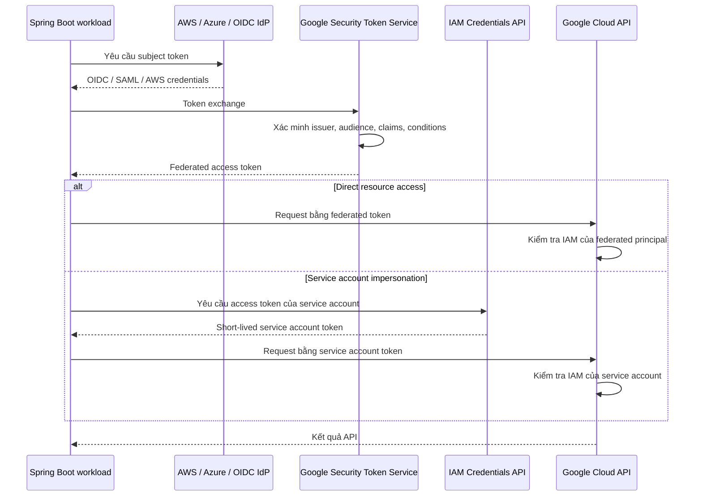

# Workload Identity Federation và danh tính ứng dụng khi triển khai

Một ứng dụng Spring Boot có thể chạy trên Cloud Run, GKE, AWS, Azure hoặc hệ thống CI/CD nhưng vẫn cần truy cập cùng một bucket, Pub/Sub topic hay Secret Manager trên Google Cloud. Nếu mỗi môi trường phải lưu một service account key JSON dài hạn, việc triển khai và xoay vòng khóa sẽ trở thành gánh nặng vận hành và làm tăng rủi ro lộ credentials.

**Workload Identity Federation (WIF)** cho phép Google Cloud tin cậy danh tính do một identity provider (IdP) bên ngoài phát hành, xác minh token đó và cấp credentials ngắn hạn cho workload. Ứng dụng Java tiếp tục dùng Application Default Credentials (ADC) và Google Cloud Client Libraries; phần xác thực thay đổi theo môi trường, còn mã nghiệp vụ hầu như không cần biết token được cấp từ đâu.

Trong mô-đun **SPRING_CLOUD_PROVIDER_INTEGRATION**, Spring Boot tích hợp với các dịch vụ managed của AWS, Azure và Google Cloud. Bài học này tập trung vào cách chọn danh tính ứng dụng khi triển khai: phân biệt WIF cho workload bên ngoài với WIF for GKE, cấu hình pool/provider, ánh xạ claims, giới hạn subject được tin cậy, chọn direct resource access hay service account impersonation và kết nối WIF với Spring Boot.

## 1. Workload Identity Federation giải quyết vấn đề gì?

Workload chạy ngoài Google Cloud vẫn có thể gọi Google Cloud APIs. Trước đây, cách phổ biến là tạo service account key JSON, lưu key trong secret store của AWS/Azure/CI rồi mount hoặc inject key vào ứng dụng. Cách này tạo ra một credential dài hạn có thể bị sao chép và sử dụng từ bất kỳ nơi nào cho đến khi bị thu hồi.

WIF thay thế key bằng một chuỗi trao đổi token:

1. Workload chứng minh danh tính với IdP mà tổ chức tin cậy, ví dụ AWS IAM, Microsoft Entra ID, GitHub OIDC hoặc Kubernetes API server.
2. Workload nhận một **subject token** ngắn hạn từ IdP.
3. Google Security Token Service (STS) xác minh token dựa trên pool/provider đã cấu hình.
4. STS cấp **federated token** cho principal bên ngoài.
5. Workload dùng token này để truy cập resource trực tiếp, hoặc đổi nó lấy access token của service account được phép impersonate.
6. Google Cloud kiểm tra IAM permission trên resource đích.



WIF không tạo quyền nghiệp vụ tự động. Pool/provider chỉ xác minh một external identity. Sau đó, principal phải được cấp role phù hợp trên resource hoặc được phép impersonate service account có role phù hợp.

## 2. Phân biệt các mô hình danh tính khi triển khai

Không phải workload nào cũng cần tạo workload identity pool. Hãy chọn cơ chế theo nơi ứng dụng chạy:

| Môi trường | Cơ chế thường dùng | Danh tính mà ứng dụng sử dụng |
| --- | --- | --- |
| Compute Engine VM | Attached service account | Service account gắn với VM qua metadata server |
| Cloud Run service/job | Attached service account | Service account gắn với revision/job |
| GKE | Workload Identity Federation for GKE | Kubernetes ServiceAccount (KSA), trực tiếp hoặc qua IAM service account |
| AWS EC2 | WIF với AWS provider | AWS role/instance profile được liên kết với Google principal |
| Azure VM | WIF với Azure provider | Managed identity hoặc Entra application |
| Amazon EKS / Azure AKS | WIF với Kubernetes OIDC provider | Kubernetes ServiceAccount token |
| GitHub Actions / GitLab / Azure DevOps | WIF với OIDC provider | Danh tính của workflow, repository, project hoặc service connection |
| On-premises | WIF với OIDC/SAML hoặc X.509 | Danh tính do IdP doanh nghiệp phát hành |

Có hai khái niệm thường bị gộp nhầm:

- **Workload Identity Federation:** cơ chế chung cho workload ngoài Google Cloud như AWS, Azure, EKS, AKS, CI/CD và IdP OIDC/SAML.
- **Workload Identity Federation for GKE:** cơ chế Google Cloud quản lý riêng cho workload chạy trong GKE. GKE tạo workload identity pool theo project, đăng ký cluster và cung cấp metadata server cho pod.

GKE không cần cấu hình external OIDC provider giống EKS/AKS. Với Cloud Run hoặc Compute Engine, attached service account thường đơn giản hơn việc tự tạo WIF pool. WIF phù hợp khi workload nằm ngoài Google Cloud hoặc khi cần danh tính KSA chi tiết trong GKE.

## 3. Các thành phần của WIF

Một cấu hình WIF bên ngoài Google Cloud có các thành phần:

| Thành phần | Vai trò | Ví dụ |
| --- | --- | --- |
| **Workload identity pool** | Không gian quản lý các external identity có thể truy cập Google Cloud | ci-production, aws-runtime |
| **Provider** | Mô tả cách Google Cloud tin cậy một IdP cụ thể | GitHub OIDC provider, AWS provider, Azure provider |
| **Issuer** | Định danh hệ thống phát hành token | https://token.actions.githubusercontent.com/ |
| **Audience** | Xác định token được phát hành cho đối tượng nào | Provider resource name hoặc audience được cấu hình |
| **Attribute mapping** | Chuyển claims từ token bên ngoài thành thuộc tính principal của Google | google.subject=assertion.sub |
| **Attribute condition** | Điều kiện CEL giới hạn identity nào được phép đi qua provider | Chỉ nhận repository production hoặc AWS role cụ thể |
| **Federated principal** | Principal đại diện external identity trong IAM | principal hoặc principalSet |
| **Credential configuration** | Tệp metadata hướng dẫn Auth Library lấy subject token và đổi token | JSON do gcloud create-cred-config tạo |

Một pool có thể chứa nhiều provider. Nên tách pool theo môi trường hoặc ranh giới tin cậy, chẳng hạn development, staging và production. Provider mô tả từng IdP; không nên dùng một điều kiện quá rộng để tất cả repository, tenant hoặc AWS account đều có thể đi vào cùng một pool.

Resource name của pool/provider có dạng:

```text
projects/PROJECT_NUMBER/locations/global/workloadIdentityPools/POOL_ID
projects/PROJECT_NUMBER/locations/global/workloadIdentityPools/POOL_ID/providers/PROVIDER_ID
```

**Lưu ý:** resource name dùng **Project number** của project chứa workload identity pool, không dùng Project ID. Khi tạo IAM principal identifier hoặc credential configuration, hãy kiểm tra đúng project number.

## 4. Token, claims và attribute mapping

External IdP phát hành token chứa các claims. Google Cloud cần biết claim nào đại diện duy nhất cho workload và claim nào dùng để giới hạn quyền.

### 4.1. google.subject là định danh chính

Attribute mapping bắt buộc phải ánh xạ google.subject. Giá trị này phải ổn định, duy nhất trong phạm vi provider và không dài quá giới hạn của Google. Ví dụ OIDC tổng quát:

```text
google.subject=assertion.sub
```

assertion.sub là claim sub trong token bên ngoài. Các IdP khác nhau có thể dùng cấu trúc subject khác nhau. Với GitHub Actions, subject có thể chứa repository và ref; với Kubernetes, subject thường có dạng system:serviceaccount:NAMESPACE:KSA_NAME.

Có thể ánh xạ thêm thuộc tính để IAM policy chọn một tập workload:

```text
google.subject=assertion.sub
attribute.repository_id=assertion.repository_id
attribute.repository_owner_id=assertion.repository_owner_id
attribute.environment=assertion.environment
```

Trong biểu thức mapping, assertion đại diện claims của token đầu vào. Các thuộc tính đích như attribute.repository_id có thể được sử dụng trong IAM principalSet hoặc trong policy condition.

### 4.2. Attribute condition giới hạn danh tính được chấp nhận

Attribute condition là biểu thức CEL. Nếu biểu thức trả về true, credential được chấp nhận; nếu trả về false, token bị từ chối.

Ví dụ giới hạn GitHub Actions theo organization, repository và branch:

```text
assertion.repository_owner_id == '12345678' &&
assertion.repository_id == '87654321' &&
assertion.ref == 'refs/heads/main'
```

Các ID ở trên chỉ là dữ liệu minh họa. Khi triển khai, lấy claim thực tế từ IdP và xác minh giá trị, kiểu dữ liệu cũng như quy tắc phát hành token.

Đối với GitHub/GitLab/HCP Terraform, issuer URL có thể được dùng chung cho nhiều organization. Vì vậy, cần có condition giới hạn organization/group cụ thể. Với GitHub, nên dùng repository_id và repository_owner_id dạng số thay vì chỉ dựa vào tên repository/owner có thể được tái sử dụng sau khi xóa.

Không nên chỉ giới hạn quyền ở IAM binding mà bỏ trống điều kiện admission của provider. Điều kiện ở provider giúp từ chối sớm token không thuộc workload được tin cậy.

### 4.3. Audience và issuer phải khớp

- **Issuer** phải trùng issuer URL mà IdP công bố.
- **Audience** phải khớp giá trị provider mong đợi và giá trị token thực tế.
- **Subject/claims** phải có cấu trúc mà mapping sử dụng.
- **Attribute condition** phải kiểm tra đúng claim đã được IdP ký.

Nếu audience không khớp, STS có thể từ chối token dù chữ ký hợp lệ. Nếu issuer trỏ nhầm tenant hoặc endpoint, Google Cloud có thể xác minh một danh tính không thuộc môi trường dự kiến.

## 5. Direct resource access và service account impersonation

Sau khi STS cấp federated token, workload có hai cách nhận quyền truy cập Google Cloud.

| Tiêu chí | Direct resource access | Service account impersonation |
| --- | --- | --- |
| Principal được cấp IAM role | Federated principal từ pool | Service account đích |
| Tài nguyên trung gian | Không cần service account | Cần service account đại diện workload |
| IAM binding | Gắn role cho principal hoặc principalSet trên resource | Gắn roles/iam.workloadIdentityUser trên service account; cấp role dữ liệu cho service account |
| Ưu điểm | Ít lớp trung gian, quyền gắn trực tiếp với external identity | Dễ dùng với hệ sinh thái đã chuẩn hóa quanh service account |
| Giới hạn | Không phải mọi resource/API đều hỗ trợ federated principal | Cần quản lý service account và quyền impersonation |
| Phù hợp | Resource hỗ trợ IAM principal federation và cần quyền trực tiếp | API/client cần service account identity hoặc cần chuẩn hóa quyền qua SA |

**Direct resource access** nên được ưu tiên khi resource và API hỗ trợ. Nếu dịch vụ có giới hạn với federated identity hoặc ứng dụng cần token của service account, dùng impersonation.

Trong mô hình impersonation, external principal cần roles/iam.workloadIdentityUser trên service account đích. Service account sau đó nhận các role nghiệp vụ như Storage Object Creator, Pub/Sub Publisher hoặc Secret Accessor trên resource. Không cấp role dữ liệu cho pool nếu ứng dụng thực tế dùng service account impersonation; cũng không cấp role rộng cho service account chỉ để tránh lỗi.

## 6. Quy trình cấu hình WIF tổng quát cho OIDC

Ví dụ này dùng GitHub Actions làm IdP. Các bước tương tự áp dụng cho OIDC provider khác, nhưng issuer, audience, claims và điều kiện phải theo tài liệu của từng IdP.

### Bước 1 — Chuẩn bị project và API

Chọn project quản lý pool/provider. Google khuyến nghị dùng project riêng hoặc project quản trị identity để quản lý workload identity pools.

Các API thường cần cho luồng WIF gồm IAM, Resource Manager, Security Token Service và IAM Service Account Credentials. API IAM Credentials cần thiết khi dùng service account impersonation.

```bash
PROJECT_ID="identity-platform-prod"

gcloud services enable \
  iam.googleapis.com \
  cloudresourcemanager.googleapis.com \
  sts.googleapis.com \
  iamcredentials.googleapis.com \
  --project="$PROJECT_ID"
```

Người thực hiện cần quyền enable API và quyền quản trị workload identity pool/provider. Không cấp các quyền bootstrap này cho runtime workload.

### Bước 2 — Tạo workload identity pool

```bash
POOL_ID="github-production"

gcloud iam workload-identity-pools create "$POOL_ID" \
  --location="global" \
  --display-name="GitHub production workloads" \
  --description="Federated identities for approved production workflows" \
  --project="$PROJECT_ID"
```

Pool ID là định danh ổn định, không nên đặt tên theo một lần chạy CI. Tách pool theo môi trường giúp thu hồi và rà soát trust policy độc lập.

### Bước 3 — Tạo OIDC provider

Ví dụ mapping claims của GitHub:

```bash
PROVIDER_ID="github-orders-api"

gcloud iam workload-identity-pools providers create-oidc "$PROVIDER_ID" \
  --location="global" \
  --workload-identity-pool="$POOL_ID" \
  --display-name="GitHub Orders API" \
  --issuer-uri="https://token.actions.githubusercontent.com/" \
  --attribute-mapping="google.subject=assertion.sub,attribute.repository_id=assertion.repository_id,attribute.repository_owner_id=assertion.repository_owner_id" \
  --attribute-condition="assertion.repository_owner_id == '12345678' && assertion.repository_id == '87654321' && assertion.ref == 'refs/heads/main'" \
  --project="$PROJECT_ID"
```

Thay các ID minh họa bằng ID thực tế. Nếu IdP không phát hành claim ref, không dùng biểu thức đó; hãy chọn claim có thật và có ý nghĩa tương đương trong token của provider.

Với OIDC provider riêng, thay issuer URL, mapping và condition theo claims của IdP. Với AWS provider, sử dụng loại provider AWS tương ứng thay vì tạo OIDC provider chung; Google Cloud xác minh AWS identity thông qua cơ chế AWS được hỗ trợ.

### Bước 4 — Lấy resource name của provider

```bash
gcloud iam workload-identity-pools providers describe "$PROVIDER_ID" \
  --location="global" \
  --workload-identity-pool="$POOL_ID" \
  --project="$PROJECT_ID" \
  --format="value(name)"
```

Giá trị trả về có dạng:

```text
projects/123456789012/locations/global/workloadIdentityPools/github-production/providers/github-orders-api
```

Đây là provider resource name dùng trong IAM member, credential configuration và CI workflow. Sử dụng project number trong chuỗi này.

### Bước 5 — Chọn direct access hoặc impersonation

Nếu chọn direct access, cấp IAM role trực tiếp cho principalSet trên resource hỗ trợ. Ví dụ quyền đọc object trong một bucket:

```bash
PROJECT_NUMBER="123456789012"
POOL_ID="github-production"
REPOSITORY_ID="87654321"

gcloud storage buckets add-iam-policy-binding gs://orders-artifacts-prod \
  --member="principalSet://iam.googleapis.com/projects/$PROJECT_NUMBER/locations/global/workloadIdentityPools/$POOL_ID/attribute.repository_id/$REPOSITORY_ID" \
  --role="roles/storage.objectViewer"
```

Nếu chọn service account impersonation, cấp quyền Workload Identity User cho external principal trên service account đích:

```bash
SA="orders-api@provider-integration-prod.iam.gserviceaccount.com"

gcloud iam service-accounts add-iam-policy-binding "$SA" \
  --member="principalSet://iam.googleapis.com/projects/$PROJECT_NUMBER/locations/global/workloadIdentityPools/$POOL_ID/attribute.repository_id/$REPOSITORY_ID" \
  --role="roles/iam.workloadIdentityUser" \
  --project="provider-integration-prod"
```

Sau đó cấp quyền nghiệp vụ cho service account trên bucket/topic/secret cần sử dụng. Ví dụ:

```bash
gcloud storage buckets add-iam-policy-binding gs://orders-artifacts-prod \
  --member="serviceAccount:$SA" \
  --role="roles/storage.objectCreator"
```

Không dùng roles/iam.serviceAccountTokenCreator thay cho roles/iam.workloadIdentityUser trong binding WIF thông thường. Hai role có mục đích khác nhau; cấu hình theo đúng hướng dẫn federation của Google Cloud.

### Bước 6 — Tạo credential configuration file

Credential configuration file mô tả provider và cách Auth Library lấy external subject token. Với service account impersonation:

```bash
gcloud iam workload-identity-pools create-cred-config \
  "projects/$PROJECT_NUMBER/locations/global/workloadIdentityPools/$POOL_ID/providers/$PROVIDER_ID" \
  --service-account="$SA" \
  --output-file="wif-credential-config.json"
```

Với direct resource access, bỏ cờ --service-account. Tệp cấu hình này không chứa private key của Google service account. Tuy nhiên, token source mà file tham chiếu vẫn phải được bảo vệ và phải trỏ tới đúng IdP/token endpoint.

Không tự viết credential JSON từ đầu nếu có thể dùng lệnh create-cred-config để sinh file. Không sử dụng credential configuration từ nguồn không tin cậy nếu chưa xác minh các endpoint như token URL, token info URL và service account impersonation URL.

## 7. Kết nối WIF với GitHub Actions

GitHub Actions có thể cấp OIDC ID token cho job. Workflow cần quyền id-token: write; không cần lưu Google service account key trong GitHub Secrets.

Ví dụ dùng action chính thức để xác thực trực tiếp bằng WIF:

```yaml
name: Build and deploy

on:
  push:
    branches:
      - main

jobs:
  deploy:
    runs-on: ubuntu-latest
    permissions:
      contents: read
      id-token: write

    steps:
      - uses: actions/checkout@v7

      - id: auth
        uses: google-github-actions/auth@v3
        with:
          project_id: provider-integration-prod
          workload_identity_provider: projects/123456789012/locations/global/workloadIdentityPools/github-production/providers/github-orders-api

      - name: Build
        run: ./gradlew clean build

      - name: Deploy
        run: gcloud run deploy orders-api --project=provider-integration-prod
```

Nếu dùng service account impersonation, thêm service_account vào cấu hình action và cấp roles/iam.workloadIdentityUser cho principalSet trên service account. Khi đó, các lệnh phía sau sử dụng danh tính service account.

Một số lưu ý:

- Giữ id-token: write ở đúng job cần xác thực.
- Giới hạn provider condition theo organization, repository và branch/environment được phép.
- Dùng repository ID và owner ID dạng số để tránh rủi ro tên repository được tái sử dụng.
- Chỉ cấp quyền triển khai cần thiết cho deployer identity.
- File credentials do action tạo ra là file tạm của job; thêm mẫu gha-creds-*.json vào .gitignore và .dockerignore để tránh đưa file này vào source hoặc image.
- Dùng gcloud storage thay cho gsutil trong workflow sử dụng credentials do action cung cấp.

**Lưu ý kiến trúc:** danh tính GitHub Actions là danh tính của pipeline. Nó dùng để build/deploy và thao tác với Google Cloud trong job. Ứng dụng Spring Boot sau khi chạy trên Cloud Run hoặc GKE cần danh tính runtime riêng; không dùng credentials của pipeline làm danh tính lâu dài cho ứng dụng.

## 8. WIF cho AWS và Azure VM

### 8.1. AWS EC2

AWS workload có thể dùng temporary credentials từ IAM role/instance profile. Google Cloud xác minh caller thông qua AWS mechanism và STS token exchange. Không cần tạo service account key JSON.

Google Cloud hỗ trợ hai cách liên kết AWS: dùng AWS IAM credentials và gọi GetCallerIdentity để xác minh caller, hoặc dùng AWS outbound identity federation khi AWS phát hành OIDC token. Với EC2 instance profile, provider AWS là lựa chọn phổ biến; cần chỉ định AWS account ID và mapping claims từ kết quả GetCallerIdentity.

Ví dụ tạo provider AWS trong pool:

```bash
AWS_ACCOUNT_ID="123456789012"
AWS_PROVIDER_ID="aws-ec2"

gcloud iam workload-identity-pools providers create-aws "$AWS_PROVIDER_ID" \
  --location="global" \
  --workload-identity-pool="aws-production" \
  --account-id="$AWS_ACCOUNT_ID" \
  --attribute-mapping="google.subject=assertion.arn,attribute.account=assertion.account,attribute.aws_role=assertion.arn.extract('assumed-role/{role_name}/')" \
  --attribute-condition="assertion.arn.startsWith('arn:aws:sts::123456789012:assumed-role/orders-api/')"
```

Condition minh họa giới hạn role được phép; thay account ID và role name bằng giá trị thực tế. Nếu cần phân biệt từng EC2 instance, có thể ánh xạ thêm instance ID theo hướng dẫn AWS provider. Không chỉ dựa vào account ID nếu nhiều role trong account có quyền khác nhau.

Quy trình khái quát:

1. Tạo AWS provider trong workload identity pool.
2. Trust đúng AWS account và role cần sử dụng.
3. Gắn IAM role phù hợp cho EC2 instance.
4. Cấp direct resource access hoặc quyền impersonate service account.
5. Sinh credential configuration cho AWS.
6. Đặt GOOGLE_APPLICATION_CREDENTIALS trỏ tới file cấu hình.
7. Chạy Spring Boot bằng ADC.

Ví dụ sinh cấu hình AWS khi dùng service account impersonation:

```bash
gcloud iam workload-identity-pools create-cred-config \
  "projects/123456789012/locations/global/workloadIdentityPools/aws-production/providers/aws-ec2" \
  --service-account="orders-api@provider-integration-prod.iam.gserviceaccount.com" \
  --aws \
  --output-file="/etc/google-cloud/aws-wif.json" \
  --enable-imdsv2
```

Cờ --enable-imdsv2 cần thiết khi EC2 sử dụng IMDSv2. Hãy kiểm tra cấu hình metadata service của EC2 và tài liệu Google Auth Library trước khi triển khai.

### 8.2. Azure VM

Azure workload có thể sử dụng managed identity hoặc Entra application theo cấu hình federation. Google Cloud xác minh external identity rồi cấp token ngắn hạn.

Với Azure, tạo Microsoft Entra application, cấu hình Application ID URI và cấp quyền để managed identity hoặc service principal được yêu cầu token cho application đó. Provider của Google là OIDC provider; issuer thường có dạng tenant-specific STS URL.

Ví dụ tạo provider:

```bash
TENANT_ID="00000000-1111-2222-3333-444444444444"
APPLICATION_ID_URI="api://orders-api"
AZURE_PROVIDER_ID="azure-vm"

gcloud iam workload-identity-pools providers create-oidc "$AZURE_PROVIDER_ID" \
  --location="global" \
  --workload-identity-pool="azure-production" \
  --issuer-uri="https://sts.windows.net/$TENANT_ID" \
  --allowed-audiences="$APPLICATION_ID_URI" \
  --attribute-mapping="google.subject=assertion.sub" \
  --attribute-condition="assertion.sub == 'MANAGED_IDENTITY_OBJECT_ID'"
```

Với managed identity, claim sub trong access token chứa Object ID của identity. Condition minh họa giới hạn một managed identity; thay Object ID bằng giá trị thực tế. Có thể dùng app role assignment trong Microsoft Entra ID để giới hạn ai được yêu cầu token cho application. Hãy kiểm tra token claims thực tế trước khi chốt mapping/condition.

Ví dụ sinh credential configuration:

```bash
gcloud iam workload-identity-pools create-cred-config \
  "projects/123456789012/locations/global/workloadIdentityPools/azure-production/providers/azure-vm" \
  --service-account="orders-api@provider-integration-prod.iam.gserviceaccount.com" \
  --azure \
  --output-file="/etc/google-cloud/azure-wif.json"
```

Trust policy phải giới hạn tenant, application hoặc managed identity được phép. Không dùng một provider Azure chung cho mọi workload trong tenant nếu các workload cần quyền khác nhau.

### 8.3. Cấu hình ADC trên AWS/Azure

Đặt biến môi trường trong container hoặc service definition:

```bash
export GOOGLE_APPLICATION_CREDENTIALS="/etc/google-cloud/wif-credential-config.json"
export GOOGLE_CLOUD_PROJECT="provider-integration-prod"
```

Java Auth Library đọc credential configuration, lấy external subject token từ AWS/Azure, trao đổi token với Google STS và refresh credentials theo vòng đời được hỗ trợ. Ứng dụng tiếp tục dùng Google Cloud Client Libraries như khi chạy trên Google Cloud.

Không copy AWS access key hoặc Azure client secret vào credential configuration. WIF nên lấy temporary credential/managed identity từ runtime theo cơ chế của provider.

## 9. WIF cho EKS, AKS và Kubernetes tự quản lý

EKS, AKS và Kubernetes tự quản lý có thể cấp Kubernetes ServiceAccount token thông qua projected volume. Google Cloud xác minh token dựa trên OIDC issuer/JWKS của cluster.

| Nền tảng | Điều kiện cần |
| --- | --- |
| Amazon EKS | Lấy OIDC issuer URL từ cluster; cấu hình provider trong pool |
| Azure AKS | Bật OIDC issuer để Google Cloud đọc metadata/JWKS của cluster |
| Kubernetes tự quản lý | Kubernetes 1.20+ và hỗ trợ projected ServiceAccount token volume |
| GKE | Dùng WIF for GKE được quản lý bởi Google Cloud, không tạo external provider theo quy trình này |

Quy trình cho EKS/AKS/self-managed Kubernetes:

1. Lấy OIDC issuer URL và xác định audience.
2. Tạo workload identity pool.
3. Tạo OIDC provider với issuer URL, mapping google.subject và condition giới hạn namespace/service account.
4. Cấp quyền trực tiếp cho federated principal hoặc liên kết KSA tới service account.
5. Sinh credential configuration file với --credential-source-file trỏ tới projected token.
6. Mount projected token volume và credential configuration vào pod.
7. Đặt GOOGLE_APPLICATION_CREDENTIALS trỏ tới credential configuration file.
8. Dùng Google Cloud Client Libraries qua ADC.

Ví dụ mapping cho Kubernetes ServiceAccount token:

```text
google.subject=assertion.sub
attribute.namespace=assertion['kubernetes.io']['namespace']
attribute.service_account_name=assertion['kubernetes.io']['serviceaccount']['name']
```

Condition có thể giới hạn namespace:

```text
assertion['kubernetes.io']['namespace'] == 'orders'
&& assertion['kubernetes.io']['serviceaccount']['name'] == 'orders-api'
```

Credential configuration có thể được tạo như sau:

```bash
gcloud iam workload-identity-pools create-cred-config \
  "projects/123456789012/locations/global/workloadIdentityPools/kubernetes-prod/providers/eks-orders" \
  --service-account="orders-api@provider-integration-prod.iam.gserviceaccount.com" \
  --credential-source-file="/var/run/service-account/token" \
  --credential-source-type="text" \
  --output-file="credential-configuration.json"
```

Nếu dùng direct resource access, bỏ --service-account. Pod cần mount cả projected token và credential configuration. Credential configuration có thể đặt trong ConfigMap; projected token phải được cấp qua volume với audience khớp provider.

Không đặt token thật vào ConfigMap hoặc Git. Kubernetes tự cấp token ngắn hạn vào projected volume và refresh theo cấu hình của volume.

## 10. Workload Identity Federation for GKE

GKE có mô hình riêng. Khi bật WIF for GKE, Google Cloud tạo workload identity pool theo project với tên:

```text
PROJECT_ID.svc.id.goog
```

GKE đăng ký cluster vào pool và triển khai GKE metadata server trên node pool. Khi ứng dụng yêu cầu ADC, metadata server lấy Kubernetes ServiceAccount token của pod, đổi token qua STS và trả federated access token.

### 10.1. Autopilot và Standard

- **Autopilot:** WIF for GKE luôn được bật.
- **Standard:** cần bật workload pool ở cấp cluster và cấu hình node pool dùng GKE metadata server.

Ví dụ bật trên cluster Standard hiện có:

```bash
gcloud container clusters update CLUSTER_NAME \
  --location=CONTROL_PLANE_LOCATION \
  --workload-pool=PROJECT_ID.svc.id.goog
```

Node pool mới có thể được tạo với:

```bash
gcloud container node-pools create orders-pool \
  --cluster=CLUSTER_NAME \
  --location=CONTROL_PLANE_LOCATION \
  --workload-metadata=GKE_METADATA
```

Việc cập nhật node pool hiện có có thể ảnh hưởng workload đang chạy vì pod chuyển sang dùng GKE metadata server. Hãy lập kế hoạch rollout và kiểm thử workload trước khi thay đổi node pool production.

### 10.2. Direct access từ KSA

WIF for GKE cho phép cấp IAM role trực tiếp cho KSA principal. Ví dụ principal identifier:

```text
principal://iam.googleapis.com/projects/PROJECT_NUMBER/locations/global/workloadIdentityPools/PROJECT_ID.svc.id.goog/subject/ns/orders/sa/orders-api
```

Cấp quyền đọc object trên bucket:

```bash
gcloud storage buckets add-iam-policy-binding gs://orders-artifacts-prod \
  --member="principal://iam.googleapis.com/projects/123456789012/locations/global/workloadIdentityPools/provider-integration-prod.svc.id.goog/subject/ns/orders/sa/orders-api" \
  --role="roles/storage.objectViewer"
```

Ứng dụng trong pod sử dụng KSA orders-api thuộc namespace orders. Google Auth Library lấy credentials từ metadata server; không cần GOOGLE_APPLICATION_CREDENTIALS trỏ tới service account key.

Direct access là lựa chọn nên thử trước khi dùng GSA impersonation. Kiểm tra danh sách sản phẩm/API hỗ trợ federated principal vì một số API method có giới hạn.

### 10.3. Liên kết KSA với IAM service account

Nếu ứng dụng cần IAM service account identity, có thể liên kết KSA với GSA và cấp Workload Identity User trên GSA.

Tạo KSA:

```bash
kubectl create namespace orders
kubectl create serviceaccount orders-api --namespace orders
```

Cấp quyền impersonate cho KSA principal trên GSA:

```bash
gcloud iam service-accounts add-iam-policy-binding \
  orders-api@provider-integration-prod.iam.gserviceaccount.com \
  --member="principal://iam.googleapis.com/projects/123456789012/locations/global/workloadIdentityPools/provider-integration-prod.svc.id.goog/subject/ns/orders/sa/orders-api" \
  --role="roles/iam.workloadIdentityUser"
```

Sau đó cấp role nghiệp vụ cho GSA trên bucket/topic/secret. Pod dùng KSA đã khai báo trong Deployment:

```yaml
apiVersion: apps/v1
kind: Deployment
metadata:
  name: orders-api
  namespace: orders
spec:
  replicas: 2
  selector:
    matchLabels:
      app: orders-api
  template:
    metadata:
      labels:
        app: orders-api
    spec:
      serviceAccountName: orders-api
      containers:
        - name: orders-api
          image: REGION-docker.pkg.dev/PROJECT_ID/apps/orders-api:VERSION
```

Không thêm annotation legacy nếu đang theo mô hình principal-based WIF for GKE hiện hành; làm theo đúng hướng dẫn của cluster version và kiểu binding đã chọn. Không dùng default KSA cho ứng dụng có quyền nhạy cảm.

## 11. Spring Boot và Google Auth Library sử dụng WIF

WIF không yêu cầu ứng dụng viết lại code gọi Google Cloud. Với Google Cloud Client Libraries, ADC được tìm tự động. Spring Framework on Google Cloud Core starter cũng mặc định dùng CredentialsProvider dựa trên ADC.

Khi chạy ngoài Google Cloud, đặt GOOGLE_APPLICATION_CREDENTIALS tới credential configuration file do gcloud create-cred-config tạo. Khi chạy trên GKE với WIF for GKE hoặc trên Cloud Run/GCE với attached identity, SDK dùng nguồn credentials tương ứng của runtime.

### 11.1. Java Cloud Client Libraries

Ví dụ tạo Cloud Storage client mà không truyền private key:

```java
import com.google.cloud.storage.Storage;
import com.google.cloud.storage.StorageOptions;

public class StorageClientFactory {

    public Storage create(String projectId) {
        return StorageOptions.newBuilder()
                .setProjectId(projectId)
                // Client Library tự lấy Application Default Credentials.
                .build()
                .getService();
    }
}
```

Khi chạy trên AWS/Azure với WIF, ADC đọc external account credential configuration. Khi chạy trên GKE, ADC lấy token từ GKE metadata server. Cùng đoạn code có thể dùng trong các môi trường nếu cấu hình identity và quyền IAM đã đúng.

### 11.2. Spring Boot configuration

Ví dụ cấu hình:

```yaml
spring:
  application:
    name: orders-api
  cloud:
    gcp:
      project-id: ${GOOGLE_CLOUD_PROJECT}

app:
  storage:
    bucket: ${ORDERS_BUCKET}
  messaging:
    topic: ${ORDERS_TOPIC}
```

spring.cloud.gcp.project-id xác định project mặc định cho tích hợp Spring. Nó không chọn external identity và không cấp IAM role. Danh tính đến từ ADC/runtime; resource project có thể khác project mặc định nếu resource name và IAM cho phép.

Nếu dùng WIF credential configuration bên ngoài Google Cloud:

```bash
export GOOGLE_APPLICATION_CREDENTIALS="/etc/google-cloud/wif-credential-config.json"
```

Không đặt spring.cloud.gcp.credentials.location hoặc encoded-key tới service account key nếu đang dùng ADC/WIF. Các property credentials tường minh có thể khiến Spring Core dùng nguồn credentials khác với nguồn WIF dự kiến; kiểm tra cấu hình thực tế của release line.

### 11.3. Phiên bản Google Auth Library cần hỗ trợ WIF

Google Cloud Java Client Libraries hỗ trợ WIF khi dependency com.google.auth:google-auth-library-oauth2-http ở phiên bản **0.24.0 trở lên** theo tài liệu hỗ trợ Java.

Kiểm tra dependency thực tế:

```bash
mvn dependency:list \
  -DincludeArtifactIds=google-auth-library-oauth2-http
```

Hoặc:

```bash
./gradlew dependencyInsight \
  --dependency google-auth-library-oauth2-http \
  --configuration runtimeClasspath
```

Với Spring Framework on Google Cloud, hãy chọn BOM tương thích với Spring Boot trước. Không tự ép version auth library một cách tùy tiện vì nó có thể gây xung đột với Google Cloud Client Libraries và Spring starter. Nếu version được kéo về thấp hơn mức hỗ trợ, kiểm tra lại BOM/release line và dependency graph.

### 11.4. Không tự parse token trong code nghiệp vụ

Ứng dụng không cần đọc projected token, gọi STS thủ công hoặc tự refresh access token nếu Google Auth Library đã hỗ trợ credential configuration/runtime. Hãy để ADC và client library quản lý token exchange/refresh.

Chỉ tích hợp token exchange thủ công khi có yêu cầu giao thức đặc biệt và đội ngũ chịu trách nhiệm rõ ràng cho việc refresh, audience, token expiry và error handling. Không lưu access token trong static field hoặc database.

## 12. Cấu hình quyền và ranh giới bảo mật

WIF tách hai loại quyền:

1. **Quyền được phép đi vào pool/provider:** issuer, audience, attribute mapping và condition xác định identity nào được chấp nhận.
2. **Quyền truy cập resource:** IAM policy xác định principal được đọc/ghi resource nào hoặc được impersonate service account nào.

Một provider condition quá rộng có thể chấp nhận nhiều token hơn dự kiến. Một IAM binding quá rộng có thể cho principal hợp lệ quyền vượt quá nghiệp vụ. Cần review cả hai lớp.

### Nguyên tắc cấu hình

- Tách pool theo môi trường và ranh giới tin cậy.
- Chỉ trust issuer chính thức và audience được xác định rõ.
- Ánh xạ subject duy nhất, ổn định.
- Giới hạn organization/account/repository/branch/namespace/service account bằng attribute condition.
- Ưu tiên ID số bất biến thay cho tên có thể được tái sử dụng.
- Cấp role ở resource scope nhỏ nhất mà dịch vụ hỗ trợ.
- Chỉ cấp roles/iam.workloadIdentityUser trên service account cần impersonate.
- Tách service account theo workload và môi trường.
- Kiểm tra audit log và danh tính thực tế sau token exchange.
- Không lưu external subject token trong image, source control hoặc log.

### Credential configuration không phải service account key

Credential configuration file mô tả cách lấy external credentials, pool/provider, token endpoint và service account impersonation nếu có. Nó không chứa private key dài hạn của Google service account.

Tuy nhiên:

- File token source hoặc token cache có thể chứa subject token còn hiệu lực.
- Endpoint/token source có thể bị thay đổi nếu file cấu hình bị sửa.
- Không dùng file JSON do bên thứ ba cung cấp mà chưa kiểm tra issuer, audience và URL.
- Tạo file bằng Google Cloud CLI hoặc tải từ Console theo đúng provider.
- Không commit credential file hoặc token vào repository dù credential configuration không phải private key.

## 13. Chẩn đoán WIF và lỗi thường gặp

| Triệu chứng | Nguyên nhân thường gặp | Cách kiểm tra |
| --- | --- | --- |
| invalid_grant hoặc token exchange thất bại | Issuer, audience, chữ ký hoặc thời gian token không hợp lệ | Kiểm tra IdP issuer, JWKS, audience và clock skew |
| invalid_target | Provider resource name hoặc audience không khớp | Kiểm tra full provider resource name và audience |
| unauthorized_client | Attribute condition từ chối token hoặc subject không được trust | Kiểm tra claims thực tế, mapping và CEL condition |
| Không tìm thấy credentials trong Java | Thiếu GOOGLE_APPLICATION_CREDENTIALS hoặc file không mount | Kiểm tra environment của chính tiến trình và file path |
| WIF xác thực thành công nhưng API trả 403 | Federated principal/service account thiếu IAM role | Xác định principal và resource IAM policy |
| Impersonation bị từ chối | Thiếu roles/iam.workloadIdentityUser trên service account đích | Kiểm tra IAM policy của chính service account |
| Direct access không hoạt động với một API | API/resource method chưa hỗ trợ federated principal | Kiểm tra danh sách supported products; cân nhắc SA impersonation |
| AWS EC2 không lấy được subject token | Instance profile/IMDS hoặc IMDSv2 config sai | Kiểm tra IAM role trên EC2 và --enable-imdsv2 |
| Azure VM không lấy được token | Managed identity hoặc Entra application chưa được cấu hình trust | Kiểm tra tenant, application, issuer và subject |
| EKS/AKS bị từ chối | OIDC issuer, projected token audience hoặc JWKS sai | Kiểm tra cluster issuer, audience, token projection và provider |
| GKE pod dùng node identity | Node pool chưa dùng GKE metadata server hoặc pod không dùng KSA mong muốn | Kiểm tra cluster workload pool, node pool và serviceAccountName |
| GitHub workflow ngoài main vẫn được xác thực | Attribute condition chỉ giới hạn organization hoặc repo | Thêm điều kiện repository ID, ref/branch hoặc environment |
| Spring Boot dùng danh tính khác | GOOGLE_APPLICATION_CREDENTIALS hoặc credentials property ghi đè nguồn dự kiến | Kiểm tra env của process và spring.cloud.gcp.credentials.* |
| WIF hoạt động sau vài phút mới ổn định | Pool/provider/IAM policy chưa propagate | Đợi propagation và kiểm tra lại policy trước khi thay đổi rộng |

Không xử lý lỗi WIF bằng cách bỏ attribute condition hoặc cấp Owner cho external principal. Xác định lớp đang từ chối: provider validation, token exchange, impersonation hay resource IAM.

## 14. Bài thực hành: triển khai Orders API với WIF

Mục tiêu: GitHub Actions triển khai ứng dụng Spring Boot lên Cloud Run, còn runtime Orders API dùng service account riêng để ghi hóa đơn và publish sự kiện.

### Bước 1 — Chuẩn bị hai danh tính riêng

- orders-api-runtime: service account runtime của Cloud Run.
- github-deployer: service account hoặc federated principal dành cho pipeline.

Runtime identity chỉ có quyền nghiệp vụ. Deployer identity chỉ có quyền deploy và attach runtime service account theo phạm vi cần thiết.

### Bước 2 — Tạo pool/provider cho GitHub

- Tạo pool github-production.
- Tạo OIDC provider với issuer GitHub.
- Mapping google.subject, repository_id, repository_owner_id.
- Condition giới hạn organization, repository và branch main.
- Lấy full provider resource name bằng lệnh gcloud providers describe.

### Bước 3 — Cấp quyền cho pipeline

Nếu pipeline impersonate github-deployer, cấp roles/iam.workloadIdentityUser cho principalSet trên service account đó. Sau đó cấp quyền deploy Cloud Run và quyền iam.serviceAccounts.actAs trên orders-api-runtime theo yêu cầu triển khai.

Không cấp Storage Object Creator hoặc Pub/Sub Publisher cho deployer nếu pipeline không cần thao tác dữ liệu.

### Bước 4 — Cấp quyền runtime

Cấp cho orders-api-runtime:

- roles/storage.objectCreator trên bucket hóa đơn.
- roles/pubsub.publisher trên topic đơn hàng.
- Các quyền Secret Manager hoặc Cloud SQL nếu ứng dụng thực sự dùng.

Không cấp quyền quản trị project cho runtime service account.

### Bước 5 — Cấu hình workflow

- Cho job quyền id-token: write.
- Dùng google-github-actions/auth@v3.
- Khai báo workload_identity_provider.
- Khai báo service_account nếu dùng impersonation.
- Build image và deploy Cloud Run bằng deployer identity.
- Gắn orders-api-runtime vào Cloud Run revision.

### Bước 6 — Cấu hình Spring Boot runtime

Ứng dụng dùng:

```yaml
spring:
  cloud:
    gcp:
      project-id: provider-integration-prod

app:
  storage:
    bucket: orders-invoices-prod
  messaging:
    topic: orders-created
```

Không đưa credential file của GitHub runner vào image. Cloud Run sử dụng attached service account orders-api-runtime qua ADC/metadata server.

### Bước 7 — Xác minh

- Kiểm tra Cloud Run revision gắn đúng service account.
- Ghi một object test vào bucket.
- Publish một message test lên topic.
- Kiểm tra Cloud Audit Logs để xác nhận principal runtime.
- Thử deploy từ branch không được phép và xác nhận provider condition từ chối.
- Thử principal runtime không có quyền trên resource khác và xác nhận bị từ chối.

### Kết quả cần ghi nhận

| Hạng mục | Kết quả mong đợi |
| --- | --- |
| GitHub identity | Chỉ workflow thuộc repository/branch đã trust được chấp nhận |
| Pipeline identity | Chỉ có quyền triển khai và attach runtime identity |
| Cloud Run runtime identity | orders-api-runtime |
| ADC trong Spring Boot | Tự nhận attached service account |
| Resource IAM | Chỉ có quyền ghi bucket và publish topic đã chỉ định |
| Secret/token | Không có service account private key trong repository/image |
| Audit | Có thể xác định principal thực hiện request |

## 15. Ghi nhớ

- WIF cho phép workload ngoài Google Cloud dùng external identity để lấy credentials ngắn hạn, giảm nhu cầu service account key.
- Workload identity pool quản lý external identities; provider mô tả issuer/IdP; mapping và condition xác định principal nào được chấp nhận.
- google.subject phải được ánh xạ; attribute condition nên giới hạn organization, account, repository, branch, namespace hoặc service account cụ thể.
- Project number được dùng trong resource name của pool/provider và IAM principal identifier.
- Direct resource access cấp IAM role cho federated principal; service account impersonation cấp roles/iam.workloadIdentityUser trên service account rồi cấp quyền dữ liệu cho service account.
- AWS EC2, Azure VM, EKS, AKS và CI/CD có thể dùng WIF; GKE có WIF for GKE được Google Cloud quản lý riêng.
- Với GKE, Autopilot đã bật WIF; Standard cần cấu hình cluster và node pool. Direct KSA access được ưu tiên khi API hỗ trợ.
- Google Cloud Java Client Libraries dùng ADC; WIF được hỗ trợ khi google-auth-library-oauth2-http từ 0.24.0 trở lên theo tài liệu Java.
- Spring Framework on Google Cloud Core starter dùng CredentialsProvider dựa trên ADC; GOOGLE_APPLICATION_CREDENTIALS trỏ tới credential configuration khi workload bên ngoài cần file cấu hình.
- Credential configuration không chứa private key nhưng vẫn cần được sinh từ nguồn tin cậy; external subject token phải được bảo vệ.
- Danh tính pipeline và danh tính runtime của Spring Boot là hai identity riêng. Cấp quyền theo đúng nhiệm vụ, kiểm tra audit log và không nới trust condition chỉ để làm cho pipeline chạy qua.

## Tài liệu tham khảo chính thức

1. [Workload Identity Federation — khái niệm, pool/provider, attribute mapping và direct access](https://docs.cloud.google.com/iam/docs/workload-identity-federation)
2. [Configure Workload Identity Federation with AWS or Azure VMs](https://docs.cloud.google.com/iam/docs/workload-identity-federation-with-other-clouds)
3. [Configure Workload Identity Federation with other identity providers](https://docs.cloud.google.com/iam/docs/workload-identity-federation-with-other-providers)
4. [Configure Workload Identity Federation with deployment pipelines](https://docs.cloud.google.com/iam/docs/workload-identity-federation-with-deployment-pipelines)
5. [Configure Workload Identity Federation with Kubernetes — EKS, AKS và self-managed Kubernetes](https://docs.cloud.google.com/iam/docs/workload-identity-federation-with-kubernetes)
6. [About Workload Identity Federation for GKE](https://docs.cloud.google.com/kubernetes-engine/docs/concepts/workload-identity)
7. [Authenticate to Google Cloud APIs from GKE workloads](https://docs.cloud.google.com/kubernetes-engine/docs/how-to/workload-identity)
8. [Get started with Google Auth Library for Java — WIF và ADC](https://docs.cloud.google.com/java/getting-started/getting-started-with-google-auth-library)
9. [Authenticate to Google Cloud from GitHub Actions](https://github.com/google-github-actions/auth)
10. [Google Cloud IAM — Best practices for workload identity](https://docs.cloud.google.com/iam/docs/best-practices-for-using-workload-identity-federation)

Các lệnh và ví dụ trong bài dùng giá trị minh họa. Khi triển khai, kiểm tra claims thực tế của IdP, phiên bản Google Auth Library, API support matrix và policy của organization trước khi cấp quyền cho workload production.
