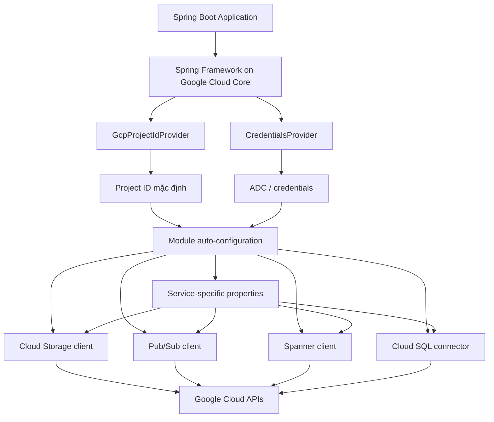

# Tùy chỉnh client, credentials provider và project ID theo dịch vụ

Một ứng dụng Spring Boot có thể gọi nhiều dịch vụ Google Cloud cùng lúc: Cloud Storage để lưu tệp, Pub/Sub để trao đổi sự kiện, Spanner để lưu dữ liệu và Cloud SQL để chạy cơ sở dữ liệu quan hệ. Các dịch vụ có thể nằm ở những project khác nhau, nhưng ứng dụng vẫn cần chọn đúng danh tính, project mặc định, credentials và cấu hình client cho từng API.

Spring Framework on Google Cloud cung cấp hai thành phần lõi để chuẩn hóa việc này:

- **GcpProjectIdProvider** cung cấp Google Cloud Project ID mặc định cho các module.
- **CredentialsProvider** cung cấp credentials để Google Cloud Client Libraries xác thực và gọi API.

Các starter tự động cấu hình hai thành phần này và tạo client cho dịch vụ tương ứng. Khi cần thay đổi hành vi, có thể dùng property cấp Core, property riêng của module, customizer do module hỗ trợ hoặc tạo một client riêng bằng Google Cloud Java Client Library.

Trong mô-đun **SPRING_CLOUD_PROVIDER_INTEGRATION**, ta thực hành tích hợp Spring Boot với các dịch vụ managed của AWS, Azure và Google Cloud. Bài này tập trung vào cách tổ chức client Google Cloud trong ứng dụng Spring: phân biệt project mặc định với project của resource và quota project, điều chỉnh credentials provider, đặt cấu hình riêng cho Pub/Sub/Storage/Spanner/Cloud SQL và tạo client tùy chỉnh khi auto-configuration không đáp ứng yêu cầu.

## 1. Mô hình cấu hình client trong Spring Framework on Google Cloud

Mỗi module Spring Framework on Google Cloud thường sử dụng hai thông tin lõi:

1. **Project ID**: project mặc định mà module dùng khi API cần project context hoặc khi resource name không chỉ rõ project.
2. **Credentials**: danh tính dùng để xác thực request; thường là ADC được cung cấp bởi môi trường chạy.

Client còn có thể có các tùy chọn riêng:

- Endpoint/host và universe domain.
- Retry, timeout, transport channel, số luồng hoặc connection/session pool.
- Project ID riêng của module.
- Emulator endpoint khi phát triển và kiểm thử.
- Credentials riêng nếu module phải truy cập một trust boundary khác.



**Không phải mọi module đều dùng cùng một project ID hoặc cùng một cấu hình client.** Core cung cấp mặc định chung; module có thể ghi đè một phần thông tin đó. Vì vậy, khi debug một request, hãy xác định module cụ thể đã tạo client và property nào được áp dụng cho client ấy.

## 2. GcpProjectIdProvider và cách chọn Project ID mặc định

### 2.1. GcpProjectIdProvider là gì?

`GcpProjectIdProvider` là functional interface có phương thức:

```java
public interface GcpProjectIdProvider {
    String getProjectId();
}
```

Spring Framework on Google Cloud Core starter tự động tạo một bean `GcpProjectIdProvider`. Nếu khai báo property:

```yaml
spring:
  cloud:
    gcp:
      project-id: provider-integration-dev
```

provider mặc định trả về giá trị `spring.cloud.gcp.project-id`. Đây là cách rõ ràng nhất để chọn project mặc định của ứng dụng.

Nếu không khai báo property, tài liệu Spring Framework on Google Cloud mô tả thứ tự tìm Project ID mặc định như sau:

1. Biến môi trường `GOOGLE_CLOUD_PROJECT`.
2. Project ID của Google App Engine.
3. Project ID trong JSON credentials file được trỏ bởi `GOOGLE_APPLICATION_CREDENTIALS`.
4. Project mặc định của Google Cloud SDK.
5. Project ID lấy từ Google Compute Engine Metadata Server.

Thứ tự này là cơ chế phát hiện project mặc định của thư viện. Không dùng nó để suy ra principal, IAM role hoặc project sở hữu resource.

### 2.2. Đặt project bằng property hoặc environment

Trong môi trường triển khai, có thể đặt project qua biến môi trường:

```bash
export GOOGLE_CLOUD_PROJECT="provider-integration-prod"
```

Hoặc khai báo trong Spring configuration:

```yaml
spring:
  cloud:
    gcp:
      project-id: ${GOOGLE_CLOUD_PROJECT:provider-integration-dev}
```

Spring Boot hỗ trợ property source theo profile. Ví dụ:

```yaml
# application-dev.yml
spring:
  cloud:
    gcp:
      project-id: provider-integration-dev
```

```yaml
# application-prod.yml
spring:
  cloud:
    gcp:
      project-id: provider-integration-prod
```

Khi kích hoạt profile, ứng dụng nhận project mặc định tương ứng. Không nên đặt project production làm fallback cho môi trường local; nếu biến môi trường thiếu, ứng dụng local nên trỏ tới project dev hoặc dừng khởi động bằng validation.

### 2.3. Khi nào cần custom GcpProjectIdProvider?

Thông thường chỉ cần `spring.cloud.gcp.project-id`. Custom provider phù hợp khi project mặc định được quyết định bởi cấu hình riêng của ứng dụng, ví dụ tenant, deployment cell hoặc một quy tắc định tuyến cố định.

Ví dụ:

```java
import com.google.cloud.spring.core.GcpProjectIdProvider;
import org.springframework.beans.factory.annotation.Value;
import org.springframework.context.annotation.Bean;
import org.springframework.context.annotation.Configuration;

@Configuration
public class GoogleCloudProjectConfiguration {

    @Bean
    GcpProjectIdProvider applicationProjectIdProvider(
            @Value("${app.gcp.default-project}") String projectId) {
        return () -> projectId;
    }
}
```

Core auto-configuration cung cấp bean mặc định khi chưa có bean cùng loại. Khi đăng ký custom bean, provider của ứng dụng sẽ thay thế provider mặc định và có thể ảnh hưởng tới nhiều module dùng project mặc định.

Không tạo provider bằng cách đọc email service account hoặc suy luận project từ principal. Một service account ở project A vẫn có thể được cấp quyền trên resource ở project B. Hãy chọn Project ID theo topology tài nguyên và cấu hình triển khai.

## 3. CredentialsProvider và ADC trong các Google Cloud client

### 3.1. CredentialsProvider làm nhiệm vụ gì?

`CredentialsProvider` là interface của Google API Client Libraries, có phương thức cung cấp credentials cho client:

```java
public interface CredentialsProvider {
    Credentials getCredentials() throws IOException;
}
```

Trong Spring Framework on Google Cloud, starter Core tự động tạo bean kiểu `com.google.api.gax.core.CredentialsProvider`. Mặc định, provider sử dụng **Application Default Credentials (ADC)**.

ADC có thể lấy credentials từ:

- Local ADC file được tạo bởi `gcloud auth application-default login`.
- Service account gắn với VM, Cloud Run hoặc môi trường runtime Google Cloud.
- Workload Identity Federation credential configuration được trỏ bởi `GOOGLE_APPLICATION_CREDENTIALS`.
- Một nguồn credentials khác được Google Auth Library hỗ trợ.

Nhờ đó, code nghiệp vụ không phải tự đọc key file, gọi OAuth token endpoint hoặc làm mới access token.

### 3.2. Credentials property ở Core

Core module hỗ trợ các property:

| Property | Chức năng | Ghi chú |
| --- | --- | --- |
| `spring.cloud.gcp.credentials.location` | Spring Resource trỏ tới credentials JSON | Tài liệu mô tả chủ yếu cho service account key file |
| `spring.cloud.gcp.credentials.encoded-key` | JSON credentials đã Base64 encode | Base64 không phải mã hóa |
| `spring.cloud.gcp.credentials.scopes` | Danh sách OAuth scopes, phân tách bằng dấu phẩy | Có placeholder `DEFAULT_SCOPES` |

Ví dụ cú pháp tham chiếu resource file:

```yaml
spring:
  cloud:
    gcp:
      credentials:
        location: file:/run/secrets/gcp-service-account.json
```

Property này được dùng khi cần nạp credentials file tường minh. Nếu workload đã dùng ADC với attached service account hoặc WIF, hãy để Core dùng ADC. Tránh khai báo một key file tường minh khiến ứng dụng chọn danh tính khác với danh tính runtime đã được thiết kế.

Default credentials provider xét nguồn cấu hình theo thứ tự: credentials file ở property location, JSON key được khai báo qua encoded-key, rồi credentials mặc định của Google Cloud Client Libraries. Khi một nguồn tường minh được cung cấp, provider dùng nguồn đó thay cho các nguồn sau. Vì vậy, chỉ cần một property credentials cũ còn sót lại là ứng dụng có thể không dùng ADC như dự kiến.

`encoded-key` chỉ là biểu diễn Base64 của JSON. Người có giá trị này vẫn có thể giải mã private key. Không commit giá trị đó vào repository, không ghi log và không đặt trong Docker image.

### 3.3. Scopes và IAM là hai lớp khác nhau

Property `spring.cloud.gcp.credentials.scopes` cho phép tùy chỉnh OAuth scopes của credentials do Core cung cấp. Ví dụ:

```yaml
spring:
  cloud:
    gcp:
      credentials:
        scopes: DEFAULT_SCOPES,https://www.googleapis.com/auth/cloud-vision
```

`DEFAULT_SCOPES` đại diện các scopes mặc định của starter; có thể thêm scope cho dịch vụ cần dùng. Tài liệu Core cũng liệt kê scopes mặc định theo các module tích hợp.

OAuth scope xác định phạm vi API mà access token được yêu cầu hỗ trợ. IAM role/permission xác định principal được phép thao tác trên resource nào. Scope rộng không tự cấp quyền đọc bucket hoặc publish topic. Khi gặp `PERMISSION_DENIED`, kiểm tra IAM policy và resource scope trước khi thay đổi scopes.

### 3.4. Khi nào cần custom CredentialsProvider?

Nếu ADC đã đáp ứng yêu cầu, không cần tự tạo provider. Chỉ thay thế provider khi ứng dụng có một quy trình credentials đặc biệt, chẳng hạn tích hợp một lớp credential broker hoặc một cơ chế cấp token nội bộ đã được kiểm soát.

Core auto-configuration tạo provider mặc định bằng điều kiện thiếu bean. Có thể đăng ký bean cùng kiểu để thay thế:

```java
import com.google.api.gax.core.CredentialsProvider;
import com.google.auth.oauth2.GoogleCredentials;
import org.springframework.context.annotation.Bean;
import org.springframework.context.annotation.Configuration;

@Configuration
public class GoogleCredentialsConfiguration {

    @Bean
    CredentialsProvider applicationCredentialsProvider() {
        return GoogleCredentials::getApplicationDefault;
    }
}
```

Đây là ví dụ tối giản cho thấy một bean có thể cung cấp ADC. Nếu chỉ cần ADC tiêu chuẩn, hãy giữ auto-configuration để Spring Framework on Google Cloud quản lý scopes và cấu hình mặc định.

Khi tự thay provider, đội ngũ ứng dụng phải chịu trách nhiệm về:

- Credentials có hỗ trợ refresh khi access token hết hạn.
- Scopes và quota project có đúng với API đang gọi.
- Credentials không bị cache dưới dạng access token tĩnh.
- Các module khác có thực sự nên dùng chung provider này hay cần provider riêng.
- Việc thay provider có làm mất hiệu lực cấu hình credentials của Core hay không.

Không trả về một `AccessToken` cố định rồi giữ mãi trong bean. Token có thời hạn; hãy dùng loại credentials có khả năng làm mới token theo cơ chế của Google Auth Library.

## 4. Phân biệt Project ID, resource project và quota project

Một ứng dụng có thể dùng ba project khác nhau trong cùng một request:

| Giá trị | Ý nghĩa | Ví dụ |
| --- | --- | --- |
| **Project ID mặc định của Spring** | Project Core cung cấp cho module nếu không có override | `provider-integration-prod` |
| **Resource project** | Project sở hữu bucket, topic, database, secret hoặc resource name cụ thể | `orders-data-prod` |
| **Quota project** | Project được dùng để tính quota/billing cho API hỗ trợ cơ chế quota project | `platform-billing-prod` |

Credentials xác định principal. Project ID mặc định xác định context của module. Resource name có thể chỉ rõ project sở hữu resource. Quota project là thông tin riêng của request/credentials. Không dùng một giá trị để thay thế các giá trị còn lại.

Ví dụ một service account ở project `application-prod` có quyền publish topic thuộc project `messaging-prod`. Spring có thể dùng project mặc định là application-prod, nhưng topic được truyền dưới dạng tên đầy đủ:

```java
String topicName =
        "projects/messaging-prod/topics/orders-created";

pubSubTemplate.publish(topicName, "order-created");
```

Tên resource đầy đủ giúp xác định project sở hữu topic. Principal trong ADC vẫn là danh tính được chọn từ môi trường chạy.

Nếu API yêu cầu quota project, hãy cấu hình quota project riêng theo hướng dẫn của API và bảo đảm principal có permission sử dụng quota project. Quota project không thay đổi IAM policy của topic, bucket hoặc database.

## 5. Cấu hình riêng theo từng Google Cloud service

Các module Spring Framework on Google Cloud hỗ trợ property riêng. Những property này có thể ghi đè cấu hình Core khi dịch vụ cần project hoặc credentials khác.

### 5.1. Bảng property thường dùng

| Dịch vụ | Project ID riêng | Credentials riêng | Cấu hình client đáng chú ý |
| --- | --- | --- | --- |
| Core | `spring.cloud.gcp.project-id` | `spring.cloud.gcp.credentials.*` | Scopes, bật/tắt Core |
| Pub/Sub | `spring.cloud.gcp.pubsub.project-id` | `spring.cloud.gcp.pubsub.credentials.*` | Emulator host, publisher/subscriber endpoint, batching, ordering |
| Cloud Storage | Không có property project-id riêng trong bảng cấu hình Storage hiện hành | `spring.cloud.gcp.storage.credentials.*` | Host, universe domain, auto-create files |
| Spanner | `spring.cloud.gcp.spanner.project-id` | `spring.cloud.gcp.spanner.credentials.*` | Instance, database, session pool, emulator, SpannerOptionsCustomizer |
| Cloud SQL | Project nằm trong `spring.cloud.gcp.sql.instance-connection-name` | `spring.cloud.gcp.sql.credentials.*` | IAM DB auth, targetPrincipal, delegates, refresh strategy |
| Datastore | `spring.cloud.gcp.datastore.project-id` | `spring.cloud.gcp.datastore.credentials.*` | Database ID, namespace, host/emulator |
| Firestore | `spring.cloud.gcp.firestore.project-id` | `spring.cloud.gcp.firestore.credentials.*` | Database ID, host-port/emulator |
| BigQuery | `spring.cloud.gcp.bigquery.project-id` | `spring.cloud.gcp.bigquery.credentials.*` | Dataset, endpoint, batch size |
| Cloud Monitoring | `spring.cloud.gcp.metrics.project-id` | `spring.cloud.gcp.metrics.credentials.*` | Bật/tắt Micrometer metrics |
| Cloud Trace | `spring.cloud.gcp.trace.project-id` | `spring.cloud.gcp.trace.credentials.*` | Sampling, endpoint và trace configuration |
| Cloud KMS | `spring.cloud.gcp.kms.project-id` | `spring.cloud.gcp.kms.credentials.location` | Endpoint và universe domain |
| Secret Manager | `spring.cloud.gcp.secretmanager.project-id` | `spring.cloud.gcp.secretmanager.credentials.*` | Secret Config Data, template, refresh |

Tên property và khả năng tùy chỉnh phụ thuộc module/version. Hãy kiểm tra reference documentation của đúng release line trước khi dùng property trong môi trường production.

**Lưu ý riêng về Cloud Storage:** module Storage có cấu hình credentials, host và universe domain; reference hiện hành không liệt kê property `spring.cloud.gcp.storage.project-id`. Nếu cần project context cho thao tác như tạo/list bucket, cấu hình client `StorageOptions` với project ID tường minh hoặc dùng API có resource name đầy đủ.

### 5.2. Pub/Sub: project API, resource name và emulator

Pub/Sub hỗ trợ:

- `spring.cloud.gcp.pubsub.project-id` để chọn project mặc định của Pub/Sub module.
- `spring.cloud.gcp.pubsub.credentials.location` và `encoded-key` để dùng credentials riêng.
- `spring.cloud.gcp.pubsub.emulator-host` để kết nối Pub/Sub Emulator khi phát triển local.
- Publisher/subscriber endpoint, retry và batching để tùy chỉnh hành vi client.

Ví dụ cấu hình project riêng:

```yaml
spring:
  cloud:
    gcp:
      pubsub:
        project-id: messaging-prod
```

Nếu topic thuộc project khác, truyền tên resource đầy đủ `projects/[PROJECT_ID]/topics/[TOPIC_ID]` cho thao tác publish. Cách này hữu ích khi một ứng dụng gửi sự kiện tới nhiều project.

Ví dụ profile local với emulator:

```yaml
# application-local.yml
spring:
  cloud:
    gcp:
      pubsub:
        project-id: provider-integration-local
        emulator-host: localhost:8085
```

Không đặt emulator host trong cấu hình production. Emulator chỉ phục vụ phát triển và kiểm thử; IAM, quota và endpoint của dịch vụ thật có hành vi khác.

Khi dùng message ordering với nhiều publisher, tài liệu Pub/Sub khuyến nghị gửi message tới cùng regional endpoint để bảo đảm message đi qua cùng region. Ví dụ endpoint publisher có dạng `us-east1-pubsub.googleapis.com:443`; chỉ cấu hình khi kiến trúc cần ordering theo region.

### 5.3. Cloud Storage: client và host

Storage starter tự động tạo bean `Storage` dựa trên credentials provider của Core. Ứng dụng có thể inject bean đó:

```java
import com.google.cloud.storage.BlobInfo;
import com.google.cloud.storage.Storage;
import org.springframework.stereotype.Service;

@Service
public class InvoiceStorageService {

    private final Storage storage;

    public InvoiceStorageService(Storage storage) {
        this.storage = storage;
    }

    public void upload(String bucket, String objectName, byte[] data) {
        storage.create(
                BlobInfo.newBuilder(bucket, objectName).build(),
                data);
    }
}
```

Các property Storage đáng chú ý:

```yaml
spring:
  cloud:
    gcp:
      storage:
        enabled: true
        auto-create-files: false
        host: storage.googleapis.com/
        universe-domain: googleapis.com
```

`auto-create-files` quyết định module có tự tạo bucket/object khi ghi tới vị trí chưa tồn tại hay không. Trong production, không nên để ứng dụng nghiệp vụ vô tình tạo bucket do sai tên cấu hình. Tạo resource bằng IaC hoặc quy trình quản trị trước khi triển khai.

`host` và `universe-domain` phục vụ các endpoint tương ứng. Chỉ thay host khi có yêu cầu tương thích, môi trường giả lập hoặc Google Cloud universe khác; không đặt endpoint tùy ý vì có thể chuyển credentials và dữ liệu tới một host không tin cậy.

### 5.4. Spanner: project, instance, database và options

Spanner cần ba thông tin riêng:

- Project ID nơi API/resource được quản lý.
- Instance ID.
- Database ID.

Ví dụ:

```yaml
spring:
  cloud:
    gcp:
      spanner:
        project-id: orders-data-prod
        instance-id: orders-instance
        database: orders
        max-sessions: 300
```

Các property session pool, số RPC channel và prefetch ảnh hưởng tài nguyên kết nối. Không tăng session pool tùy tiện; cân nhắc số replica, concurrency, transaction duration và quota session của instance.

Spanner hỗ trợ `SpannerOptionsCustomizer` để tùy chỉnh `SpannerOptions.Builder` khi các property chuẩn chưa đủ:

```java
import com.google.cloud.spring.autoconfigure.spanner.SpannerOptionsCustomizer;
import org.springframework.context.annotation.Bean;
import org.springframework.context.annotation.Configuration;

@Configuration
public class SpannerClientConfiguration {

    @Bean
    SpannerOptionsCustomizer spannerOptionsCustomizer() {
        return builder -> builder.setNumChannels(8);
    }
}
```

Customizer chỉ nên thay đổi các option mà ứng dụng thực sự cần. Nếu property đã có sẵn, ưu tiên dùng property để cấu hình rõ ràng và dễ kiểm tra hơn.

Spanner Emulator có thể được bật bằng `spring.cloud.gcp.spanner.emulator.enabled` và `emulator-host`. Emulator lưu dữ liệu trong bộ nhớ theo cách triển khai mặc định, phục vụ phát triển/kiểm thử chứ không thay thế production database.

### 5.5. Cloud SQL: project nằm trong instance connection name

Cloud SQL JDBC starter nhận tên kết nối theo định dạng:

```text
PROJECT_ID:REGION:INSTANCE_NAME
```

Ví dụ:

```yaml
spring:
  cloud:
    gcp:
      sql:
        instance-connection-name: provider-integration-prod:asia-southeast1:orders-db
        database-name: orders
        ip-types: PRIVATE,PUBLIC
```

Cloud SQL starter tạo DataSource/connection configuration dựa trên property này. Project trong instance connection name là project chứa Cloud SQL instance; nó không nhất thiết trùng `spring.cloud.gcp.project-id`.

Module SQL có thể dùng credentials riêng qua `spring.cloud.gcp.sql.credentials.location` hoặc `encoded-key`. Ngoài ra, `spring.cloud.gcp.sql.targetPrincipal` cho phép chỉ định service account cần impersonate trong quá trình kết nối Cloud SQL và gọi Admin API. Chỉ dùng nếu đã cấu hình quyền impersonation và có yêu cầu rõ ràng.

Nếu dùng IAM database authentication cho PostgreSQL, cấu hình `spring.cloud.gcp.sql.enableIamAuth` và database user tương ứng. IAM permission ở Google Cloud không tự cấp quyền SELECT/INSERT trong PostgreSQL; vẫn phải cấp quyền database/schema/table theo yêu cầu.

## 6. Tạo client riêng khi một ứng dụng dùng nhiều project

Có những trường hợp một Spring Boot service phải dùng hai bucket ở hai project hoặc hai Pub/Sub API project. Nếu module chỉ cung cấp một bean mặc định, có thể tạo client riêng bằng Google Cloud Java Client Library và gắn tên bean rõ ràng.

Ví dụ tạo client Storage riêng cho kho lưu trữ:

```java
import com.google.api.gax.core.CredentialsProvider;
import com.google.cloud.storage.Storage;
import com.google.cloud.storage.StorageOptions;
import java.io.IOException;
import org.springframework.beans.factory.annotation.Qualifier;
import org.springframework.beans.factory.annotation.Value;
import org.springframework.context.annotation.Bean;
import org.springframework.context.annotation.Configuration;

@Configuration
public class MultiProjectStorageConfiguration {

    @Bean
    @Qualifier("archiveStorage")
    Storage archiveStorage(
            CredentialsProvider credentialsProvider,
            @Value("${app.gcp.archive-project-id}") String projectId)
            throws IOException {

        return StorageOptions.newBuilder()
                .setProjectId(projectId)
                .setCredentials(credentialsProvider.getCredentials())
                .build()
                .getService();
    }
}
```

Inject client riêng bằng qualifier:

```java
@Service
public class ArchiveService {

    private final Storage archiveStorage;

    public ArchiveService(
            @Qualifier("archiveStorage") Storage archiveStorage) {
        this.archiveStorage = archiveStorage;
    }
}
```

Trong ví dụ này, credentials provider vẫn dùng danh tính ADC hiện hành, còn client Storage có project context riêng. Service account phải được cấp quyền trên bucket thuộc project archive.

Không tạo một client mới cho mỗi request. Google Cloud Client Libraries được thiết kế để tạo client một lần, tái sử dụng trong vòng đời ứng dụng và đóng client khi ứng dụng kết thúc nếu API yêu cầu đóng.

### Khi nào nên tạo client riêng?

- Một service cần truy cập resource ở nhiều project.
- Mỗi client cần endpoint hoặc retry policy khác nhau.
- Cần dùng emulator trong một test slice nhưng dùng service thật ở profile khác.
- Một dịch vụ cần danh tính khác vì ranh giới quyền hoặc trách nhiệm vận hành.
- Cần kiểm soát transport/client option mà starter không expose thành property.

Nếu chỉ cần đổi project mặc định cho một module, ưu tiên property của module. Không cần tự tạo client chỉ để thay một property đã có sẵn.

## 7. Phân tách cấu hình theo môi trường và theo dịch vụ

Một cấu hình nhiều dịch vụ có thể tổ chức như sau:

```yaml
# application.yml
spring:
  application:
    name: orders-api
  cloud:
    gcp:
      project-id: ${GOOGLE_CLOUD_PROJECT}
      pubsub:
        project-id: ${PUBSUB_PROJECT_ID}
      spanner:
        project-id: ${SPANNER_PROJECT_ID}
        instance-id: ${SPANNER_INSTANCE}
        database: ${SPANNER_DATABASE}
      sql:
        instance-connection-name: ${CLOUD_SQL_INSTANCE}
        database-name: orders

app:
  gcp:
    archive-project-id: ${ARCHIVE_PROJECT_ID}
```

Profile local:

```yaml
# application-local.yml
spring:
  cloud:
    gcp:
      pubsub:
        emulator-host: localhost:8085
      spanner:
        emulator:
          enabled: true
        emulator-host: localhost:9010
```

Profile production không khai báo emulator. Identity production nên đến từ attached service account hoặc Workload Identity Federation. Không lưu private key trong application.yml.

Dùng environment variable để triển khai cùng một artifact sang dev/staging/prod. Nếu nhiều module có project ID riêng, đặt tên biến môi trường theo dịch vụ, ví dụ `PUBSUB_PROJECT_ID`, `SPANNER_PROJECT_ID` và `ARCHIVE_PROJECT_ID`, thay vì dùng một biến chung rồi ngầm hiểu mọi resource đều nằm cùng project.

## 8. Quản lý scopes, credentials và ranh giới bảo mật

Khi module có credentials riêng, property của module có thể ghi đè credentials Core. Điều này hữu ích khi một ứng dụng cần gọi hai dịch vụ bằng hai danh tính khác nhau, nhưng cũng dễ tạo cấu hình khó kiểm soát.

Ví dụ:

```yaml
spring:
  cloud:
    gcp:
      project-id: provider-integration-prod
      pubsub:
        project-id: messaging-prod
      storage:
        credentials:
          location: file:/run/secrets/storage-service-account.json
```

Trong cấu hình trên, Pub/Sub dùng project riêng; Storage được yêu cầu dùng credentials riêng theo property. Đây là ví dụ cú pháp để minh họa override, không phải mô hình khuyến nghị cho production nếu có thể dùng WIF/attached identity.

Trước khi dùng credentials override, hãy trả lời:

1. Dịch vụ này có thực sự cần danh tính khác không?
2. Principal mới có quyền tối thiểu trên resource đích không?
3. Credentials có refresh token an toàn và không phải token tĩnh không?
4. Có thể dùng ADC với attached identity hoặc federation thay cho key JSON không?
5. Audit log có giúp phân biệt các principal khi điều tra sự cố không?

Nếu một module cần dùng WIF, ưu tiên cấu hình ADC qua nguồn được Google Auth Library hỗ trợ, ví dụ `GOOGLE_APPLICATION_CREDENTIALS` trỏ tới external account credential configuration. Tránh đặt `credentials.location` thành service account key chỉ vì muốn thay project; project ID và credentials là hai cấu hình độc lập.

## 9. Tùy chỉnh vòng đời bean và xoay vòng credentials

Spring Framework on Google Cloud starter tạo các bean theo singleton scope. Đây là lựa chọn phù hợp cho hầu hết client vì việc tạo client thường tốn tài nguyên và client có thể tái sử dụng.

Nếu ứng dụng cần làm mới bean khi credentials hoặc cấu hình thay đổi, tài liệu Spring Framework on Google Cloud đề cập hai hướng:

- Đánh dấu custom bean bằng `@RefreshScope` nếu ứng dụng đã tự định nghĩa bean đó.
- Thêm các bean auto-configured vào `spring.cloud.refresh.extra-refreshable` nếu chúng hỗ trợ cơ chế refresh.

Ví dụ một số bean Pub/Sub có thể được cấu hình refreshable:

```yaml
spring:
  cloud:
    refresh:
      extra-refreshable:
        - com.google.cloud.spring.pubsub.support.SubscriberFactory
        - com.google.cloud.spring.pubsub.core.subscriber.PubSubSubscriberTemplate
```

Không phải mọi bean đều có thể refresh an toàn. Các thành phần `SmartLifecycle` như Spring Integration adapters có thể cần dừng và khởi động lại khi dependency bên trong được refresh. Không xem refresh scope là cơ chế thay thế quy trình rotate credentials của nền tảng.

Với ADC và attached service account, Google Auth Library tự làm mới access token; thông thường không cần restart ứng dụng chỉ vì access token hết hạn. Nếu private key hoặc external identity configuration thay đổi, hãy theo quy trình triển khai/rotation phù hợp và kiểm thử các client đang hoạt động.

## 10. Kiểm thử client và cấu hình theo dịch vụ

### 10.1. Tách profile local và production

Dùng profile local để bật emulator hoặc endpoint giả lập. Dùng profile production để kết nối endpoint thật và lấy credentials từ runtime identity. Không bật emulator qua biến môi trường dùng chung có thể bị giữ lại khi triển khai production.

### 10.2. Kiểm thử project ID

Có thể kiểm tra provider được Spring inject:

```java
import com.google.cloud.spring.core.GcpProjectIdProvider;
import org.springframework.stereotype.Component;

@Component
public class GcpConfigurationProbe {

    private final GcpProjectIdProvider projectIdProvider;

    public GcpConfigurationProbe(GcpProjectIdProvider projectIdProvider) {
        this.projectIdProvider = projectIdProvider;
    }

    public String defaultProjectId() {
        return projectIdProvider.getProjectId();
    }
}
```

Trong test, đặt property tường minh và xác nhận provider trả về đúng project. Với module có property project riêng, kiểm tra cấu hình riêng đó và resource name cuối cùng mà client sử dụng.

Không log credentials hoặc access token trong test. Chỉ log Project ID, endpoint không nhạy cảm và tên module khi cần chẩn đoán.

### 10.3. Kiểm thử credentials và quyền

Một test cấu hình có thể xác nhận Spring tạo được client bean, nhưng chưa chứng minh principal có IAM permission trên resource thật. Nên phân tách:

- **Configuration test:** property được bind đúng, client bean được tạo, project ID/endpoint đúng.
- **Integration test với emulator:** kiểm tra logic ứng dụng và serialization mà không gọi dịch vụ production.
- **Integration test với project sandbox:** kiểm tra IAM, credentials và API thật bằng identity test có quyền tối thiểu.
- **Production smoke test:** chỉ thực hiện thao tác an toàn, có thể quan sát và không thay đổi dữ liệu nghiệp vụ.

Không dùng project production cho test xóa/tạo resource hoặc thao tác có side effect. Không dùng user ADC có Owner để thay thế runtime service account trong integration test; hãy kiểm thử bằng impersonation hoặc identity test tương ứng.

## 11. Troubleshooting: client dùng sai project hoặc credentials

| Triệu chứng | Nguyên nhân thường gặp | Cách kiểm tra |
| --- | --- | --- |
| Pub/Sub gọi nhầm project | Core project ID hoặc Pub/Sub project override không đúng | Kiểm tra `spring.cloud.gcp.pubsub.project-id` và tên topic đầy đủ |
| Storage tạo bucket nhầm project | Storage client không nhận project context như dự kiến | Kiểm tra `StorageOptions.setProjectId` hoặc client bean được inject |
| Spanner báo instance không tồn tại | Project ID, instance ID hoặc database ID sai | Kiểm tra ba property Spanner và resource path |
| Cloud SQL kết nối sai instance | Instance connection name có project/region/instance sai | Kiểm tra `spring.cloud.gcp.sql.instance-connection-name` |
| Client dùng principal không mong đợi | Module credentials override hoặc env var ADC bị đặt khác | Kiểm tra `GOOGLE_APPLICATION_CREDENTIALS`, credentials property Core và module |
| Một module có quyền, module khác bị 403 | Mỗi module dùng credentials hoặc resource project khác nhau | Kiểm tra principal thực tế và IAM policy trên từng resource |
| Local chạy được nhưng Cloud Run lỗi | Local ADC user có quyền, runtime service account thiếu role | Kiểm tra service account gắn vào revision và IAM role |
| Pub/Sub kết nối localhost trong production | Profile hoặc env emulator host bị bật ngoài ý muốn | Kiểm tra `spring.cloud.gcp.pubsub.emulator-host` |
| Spanner dùng emulator ngoài ý muốn | Profile emulator được kích hoạt trong deployment | Kiểm tra `spring.cloud.gcp.spanner.emulator.enabled` và host |
| Credentials hết hạn gây lỗi lặp lại | Custom provider trả token tĩnh hoặc không hỗ trợ refresh | Dùng credentials có refresh và tránh cache access token |
| Project ID là null | Không có property/env/runtime metadata phù hợp | Đặt `spring.cloud.gcp.project-id` hoặc `GOOGLE_CLOUD_PROJECT` |
| Quota lỗi dù resource đúng | Quota project chưa được đặt hoặc thiếu permission | Kiểm tra quota project và `serviceusage.services.use` |
| Custom client bean không được inject | Có nhiều bean cùng kiểu hoặc thiếu qualifier | Dùng `@Qualifier` và tên bean rõ ràng |
| Property credentials của module không có tác dụng | Module đã dùng custom CredentialsProvider/Settings bean | Kiểm tra bean tự định nghĩa và auto-configuration condition |

Khi nhận `PERMISSION_DENIED`, xác định theo thứ tự: credentials source → principal → project/resource name → IAM permission → quota/API enablement. Không cấp Owner/Editor hoặc thay toàn bộ credentials chỉ để làm cho request chạy được.

## 12. Bài thực hành: cấu hình Orders API truy cập ba project

Mục tiêu: một Spring Boot service có danh tính runtime duy nhất, nhưng sử dụng Pub/Sub, Storage và Spanner ở ba project khác nhau.

### Bước 1 — Xác định project topology

| Thành phần | Project |
| --- | --- |
| Ứng dụng và runtime identity | `provider-integration-prod` |
| Pub/Sub topic | `messaging-prod` |
| Bucket hóa đơn | `archive-prod` |
| Spanner instance/database | `orders-data-prod` |

Tạo service account runtime ở project ứng dụng và cấp role đúng trên topic, bucket và database tương ứng.

### Bước 2 — Cấu hình project và module

```yaml
spring:
  cloud:
    gcp:
      project-id: provider-integration-prod
      pubsub:
        project-id: messaging-prod
      spanner:
        project-id: orders-data-prod
        instance-id: orders-instance
        database: orders
```

Storage client cần project context riêng cho thao tác quản lý bucket thì tạo bean riêng với `StorageOptions.setProjectId("archive-prod")`; thao tác object vẫn dùng bucket name đã xác định.

### Bước 3 — Dùng một ADC identity

- Local: tạo ADC bằng user hoặc service account impersonation của runtime test.
- Cloud Run: gắn service account runtime.
- Không khai báo key JSON trong application.yml.
- Kiểm tra env var `GOOGLE_APPLICATION_CREDENTIALS` không ghi đè nguồn credentials dự kiến.

### Bước 4 — Kiểm thử từng client

- Publish message vào `projects/messaging-prod/topics/orders-created`.
- Ghi object test vào bucket hóa đơn trong project archive.
- Thực hiện truy vấn đọc trên Spanner database trong project orders-data.
- Ghi lại project ID, resource name và principal của từng thao tác.

### Bước 5 — Kiểm tra quyền

Thử một thao tác ngoài phạm vi, ví dụ xóa bucket hoặc tạo topic. Request phải bị từ chối nếu runtime identity không có quyền đó. Nếu thao tác vẫn thành công, kiểm tra quyền kế thừa từ project/folder/organization và các credentials override.

### Bước 6 — So sánh local và production

Chạy cùng image trong local profile và Cloud Run. Kết quả mong đợi:

- Code nghiệp vụ không cần đổi credentials.
- Project mặc định và project riêng từng dịch vụ giữ đúng cấu hình.
- Local và production dùng principal tương ứng với môi trường.
- Client endpoint/emulator chỉ được bật trong profile phù hợp.
- Audit log thể hiện đúng service account runtime khi gọi dịch vụ thật.

## 13. Ghi nhớ

- Spring Framework on Google Cloud Core cung cấp **GcpProjectIdProvider** và **com.google.api.gax.core.CredentialsProvider**.
- **spring.cloud.gcp.project-id** đặt Project ID mặc định; nếu không có, provider dùng quy tắc phát hiện project của thư viện.
- Credentials xác định principal; Project ID xác định context mặc định; resource project và quota project có thể khác nhau.
- Core mặc định dùng ADC. Trên production, ưu tiên attached service account hoặc Workload Identity Federation.
- **spring.cloud.gcp.credentials.location** và **encoded-key** là các lựa chọn credentials tường minh; tránh service account key dài hạn khi ADC đáp ứng yêu cầu.
- Pub/Sub, Spanner, Datastore, Firestore, Metrics, BigQuery, KMS và một số module khác có project ID riêng; Storage dùng client project context và không có property project-id riêng trong reference Storage hiện hành.
- Pub/Sub hỗ trợ resource name đầy đủ để truy cập topic ở project khác; Cloud SQL xác định project/region/instance qua instance connection name.
- Dùng property module trước khi tự tạo client. Khi cần client thứ hai, tạo bean riêng, đặt qualifier và tái sử dụng client.
- **SpannerOptionsCustomizer** là điểm mở rộng để điều chỉnh **SpannerOptions.Builder**; các module khác có customizer riêng theo tài liệu của module.
- Khi thay CredentialsProvider, phải giữ khả năng refresh, scopes và quota project; không cache access token tĩnh.
- Phân tách profile local/emulator với production; kiểm tra project, principal, resource name và IAM policy khi troubleshoot.

## Tài liệu tham khảo chính thức

1. [Spring Framework on Google Cloud — Reference Documentation](https://googlecloudplatform.github.io/spring-cloud-gcp/reference/html/)
2. [Spring Framework on Google Cloud Core — Project ID và CredentialsProvider](https://googlecloudplatform.github.io/spring-cloud-gcp/6.4.0/reference/html/core.html)
3. [Spring Framework on Google Cloud 7.5.2 — compatibility matrix và BOM](https://googlecloudplatform.github.io/spring-cloud-gcp/reference/html/)
4. [Cloud Storage — configuration và Storage bean](https://googlecloudplatform.github.io/spring-cloud-gcp/reference/html/#cloud-storage)
5. [Cloud Pub/Sub — project, credentials, emulator và client configuration](https://googlecloudplatform.github.io/spring-cloud-gcp/reference/html/#cloud-pubsub)
6. [Cloud SQL — configuration properties và connection name](https://googlecloudplatform.github.io/spring-cloud-gcp/reference/html/#cloud-sql)
7. [Spring Data Cloud Spanner — configuration và SpannerOptionsCustomizer](https://googlecloudplatform.github.io/spring-cloud-gcp/reference/html/#spring-data-cloud-spanner)
8. [GcpContextAutoConfiguration — default providers và ConditionalOnMissingBean](https://googleapis.dev/java/spring-cloud-gcp/latest/com/google/cloud/spring/autoconfigure/core/GcpContextAutoConfiguration.html)
9. [SpannerOptionsCustomizer — API reference](https://googleapis.dev/java/spring-cloud-gcp/latest/com/google/cloud/spring/autoconfigure/spanner/SpannerOptionsCustomizer.html)
10. [StorageOptions.Builder — setProjectId, setCredentials và client options](https://docs.cloud.google.com/java/docs/reference/google-cloud-storage/latest/com.google.cloud.storage.StorageOptions.Builder)
11. [Authenticate with Google Cloud Client Libraries — ADC](https://docs.cloud.google.com/docs/authentication/client-libraries)

Property và API trong bài được đối chiếu với Spring Framework on Google Cloud reference 7.5.2 tại thời điểm biên soạn. Trước khi nâng cấp, kiểm tra compatibility matrix giữa Spring Framework on Google Cloud, Spring Boot, Spring Cloud và Java; không sao chép property từ release line cũ mà chưa xác nhận.
