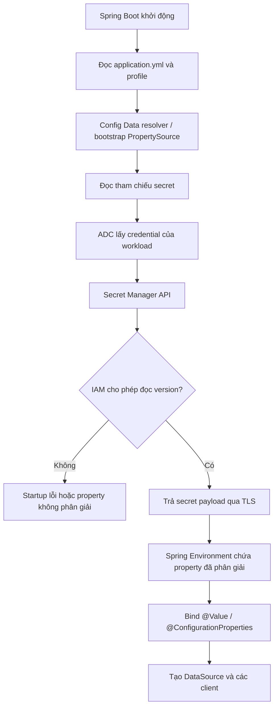

# Nạp Secret Manager vào cấu hình Spring theo phiên bản thư viện

Một ứng dụng Spring Boot thường cần mật khẩu database, API key của đối tác hoặc credential để kết nối dịch vụ managed. Nếu đặt giá trị thật trong application.yml, commit file .env, truyền chúng qua Docker ARG hoặc in toàn bộ cấu hình ra log, bí mật có thể bị sao chép vào Git, build cache, image layer, CI artifact và hệ thống quan sát. Xóa dòng cấu hình khỏi source sau đó không thu hồi credential đã bị lộ.

Bài thuộc chương **Cấu hình Google Cloud** của module **SPRING_CLOUD_PROVIDER_INTEGRATION**. Khi tích hợp Spring Boot với các dịch vụ managed của AWS, Azure và Google Cloud qua thư viện Spring Cloud tương ứng, bài này tập trung vào cách **nạp secret của Google Cloud Secret Manager vào cấu hình Spring**, chọn starter/BOM đúng với Spring Boot, xác thực bằng Application Default Credentials (ADC), giới hạn quyền đọc và xử lý cập nhật secret.

Điểm cần chú ý là **cú pháp và cơ chế nạp Secret Manager thay đổi theo phiên bản Spring Framework on Google Cloud**. Các nhánh cũ dùng bootstrap property source; những nhánh mới dùng Spring Boot Config Data API; từ phiên bản 6.0 có cú pháp tham chiếu mới. Chọn nhầm cú pháp hoặc BOM có thể khiến ứng dụng không phân giải được placeholder hoặc khởi động thất bại trước khi tạo bean.

## 1. Mục tiêu học tập

Sau bài học, bạn có thể:

- Giải thích vai trò của Google Cloud Secret Manager trong Spring Boot configuration.
- Chọn đúng nhánh Spring Framework on Google Cloud theo phiên bản Spring Boot/Spring Cloud đang dùng.
- Phân biệt **bootstrap property source**, **Spring Boot Config Data resource** và **SecretManagerTemplate**.
- Cấu hình dependency BOM và starter spring-cloud-gcp-starter-secretmanager.
- Viết đúng cú pháp sm:// hoặc sm@ theo phiên bản thư viện, bao gồm secret toàn cục, secret theo vùng và version cụ thể.
- Dùng ADC/workload identity để đọc secret mà không đóng gói service account private key vào ứng dụng.
- Bind secret vào @Value hoặc @ConfigurationProperties, hiểu thời điểm nạp và cách refresh.
- Chẩn đoán lỗi sai version, sai project, thiếu IAM permission, secret/version không tồn tại và bootstrap chưa được kích hoạt.

## 2. Secret Manager được nạp vào Spring như thế nào?

Google Cloud Secret Manager lưu giá trị bí mật dưới dạng **secret** và **secret version**. Mỗi secret có thể có nhiều version; ứng dụng thường đọc một version cụ thể hoặc alias latest. Secret Manager không tự biến tất cả secret trong project thành property của Spring. Ứng dụng phải khai báo **tham chiếu đến secret cần dùng**, và danh tính runtime phải có quyền truy cập giá trị của secret đó.

Có ba thành phần nên phân biệt:

| Thành phần | Nhiệm vụ | Khi nên dùng |
| --- | --- | --- |
| **Secret Manager Config Data resource / PropertySource** | Phân giải tham chiếu secret thành property trong Environment của Spring | Cấu hình datasource, API key, signing key hoặc property cần có ngay khi ứng dụng khởi động |
| **SecretManagerTemplate** | Cung cấp API để đọc, tạo, cập nhật hoặc thao tác secret theo chương trình | Luồng nghiệp vụ cần đọc secret theo tên/version tại runtime, hoặc công cụ quản trị secret |
| **Google Secret Manager Java client** | API gốc của Google Cloud, không phụ thuộc abstraction của Spring | Tích hợp tùy chỉnh hoặc khi không sử dụng starter |

Luồng nạp cấu hình điển hình:



Ở nhánh dùng Config Data API, resolver tham gia vào quá trình nạp external configuration của Spring Boot. Ở nhánh cũ, property source được nạp trong bootstrap phase của Spring Cloud. Dù khác cơ chế, cả hai đều cần credential hợp lệ và quyền IAM trên secret đích.

**Đây là nạp cấu hình lúc khởi động.** Việc secret đổi trong Google Cloud Secret Manager không có nghĩa mọi bean đang chạy tự động nhận giá trị mới. Muốn cập nhật nóng, phải thiết kế refresh/reload rõ ràng hoặc rollout ứng dụng.

## 3. Chọn phiên bản thư viện trước khi viết cấu hình

Tên thư viện hiện tại là **Spring Framework on Google Cloud** (trước đây thường được gọi là Spring Cloud GCP). Không nên chọn một phiên bản starter mới nhất rồi gắn vào bất kỳ Spring Boot nào. Các thành phần Spring Framework, Spring Cloud và Spring Boot phải nằm trong tổ hợp được dự án hỗ trợ.

Bảng tương thích dưới đây dựa trên tài liệu chính thức của dự án tại thời điểm **24-11-2026**:

| Spring Framework on Google Cloud | Spring Cloud release train | Spring Boot tương thích | Tình trạng theo tài liệu dự án |
| --- | --- | --- | --- |
| **8.x** — ví dụ 8.3.1 | 2025.1.x (Oakwood) | 4.0.x, 4.1.x | Được hỗ trợ |
| **7.x** — ví dụ 7.5.2 | 2025.0.x (Northfields) | 3.5.x | Được hỗ trợ |
| **6.x** — ví dụ 6.5.12 | 2024.0.x (Moorgate) | 3.4.x | Chỉ critical patches |
| **5.x** — ví dụ 5.13.12 | 2023.0.x (Leyton) | 3.2.x, 3.3.x* | Không còn hỗ trợ |
| **4.x** — ví dụ 4.11.3 | 2022.0.x (Kilburn) | 3.0.x, 3.1.x | Không còn hỗ trợ |
| **3.x** — ví dụ 3.9.19 | 2021.0.x (Jubilee) | 2.6.x, 2.7.x | Chỉ critical patches |

*Nhánh 5.x có ngoại lệ tương thích cho module Trace ở một số phiên bản Boot 3.2.x. Bảng trên nhằm chọn dòng thư viện tổng thể; khi dùng module khác, kiểm tra compatibility riêng của module đó.*

Có thể chọn theo hướng:

- Dự án dùng **Spring Boot 4.0/4.1**: chọn Spring Framework on Google Cloud 8.x và Spring Cloud 2025.1.x.
- Dự án dùng **Spring Boot 3.5**: chọn dòng 7.x.
- Dự án dùng **Spring Boot 3.4**: dòng 6.x tương thích nhưng hiện chỉ còn critical patches; lập kế hoạch nâng cấp.
- Dự án cũ dùng Boot 3.2/3.3, 3.0/3.1 hoặc 2.6/2.7: xác định rõ trạng thái hỗ trợ trước khi giữ nguyên. Không nâng riêng starter Secret Manager vượt khỏi BOM đang dùng.

**Quy tắc:** chọn Spring Boot và Spring Cloud release train trước; sau đó chọn Spring Framework on Google Cloud tương thích. Không ép một phiên bản BOM mới vào dự án chỉ để dùng cú pháp secret mới.

## 4. Thêm dependency và quản lý BOM

Starter dùng cho tích hợp Secret Manager là:

```text
com.google.cloud:spring-cloud-gcp-starter-secretmanager
```

Nên import **Spring Framework on Google Cloud BOM** để các module cùng dòng có phiên bản nhất quán. Ví dụ sau dành cho dự án **Spring Boot 4.0/4.1** dùng dòng 8.x, với BOM 8.3.1:

### Maven

```xml
<dependencyManagement>
    <dependencies>
        <dependency>
            <groupId>com.google.cloud</groupId>
            <artifactId>spring-cloud-gcp-dependencies</artifactId>
            <version>8.3.1</version>
            <type>pom</type>
            <scope>import</scope>
        </dependency>
    </dependencies>
</dependencyManagement>

<dependencies>
    <dependency>
        <groupId>com.google.cloud</groupId>
        <artifactId>spring-cloud-gcp-starter-secretmanager</artifactId>
    </dependency>
</dependencies>
```

### Gradle

```kotlin
dependencies {
    implementation(platform("com.google.cloud:spring-cloud-gcp-dependencies:8.3.1"))
    implementation("com.google.cloud:spring-cloud-gcp-starter-secretmanager")
}
```

Các ví dụ dùng version cụ thể trong bài cần được hiểu theo BOM tương ứng:

| Spring Boot | Dòng BOM minh họa | Version starter |
| --- | --- | --- |
| 4.0/4.1 | spring-cloud-gcp-dependencies:8.3.1 | Do BOM quản lý |
| 3.5 | spring-cloud-gcp-dependencies:7.5.2 | Do BOM quản lý |
| 3.4 | spring-cloud-gcp-dependencies:6.5.12 | Do BOM quản lý |

Không khai báo version riêng cho spring-cloud-gcp-starter-secretmanager khi đã import BOM. Nếu các dependency Spring Cloud khác cũng có BOM, kiểm tra hướng dẫn kết hợp BOM và thứ tự quản lý dependency của dự án để tránh xung đột phiên bản.

## 5. Cú pháp theo phiên bản: bootstrap, sm:// và sm@

Đây là phần quan trọng nhất của bài. Cùng một secret có thể có cách tham chiếu khác nhau tùy dòng Spring Framework on Google Cloud.

| Dòng thư viện | Cơ chế nạp | Cú pháp secret | File cấu hình thường dùng |
| --- | --- | --- | --- |
| **2.x–3.x** | Bootstrap PropertySource của Spring Cloud | sm://... | bootstrap.yml/bootstrap.properties cho bootstrap settings; tham chiếu có thể nằm trong application config |
| **4.x–5.x** | Spring Boot Config Data API | sm://... | application.yml/application.properties với spring.config.import |
| **6.x–8.x** | Spring Boot Config Data API | **sm@...** được khuyến nghị | application.yml/application.properties với spring.config.import |

### 5.1. Nhánh 3.x: bootstrap property source

Ở Spring Framework on Google Cloud 3.x, Secret Manager tích hợp dưới dạng **bootstrap property source**. Các thiết lập kích hoạt và project mặc định được đặt trong bootstrap.yml hoặc bootstrap.properties, ví dụ:

```yaml
spring:
  cloud:
    gcp:
      secretmanager:
        enabled: true
        project-id: invoice-prod
```

Trong application.yml, tham chiếu secret bằng cú pháp sm://:

```yaml
spring:
  datasource:
    password: "${sm://projects/invoice-prod/secrets/invoice-db-password/versions/latest}"
```

Bootstrap phase phải được kích hoạt đúng theo cấu hình Spring Cloud của dự án. Nếu ứng dụng không chạy bootstrap context, Secret Manager property source sẽ không được nạp dù starter đã có trên classpath. Với các ứng dụng dùng cơ chế bootstrap tách rời, kiểm tra việc sử dụng spring-cloud-starter-bootstrap theo phiên bản Spring Cloud đang dùng.

Không lấy cấu hình bootstrap.yml của 3.x rồi chép nguyên sang 6.x/8.x. Cơ chế bootstrap cũ đã được thay bằng Config Data API ở các dòng mới.

### 5.2. Nhánh 4.x và 5.x: Config Data API với sm://

Từ dòng 4.x, Secret Manager được dùng như một **Config Data resource** của Spring Boot. Khai báo import trong application.yml:

```yaml
spring:
  config:
    import: "sm://"
  cloud:
    gcp:
      secretmanager:
        project-id: invoice-prod

  datasource:
    url: jdbc:postgresql://10.20.0.15:5432/invoice
    username: invoice_app
    password: "${sm://projects/invoice-prod/secrets/invoice-db-password/versions/latest}"
```

Hai phần có ý nghĩa khác nhau:

- spring.config.import: "sm://" đăng ký Secret Manager làm nguồn Config Data.
- Placeholder được viết theo mẫu dưới đây chỉ định secret cụ thể cần phân giải thành giá trị property: sm://projects/PROJECT_ID/secrets/SECRET_ID/versions/VERSION.

Cú pháp này được dùng ở các dòng 4.x và 5.x theo tài liệu tương ứng. Không thêm spring.cloud.gcp.secretmanager.legacy hoặc các cấu hình bootstrap cũ vào dự án 4.x chỉ vì một bài hướng dẫn cũ yêu cầu; migration guide của 4.x hướng dẫn chuyển sang Config Data API và loại bỏ các thiết lập legacy tương ứng.

### 5.3. Từ nhánh 6.x: dùng cú pháp sm@

Từ **6.0.0**, thư viện giới thiệu cú pháp mới **sm@secret_id**. Đây là cú pháp được khuyến nghị ở các nhánh hiện tại. Cú pháp cũ sm://secret_id vẫn có thể được chấp nhận để tương thích, nhưng thư viện phát cảnh báo khuyến khích chuyển sang sm@.

Ví dụ với Spring Boot 4.x và Spring Framework on Google Cloud 8.x:

```yaml
spring:
  config:
    import: "sm@"
  cloud:
    gcp:
      secretmanager:
        project-id: invoice-prod

  datasource:
    url: jdbc:postgresql://10.20.0.15:5432/invoice
    username: invoice_app
    password: "${sm@projects/invoice-prod/secrets/invoice-db-password/versions/latest}"

partner:
  api-key: "${sm@projects/invoice-prod/secrets/partner-api-key}"
```

Có thể dùng cú pháp ngắn khi đã cấu hình project mặc định:

```yaml
spring:
  config:
    import: "sm@"
  cloud:
    gcp:
      secretmanager:
        project-id: invoice-prod

partner:
  api-key: "${sm@partner-api-key}"
```

Cú pháp ngắn thuận tiện nhưng phụ thuộc project mặc định. Trong hệ thống nhiều project hoặc nhiều môi trường, dạng fully-qualified path giúp người đọc thấy rõ secret thuộc project nào và giảm rủi ro phân giải nhầm project.

## 6. Tham chiếu secret toàn cục, theo vùng và theo version

Secret Manager hỗ trợ **global secrets** và **regional secrets**. Cú pháp sm@ ở các dòng 6.x trở lên có nhiều dạng:

### 6.1. Global secret

| Cách viết | Ý nghĩa |
| --- | --- |
| sm@projects/PROJECT_ID/secrets/SECRET_ID/versions/VERSION_ID | Chỉ rõ project, secret và version |
| sm@projects/PROJECT_ID/secrets/SECRET_ID | Chỉ rõ project và secret; dùng version latest |
| sm@PROJECT_ID/SECRET_ID/VERSION_ID | Dạng ngắn có project và version |
| sm@SECRET_ID/VERSION | Dùng project mặc định và version cụ thể |
| sm@SECRET_ID | Dùng project mặc định và version latest |

Ví dụ:

```yaml
spring:
  config:
    import: "sm@"
  cloud:
    gcp:
      secretmanager:
        project-id: invoice-prod

invoice:
  database:
    password: "${sm@projects/invoice-prod/secrets/invoice-db-password/versions/7}"
  partner:
    api-key: "${sm@projects/invoice-prod/secrets/partner-api-key}"
```

### 6.2. Regional secret

Nếu secret được tạo ở một region cụ thể, resource path có thêm locations/LOCATION_ID:

| Cách viết | Ý nghĩa |
| --- | --- |
| sm@projects/PROJECT_ID/locations/LOCATION_ID/secrets/SECRET_ID/versions/VERSION_ID | Chỉ rõ project, location, secret và version |
| sm@projects/PROJECT_ID/locations/LOCATION_ID/secrets/SECRET_ID | Chỉ rõ project, location và dùng latest |
| sm@PROJECT_ID/LOCATION_ID/SECRET_ID/VERSION_ID | Dạng ngắn có project, location và version |
| sm@locations/LOCATION_ID/SECRET_ID/VERSION | Dùng project mặc định và version cụ thể |
| sm@locations/LOCATION_ID/SECRET_ID | Dùng project mặc định và latest |

Ví dụ:

```yaml
spring:
  config:
    import: "sm@"

partner:
  api-key: "${sm@projects/invoice-prod/locations/asia-southeast1/secrets/partner-api-key/versions/latest}"
```

Chỉ dùng path có locations/... khi secret thực sự là regional secret. Không tự thêm region vào path của global secret.

### 6.3. Chọn latest hay version cố định?

| Lựa chọn | Ưu điểm | Điểm cần cân nhắc |
| --- | --- | --- |
| latest | Ứng dụng nhận version mới nhất ở lần nạp cấu hình tiếp theo | Cần kế hoạch refresh/redeploy sau rotation; lần khởi động ở thời điểm khác nhau có thể nhận version khác nhau |
| Version số cụ thể | Tái lập cấu hình và dễ kiểm soát rollout/rollback | Phải cập nhật tham chiếu khi muốn chuyển version; pin version cũ quá lâu có thể giữ credential đã bị thu hồi |

Ví dụ dùng version cụ thể:

```yaml
spring:
  config:
    import: "sm@"

partner:
  api-key: "${sm@projects/invoice-prod/secrets/partner-api-key/versions/12}"
```

Khi đã kiểm thử version 12, có thể rollout phiên bản ứng dụng tiếp theo với version 13. Nếu chọn latest, ứng dụng sẽ phân giải alias ở lần nạp cấu hình; **alias latest không phải cơ chế polling tự động trong suốt thời gian JVM chạy**.

## 7. Project mặc định và cấu hình Secret Manager

Có một số property thường gặp:

| Property | Vai trò |
| --- | --- |
| spring.cloud.gcp.secretmanager.enabled | Bật/tắt tích hợp Secret Manager ở các nhánh có hỗ trợ property này; mặc định tích hợp được bật |
| spring.cloud.gcp.secretmanager.project-id | Project mặc định mà Secret Manager integration dùng để phân giải secret khi tham chiếu không chỉ rõ project |
| spring.cloud.gcp.secretmanager.credentials.location | Vị trí credential resource nếu cần override ADC |
| spring.cloud.gcp.secretmanager.credentials.encoded-key | Credential key JSON đã mã hóa Base64; có thể dùng trong một số môi trường legacy nhưng không nên là lựa chọn mặc định |
| spring.cloud.gcp.secretmanager.allow-default-secret | Quy định hành vi khi secret không tồn tại; mặc định false |

Có thể cấu hình project ID mặc định:

```yaml
spring:
  cloud:
    gcp:
      project-id: invoice-prod
      secretmanager:
        project-id: invoice-prod
```

Hai property có phạm vi khác nhau: spring.cloud.gcp.project-id là project mặc định của module Google Cloud Core; spring.cloud.gcp.secretmanager.project-id là project mặc định cho Secret Manager integration. Khi cấu hình nhiều project, hãy chỉ rõ project trong resource path của secret để tránh nhầm.

Nếu không đặt project mặc định, thư viện có thể suy ra từ cấu hình Google Cloud Core hoặc Application Default Credentials tùy phiên bản và nguồn credential. Với ứng dụng cần đọc secret ở project khác project chạy workload, dùng resource path đầy đủ để thể hiện project sở hữu secret.

## 8. Xác thực bằng ADC và workload identity

Spring Framework on Google Cloud Secret Manager mặc định dùng **Application Default Credentials (ADC)**. ADC tìm credential theo môi trường thực thi. Điều này cho phép cùng một ứng dụng Spring Boot chạy local và trên cloud mà không phải đóng gói khóa riêng vào image.

### 8.1. Local development

Developer có thể thiết lập ADC cho Google Cloud Java libraries bằng:

```bash
gcloud auth application-default login
```

Lệnh này tạo thông tin xác thực ADC dành cho client libraries. Nó khác với gcloud auth login, vốn chủ yếu đăng nhập CLI. Tài khoản developer phải được cấp quyền đọc secret ở project test; không dùng production secret để thử cấu hình local nếu không có nhu cầu và phê duyệt.

### 8.2. Cloud Run, Compute Engine và GKE

Trên runtime Google Cloud:

- **Cloud Run:** gắn service account riêng cho service revision.
- **Compute Engine:** gắn service account cho VM và cấu hình OAuth scopes phù hợp.
- **GKE:** dùng Workload Identity Federation for GKE để Pod nhận danh tính workload được cấu hình.
- **CI/CD bên ngoài Google Cloud:** dùng Workload Identity Federation để trao đổi OIDC token thay cho service account key JSON.

Cấp role roles/secretmanager.secretAccessor cho service account hoặc principal được federate ở **secret cụ thể** khi có thể. Permission cốt lõi để đọc payload là secretmanager.versions.access. Ví dụ gán quyền ở một secret:

```bash
gcloud secrets add-iam-policy-binding invoice-db-password \
  --project=invoice-prod \
  --member="serviceAccount:invoice-api@invoice-prod.iam.gserviceaccount.com" \
  --role="roles/secretmanager.secretAccessor"
```

Đảm bảo Secret Manager API đã được bật trong project chứa secret:

```bash
gcloud services enable secretmanager.googleapis.com \
  --project=invoice-prod
```

**Không cần** phát hành service account key JSON cho Cloud Run/GCE/GKE chỉ để Secret Manager hoạt động. Hạn chế cấu hình spring.cloud.gcp.secretmanager.credentials.location hoặc encoded-key trỏ tới private key tĩnh; ưu tiên ADC/workload identity và quản lý quyền bằng IAM.

## 9. Nạp secret vào property và bind vào Spring bean

Khi Config Data resource đã được khai báo, có thể dùng secret reference như một Spring property thông thường.

### 9.1. Bind vào datasource

```yaml
spring:
  config:
    import: "sm@"
  cloud:
    gcp:
      secretmanager:
        project-id: invoice-prod
  datasource:
    url: jdbc:postgresql://10.20.0.15:5432/invoice
    username: invoice_app
    password: "${sm@projects/invoice-prod/secrets/invoice-db-password/versions/latest}"
```

Spring Boot sẽ phân giải placeholder trước khi tạo các bean cần property datasource. Secret value không xuất hiện trong file cấu hình được commit; file chỉ chứa **resource reference**.

### 9.2. Bind vào @ConfigurationProperties

Ví dụ cấu hình partner API:

```yaml
spring:
  config:
    import: "sm@"

partner:
  base-url: https://api.partner.example
  api-key: "${sm@projects/invoice-prod/secrets/partner-api-key/versions/latest}"
```

Lớp Java nhận property đã được phân giải:

```java
@ConfigurationProperties(prefix = "partner")
public class PartnerProperties {

    private String baseUrl;
    private String apiKey;

    public String getBaseUrl() {
        return baseUrl;
    }

    public void setBaseUrl(String baseUrl) {
        this.baseUrl = baseUrl;
    }

    public String getApiKey() {
        return apiKey;
    }

    public void setApiKey(String apiKey) {
        this.apiKey = apiKey;
    }
}
```

Đăng ký configuration properties bằng @ConfigurationPropertiesScan trên application class hoặc @EnableConfigurationProperties(PartnerProperties.class) trong cấu hình. Khi sử dụng secret, tránh viết toString() của object chứa API key hoặc log toàn bộ bean cấu hình.

### 9.3. Dùng @Value

Nếu chỉ có một property đơn giản, có thể inject trực tiếp:

```java
@Component
public class PartnerClientFactory {

    private final String apiKey;

    public PartnerClientFactory(
            @Value("${partner.api-key}") String apiKey) {
        this.apiKey = apiKey;
    }

    // Dùng apiKey để cấu hình client.
    // Không ghi apiKey vào log hoặc exception.
}
```

Có thể tham chiếu trực tiếp secret trong annotation theo cú pháp của nhánh thư viện, ví dụ @Value("${sm@my-secret}") trên dòng 6.x trở lên. Tuy nhiên, đặt reference trong application.yml rồi bind bằng property nghiệp vụ như partner.api-key thường dễ quản lý profile, kiểm thử và thay đổi môi trường hơn.

## 10. Profile dev, staging và production

Cùng một image có thể chạy nhiều môi trường, trong khi secret khác nhau theo môi trường. Dùng profile-specific configuration để trỏ đến secret tương ứng:

```yaml
# application.yml
spring:
  config:
    import: "sm@"
```

```yaml
# application-dev.yml
partner:
  api-key: "${sm@projects/invoice-dev/secrets/partner-api-key/versions/latest}"
```

```yaml
# application-staging.yml
partner:
  api-key: "${sm@projects/invoice-staging/secrets/partner-api-key/versions/latest}"
```

```yaml
# application-prod.yml
partner:
  api-key: "${sm@projects/invoice-prod/secrets/partner-api-key/versions/latest}"
```

Chọn profile khi khởi động bằng biến môi trường hoặc cấu hình triển khai, ví dụ SPRING_PROFILES_ACTIVE=prod. Không commit giá trị secret vào các file profile; chỉ commit tham chiếu. Identity của từng môi trường chỉ được đọc secret tương ứng, nhờ vậy nếu workload staging bị xâm nhập thì quyền truy cập production không tự động xuất hiện.

Cần kiểm tra **property precedence** của Spring Boot. Environment variable, command-line argument hoặc external config khác có thể override property cùng tên tùy thứ tự nguồn. Nếu một biến PARTNER_API_KEY cũ vẫn tồn tại ở deployment, ứng dụng có thể dùng giá trị đó thay cho property từ Secret Manager. Hãy kiểm soát nguồn cấu hình thực tế thay vì chỉ nhìn file YAML.

## 11. Config Data API và SecretManagerTemplate khác nhau thế nào?

Hai API thường được dùng cùng starter nhưng phục vụ hai mục đích:

| Nhu cầu | Cách dùng |
| --- | --- |
| Nạp DB password ngay khi Spring Boot khởi động | Config Data reference sm@... hoặc sm://... theo phiên bản |
| Bind API key vào @ConfigurationProperties | Config Data reference + Spring property binding |
| Đọc một secret theo tên/version trong một thao tác runtime | SecretManagerTemplate hoặc Secret Manager Java client |
| Tạo secret/version từ công cụ quản trị | SecretManagerTemplate/API quản trị với principal có quyền ghi |
| Xoay vòng secret | Tạo version mới, sau đó refresh/rollout consumer theo kế hoạch |

Spring Framework on Google Cloud cung cấp SecretManagerTemplate để đơn giản hóa thao tác đọc, tạo và cập nhật secret. Sau khi thêm starter, ứng dụng có thể inject template và sử dụng các operation được định nghĩa trong SecretManagerOperations. Hãy chọn đúng API theo kiểu dữ liệu và thao tác cần làm; không dùng template để thay thế Config Data resource khi mục tiêu chỉ là nạp một property lúc khởi động.

Không dùng một service quản trị có quyền tạo/xóa secret làm credential mặc định cho mọi request của ứng dụng. Runtime service thường chỉ cần quyền access version; công cụ quản trị/rotation có principal và quyền riêng.

## 12. Refresh khi secret đổi

Khi Secret Manager tạo version mới, ứng dụng đang chạy **không tự động đọc lại mọi property** chỉ vì reference dùng alias latest. Config Data resource được phân giải trong quá trình nạp cấu hình; bean có thể đã giữ giá trị cũ.

Có ba chiến lược phổ biến:

| Chiến lược | Cách hoạt động | Phù hợp khi |
| --- | --- | --- |
| **Restart/rollout** | Triển khai lại hoặc restart instance để Spring nạp cấu hình và secret mới | Ứng dụng đơn giản, rotation theo lịch, có khả năng rollout an toàn |
| **Spring Cloud refresh** | Dùng Actuator refresh và @RefreshScope cho configuration properties được hỗ trợ | Cần thay đổi cấu hình có kiểm soát mà không restart toàn bộ process |
| **Đọc runtime qua Template/client** | Thành phần nghiệp vụ lấy version mới theo cache/TTL do ứng dụng quản lý | Cần đọc secret động hoặc có logic refresh riêng |

### 12.1. Refresh với Actuator

Tài liệu Spring Framework on Google Cloud mô tả cách bật Actuator refresh:

```xml
<dependency>
    <groupId>org.springframework.boot</groupId>
    <artifactId>spring-boot-starter-actuator</artifactId>
</dependency>
```

```yaml
management:
  endpoints:
    web:
      exposure:
        include: refresh
```

Sau khi Secret Manager được cập nhật, gửi request refresh tới ứng dụng:

```bash
curl -X POST http://localhost:8080/actuator/refresh
```

Theo tài liệu tích hợp, chỉ các @ConfigurationProperties được đánh dấu @RefreshScope mới được cập nhật theo cơ chế này. Ví dụ:

```java
@Component
@RefreshScope
@ConfigurationProperties(prefix = "partner")
public class PartnerProperties {

    private String apiKey;

    public String getApiKey() {
        return apiKey;
    }

    public void setApiKey(String apiKey) {
        this.apiKey = apiKey;
    }
}
```

Endpoint refresh có thể làm thay đổi cấu hình đang chạy. **Không expose công khai** endpoint này; giới hạn bằng authentication, authorization và mạng quản trị. Nếu bean/client không thuộc refresh scope, hoặc connection pool giữ credential cũ, chỉ gọi refresh chưa chắc cập nhật được kết nối đã tồn tại. Kiểm thử consumer sau rotation và thiết kế rollout/connection replacement nếu cần.

### 12.2. Chọn version rõ ràng cho rotation

Với alias latest, mỗi lần ứng dụng nạp lại cấu hình sẽ phân giải version mới nhất. Với version số cụ thể, phải cập nhật reference sang version mới. Cả hai cách đều cần một quy trình:

1. Tạo secret version mới.
2. Kiểm tra quyền truy cập và nội dung bằng workload/test principal phù hợp.
3. Cập nhật consumer bằng refresh hoặc rollout.
4. Xác minh request mới thực sự dùng credential mới.
5. Thu hồi hoặc disable credential cũ khi mọi consumer đã chuyển.

Đừng disable version cũ ngay khi tạo version mới nếu một số instance vẫn đang dùng credential cũ và cần thời gian chuyển đổi. Ngược lại, trong sự cố lộ secret, ưu tiên thu hồi theo incident response thay vì giữ credential cũ chỉ để duy trì availability.

## 13. Secret không tồn tại và hành vi mặc định

Mặc định, khi ứng dụng tham chiếu secret không tồn tại, tích hợp Secret Manager sẽ phát sinh lỗi. Property sau thay đổi hành vi:

```yaml
spring:
  cloud:
    gcp:
      secretmanager:
        allow-default-secret: true
```

Khi bật, việc truy cập secret không tồn tại có thể trả về null thay vì ném exception. Có thể kết hợp placeholder fallback cho **cấu hình tùy chọn**, nhưng phải hiểu rõ điều kiện phân giải placeholder và kiểm thử theo phiên bản thư viện.

Không dùng hành vi fallback để che giấu lỗi ở secret bắt buộc như database password, signing key hoặc production API key. Nếu thiếu secret bắt buộc, ứng dụng nên fail fast hoặc không nhận traffic. Nếu secret tùy chọn không có, fallback nên là giá trị không nhạy cảm và không làm ứng dụng chuyển sang tài khoản/quyền rộng hơn.

## 14. Quyền IAM cần có

Ứng dụng chỉ đọc được secret khi workload principal được cấp quyền trên resource. Permission quan trọng để truy cập payload của secret version là:

```text
secretmanager.versions.access
```

Role dựng sẵn thường dùng là:

```text
roles/secretmanager.secretAccessor
```

Gán role ở cấp **secret cụ thể** nếu ứng dụng chỉ đọc một vài secret. Không gán roles/secretmanager.admin cho runtime chỉ để đọc password. Phân biệt:

- **Runtime principal:** chỉ cần quyền access secret/version mà ứng dụng dùng.
- **CI/deployer principal:** có thể cần quyền deploy workload; không mặc nhiên cần đọc secret runtime.
- **Secret administrator/rotation principal:** quản lý metadata/version/rotation theo nhiệm vụ; không chia sẻ quyền quản trị cho mọi service.

Nếu project chứa Secret Manager khác project chạy Cloud Run/GKE, IAM binding phải gắn cho principal ở resource project đích; resource path nên ghi rõ project ID. Bên cạnh IAM, kiểm tra Secret Manager API đã bật, VPC Service Controls/firewall nếu tổ chức dùng và quyền KMS khi cấu hình mã hóa bằng CMEK.

## 15. Chẩn đoán lỗi thường gặp

| Triệu chứng | Nguyên nhân có thể | Hướng kiểm tra |
| --- | --- | --- |
| Placeholder sm@... không được phân giải | Đang dùng thư viện dưới 6.x hoặc starter không được nạp | Kiểm tra BOM, dependency tree và cú pháp đúng phiên bản |
| sm://... phát cảnh báo sau khi nâng cấp | Từ dòng 6.0 cú pháp sm@ được khuyến nghị | Chuyển reference và import sang sm@ theo docs |
| Ứng dụng không tìm thấy sm:// trong 3.x | Bootstrap property source chưa được kích hoạt hoặc cấu hình đặt sai file | Kiểm tra bootstrap phase, starter bootstrap và bootstrap.yml |
| Config Data resource không được nạp ở 4.x/5.x/6.x+ | Thiếu spring.config.import hoặc import sai scheme | Dùng sm:// ở 4.x/5.x; sm@ ở 6.x+ |
| 403 PermissionDenied | Workload principal thiếu secretmanager.versions.access hoặc role gắn sai secret | Xác minh ADC principal và IAM binding trên đúng secret |
| 404 Not Found | Sai project ID, secret ID, location hoặc version | Kiểm tra resource path và secret version có tồn tại/đang enabled |
| Local chạy được, Cloud Run lỗi | Developer ADC có quyền nhưng service account runtime không có | Xác minh service account gắn cho Cloud Run và IAM binding |
| Secret lấy từ nhầm project | Project mặc định bị suy ra từ ADC hoặc cấu hình khác | Đặt spring.cloud.gcp.secretmanager.project-id hoặc dùng fully-qualified path |
| Secret mới đã tạo nhưng app vẫn dùng giá trị cũ | Config Data đã được nạp lúc startup, bean chưa refresh | Rollout/restart hoặc refresh đúng @RefreshScope property |
| Ứng dụng khởi động với secret null | allow-default-secret được bật hoặc fallback placeholder che lỗi | Kiểm tra cấu hình fallback; fail fast với secret bắt buộc |

### 15.1. Quy trình kiểm tra theo thứ tự

1. Xác nhận **Spring Boot version**, Spring Cloud train và Spring Framework on Google Cloud BOM.
2. Xác nhận starter spring-cloud-gcp-starter-secretmanager có trong runtime classpath.
3. Xác nhận scheme đúng: 3.x bootstrap sm://, 4.x–5.x Config Data sm://, 6.x+ sm@.
4. Xác nhận spring.config.import có mặt ở nhánh Config Data.
5. Xác nhận project ID, secret ID, location và version.
6. Xác minh ADC/workload identity được chọn trong đúng môi trường.
7. Kiểm tra IAM permission trên secret và audit log của Secret Manager.
8. Kiểm tra property cuối cùng được bind vào bean mà không in giá trị secret.

Không khắc phục lỗi 403 bằng cách thêm service account key JSON vào image. Nếu identity đúng nhưng thiếu permission, sửa IAM tại secret cần truy cập; nếu identity sai, sửa runtime identity/ADC trước.

## 16. Kiểm thử tích hợp an toàn

Tạo một project hoặc secret riêng cho integration test, ví dụ:

```text
Project: invoice-integration-test
Secret: invoice-db-password-test
Version: 1
```

Cấp quyền roles/secretmanager.secretAccessor cho test workload trên secret này. Kiểm thử nên xác minh:

| Ca kiểm thử | Kết quả mong đợi |
| --- | --- |
| Secret và version tồn tại, principal có quyền | Spring property được bind đúng |
| Principal không có quyền | Ứng dụng không đọc được payload; lỗi được báo có kiểm soát |
| Secret ID sai | Startup/test thất bại hoặc xử lý theo fallback đã thiết kế |
| Version cụ thể không tồn tại/đã disable | Không bind nhầm một version khác |
| Thay version rồi refresh/rollout | Bean được cập nhật theo chiến lược đã chọn |
| Secret thuộc project khác | Chỉ đọc được nếu resource path và IAM binding đúng |

Ví dụ test kiểm tra property binding không in secret:

```java
@SpringBootTest
class PartnerPropertiesIntegrationTest {

    @Autowired
    private PartnerProperties partnerProperties;

    @Test
    void loadsPartnerApiKeyFromSecretManager() {
        assertNotNull(partnerProperties.getApiKey());
        assertFalse(partnerProperties.getApiKey().isBlank());
    }
}
```

Test này cần chạy trong môi trường đã có ADC/workload identity và secret test. Không đưa giá trị secret thật vào assertion message, report hoặc log. Với unit test không có cloud, mock property source/bean; nhưng mock không chứng minh IAM, Config Data resolver hay ADC ngoài môi trường thật đã hoạt động.

## 17. Bài thực hành: nạp database password từ Secret Manager

**Bối cảnh:** invoice-service dùng Spring Boot, chạy trên Cloud Run và kết nối Cloud SQL PostgreSQL. Password database được lưu trong Secret Manager. Yêu cầu: cùng image chạy ở staging và production; mỗi môi trường đọc secret riêng; không có service account key JSON hoặc password trong repository/image.

### Bước 1 — Chuẩn bị Secret Manager

Tạo secret trong project staging, ví dụ invoice-db-password, thêm version test. Bật Secret Manager API. Không dùng password production trong bài thực hành.

### Bước 2 — Gắn runtime identity

Gắn service account riêng cho Cloud Run service, ví dụ invoice-api-staging@invoice-staging.iam.gserviceaccount.com. Gán roles/secretmanager.secretAccessor trên secret invoice-db-password ở project staging. Không dùng service account mặc định có quyền rộng nếu không cần.

### Bước 3 — Chọn BOM đúng với Spring Boot

Nếu dự án dùng Spring Boot 3.5, chọn dòng Spring Framework on Google Cloud 7.x; nếu dùng Boot 4.0/4.1, chọn dòng 8.x. Import BOM tương ứng và thêm starter Secret Manager. Không trộn version 7.x và 8.x trong cùng dependency graph.

### Bước 4 — Cấu hình Spring Boot

Với dòng 6.x trở lên:

```yaml
spring:
  config:
    import: "sm@"
  cloud:
    gcp:
      secretmanager:
        project-id: invoice-staging
  datasource:
    url: jdbc:postgresql://10.20.0.15:5432/invoice
    username: invoice_app
    password: "${sm@projects/invoice-staging/secrets/invoice-db-password/versions/latest}"
```

Nếu dự án đang ở dòng 5.x, dùng spring.config.import: "sm://" và placeholder sm://... Nếu dự án ở dòng 3.x, làm theo bootstrap property source của nhánh đó.

### Bước 5 — Chạy local và trên Cloud Run

- Local: đăng nhập ADC bằng tài khoản developer có quyền đọc secret test.
- Cloud Run: deploy service với service account staging; không đưa file credential vào container.
- Xác minh principal thực tế và project chứa secret trước khi kiểm tra kết nối database.

### Bước 6 — Kiểm tra rotation

Tạo version mới của secret test. Rollout/restart service hoặc thực hiện refresh được bảo vệ nếu bean hỗ trợ @RefreshScope. Xác minh connection mới dùng password mới; kiểm tra connection pool và trạng thái credential cũ trước khi disable version/credential cũ.

### Bước 7 — Kiểm tra bảo mật

- Source và image không chứa password.
- CI log không in secret value hoặc token.
- Workload staging không đọc được secret production.
- Runtime service không có quyền tạo/xóa secret nếu không cần.
- Secret reference trong YAML chỉ là resource path, không phải giá trị bí mật.

## 18. Câu hỏi tự kiểm tra

1. Vì sao cùng một secret reference sm://... có thể hoạt động ở Spring Framework on Google Cloud 5.x nhưng phát cảnh báo ở 6.x trở lên?
2. Điểm khác nhau giữa bootstrap property source của 3.x và Config Data resource của 4.x trở lên là gì?
3. Trong cấu hình hiện đại, spring.config.import: "sm@" làm nhiệm vụ gì và placeholder được viết theo dạng ${sm@...} làm nhiệm vụ gì?
4. Khi nào nên dùng fully-qualified resource path thay vì tham chiếu ngắn sm@my-secret?
5. Vì sao thêm spring.cloud.gcp.secretmanager.project-id có thể giúp tránh đọc nhầm project?
6. Vì sao Cloud Run nên dùng service account gắn với runtime thay vì service account key JSON?
7. Quyền roles/secretmanager.secretAccessor khác quyền quản trị secret như thế nào?
8. Nếu Secret Manager đã có version mới nhưng Spring bean vẫn giữ giá trị cũ, cần refresh hoặc rollout theo cách nào?
9. Vì sao không nên bật allow-default-secret cho database password bắt buộc?
10. Nếu local đọc được secret nhưng Cloud Run trả 403, cần kiểm tra principal và IAM binding nào?

## 19. Ghi nhớ

**Nạp Secret Manager vào Spring là một tính năng phụ thuộc chặt vào phiên bản Spring Framework on Google Cloud.** Nhánh 3.x sử dụng bootstrap property source và cú pháp sm://; nhánh 4.x–5.x dùng Spring Boot Config Data API với sm://; từ 6.0, cú pháp sm@ được giới thiệu và khuyến nghị. Hãy chọn BOM tương thích với Spring Boot trước, thêm đúng starter, khai báo import/reference đúng phiên bản và xác minh project mặc định.

Trong production, để ADC/workload identity cấp credential cho runtime, gán quyền đọc đúng secret, không đóng gói khóa service account, không ghi giá trị secret ra log và có kế hoạch refresh/rollout khi version đổi. **Một property được phân giải thành công chỉ chứng minh ứng dụng đọc được secret; IAM, rotation và kiểm thử theo từng môi trường mới bảo đảm cách tích hợp đó được kiểm soát.**

## Tài liệu tham khảo chính thức

- [Spring Framework on Google Cloud 8.3.1 — Getting Started và compatibility matrix](https://googlecloudplatform.github.io/spring-cloud-gcp/8.3.1/reference/html/index.html)
- [Spring Framework on Google Cloud 8.3.1 — Secret Manager](https://googlecloudplatform.github.io/spring-cloud-gcp/8.3.1/reference/html/index.html#secret-manager)
- [Spring Framework on Google Cloud 5.13.2 — Secret Manager với cú pháp sm://](https://googlecloudplatform.github.io/spring-cloud-gcp/5.13.2/reference/html/index.html)
- [Spring Framework on Google Cloud 4.11.3 — Migration guide và Config Data API](https://googlecloudplatform.github.io/spring-cloud-gcp/4.11.3/reference/html/index.html)
- [Spring Framework on Google Cloud 3.9.17 — Bootstrap PropertySource](https://googlecloudplatform.github.io/spring-cloud-gcp/3.9.17/reference/html/index.html)
- [Google Cloud Secret Manager documentation](https://cloud.google.com/secret-manager/docs)

