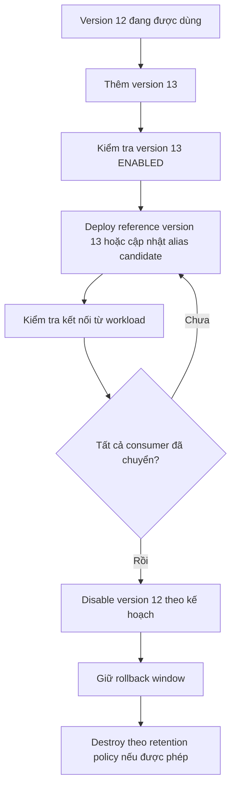

# Tham chiếu tên bí mật, project và phiên bản bí mật

Khi một ứng dụng Spring Boot lấy mật khẩu database từ Google Cloud Secret Manager, cấu hình cần xác định chính xác ba thành phần: **secret nằm trong project nào, secret có tên gì và cần đọc version nào**. Chỉ ghi tên secret đôi khi đủ trong một project đơn giản, nhưng dễ dẫn tới đọc nhầm môi trường khi workload chạy ở project khác, dùng regional secret hoặc cần rollout credential theo từng version.

Trong Google Cloud Secret Manager, tên secret, tên resource đầy đủ và giá trị bí mật là ba khái niệm khác nhau. **Tên secret** định danh một đối tượng quản lý; **secret version** định danh một lần lưu payload; **resource name** kết hợp project, location (nếu có), secret và version để API biết cần truy cập đối tượng nào. Spring Framework on Google Cloud cung cấp cú pháp tham chiếu rút gọn để đưa resource này vào Spring Environment.

Bài thuộc chương **Cấu hình Google Cloud** của module **SPRING_CLOUD_PROVIDER_INTEGRATION**. Trong phạm vi thực hành tích hợp Spring Boot với các dịch vụ managed của AWS, Azure và Google Cloud qua thư viện Spring Cloud tương ứng, chúng ta tập trung vào cách đặt tên và tham chiếu Secret Manager một cách tường minh, có thể kiểm soát giữa dev/staging/production và có thể tái lập khi deploy.

## 1. Mục tiêu học tập

Sau bài học, bạn có thể:

- Phân biệt **project ID**, project number, secret ID, secret resource name, secret version ID và secret payload.
- Đặt tên secret theo quy tắc Google Cloud và theo quy ước vận hành của service.
- Viết resource name đầy đủ cho global secret và regional secret.
- Chọn đúng project khi ứng dụng chạy ở một project nhưng đọc secret ở project khác.
- Dùng cú pháp `sm@` của Spring Framework on Google Cloud để tham chiếu secret bằng tên ngắn hoặc resource path đầy đủ.
- Phân biệt version ID dạng số, alias `latest` và alias do người dùng tạo.
- Chọn version phù hợp cho local, staging và production; hiểu ảnh hưởng của việc thêm, disable hoặc destroy version.
- Chẩn đoán lỗi do sai tên, sai project, sai location, version không khả dụng hoặc thiếu IAM permission.

## 2. Phân biệt project, secret, version và payload

Một Secret Manager resource có cấu trúc phân cấp:

```text
Project
└── Secret
    ├── Secret metadata
    ├── Version 1
    │   └── Payload
    ├── Version 2
    │   └── Payload
    └── Version 3
        └── Payload
```

| Khái niệm | Ý nghĩa | Ví dụ |
| --- | --- | --- |
| **Project ID** | Định danh project sở hữu secret | `invoice-prod` |
| **Project number** | Số định danh do Google Cloud cấp cho project | `415104041262` |
| **Secret ID** | Tên duy nhất của secret trong phạm vi project | `invoice-db-password` |
| **Secret resource name** | Tên tài nguyên secret đầy đủ, chưa chỉ rõ version | `projects/invoice-prod/secrets/invoice-db-password` |
| **Version ID** | Định danh một lần lưu payload của secret | `12` |
| **Secret version resource name** | Tên tài nguyên version đầy đủ | `projects/invoice-prod/secrets/invoice-db-password/versions/12` |
| **Payload** | Dữ liệu bí mật thực tế nằm trong version | Password, API key hoặc private key |

Tên project hiển thị trong Google Cloud Console (project name) có thể có khoảng trắng và được đổi tên. **Project ID** là định danh dùng phổ biến trong resource path; nó phải duy nhất và không thay đổi sau khi project được tạo. Project number là một định danh số khác. Các ví dụ trong bài sử dụng project ID để resource name dễ đọc; không lấy display name đưa vào path.

Secret resource chứa metadata như replication policy, labels, annotations và version aliases. **Giá trị bí mật nằm trong secret version**, không nằm trong secret ID. Một secret có thể tồn tại trước khi có version đầu tiên; khi đó chưa có payload để đọc.

### 2.1. Vì sao phải tách secret ID và version ID?

Giả sử database password được thay đổi ba lần:

| Thời điểm | Secret ID | Version ID | Ý nghĩa |
| --- | --- | --- | --- |
| Ban đầu | `invoice-db-password` | `1` | Password ban đầu |
| Lần xoay thứ nhất | `invoice-db-password` | `2` | Password mới |
| Lần xoay thứ hai | `invoice-db-password` | `3` | Password mới hơn |

Tên secret vẫn giữ nguyên; mỗi lần thêm payload mới tạo ra một version mới. Vì vậy, cấu hình chỉ trỏ đến secret ID chưa thể nói rõ đang cần version nào. API truy cập payload phải chỉ định một version ID hoặc alias version.

**Không đặt password vào tên secret hoặc version.** Tên tài nguyên có thể xuất hiện trong log, audit event, metric, policy và công cụ quản trị. Chỉ đặt thông tin phân loại cần thiết như service, môi trường và mục đích.

## 3. Quy tắc đặt tên project và secret

### 3.1. Project ID

Project ID của Google Cloud có các quy tắc chính:

- Dài từ **6 đến 30 ký tự**.
- Chỉ dùng chữ ASCII thường `a-z`, chữ số `0-9` và dấu gạch nối `-`.
- Bắt đầu bằng chữ cái.
- Không kết thúc bằng dấu gạch nối.
- Phải duy nhất trên Google Cloud và không thể tái sử dụng một ID đã từng được dùng, kể cả project đã xóa.
- Một số chuỗi bị hạn chế, ví dụ `google` và `ssl`.

Ví dụ:

| Project ID | Đánh giá |
| --- | --- |
| `invoice-dev` | Hợp lệ theo hình thức |
| `invoice-staging` | Hợp lệ theo hình thức |
| `invoice-prod` | Hợp lệ theo hình thức |
| `Invoice-Prod` | Không hợp lệ vì có chữ hoa |
| `invoice_prod` | Không hợp lệ vì có dấu gạch dưới |
| `-invoice-prod` | Không hợp lệ vì bắt đầu bằng dấu gạch nối |
| `invoice-prod-` | Không hợp lệ vì kết thúc bằng dấu gạch nối |

Tên project có thể chứa thông tin mô tả, nhưng project ID xuất hiện trong resource name và có thể được nhiều hệ thống quan sát. Không đưa email cá nhân, tên khách hàng, mã hợp đồng hoặc dữ liệu nhạy cảm vào project ID.

### 3.2. Secret ID

Secret ID phải duy nhất trong project và có các quy tắc:

- Tối đa **255 ký tự**.
- Cho phép chữ hoa, chữ thường, chữ số, dấu gạch nối `-` và dấu gạch dưới `_`.
- Không dùng dấu `/` để chia thư mục; Secret Manager không tổ chức secret theo cây thư mục từ ký tự slash trong secret ID.
- Nên giữ tên ngắn, có nghĩa và thống nhất giữa các môi trường.

Ví dụ:

```text
invoice-db-password
invoice-partner-api-key
invoice-jwt-signing-key
invoice-webhook-signature
billing-sftp-private-key
```

Secret ID không phải đường dẫn file. Tên `prod/invoice/db-password` có dấu slash không phải cách đặt tên secret ID phù hợp với quy tắc của Secret Manager. Hãy dùng `invoice-db-password` làm ID và thể hiện project/environment trong resource path hoặc trong quy ước quản trị.

### 3.3. Quy ước đặt tên theo service và môi trường

Một quy ước đơn giản:

```text
<service>-<purpose>
```

Ví dụ nếu mỗi môi trường có project riêng:

| Môi trường | Project | Secret ID |
| --- | --- | --- |
| Dev | `invoice-dev` | `invoice-db-password` |
| Staging | `invoice-staging` | `invoice-db-password` |
| Production | `invoice-prod` | `invoice-db-password` |

Vì project đã phân tách môi trường, có thể dùng cùng secret ID ở các project. Điều này giúp cấu hình theo profile nhất quán và giảm tên trùng lặp như `prod-prod-invoice-db-password`.

Nếu nhiều ứng dụng dùng chung một project, thêm tên service vào secret ID:

```text
invoice-api-db-password
invoice-worker-db-password
reporting-service-readonly-db-password
```

Không gộp nhiều credential của các service khác nhau vào một secret chỉ để giảm số lượng secret. Tách secret giúp cấp IAM theo nguyên tắc quyền tối thiểu, xoay vòng độc lập và audit rõ ràng.

## 4. Resource name đầy đủ của global secret

Với **global secret**, secret resource name có dạng:

```text
projects/PROJECT_ID/secrets/SECRET_ID
```

Một version cụ thể có dạng:

```text
projects/PROJECT_ID/secrets/SECRET_ID/versions/VERSION_ID
```

Ví dụ:

```text
projects/invoice-prod/secrets/invoice-db-password
projects/invoice-prod/secrets/invoice-db-password/versions/12
```

Trong đó:

- `invoice-prod` là project sở hữu secret.
- `invoice-db-password` là secret ID.
- `12` là version ID.
- `versions/12` chỉ ra payload version 12, không phải version của ứng dụng Spring Boot hoặc phiên bản database.

Resource name là định danh logic được dùng trong API. Nó không phải URL HTTP đầy đủ; endpoint API toàn cục của Secret Manager sẽ nhận resource name trong request.

### 4.1. Resource name và cú pháp Spring `sm@`

Từ Spring Framework on Google Cloud **6.0**, cú pháp `sm@` được giới thiệu và khuyến nghị. Với Config Data API, khai báo import một lần:

```yaml
spring:
  config:
    import: "sm@"
```

Sau đó tham chiếu version bằng resource path trong placeholder:

```yaml
spring:
  config:
    import: "sm@"

  cloud:
    gcp:
      secretmanager:
        project-id: invoice-prod

invoice:
  database:
    password: "${sm@projects/invoice-prod/secrets/invoice-db-password/versions/12}"
```

`spring.config.import` đăng ký Secret Manager làm nguồn Config Data; placeholder xác định secret/version cần phân giải. Cấu hình chỉ lưu **resource reference**, không lưu payload bí mật.

Nếu đang dùng dòng thư viện cũ hơn, cú pháp có thể là `sm://` theo tài liệu của nhánh đó. Không trộn cú pháp `sm@` với starter cũ chưa hỗ trợ. Bài này sử dụng cú pháp hiện hành `sm@` cho các ví dụ Spring.

## 5. Chọn project: tường minh hay project mặc định?

Có hai cách chỉ định project trong Spring reference.

### 5.1. Ghi project trực tiếp trong resource path

Dạng đầy đủ:

```yaml
spring:
  config:
    import: "sm@"

invoice:
  database:
    password: "${sm@projects/invoice-prod/secrets/invoice-db-password/versions/12}"
```

Ưu điểm:

- Người đọc biết chính xác secret nằm ở project nào.
- Dễ kiểm tra cấu hình khi ứng dụng truy cập nhiều project.
- Giảm phụ thuộc vào cấu hình project mặc định và ADC.
- Phù hợp với deployment cần audit/review rõ ràng.

Đây là lựa chọn nên ưu tiên cho production, cross-project và hệ thống có nhiều project.

### 5.2. Dùng project mặc định

Có thể đặt project mặc định cho Secret Manager:

```yaml
spring:
  config:
    import: "sm@"
  cloud:
    gcp:
      secretmanager:
        project-id: invoice-prod

invoice:
  database:
    password: "${sm@invoice-db-password/12}"
```

Khi không chỉ rõ project trong reference, Spring Framework on Google Cloud suy ra project từ `spring.cloud.gcp.secretmanager.project-id`; nếu property này không được đặt, tài liệu thư viện cho biết project có thể được suy ra từ cấu hình Google Cloud Core hoặc Application Default Credentials.

Project mặc định giúp cấu hình gọn hơn khi mọi secret đều thuộc cùng project. Nhưng khi ứng dụng đọc secret từ nhiều project, dạng shorthand có thể khiến người bảo trì không nhận ra resource đích. Hãy dùng full path cho secret quan trọng hoặc secret nằm ngoài project mặc định.

### 5.3. Project của workload khác project chứa secret

Một trường hợp thường gặp:

```text
Project chạy Cloud Run:
  invoice-runtime

Project chứa Secret Manager:
  invoice-prod

Service account gắn với Cloud Run:
  invoice-api@invoice-runtime.iam.gserviceaccount.com

Secret cần đọc:
  projects/invoice-prod/secrets/invoice-db-password/versions/12
```

Project trong resource path là **project sở hữu secret**, không nhất thiết là project chứa VM, Cloud Run service hoặc GKE cluster. ADC xác định principal đang gọi API; IAM policy trên secret xác định principal đó có được đọc payload hay không.

Ví dụ cấp quyền đọc secret cho service account thuộc project runtime:

```bash
gcloud secrets add-iam-policy-binding invoice-db-password \
  --project=invoice-prod \
  --member="serviceAccount:invoice-api@invoice-runtime.iam.gserviceaccount.com" \
  --role="roles/secretmanager.secretAccessor"
```

Lệnh trên gắn role trên secret thuộc project `invoice-prod`. Service account thuộc `invoice-runtime` vẫn có thể đọc nếu tổ chức không có policy khác chặn. Không cần chuyển secret sang project runtime chỉ vì ứng dụng chạy ở đó.

## 6. Global secret và regional secret

Google Cloud Secret Manager có **global secrets** và **regional secrets**. Đây là hai loại resource khác nhau; regional secret có location trong resource name và sử dụng regional endpoint tương ứng.

### 6.1. Global secret

Secret resource:

```text
projects/PROJECT_ID/secrets/SECRET_ID
```

Secret version:

```text
projects/PROJECT_ID/secrets/SECRET_ID/versions/VERSION_ID
```

Ví dụ Spring reference:

```yaml
spring:
  config:
    import: "sm@"

partner:
  api-key: "${sm@projects/invoice-prod/secrets/partner-api-key/versions/12}"
```

### 6.2. Regional secret

Secret resource của regional secret có thêm location:

```text
projects/PROJECT_ID/locations/LOCATION_ID/secrets/SECRET_ID
```

Secret version:

```text
projects/PROJECT_ID/locations/LOCATION_ID/secrets/SECRET_ID/versions/VERSION_ID
```

Ví dụ dùng location `us-central1`:

```yaml
spring:
  config:
    import: "sm@"

partner:
  api-key: "${sm@projects/invoice-prod/locations/us-central1/secrets/partner-api-key/versions/12}"
```

Không thêm `locations/...` vào resource path của global secret. Không bỏ location khỏi path của regional secret. Location ID phải đúng với nơi secret được tạo; nó không phải tên project hoặc tên service. Regional API sử dụng endpoint theo location, ví dụ `secretmanager.us-central1.rep.googleapis.com`; khi dùng Java client hoặc REST cần cấu hình endpoint tương ứng.

### 6.3. Dạng rút gọn `sm@` cho regional secret

Khi đã cấu hình project mặc định, có thể viết:

| Dạng reference | Ý nghĩa |
| --- | --- |
| `sm@projects/PROJECT_ID/locations/LOCATION_ID/secrets/SECRET_ID/versions/VERSION_ID` | Đầy đủ project, location, secret và version |
| `sm@projects/PROJECT_ID/locations/LOCATION_ID/secrets/SECRET_ID` | Đầy đủ project, location, secret; dùng `latest` |
| `sm@PROJECT_ID/LOCATION_ID/SECRET_ID/VERSION_ID` | Dạng ngắn, chỉ rõ project và version |
| `sm@locations/LOCATION_ID/SECRET_ID/VERSION` | Dùng project mặc định, version cụ thể |
| `sm@locations/LOCATION_ID/SECRET_ID` | Dùng project mặc định và `latest` |

Đối với global secret:

| Dạng reference | Ý nghĩa |
| --- | --- |
| `sm@projects/PROJECT_ID/secrets/SECRET_ID/versions/VERSION_ID` | Đầy đủ project, secret và version |
| `sm@projects/PROJECT_ID/secrets/SECRET_ID` | Đầy đủ project và secret; dùng `latest` |
| `sm@PROJECT_ID/SECRET_ID/VERSION_ID` | Dạng ngắn, chỉ rõ project và version |
| `sm@SECRET_ID/VERSION` | Dùng project mặc định, version cụ thể |
| `sm@SECRET_ID` | Dùng project mặc định và `latest` |

Dạng ngắn làm cấu hình dễ đọc nhưng cần thống nhất project mặc định. Với ứng dụng có cả global và regional secret, nên dùng dạng đầy đủ để tránh nhầm location.

## 7. Version ID: số thứ tự của payload

Mỗi lần thêm payload vào secret, Secret Manager tạo một **secret version** mới. Version ID bắt đầu từ `1` và tăng dần theo từng version được tạo cho secret đó.

Ví dụ:

```text
projects/invoice-prod/secrets/invoice-db-password/versions/1
projects/invoice-prod/secrets/invoice-db-password/versions/2
projects/invoice-prod/secrets/invoice-db-password/versions/3
```

Version ID là định danh của version, không phải ngày giờ, số lần deploy hoặc phiên bản ứng dụng. Khi tạo version mới, không sửa payload của version cũ tại chỗ; thay vào đó, thêm version mới rồi chuyển consumer sang version cần dùng.

Có thể xem danh sách version mà không cần in payload:

```bash
gcloud secrets versions list invoice-db-password \
  --project=invoice-prod
```

Xem metadata của version 12:

```bash
gcloud secrets versions describe 12 \
  --secret=invoice-db-password \
  --project=invoice-prod
```

Thông tin metadata hữu ích gồm tên resource, thời điểm tạo, state và replication status. Không cần gọi thao tác access payload chỉ để kiểm tra version có tồn tại.

## 8. `latest`, custom alias và version số

Secret Manager cho phép chỉ định version bằng số hoặc alias. Ba cách thường gặp có hành vi khác nhau.

### 8.1. Alias `latest`

`latest` là alias đặc biệt trỏ tới version mới nhất được tạo cho secret. Ví dụ:

```text
projects/invoice-prod/secrets/invoice-db-password/versions/latest
```

Spring reference:

```yaml
invoice:
  database:
    password: "${sm@projects/invoice-prod/secrets/invoice-db-password/versions/latest}"
```

Khi thêm version mới, `latest` sẽ trỏ tới version mới nhất. Điều này tiện cho thử nghiệm hoặc workload chấp nhận lấy giá trị mới nhất ở lần nạp cấu hình tiếp theo. Nhưng nó làm cấu hình không tái lập: hai instance khởi động ở hai thời điểm khác nhau có thể nhận version khác nhau.

Tài liệu quickstart của Google Cloud khuyến nghị **không dùng `latest` cho ứng dụng production**, thay vào đó chỉ định version ID cụ thể. Lựa chọn này giúp mỗi lần deploy biết rõ credential nào đang được sử dụng.

### 8.2. Custom version alias

Có thể gán alias riêng cho một version, ví dụ:

```text
stable -> version 12
candidate -> version 13
rollback -> version 11
```

Custom alias là một ánh xạ có thể thay đổi từ tên alias sang version ID. Quy tắc chính:

- Alias dài tối đa **63 ký tự**.
- Phải bắt đầu bằng chữ cái.
- Cho phép chữ hoa, chữ thường, chữ số, dấu gạch nối và dấu gạch dưới.
- Không được dùng `latest` hoặc `NEW` (không phân biệt hoa thường).
- Một secret có tối đa **50 version aliases**.

Có thể cập nhật alias bằng gcloud:

```bash
gcloud secrets update invoice-db-password \
  --project=invoice-prod \
  --update-version-aliases=stable=12
```

Sau đó tham chiếu alias như version:

```yaml
spring:
  config:
    import: "sm@"

invoice:
  database:
    password: "${sm@projects/invoice-prod/secrets/invoice-db-password/versions/stable}"
```

Alias phù hợp cho quy trình rollout có kiểm soát, chẳng hạn `candidate` trỏ tới version mới để test rồi chuyển `stable` sau khi xác nhận. Vì alias có thể được đổi đích, cần audit thay đổi alias và kiểm tra version mà alias đang trỏ tới trước khi deploy.

Theo API Google Cloud, truy cập alias được hỗ trợ cho các thao tác **GetSecretVersion** và **AccessSecretVersion**. Không giả định alias hoạt động như version ID trong mọi thao tác quản trị hoặc mọi API khác.

### 8.3. Version số cụ thể

Tham chiếu version số:

```yaml
spring:
  config:
    import: "sm@"

invoice:
  database:
    password: "${sm@projects/invoice-prod/secrets/invoice-db-password/versions/12}"
```

Ưu điểm:

- Cấu hình có thể tái lập giữa các instance của cùng một release.
- Review deployment biết chính xác version được dùng.
- Có thể rollback bằng cách đưa cấu hình về version trước nếu version đó còn enabled.
- Không bị đổi đích bất ngờ chỉ vì một version mới được thêm vào secret.

Nhược điểm là phải cập nhật reference khi muốn chuyển version. Đây là một thao tác có chủ đích, phù hợp với quy trình release và rotation production.

### 8.4. So sánh cách chọn version

| Cách chọn | Đích tham chiếu | Có tự đổi khi thêm version mới? | Khuyến nghị |
| --- | --- | --- | --- |
| `latest` | Version mới nhất | Có | Dev/test hoặc trường hợp đã chấp nhận tính động |
| Custom alias `stable` | Version được gán cho alias | Khi alias được cập nhật | Rollout có kiểm soát, cần audit mapping |
| Version số `12` | Chính xác version 12 | Không | Production cần tính tái lập |

Dù chọn cách nào, Spring Config Data vẫn phân giải reference trong quá trình nạp cấu hình. Việc `latest` hoặc alias đổi đích **không có nghĩa JVM đang chạy tự polling và cập nhật bean**. Cần refresh/rollout hoặc cơ chế đọc runtime riêng.

## 9. Trạng thái của secret version

Một version có thể ở các trạng thái:

| State | Ý nghĩa | Có thể truy cập payload? |
| --- | --- | --- |
| `ENABLED` | Version hoạt động | Có |
| `DISABLED` | Payload vẫn được lưu nhưng version không được truy cập | Không |
| `DESTROYED` | Payload đã bị hủy | Không; trạng thái không thể đảo ngược |

Một version disabled có thể được bật lại nếu chính sách và quyền cho phép. Version destroyed là trạng thái cuối; payload không còn được lưu để khôi phục qua Secret Manager.

Điều này ảnh hưởng trực tiếp tới resource reference:

- Resource path đúng nhưng version ở `DISABLED` vẫn không đọc được payload.
- Version ID vẫn có thể xuất hiện trong danh sách metadata dù payload đã destroyed.
- Không nên giả định `latest` sẽ tự bỏ qua version mới nhất đang disabled để quay về version enabled trước đó.
- Nếu muốn rollback, phải xác minh version mục tiêu còn tồn tại và đang enabled.

Ví dụ xem trạng thái:

```bash
gcloud secrets versions describe 12 \
  --secret=invoice-db-password \
  --project=invoice-prod \
  --format="yaml(name,state,createTime,destroyTime)"
```

Không dùng `DESTROYED` như một cách thử nghiệm rotation. Hãy disable version cũ sau khi consumer đã chuyển và chỉ destroy theo retention policy hoặc quy trình xử lý dữ liệu đã được phê duyệt.

## 10. Nạp version vào Spring property

### 10.1. Cấu hình datasource với version cố định

Ví dụ production sử dụng version 12:

```yaml
spring:
  config:
    import: "sm@"
  cloud:
    gcp:
      secretmanager:
        project-id: invoice-prod
  datasource:
    url: jdbc:postgresql://10.20.0.15:5432/invoice
    username: invoice_app
    password: "${sm@projects/invoice-prod/secrets/invoice-db-password/versions/12}"
```

Secret reference được phân giải thành giá trị property trước khi Spring Boot tạo datasource. File cấu hình chỉ chứa resource name, không chứa password.

### 10.2. Bind vào configuration properties

```yaml
spring:
  config:
    import: "sm@"

partner:
  base-url: https://api.partner.example
  api-key: "${sm@projects/invoice-prod/secrets/partner-api-key/versions/7}"
```

```java
@ConfigurationProperties(prefix = "partner")
public class PartnerProperties {

    private String baseUrl;
    private String apiKey;

    public String getBaseUrl() {
        return baseUrl;
    }

    public void setBaseUrl(String baseUrl) {
        this.baseUrl = baseUrl;
    }

    public String getApiKey() {
        return apiKey;
    }

    public void setApiKey(String apiKey) {
        this.apiKey = apiKey;
    }
}
```

Đăng ký properties bằng `@ConfigurationPropertiesScan` hoặc `@EnableConfigurationProperties`. Không log object chứa API key; tránh tạo `toString()` trả về toàn bộ field nhạy cảm.

### 10.3. Profile theo môi trường

Có thể giữ cùng secret ID nhưng dùng project và version riêng:

```yaml
# application-dev.yml
spring:
  config:
    import: "sm@"
partner:
  api-key: "${sm@projects/invoice-dev/secrets/partner-api-key/versions/3}"
```

```yaml
# application-staging.yml
spring:
  config:
    import: "sm@"
partner:
  api-key: "${sm@projects/invoice-staging/secrets/partner-api-key/versions/6}"
```

```yaml
# application-prod.yml
spring:
  config:
    import: "sm@"
partner:
  api-key: "${sm@projects/invoice-prod/secrets/partner-api-key/versions/12}"
```

Khi chọn profile `prod`, ứng dụng sẽ đọc secret từ project production và version 12. Cần đảm bảo runtime identity production có quyền đọc secret tương ứng; profile chỉ thay resource reference, không cấp quyền IAM.

Không dùng một biến môi trường có giá trị secret để ghi đè property từ Secret Manager mà không có chủ đích. Spring Boot có thứ tự ưu tiên property source; một nguồn cấu hình ngoài có thể override property đã được nạp. Khi kiểm tra ứng dụng, xác minh cả profile và property source thực tế.

## 11. Đọc secret version bằng Java client

Khi cần truy cập Secret Manager theo chương trình thay vì Config Data, có thể dùng Google Cloud Java client. Ví dụ dưới đây minh họa global secret và version ID được truyền vào:

```java
public final class SecretVersionReader {

    private final SecretManagerServiceClient client;

    public SecretVersionReader(SecretManagerServiceClient client) {
        this.client = client;
    }

    public String read(
            String projectId,
            String secretId,
            String versionId) {

        String resourceName = String.format(
                "projects/%s/secrets/%s/versions/%s",
                projectId,
                secretId,
                versionId);

        AccessSecretVersionResponse response =
                client.accessSecretVersion(
                        AccessSecretVersionRequest.newBuilder()
                                .setName(resourceName)
                                .build());

        return response.getPayload().getData().toStringUtf8();
    }
}
```

Đối số `versionId` có thể là số version hoặc alias được API hỗ trợ, ví dụ `12`, `latest` hoặc `stable`. Trong production, nên lấy version số từ cấu hình release đã review. Kiểm tra input project/secret/version trước khi tạo resource name; không nhận nguyên resource path từ request người dùng nếu ứng dụng không có nhu cầu đó.

Không log `response`, payload hoặc chuỗi trả về. Client cần được quản lý vòng đời và đóng khi ứng dụng dừng. Với regional secret, resource name và API endpoint phải chuyển sang dạng regional; không dùng client endpoint global cho một regional resource nếu SDK yêu cầu endpoint theo location.

## 12. Kiểm tra tên và version bằng gcloud

Các lệnh metadata giúp kiểm tra resource mà không in payload.

### 12.1. Xem secret metadata

```bash
gcloud secrets describe invoice-db-password \
  --project=invoice-prod
```

### 12.2. Liệt kê versions

```bash
gcloud secrets versions list invoice-db-password \
  --project=invoice-prod
```

### 12.3. Xem metadata của một version

```bash
gcloud secrets versions describe 12 \
  --secret=invoice-db-password \
  --project=invoice-prod
```

### 12.4. Truy cập payload

```bash
gcloud secrets versions access 12 \
  --secret=invoice-db-password \
  --project=invoice-prod
```

Lệnh cuối trả **giá trị bí mật ra stdout**. Chỉ dùng trong terminal được kiểm soát khi thực sự cần xác minh payload; không đưa vào CI job có log lưu trữ, không copy output vào ticket/chat và không thêm shell tracing. Trong automation, kiểm tra status/metadata khi có thể thay vì in secret.

Với regional secret, thêm `--location=LOCATION_ID` vào các lệnh tương ứng và dùng đúng regional endpoint/resource. Không chỉ thay chuỗi resource path mà bỏ qua location khi gọi API.

## 13. Quyền IAM gắn với resource nào?

Permission cốt lõi để đọc payload của một version là:

```text
secretmanager.versions.access
```

Role dựng sẵn thường dùng:

```text
roles/secretmanager.secretAccessor
```

Gán role ở secret cụ thể nếu ứng dụng chỉ cần đọc một secret. Trong trường hợp cross-project:

- Resource path chỉ project chứa secret.
- Principal là service account hoặc federated identity của workload.
- IAM binding được áp dụng trên secret thuộc project đích.
- Project chạy ứng dụng không tự động có quyền trên project chứa secret.

Một lỗi thường gặp là kiểm tra đúng service account trong Cloud Run nhưng gán role vào project runtime thay vì project sở hữu secret. Hãy kiểm tra IAM policy trên chính secret resource, rồi đối chiếu principal từ runtime identity.

Không cấp `roles/secretmanager.admin` cho service chỉ đọc password. Quyền quản lý version aliases, thêm version hoặc destroy version cần được tách cho principal quản trị/rotation.

## 14. Quy trình rotation có kiểm soát bằng version

Giả sử ứng dụng đang dùng version 12 và cần chuyển sang password mới:



Các bước vận hành:

1. Tạo password mới ở hệ thống đích, chẳng hạn database, rồi thêm payload thành version 13.
2. Kiểm tra version 13 ở trạng thái `ENABLED` và đúng secret/project/location.
3. Cập nhật cấu hình Spring sang version 13 hoặc chuyển alias được quản lý.
4. Rollout từng instance; xác minh kết nối mới và audit log dùng đúng principal.
5. Chờ connection pool và consumer cũ ngừng sử dụng credential version 12.
6. Disable version 12 khi không còn consumer cần dùng.
7. Destroy version 12 theo retention policy sau khi hết thời gian rollback và đáp ứng yêu cầu lưu giữ.

Không disable version cũ ngay sau khi tạo version mới nếu instance cũ còn chạy. Với database, connection đã được xác thực trước đó có thể còn hoạt động, trong khi connection mới cần password mới; phải kiểm tra connection pool và khả năng tạo kết nối mới. Khi có sự cố lộ credential, ưu tiên quy trình incident response và thu hồi nhanh hơn kế hoạch rotation thông thường.

## 15. Chẩn đoán lỗi tham chiếu

| Triệu chứng | Nguyên nhân thường gặp | Hướng kiểm tra |
| --- | --- | --- |
| `NOT_FOUND` | Sai project ID, secret ID hoặc version | Dùng `gcloud secrets describe` và `versions list` trên đúng project |
| `PERMISSION_DENIED` | Workload principal thiếu `secretmanager.versions.access` | Xác minh ADC principal và IAM binding trên secret ở project đích |
| Version không đọc được dù resource path đúng | Version đang `DISABLED` hoặc `DESTROYED` | Xem metadata state; chọn version `ENABLED` |
| Đọc nhầm secret của môi trường khác | Dùng project mặc định không như mong đợi | Dùng full resource path và kiểm tra profile |
| `sm@...` không phân giải | Starter chưa hỗ trợ cú pháp hoặc Config Data import thiếu | Kiểm tra BOM, runtime dependency và `spring.config.import` |
| Regional secret không tìm thấy | Thiếu location hoặc dùng sai endpoint | Kiểm tra resource path có `locations/...` và regional location |
| `latest` trả credential ngoài dự kiến | Version mới được thêm vào secret | Pin numeric version cho production hoặc kiểm soát alias |
| Alias không hoạt động | Alias chưa được gán, sai tên hoặc API không hỗ trợ thao tác đó | Xem metadata `versionAliases` và giới hạn API alias |
| Local chạy nhưng workload cloud lỗi | Developer ADC có quyền; runtime identity không có | Kiểm tra service account gắn với Cloud Run/GKE/VM |
| Secret đã rotate nhưng instance vẫn dùng giá trị cũ | Spring nạp property lúc startup hoặc bean không refresh | Rollout/restart hoặc refresh đúng scope; kiểm tra connection pool |

### 15.1. Checklist kiểm tra reference

Khi gặp lỗi, xác minh theo thứ tự:

1. Cú pháp Spring resolver đúng với phiên bản thư viện đang dùng.
2. `spring.config.import` đã đăng ký Secret Manager Config Data.
3. Project trong resource path là project sở hữu secret.
4. Secret ID đúng chính tả và đúng chữ hoa/chữ thường.
5. Nếu là regional secret, location ID đúng và có mặt trong path.
6. Version ID hoặc alias tồn tại và version đang `ENABLED`.
7. ADC trả về principal đúng cho môi trường hiện tại.
8. Principal có `roles/secretmanager.secretAccessor` hoặc custom permission phù hợp trên secret.
9. Profile và property source không bị một cấu hình ngoài override.
10. Nếu secret mới đã được tạo, ứng dụng đã refresh/rollout để nạp reference mới.

Không xử lý `PERMISSION_DENIED` bằng cách cấp quyền project-wide cho mọi service hoặc đóng gói service account key vào image. Sửa đúng principal và scope resource.

## 16. Kiểm thử reference theo project và version

Nên tạo một project test hoặc secret test độc lập:

```text
Project: invoice-integration-test
Secret ID: invoice-db-password
Versions:
  1: password test ban đầu
  2: password test sau rotation
Alias:
  stable -> 1
```

Kiểm thử các trường hợp:

| Ca | Thiết lập | Kết quả mong đợi |
| --- | --- | --- |
| A | Full path đến version 1, principal có quyền | Đọc đúng version 1 |
| B | Short reference và project mặc định đúng | Đọc đúng secret trong project mặc định |
| C | Full path sang project khác, IAM có binding | Đọc được secret của project đích |
| D | Full path sang project khác, IAM không có binding | Bị từ chối |
| E | Version ID không tồn tại | Nhận lỗi not found |
| F | Version disabled | Không truy cập payload |
| G | Alias `stable` trỏ version 1 | Đọc version 1 |
| H | Chuyển `stable` sang version 2 | Lần đọc tiếp theo qua alias nhận version 2 |
| I | Thêm version 3 nhưng ứng dụng pin version 2 | Ứng dụng vẫn dùng version 2 cho tới khi cấu hình đổi |
| J | Regional path thiếu location | Reference không được phân giải đúng |

Trong integration test, không so sánh secret thật trong assertion message hoặc log. Có thể so sánh một giá trị canary test được lưu trong project test; bảo đảm không dùng lại canary ở production.

### 16.1. Kiểm thử cấu hình Spring

Ví dụ kiểm tra property đã được nạp:

```java
@SpringBootTest
class InvoiceSecretReferenceTest {

    @Autowired
    private InvoiceProperties invoiceProperties;

    @Test
    void loadsPinnedSecretVersion() {
        assertNotNull(invoiceProperties.getDatabasePassword());
        assertFalse(invoiceProperties.getDatabasePassword().isBlank());
    }
}
```

Test này cần ADC/workload identity và secret test thực tế. Nó xác minh property được bind, nhưng không thay thế kiểm thử IAM âm tính ở một principal không được cấp quyền. Với unit test không truy cập cloud, có thể mock property source; cần ít nhất một integration test để xác nhận resolver, project và version thực sự hoạt động.

## 17. Bài thực hành: chuyển secret từ version 1 sang version 2

**Bối cảnh:** `invoice-service` chạy trên Cloud Run trong project `invoice-runtime`, nhưng password database nằm trong Secret Manager của project `invoice-prod`. Ứng dụng cần chuyển từ version 1 sang version 2 có kiểm soát.

### Bước 1 — Xác định resource

Ghi lại:

```text
Project chứa secret: invoice-prod
Project chạy workload: invoice-runtime
Secret ID: invoice-db-password
Version hiện tại: 1
Version dự kiến: 2
```

Không lấy tên hiển thị project thay cho project ID. Kiểm tra secret ID và resource path bằng lệnh metadata.

### Bước 2 — Kiểm tra IAM

Xác nhận service account gắn với Cloud Run có `roles/secretmanager.secretAccessor` trên secret `invoice-db-password` trong project `invoice-prod`. Không cấp role cho mọi secret của project nếu service chỉ cần một secret.

### Bước 3 — Thêm version mới

Thêm password test mới thành version 2. Kiểm tra version 2 tồn tại và đang `ENABLED`. Không đưa payload vào lệnh shell được lưu trong CI log.

### Bước 4 — Cập nhật Spring reference

Trong cấu hình production, dùng full resource path và version cố định:

```yaml
spring:
  config:
    import: "sm@"
  datasource:
    password: "${sm@projects/invoice-prod/secrets/invoice-db-password/versions/2}"
```

### Bước 5 — Deploy và xác minh

Rollout ứng dụng. Xác minh readiness, tạo kết nối database mới và theo dõi lỗi authentication. Đối chiếu audit log để xác nhận workload principal truy cập đúng secret version.

### Bước 6 — Hoàn tất rotation

Khi mọi instance đã dùng version 2, disable version 1 theo quy trình. Giữ thời gian rollback phù hợp trước khi destroy version cũ. Nếu rollback cần thiết, bật lại version 1 nếu chưa destroyed và triển khai lại cấu hình tham chiếu version 1.

### Bước 7 — Kiểm tra profile và resource

Chạy lại ứng dụng ở profile staging và production, xác minh mỗi profile trỏ đến project đúng. Kiểm tra staging không có IAM binding để đọc secret production.

## 18. Câu hỏi tự kiểm tra

1. Khác nhau giữa project name, project ID và project number là gì? Thành phần nào thường xuất hiện trong Secret Manager resource path?
2. Vì sao secret ID không nên chứa dấu slash để mô phỏng thư mục?
3. Trong resource name `projects/invoice-prod/secrets/invoice-db-password/versions/12`, thành phần nào xác định project, secret và version?
4. Nếu Cloud Run ở project `invoice-runtime` đọc secret từ `invoice-prod`, project nào phải xuất hiện trong resource path và IAM binding phải đặt ở đâu?
5. Global secret và regional secret khác nhau ở resource path như thế nào?
6. Vì sao `latest` có thể khiến hai instance khởi động ở hai thời điểm nhận credential khác nhau?
7. Khi nào custom alias `stable` hữu ích? Ai có quyền thay đổi alias và vì sao cần audit?
8. Version `DISABLED` khác version `DESTROYED` như thế nào?
9. Vì sao version số cụ thể thường phù hợp hơn `latest` cho production deployment?
10. Nếu Spring property vẫn dùng version cũ sau khi alias được cập nhật, cần làm gì?
11. Nếu `sm@invoice-db-password` đọc nhầm project, property nào hoặc resource path nào cần kiểm tra?
12. Vì sao không nên in payload ra stdout chỉ để xác nhận version tồn tại?

## 19. Ghi nhớ

Một tham chiếu Secret Manager cần xác định đúng **project, secret, location (nếu là regional secret) và version**. Resource path đầy đủ giúp review và audit rõ ràng; shorthand `sm@` phù hợp khi project mặc định được kiểm soát. Secret ID là tên đối tượng, version ID xác định payload; không đặt dữ liệu bí mật vào tên resource.

`latest` thuận tiện nhưng là alias động; custom alias giúp triển khai theo giai đoạn nhưng có thể đổi đích; version số cụ thể giúp production deployment tái lập và rollback rõ ràng. Khi đọc secret cross-project, resource path chỉ project chứa secret và workload principal phải được cấp quyền trên chính secret đó. **Đặt tên đúng, chọn version có chủ đích và kiểm tra state/IAM trước khi deploy** giúp Spring Boot đọc đúng credential ở từng môi trường mà không cần đưa secret vào mã nguồn hoặc container image.

## Tài liệu tham khảo chính thức

- [Spring Framework on Google Cloud — Secret Manager Config Data resource và cú pháp sm@](https://googlecloudplatform.github.io/spring-cloud-gcp/reference/html/)
- [Google Cloud Secret Manager — Access a secret version](https://docs.cloud.google.com/secret-manager/docs/access-secret-version)
- [Google Cloud Secret Manager — SecretVersion resource và version states](https://docs.cloud.google.com/secret-manager/docs/reference/rest/v1/projects.secrets.versions)
- [Google Cloud Secret Manager — Assign an alias to a secret version](https://docs.cloud.google.com/secret-manager/docs/assign-alias-to-secret-version)
- [Google Cloud Secret Manager — Create a secret và naming rules](https://docs.cloud.google.com/secret-manager/docs/creating-and-accessing-secrets)
- [Google Cloud Resource Manager — Project ID requirements](https://docs.cloud.google.com/resource-manager/docs/creating-managing-projects)
- [Google Cloud Secret Manager — Access a regional secret version](https://docs.cloud.google.com/secret-manager/regional-secrets/access-secret-version-rs)

