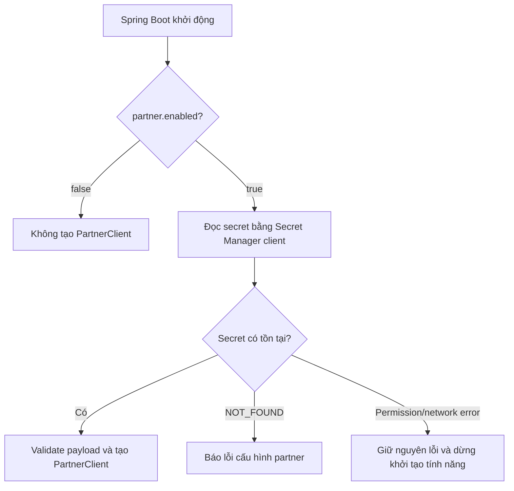

# Chọn bí mật bắt buộc hoặc tùy chọn trong Config Data

Một ứng dụng Spring Boot thường có nhiều loại cấu hình cần lấy từ Google Cloud Secret Manager. Mật khẩu database và khóa ký token thường là **bắt buộc**: thiếu chúng thì ứng dụng không thể hoạt động an toàn. API key của một đối tác chỉ dùng cho một tính năng phụ có thể là **tùy chọn**: nếu tính năng đó tắt, ứng dụng vẫn có thể phục vụ các luồng khác.

Để xử lý đúng hai trường hợp, cần phân biệt ba lớp: **Config Data import** đăng ký nguồn cấu hình từ Secret Manager; **secret reference** chỉ rõ giá trị nào cần phân giải; **quy tắc của ứng dụng** quyết định thiếu giá trị thì dừng khởi động hay tắt một tính năng. Dùng sai lớp có thể khiến ứng dụng bỏ qua lỗi thiếu cấu hình bắt buộc, hoặc dừng toàn bộ service chỉ vì một tích hợp phụ chưa được cấu hình.

Bài thuộc chương **Cấu hình Google Cloud** của module **SPRING_CLOUD_PROVIDER_INTEGRATION**. Trong module này, chúng ta thực hành tích hợp Spring Boot với dịch vụ managed của AWS, Azure và Google Cloud qua thư viện Spring Cloud tương ứng. Bài tập trung vào Google Cloud Secret Manager và Spring Boot Config Data API: chọn secret bắt buộc/tùy chọn, cấu hình giá trị mặc định, kiểm soát lỗi khi secret không tồn tại và kiểm thử hành vi khởi động.

## 1. Mục tiêu học tập

Sau bài học, bạn có thể:

- Phân biệt **Config Data location**, **secret reference**, **secret payload** và **giá trị mặc định**.
- Giải thích sự khác nhau giữa `spring.config.import`, tiền tố `optional:` và `spring.cloud.gcp.secretmanager.allow-default-secret`.
- Chọn secret nào phải có khi ứng dụng khởi động và secret nào có thể vắng mặt.
- Cấu hình Spring Framework on Google Cloud để xử lý secret không tồn tại.
- Dùng placeholder indirection để lấy secret tùy chọn và áp dụng fallback đúng cách.
- Thiết kế feature flag và conditional bean để tích hợp phụ không làm dừng toàn bộ ứng dụng.
- Giữ hành vi fail fast cho secret bắt buộc, kể cả khi ứng dụng có secret tùy chọn.
- Phân biệt lỗi `NOT_FOUND`, `PERMISSION_DENIED`, lỗi mạng, version bị disable và giá trị rỗng.
- Viết kiểm thử cho các tình huống có secret, thiếu secret, thiếu quyền và tính năng bị tắt.

## 2. Phân loại secret theo mức độ bắt buộc

Không nên quyết định một secret là tùy chọn chỉ vì ứng dụng có thể khởi động mà không có nó. Hãy dựa vào chức năng mà secret bảo vệ và hành vi mà sản phẩm phải duy trì.

| Loại secret | Ví dụ | Khi thiếu | Chính sách phù hợp |
| --- | --- | --- | --- |
| **Bắt buộc để service hoạt động** | DB password, credential truy cập storage chính, signing key cho token | Không thể phục vụ luồng chính hoặc có thể làm lộ dữ liệu | Fail fast; không nhận traffic |
| **Bắt buộc khi một tính năng được bật** | Partner API key, webhook signing secret, credential gửi email | Tính năng đó không thể hoạt động an toàn | Chỉ khởi tạo client khi tính năng bật; nếu bật mà thiếu secret thì fail fast |
| **Tùy chọn theo môi trường** | API key của sandbox, credential của hệ thống thử nghiệm | Có thể tắt tích hợp ở dev/test | Fallback sang trạng thái feature disabled |
| **Tùy chọn thực sự** | Secret cho một chức năng phụ không được kích hoạt trong môi trường hiện tại | Không ảnh hưởng luồng chính | Cho phép vắng mặt, ghi nhận trạng thái và không tạo client |
| **Không nên có fallback** | Production private key, OAuth client secret, encryption key | Có thể gây xác thực yếu hoặc mất khả năng bảo vệ dữ liệu | Không dùng giá trị mặc định giả; yêu cầu secret hợp lệ |

Một quy tắc thực tế:

- Nếu thiếu secret làm service không thể xác thực an toàn với thành phần cốt lõi, secret đó là **bắt buộc**.
- Nếu secret chỉ cần khi một tính năng được bật, secret đó là **bắt buộc có điều kiện**.
- Nếu tính năng không được bật và ứng dụng có thể hoạt động đúng khi không tạo client, secret có thể là **tùy chọn**.
- Nếu fallback làm ứng dụng dùng tài khoản mặc định, quyền rộng hơn hoặc khóa dùng chung, fallback đó không an toàn.

Ví dụ, `invoice-service` cần DB password để đọc/ghi hóa đơn, nên DB password là bắt buộc. API key của dịch vụ gửi SMS chỉ cần khi `notification.sms.enabled=true`; nếu SMS tắt ở môi trường local, service vẫn có thể chạy mà không cần key.

## 3. Ba cơ chế khác nhau trong Spring Config Data

Khi tích hợp Secret Manager, có ba cơ chế dễ bị nhầm:

| Cơ chế | Cấu hình | Phạm vi tác động |
| --- | --- | --- |
| Đăng ký Config Data resource | `spring.config.import: "sm@"` | Cho phép Spring Boot dùng Secret Manager như một nguồn external configuration |
| Optional Config Data location | `optional:` đứng trước một location trong `spring.config.import` | Cho phép Spring Boot tiếp tục khi chính location được import không tồn tại theo quy tắc Config Data |
| Cho phép secret không tồn tại | `spring.cloud.gcp.secretmanager.allow-default-secret=true` | Khi Secret Manager được hỏi về một secret không tồn tại, integration có thể trả về `null` thay vì ném exception |

`spring.config.import` không tự tải mọi secret trong project. Nó đăng ký Config Data resolver; từng secret được tham chiếu riêng trong property hoặc annotation.

### 3.1. Config Data import

Với các dòng Spring Framework on Google Cloud hỗ trợ cú pháp mới, ví dụ:

```yaml
spring:
  config:
    import: "sm@"
```

Sau đó, một property có thể tham chiếu secret:

```yaml
spring:
  datasource:
    password: "${sm@projects/invoice-prod/secrets/invoice-db-password/versions/12}"
```

`sm@` là scheme của Secret Manager Config Data resource. Cú pháp `sm@` được giới thiệu từ Spring Framework on Google Cloud 6.0 và được khuyến nghị ở các dòng mới. Với nhánh thư viện cũ hơn, kiểm tra tài liệu đúng phiên bản; một số nhánh dùng cú pháp `sm://`.

### 3.2. Tiền tố optional: áp dụng cho location

Spring Boot cho phép đặt tiền tố `optional:` trước một Config Data location. Ví dụ với một file cấu hình phụ:

```yaml
spring:
  config:
    import:
      - "sm@"
      - "optional:file:./partner-overrides.yml"
```

Ở ví dụ này:

- `sm@` đăng ký Secret Manager resource.
- `optional:file:./partner-overrides.yml` cho phép file cấu hình phụ vắng mặt mà không làm Spring Boot dừng chỉ vì file đó không có.

`optional:` là quy tắc của Spring Boot đối với **location được import**. Nó không phải một thuộc tính để đánh dấu từng secret trong placeholder là tùy chọn. Không suy luận rằng đặt `optional:` trước `sm@` sẽ biến mọi secret được tham chiếu trong YAML thành secret tùy chọn.

Tiền tố này cũng không cấp IAM permission, không sửa lỗi sai project/secret ID và không làm cho lỗi xác thực hoặc lỗi kết nối mạng trở thành một giá trị mặc định hợp lệ. Nếu cần bỏ qua một Config Data location thực sự có thể không tồn tại, dùng `optional:` ở đúng location đó; nếu cần xử lý một secret cụ thể có thể vắng mặt, thiết kế ở lớp secret reference hoặc ở code truy cập secret.

### 3.3. allow-default-secret

Spring Framework on Google Cloud có property:

```yaml
spring:
  cloud:
    gcp:
      secretmanager:
        allow-default-secret: true
```

Mặc định là `false`. Khi `allow-default-secret=true`, việc truy cập một secret không tồn tại có thể trả về `null` thay vì ném exception. Đây là cơ chế của Secret Manager integration, không phải tính năng mặc định của Spring Boot.

Cần lưu ý:

- Property này có phạm vi toàn integration Secret Manager trong application context, không phải cờ riêng cho một secret.
- Khi bật, secret bắt buộc bị thiếu cũng có thể không ném exception ngay tại bước truy cập; ứng dụng phải kiểm tra và fail fast ở nơi sử dụng.
- Nó chỉ thay đổi hành vi được tài liệu mô tả cho **secret không tồn tại**. Không coi nó là cơ chế bỏ qua `PERMISSION_DENIED`, lỗi mạng, lỗi TLS hoặc mọi lỗi API.
- Không bật property này chỉ để che lỗi cấu hình production.

Nếu một ứng dụng có cả DB password bắt buộc và API key tùy chọn, hãy cân nhắc kỹ phạm vi toàn cục này. Có thể giữ `allow-default-secret=false` và đọc secret tùy chọn bằng một component riêng, chỉ xử lý lỗi `NOT_FOUND`.

## 4. Secret bắt buộc: fail fast khi không thể lấy giá trị

Với secret bắt buộc, giữ hành vi mặc định `allow-default-secret=false`. Khi secret không tồn tại, Spring Framework on Google Cloud sẽ báo lỗi thay vì trả `null`.

Ví dụ cấu hình datasource:

```yaml
spring:
  config:
    import: "sm@"
  cloud:
    gcp:
      secretmanager:
        project-id: invoice-prod
        allow-default-secret: false
  datasource:
    url: jdbc:postgresql://10.20.0.15:5432/invoice
    username: invoice_app
    password: "${sm@projects/invoice-prod/secrets/invoice-db-password/versions/12}"
```

Trong production:

1. Secret `invoice-db-password` phải tồn tại trong project `invoice-prod`.
2. Version `12` phải tồn tại và ở trạng thái có thể truy cập.
3. Workload identity phải có quyền đọc version.
4. Ứng dụng chỉ được đánh dấu sẵn sàng sau khi cấu hình datasource hợp lệ và kết nối cốt lõi đáp ứng health check.

Không dùng mật khẩu mặc định như `password`, `changeme`, chuỗi rỗng hoặc thông tin đăng nhập dùng chung để giúp service khởi động. Nếu database password thiếu, dừng khởi động là hành vi đúng.

### 4.1. Kiểm tra giá trị rỗng sau khi phân giải

Một secret tồn tại nhưng payload rỗng vẫn khác với secret không tồn tại. `allow-default-secret=false` không thay thế kiểm tra nội dung. Với credential bắt buộc, kiểm tra giá trị không rỗng trước khi tạo client hoặc kết nối.

Ví dụ với `@ConfigurationProperties`:

```java
@ConfigurationProperties(prefix = "invoice.database")
public class InvoiceDatabaseProperties {

    private String username;
    private String password;

    public String getUsername() {
        return username;
    }

    public void setUsername(String username) {
        this.username = username;
    }

    public String getPassword() {
        return password;
    }

    public void setPassword(String password) {
        this.password = password;
    }

    public void validate() {
        if (password == null || password.isBlank()) {
            throw new IllegalStateException(
                    "invoice.database.password is required");
        }
    }
}
```

Gọi validation ở bước tạo cấu hình datasource hoặc dùng Bean Validation với `@Validated` và `@NotBlank` nếu cấu trúc properties phù hợp. Thông báo lỗi chỉ nên nêu tên property, không đưa giá trị secret vào exception.

### 4.2. Lỗi thiếu secret và lỗi quyền không giống nhau

| Tình huống | Ý nghĩa | Cách xử lý |
| --- | --- | --- |
| Secret không tồn tại | Resource được yêu cầu không có | Với secret bắt buộc: fail fast; với secret tùy chọn: fallback có kiểm soát |
| Secret/version bị disable hoặc destroyed | Resource có metadata nhưng payload không thể truy cập theo trạng thái đó | Chọn version hợp lệ hoặc khôi phục theo quy trình quản trị |
| `PERMISSION_DENIED` | Principal không được phép đọc | Sửa IAM đúng secret và đúng workload identity |
| Lỗi network/timeout/TLS | Không thể hoàn tất request tới API | Retry có giới hạn, kiểm tra mạng/certificate; không giả định secret không tồn tại |
| Payload rỗng hoặc sai định dạng | Secret có thể tồn tại nhưng không dùng được | Validate schema/độ dài/định dạng theo nghiệp vụ |

Một fallback tùy chọn chỉ nên áp dụng cho trường hợp đã xác định là **không có secret**. Không bắt mọi exception rồi trả về chuỗi rỗng, vì như vậy lỗi IAM hoặc outage có thể bị hiểu nhầm là người vận hành chủ ý tắt tính năng.

## 5. Secret tùy chọn: gắn với một tính năng có thể tắt

Giả sử `invoice-service` tích hợp với một đối tác gửi thông báo. Ở local và một số môi trường test, tính năng này không được bật. Khi đó:

- `partner.enabled=false`: ứng dụng không tạo partner client và không cần API key.
- `partner.enabled=true`: API key phải tồn tại và hợp lệ.
- Nếu tính năng đang bật nhưng secret thiếu, ứng dụng phải báo lỗi cấu hình thay vì âm thầm gửi request không xác thực.

Một cấu hình minh họa:

```yaml
spring:
  config:
    import: "sm@"
  cloud:
    gcp:
      secretmanager:
        allow-default-secret: true

partner:
  enabled: false
  api-key-secret-ref: "sm@projects/invoice-staging/secrets/partner-api-key/versions/7"
  api-key: "${${partner.api-key-secret-ref}:}"
```

Ở đây, `partner.api-key-secret-ref` là **chuỗi tham chiếu**, không phải giá trị secret. Placeholder lồng nhau hoạt động theo hai bước:

1. Placeholder bên trong lấy chuỗi `sm@projects/.../partner-api-key/versions/7`.
2. Placeholder bên ngoài dùng chuỗi đó làm key để phân giải secret; nếu Secret Manager không có secret và integration được cấu hình cho phép trả `null`, phần mặc định rỗng được dùng.

Kết quả mong đợi: nếu secret có giá trị, `partner.api-key` nhận payload; nếu secret không tồn tại, property nhận chuỗi rỗng để ứng dụng quyết định tính năng có được phép chạy hay không.

**Không viết placeholder lồng nhau với giá trị secret trực tiếp làm biểu thức bên trong.** Biểu thức bên trong phải phân giải thành tên/reference `sm@...`; nếu nó phân giải thành payload bí mật, Spring có thể hiểu payload đó như tên property tiếp theo thay vì giữ nguyên giá trị secret.

Cú pháp placeholder và hành vi `null` cần được kiểm thử với đúng phiên bản Spring Boot/Spring Framework on Google Cloud của dự án. Đây là một điểm nhạy với cơ chế phân giải placeholder, vì vậy không sao chép ví dụ giữa các nhánh thư viện mà không chạy integration test.

### 5.1. Bật client chỉ khi tính năng được bật

Ví dụ cấu hình properties:

```java
@ConfigurationProperties(prefix = "partner")
public class PartnerProperties {

    private boolean enabled;
    private String apiKey;

    public boolean isEnabled() {
        return enabled;
    }

    public void setEnabled(boolean enabled) {
        this.enabled = enabled;
    }

    public String getApiKey() {
        return apiKey;
    }

    public void setApiKey(String apiKey) {
        this.apiKey = apiKey;
    }
}
```

Chỉ tạo client khi feature flag bật:

```java
@Configuration
@EnableConfigurationProperties(PartnerProperties.class)
public class PartnerConfiguration {

    @Bean
    @ConditionalOnProperty(
            prefix = "partner",
            name = "enabled",
            havingValue = "true")
    PartnerClient partnerClient(PartnerProperties properties) {

        if (properties.getApiKey() == null
                || properties.getApiKey().isBlank()) {
            throw new IllegalStateException(
                    "partner.api-key is required when partner.enabled=true");
        }

        return new PartnerClient(properties.getApiKey());
    }
}
```

`PartnerClient` ở đây đại diện cho client của ứng dụng. Trong code thực tế, thay bằng HTTP client hoặc SDK của đối tác. Không log `apiKey` hoặc đưa nó vào `toString()`.

`@ConditionalOnProperty` ngăn bean partner client được tạo khi `partner.enabled=false`. Việc bind properties vẫn diễn ra; do đó secret tùy chọn phải được xử lý an toàn ở bước phân giải hoặc chỉ được truy cập bằng code khi tính năng bật.

## 6. Cách an toàn hơn khi chỉ một secret là tùy chọn

Vì `allow-default-secret` là property ở cấp integration, một ứng dụng có thể muốn giữ chế độ fail fast cho phần lớn secret nhưng chỉ cho phép một secret phụ vắng mặt. Trong trường hợp này, cân nhắc **không bật `allow-default-secret` toàn cục**. Thay vào đó, lưu tên resource của secret dưới dạng cấu hình thông thường và đọc nó trong một bean chỉ được tạo khi tính năng bật.

Luồng:



Ví dụ service đọc secret tùy chọn:

```java
@Service
public class OptionalPartnerSecretReader {

    private final SecretManagerServiceClient client;

    public OptionalPartnerSecretReader(
            SecretManagerServiceClient client) {
        this.client = client;
    }

    public Optional<String> readIfPresent(String versionResourceName) {
        try {
            AccessSecretVersionResponse response =
                    client.accessSecretVersion(
                            AccessSecretVersionRequest.newBuilder()
                                    .setName(versionResourceName)
                                    .build());

            String value =
                    response.getPayload().getData().toStringUtf8();

            if (value.isBlank()) {
                return Optional.empty();
            }

            return Optional.of(value);
        } catch (NotFoundException ex) {
            return Optional.empty();
        }
    }
}
```

Đoạn code minh họa cách xử lý `NOT_FOUND` riêng. Trong ứng dụng thật:

- `versionResourceName` phải đến từ cấu hình đã được kiểm soát, không nhận tùy ý từ request bên ngoài.
- `PERMISSION_DENIED`, timeout, lỗi TLS và lỗi API khác phải được giữ nguyên để vận hành xử lý.
- Nếu tính năng đã bật nhưng `Optional.empty()`, tầng cấu hình client phải phát lỗi rõ ràng.
- Quản lý `SecretManagerServiceClient` như Spring bean và đóng client khi application context dừng.
- Với regional secret, dùng resource name và endpoint regional tương ứng.

Cách này tạo ranh giới rõ: thiếu secret là trường hợp có thể xử lý; lỗi truy cập secret manager vẫn là lỗi hệ thống. Nó cũng tránh làm thay đổi hành vi của những secret bắt buộc khác trong cùng application context.

## 7. Không dùng giá trị mặc định để che lỗi bảo mật

Giá trị mặc định phù hợp cho cấu hình không nhạy cảm như timeout, số lần retry hoặc trạng thái tắt một tích hợp. Với secret, fallback cần được cân nhắc kỹ.

| Fallback | Đánh giá |
| --- | --- |
| `partner.enabled=false` khi môi trường không sử dụng partner | Hợp lý nếu sản phẩm cho phép tắt tính năng |
| Chuỗi rỗng cho API key tùy chọn khi feature disabled | Có thể chấp nhận nếu bean không được tạo và giá trị được kiểm tra khi feature bật |
| `password=changeme` khi thiếu DB secret | Không an toàn |
| Dùng API key staging nếu production secret thiếu | Không an toàn; có thể gửi dữ liệu production sang hệ thống test |
| Dùng service account mặc định có quyền rộng khi credential thiếu | Không an toàn; làm tăng phạm vi truy cập |
| Dùng signing key cố định trong source khi Secret Manager lỗi | Không an toàn; làm suy yếu khả năng thu hồi và rotation |

Một số nguyên tắc:

1. **Không fallback sang credential của môi trường khác.** Mỗi môi trường phải dùng secret và identity đúng phạm vi.
2. **Không dùng giá trị giả để đánh dấu ứng dụng sẵn sàng.** Health check phải phản ánh khả năng phục vụ thực tế.
3. **Không bắt mọi exception rồi trả về giá trị rỗng.** Chỉ xử lý loại lỗi mà nghiệp vụ cho phép, thường là `NOT_FOUND`.
4. **Không log secret để tìm hiểu lỗi.** Log resource name, project, principal, error code và request ID nếu được phép.
5. **Không biến secret tùy chọn thành quyền tùy chọn.** Workload identity vẫn chỉ được cấp quyền đọc secret cần thiết.

## 8. Profile dev, staging và production

Một secret có thể tùy chọn ở dev nhưng bắt buộc ở production. Hãy biểu diễn chính sách theo profile một cách rõ ràng:

```yaml
# application.yml
spring:
  config:
    import: "sm@"

partner:
  enabled: false
```

```yaml
# application-dev.yml
partner:
  enabled: false
```

```yaml
# application-staging.yml
partner:
  enabled: true
  api-key-secret-ref: "sm@projects/invoice-staging/secrets/partner-api-key/versions/7"
```

```yaml
# application-prod.yml
partner:
  enabled: true
  api-key-secret-ref: "sm@projects/invoice-prod/secrets/partner-api-key/versions/12"
```

Với profile staging/production, nếu thiếu API key trong khi `partner.enabled=true`, client factory phải fail fast. Nếu dev tắt partner, ứng dụng không cần truy cập secret đó.

Không nên chỉ dựa vào tên profile để quyết định một secret có bắt buộc hay không. Feature flag và validation của bean phải thống nhất. Nếu profile production vô tình override `partner.enabled=false`, ứng dụng có thể khởi động nhưng bỏ qua tích hợp ngoài dự kiến; cần kiểm tra cấu hình triển khai và readiness theo yêu cầu sản phẩm.

## 9. Thứ tự property và fallback

Spring Boot có thứ tự ưu tiên property source. Giá trị từ environment variable, system property, command-line argument hoặc nguồn cấu hình test có thể ghi đè property từ Config Data.

Ví dụ:

- YAML có `partner.enabled=true`.
- Deployment đặt `PARTNER_ENABLED=false`.
- Giá trị runtime có thể trở thành `false` theo thứ tự ưu tiên property source.

Điều này hữu ích cho môi trường dev, nhưng có thể làm tắt tích hợp ngoài dự kiến ở production. Hãy kiểm tra nguồn cấu hình hiệu lực bằng công cụ quản trị được bảo vệ và không in secret value ra endpoint `env`/`configprops`.

Một property fallback trong placeholder chỉ được dùng khi placeholder không phân giải được theo cơ chế tương ứng. Nó không thay thế validation nghiệp vụ. Nếu API key có giá trị nhưng sai định dạng hoặc đã bị thu hồi, placeholder vẫn phân giải thành công; ứng dụng cần kiểm tra bằng request thử nghiệm hoặc health check phù hợp.

## 10. Retry và hành vi khi Secret Manager không khả dụng

Không thể lấy secret vì Secret Manager tạm thời không truy cập được là tình huống khác với secret không tồn tại.

| Tình huống | Ứng dụng bắt buộc secret | Ứng dụng có secret tùy chọn |
| --- | --- | --- |
| Secret tồn tại, quyền hợp lệ | Tiếp tục khởi động | Tạo client nếu feature bật |
| Secret không tồn tại | Fail fast | Feature tắt có thể tiếp tục; feature bật phải báo lỗi |
| IAM từ chối | Fail fast và cảnh báo cấu hình quyền | Không giả định feature disabled; báo lỗi truy cập |
| Timeout/outage | Retry có giới hạn rồi fail theo chính sách startup | Có thể trì hoãn khởi tạo hoặc báo trạng thái degraded; không giả vờ secret không tồn tại |
| Secret payload rỗng | Fail validation | Feature enabled thì fail validation; feature disabled thì không tạo client |

Với workload bắt buộc secret, có thể dùng retry có giới hạn và backoff khi lỗi là tạm thời. Không retry vô hạn làm quá trình rollout treo không giới hạn. Với secret tùy chọn, nếu hệ thống cho phép hoạt động degraded trong thời gian ngắn, cần có timeout rõ ràng, trạng thái feature và alert; không coi mọi lỗi API là `Optional.empty()`.

Nếu ứng dụng giữ secret trong cache, cần quy định TTL và hành vi khi refresh lỗi. Khi credential cũ bị thu hồi vì sự cố, không tiếp tục dùng cache cũ chỉ để giữ availability.

## 11. Kiểm thử hành vi bắt buộc và tùy chọn

Kiểm thử cần chạy bằng đúng property, profile và identity dự kiến. Mock Secret Manager hữu ích cho unit test, nhưng không chứng minh IAM thật hoạt động.

### 11.1. Ma trận kiểm thử

| Ca | Feature | Secret | Quyền | Kết quả mong đợi |
| --- | --- | --- | --- | --- |
| A | Core service | DB secret tồn tại | Được phép | Ứng dụng khởi động và datasource hợp lệ |
| B | Core service | DB secret không tồn tại | Được phép với các secret khác | Ứng dụng fail fast |
| C | Partner disabled | Partner secret không tồn tại | Không cần quyền partner | Ứng dụng khởi động, PartnerClient không được tạo |
| D | Partner enabled | Partner secret tồn tại | Được phép | PartnerClient được tạo |
| E | Partner enabled | Partner secret không tồn tại | Được phép | Startup/configuration của partner thất bại rõ ràng |
| F | Partner enabled | Secret tồn tại | Bị từ chối | Báo lỗi IAM, không fallback thành feature disabled |
| G | Partner enabled | Secret Manager timeout | Không xác định được payload | Báo lỗi truy cập; retry theo chính sách |
| H | Partner enabled | Payload rỗng | Được phép | Validation thất bại |
| I | Partner disabled | Secret Manager không truy cập được | Không cần partner secret | Core service vẫn hoạt động nếu không có lookup phụ |
| J | Production profile | Partner flag bị override sai | Không liên quan | Test cấu hình phải phát hiện feature cốt lõi bị tắt |

### 11.2. Test bean chỉ được tạo khi feature bật

Ví dụ với Spring Boot test:

```java
@SpringBootTest(properties = {
        "partner.enabled=false",
        "partner.api-key="
})
class PartnerDisabledConfigurationTest {

    @Autowired
    private ApplicationContext context;

    @Test
    void doesNotCreatePartnerClientWhenDisabled() {
        assertFalse(context.containsBean("partnerClient"));
    }
}
```

Test này xác minh conditional bean không được tạo. Nếu secret được tham chiếu trực tiếp trong Config Data, vẫn phải cấu hình fallback phù hợp để quá trình nạp property không thất bại trước khi context hoàn tất.

### 11.3. Test bắt buộc có giá trị

```java
@SpringBootTest(properties = {
        "partner.enabled=true",
        "partner.api-key="
})
class PartnerRequiredSecretTest {

    @Test
    void missingPartnerApiKeyFailsWhenFeatureIsEnabled() {
        assertThrows(
                Exception.class,
                () -> SpringApplication.run(PartnerTestApplication.class));
    }
}
```

Đây là ví dụ khái niệm về hành vi fail fast. Trong test suite thực tế, nên dùng `ApplicationContextRunner` hoặc context riêng để xác minh exception cụ thể và tránh khởi tạo ứng dụng thật nhiều lần. Không ghi secret thật vào assertion hoặc test report.

## 12. Chẩn đoán lỗi thường gặp

| Triệu chứng | Nguyên nhân có thể | Hướng xử lý |
| --- | --- | --- |
| Ứng dụng dừng khi thiếu một API key phụ | Secret được tham chiếu như bắt buộc hoặc chưa cấu hình fallback | Xác định feature flag; dùng optional secret flow phù hợp |
| `optional:` đã được thêm nhưng placeholder secret vẫn lỗi | `optional:` đang áp dụng cho Config Data location, không phải secret reference | Dùng `allow-default-secret` hoặc đọc secret tùy chọn trong code |
| Secret thiếu nhưng ứng dụng nhận `null` ở DB password | `allow-default-secret=true` áp dụng cả secret bắt buộc | Tắt cờ toàn cục hoặc validate/fail fast cho DB password |
| API key rỗng nhưng client vẫn được tạo | Chưa validate property khi feature bật | Kiểm tra `hasText` trước khi tạo client |
| IAM bị từ chối nhưng code coi như secret tùy chọn | Bắt exception quá rộng | Chỉ xử lý `NotFoundException`; giữ nguyên lỗi quyền |
| Secret Manager timeout nhưng service báo feature disabled | Catch mọi lỗi và trả `Optional.empty()` | Tách `NOT_FOUND` khỏi lỗi mạng và lỗi xác thực |
| Secret tồn tại nhưng fallback vẫn được dùng | Placeholder indirection sai hoặc property nguồn ghi đè | Kiểm tra giá trị của property chứa secret reference và property precedence |
| Local chạy nhưng production fail | ADC local có quyền, workload identity production thiếu quyền | Kiểm tra service account/Workload Identity và IAM binding |
| Version bị disable nhưng ứng dụng không dùng fallback như mong đợi | Version không ở trạng thái có thể truy cập | Chọn version hợp lệ; không coi disable như secret không tồn tại |
| Config import không được nạp | Thiếu starter hoặc sai scheme theo version thư viện | Kiểm tra BOM, dependency và cú pháp `sm@`/`sm://` đúng nhánh |

### 12.1. Checklist trước khi deploy

1. Liệt kê tất cả secret mà ứng dụng tham chiếu.
2. Đánh dấu từng secret là bắt buộc, bắt buộc có điều kiện hoặc tùy chọn.
3. Với secret bắt buộc, giữ `allow-default-secret=false` và kiểm tra payload không rỗng.
4. Với secret tùy chọn, xác định feature flag và hành vi khi thiếu.
5. Nếu bật `allow-default-secret=true`, rà soát mọi Secret Manager reference trong application context vì cờ có phạm vi toàn integration.
6. Nếu chỉ một secret tùy chọn, cân nhắc đọc nó trong code và chỉ bắt `NOT_FOUND`.
7. Kiểm tra IAM của workload identity trên từng secret.
8. Kiểm tra `PERMISSION_DENIED`, timeout và lỗi TLS không bị biến thành trạng thái “không có secret”.
9. Kiểm tra profile production không vô tình tắt tính năng bắt buộc.
10. Chạy test với secret test và principal test; không dùng credential production trong unit test.

## 13. Bài thực hành: bật/tắt tích hợp đối tác theo secret tùy chọn

**Bối cảnh:** `invoice-service` cần database credential để xử lý hóa đơn. Dịch vụ gửi SMS là tích hợp phụ, chỉ chạy ở staging và production. Ở local, SMS tắt và không cần API key.

### Bước 1 — Tạo cấu hình core và feature flag

```yaml
spring:
  config:
    import: "sm@"
  cloud:
    gcp:
      secretmanager:
        project-id: invoice-staging
        allow-default-secret: false

invoice:
  database:
    password: "${sm@projects/invoice-staging/secrets/invoice-db-password/versions/12}"

notification:
  sms:
    enabled: false
```

DB password vẫn bắt buộc. Cấu hình SMS tắt ở mặc định.

### Bước 2 — Cấu hình môi trường có SMS

Trong profile staging:

```yaml
notification:
  sms:
    enabled: true
    api-key-secret-ref: "sm@projects/invoice-staging/secrets/sms-provider-api-key/versions/4"
```

Trong profile production, thay project và version theo resource của production. Không sao chép giá trị API key vào YAML.

### Bước 3 — Chỉ đọc secret khi feature bật

Tạo bean SMS client với `@ConditionalOnProperty(prefix="notification.sms", name="enabled", havingValue="true")`. Trong bean factory, đọc resource được cấu hình, kiểm tra payload không rỗng và tạo client. Nếu secret không tồn tại hoặc principal không có quyền, báo lỗi cấu hình để rollout không đánh dấu service sẵn sàng.

### Bước 4 — Kiểm tra local

Chạy profile dev với `notification.sms.enabled=false`. Xác minh:

- Ứng dụng vẫn kết nối database.
- Không tạo SMS client.
- Không gọi Secret Manager để lấy SMS API key nếu code chỉ đọc khi bean được tạo.
- Không cần cấp quyền đọc SMS secret cho developer local.

### Bước 5 — Kiểm tra staging

Bật SMS, cấp quyền đọc đúng secret cho workload identity staging. Xác minh client được tạo và gửi một request test tới sandbox của đối tác. Nếu secret thiếu, startup hoặc khởi tạo feature phải thất bại với thông báo không chứa payload.

### Bước 6 — Kiểm tra lỗi quyền

Thu hồi quyền đọc SMS secret khỏi principal test. Xác minh ứng dụng báo `PERMISSION_DENIED`; không coi lỗi này là secret tùy chọn vắng mặt và không âm thầm tắt SMS.

### Bước 7 — Kiểm tra rotation

Tạo version mới, cập nhật reference hoặc refresh theo chiến lược đã thiết kế. Xác minh client mới sử dụng key mới, sau đó thu hồi key cũ. Không in API key ra log để xác nhận.

## 14. Câu hỏi tự kiểm tra

1. `spring.config.import: "sm@"` đăng ký điều gì trong Spring Boot?
2. Vì sao `optional:` trên Config Data location không đồng nghĩa với việc mọi secret placeholder đều tùy chọn?
3. Giá trị mặc định của `spring.cloud.gcp.secretmanager.allow-default-secret` là gì?
4. Khi bật `allow-default-secret=true`, integration xử lý secret không tồn tại như thế nào?
5. Vì sao cờ `allow-default-secret` có thể gây rủi ro nếu ứng dụng đồng thời có DB password bắt buộc?
6. Một API key chỉ cần khi `partner.enabled=true` nên được kiểm tra ở bước nào?
7. Vì sao không nên bắt mọi exception rồi trả về `Optional.empty()`?
8. Phân biệt `NOT_FOUND`, `PERMISSION_DENIED` và timeout khi truy cập Secret Manager.
9. Vì sao secret payload rỗng vẫn cần validation dù secret resource tồn tại?
10. Khi nào nên đọc secret tùy chọn bằng Java client trong một bean có điều kiện thay vì placeholder Config Data?
11. Nếu secret có giá trị nhưng fallback vẫn được dùng, cần kiểm tra property indirection và property precedence ra sao?
12. Vì sao production không nên dùng chuỗi mặc định `changeme` khi DB secret thiếu?

## 15. Ghi nhớ

Hãy quyết định secret bắt buộc hay tùy chọn dựa trên chức năng mà nó bảo vệ. Database password, signing key và credential của luồng chính phải fail fast khi thiếu. Secret chỉ phục vụ một tính năng phụ có thể vắng mặt khi feature đó tắt; khi feature bật, secret vẫn phải hợp lệ.

Trong Spring Boot, `spring.config.import` đăng ký Config Data resource, `optional:` áp dụng cho location được import, còn `spring.cloud.gcp.secretmanager.allow-default-secret` quyết định cách integration xử lý secret không tồn tại. Ba cơ chế này không thay thế nhau. Vì `allow-default-secret` áp dụng ở cấp integration, hãy cân nhắc tác động đến mọi secret trong ứng dụng; nếu chỉ một secret là tùy chọn, đọc riêng và chỉ xử lý `NOT_FOUND` thường dễ kiểm soát hơn.

**Fallback phải thể hiện một trạng thái sản phẩm hợp lệ**, chẳng hạn tắt một tích hợp phụ. Không dùng fallback để che lỗi IAM, lỗi mạng hoặc thiếu credential cốt lõi. Kiểm thử cả trường hợp secret tồn tại, secret vắng mặt, feature bật/tắt và principal không có quyền trước khi triển khai.

## Tài liệu tham khảo chính thức

- [Spring Framework on Google Cloud — Secret Manager Config Data Resource và Allow default secret](https://googlecloudplatform.github.io/spring-cloud-gcp/reference/html/index.html#secret-manager)
- [Spring Boot — Externalized Configuration: Importing Additional Data và Optional Locations](https://docs.spring.io/spring-boot/reference/features/external-config.html)
- [Spring Boot 3.5 — Externalized Configuration](https://docs.spring.io/spring-boot/3.5/reference/features/external-config.html)
- [Spring Framework on Google Cloud — Secret Manager documentation source](https://github.com/GoogleCloudPlatform/spring-cloud-gcp/blob/main/docs/src/main/asciidoc/secretmanager.adoc)
- [Spring Framework on Google Cloud — Issue 3440: Secret Manager key with default value](https://github.com/GoogleCloudPlatform/spring-cloud-gcp/issues/3440)

