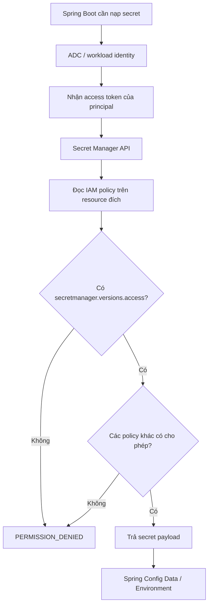
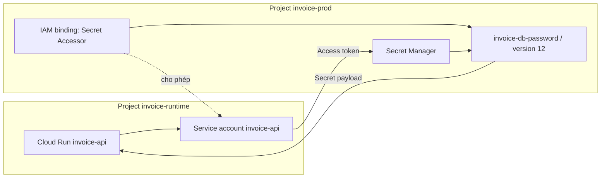

# Phân quyền đọc bí mật và truy cập khác project

Một ứng dụng Spring Boot có thể chạy trong project `invoice-runtime` nhưng cần đọc database password được lưu trong Secret Manager của project `invoice-prod`. Việc biết đúng resource name chưa đủ để đọc được secret. Google Cloud phải xác thực **danh tính đang gọi API**, sau đó đánh giá IAM policy trên **secret mà request nhắm tới**.

Với Secret Manager, quyền đọc payload cốt lõi là `secretmanager.versions.access`. Role dựng sẵn thường dùng là `roles/secretmanager.secretAccessor`. Role này có thể được cấp ngay trên một secret cụ thể. Đây là cách phù hợp khi một service chỉ cần một vài credential. Nếu cấp role ở project, folder hoặc organization, phạm vi quyền sẽ mở rộng tới nhiều secret hơn.

Bài thuộc chương **Cấu hình Google Cloud** của module **SPRING_CLOUD_PROVIDER_INTEGRATION**. Module thực hành tích hợp Spring Boot với dịch vụ managed của AWS, Azure và Google Cloud qua các thư viện Spring Cloud tương ứng. Bài này tập trung vào IAM cho Google Cloud Secret Manager, phân biệt danh tính runtime với project chứa secret, cấu hình truy cập cross-project và kiểm tra lỗi quyền trong môi trường triển khai.

## 1. Mục tiêu học tập

Sau bài học, bạn có thể:

- Giải thích sự khác nhau giữa authentication và authorization khi Spring Boot gọi Secret Manager.
- Xác định principal thực tế mà ứng dụng sử dụng từ ADC hoặc workload identity.
- Biết permission `secretmanager.versions.access` và role `roles/secretmanager.secretAccessor`.
- Phân biệt quyền đọc payload với quyền xem metadata, thêm version và quản trị secret.
- Gán quyền ở cấp secret thay vì cấp project khi ứng dụng chỉ cần một secret.
- Thiết lập quyền khi workload và Secret Manager nằm ở hai project khác nhau.
- Chọn cách xác thực phù hợp cho Cloud Run, Compute Engine, GKE, môi trường local và workload bên ngoài Google Cloud.
- Hiểu vai trò của OAuth scope, IAM Conditions, VPC Service Controls và audit logs.
- Chẩn đoán `PERMISSION_DENIED`, thiếu authentication scope, sai principal và lỗi cross-project.

## 2. Authentication và authorization là hai bước khác nhau

Khi ứng dụng gọi Secret Manager, Google Cloud xử lý hai câu hỏi:

- **Authentication:** Ai đang gửi request? Ví dụ service account gắn với Cloud Run, Kubernetes service account được liên kết, federated principal hoặc user đang phát triển local.
- **Authorization:** Principal đó có quyền thực hiện thao tác trên secret được yêu cầu không? Ví dụ có `secretmanager.versions.access` trên secret đích hay không.

Luồng truy cập điển hình:



Có access token hợp lệ chỉ chứng minh ứng dụng đã xác thực. Token đó không tự cấp quyền đọc secret. Ngược lại, một IAM binding đúng cũng không giúp request thành công nếu ứng dụng không lấy được credential hoặc đang dùng sai principal.

Ví dụ:

- Cloud Run service được gắn service account `invoice-api@invoice-runtime.iam.gserviceaccount.com`.
- Ứng dụng tham chiếu `projects/invoice-prod/secrets/invoice-db-password/versions/12`.
- IAM policy của secret `invoice-db-password` trong project `invoice-prod` phải cho phép service account nói trên truy cập payload.
- Nếu Cloud Run đang chạy bằng service account khác, binding cho `invoice-api@...` không có tác dụng với request thực tế.

## 3. Permission và role cần cho đọc secret

Permission cốt lõi là:

```text
secretmanager.versions.access
```

Role dựng sẵn phổ biến:

```text
roles/secretmanager.secretAccessor
```

`roles/secretmanager.secretAccessor` cho phép truy cập payload của secret. Role này bao gồm permission `secretmanager.versions.access` và các quyền đọc project cần thiết cho thao tác đó. Google Cloud cho phép cấp role này ở mức thấp nhất là **secret resource**.

### 3.1. Phân biệt các role thường gặp

| Role | Khả năng chính | Có đọc payload? |
| --- | --- | --- |
| `roles/secretmanager.secretAccessor` | Truy cập payload của secret | Có |
| `roles/secretmanager.viewer` | Xem metadata, secret và version metadata | Không |
| `roles/secretmanager.editor` | Tạo/cập nhật/quản lý một số resource và version | Không |
| `roles/secretmanager.secretVersionAdder` | Thêm version vào secret hiện có | Không |
| `roles/secretmanager.secretVersionManager` | Quản lý version: thêm, enable, disable, destroy và xem metadata | Không |
| `roles/secretmanager.admin` | Quản trị toàn bộ hoạt động Secret Manager trong phạm vi được cấp | Có, nhưng rộng hơn nhu cầu runtime chỉ đọc |

Một điểm dễ nhầm: `roles/editor` của project và `roles/secretmanager.editor` không phải role đọc payload. Theo bảng permission hiện hành của Google Cloud, các role này không chứa `secretmanager.versions.access`. `roles/secretmanager.viewer` cũng chỉ xem metadata, không đọc nội dung bí mật.

Ứng dụng runtime thường chỉ cần `roles/secretmanager.secretAccessor`. Không cấp `roles/secretmanager.admin` chỉ để Spring Boot đọc database password. Việc thêm version, thay đổi IAM policy hoặc destroy version nên thuộc principal quản trị/rotation riêng.

### 3.2. Phạm vi quyền theo resource hierarchy

Cùng một role nhưng phạm vi truy cập phụ thuộc nơi gán binding:

| Nơi gán `roles/secretmanager.secretAccessor` | Phạm vi secret mà principal có thể đọc |
| --- | --- |
| Một secret | Chỉ secret đó |
| Project | Tất cả secret trong project |
| Folder | Tất cả secret trong các project thuộc folder |
| Organization | Tất cả secret trong các project thuộc organization |

Nếu `invoice-api` chỉ cần `invoice-db-password`, cấp role ở secret đó. Không cấp quyền ở project chỉ vì lệnh cấu hình dễ viết hơn. Một binding ở project có thể khiến service đọc được thêm các secret được tạo sau này mà không cần thay đổi ứng dụng.

## 4. Cấp quyền ở cấp secret

Giả sử có:

```text
Project chứa secret: invoice-prod
Secret ID: invoice-db-password
Runtime service account:
  invoice-api@invoice-runtime.iam.gserviceaccount.com
Role:
  roles/secretmanager.secretAccessor
```

Lệnh gcloud để cấp quyền:

```bash
gcloud secrets add-iam-policy-binding invoice-db-password \
  --project=invoice-prod \
  --member="serviceAccount:invoice-api@invoice-runtime.iam.gserviceaccount.com" \
  --role="roles/secretmanager.secretAccessor"
```

Trong lệnh này:

- `invoice-db-password` là secret ID.
- `--project=invoice-prod` chỉ project **sở hữu secret**.
- `--member` là principal được cấp quyền; service account có thể nằm ở project khác.
- `--role` cấp quyền đọc payload.

Tài khoản chạy lệnh quản trị cần có quyền sửa IAM policy trên secret, chẳng hạn permission `secretmanager.secrets.setIamPolicy`. Runtime service account không cần quyền sửa IAM policy để đọc secret.

### 4.1. Xem IAM policy hiện tại

```bash
gcloud secrets get-iam-policy invoice-db-password \
  --project=invoice-prod \
  --format=yaml
```

Kiểm tra member và role đã xuất hiện đúng. Chú ý rằng IAM policy có thể chứa nhiều binding do các nhóm và service khác quản lý; không ghi đè toàn bộ policy chỉ để thêm một service account.

### 4.2. Thu hồi quyền khi service không còn cần secret

```bash
gcloud secrets remove-iam-policy-binding invoice-db-password \
  --project=invoice-prod \
  --member="serviceAccount:invoice-api@invoice-runtime.iam.gserviceaccount.com" \
  --role="roles/secretmanager.secretAccessor"
```

Sau khi thu hồi, request mới của principal đó sẽ không còn được phép đọc payload. Việc thu hồi quyền không xóa secret hoặc version. Nếu service vẫn đang giữ secret trong memory, việc thu hồi IAM cũng không tự xóa bản sao đã được nạp trước đó; cần có quy trình restart/refresh hoặc thu hồi credential ở hệ thống đích nếu có nguy cơ lộ.

Với regional secret, chỉ rõ location theo cú pháp gcloud hỗ trợ cho regional resource và kiểm tra IAM policy trên đúng regional secret. Không gán quyền nhầm vào một global secret cùng tên.

## 5. Truy cập secret ở project khác project chạy ứng dụng

Đây là tình huống chính của bài:

```text
Project invoice-runtime
  Cloud Run service: invoice-api
  Service account:
    invoice-api@invoice-runtime.iam.gserviceaccount.com

Project invoice-prod
  Secret Manager:
    invoice-db-password
    Version: 12
```

Spring Boot tham chiếu resource của project chứa secret:

```yaml
spring:
  config:
    import: "sm@"
  cloud:
    gcp:
      secretmanager:
        project-id: invoice-prod

invoice:
  database:
    password: "${sm@projects/invoice-prod/secrets/invoice-db-password/versions/12}"
```

Có hai project khác nhau với hai vai trò:

- `invoice-runtime` chứa workload và service account được dùng làm danh tính gọi API.
- `invoice-prod` chứa secret và IAM policy quyết định ai được đọc payload.

**Resource path phải chỉ project chứa secret.** IAM binding phải được gắn trên secret thuộc project `invoice-prod`, với member là service account của workload thuộc `invoice-runtime`.

### 5.1. Sơ đồ cross-project



Không cần sao chép secret sang project runtime chỉ vì ứng dụng chạy ở đó. Giữ secret trong project quản lý dữ liệu nhạy cảm giúp tách vòng đời secret, quyền quản trị và quyền deploy ứng dụng.

### 5.2. Gán IAM binding cho service account cross-project

Chạy lệnh trong project có secret:

```bash
gcloud secrets add-iam-policy-binding invoice-db-password \
  --project=invoice-prod \
  --member="serviceAccount:invoice-api@invoice-runtime.iam.gserviceaccount.com" \
  --role="roles/secretmanager.secretAccessor"
```

Dùng service account email chính xác. Không nhầm với:

- User account của developer đang chạy `gcloud`.
- Service account mặc định của project runtime.
- Service account dùng bởi pipeline deploy.
- Service account của một service khác trong cùng project.

Một service account có thể được quản lý ở project runtime và được cấp quyền trên resource project khác. IAM member định danh service account; project trong `--project` xác định nơi lưu secret và policy.

## 6. Xác thực workload trên Google Cloud

Spring Framework on Google Cloud dùng Application Default Credentials (ADC) để lấy credential theo môi trường. Với workload chạy trên Google Cloud, nên dùng danh tính gắn với compute resource.

### 6.1. Cloud Run

Gắn một service account riêng cho từng service hoặc nhóm workload có cùng nhu cầu quyền. Ví dụ cập nhật service:

```bash
gcloud run services update invoice-api \
  --project=invoice-runtime \
  --region=asia-southeast1 \
  --service-account=invoice-api@invoice-runtime.iam.gserviceaccount.com
```

Khi ứng dụng gọi Secret Manager, ADC sử dụng service account được gắn với Cloud Run revision. Cấp `roles/secretmanager.secretAccessor` cho đúng service account đó trên secret trong `invoice-prod`.

Không cấp quyền cho user đã deploy Cloud Run với giả định ứng dụng sẽ dùng user đó. Danh tính deploy và danh tính runtime là hai principal khác nhau.

### 6.2. Compute Engine

Gắn service account phù hợp cho VM và đảm bảo VM có OAuth scope `https://www.googleapis.com/auth/cloud-platform`. Google Cloud yêu cầu scope này khi dùng Secret Manager từ Compute Engine.

OAuth scope và IAM có vai trò khác nhau:

- OAuth scope giới hạn nhóm API mà access token của VM có thể gọi.
- IAM policy quyết định principal có quyền đọc secret cụ thể hay không.

Có `cloud-platform` scope không tự cấp `secretmanager.versions.access`. Ngược lại, IAM binding đúng cũng chưa đủ nếu VM được tạo với OAuth scope quá hẹp.

### 6.3. Google Kubernetes Engine

Với GKE, dùng Workload Identity Federation for GKE để cấp danh tính cho Kubernetes workload. Có hai mô hình thường gặp:

- **Direct resource access:** cấp role Secret Accessor trực tiếp cho federated Kubernetes service account principal trên secret.
- **Service account impersonation:** liên kết Kubernetes service account với Google Cloud service account; sau đó cấp quyền đọc secret cho Google Cloud service account.

Mô hình impersonation hữu ích khi cần dùng một service account làm danh tính thống nhất cho nhiều Google Cloud API. Giới hạn quyền liên kết vào đúng Kubernetes namespace/service account; không cho mọi workload trong cluster impersonate một service account có quyền đọc nhiều secret.

Đối với GKE node hoặc Compute Engine VM, kiểm tra thêm `cloud-platform` OAuth scope. Đây là nguyên nhân phổ biến của lỗi `insufficient authentication scopes` dù IAM policy có vẻ đúng.

## 7. Truy cập từ local development

Ở local, developer có thể dùng ADC bằng user credential:

```bash
gcloud auth application-default login
```

Cách này phù hợp cho dev khi user được cấp quyền đọc secret test. Không nên cấp cho mọi developer quyền đọc production secret chỉ để chạy ứng dụng local.

Nếu cần kiểm thử chính xác quyền runtime, có thể dùng service account impersonation để tạo ADC ngắn hạn cho service account:

```bash
gcloud auth application-default login \
  --impersonate-service-account=invoice-api@invoice-runtime.iam.gserviceaccount.com
```

Principal developer cần permission `iam.serviceAccounts.getAccessToken`, thường thông qua `roles/iam.serviceAccountTokenCreator` trên service account được impersonate. Java client libraries hỗ trợ ADC với service account impersonation.

Lợi ích:

- Không phải tải service account private key về máy.
- Kiểm thử bằng chính quyền runtime dự kiến.
- Token được tạo ngắn hạn thay vì dùng credential tĩnh.
- Có thể thu hồi quyền impersonation riêng mà không thay IAM của secret.

Khi dùng impersonation, phân biệt hai lớp quyền: developer được phép impersonate service account; service account được phép đọc secret. Developer không nhất thiết phải có quyền trực tiếp đọc secret production.

## 8. Workload chạy ngoài Google Cloud: AWS, Azure và CI/CD

Module này thực hành Spring Boot với các provider managed khác nhau. Nếu ứng dụng chạy trên AWS, Azure, GitHub Actions hoặc GitLab CI nhưng cần đọc Google Cloud Secret Manager, dùng **Workload Identity Federation (WIF)**.

WIF cho phép Google Cloud tin cậy identity provider bên ngoài thông qua OIDC, SAML hoặc cơ chế federation được hỗ trợ. Workload đổi credential bên ngoài lấy token ngắn hạn của Google Cloud. Cách này tránh duy trì service account key JSON lâu dài.

Có hai phương án cấp quyền:

### 8.1. Direct resource access

Cấp role `roles/secretmanager.secretAccessor` trực tiếp cho federated principal trên secret đích. Principal có thể được giới hạn theo subject, repository, environment hoặc attribute mapping của identity provider.

Cách này loại bỏ bước impersonate service account nếu API và use case hỗ trợ direct access. Phải giới hạn member bằng principal identifier và attribute condition; tránh cấp quyền cho mọi thành viên của workload identity pool.

### 8.2. Service account impersonation

Một federated identity được phép impersonate Google Cloud service account. Khi đó:

1. WIF xác thực workload AWS/Azure/CI với Google Cloud.
2. Federated principal nhận quyền `roles/iam.workloadIdentityUser` trên service account được chọn.
3. Service account nhận `roles/secretmanager.secretAccessor` trên secret trong project chứa secret.
4. Workload dùng short-lived credential của service account để gọi Secret Manager.

Đây là hai binding khác nhau: WIF principal được phép impersonate service account; service account được phép đọc secret. Không cấp `roles/secretmanager.secretAccessor` cho một principal khác rồi kỳ vọng service account tự kế thừa quyền đó.

Google Cloud khuyến nghị giới hạn external identities bằng attribute/condition và tạo service account riêng cho từng ứng dụng. Với môi trường dev, staging và production, cân nhắc tách workload identity pool hoặc provider theo môi trường để tránh một identity từ CI staging có thể impersonate service account production.

## 9. IAM Conditions và giới hạn truy cập

Ngoài role, IAM Conditions cho phép giới hạn quyền theo thuộc tính resource hoặc thời gian. Secret Manager hỗ trợ điều kiện dựa trên resource name/type/service và thời gian.

Một số trường hợp:

- Cấp quyền đọc có thời hạn cho một nhóm hỗ trợ xử lý incident.
- Giới hạn principal chỉ truy cập secret có prefix nhất định.
- Giới hạn quyền vào một secret version cụ thể khi chính sách và resource attribute cho phép.
- Cấp quyền tạm thời trong quá trình migration rồi tự hết hiệu lực theo timestamp.

Ví dụ biểu thức điều kiện theo thời gian:

```text
request.time < timestamp("2026-12-01T00:00:00Z")
```

Khi thêm condition, kiểm tra resource attribute mà Secret Manager đánh giá ở đúng thao tác API. Không giả định condition được đánh giá trên cùng một resource name trong mọi thao tác secret và version. Kiểm thử policy bằng principal thực tế trước khi triển khai rộng.

IAM allow policy cũng có thể bị giới hạn bởi IAM Deny policy hoặc chính sách cấp cao hơn. Một allow binding đúng không bảo đảm request thành công nếu có deny policy áp dụng.

## 10. API, OAuth scope và các ràng buộc ngoài IAM

Để đọc secret thành công, cần kiểm tra nhiều lớp:

| Lớp | Điều cần xác nhận | Lỗi thường gặp |
| --- | --- | --- |
| Secret Manager API | API đã được bật trong project cần sử dụng | `SERVICE_DISABLED` hoặc lỗi API chưa được enable |
| Authentication | ADC trả về principal đúng | `UNAUTHENTICATED`, credential không tìm thấy |
| IAM | Principal có `secretmanager.versions.access` trên secret | `PERMISSION_DENIED` |
| OAuth scope | VM/GKE node có `cloud-platform` scope | `insufficient authentication scopes` |
| VPC Service Controls | Request được phép đi qua service perimeter | Policy denied dù IAM đã cấp |
| IAM Deny/Condition | Không có deny hoặc condition không thỏa | `PERMISSION_DENIED` |
| Version state | Secret version tồn tại và có thể truy cập | `NOT_FOUND` hoặc lỗi version không khả dụng |
| CMEK (nếu dùng) | Secret Manager service agent có quyền dùng Cloud KMS key | Lỗi thao tác mã hóa/giải mã |

Bật Secret Manager API nếu project chưa bật:

```bash
gcloud services enable secretmanager.googleapis.com \
  --project=invoice-prod
```

Với secret được mã hóa bằng customer-managed encryption key (CMEK), phân biệt quyền đọc secret của workload với quyền dùng khóa Cloud KMS của Secret Manager service agent. Workload thường cần Secret Accessor trên secret; service agent của Secret Manager cần quyền phù hợp trên CryptoKey để thực hiện thao tác mã hóa/giải mã. Không cấp quyền KMS rộng cho workload chỉ vì secret dùng CMEK.

## 11. Theo dõi truy cập bằng Cloud Audit Logs

Secret Manager tạo audit logs cho hoạt động quản trị và truy cập dữ liệu. Phương thức `AccessSecretVersion` yêu cầu permission `secretmanager.versions.access` và tạo **Data Access audit log**.

Data Access audit logs cần được bật theo cấu hình audit logging của project/organization nếu chưa được bật. Sau đó có thể lọc trong Logs Explorer:

```text
protoPayload.serviceName="secretmanager.googleapis.com"
```

Để xem thao tác đọc payload:

```text
protoPayload.serviceName="secretmanager.googleapis.com"
protoPayload.methodName="google.cloud.secretmanager.v1.SecretManagerService.AccessSecretVersion"
```

Dùng log để xác minh:

- Principal nào đã truy cập secret.
- Secret resource nào được yêu cầu.
- Thời điểm và method thực hiện.
- Request có bị từ chối hay không, nếu log được tạo cho sự kiện đó.

Audit log phục vụ điều tra và kiểm toán; nó không thay thế IAM policy. Không log secret payload trong ứng dụng để bổ sung thông tin cho audit log.

## 12. Chẩn đoán `PERMISSION_DENIED` và lỗi cross-project

Khi Spring Boot báo không đọc được secret, kiểm tra theo thứ tự:

### 12.1. Xác minh principal thực tế

Xác nhận ứng dụng đang chạy với service account nào:

- Cloud Run: service account gắn trên revision.
- Compute Engine: service account gắn trên VM.
- GKE: federated Kubernetes service account hoặc Google Cloud service account được impersonate.
- Local: ADC user hoặc service account impersonation.
- AWS/Azure/GitHub/GitLab: external principal hoặc service account được impersonate qua WIF.

Không suy ra principal runtime từ tài khoản đã chạy lệnh deploy.

### 12.2. Xác minh project chứa secret

Resource name phải có project sở hữu secret:

```text
projects/invoice-prod/secrets/invoice-db-password/versions/12
```

Nếu ứng dụng dùng project mặc định, kiểm tra `spring.cloud.gcp.secretmanager.project-id`. Với cross-project, nên ghi project rõ ràng trong resource path để tránh đọc nhầm project.

### 12.3. Xác minh IAM binding ở đúng secret

```bash
gcloud secrets get-iam-policy invoice-db-password \
  --project=invoice-prod \
  --format=yaml
```

Tìm đúng service account hoặc federated principal và role `roles/secretmanager.secretAccessor`. Nếu binding chỉ tồn tại ở `invoice-runtime`, nó không tự áp dụng cho secret nằm trong `invoice-prod`.

### 12.4. Phân biệt lỗi theo dấu hiệu

| Lỗi | Hướng kiểm tra |
| --- | --- |
| `UNAUTHENTICATED` | ADC, token, service account attachment, WIF credential configuration |
| `PERMISSION_DENIED` | Principal, IAM binding, IAM Deny, IAM Condition, VPC Service Controls |
| `insufficient authentication scopes` | OAuth scope `cloud-platform` trên Compute Engine/GKE |
| `SERVICE_DISABLED` | Secret Manager API trong project phù hợp |
| `NOT_FOUND` | Project ID, secret ID, location, version và resource path |
| Lỗi CMEK | Secret Manager service agent và quyền trên Cloud KMS key |
| Local thành công, Cloud Run thất bại | User ADC có quyền nhưng runtime service account chưa được cấp quyền |
| Secret Accessor đã cấp nhưng vẫn bị chặn | Kiểm tra deny policy, service perimeter và scope |

Một lỗi `PERMISSION_DENIED` không nên được xử lý bằng cách cấp `roles/owner` hoặc `roles/secretmanager.admin` cho runtime. Xác định lớp policy đang từ chối rồi sửa binding nhỏ nhất cần thiết.

## 13. Bài thực hành: Cloud Run đọc secret ở project khác

**Bối cảnh:** `invoice-api` chạy trên Cloud Run trong project `invoice-runtime`. Database password nằm trong Secret Manager của project `invoice-prod`. Yêu cầu: Cloud Run dùng service account riêng, chỉ đọc được một secret cần thiết và không chứa service account key JSON.

### Bước 1 — Xác định hai project và principal

```text
Runtime project: invoice-runtime
Secret project: invoice-prod
Cloud Run service: invoice-api
Runtime service account:
  invoice-api@invoice-runtime.iam.gserviceaccount.com
Secret:
  invoice-db-password
Secret version:
  12
```

Xác nhận project ID, secret ID và version bằng lệnh metadata. Không dùng tên hiển thị project thay cho project ID.

### Bước 2 — Bật Secret Manager API

```bash
gcloud services enable secretmanager.googleapis.com \
  --project=invoice-prod
```

### Bước 3 — Gắn service account vào Cloud Run

```bash
gcloud run services update invoice-api \
  --project=invoice-runtime \
  --region=asia-southeast1 \
  --service-account=invoice-api@invoice-runtime.iam.gserviceaccount.com
```

Nếu service chưa được tạo, gắn service account ngay trong bước deploy. Kiểm tra revision mới thực sự sử dụng identity này.

### Bước 4 — Cấp Secret Accessor trên secret đích

```bash
gcloud secrets add-iam-policy-binding invoice-db-password \
  --project=invoice-prod \
  --member="serviceAccount:invoice-api@invoice-runtime.iam.gserviceaccount.com" \
  --role="roles/secretmanager.secretAccessor"
```

Binding được gắn trên secret thuộc `invoice-prod`. Service account thuộc `invoice-runtime` chỉ nhận quyền đọc secret đó.

### Bước 5 — Cấu hình Spring Boot

```yaml
spring:
  config:
    import: "sm@"
  cloud:
    gcp:
      secretmanager:
        project-id: invoice-prod
  datasource:
    url: jdbc:postgresql://10.20.0.15:5432/invoice
    username: invoice_app
    password: "${sm@projects/invoice-prod/secrets/invoice-db-password/versions/12}"
```

Ứng dụng dùng ADC của Cloud Run. Không đặt `GOOGLE_APPLICATION_CREDENTIALS` trỏ tới service account key trong image hoặc biến môi trường production.

### Bước 6 — Xác minh truy cập

- Kiểm tra Cloud Run revision dùng đúng service account.
- Kiểm tra IAM policy của secret có member đúng.
- Gọi endpoint health check phụ thuộc datasource và xác minh kết nối.
- Kiểm tra Data Access audit log nếu đã bật để xác nhận principal truy cập đúng resource.
- Không in password ra log hoặc trả về API response.

### Bước 7 — Kiểm thử quyền bị từ chối

Dùng một service account test khác chưa được cấp quyền để gọi Secret Manager. Kết quả mong đợi là `PERMISSION_DENIED`. Sau đó cấp role trên đúng secret và chạy lại. Kiểm tra rằng service account test không thể đọc các secret khác trong project.

## 14. Kiểm thử IAM và truy cập cross-project

Nên có các ca kiểm thử sau trong môi trường test:

| Ca | Principal | IAM binding | Kết quả mong đợi |
| --- | --- | --- | --- |
| A | Runtime service account | Accessor trên đúng secret | Đọc payload thành công |
| B | Runtime service account | Không có binding | Bị từ chối |
| C | Service account khác | Accessor trên secret A | Đọc A được, không đọc B được |
| D | Runtime service account | Accessor ở project runtime, secret ở project khác | Bị từ chối nếu không có binding tại resource project |
| E | Runtime service account | Accessor trên project secret | Đọc được mọi secret trong project; phạm vi rộng cần được xem xét |
| F | GKE/Compute workload | IAM đúng nhưng OAuth scope thiếu | Lỗi `insufficient authentication scopes` |
| G | Federated principal | Direct access binding đúng | Đọc được nếu API hỗ trợ và các policy khác cho phép |
| H | WIF principal | Được impersonate service account; service account có Accessor | Đọc được qua service account |
| I | Principal có Accessor nhưng VPC-SC chặn | Bị policy perimeter từ chối |
| J | Viewer hoặc Editor | Không có `secretmanager.versions.access` | Không đọc được payload |

Một integration test thực tế cần chạy bằng danh tính tương ứng. Mock `SecretManagerServiceClient` chỉ kiểm tra logic xử lý của ứng dụng; nó không chứng minh IAM policy, OAuth scope hoặc service perimeter trong Google Cloud đang đúng.

## 15. Nguyên tắc thiết kế quyền cho production

Một thiết kế tốt nên tách danh tính theo trách nhiệm:

| Principal | Quyền nên có |
| --- | --- |
| Runtime service account | Secret Accessor trên từng secret cần đọc |
| Deploy pipeline | Quyền deploy workload; không mặc nhiên có quyền đọc payload |
| Secret administrator | Quản trị metadata, IAM policy và vòng đời secret |
| Rotation job | Quyền thêm version hoặc quản lý version cần thiết |
| Developer local | ADC cho secret dev/test; impersonation có kiểm soát nếu cần kiểm thử runtime |
| Security auditor | Quyền xem policy và audit logs, không cần payload |

Các nguyên tắc quan trọng:

1. Dùng một service account riêng cho từng ứng dụng hoặc workload có nhu cầu quyền khác nhau.
2. Cấp `roles/secretmanager.secretAccessor` ở cấp secret khi có thể.
3. Tách project chứa secret khỏi project chạy workload nếu kiến trúc yêu cầu ranh giới quản trị.
4. Dùng workload identity/ADC thay cho service account key tĩnh.
5. Tách quyền đọc payload khỏi quyền tạo, disable, destroy version và sửa IAM policy.
6. Dùng IAM Conditions hoặc cơ chế cấp quyền tạm thời khi cần giới hạn thời gian/phạm vi.
7. Bật audit logs phù hợp và kiểm tra quyền truy cập định kỳ.
8. Kiểm thử cả trường hợp được phép và bị từ chối; xác minh workload không đọc được secret ngoài phạm vi.

## 16. Câu hỏi tự kiểm tra

1. Khác nhau giữa authentication và authorization khi Spring Boot gọi Secret Manager là gì?
2. Permission nào cho phép đọc payload của một secret version?
3. Vì sao `roles/secretmanager.viewer` không đủ để đọc secret?
4. `roles/secretmanager.secretAccessor` khi gán ở secret-level khác gì khi gán ở project-level?
5. Khi Cloud Run chạy trong `invoice-runtime` và secret nằm ở `invoice-prod`, project nào xuất hiện trong resource path?
6. IAM binding cần được gắn ở project nào và member nên là principal nào?
7. Vì sao service account dùng để deploy Cloud Run khác service account mà revision dùng khi chạy?
8. OAuth scope `cloud-platform` trên Compute Engine/GKE có thay thế IAM role không?
9. WIF direct resource access khác service account impersonation ở điểm nào?
10. Nếu đã cấp Secret Accessor nhưng request vẫn bị chặn, cần kiểm tra những policy nào?
11. `AccessSecretVersion` được ghi vào loại audit log nào?
12. Vì sao không nên cấp `roles/secretmanager.admin` cho runtime service chỉ đọc database password?

## 17. Ghi nhớ

Đọc secret là sự kết hợp giữa **principal đúng**, **permission đúng** và **resource đúng**. Permission cốt lõi là `secretmanager.versions.access`; role thường dùng là `roles/secretmanager.secretAccessor`. Cấp role ở cấp secret giúp một service chỉ đọc đúng credential cần thiết. Cấp ở project, folder hoặc organization mở rộng quyền tới nhiều secret hơn.

Khi truy cập cross-project, resource path phải trỏ tới project chứa secret, còn IAM binding phải cho phép principal runtime đọc secret trong project đó. Cloud Run, Compute Engine, GKE, local development và workload ngoài Google Cloud có thể dùng các cơ chế identity khác nhau, nhưng nguyên tắc authorization trên secret vẫn giữ nguyên. **Xác minh principal thực tế, gắn quyền ở đúng resource và kiểm thử cả truy cập được lẫn bị từ chối** là cách triển khai Spring Boot với Secret Manager có thể kiểm soát.

## Tài liệu tham khảo chính thức

- [Google Cloud Secret Manager — Access control with IAM](https://docs.cloud.google.com/secret-manager/docs/access-control)
- [Google Cloud Secret Manager — Manage access to secrets](https://docs.cloud.google.com/secret-manager/docs/manage-access-to-secrets)
- [Google Cloud Secret Manager — Access the Secret Manager API](https://docs.cloud.google.com/secret-manager/docs/accessing-the-api)
- [Google Cloud Secret Manager — Audit logging](https://docs.cloud.google.com/secret-manager/docs/audit-logging)
- [Google Cloud IAM — Workload Identity Federation](https://docs.cloud.google.com/iam/docs/workload-identity-federation)
- [Google Cloud IAM — Service account impersonation](https://docs.cloud.google.com/iam/docs/service-account-impersonation)
- [Google Cloud VPC Service Controls — Troubleshooting](https://docs.cloud.google.com/vpc-service-controls/docs/troubleshooting)
- [Google Cloud Secret Manager — Customer-managed encryption keys](https://docs.cloud.google.com/secret-manager/docs/cmek)

