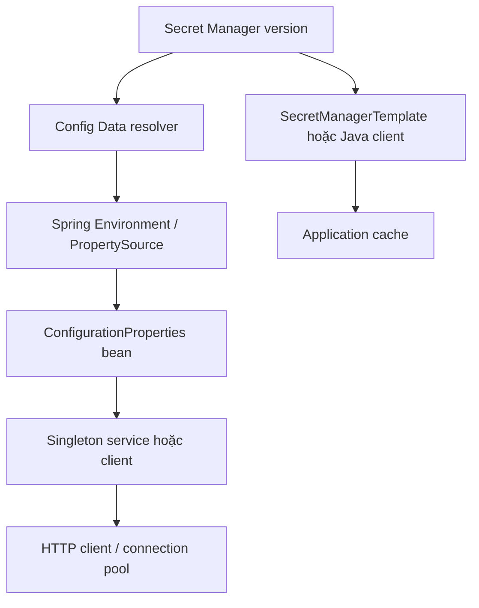
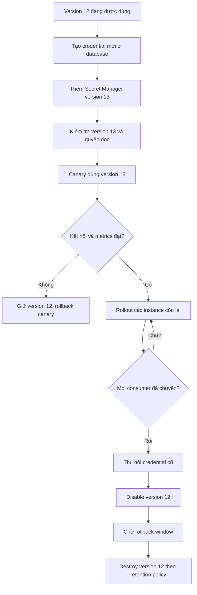

# Phiên bản bí mật, bộ nhớ đệm và cập nhật ứng dụng sau xoay vòng

Tạo một secret version mới trong Google Cloud Secret Manager **không làm giá trị đang nằm trong bộ nhớ của ứng dụng Spring Boot tự thay đổi**. Secret Manager lưu version mới; ứng dụng phải đọc version đó, nạp lại cấu hình hoặc triển khai lại để sử dụng. Nếu ứng dụng còn giữ giá trị cũ trong Spring Environment, singleton bean, HTTP client hay connection pool, việc thêm version mới chưa đủ để hoàn tất rotation.

Bài này kết nối ba phần của vòng đời secret: **version trong Secret Manager**, **bộ nhớ đệm trong ứng dụng** và **quy trình cập nhật workload**. Mục tiêu là chuyển credential an toàn theo từng đợt, xác minh phiên bản mới hoạt động, giữ khả năng rollback trong thời gian cần thiết và chỉ thu hồi version cũ sau khi mọi consumer đã chuyển.

Bài thuộc chương **Cấu hình Google Cloud** của module **SPRING_CLOUD_PROVIDER_INTEGRATION**. Module thực hành tích hợp Spring Boot với các dịch vụ managed của AWS, Azure và Google Cloud qua các thư viện Spring Cloud tương ứng. Trong phạm vi Google Cloud, bài tập trung vào Secret Manager, Spring Framework on Google Cloud, Spring Boot Config Data API, @RefreshScope, Actuator và Pub/Sub notifications.

## 1. Mục tiêu học tập

Sau bài học, bạn có thể:

- Giải thích quan hệ giữa secret, secret version và payload bất biến.
- Phân biệt latest với version ID cụ thể khi triển khai production.
- Nhận diện các lớp giữ secret trong ứng dụng: Config Data, Spring Environment, bean, SDK client, cache và connection pool.
- Hiểu vì sao cập nhật secret trên Google Cloud không tự cập nhật JVM đang chạy.
- Chọn giữa restart/rollout, Actuator refresh và đọc secret động qua client.
- Dùng @ConfigurationProperties kết hợp @RefreshScope để nạp lại property được hỗ trợ.
- Thiết kế cache có TTL, giới hạn độ cũ và xử lý lỗi khi Secret Manager không truy cập được.
- Tạo quy trình rotation có overlap, rollout từng đợt, xác minh và rollback.
- Dùng Pub/Sub event notifications và rotation schedule để kích hoạt workflow.
- Kiểm thử ứng dụng đã thực sự dùng version mới trước khi disable hoặc destroy version cũ.

## 2. Secret version là snapshot của payload

Secret Manager lưu một secret dưới dạng resource quản lý và nhiều **secret version**. Mỗi lần thêm payload mới, dịch vụ tạo một version mới với ID tăng dần. Payload của version đã tạo không được sửa tại chỗ; rotation tạo version mới thay cho việc ghi đè version cũ.

Ví dụ:

```text
projects/invoice-prod/secrets/invoice-db-password/versions/12
projects/invoice-prod/secrets/invoice-db-password/versions/13
```

- Version 12 chứa credential đang được ứng dụng sử dụng.
- Version 13 chứa credential mới sau rotation.
- Cả hai version có thể cùng tồn tại trong thời gian chuyển đổi.
- Ứng dụng chỉ đọc version mà resource reference hoặc logic runtime yêu cầu.

Có thể thêm version bằng gcloud:

```bash
gcloud secrets versions add invoice-db-password \
  --project=invoice-prod \
  --data-file=./invoice-db-password.next
```

File đầu vào phải được bảo vệ quyền đọc, không nằm trong source control và không bị lưu vào artifact/log của pipeline. Lệnh trả về resource name của version vừa tạo; lưu version ID trong metadata triển khai hoặc output đã được kiểm soát, không lưu payload.

Xem danh sách version:

```bash
gcloud secrets versions list invoice-db-password \
  --project=invoice-prod
```

Xem metadata một version:

```bash
gcloud secrets versions describe 13 \
  --secret=invoice-db-password \
  --project=invoice-prod
```

Các thao tác trên cho biết version đã được tạo và trạng thái của nó. Không cần truy xuất payload chỉ để xác minh version ID.

## 3. Chọn version cố định hay latest?

Secret Manager cung cấp alias latest trỏ tới version mới nhất. Spring Framework on Google Cloud hỗ trợ tham chiếu alias này, ví dụ:

```yaml
spring:
  config:
    import: "sm@"

invoice:
  database:
    password: "${sm@projects/invoice-prod/secrets/invoice-db-password/versions/latest}"
```

Khi thêm version 13, alias latest sẽ trỏ tới version mới nhất. Tuy nhiên, hai instance khởi động ở thời điểm khác nhau có thể đọc hai payload khác nhau. Một version lỗi có thể được nhiều instance mới lấy ngay khi chúng restart hoặc scale out.

Google Cloud khuyến nghị tham chiếu version number thay cho latest trong production và triển khai version mới qua quy trình release hiện có. Cách này cho phép kiểm tra version, rollout dần và rollback bằng cách khôi phục cấu hình về version trước. latest có thể phù hợp cho local/test hoặc trường hợp đã chấp nhận rõ hành vi tự trỏ sang version mới nhất.

### 3.1. Pin version ID trong cấu hình

Ví dụ ứng dụng production đang dùng version 12:

```yaml
spring:
  config:
    import: "sm@"
  cloud:
    gcp:
      secretmanager:
        project-id: invoice-prod

invoice:
  database:
    password: "${sm@projects/invoice-prod/secrets/invoice-db-password/versions/12}"
```

Sau khi tạo version 13, resource reference trên vẫn trỏ tới version 12. Muốn chuyển ứng dụng sang version 13, cần cập nhật cấu hình triển khai:

```yaml
invoice:
  database:
    password: "${sm@projects/invoice-prod/secrets/invoice-db-password/versions/13}"
```

Nếu dùng version cố định, việc thêm version mới không làm thay đổi cấu hình hiện tại. Đây là đặc tính hữu ích cho triển khai có thể tái lập.

### 3.2. So sánh chiến lược binding

| Chiến lược | Khi nào lấy payload? | Cập nhật khi thêm version? | Đặc điểm |
| --- | --- | --- | --- |
| Pin version số | Khi ứng dụng nạp cấu hình hoặc gọi API cho version đó | Không | Dễ review, tái lập, rollout và rollback |
| latest khi startup | Mỗi lần instance nạp cấu hình | Chỉ ở lần nạp tiếp theo | Đơn giản nhưng các instance có thể dùng version khác nhau |
| Poll latest liên tục | Theo chu kỳ polling do ứng dụng đặt | Sau lần polling thành công | Có thể cập nhật nhanh nhưng dễ phát tán version lỗi tới toàn bộ instance |
| Đọc version qua API theo yêu cầu | Mỗi lần gọi hoặc theo cache do ứng dụng quản lý | Khi logic chọn version đổi | Linh hoạt nhưng phải quản lý latency, quota và cache |

Với production, pin version và dùng release process thường tạo ra đường đi rõ ràng nhất. Nếu cần cập nhật liên tục, phải có rollout, kiểm tra sức khỏe, giới hạn tốc độ và khả năng quay lại version hoạt động trước đó.

## 4. Secret được giữ ở đâu trong ứng dụng Spring?

Một giá trị được lấy từ Secret Manager có thể tồn tại ở nhiều nơi sau khi được đọc:



Các lớp này có vòng đời khác nhau:

| Vị trí | Cách giữ giá trị | Điều gì làm giá trị thay đổi? |
| --- | --- | --- |
| Config Data / PropertySource | Được nạp vào Spring Environment khi xử lý cấu hình | Nạp lại cấu hình hoặc refresh được tích hợp hỗ trợ |
| @Value trong singleton | Giá trị được inject vào bean khi tạo | Tạo lại bean/context; không tự đổi chỉ vì secret mới |
| @ConfigurationProperties | Bean giữ các property đã bind | Cơ chế refresh có hỗ trợ và bean được đặt trong refresh scope |
| HTTP client/SDK client | Có thể sao chép API key/token vào cấu hình nội bộ | Tạo lại client hoặc cập nhật credential theo API của client |
| JDBC connection pool | Connection đã mở có thể tiếp tục dùng phiên xác thực cũ | Tạo connection mới, thay pool hoặc rollout theo cách phù hợp |
| Cache do ứng dụng viết | Giá trị trong memory theo key/TTL | TTL hết hạn, invalidation event hoặc refresh chủ động |

Vì vậy, **refresh property không đồng nghĩa mọi đối tượng đã nhận secret đều tự đổi theo**. Một service có thể đã copy API key vào một client singleton; một datasource có thể giữ connection đã được xác thực bằng password cũ. Thiết kế rotation phải xác định nơi nào cần được tạo lại hoặc làm mới.

## 5. Spring Config Data không tự theo dõi thay đổi

Khai báo spring.config.import: "sm@" cho phép Spring Boot nạp secret reference qua Config Data API. Trong quá trình khởi động, thư viện phân giải reference và đưa giá trị vào Spring Environment. Một bean sau đó nhận giá trị từ Environment.

Ví dụ:

```yaml
spring:
  config:
    import: "sm@"

partner:
  api-key: "${sm@projects/invoice-prod/secrets/partner-api-key/versions/12}"
```

```java
@ConfigurationProperties(prefix = "partner")
public class PartnerProperties {

    private String apiKey;

    public String getApiKey() {
        return apiKey;
    }

    public void setApiKey(String apiKey) {
        this.apiKey = apiKey;
    }
}
```

Việc tạo version 13 trên Secret Manager không sửa file YAML và không gửi payload mới trực tiếp vào PartnerProperties. Nếu ứng dụng đang chạy, giá trị cũ vẫn có thể được giữ trong Environment hoặc bean cho tới khi ứng dụng nạp lại cấu hình theo một cơ chế được hỗ trợ.

Không nên nhầm event notification của Secret Manager với refresh Spring. Pub/Sub có thể báo rằng secret/version đã thay đổi; ứng dụng hoặc automation vẫn phải nhận thông báo và chủ động gọi refresh, thay cấu hình hoặc rollout workload.

## 6. Cập nhật cấu hình không restart bằng Actuator refresh

Spring Framework on Google Cloud hướng dẫn sử dụng Spring Boot Actuator để refresh secret mà không restart ứng dụng. Các bước cơ bản:

1. Thêm Actuator dependency.
2. Expose endpoint refresh.
3. Đánh dấu @ConfigurationProperties cần cập nhật bằng @RefreshScope.
4. Cập nhật secret trong Secret Manager.
5. Gửi POST tới endpoint refresh.
6. Xác minh bean và consumer đã dùng giá trị mới.

### 6.1. Thêm dependency và expose endpoint

Maven:

```xml
<dependency>
    <groupId>org.springframework.boot</groupId>
    <artifactId>spring-boot-starter-actuator</artifactId>
</dependency>
```

Cấu hình:

```yaml
management:
  endpoints:
    web:
      exposure:
        include: refresh
```

Endpoint refresh có thể làm thay đổi cấu hình đang chạy. Chỉ expose trên mạng quản trị, yêu cầu authentication/authorization phù hợp và giới hạn principal được gọi. Không đưa endpoint này ra internet công khai.

### 6.2. Đánh dấu ConfigurationProperties bằng RefreshScope

Ví dụ:

```java
@Component
@RefreshScope
@ConfigurationProperties(prefix = "partner")
public class PartnerProperties {

    private String apiKey;

    public String getApiKey() {
        return apiKey;
    }

    public void setApiKey(String apiKey) {
        this.apiKey = apiKey;
    }
}
```

Theo tài liệu tích hợp Secret Manager của Spring Framework on Google Cloud, chỉ @ConfigurationProperties được đánh dấu @RefreshScope hỗ trợ cập nhật secret mà không restart ứng dụng.

### 6.3. Gọi refresh sau khi cập nhật secret

Sau khi Secret Manager có version mới, gọi:

```bash
curl -X POST https://invoice-api.internal/actuator/refresh
```

URL ở ví dụ là endpoint quản trị nội bộ; request thực tế cần đi qua cơ chế xác thực và mạng quản trị của hệ thống. Không ghi bearer token hoặc secret vào shell history.

Với reference dùng latest, lần refresh có thể phân giải lại alias để nhận version mới. Với reference pin version 12, refresh vẫn đọc version 12 cho tới khi cấu hình được đổi sang version 13. Refresh không tự thay số version cố định trong YAML.

### 6.4. Refresh property và tạo lại consumer

Giả sử PartnerProperties đã nhận API key mới nhưng PartnerClient được tạo một lần và giữ bản sao API key cũ. Client đó có thể tiếp tục gửi request bằng credential cũ.

Có thể đặt client trong refresh scope để nó được tạo lại sau refresh:

```java
@Configuration
public class PartnerClientConfiguration {

    @Bean
    @RefreshScope
    PartnerClient partnerClient(PartnerProperties properties) {
        return new PartnerClient(properties.getApiKey());
    }
}
```

PartnerClient đại diện cho client cụ thể của ứng dụng. Trong triển khai thật, cần đảm bảo client cũ được đóng đúng vòng đời và client mới không được dùng trước khi khởi tạo thành công. Với datasource/connection pool, cần kế hoạch thay pool hoặc rollout phù hợp; không giả định refresh một properties bean sẽ tự xác thực lại mọi connection đang mở.

## 7. Khi nào nên restart hoặc rollout ứng dụng?

Actuator refresh phù hợp khi bean và thư viện sử dụng cấu hình hỗ trợ refresh. Có những trường hợp restart/rollout rõ ràng và dễ kiểm soát hơn:

- Credential được đọc trong constructor của singleton không thuộc refresh scope.
- SDK không hỗ trợ thay credential sau khi client được tạo.
- Connection pool cần tạo lại để dùng password mới.
- Ứng dụng cần pin version cụ thể theo release.
- Cần rollout từng nhóm instance, quan sát lỗi và rollback.
- Không muốn expose endpoint refresh cho workload production.

Quy trình rollout:

1. Thêm version mới vào Secret Manager.
2. Cập nhật manifest/parameter/deployment config sang version ID mới.
3. Triển khai một nhóm nhỏ instance hoặc một revision canary.
4. Kiểm tra readiness, authentication failure, latency và error rate.
5. Tăng dần tỷ lệ traffic nếu các chỉ số đạt yêu cầu.
6. Hoàn tất rollout rồi mới thu hồi credential cũ.

Cloud Run có thể triển khai revision mới với cùng image nhưng cấu hình reference/version mới. Kubernetes có thể cập nhật deployment annotation/config để tạo rollout mới. Dù dùng nền tảng nào, cần biết instance nào đang chạy version nào để tránh thu hồi credential cũ quá sớm.

## 8. Bộ nhớ đệm và giới hạn độ cũ của secret

Secret Manager là dịch vụ từ xa. Gọi API cho mọi request nghiệp vụ sẽ thêm latency, tạo phụ thuộc mạng và tăng số lần truy cập. Ngược lại, giữ secret trong cache quá lâu khiến ứng dụng tiếp tục dùng credential đã rotate hoặc đã bị thu hồi.

Hãy chọn cách lưu phù hợp với nhu cầu:

| Cách dùng | Lợi ích | Rủi ro cần quản lý |
| --- | --- | --- |
| Nạp một lần lúc startup | Ít request tới Secret Manager, hành vi dễ dự đoán | Giá trị cũ tồn tại tới lần restart/refresh tiếp theo |
| Cache có TTL | Giảm request, có giới hạn độ cũ | Có khoảng trễ trước khi nhận version mới |
| Refresh theo event | Cập nhật gần với thời điểm version đổi | Cần subscriber, bảo đảm event không bị bỏ qua và xử lý lặp |
| Poll định kỳ | Không phụ thuộc hoàn toàn vào event | Tăng request; nhiều instance có thể đồng loạt polling |
| Đọc API mỗi request | Luôn kiểm tra resource theo yêu cầu | Latency, quota, chi phí và độ phụ thuộc dịch vụ cao |

### 8.1. Quy tắc thiết kế cache

Nếu ứng dụng phải đọc secret động, cache cần có chính sách rõ ràng:

- **TTL hữu hạn:** xác định thời gian tối đa ứng dụng được dùng giá trị đã cache.
- **Jitter:** lệch thời điểm refresh giữa các instance để tránh tất cả cùng gọi API.
- **Single-flight:** khi nhiều request đồng thời thấy cache hết hạn, chỉ một luồng thực hiện refresh; các luồng khác chờ kết quả.
- **Giới hạn stale-on-error:** chỉ dùng giá trị cũ khi nghiệp vụ cho phép, có thời gian tối đa và có cảnh báo.
- **Invalidate có chủ đích:** event version mới có thể yêu cầu refresh sớm hơn TTL.
- **Không log payload:** log version resource, thời điểm refresh, trạng thái và error code; không log secret value.
- **Quản lý quyền:** principal runtime chỉ có quyền đọc secret cần thiết.

Không có một TTL phù hợp cho mọi loại secret. API key có thể chấp nhận một khoảng chuyển đổi ngắn; credential dùng để mã hóa dữ liệu hoặc xác thực quyền cao có thể cần thời gian cache ngắn hơn và quy trình thu hồi nghiêm ngặt hơn. TTL phải được chọn cùng với khả năng chấp nhận credential cũ của hệ thống đích.

### 8.2. Cache theo version thay vì chỉ theo secret ID

Một cache có thể lưu cả secret resource, version ID, payload và thời điểm nạp. Điều này giúp quan sát instance đang dùng version nào mà không hiển thị payload.

Ví dụ metadata nội bộ:

```text
secret: projects/invoice-prod/secrets/partner-api-key
version: 13
loadedAt: 2026-11-24T10:30:00Z
expiresAt: 2026-11-24T10:35:00Z
```

Không dùng payload làm cache key hoặc metric label. Không ghi giá trị bí mật vào distributed cache chỉ vì cần chia sẻ giữa instance; nếu bắt buộc dùng shared cache, phải áp dụng kiểm soát truy cập, mã hóa và TTL phù hợp.

### 8.3. Khi refresh thất bại

Nếu lần refresh thất bại, ứng dụng cần quyết định rõ:

- Secret cũ còn hợp lệ và có thể dùng trong một khoảng thời gian ngắn không?
- Credential cũ đã bị thu hồi vì sự cố hay chỉ version mới chưa đọc được?
- Feature có thể chuyển sang trạng thái degraded hay phải dừng?
- Sau bao lâu phải đánh dấu unhealthy và cảnh báo?

Không dùng stale cache vô thời hạn. Với incident lộ credential, giữ secret cũ trong cache có thể duy trì khả năng truy cập trái phép. Với rotation định kỳ, một khoảng overlap có thể cần thiết để rollout không làm gián đoạn traffic; đây là chính sách của hệ thống đích và ứng dụng, không phải lý do để giữ cache không giới hạn.

## 9. SecretManagerTemplate và Java client trong luồng runtime

Spring Framework on Google Cloud cung cấp SecretManagerTemplate để đọc, tạo và cập nhật secret theo chương trình. Khác với Config Data, cách dùng template/client cho phép ứng dụng chủ động quyết định khi nào gọi Secret Manager và có cache riêng hay không.

Có thể inject template sau khi thêm starter:

```java
@Service
public class PartnerSecretService {

    private final SecretManagerTemplate secretManagerTemplate;

    public PartnerSecretService(
            SecretManagerTemplate secretManagerTemplate) {
        this.secretManagerTemplate = secretManagerTemplate;
    }

    // Chọn operation đọc secret từ SecretManagerOperations
    // theo resource name và kiểu dữ liệu của ứng dụng.
}
```

Các operation cụ thể được định nghĩa trong SecretManagerOperations. Hãy chọn API phù hợp với phiên bản thư viện đang dùng. Không giả định template tự polling version mới hoặc tự cập nhật bean đã nhận giá trị trước đó.

Nếu dùng Google Cloud Java client trực tiếp, có thể truy cập một version cụ thể:

```java
public String readSecretVersion(
        SecretManagerServiceClient client,
        String projectId,
        String secretId,
        String versionId) {

    SecretVersionName name =
            SecretVersionName.of(projectId, secretId, versionId);

    AccessSecretVersionResponse response =
            client.accessSecretVersion(name);

    return response.getPayload().getData().toStringUtf8();
}
```

Client nên được quản lý như một bean dùng chung và đóng khi application context dừng. Đoạn code trên minh họa việc đọc payload; không nên gọi lặp lại cho mọi request nếu không có lý do nghiệp vụ. Nếu đọc động, thêm cache TTL, giới hạn concurrency và cách refresh/close consumer.

## 10. Pub/Sub notifications và rotation schedule

Secret Manager hỗ trợ cấu hình Pub/Sub topic để gửi thông báo khi secret hoặc version thay đổi. Một số event type quan trọng:

| Event | Ý nghĩa |
| --- | --- |
| SECRET_VERSION_ADD | Một version mới đã được thêm thành công |
| SECRET_VERSION_ENABLE | Một version được enable |
| SECRET_VERSION_DISABLE | Một version được disable |
| SECRET_VERSION_DESTROY | Một version bị destroy |
| SECRET_ROTATE | Đến thời điểm lịch rotation đã cấu hình |

Event notification có thể kích hoạt workflow, ví dụ:

- Cập nhật deployment parameter sang version ID mới.
- Gửi yêu cầu tới hệ thống release để rollout revision.
- Làm mới cache hoặc gửi tín hiệu refresh đến ứng dụng.
- Cảnh báo đội vận hành khi version bị disable/destroy.

### 10.1. Rotation schedule chỉ gửi tín hiệu

Secret Manager có thể cấu hình rotation_period và next_rotation_time. Khi tới thời điểm, dịch vụ gửi message SECRET_ROTATE đến Pub/Sub topic đã gắn với secret. **Secret Manager không tự thay password ở database, không tự tạo payload mới và không tự triển khai ứng dụng.** Phải có subscriber hoặc workflow nhận message và thực hiện các bước rotation.

Các bước thường gặp:

1. Subscriber nhận SECRET_ROTATE.
2. Rotation worker tạo credential mới ở hệ thống đích.
3. Worker thêm payload mới thành secret version.
4. Hệ thống phát hiện SECRET_VERSION_ADD hoặc pipeline nhận output version ID.
5. Release workflow cập nhật cấu hình và rollout ứng dụng.
6. Sau khi xác minh mọi consumer đã chuyển, workflow thu hồi credential cũ và dọn version cũ theo chính sách.

Thông báo rotation không bảo đảm workflow nghiệp vụ đã hoàn tất. Cần theo dõi trạng thái từng bước, retry có kiểm soát và cảnh báo khi rotation chưa được hoàn thành.

### 10.2. Thiết kế subscriber có thể chạy lại

Cloud Run hoặc worker nhận Pub/Sub message có thể bị retry, timeout hoặc dừng giữa chừng. Rotation workflow cần idempotent/reentrant:

- Xác định rotation đang xử lý theo secret và thời điểm/operation ID.
- Lưu trạng thái bước đã hoàn thành để không tạo nhiều credential ngoài ý muốn.
- Dùng etag khi cập nhật metadata nếu có nhiều actor có thể sửa cùng secret.
- Giới hạn concurrency để hai rotation không chạy đồng thời cho cùng credential.
- Ghi version ID và trạng thái workflow, không ghi payload.
- Có thao tác resume hoặc rollback khi một bước thất bại.

Google Cloud tự retry một số lần gửi notification, nhưng không bảo đảm notification sẽ tới được subscriber nếu cấu hình topic, quyền hoặc quota sai. Subscriber vẫn cần retry, dead-letter/alerting và cơ chế phát hiện rotation bị bỏ lỡ.

## 11. Quy trình rotation có overlap và rollback

Giả sử invoice-service đang dùng database credential version 12, cần chuyển sang version 13.



### 11.1. Giữ hai credential hợp lệ trong thời gian chuyển đổi

Nếu hệ thống đích hỗ trợ hai key/user đang hoạt động cùng lúc, tạo credential mới trước khi thu hồi credential cũ. Điều này cho phép instance cũ tiếp tục hoạt động trong lúc instance mới được rollout.

Với database chỉ cho phép một password tại một thời điểm, cần cân nhắc cơ chế user luân phiên, hai database principal hoặc một kế hoạch chuyển đổi có thời gian dừng được chấp nhận. Không giả định rolling deployment luôn an toàn nếu credential cũ bị vô hiệu ngay khi password mới được đặt.

### 11.2. Xác minh trước khi thu hồi

Chỉ coi rotation hoàn tất khi đã kiểm tra:

- Tất cả instance/revision đang chạy reference version mới.
- Client mới tạo kết nối thành công.
- Không còn consumer sử dụng credential cũ.
- Error rate và authentication failure ở mức bình thường.
- Cache cũ đã hết TTL hoặc được invalidate.
- Rollback window đã kết thúc hoặc có quyết định rõ ràng về việc giữ version cũ.

Sau đó mới disable version cũ. Disable có thể đảo ngược; destroy là thao tác không thể khôi phục payload. Google Cloud khuyến nghị disable và chờ xác minh trước khi destroy version.

## 12. Quan sát và chẩn đoán sau rotation

Không log secret payload để xác nhận ứng dụng đã cập nhật. Hãy log metadata vận hành không nhạy cảm:

| Trường quan sát | Mục đích |
| --- | --- |
| Secret resource name | Xác định secret mà instance tham chiếu |
| Version ID đã nạp | Biết instance đang dùng version nào |
| Thời điểm load/refresh | Kiểm tra refresh có diễn ra |
| Instance/revision ID | Tìm instance chưa chuyển |
| Kết quả refresh | Thành công, lỗi hay đang retry |
| Error code | Phân biệt IAM, NOT_FOUND, timeout và lỗi khác |
| Cache age/TTL còn lại | Biết dữ liệu trong cache đã cũ bao lâu |

Có thể tạo metric như secret_refresh_success_total, secret_refresh_failure_total, secret_cache_age_seconds hoặc secret_version_loaded nhưng không đưa payload, API key hay password vào label.

### 12.1. Lỗi thường gặp

| Triệu chứng | Nguyên nhân có thể | Hướng xử lý |
| --- | --- | --- |
| Đã thêm version nhưng ứng dụng vẫn dùng giá trị cũ | Config Data và bean đã nạp trước đó | Refresh đúng bean hoặc rollout/restart |
| Gọi /actuator/refresh nhưng client vẫn dùng key cũ | Client giữ bản sao credential và không thuộc refresh scope | Tạo lại client hoặc thiết kế client đọc properties động |
| Pin version 12 nhưng mong nhận version 13 sau refresh | Reference vẫn trỏ version 12 | Cập nhật resource reference sang 13, rồi refresh/rollout |
| Dùng latest và một số instance lỗi sau scale out | Instance mới đọc version mới không hợp lệ | Pin version đã xác minh; rollback deployment |
| Refresh đồng thời ở nhiều instance gây tải đột biến | Không có jitter hoặc rollout control | Refresh theo đợt, jitter và giới hạn concurrency |
| Secret Manager timeout, cache trả giá trị cũ vô hạn | Stale-on-error không có giới hạn | Đặt max staleness, alert và chính sách fail rõ ràng |
| Version cũ bị disable khi instance cũ còn chạy | Thu hồi trước khi hoàn tất rollout | Enable lại nếu phù hợp, chuyển consumer rồi mới disable |
| Rotation schedule đã tới nhưng credential chưa đổi | Chỉ có Pub/Sub notification, chưa có subscriber hoàn tất workflow | Kiểm tra topic, subscription, IAM, retry và trạng thái rotation |
| Pub/Sub message bị xử lý nhiều lần | Subscriber không idempotent | Dùng operation ID/state và kiểm soát concurrency |
| Version mới được nạp nhưng database vẫn từ chối | Credential ở database không khớp hoặc pool còn connection cũ | Kiểm tra target system, tạo connection mới và thay pool |

## 13. Bài thực hành: xoay vòng API key cho partner client

**Bối cảnh:** invoice-service chạy trên Cloud Run. Partner API key nằm trong Secret Manager của project invoice-prod. Revision hiện tại sử dụng version 12; version 13 sẽ được phát hành. Yêu cầu: chuyển dần sang key mới, giữ khả năng rollback và không log payload.

### Bước 1 — Kiểm tra version hiện tại

```bash
gcloud secrets versions describe 12 \
  --secret=partner-api-key \
  --project=invoice-prod
```

Xác nhận version 12 đang enabled và ứng dụng đang dùng đúng resource reference này.

### Bước 2 — Tạo key mới ở hệ thống partner

Dùng portal/API quản trị của đối tác để tạo key mới. Nếu đối tác hỗ trợ nhiều key đồng thời, giữ key cũ hoạt động trong thời gian rollout. Không vô hiệu key cũ ngay khi tạo key mới.

### Bước 3 — Thêm version mới vào Secret Manager

```bash
gcloud secrets versions add partner-api-key \
  --project=invoice-prod \
  --data-file=./partner-api-key.next
```

Bảo vệ file tạm và xóa theo chính sách sau khi hoàn tất. Không in nội dung file ra terminal hoặc pipeline log.

### Bước 4 — Kiểm tra version mới

Liệt kê versions và kiểm tra metadata của version vừa tạo. Xác minh version ở trạng thái enabled và runtime service account có quyền đọc secret.

### Bước 5 — Cập nhật cấu hình release

Đổi reference từ version 12 sang version 13:

```yaml
partner:
  api-key: "${sm@projects/invoice-prod/secrets/partner-api-key/versions/13}"
```

Tạo revision mới hoặc dùng quy trình refresh được kiểm soát nếu bean hỗ trợ @RefreshScope.

### Bước 6 — Canary và rollout

Triển khai một nhóm nhỏ instance/revision. Gửi request test tới partner, theo dõi HTTP 401/403, timeout và error rate. Nếu có lỗi, đưa cấu hình về version 12 và rollback canary khi key cũ còn hợp lệ.

### Bước 7 — Hoàn tất rotation

Khi mọi instance đã dùng version 13, chờ cache TTL và connection/client lifecycle cũ kết thúc. Thu hồi key cũ tại hệ thống partner, sau đó disable version 12. Giữ thời gian rollback phù hợp trước khi destroy version cũ.

### Bước 8 — Kiểm tra bằng metadata

Xác minh deployment đang pin version 13, version 12 đã được xử lý theo kế hoạch và không còn instance cũ. Không đọc payload để kiểm tra trạng thái rollout.

## 14. Câu hỏi tự kiểm tra

1. Vì sao thêm một secret version mới không tự thay đổi giá trị trong Spring singleton bean?
2. latest khác version ID cố định như thế nào khi nhiều instance khởi động ở thời điểm khác nhau?
3. Những lớp nào trong ứng dụng có thể tiếp tục giữ credential cũ sau khi Config Data đã refresh?
4. @RefreshScope có vai trò gì khi kết hợp với @ConfigurationProperties?
5. Vì sao gọi /actuator/refresh chưa chắc cập nhật một HTTP client hoặc connection pool đã tạo?
6. Khi nào nên rollout revision mới thay cho refresh trong process?
7. Cache TTL, jitter và single-flight giúp kiểm soát điều gì?
8. Vì sao không nên dùng stale-on-error vô thời hạn?
9. SECRET_ROTATE và SECRET_VERSION_ADD khác nhau như thế nào?
10. Vì sao rotation schedule cần Pub/Sub subscriber hoặc workflow riêng?
11. Vì sao nên giữ credential cũ hợp lệ trong thời gian rollout nếu hệ thống đích hỗ trợ?
12. Khi nào được phép disable và destroy version cũ?
13. Làm sao xác minh version đang dùng mà không log payload?
14. Nếu version mới gây lỗi sau canary, quy trình rollback cần giữ điều kiện nào?

## 15. Ghi nhớ

Secret Manager lưu các version riêng biệt; ứng dụng quyết định version nào được đọc và giữ giá trị đó ở đâu. Config Data thường nạp secret trong quá trình khởi động; bean, client, connection pool và cache có thể tiếp tục giữ giá trị cũ. Actuator refresh với @RefreshScope hỗ trợ cập nhật @ConfigurationProperties được đánh dấu phù hợp, nhưng consumer giữ bản sao credential vẫn cần được tạo lại hoặc rollout.

Google Cloud khuyến nghị pin version số trong production và dùng quy trình release để triển khai version mới dần. Cache cần TTL và giới hạn stale; Pub/Sub notification chỉ kích hoạt workflow, không tự xoay credential hoặc cập nhật JVM. **Chỉ thu hồi version cũ sau khi mọi consumer đã chuyển và xác minh hoạt động với version mới.**

## Tài liệu tham khảo chính thức

- [Spring Framework on Google Cloud — Secret Manager: Refresh secrets without restarting the application](https://googlecloudplatform.github.io/spring-cloud-gcp/reference/html/index.html#secret-manager)
- [Google Cloud Secret Manager — Rotation recommendations](https://docs.cloud.google.com/secret-manager/docs/rotation-recommendations)
- [Google Cloud Secret Manager — Create rotation schedules](https://docs.cloud.google.com/secret-manager/docs/secret-rotation)
- [Google Cloud Secret Manager — Event notifications](https://docs.cloud.google.com/secret-manager/docs/event-notifications)
- [Google Cloud Secret Manager — Best practices](https://docs.cloud.google.com/secret-manager/docs/best-practices)
- [Google Cloud Secret Manager — Access a secret version](https://docs.cloud.google.com/secret-manager/docs/access-secret-version)
- [Google Cloud Secret Manager — Add a secret version](https://docs.cloud.google.com/secret-manager/docs/add-secret-version)

