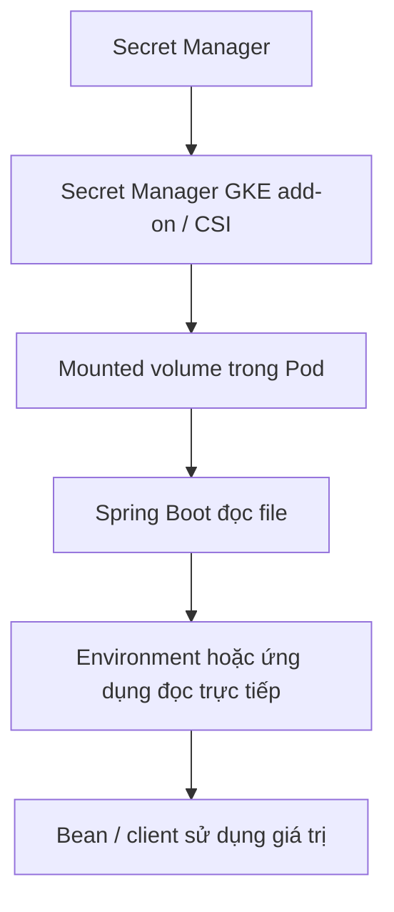

# Phân biệt Secret Manager, biến môi trường và tệp cấu hình

Spring Boot có thể nhận cấu hình từ nhiều nguồn: tệp YAML, tệp properties, biến môi trường, tham số dòng lệnh và dịch vụ quản lý cấu hình bên ngoài. Các nguồn này đều có thể đưa giá trị vào Spring Environment, nhưng không có cùng mục đích hoặc mức độ bảo vệ. Một cổng HTTP, tên profile hay feature flag thường phù hợp với biến môi trường hoặc tệp cấu hình. Database password, API key và private key cần được quản lý như dữ liệu bí mật.

Với Google Cloud, **Secret Manager là nơi lưu trữ và quản lý secret**; biến môi trường và tệp cấu hình là những cách đưa giá trị vào tiến trình ứng dụng. Khi dùng tích hợp managed của Cloud Run hoặc GKE, secret có thể được cung cấp qua environment variable hoặc file mount. Khi dùng Spring Framework on Google Cloud, ứng dụng cũng có thể đọc secret trực tiếp qua Secret Manager Config Data hoặc client library.

Điểm quan trọng là không chỉ chọn nơi lưu giá trị. Cần hiểu **ai được đọc, giá trị được đưa vào đâu, khi nào ứng dụng nạp lại và nguồn nào có thể ghi đè nguồn khác**. Bài thuộc chương **Cấu hình Google Cloud** của module **SPRING_CLOUD_PROVIDER_INTEGRATION**, nơi thực hành tích hợp Spring Boot với các dịch vụ managed của AWS, Azure và Google Cloud qua thư viện Spring Cloud tương ứng.

## 1. Mục tiêu học tập

Sau bài học, bạn có thể:

- Phân biệt cấu hình thông thường và dữ liệu bí mật.
- Giải thích vai trò của Secret Manager, biến môi trường và tệp cấu hình.
- Chọn nguồn phù hợp cho URL, port, profile, feature flag, database password và API key.
- Cấu hình Spring Boot đọc secret qua Spring Framework on Google Cloud Config Data.
- Dùng biến môi trường cho cấu hình triển khai mà không lưu secret payload vào biến môi trường thủ công.
- Dùng Cloud Run secret environment variable hoặc secret volume và hiểu khác biệt về thời điểm nạp.
- Dùng GKE Secret Manager add-on để mount secret vào Pod.
- Nạp file mount thành Spring property bằng Config Data configtree.
- Hiểu thứ tự ưu tiên PropertySource và rủi ro ghi đè secret reference.
- Đánh giá rủi ro khi secret xuất hiện trong source code, image, log, process environment, filesystem hoặc Kubernetes Secret.

## 2. Phân biệt cấu hình và secret

**Cấu hình** mô tả cách ứng dụng vận hành trong một môi trường. **Secret** là dữ liệu nhạy cảm mà người không có quyền không được biết, thường dùng để xác thực, ký, mã hóa hoặc truy cập tài nguyên.

| Giá trị | Ví dụ | Phân loại | Nguồn thường phù hợp |
| --- | --- | --- | --- |
| HTTP port | 8080 | Cấu hình | Biến môi trường hoặc application.yml |
| Spring profile | prod | Cấu hình | Biến môi trường/deployment setting |
| Database host | 10.20.0.15 | Cấu hình hạ tầng | Tệp cấu hình hoặc biến môi trường |
| Partner API base URL | https://api.partner.example | Cấu hình | Tệp cấu hình hoặc biến môi trường |
| Feature flag | partner.enabled=true | Cấu hình | Tệp cấu hình hoặc biến môi trường |
| Database password | Mật khẩu kết nối PostgreSQL | Secret | Google Cloud Secret Manager |
| Partner API key | Khóa truy cập đối tác | Secret | Google Cloud Secret Manager |
| JWT signing private key | Khóa ký token | Secret | Google Cloud Secret Manager |
| OAuth client secret | Bí mật của OAuth client | Secret | Google Cloud Secret Manager |
| Service account private key | Khóa JSON của service account | Credential đặc biệt nhạy cảm | Tránh phát hành khóa tĩnh; dùng ADC/workload identity |

Một giá trị không tự trở thành secret chỉ vì tên property có chữ password hoặc token; ngược lại, dữ liệu nhạy cảm vẫn là secret dù được đặt trong một file có tên application-dev.yml. Hãy phân loại dựa trên tác động nếu giá trị bị lộ.

Ví dụ, SPRING_PROFILES_ACTIVE=prod có thể hiển thị trong cấu hình triển khai mà không làm lộ quyền truy cập. SPRING_DATASOURCE_PASSWORD chứa mật khẩu thật thì có thể làm lộ quyền truy cập database nếu bị đọc từ process environment hoặc log.

## 3. Ba nguồn dữ liệu khác nhau

### 3.1. Secret Manager: nơi quản lý secret tập trung

Google Cloud Secret Manager lưu secret và các version của secret. Mỗi version có payload riêng; IAM kiểm soát principal được đọc; audit logs hỗ trợ theo dõi truy cập; versioning và rotation hỗ trợ thay credential theo quy trình.

Secret Manager phù hợp cho:

- Database password và API key.
- Private key, signing key và certificate material.
- Credential dùng chung bởi nhiều workload nhưng có quyền truy cập tách biệt.
- Secret cần audit, rotation và quản lý version.
- Secret cần phân quyền theo từng service hoặc môi trường.

Ứng dụng có thể đọc Secret Manager bằng Java client library, Spring Framework on Google Cloud Config Data, hoặc thông qua tích hợp của nền tảng như Cloud Run secret environment variable/volume và GKE Secret Manager add-on.

Google Cloud khuyến nghị dùng API/client library trực tiếp khi phù hợp và tránh truyền secret qua filesystem hoặc environment variables theo cách thủ công. Các tích hợp serverless/managed là ngoại lệ được nền tảng hỗ trợ, nhưng vẫn cần hiểu dữ liệu được đưa vào tiến trình như thế nào.

### 3.2. Biến môi trường: cấu hình tiến trình tại thời điểm chạy

Biến môi trường là cặp tên/giá trị được runtime cung cấp cho process. Spring Boot có thể đọc chúng qua Spring Environment và relaxed binding.

Ví dụ:

```bash
SPRING_PROFILES_ACTIVE=prod
SERVER_PORT=8080
PARTNER_ENABLED=true
GOOGLE_CLOUD_PROJECT=invoice-prod
```

Biến môi trường phù hợp với các giá trị thay đổi theo deployment:

- Profile và port.
- Tên service, project ID và region.
- Feature flag và mức log.
- URL của dịch vụ phụ trợ không nhạy cảm.
- Giới hạn concurrency, timeout và các tham số vận hành.

Không nên tự đưa password hoặc API key thật vào biến môi trường như một cách lưu trữ mặc định. Environment có thể bị đọc bởi công cụ chẩn đoán, process con, script khởi động hoặc dependency ghi lại toàn bộ môi trường. Một cấu hình debug không phù hợp cũng có thể làm lộ giá trị.

Cần phân biệt hai cách:

- **Tự đặt secret payload vào environment variable:** ứng dụng nhận giá trị bí mật trực tiếp qua môi trường; đây là cách Google Cloud khuyên tránh.
- **Cloud Run tham chiếu Secret Manager để tạo environment variable:** nền tảng lấy secret theo IAM rồi đưa payload vào environment của instance; đây là tích hợp managed được hỗ trợ, nhưng payload vẫn hiện diện trong process environment và được resolve khi instance khởi động.

### 3.3. Tệp cấu hình: mô tả cấu trúc và giá trị không nhạy cảm

Tệp application.yml hoặc application.properties phù hợp với:

- Giá trị mặc định không nhạy cảm.
- Cấu trúc datasource, logging, HTTP client và feature.
- Các giá trị theo profile dev/staging/prod.
- Secret resource reference, thay vì secret payload.

Ví dụ:

```yaml
spring:
  application:
    name: invoice-service
  datasource:
    url: jdbc:postgresql://10.20.0.15:5432/invoice
    username: invoice_app

partner:
  base-url: https://api.partner.example
  enabled: false
```

Tệp cấu hình có thể nằm trong source code, JAR, container image hoặc được mount từ bên ngoài. Nếu ghi password thật vào YAML rồi commit, giá trị đó có thể tồn tại trong Git history, build artifact, image layer và bản sao của repository ngay cả khi dòng cấu hình được xóa về sau.

Tệp cấu hình nên chứa **tham chiếu** tới secret, không chứa payload:

```yaml
spring:
  config:
    import: "sm@"
  datasource:
    password: "${sm@projects/invoice-prod/secrets/invoice-db-password/versions/12}"
```

## 4. So sánh theo yêu cầu vận hành

| Tiêu chí | Secret Manager | Biến môi trường | Tệp cấu hình |
| --- | --- | --- | --- |
| Mục đích chính | Quản lý secret | Cấu hình process/deployment | Khai báo cấu hình ứng dụng |
| Lưu secret tập trung | Có | Không; giá trị được cấp cho process | Không; trừ khi file mount từ một secret store |
| Phân quyền đọc | IAM theo secret/project | Phụ thuộc quyền xem/sửa cấu hình nền tảng và quyền process | Phụ thuộc quyền file, volume và nền tảng lưu trữ |
| Audit truy cập secret | Có audit log từ Secret Manager | Không có audit secret riêng nếu không tích hợp nguồn khác | Phụ thuộc hệ thống file/config store |
| Version và rotation | Có secret versions, rotation workflow | Không có version secret độc lập | Không có version secret độc lập |
| Dùng cho non-secret config | Không phải lựa chọn mặc định | Rất phù hợp | Rất phù hợp |
| Ảnh hưởng khi restart | Ứng dụng đọc version theo reference hoặc cơ chế tích hợp | Runtime inject giá trị khi tạo process | Spring Boot nạp file trong quá trình khởi động |
| Rủi ro chính | IAM quá rộng, credential bị cache hoặc log sau khi đọc | Lộ qua environment inspection, debug, process dump hoặc cấu hình nền tảng | Lộ qua source control, image, backup, file permission và log |

Không có một nguồn duy nhất phù hợp cho mọi property. Hãy để Secret Manager quản lý payload nhạy cảm, dùng biến môi trường để chọn profile hoặc tham số deployment và dùng YAML để mô tả cấu trúc ứng dụng cùng resource reference.

## 5. Cấu hình Spring Boot: tệp chứa reference, Secret Manager chứa payload

Spring Framework on Google Cloud cung cấp starter Secret Manager. Với các dòng thư viện dùng cú pháp sm@ (từ 6.x), khai báo Config Data import và placeholder:

```yaml
spring:
  config:
    import: "sm@"
  cloud:
    gcp:
      secretmanager:
        project-id: invoice-prod
  datasource:
    url: jdbc:postgresql://10.20.0.15:5432/invoice
    username: invoice_app
    password: "${sm@projects/invoice-prod/secrets/invoice-db-password/versions/12}"

partner:
  base-url: https://api.partner.example
  api-key: "${sm@projects/invoice-prod/secrets/partner-api-key/versions/7}"
  enabled: false
```

Trong ví dụ:

- YAML chứa URL, username, feature flag và secret reference.
- Secret Manager giữ database password và partner API key.
- ADC/workload identity xác định principal gọi Secret Manager.
- IAM quyết định principal đó được đọc secret nào.
- Spring Boot phân giải placeholder trước khi bind property vào bean cần dùng.

Với các dòng thư viện cũ, cú pháp có thể khác; kiểm tra đúng version của Spring Framework on Google Cloud. Một số nhánh dùng sm:// thay cho sm@. Không nâng riêng starter để dùng cú pháp mới nếu dependency graph của Spring Boot chưa tương thích.

### 5.1. Thêm starter

Maven dependency (version do BOM của Spring Framework on Google Cloud quản lý):

```xml
<dependency>
    <groupId>com.google.cloud</groupId>
    <artifactId>spring-cloud-gcp-starter-secretmanager</artifactId>
</dependency>
```

Import BOM phù hợp với dòng Spring Boot và Spring Framework on Google Cloud của dự án. Không khai báo version riêng cho starter nếu BOM đã quản lý.

### 5.2. Bind property như cấu hình bình thường

```java
@ConfigurationProperties(prefix = "partner")
public class PartnerProperties {

    private String baseUrl;
    private String apiKey;
    private boolean enabled;

    public String getBaseUrl() {
        return baseUrl;
    }

    public void setBaseUrl(String baseUrl) {
        this.baseUrl = baseUrl;
    }

    public String getApiKey() {
        return apiKey;
    }

    public void setApiKey(String apiKey) {
        this.apiKey = apiKey;
    }

    public boolean isEnabled() {
        return enabled;
    }

    public void setEnabled(boolean enabled) {
        this.enabled = enabled;
    }
}
```

Đăng ký properties bằng @ConfigurationPropertiesScan hoặc @EnableConfigurationProperties. Không log object chứa apiKey; không đưa secret vào toString(), exception hoặc metric label.

## 6. Dùng biến môi trường đúng vai trò

Spring Boot hỗ trợ relaxed binding từ environment variable. Tên property được chuyển đổi theo quy tắc: thay dấu chấm bằng dấu gạch dưới, bỏ dấu gạch ngang và chuyển thành chữ hoa.

Ví dụ:

| Spring property | Environment variable |
| --- | --- |
| server.port | SERVER_PORT |
| spring.profiles.active | SPRING_PROFILES_ACTIVE |
| spring.datasource.url | SPRING_DATASOURCE_URL |
| partner.enabled | PARTNER_ENABLED |
| logging.level.root | LOGGING_LEVEL_ROOT |

Có thể để giá trị mặc định trong YAML và cho deployment override:

```yaml
server:
  port: "${SERVER_PORT:8080}"

spring:
  profiles:
    active: "${SPRING_PROFILES_ACTIVE:dev}"

partner:
  enabled: "${PARTNER_ENABLED:false}"
```

Environment variables có ưu tiên cao hơn Config Data trong Spring Boot. Vì vậy, nếu SPRING_DATASOURCE_PASSWORD được khai báo với giá trị khác, nó có thể ghi đè property cùng tên được nạp từ application.yml hoặc Secret Manager reference. Đây là một nguyên nhân khiến ứng dụng tưởng đang dùng Secret Manager nhưng thực tế lại dùng một nguồn khác.

Không đưa secret payload vào các biến như:

```bash
SPRING_DATASOURCE_PASSWORD=actual-database-password
PARTNER_API_KEY=actual-partner-key
```

Thay vào đó, dùng Secret Manager Config Data hoặc tích hợp Secret Manager của nền tảng. Nếu có biến môi trường trùng property nhạy cảm, kiểm tra nguồn hiệu lực bằng cách được bảo vệ; không in giá trị secret qua log hoặc endpoint chẩn đoán.

## 7. Thứ tự ưu tiên PropertySource của Spring Boot

Spring Boot hợp nhất các nguồn cấu hình vào Environment. Nguồn có ưu tiên cao hơn có thể ghi đè nguồn thấp hơn.

Trong tài liệu Spring Boot hiện hành, thứ tự quan trọng đối với ứng dụng web/service thường gồm:

1. Giá trị mặc định của ứng dụng.
2. @PropertySource.
3. Config Data, gồm application YAML/properties và các Config Data import.
4. RandomValuePropertySource.
5. Environment variables của hệ điều hành.
6. Java system properties.
7. JNDI và servlet context/config nếu có.
8. SPRING_APPLICATION_JSON.
9. Tham số dòng lệnh.
10. Property được khai báo trực tiếp trong test.

Các vị trí cụ thể có thể khác theo phiên bản Spring Boot và môi trường; hãy xem tài liệu của phiên bản dự án. Quy tắc thực tế cần nhớ là **OS environment variables, system properties và command-line arguments có thể ghi đè Config Data**.

Ví dụ:

```yaml
# application.yml
spring:
  datasource:
    password: "${sm@projects/invoice-prod/secrets/invoice-db-password/versions/12}"
```

Nếu deployment đồng thời khai báo:

```bash
SPRING_DATASOURCE_PASSWORD=temporary-password
```

Spring Boot có thể bind temporary-password thay cho giá trị từ Secret Manager reference. Vì vậy:

- Không tạo environment variable trùng property chứa secret nếu không có chủ đích rõ ràng.
- Không dùng command-line argument để truyền password.
- Kiểm tra SPRING_APPLICATION_JSON trong manifest và pipeline.
- Khi chẩn đoán, kiểm tra property source và tên nguồn; tránh hiển thị payload.
- Khóa endpoint Actuator env và configprops bằng authentication/authorization nếu cần dùng để điều tra.

## 8. Cloud Run: secret environment variable và secret volume

Cloud Run hỗ trợ hai cách tích hợp Secret Manager trực tiếp với container. Đây là lựa chọn managed của nền tảng, khác với việc tự viết giá trị secret vào service environment.

### 8.1. Secret dưới dạng environment variable

Ví dụ:

```bash
gcloud run services update invoice-api \
  --project=invoice-prod \
  --region=asia-southeast1 \
  --update-secrets=SPRING_DATASOURCE_PASSWORD=invoice-db-password:12
```

Cloud Run lấy giá trị secret trước khi khởi động instance. Nếu không lấy được secret, instance không khởi động. Vì environment variable được resolve tại thời điểm startup, Google khuyến nghị pin version cụ thể thay vì latest.

Ưu điểm:

- Dễ tích hợp với cấu hình Spring Boot hiện có.
- Có thể bind trực tiếp vào spring.datasource.password.
- Không cần code đọc file.

Điểm cần cân nhắc:

- Secret payload tồn tại trong process environment.
- Giá trị được resolve khi instance khởi động; version mới không tự thay đổi environment của instance đang chạy.
- Cần tạo revision/instance mới để nạp version mới theo cấu hình deployment.
- Không expose process environment hoặc log toàn bộ biến môi trường.

### 8.2. Secret dưới dạng volume mount

Ví dụ:

```bash
gcloud run services update invoice-api \
  --project=invoice-prod \
  --region=asia-southeast1 \
  --update-secrets=/var/run/secrets/spring/datasource/password=invoice-db-password:latest
```

Cloud Run cung cấp secret dưới dạng file. Khi ứng dụng đọc file mount, Cloud Run lấy giá trị latest từ Secret Manager. Cách này hỗ trợ rotation tốt hơn khi ứng dụng thực sự đọc lại file sau khi version thay đổi.

Spring Boot có thể đọc file trực tiếp trong code, hoặc dùng configtree: để ánh xạ file thành property. Cần nhớ: **Cloud Run cập nhật giá trị file không đồng nghĩa Spring Environment tự bind lại property**. Nếu file được import bằng Config Data lúc startup, Spring vẫn giữ property đã nạp cho tới khi có cơ chế refresh/restart phù hợp.

### 8.3. Chọn cách nào trên Cloud Run?

| Nhu cầu | Lựa chọn |
| --- | --- |
| Ứng dụng dùng @ConfigurationProperties và rollout theo release | Secret env var với version cố định hoặc Spring Config Data |
| Ứng dụng cần đọc lại file khi secret đổi | Secret volume mount và code đọc file có kiểm soát |
| Cần theo dõi version theo deployment | Pin version và triển khai revision mới |
| Cần dùng latest khi đọc | Volume mount; ứng dụng phải đọc lại file và quản lý cache |
| Muốn tránh secret trong process environment | Volume mount hoặc gọi Secret Manager API trực tiếp |

Không chọn volume chỉ vì nghĩ nó tự cập nhật mọi bean. Hãy kiểm tra consumer có thực sự đọc lại file hay vẫn giữ credential trong singleton client hoặc connection pool.

## 9. GKE: Secret Manager add-on và Spring configtree

Với GKE, Secret Manager add-on sử dụng Secrets Store CSI Driver để mount secret từ Secret Manager vào volume của Pod. Pod dùng Workload Identity Federation for GKE để xác thực với API; SecretProviderClass xác định secret nào được mount.

Sơ đồ:



Ví dụ phần volume trong Pod:

```yaml
spec:
  containers:
    - name: invoice-api
      image: example/invoice-api:1.0
      volumeMounts:
        - name: secrets-volume
          mountPath: /var/run/secrets
          readOnly: true
  volumes:
    - name: secrets-volume
      csi:
        driver: secrets-store-gke.csi.k8s.io
        readOnly: true
        volumeAttributes:
          secretProviderClass: invoice-secrets
```

Manifest thực tế cần có SecretProviderClass mô tả secret resource và cấu hình identity phù hợp. Workload phải có quyền đọc đúng secret trong Secret Manager.

### 9.1. Tự động rotation trên GKE

Secret Manager add-on có thể tự động cập nhật file mount khi version mới được tạo:

- Cần GKE từ version 1.32.2-gke.1059000 trở lên để dùng automatic rotation.
- Chu kỳ mặc định là 120 giây.
- Chu kỳ tối thiểu được hỗ trợ là 60 giây.
- File trong Pod volume được cập nhật mà không cần restart Pod.

Đây là cập nhật file trong volume. Ứng dụng phải đọc lại file hoặc có cơ chế reload. Nếu configtree đã nạp file thành Spring property lúc startup, property không tự đổi chỉ vì CSI volume cập nhật. Nếu bean hoặc client giữ giá trị cũ, cần refresh/recreate consumer hoặc rollout.

### 9.2. Dùng Spring Boot configtree

Giả sử volume mount có cấu trúc:

```text
/var/run/secrets/
  spring/
    datasource/
      password
  partner/
    api-key
```

Spring Boot ánh xạ tên thư mục và file thành property:

- File spring/datasource/password thành spring.datasource.password.
- File partner/api-key thành partner.api-key.

Cấu hình import:

```yaml
spring:
  config:
    import: "configtree:/var/run/secrets/"
```

Không dùng tiền tố optional: cho secret bắt buộc; nếu volume hoặc file không tồn tại, ứng dụng nên fail fast. Với secret tùy chọn, có thể dùng optional:configtree: hoặc cấu trúc feature flag riêng, nhưng vẫn phải xác minh hành vi khi feature được bật.

### 9.3. Kubernetes Secret và bản sao dữ liệu

Một số cách tích hợp có thể đồng bộ payload sang Kubernetes Secret. Khi đó dữ liệu được lưu ở thêm một hệ thống ngoài Secret Manager. Cần đánh giá:

- RBAC: ai có quyền đọc Kubernetes Secret và Pod spec?
- Encryption at rest của Kubernetes/etcd đã được cấu hình chưa?
- Audit log có ghi nhận truy cập secret không?
- Phạm vi namespace và node có rộng hơn IAM policy ở Secret Manager không?
- Chính sách location/replication có phù hợp yêu cầu dữ liệu không?

Base64 encoding trong manifest Kubernetes không phải mã hóa. GKE Secret Manager add-on được quản lý không hỗ trợ tính năng Sync as Kubernetes Secret của open-source CSI driver; nếu cần đồng bộ, chọn cơ chế sync riêng và đánh giá ranh giới bảo mật của bản sao.

## 10. Tệp cấu hình ngoài container và cấu hình theo profile

Spring Boot có thể nạp application YAML/properties từ trong JAR hoặc từ vị trí bên ngoài. Có thể dùng file ngoài để thay đổi cấu hình mà không build lại image.

Ví dụ cấu trúc:

```text
/app/
  invoice-service.jar
  config/
    application.yml
    application-prod.yml
```

Chạy ứng dụng với cấu hình ngoài:

```bash
java -jar invoice-service.jar \
  --spring.config.additional-location=optional:file:./config/
```

Tệp ngoài có thể override property từ trong JAR. Dùng nó cho URL, feature flag, timeout, logging và secret resource reference. Không lưu payload thật vào file ngoài rồi cho rằng file nằm ngoài repository là đủ an toàn; file vẫn cần permission, audit, backup và rotation phù hợp.

Profile giúp tách giá trị không nhạy cảm và resource reference:

```yaml
# application.yml
spring:
  application:
    name: invoice-service
  config:
    import: "sm@"

partner:
  enabled: false
```

```yaml
# application-staging.yml
spring:
  cloud:
    gcp:
      secretmanager:
        project-id: invoice-staging
  datasource:
    password: "${sm@projects/invoice-staging/secrets/invoice-db-password/versions/6}"
```

```yaml
# application-prod.yml
spring:
  cloud:
    gcp:
      secretmanager:
        project-id: invoice-prod
  datasource:
    password: "${sm@projects/invoice-prod/secrets/invoice-db-password/versions/12}"
```

Cấu hình triển khai chọn profile:

```bash
SPRING_PROFILES_ACTIVE=prod
```

Tách project và secret theo môi trường giúp IAM policy rõ ràng. Không dùng secret staging làm fallback khi production secret thiếu.

## 11. Rủi ro khi secret xuất hiện trong các nguồn khác

### 11.1. Source code và Git

Nếu payload được ghi trong application.yml, .env, Dockerfile hoặc manifest, nó có thể tồn tại trong commit history, fork, pull request, build log và artifact. Xóa file ở commit mới không xóa bản sao cũ. Nếu đã lộ credential, cần thu hồi/rotate secret ở hệ thống đích.

### 11.2. Container image và build pipeline

Không truyền secret qua Docker ARG hoặc ENV để build image. Giá trị có thể bị lưu trong image metadata/layer, build cache hoặc log của CI. Image nên dùng cùng cho nhiều môi trường; runtime mới cấp cấu hình và secret reference.

### 11.3. Environment và diagnostic endpoint

Không bật debug endpoint hoặc dependency có thể in toàn bộ environment. Bảo vệ Actuator env, configprops, heap dump, thread dump và endpoint quản trị. Khi điều tra, chỉ cần tên property, nguồn, project, secret resource và error code; không cần payload.

### 11.4. Filesystem và volume

File mount giúp tránh đưa payload vào environment, nhưng process có quyền đọc file vẫn có thể lấy secret. Hạn chế mount đúng container, dùng read-only volume, kiểm soát file permission và không mount secret vào thư mục phục vụ static content. Tránh path traversal và không cho ứng dụng trả nội dung file qua API.

### 11.5. Kubernetes Secret

Nếu secret được copy từ Secret Manager sang Kubernetes Secret, quyền truy cập có thể rộng hơn hoặc khó audit hơn. Đánh giá RBAC, encryption at rest và cách các Pod được phép mount. Giữ Secret Manager làm nguồn quản lý chính và hạn chế số nơi lưu bản sao.

## 12. Quy trình chọn nguồn cho từng property

Dùng quy trình sau khi thiết kế cấu hình:

1. **Phân loại giá trị.** Đây là cấu hình không nhạy cảm hay secret?
2. **Chọn nơi lưu.** Cấu hình thông thường ở YAML/environment; secret payload ở Secret Manager.
3. **Chọn cách phân phối.** Spring Config Data/API, Cloud Run secret integration hoặc GKE CSI volume.
4. **Chọn version.** Production nên pin version số nếu dùng environment variable hoặc release process; chỉ dùng latest khi chấp nhận cơ chế động và hiểu cách đọc lại.
5. **Chọn identity.** ADC/workload identity và IAM tối thiểu trên secret.
6. **Kiểm tra precedence.** Đảm bảo environment variable hoặc command-line không ghi đè property nhạy cảm ngoài dự kiến.
7. **Thiết kế refresh.** Xác định restart, Actuator refresh, đọc file động hoặc cache TTL.
8. **Kiểm thử rò rỉ.** Kiểm tra source, image, CI logs, process environment, file mount và endpoint chẩn đoán.

### 12.1. Ma trận quyết định nhanh

| Tình huống | Nguồn nên dùng | Lý do |
| --- | --- | --- |
| Port, profile, log level | Environment variable | Thay đổi theo deployment, không nhạy cảm |
| URL và timeout dịch vụ | YAML/profile hoặc environment | Dễ review và override |
| Database password trong Spring Boot | Secret Manager Config Data/API | IAM, audit, versioning |
| Cloud Run service cần password lúc startup | Secret Manager env integration với version cố định hoặc Config Data/API | Managed secret access và fail fast |
| Cloud Run service cần đọc secret file khi đổi version | Secret Manager volume | Volume fetch latest khi đọc |
| GKE workload cần secret file và auto-rotation | Secret Manager add-on CSI volume | Quản lý tập trung và cập nhật file mount |
| Spring cần bind file mount thành property | configtree: | Ánh xạ file tree vào Spring Environment |
| Cấu hình mặc định trong JAR | application.yml không chứa payload | Có thể version cùng source code |
| Cấu hình theo môi trường ngoài JAR | External application config | Không cần build image riêng |
| Credential dùng cho nhiều workload | Secret Manager với IAM riêng từng workload | Kiểm soát quyền và audit tập trung |

## 13. Bài thực hành: cấu hình invoice-service trên Cloud Run

**Bối cảnh:** invoice-service chạy trên Cloud Run. Ứng dụng dùng PostgreSQL và partner API. Yêu cầu: cùng một image cho staging và production; YAML chỉ chứa cấu trúc và reference; database password và API key được lưu trong Secret Manager.

### Bước 1 — Tạo secret trong project môi trường

Tạo hai secret:

```text
Project: invoice-prod
Secret:
  invoice-db-password
  partner-api-key
```

Thêm version đã được kiểm tra vào mỗi secret. Không commit payload hoặc file tạm chứa payload vào repository.

### Bước 2 — Cấp quyền cho runtime identity

Gắn service account riêng cho Cloud Run service. Cấp roles/secretmanager.secretAccessor trên đúng hai secret. Không cấp quyền đọc toàn bộ project nếu service chỉ cần hai secret.

### Bước 3 — Chọn một cách nạp secret

Có thể chọn một trong các cách sau:

- Spring Framework on Google Cloud Config Data: ứng dụng đọc trực tiếp qua ADC và placeholder sm@.
- Cloud Run secret environment variable: Cloud Run resolve secret lúc instance startup; pin version cụ thể.
- Cloud Run secret volume: Cloud Run mount file và lấy latest khi ứng dụng đọc; code phải đọc lại file nếu muốn nhận version mới.

Không khai báo cùng một property từ nhiều nguồn trừ khi đã hiểu rõ precedence và mục đích fallback.

### Bước 4 — Cấu hình application.yml

Ví dụ dùng Spring Config Data:

```yaml
spring:
  config:
    import: "sm@"
  application:
    name: invoice-service
  datasource:
    url: jdbc:postgresql://10.20.0.15:5432/invoice
    username: invoice_app
    password: "${sm@projects/invoice-prod/secrets/invoice-db-password/versions/12}"

partner:
  base-url: https://api.partner.example
  api-key: "${sm@projects/invoice-prod/secrets/partner-api-key/versions/7}"
  enabled: true
```

YAML không chứa secret payload. Khi deploy staging, thay project và version reference theo môi trường staging.

### Bước 5 — Cấu hình non-secret bằng environment

Ví dụ:

```bash
SPRING_PROFILES_ACTIVE=prod
SERVER_PORT=8080
```

Không đặt SPRING_DATASOURCE_PASSWORD hoặc PARTNER_API_KEY với payload thật nếu ứng dụng đang lấy các property đó từ Secret Manager.

### Bước 6 — Deploy và xác minh

Deploy image lên Cloud Run với service account runtime. Kiểm tra:

- Instance khởi động được và datasource kết nối thành công.
- Service account có quyền đọc đúng secret.
- Secret Manager audit log ghi nhận principal dự kiến.
- Không có password/API key trong source, image, environment config thủ công hoặc CI log.
- Endpoint Actuator và log không làm lộ giá trị secret.

### Bước 7 — Kiểm tra thay đổi version

Tạo version mới cho partner-api-key. Nếu dùng Config Data pin version, cập nhật reference và rollout revision mới. Nếu dùng Cloud Run volume, đọc lại file sau khi version đổi. Nếu client đã cache API key, tạo lại client hoặc refresh theo thiết kế.

## 14. Câu hỏi tự kiểm tra

1. Vì sao SPRING_PROFILES_ACTIVE phù hợp với environment variable nhưng database password không nên được lưu thủ công ở đó?
2. Secret Manager khác tệp application.yml ở vai trò nào?
3. Tại sao một secret reference trong YAML có thể an toàn hơn payload thật trong YAML?
4. Spring Boot PropertySource precedence có thể khiến environment variable ghi đè secret reference như thế nào?
5. Cloud Run resolve secret environment variable vào thời điểm nào?
6. Vì sao Cloud Run khuyến nghị pin version khi dùng secret environment variable?
7. Secret volume của Cloud Run khác secret environment variable về thời điểm đọc như thế nào?
8. GKE Secret Manager add-on cập nhật file mount có đồng nghĩa @ConfigurationProperties tự được bind lại không?
9. configtree: ánh xạ thư mục và tên file thành Spring property như thế nào?
10. Vì sao đồng bộ Secret Manager payload sang Kubernetes Secret tạo thêm một ranh giới cần bảo vệ?
11. Những vị trí nào có thể lưu lại secret ngoài Secret Manager: Git, image, environment, filesystem hay log?
12. Khi secret version thay đổi, cần xác định những consumer/cache nào phải được refresh hoặc tạo lại?

## 15. Ghi nhớ

Secret Manager, biến môi trường và tệp cấu hình có vai trò khác nhau. Secret Manager quản lý payload nhạy cảm, IAM, audit và version. Biến môi trường phù hợp với cấu hình theo deployment như profile, port và feature flag. Tệp YAML/properties mô tả cấu trúc ứng dụng, giá trị mặc định và resource reference; không nên chứa password hoặc API key thật.

Với Cloud Run, secret environment variable được resolve lúc instance khởi động và nên pin version; secret volume lấy latest khi ứng dụng đọc file. Với GKE, Secret Manager add-on có thể cập nhật file mount tự động, nhưng Spring Boot không tự rebind property chỉ vì file đổi. Luôn kiểm tra property precedence, quyền đọc và vòng đời consumer. **Đặt payload ở Secret Manager, dùng YAML/environment cho cấu hình không nhạy cảm và chọn cách phân phối phù hợp với cách ứng dụng thực sự đọc secret.**

## Tài liệu tham khảo chính thức

- [Google Cloud Secret Manager — Best practices](https://docs.cloud.google.com/secret-manager/docs/best-practices)
- [Google Cloud Secret Manager — Access the Secret Manager API](https://docs.cloud.google.com/secret-manager/docs/accessing-the-api)
- [Google Cloud Run — Configure secrets for services](https://docs.cloud.google.com/run/docs/configuring/services/secrets)
- [Google Cloud Run — Configure environment variables for services](https://docs.cloud.google.com/run/docs/configuring/services/environment-variables)
- [Google Kubernetes Engine — Use Secret Manager add-on](https://docs.cloud.google.com/secret-manager/docs/secret-manager-managed-csi-component)
- [Spring Boot — Externalized Configuration](https://docs.spring.io/spring-boot/reference/features/external-config.html)
- [Spring Framework on Google Cloud — Secret Manager](https://googlecloudplatform.github.io/spring-cloud-gcp/reference/html/index.html#secret-manager)

