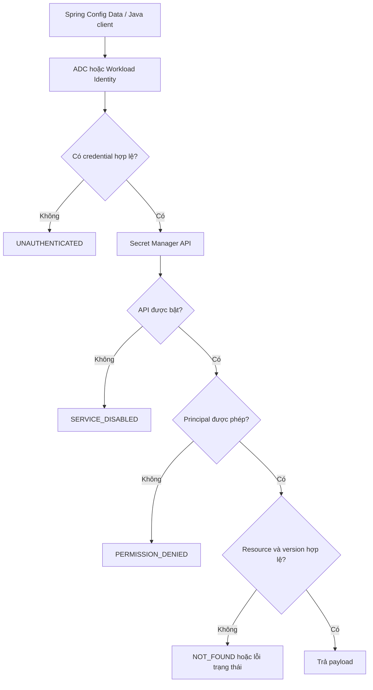

# Xử lý thiếu quyền, API chưa bật và bí mật không tồn tại

Khi Spring Boot không đọc được một secret từ Google Cloud Secret Manager, thông báo lỗi ban đầu thường chưa nói đủ nguyên nhân. Request có thể thất bại vì ứng dụng đang dùng sai danh tính, IAM không cho phép đọc payload, Secret Manager API chưa được bật trong project, resource name trỏ nhầm secret/version hoặc version đã bị disable. Các trường hợp này cần cách xử lý khác nhau.

Hãy chẩn đoán theo ba lớp: **dịch vụ có sẵn sàng nhận request không, request được gửi bởi principal nào và principal có quyền trên resource/version được yêu cầu không**. Khi ba lớp này đúng, mới kiểm tra trạng thái secret và cấu hình Spring. Cách phân loại rõ ràng giúp tránh cấp quyền quá rộng chỉ để chữa lỗi API chưa bật, hoặc bật fallback để che một lỗi IAM.

Bài thuộc chương **Cấu hình Google Cloud** của module **SPRING_CLOUD_PROVIDER_INTEGRATION**. Module thực hành tích hợp Spring Boot với các dịch vụ managed của AWS, Azure và Google Cloud qua các thư viện Spring Cloud tương ứng. Bài này tập trung vào Google Cloud Secret Manager, Service Usage, IAM, Application Default Credentials (ADC), trạng thái secret version và cách xử lý lỗi trong Spring Boot.

## 1. Mục tiêu học tập

Sau bài học, bạn có thể:

- Phân biệt lỗi API chưa bật, thiếu quyền IAM, thiếu authentication và resource không tồn tại.
- Xác định project cần bật Secret Manager API và kiểm tra trạng thái dịch vụ bằng gcloud.
- Xác định principal thực tế mà Spring Boot dùng qua ADC hoặc workload identity.
- Cấp đúng permission đọc payload ở cấp secret.
- Phân biệt `roles/secretmanager.secretAccessor` với quyền xem metadata.
- Kiểm tra resource name, project, location, secret ID và version ID.
- Phân biệt version `ENABLED`, `DISABLED` và `DESTROYED`.
- Xử lý `NOT_FOUND` riêng với `PERMISSION_DENIED`, lỗi API và lỗi mạng.
- Thiết kế hành vi fail fast cho secret bắt buộc và fallback có kiểm soát cho secret tùy chọn.
- Dùng Policy Troubleshooter, Cloud Audit Logs và integration test để tìm nguyên nhân.

## 2. Phân loại lỗi trước khi sửa

Một lỗi Secret Manager có thể xuất hiện ở nhiều lớp. Không nên chỉ nhìn mã HTTP rồi cấp thêm quyền hoặc đổi resource path ngay lập tức.

| Dấu hiệu | Nhóm nguyên nhân | Cần kiểm tra đầu tiên |
| --- | --- | --- |
| `SERVICE_DISABLED` hoặc thông báo API chưa được sử dụng trong project | Secret Manager API chưa bật trong consumer project được nêu trong lỗi | Project ID/project number trong thông báo và trạng thái API |
| `PERMISSION_DENIED` | Principal thiếu permission, IAM Condition không thỏa, Deny/PAB policy hoặc VPC Service Controls chặn | Principal thực tế, resource đích và policy |
| `UNAUTHENTICATED` | ADC không tìm thấy credential, token hết hạn hoặc workload identity chưa cấu hình đúng | Nguồn credential và danh tính runtime |
| `NOT_FOUND` | Sai project, secret ID, location hoặc version; resource thực sự không tồn tại | Resource name đầy đủ và metadata |
| Version không thể truy cập dù secret tồn tại | Version `DISABLED` hoặc `DESTROYED` | State của version |
| `INVALID_ARGUMENT` | Resource name hoặc tham số request sai định dạng | Cú pháp global/regional resource path |
| `FAILED_PRECONDITION` | Trạng thái resource hoặc điều kiện vận hành không cho phép thao tác | Version state và thông tin chi tiết của API |
| `RESOURCE_EXHAUSTED`, `UNAVAILABLE`, `DEADLINE_EXCEEDED` | Quota, dịch vụ tạm thời không khả dụng hoặc timeout | Quota, mạng và retry policy |

Các mã trên là dấu hiệu để khoanh vùng, không thay thế phần `reason` và thông tin chi tiết trong lỗi Google API. Ví dụ `403` có thể là IAM denial hoặc API chưa bật; cần đọc `status`, `reason`, project được nhắc đến và request context. Không phân loại chỉ bằng mã HTTP.

## 3. Hiểu luồng request của Spring Boot

Với Spring Framework on Google Cloud Config Data, cấu hình có thể tham chiếu một secret như sau:

```yaml
spring:
  config:
    import: "sm@"
  cloud:
    gcp:
      secretmanager:
        project-id: invoice-prod

invoice:
  database:
    password: "${sm@projects/invoice-prod/secrets/invoice-db-password/versions/12}"
```

Khi ứng dụng khởi động, Spring phân giải reference thông qua Secret Manager integration. Request được gửi bằng credential mà ADC tìm thấy. Google Cloud xác thực token, kiểm tra dịch vụ/API, đánh giá IAM và các policy liên quan trên resource rồi mới trả payload.



Có bốn thông tin phải khớp:

1. **Principal:** service account, user ADC hoặc federated identity đang gửi request.
2. **Project tiêu thụ API:** project mà Google API xác định để kiểm tra Service Usage/quota, thường được nêu trong thông báo lỗi.
3. **Project sở hữu secret:** project xuất hiện trong resource name của secret.
4. **Resource/version:** secret ID, location nếu là regional secret và version ID/alias.

Trong mô hình cross-project, project chạy workload có thể khác project chứa secret. Không thay project sở hữu secret bằng project runtime trong resource path.

## 4. Secret Manager API chưa được bật

Google Cloud yêu cầu bật API trong project trước khi sử dụng dịch vụ. Với Secret Manager, API service name là:

```text
secretmanager.googleapis.com
```

### 4.1. Xác định đúng project

Ví dụ secret nằm trong project `invoice-prod`, còn ứng dụng chạy trong `invoice-runtime`. Hãy xác định project được nêu trong lỗi `SERVICE_DISABLED` hoặc consumer project của request. Đừng tự động bật API ở project đang mở trong Console nếu đó không phải project liên quan tới request.

Xem project hiện tại của gcloud:

```bash
gcloud config get-value project
```

Lệnh này cho biết project mặc định của gcloud CLI. Nó không chứng minh project mà ứng dụng ADC hoặc request đang sử dụng. Trong cấu hình cross-project, kiểm tra riêng resource path và project được nêu trong lỗi.

### 4.2. Kiểm tra API đã bật chưa

```bash
gcloud services list \
  --enabled \
  --project=invoice-prod \
  --filter="name:secretmanager.googleapis.com"
```

Nếu không có kết quả, kiểm tra project ID và quyền Service Usage trước khi bật API.

### 4.3. Bật Secret Manager API

```bash
gcloud services enable secretmanager.googleapis.com \
  --project=invoice-prod
```

Thao tác này cần permission `serviceusage.services.enable` trên project. Role dựng sẵn thường được cấp cho người quản trị API là:

```text
roles/serviceusage.serviceUsageAdmin
```

Runtime service account chỉ đọc secret không cần quyền bật API. Tách quyền cấu hình project khỏi quyền đọc payload. Nếu người triển khai không có quyền bật dịch vụ, nhờ project administrator thực hiện theo quy trình quản trị.

### 4.4. Xác minh sau khi bật

Sau khi lệnh hoàn tất, chạy lại:

```bash
gcloud services list \
  --enabled \
  --project=invoice-prod \
  --filter="name:secretmanager.googleapis.com"
```

Nếu vẫn nhận `SERVICE_DISABLED`, đọc lại lỗi để tìm project consumer chính xác, kiểm tra Service Usage API và xác minh thao tác enable đã hoàn tất. Một API được bật ở `invoice-runtime` không tự có nghĩa API đã bật ở mọi project khác.

API enablement và IAM là hai việc độc lập. Bật API không cấp `secretmanager.versions.access`; cấp Secret Accessor cũng không bật API.

## 5. Thiếu quyền IAM: xác định đúng principal

Permission đọc payload của một secret version là:

```text
secretmanager.versions.access
```

Role dựng sẵn thường dùng:

```text
roles/secretmanager.secretAccessor
```

Cấp role này trên đúng secret:

```bash
gcloud secrets add-iam-policy-binding invoice-db-password \
  --project=invoice-prod \
  --member="serviceAccount:invoice-api@invoice-runtime.iam.gserviceaccount.com" \
  --role="roles/secretmanager.secretAccessor"
```

Trong lệnh trên, project `invoice-prod` sở hữu secret. Service account có thể thuộc project runtime khác. Binding được gắn trên secret đích nên service chỉ đọc được secret đó.

### 5.1. Không nhầm quyền xem metadata với quyền đọc payload

| Role | Mục đích | Đọc payload được không? |
| --- | --- | --- |
| `roles/secretmanager.secretAccessor` | Đọc nội dung secret version | Có |
| `roles/secretmanager.viewer` | Xem metadata secret và version | Không |
| `roles/secretmanager.secretVersionAdder` | Thêm version vào secret | Không |
| `roles/secretmanager.secretVersionManager` | Quản lý trạng thái/version | Không |
| `roles/secretmanager.admin` | Quản trị Secret Manager | Có, nhưng quá rộng cho workload chỉ đọc |

Nếu lệnh `gcloud secrets describe` thành công nhưng ứng dụng không đọc được payload, điều đó không chứng minh quyền Accessor đã được cấp. Quyền xem metadata và quyền `AccessSecretVersion` là khác nhau.

Không cấp `roles/owner`, `roles/editor` hoặc `roles/secretmanager.admin` như cách chữa nhanh cho runtime. Hãy cấp Secret Accessor ở cấp secret nếu workload chỉ cần một credential.

### 5.2. Xem policy của secret

```bash
gcloud secrets get-iam-policy invoice-db-password \
  --project=invoice-prod \
  --format=yaml
```

Đối chiếu chính xác member và role. Một số lỗi thường gặp:

- Gán quyền cho service account dùng khi deploy thay vì service account của runtime.
- Gán quyền cho default service account trong khi Cloud Run/GKE dùng identity riêng.
- Gán quyền ở `invoice-runtime` trong khi secret thuộc `invoice-prod`.
- Sai email service account hoặc sai loại member prefix.
- Có IAM Condition nhưng request không thỏa điều kiện.
- Có IAM Deny, Principal Access Boundary hoặc VPC Service Controls chặn request.

### 5.3. Xác minh principal của ứng dụng

Với Cloud Run, kiểm tra service account gắn với revision. Với Compute Engine, kiểm tra service account gắn với VM. Với GKE, kiểm tra Workload Identity Federation for GKE hoặc service account được impersonate. Với local development, phân biệt user credential của gcloud CLI với ADC mà Java client dùng.

Các lệnh sau chỉ giúp kiểm tra danh tính CLI:

```bash
gcloud auth list
gcloud config get-value project
```

`gcloud auth list` không nhất thiết cho biết principal của ứng dụng đang chạy trên Cloud Run/GKE. Ở local, ADC có thể là user credential khác với tài khoản CLI. Ở cloud runtime, ADC thường lấy identity gắn với workload. Kiểm tra cấu hình workload và log identity an toàn của ứng dụng; không in access token.

### 5.4. Dùng Policy Troubleshooter

Khi đã biết:

- Principal đang gọi API.
- Resource secret đầy đủ.
- Permission cần kiểm tra là `secretmanager.versions.access`.

Dùng IAM Policy Troubleshooter trong Google Cloud Console để kiểm tra allow policy, deny policy và Principal Access Boundary có ảnh hưởng đến request không. Công cụ cho biết policy nào cho phép hoặc chặn principal trên resource/permission cụ thể.

Nếu IAM policy có vẻ đúng nhưng request vẫn bị từ chối, kiểm tra VPC Service Controls, IAM Conditions và OAuth scope. Workload trên Compute Engine hoặc GKE cần `cloud-platform` OAuth scope; scope này không thay thế IAM role.

## 6. Secret hoặc version không tồn tại

Lỗi `NOT_FOUND` thường liên quan resource name hoặc version. Kiểm tra từng thành phần thay vì đổi IAM ngay lập tức.

Global secret version có dạng:

```text
projects/PROJECT_ID/secrets/SECRET_ID/versions/VERSION_ID
```

Regional secret version có dạng:

```text
projects/PROJECT_ID/locations/LOCATION_ID/secrets/SECRET_ID/versions/VERSION_ID
```

Xác minh:

1. Project ID là project sở hữu secret.
2. Secret ID đúng chính tả và đúng chữ hoa/chữ thường.
3. Nếu là regional secret, location có mặt và đúng.
4. Version ID hoặc alias tồn tại.
5. Cấu hình Spring không dùng nhầm project mặc định.
6. Ứng dụng đang chạy đúng profile.

### 6.1. Kiểm tra secret metadata

```bash
gcloud secrets describe invoice-db-password \
  --project=invoice-prod
```

Lệnh này kiểm tra secret resource và metadata, không in payload.

### 6.2. Kiểm tra danh sách version

```bash
gcloud secrets versions list invoice-db-password \
  --project=invoice-prod
```

### 6.3. Kiểm tra metadata version cụ thể

```bash
gcloud secrets versions describe 12 \
  --secret=invoice-db-password \
  --project=invoice-prod
```

Nếu lệnh metadata bị `PERMISSION_DENIED`, principal đang chạy lệnh có thể thiếu quyền xem metadata. Điều đó khác với kết luận rằng secret không tồn tại. Dùng principal quản trị phù hợp để xác minh resource, đồng thời kiểm tra riêng quyền runtime.

## 7. Secret version bị disable hoặc destroyed

Một secret có thể tồn tại trong khi version được tham chiếu không còn truy cập được.

| State | Payload | Có thể đọc? | Có thể khôi phục? |
| --- | --- | --- | --- |
| `ENABLED` | Được lưu | Có | Không cần khôi phục |
| `DISABLED` | Vẫn được lưu | Không | Có thể enable lại |
| `DESTROYED` | Đã bị hủy | Không | Không thể chuyển lại sang enabled |

Version `DISABLED` không phải secret không tồn tại. Nếu có quyền quản trị phù hợp và việc khôi phục được chấp thuận, có thể enable lại:

```bash
gcloud secrets versions enable 12 \
  --secret=invoice-db-password \
  --project=invoice-prod
```

Thao tác này cần quyền quản lý version, không thuộc quyền đọc payload của runtime. Không cấp `roles/secretmanager.secretVersionManager` cho ứng dụng chỉ để nó có thể tự enable version.

Version `DESTROYED` đã mất payload và không thể khôi phục qua thao tác enable. Cần thêm version mới từ nguồn credential hợp lệ rồi cập nhật reference. Nếu secret có cấu hình delayed destruction, kiểm tra trạng thái đang chờ hủy và thời hạn trước khi kết luận payload đã bị xóa vĩnh viễn.

## 8. Phân biệt lỗi API với lỗi IAM

`PERMISSION_DENIED` không phải lúc nào cũng có nghĩa thiếu Secret Accessor. Google API có thể trả lỗi quyền cho API chưa bật hoặc policy khác chặn request. Hãy xem reason và thông tin chi tiết trong lỗi.

| Tình huống | Dấu hiệu cần tìm | Hướng xử lý |
| --- | --- | --- |
| API chưa bật | `SERVICE_DISABLED`, tên service và consumer project | Bật `secretmanager.googleapis.com` trong đúng project |
| IAM thiếu quyền | Principal và permission bị từ chối | Cấp Secret Accessor trên secret |
| IAM Deny/PAB/Condition | Policy Troubleshooter cho biết policy chặn | Sửa policy/condition đúng phạm vi |
| VPC Service Controls | Thông tin violation/perimeter trong error hoặc audit log | Kiểm tra ingress/egress policy và service perimeter |
| OAuth scope thiếu | `insufficient authentication scopes` | Cấu hình `cloud-platform` scope cho VM/node |
| ADC không hợp lệ | `UNAUTHENTICATED`, credential source không có hoặc token lỗi | Sửa workload identity/ADC |
| Sai resource | `NOT_FOUND` hoặc `INVALID_ARGUMENT` | Kiểm tra project, location, secret và version |
| Version bị disable | Lỗi trạng thái/precondition khi access | Kiểm tra state và enable theo quy trình |
| Quota hoặc outage | `RESOURCE_EXHAUSTED`, `UNAVAILABLE`, `DEADLINE_EXCEEDED` | Backoff có jitter, kiểm tra quota và tình trạng dịch vụ |

Không retry liên tục với `PERMISSION_DENIED`, `SERVICE_DISABLED` hoặc `NOT_FOUND`. Đây thường là lỗi cấu hình cần sửa. Retry chỉ có ý nghĩa khi có nguyên nhân tạm thời, quota hoặc trạng thái dịch vụ được xác nhận.

## 9. Xử lý lỗi trong Spring Boot

### 9.1. Khi dùng Config Data

Ví dụ:

```yaml
spring:
  config:
    import: "sm@"

invoice:
  database:
    password: "${sm@projects/invoice-prod/secrets/invoice-db-password/versions/12}"
```

Secret được phân giải trong quá trình nạp cấu hình. Nếu secret bắt buộc không đọc được, Spring có thể dừng quá trình khởi động trước khi ApplicationContext hoàn tất. Exception của Spring có thể bọc lỗi từ Google API; khi chẩn đoán cần xem root cause và mã trạng thái Google API, không chỉ nhìn lớp exception ngoài cùng.

Không thêm `optional:` hoặc bật `allow-default-secret` để che `PERMISSION_DENIED` hay `SERVICE_DISABLED`. Optional Config Data location không phải cơ chế bỏ qua mọi lỗi truy cập secret. `allow-default-secret` liên quan secret không tồn tại theo hành vi của thư viện; nó không cấp quyền, không bật API và không sửa lỗi mạng.

### 9.2. Secret bắt buộc: fail fast

Với database password, signing key hoặc credential của luồng chính, giữ hành vi lỗi khi không lấy được giá trị. Kiểm tra payload không rỗng trước khi tạo client:

```java
String password = properties.getPassword();

if (password == null || password.isBlank()) {
    throw new IllegalStateException(
            "invoice.database.password is required");
}
```

Thông báo lỗi chỉ nêu tên property/resource và nguyên nhân đã phân loại; không đưa payload vào exception, log hoặc response.

### 9.3. Secret tùy chọn: chỉ xử lý NOT_FOUND

Nếu một tính năng phụ có thể tắt khi secret không tồn tại, chỉ chuyển `NOT_FOUND` thành trạng thái không có giá trị. Các lỗi permission, API disabled, authentication và network phải tiếp tục được báo.

Ví dụ với Google Cloud Java client:

```java
import com.google.api.gax.rpc.NotFoundException;
import com.google.cloud.secretmanager.v1.AccessSecretVersionResponse;
import com.google.cloud.secretmanager.v1.SecretManagerServiceClient;
import com.google.cloud.secretmanager.v1.SecretVersionName;

import java.util.Optional;

public class OptionalSecretReader {

    private final SecretManagerServiceClient client;

    public OptionalSecretReader(SecretManagerServiceClient client) {
        this.client = client;
    }

    public Optional<String> readIfPresent(
            String projectId,
            String secretId,
            String versionId) {

        SecretVersionName name =
                SecretVersionName.of(projectId, secretId, versionId);

        try {
            AccessSecretVersionResponse response =
                    client.accessSecretVersion(name);

            String value =
                    response.getPayload().getData().toStringUtf8();

            if (value.isBlank()) {
                return Optional.empty();
            }

            return Optional.of(value);
        } catch (NotFoundException ex) {
            return Optional.empty();
        }
    }
}
```

Ví dụ chỉ minh họa xử lý secret global. Với regional secret, dùng resource name/client endpoint tương ứng. Trong production, quản lý client như bean dùng chung và đóng khi application context dừng.

Không bắt `Exception` hoặc `ApiException` chung rồi trả `Optional.empty()`. Làm vậy có thể biến `PERMISSION_DENIED`, `SERVICE_DISABLED` hoặc outage thành trạng thái “tính năng không cấu hình”. Nếu tính năng đang bật nhưng `Optional.empty()`, tầng tạo client phải báo lỗi cấu hình rõ ràng.

### 9.4. Ghi log an toàn

Có thể ghi log metadata chẩn đoán:

- Secret resource name hoặc một định danh đã được chuẩn hóa.
- Project ID.
- Operation (`AccessSecretVersion`).
- Error code/status.
- Runtime principal đã xác định (không ghi token).
- Correlation/request ID nếu có.

Không ghi secret payload, access token, private key, password hoặc toàn bộ object response. Tránh log nguyên environment, exception có chứa cấu hình nhạy cảm hoặc giá trị property sau khi resolve.

## 10. Retry: lỗi nào được thử lại?

| Lỗi | Retry? | Hành động |
| --- | --- | --- |
| `PERMISSION_DENIED` do IAM | Không retry liên tục | Sửa IAM/policy và thử lại sau khi thay đổi có hiệu lực |
| `SERVICE_DISABLED` | Không | Bật API đúng project |
| `NOT_FOUND` | Không | Sửa resource path hoặc tạo resource đúng |
| Version `DISABLED`/`DESTROYED` | Không | Chọn version hợp lệ hoặc tạo version mới |
| `UNAUTHENTICATED` | Không retry mù | Sửa ADC/token/workload identity |
| `INVALID_ARGUMENT` | Không | Sửa request/resource name |
| `RESOURCE_EXHAUSTED` | Có, theo quota/backoff | Exponential backoff và jitter; tôn trọng quota |
| `UNAVAILABLE` hoặc lỗi 5xx tạm thời | Có giới hạn | Retry có backoff, giới hạn tổng thời gian |
| `DEADLINE_EXCEEDED` | Có điều kiện | Kiểm tra timeout, mạng và idempotency trước khi retry |

Dùng exponential backoff với jitter để tránh nhiều instance retry đồng thời. Không retry vô hạn trong startup; đặt tổng thời gian chờ hợp lý rồi fail fast để rollout báo lỗi. Nếu request là thao tác đọc version, retry thường an toàn hơn thao tác thay đổi resource, nhưng vẫn phải giới hạn số lần và thời gian.

## 11. Dùng Cloud Audit Logs để tìm principal và thao tác

Secret Manager có audit logs cho hoạt động quản trị và truy cập dữ liệu. `AccessSecretVersion` là Data Access method. Data Access logging cần được bật theo cấu hình audit của project/organization.

Trong Logs Explorer, bắt đầu với:

```text
protoPayload.serviceName="secretmanager.googleapis.com"
```

Lọc riêng thao tác đọc payload:

```text
protoPayload.serviceName="secretmanager.googleapis.com"
protoPayload.methodName="google.cloud.secretmanager.v1.SecretManagerService.AccessSecretVersion"
```

Đối chiếu principal, resource, thời điểm và kết quả. Audit log có thể giúp xác nhận ứng dụng đang dùng service account nào thay vì principal mà người triển khai nghĩ rằng nó đang dùng. Không phải mọi lỗi đều có cùng mức log; hãy kết hợp audit logs với error detail và Policy Troubleshooter.

## 12. Quy trình chẩn đoán theo thứ tự

Khi một instance Spring Boot không đọc được secret, thực hiện lần lượt:

1. **Đọc root cause:** xác định error code và reason, không chỉ exception ngoài cùng.
2. **Xác định resource:** ghi lại project, secret ID, location và version từ reference.
3. **Kiểm tra API:** xác nhận `secretmanager.googleapis.com` được bật trong project được request sử dụng.
4. **Xác minh principal:** kiểm tra Cloud Run revision, VM, GKE workload identity hoặc ADC local.
5. **Kiểm tra IAM:** xác nhận principal có `secretmanager.versions.access` trên secret đích.
6. **Kiểm tra policy nâng cao:** IAM Condition, Deny, PAB, VPC Service Controls và OAuth scope.
7. **Kiểm tra metadata:** xác nhận secret/version tồn tại và version đang `ENABLED`.
8. **Kiểm tra Spring config:** project mặc định, profile, `sm@`/`sm://` theo version thư viện và property override.
9. **Kiểm tra trạng thái ứng dụng:** secret bắt buộc phải fail fast; secret tùy chọn chỉ fallback cho `NOT_FOUND`.
10. **Kiểm thử lại:** dùng đúng runtime principal và không in payload ra log.

Thứ tự này giúp phân biệt lỗi ở project, identity, policy và resource. Không bắt đầu bằng việc cấp quyền project-wide hoặc đổi secret sang `latest` vì hai thao tác đó có thể che nguyên nhân thật.

## 13. Bài thực hành: xử lý ba lỗi trong invoice-service

**Bối cảnh:** `invoice-service` chạy trên Cloud Run trong project `invoice-runtime`. Database password nằm trong Secret Manager của project `invoice-prod`:

```text
projects/invoice-prod/secrets/invoice-db-password/versions/12
```

Service account runtime:

```text
invoice-api@invoice-runtime.iam.gserviceaccount.com
```

### Bước 1 — Kiểm tra API

```bash
gcloud services list \
  --enabled \
  --project=invoice-prod \
  --filter="name:secretmanager.googleapis.com"
```

Nếu API chưa bật và bạn có quyền Service Usage:

```bash
gcloud services enable secretmanager.googleapis.com \
  --project=invoice-prod
```

Nếu không có `serviceusage.services.enable`, yêu cầu project administrator bật API. Không cấp Secret Accessor để thay thế quyền bật dịch vụ.

### Bước 2 — Kiểm tra secret và version

```bash
gcloud secrets describe invoice-db-password \
  --project=invoice-prod
```

```bash
gcloud secrets versions describe 12 \
  --secret=invoice-db-password \
  --project=invoice-prod
```

Xác nhận resource đúng và version đang enabled. Nếu version bị disabled, chỉ enable lại sau khi người quản trị xác nhận đây là version cần dùng.

### Bước 3 — Kiểm tra IAM binding

```bash
gcloud secrets get-iam-policy invoice-db-password \
  --project=invoice-prod \
  --format=yaml
```

Nếu thiếu member, cấp role trên đúng secret:

```bash
gcloud secrets add-iam-policy-binding invoice-db-password \
  --project=invoice-prod \
  --member="serviceAccount:invoice-api@invoice-runtime.iam.gserviceaccount.com" \
  --role="roles/secretmanager.secretAccessor"
```

Không gán binding cho tài khoản deploy nếu Cloud Run revision chạy bằng service account khác.

### Bước 4 — Kiểm tra Cloud Run identity

Kiểm tra cấu hình service/revision và xác nhận service account runtime đúng là `invoice-api@invoice-runtime.iam.gserviceaccount.com`. Nếu identity sai, cập nhật service account theo quy trình deploy và rollout revision mới.

### Bước 5 — Kiểm tra Spring resource reference

```yaml
spring:
  config:
    import: "sm@"

invoice:
  database:
    password: "${sm@projects/invoice-prod/secrets/invoice-db-password/versions/12}"
```

Project trong resource path là `invoice-prod`, nơi secret tồn tại. Không thay thành `invoice-runtime` chỉ vì Cloud Run chạy trong project đó.

### Bước 6 — Kiểm thử quyền âm tính

Dùng một service account test không được cấp Accessor và xác nhận request bị từ chối. Sau đó kiểm thử bằng runtime service account được cấp đúng quyền. Không dùng role Owner/Admin để làm cho test thành công.

### Bước 7 — Kiểm tra log và readiness

Xác minh Data Access audit log có principal và resource dự kiến. Kiểm tra datasource kết nối thành công trước khi đánh dấu service ready. Không trả password ra endpoint hoặc log.

## 14. Ma trận kiểm thử

| Ca | API | IAM | Resource/version | Kết quả mong đợi |
| --- | --- | --- | --- | --- |
| A | Bật | Accessor đúng | Tồn tại, enabled | Đọc được payload |
| B | Chưa bật | Bất kỳ | Tồn tại | Lỗi API/service disabled |
| C | Bật | Thiếu Accessor | Tồn tại | `PERMISSION_DENIED` |
| D | Bật | Viewer | Tồn tại | Xem metadata được nếu quyền đủ, không đọc payload |
| E | Bật | Accessor đúng | Sai secret ID/project | `NOT_FOUND` |
| F | Bật | Accessor đúng | Sai version | `NOT_FOUND` hoặc lỗi resource tương ứng |
| G | Bật | Accessor đúng | Version disabled | Không đọc được; có thể re-enable theo quyền quản trị |
| H | Bật | Accessor đúng | Version destroyed | Không thể đọc hoặc khôi phục payload |
| I | Bật | Principal sai/không có ADC | Tồn tại | `UNAUTHENTICATED` hoặc lỗi credential |
| J | Bật | IAM đúng nhưng VPC-SC/Deny chặn | Tồn tại | Request vẫn bị policy từ chối |
| K | Bật | Accessor đúng | Secret tùy chọn không tồn tại | Chỉ fallback nếu nghiệp vụ cho phép |
| L | Bật | IAM bị từ chối cho secret tùy chọn | Tồn tại | Báo lỗi quyền, không fallback thành empty |

Unit test có thể mock client để kiểm tra cách ứng dụng phân loại exception. Integration test cần chạy bằng identity test thực tế để xác minh API enablement, IAM, resource path và workload identity. Không dùng secret production trong test.

## 15. Câu hỏi tự kiểm tra

1. Vì sao `SERVICE_DISABLED` không được xử lý bằng cách cấp `roles/secretmanager.secretAccessor`?
2. Permission nào cần để bật một API trong project?
3. Vì sao `gcloud auth list` không chứng minh được principal của Cloud Run runtime?
4. Khi secret nằm ở `invoice-prod` nhưng workload chạy trong `invoice-runtime`, project nào xuất hiện trong resource path?
5. Khác nhau giữa `roles/secretmanager.viewer` và `roles/secretmanager.secretAccessor` là gì?
6. Khi nào `PERMISSION_DENIED` có thể do IAM Deny, PAB hoặc VPC Service Controls thay vì thiếu allow binding?
7. Vì sao version `DISABLED` khác secret không tồn tại?
8. Có thể khôi phục version `DESTROYED` bằng thao tác enable không?
9. Vì sao không nên bắt mọi `ApiException` rồi trả `Optional.empty()`?
10. Secret bắt buộc nên phản ứng thế nào khi API chưa bật hoặc IAM bị từ chối?
11. Khi nào nên retry `UNAVAILABLE` và `RESOURCE_EXHAUSTED`?
12. Audit log nào ghi nhận thao tác `AccessSecretVersion`?
13. Vì sao không nên cấp `roles/owner` cho runtime chỉ để chữa lỗi đọc secret?
14. Làm thế nào để kiểm thử một service account không thể đọc secret ngoài phạm vi?

## 16. Ghi nhớ

Ba nhóm lỗi chính cần được xử lý riêng. **API chưa bật** là vấn đề Service Usage ở project phù hợp và cần permission `serviceusage.services.enable`. **Thiếu quyền** là vấn đề principal và IAM/policy trên secret; quyền đọc payload là `secretmanager.versions.access`, thường được cấp bằng `roles/secretmanager.secretAccessor`. **Secret không tồn tại hoặc không đọc được** cần kiểm tra project, secret ID, location, version và state của version.

Trong Spring Boot, lỗi Secret Manager có thể xuất hiện khi Config Data đang được nạp, trước khi ứng dụng hoàn tất khởi động. Secret bắt buộc phải fail fast. Secret tùy chọn chỉ nên chuyển `NOT_FOUND` thành trạng thái vắng mặt khi nghiệp vụ cho phép; không biến lỗi IAM, API disabled, authentication hoặc network thành giá trị rỗng. **Xác định đúng error reason, principal, project và version trước khi thay đổi policy** giúp xử lý sự cố chính xác mà vẫn giữ quyền truy cập ở mức tối thiểu.

## Tài liệu tham khảo chính thức

- [Google Cloud Secret Manager — Enable the Secret Manager API](https://docs.cloud.google.com/secret-manager/docs/configuring-secret-manager)
- [Google Cloud Service Usage — Troubleshoot issues](https://docs.cloud.google.com/service-usage/docs/troubleshooting)
- [Google Cloud Service Usage — Enable and disable services](https://docs.cloud.google.com/service-usage/docs/enable-disable)
- [Google Cloud Secret Manager — Access control with IAM](https://docs.cloud.google.com/secret-manager/docs/access-control)
- [Google Cloud Secret Manager — Access a secret version](https://docs.cloud.google.com/secret-manager/docs/access-secret-version)
- [Google Cloud Secret Manager — Disable a secret version](https://docs.cloud.google.com/secret-manager/docs/disable-secret-version)
- [Google Cloud Secret Manager — Destroy a secret version](https://docs.cloud.google.com/secret-manager/docs/destroy-secret-version)
- [Google Cloud IAM — Troubleshoot IAM-related policies](https://docs.cloud.google.com/iam/docs/troubleshoot-policies)
- [Google Cloud Secret Manager — Audit logging](https://docs.cloud.google.com/secret-manager/docs/audit-logging)
- [Spring Framework on Google Cloud — Secret Manager](https://googlecloudplatform.github.io/spring-cloud-gcp/reference/html/index.html#secret-manager)

