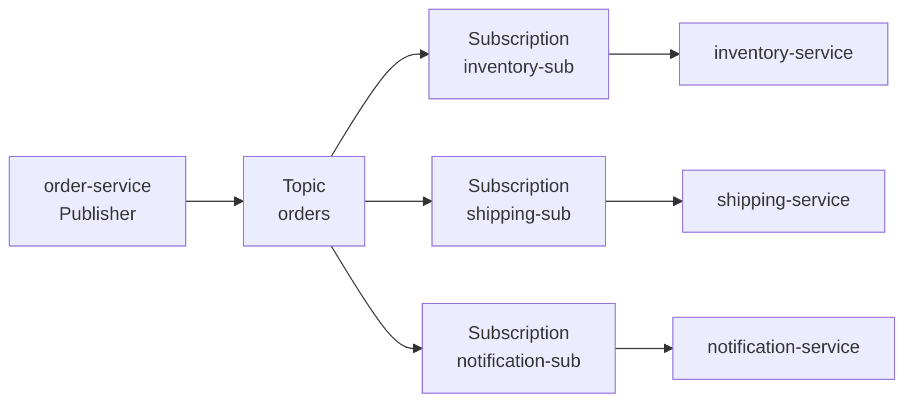
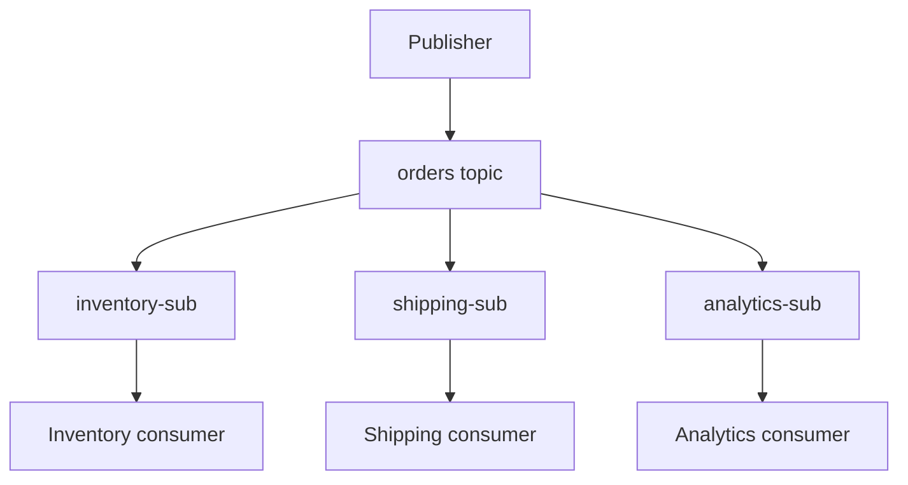
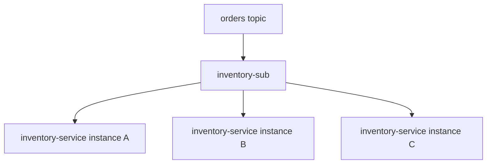
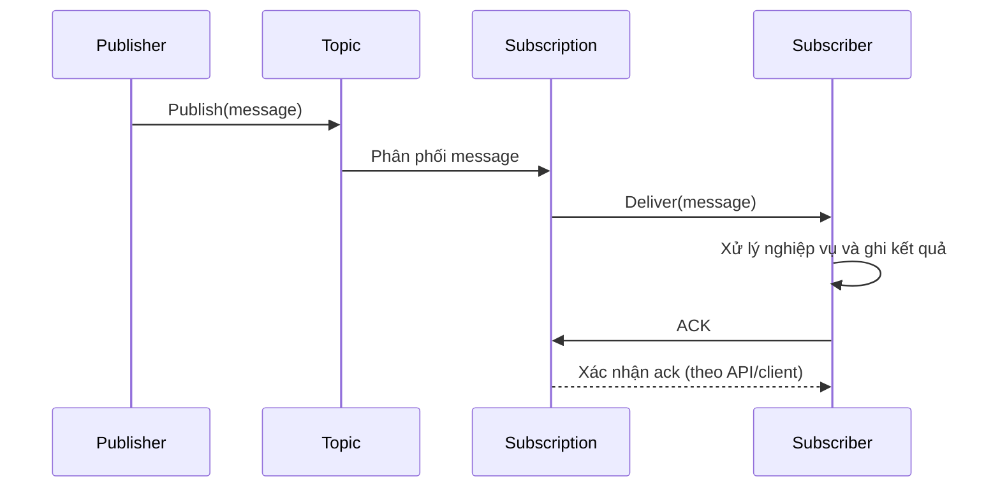
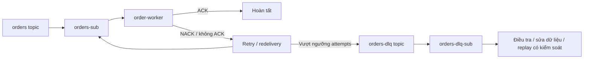
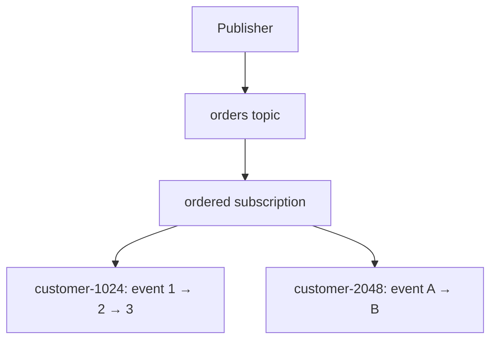

# Topic, subscription, publisher và subscriber trong Pub/Sub

## Mục tiêu bài học

Module **SPRING_CLOUD_PROVIDER_INTEGRATION** hướng dẫn tích hợp Spring Boot với các dịch vụ managed của **AWS, Azure và Google Cloud** thông qua thư viện Spring Cloud tương ứng. Bên cạnh cấu hình danh tính và quyền, storage, messaging, dữ liệu và bảo vệ secret, người học cần biết cách đưa hệ thống xử lý bất đồng bộ bằng dịch vụ messaging managed của từng cloud.

Trong chương **Google Cloud Pub/Sub**, bài này giới thiệu bốn thành phần cốt lõi:

- **Topic**: nơi publisher gửi message.
- **Subscription**: đăng ký nhận message từ một topic, lưu trạng thái giao nhận riêng.
- **Publisher**: ứng dụng tạo và gửi message.
- **Subscriber**: ứng dụng nhận, xử lý và xác nhận message từ subscription.

Sau bài học, bạn có thể:

1. Mô tả luồng publish/subscribe và quan hệ giữa topic với một hoặc nhiều subscription.
2. Phân biệt fan-out, load balancing, pull subscription và push subscription.
3. Tạo topic/subscription bằng Google Cloud CLI và cấp IAM quyền tối thiểu.
4. Tích hợp Spring Boot bằng **Spring Framework on Google Cloud Pub/Sub Starter**, `PubSubTemplate` và `PubSubAdmin`.
5. Xử lý acknowledgment, redelivery, duplicate, ordering, retry và dead-letter topic.
6. Chạy kiểm thử local bằng Pub/Sub emulator và thiết kế integration test trên Google Cloud sandbox.

> **Phạm vi:** Ví dụ dùng Maven và Spring Boot starter `com.google.cloud:spring-cloud-gcp-starter-pubsub`, theo tài liệu Spring Framework on Google Cloud hiện hành. Chọn BOM tương thích với phiên bản Spring Boot của dự án; không tự ghim một version rời rạc hoặc trộn các dòng thư viện cũ/mới.

## 1. Pub/Sub giải quyết vấn đề gì?

Giả sử hệ thống thương mại điện tử có `order-service`, `inventory-service`, `shipping-service` và `notification-service`. Khi khách hàng đặt hàng, `order-service` cần phát một sự kiện `OrderCreated`. Các service khác có thể xử lý độc lập:

- `inventory-service` trừ tồn kho.
- `shipping-service` tạo yêu cầu giao hàng.
- `notification-service` gửi email xác nhận.

Nếu `order-service` gọi HTTP tuần tự tới cả ba service, nó phụ thuộc vào trạng thái mạng, thời gian phản hồi và availability của từng service. Một downstream chậm có thể kéo dài request đặt hàng, còn một downstream ngừng hoạt động có thể khiến cả luồng đồng bộ thất bại.

Pub/Sub giúp **tách publisher khỏi subscriber**. Publisher gửi sự kiện đến một topic; các subscriber nhận thông qua subscription của riêng mình và xử lý độc lập. Publisher không cần biết service nào đang nghe, số lượng consumer hay cách từng consumer triển khai.



Mỗi subscription có trạng thái nhận và acknowledgment riêng. Khi `inventory-service` xác nhận message, điều đó không xác nhận thay cho `shipping-service` hoặc `notification-service`. Đây là nền tảng của mô hình **fan-out**.

Pub/Sub phù hợp với event-driven architecture, xử lý nền, tích hợp nhiều hệ thống và hấp thụ tải đột biến. Nó không tự bảo đảm transaction xuyên database, không thay thế thiết kế idempotency và không biến mọi message thành xử lý exactly-once ở tầng nghiệp vụ.

## 2. Bốn thành phần cơ bản

### 2.1. Topic

**Topic** là tài nguyên có tên đại diện cho một luồng message. Publisher gửi message tới topic, không gửi trực tiếp tới subscription hoặc một subscriber cụ thể.

Ví dụ:

```text
projects/acme-commerce/topics/orders
projects/acme-commerce/topics/payments
projects/acme-commerce/topics/inventory-events
```

Một message thường gồm:

| Thành phần | Ý nghĩa | Ví dụ |
| --- | --- | --- |
| `data` | Payload dạng bytes | JSON biểu diễn `OrderCreated` |
| `attributes` | Metadata dạng key/value chuỗi | `eventType=OrderCreated`, `schemaVersion=1` |
| `orderingKey` | Khóa dùng để sắp thứ tự theo nhóm | `customer-1024` |
| `messageId` | ID do Pub/Sub gán sau khi publish thành công | Dùng để quan sát/đối chiếu message |
| `publishTime` | Thời điểm Pub/Sub ghi nhận message | Timestamp do dịch vụ cung cấp |

`data` có thể là JSON, protobuf hoặc định dạng ứng dụng tự quy ước. Pub/Sub không tự hiểu ngữ nghĩa payload nếu bạn không dùng schema/consumer tương ứng. `attributes` phù hợp cho metadata định tuyến hoặc quan sát; không nên đặt password, token hay dữ liệu nhạy cảm vào attributes.

### 2.2. Subscription

**Subscription** là tài nguyên biểu diễn một consumer group logic đang quan tâm tới message của một topic. Subscription giữ trạng thái message đã giao, chưa xác nhận, retry và retention.

Ví dụ:

```text
projects/acme-commerce/subscriptions/inventory-sub
projects/acme-commerce/subscriptions/shipping-sub
projects/acme-commerce/subscriptions/notification-sub
```

Một topic có thể có nhiều subscription; một subscription thuộc về một topic. Một subscriber phải đọc từ **subscription**, không đọc trực tiếp từ topic.

Một quy tắc quan trọng: subscription thường chỉ nhận message được publish **sau khi subscription được tạo**. Nếu cần phát lại message đã publish trước khi tạo subscription, cần thiết kế topic message retention và thao tác replay/seek phù hợp; không mặc định topic là một kho lưu trữ lịch sử vô hạn.

### 2.3. Publisher

Publisher là ứng dụng hoặc thành phần tạo message và gửi lên topic. Nó thường thực hiện:

1. Tạo payload theo hợp đồng sự kiện.
2. Thêm attributes cần thiết.
3. Chọn topic đích.
4. Gọi API publish và chờ kết quả bất đồng bộ.
5. Xử lý lỗi publish và ghi nhận message ID khi thành công.

Publisher không cần biết subscriber nào đã xử lý message. Publish thành công có nghĩa Pub/Sub đã chấp nhận message, **không có nghĩa** mọi consumer đã hoàn thành nghiệp vụ.

### 2.4. Subscriber

Subscriber là ứng dụng nhận message từ subscription. Nó cần:

1. Nhận message.
2. Kiểm tra schema và dữ liệu đầu vào.
3. Xử lý nghiệp vụ, thường ghi kết quả vào database hoặc gọi dịch vụ khác.
4. **Ack** khi xử lý thành công.
5. **Nack** hoặc để acknowledgment deadline hết hạn khi chưa xử lý được, để Pub/Sub có thể giao lại theo retry policy.

Subscriber phải chịu được việc một message được giao nhiều lần. Đây là điều quan trọng ngay cả khi publisher chỉ gửi một lần.

## 3. Topic, subscription và mô hình phân phối

### 3.1. Fan-out: một topic, nhiều subscription

Khi nhiều hệ thống cần nhận cùng một sự kiện nhưng xử lý cho mục đích khác nhau, tạo một subscription cho từng consumer:



Mỗi subscription nhận một bản phân phối độc lập của các message mới. `inventory-sub` ack không làm message biến mất khỏi `shipping-sub`. Nhờ vậy các consumer có thể có tốc độ, retry policy và retention khác nhau.

### 3.2. Load balancing: nhiều subscriber cùng một subscription

Nếu cần tăng năng lực xử lý, chạy nhiều instance subscriber cùng đọc **một subscription**:



Các instance chia nhau xử lý message của subscription. Một message đang outstanding thường không được gửi đồng thời tới subscriber khác của cùng subscription; nếu không được ack đúng hạn, nó có thể được redeliver. Không phải mỗi instance đều nhận bản sao đầy đủ của toàn bộ luồng.

### 3.3. Fan-out kết hợp load balancing

Một kiến trúc có thể kết hợp cả hai:

- Nhiều subscription để các nhóm nghiệp vụ nhận bản sao độc lập.
- Nhiều instance subscriber trong từng subscription để chia tải.

| Mục tiêu | Cách thiết kế |
| --- | --- |
| Inventory và Shipping đều cần mọi OrderCreated | Hai subscription khác nhau |
| Tăng số worker xử lý inventory | Nhiều subscriber cùng `inventory-sub` |
| Analytics cần replay độc lập | Subscription riêng và retention/replay phù hợp |
| Một consumer lỗi không làm chậm consumer khác | Subscription riêng, retry/DLQ riêng |

Đừng tạo một subscription cho mỗi instance nếu mục tiêu là chia tải; điều đó sẽ biến mô hình load balancing thành fan-out, khiến mỗi instance nhận cùng message.

## 4. Pull subscription và push subscription

Pub/Sub hỗ trợ các cách giao message chính:

| Kiểu | Cách hoạt động | Khi phù hợp |
| --- | --- | --- |
| **Pull** | Subscriber chủ động nhận message từ Pub/Sub | Worker nền, autoscaling, kiểm soát flow và ack |
| **Push** | Pub/Sub gửi HTTP request tới endpoint của ứng dụng | Web service có HTTPS endpoint và muốn nhận request do dịch vụ chủ động gửi |
| **Export subscription** | Pub/Sub ghi message trực tiếp tới tài nguyên được hỗ trợ như BigQuery hoặc Cloud Storage | Pipeline dữ liệu, lưu trữ/analytics mà không cần tự vận hành subscriber |

Trong Spring Framework on Google Cloud, `PubSubTemplate.subscribe()` là cách lắng nghe subscription theo mô hình pull bất đồng bộ. Khi dùng push subscription, Pub/Sub gọi endpoint đã cấu hình; endpoint cần đáp ứng yêu cầu xác thực và HTTPS của môi trường production. Push không phải cùng cơ chế callback trong `PubSubTemplate.subscribe()`.

Với push delivery, endpoint xác nhận message bằng cách trả một trong các HTTP status `102`, `200`, `201`, `202` hoặc `204`. Các status khác được xem là negative acknowledgment và có thể khiến Pub/Sub gửi lại message. Khi bật xác thực push, Pub/Sub gửi JWT trong header `Authorization`; endpoint phải xác minh chữ ký, audience và danh tính service account theo cấu hình, không chỉ kiểm tra request có đến từ HTTPS.

Mặc định, push request gửi một JSON envelope; trường `message.data` là payload được mã hóa Base64:

```json
{
  "message": {
    "data": "eyJldmVudElkIjoiZXZ0LTEwMDEifQ==",
    "messageId": "2070443601311540",
    "attributes": {
      "eventType": "OrderCreated"
    }
  },
  "subscription": "projects/acme-commerce-dev/subscriptions/notification-sub"
}
```

Endpoint cần giải mã Base64, validate payload và chỉ trả status xác nhận sau khi đã hoàn tất nghiệp vụ theo thiết kế. Push subscriber không thể gọi `ModifyAckDeadline` cho từng message như pull subscriber; thời gian xử lý phải nằm trong ack deadline của subscription. Nếu push endpoint trả lỗi hoặc quá thời hạn, Pub/Sub gửi lại và còn có thể áp dụng push backoff ngoài retry policy của subscription.

Với authenticated push, Pub/Sub service agent cần quyền `roles/iam.serviceAccountTokenCreator` trên service account được chọn để ký JWT; principal tạo/cập nhật subscription cũng cần quyền `iam.serviceAccounts.actAs` trên service account đó. Xác minh JWT theo chữ ký, issuer, audience, thời hạn và email service account dự kiến.

### Khi chọn pull

- Worker có thể scale theo backlog.
- Ứng dụng chủ động kiểm soát xử lý và acknowledgment.
- Có thể cấu hình flow control để giới hạn số message đang xử lý.
- Dễ tích hợp vào service chạy nền.

### Khi chọn push

- Ứng dụng có HTTP endpoint sẵn sàng nhận POST.
- Muốn để Pub/Sub chủ động gọi consumer.
- Có thể bảo vệ endpoint, xác thực request và xử lý phản hồi HTTP đúng semantics.

Không chọn push chỉ vì “Spring Boot có REST controller”; cần tính tới xác thực push, timeout, phản hồi thành công/thất bại và khả năng scale endpoint.

## 5. Vòng đời message: publish, receive, ack và redelivery

### 5.1. Luồng xử lý cơ bản



Sau khi publisher gửi message, Pub/Sub phân phối tới các subscription gắn với topic. Subscriber nhận message qua subscription và cần xác nhận sau khi xử lý thành công. Nếu subscriber không ack trong thời gian cho phép, message có thể được giao lại.

### 5.2. Acknowledgment deadline

**Acknowledgment deadline (ack deadline)** là khoảng thời gian subscriber được phép xử lý message trước khi Pub/Sub coi message chưa được xác nhận và có thể redeliver.

Các giá trị chung của subscription:

| Thuộc tính | Giá trị |
| --- | --- |
| Ack deadline mặc định | 10 giây |
| Ack deadline tối thiểu | 10 giây |
| Ack deadline tối đa cấu hình trực tiếp | 600 giây |

Client library có thể tự gia hạn deadline bằng các request modify-ack-deadline khi đang xử lý. Vì vậy, thời gian thực tế một message được giữ outstanding còn phụ thuộc cấu hình subscriber/client, không chỉ giá trị ban đầu của subscription.

Nếu xử lý mất 30 giây nhưng client không gia hạn, Pub/Sub có thể giao lại message trong khi worker đầu tiên vẫn đang làm việc. Hai worker có thể thực hiện cùng nghiệp vụ, vì vậy cần thiết kế idempotency và đặt giới hạn thời gian xử lý phù hợp.

### 5.3. Ack chỉ sau khi hoàn tất nghiệp vụ

Quy tắc an toàn:

```text
Nhận message
    ↓
Validate payload
    ↓
Thực hiện nghiệp vụ và commit dữ liệu
    ↓
ACK
```

Nếu ack **trước khi** commit database, process có thể crash sau ack nhưng trước khi lưu dữ liệu. Pub/Sub đã xem message hoàn tất và sẽ không giao lại theo luồng bình thường; nghiệp vụ có nguy cơ bị mất.

Nếu commit database thành công nhưng ack thất bại hoặc mất phản hồi, Pub/Sub có thể giao lại. Vì thế ứng dụng cần **idempotent consumer**: cùng một event xử lý nhiều lần vẫn tạo một kết quả nghiệp vụ đúng.

Một cách làm là lưu `eventId`/business key cùng kết quả trong một transaction và đặt unique constraint:

```sql
CREATE TABLE processed_events (
    event_id VARCHAR(100) PRIMARY KEY,
    processed_at TIMESTAMP NOT NULL
);
```

Trong transaction xử lý, ứng dụng kiểm tra/chèn `event_id`. Nếu event đã được xử lý, bỏ qua side effect lặp lại rồi ack. Chỉ log `messageId` hoặc `eventId` đã được cho phép; không log toàn bộ payload nếu có dữ liệu cá nhân hoặc nhạy cảm.

### 5.4. At-least-once và duplicate

Mặc định Pub/Sub cung cấp **at-least-once delivery** và không có cam kết thứ tự toàn cục. Điều này có nghĩa message có thể được giao nhiều lần, ví dụ:

- Subscriber không ack trước khi deadline hết hạn.
- Subscriber gửi nack.
- Ack được gửi nhưng phản hồi bị mất hoặc có sự cố mạng.
- Worker xử lý xong nhưng process chết trước khi acknowledgment được ghi nhận.
- Trong một số tình huống hiếm, message vẫn có thể được redeliver ngay cả khi acknowledgment request đã trả thành công, do sự cố nội bộ hoặc phía client/server.

Một lần redelivery hợp lệ có thể giữ nguyên `messageId`. Pub/Sub cũng có thể redeliver message trong một số tình huống hiếm ngay cả khi acknowledgment request trước đó đã trả thành công. Publisher retry một publish request ở tầng ứng dụng có thể tạo nhiều message khác nhau với ID khác nhau nếu lần gửi đầu đã thành công nhưng response bị mất. Do đó idempotency nên dựa trên **event ID do nghiệp vụ tạo** khi cần nhận diện một sự kiện logic qua nhiều lần publish.

### 5.5. Exactly-once delivery có giới hạn

Pub/Sub có tính năng **exactly-once delivery** cho **pull subscriptions** trong phạm vi một region. Khi bật, subscriber có thể nhận kết quả xác nhận acknowledgment; message không bị redeliver sau khi ack được ghi nhận thành công theo semantics của dịch vụ.

Tuy nhiên:

- Exactly-once delivery không biến side effect database/API bên ngoài thành transaction exactly-once.
- Publisher retry có thể tạo nhiều message publish độc lập nếu không có event ID/idempotency ở tầng nghiệp vụ.
- Exactly-once có giới hạn về vùng và loại subscription; push subscription không hỗ trợ tính năng này.
- Spring Framework on Google Cloud cung cấp `ack()` bất đồng bộ qua `CompletableFuture<Void>` ở tài liệu hiện hành; một số phiên bản cũ dùng `ListenableFuture<Void>`. Nếu bật exactly-once, phải kiểm tra cách phiên bản thư viện đang dùng chuyển tiếp kết quả acknowledgment và xử lý lỗi ack. Khi yêu cầu nghiệp vụ cần kiểm soát trực tiếp ack response/ack ID hoặc một tính năng mà abstraction chưa phơi bày, đánh giá sử dụng Google Cloud Java Pub/Sub client ở mức thấp hơn.

Vì vậy, thiết kế subscriber idempotent vẫn cần thiết ngay cả khi hệ thống bật exactly-once delivery.

## 6. Retry, dead-letter topic và message retention

### 6.1. Retry policy

Nếu subscriber nack hoặc ack deadline hết hạn, Pub/Sub có thể giao lại message. Subscription hỗ trợ hai kiểu retry thường dùng:

| Chính sách | Hành vi |
| --- | --- |
| Immediate retry | Giao lại gần như ngay khi message bị nack hoặc hết deadline |
| Exponential backoff | Tăng dần khoảng chờ giữa các lần giao lại, trong giới hạn cấu hình |

Exponential backoff hữu ích khi lỗi có tính tạm thời, ví dụ database đang bảo trì hoặc API downstream bị rate limit. Nó không phải cơ chế trì hoãn message theo lịch nghiệp vụ; nếu cần chạy tác vụ tại thời điểm tương lai, hãy đánh giá Cloud Tasks.

Ví dụ tạo subscription với exponential backoff bằng CLI:

```bash
gcloud pubsub subscriptions create orders-sub \
  --topic=orders \
  --min-retry-delay=10s \
  --max-retry-delay=300s
```

Các giá trị là ví dụ. Thời gian retry nên dựa trên thời gian phục hồi của dependency, giới hạn API và yêu cầu latency.

### 6.2. Dead-letter topic (DLQ)

Nếu một message liên tục không xử lý được, subscription có thể chuyển nó sang **dead-letter topic** sau số lần giao lại được cấu hình. DLQ giúp tách message lỗi khỏi luồng chính để điều tra hoặc xử lý thủ công.



Một số điểm quan trọng:

- DLQ được cấu hình trên **subscription**, không phải trên topic nguồn.
- Số lần giao lại cấu hình được trong khoảng **5 đến 100**; việc chuyển tiếp là best-effort, nên không xem số lần này là bộ đếm chính xác tuyệt đối.
- Giá trị mặc định của maximum delivery attempts là **5**. Pub/Sub cần được cấp quyền để service agent publish lên dead-letter topic và consume/ack trên subscription nguồn theo cấu hình. Thiếu IAM cho service agent có thể khiến DLQ không hoạt động như mong đợi.
- Message chuyển sang DLQ được bọc trong message mới với metadata xác định subscription nguồn; thiết kế quy trình replay để tránh tạo vòng lặp vô hạn.

Ví dụ tạo subscription có DLQ:

```bash
gcloud pubsub subscriptions create orders-sub \
  --topic=orders \
  --dead-letter-topic=orders-dlq \
  --max-delivery-attempts=8
```

Lệnh này giả định topic `orders-dlq` đã tồn tại và các quyền cần thiết cho Pub/Sub service agent đã được cấp.

Service agent có dạng `service-PROJECT_NUMBER@gcp-sa-pubsub.iam.gserviceaccount.com`. Ví dụ, với project sở hữu subscription nguồn, cấp quyền publish trên topic DLQ và quyền subscriber trên subscription nguồn:

```bash
PUBSUB_SERVICE_ACCOUNT="service-PROJECT_NUMBER@gcp-sa-pubsub.iam.gserviceaccount.com"

gcloud pubsub topics add-iam-policy-binding orders-dlq \
  --member="serviceAccount:${PUBSUB_SERVICE_ACCOUNT}" \
  --role="roles/pubsub.publisher"

gcloud pubsub subscriptions add-iam-policy-binding orders-sub \
  --member="serviceAccount:${PUBSUB_SERVICE_ACCOUNT}" \
  --role="roles/pubsub.subscriber"
```

Thay `PROJECT_NUMBER` bằng project number thực tế. Nếu topic DLQ và subscription nguồn ở hai project khác nhau, cấp role trên đúng project/resource sở hữu từng tài nguyên. Chỉ cấp các role này cho Pub/Sub service agent, không cấp `roles/pubsub.serviceAgent` cho service account ứng dụng.

### 6.3. Message retention và subscription expiration

Subscription lưu message chưa được ack trong một khoảng thời gian retention:

| Thuộc tính | Giá trị mặc định | Phạm vi |
| --- | --- | --- |
| Message retention duration | 7 ngày | 10 phút đến 31 ngày |
| Subscription expiration | 31 ngày không có hoạt động | Có thể cấu hình không hết hạn |
| Ack deadline ban đầu | 10 giây | 10 đến 600 giây |

Retention quyết định message chưa xử lý còn có thể được giao lại trong bao lâu. Subscription không có hoạt động có thể hết hạn theo chính sách mặc định. Nếu cần giữ message đã ack để replay, phải bật tùy chọn retain acknowledged messages phù hợp và tính thêm chi phí lưu trữ.

Đừng xem Pub/Sub là kho lưu trữ lâu dài thay cho database hoặc data lake. Nếu cần lưu lịch sử, hãy thiết kế topic retention, subscription retention hoặc pipeline export theo yêu cầu phục hồi và chi phí.

## 7. Message ordering và ordering key

Mặc định Pub/Sub **không bảo đảm message được giao theo thứ tự publish**. Nếu nghiệp vụ yêu cầu thứ tự theo khách hàng, đơn hàng hoặc tài khoản, có thể bật ordering cho subscription và publisher gửi message kèm `orderingKey`.

Ví dụ:

```text
orderingKey = "customer-1024"

OrderCreated(customer-1024)
OrderPaid(customer-1024)
OrderShipped(customer-1024)
```

Với Spring converter, có thể gửi ordering key qua header:

```java
import com.google.cloud.spring.pubsub.support.GcpPubSubHeaders;
import java.util.Map;

pubSubTemplate.publish(
        "orders",
        jsonPayload,
        Map.of(
                "eventType", "OrderCreated",
                GcpPubSubHeaders.ORDERING_KEY, "customer-1024"
        )
);
```

Với cùng ordering key, trong cùng region và khi cấu hình ordering phù hợp, subscriber nhận theo thứ tự dịch vụ nhận các message. Các key khác nhau không có thứ tự tương quan:



Các điều kiện cần nhớ:

1. Bật message ordering trên subscription.
2. Publisher đặt ordering key cho message.
3. Với nhiều publisher, gửi tới cùng regional endpoint để giữ luồng theo region như thiết kế.
4. Ack message theo thứ tự trong cùng ordering key; ack message sau có thể bị chờ message trước.
5. Redelivery một message có thể kéo theo redelivery các message sau cùng key.

Tạo subscription bật ordering bằng CLI:

```bash
gcloud pubsub subscriptions create orders-ordered-sub \
  --topic=orders \
  --enable-message-ordering
```

Subscription phải được tạo/cấu hình ordering phù hợp; chỉ bật `spring.cloud.gcp.pubsub.publisher.enable-message-ordering` ở publisher là chưa đủ.

Ordering có thể làm giảm throughput nếu một key có nhiều message hoặc message đầu bị kẹt. Chọn key có cardinality phù hợp, tránh dùng một key duy nhất cho toàn bộ hệ thống nếu không cần thứ tự toàn cục.

Trong Spring Framework on Google Cloud, có thể bật:

```yaml
spring:
  cloud:
    gcp:
      pubsub:
        publisher:
          enable-message-ordering: true
          endpoint: "us-central1-pubsub.googleapis.com:443"
```

Khi dùng converter/headers của Spring, ordering key được truyền qua header `GcpPubSubHeaders.ORDERING_KEY`. Cần kiểm tra đúng tên header và API của phiên bản thư viện đang dùng.

## 8. Tạo topic và subscription

### 8.1. Chuẩn bị project

Trước khi tạo tài nguyên:

1. Chọn Google Cloud project dùng cho môi trường dev/test.
2. Bật **Cloud Pub/Sub API** trong project.
3. Xác định Region hoặc multi-region phù hợp với yêu cầu latency, ordering và nơi chạy ứng dụng.
4. Tạo topic và subscription theo quy ước tên rõ ràng.
5. Cấp IAM role cho service account của publisher và subscriber.

Ví dụ đặt tên:

```text
Project: acme-commerce-dev
Topic: orders
Subscription: inventory-sub
Dead-letter topic: orders-dlq
```

Tên đầy đủ của tài nguyên có dạng:

```text
projects/acme-commerce-dev/topics/orders
projects/acme-commerce-dev/subscriptions/inventory-sub
```

### 8.2. Tạo bằng Google Cloud CLI

Sau khi đăng nhập và chọn project:

```bash
gcloud config set project acme-commerce-dev
gcloud services enable pubsub.googleapis.com

gcloud pubsub topics create orders
gcloud pubsub subscriptions create inventory-sub --topic=orders
```

Publish một message thử:

```bash
gcloud pubsub topics publish orders \
  --message='{"eventId":"evt-1001","orderId":"ord-1001","status":"CREATED"}'
```

Pull một message và auto-ack để kiểm tra nhanh:

```bash
gcloud pubsub subscriptions pull inventory-sub --auto-ack
```

`--auto-ack` phù hợp cho bước smoke test đơn giản; khi xây dựng subscriber thực, cần ack **sau khi** nghiệp vụ hoàn thành. Lệnh pull thủ công có thể lấy message từ subscription đang dùng, vì vậy tránh chạy trên subscription production đang phục vụ consumer thật.

### 8.3. Quản lý resource bằng `PubSubAdmin`

Spring Framework on Google Cloud cung cấp `PubSubAdmin` để tạo, liệt kê và xóa topic/subscription. Ví dụ:

```java
import com.google.cloud.spring.pubsub.core.PubSubAdmin;
import org.springframework.stereotype.Component;

@Component
public class PubSubResourceProvisioner {
    private final PubSubAdmin pubSubAdmin;

    public PubSubResourceProvisioner(PubSubAdmin pubSubAdmin) {
        this.pubSubAdmin = pubSubAdmin;
    }

    public void createDevelopmentResources() {
        pubSubAdmin.createTopic("orders");
        pubSubAdmin.createSubscription("inventory-sub", "orders");
    }
}
```

Đoạn code minh họa API quản lý resource; nếu chạy nhiều lần, cần xử lý trường hợp tài nguyên đã tồn tại và lỗi race khi nhiều instance cùng khởi tạo. Trong môi trường production, nên provision topic/subscription bằng **Terraform, gcloud/IaC hoặc pipeline quản trị riêng**, thay vì cấp quyền `Pub/Sub Editor` cho mọi instance ứng dụng.

### 8.4. Cấu hình subscription theo yêu cầu nghiệp vụ

Có thể thiết lập retry, dead-letter topic và ordering khi tạo subscription. Ví dụ:

```bash
gcloud pubsub subscriptions create inventory-sub \
  --topic=orders \
  --ack-deadline=30 \
  --min-retry-delay=10s \
  --max-retry-delay=300s \
  --dead-letter-topic=orders-dlq \
  --max-delivery-attempts=8
```

Các option là minh họa. Topic `orders-dlq` phải tồn tại trước và cần cấp quyền cho Pub/Sub service agent để chuyển message. Ack deadline nên phù hợp thời gian xử lý; client library có thể tự gia hạn deadline khi subscriber hoạt động.

## 9. Tích hợp Spring Boot với Spring Framework on Google Cloud

### 9.1. Thêm starter và BOM

Spring Framework on Google Cloud cung cấp starter tự động cấu hình các thành phần cần thiết cho Pub/Sub. Với Maven:

```xml
<dependencyManagement>
    <dependencies>
        <dependency>
            <groupId>com.google.cloud</groupId>
            <artifactId>spring-cloud-gcp-dependencies</artifactId>
            <version>${spring-cloud-gcp.version}</version>
            <type>pom</type>
            <scope>import</scope>
        </dependency>
    </dependencies>
</dependencyManagement>

<dependencies>
    <dependency>
        <groupId>com.google.cloud</groupId>
        <artifactId>spring-cloud-gcp-starter-pubsub</artifactId>
    </dependency>
</dependencies>
```

`${spring-cloud-gcp.version}` là property do dự án khai báo bằng phiên bản BOM tương thích với Spring Boot và Spring Cloud đang dùng. Không copy version từ một ví dụ cũ rồi trộn các module có version khác nhau. Có thể chọn entry **GCP Messaging** từ Spring Initializr để tạo bộ dependency ban đầu.

Starter cung cấp các bean chính:

| Bean/API | Vai trò |
| --- | --- |
| `PubSubTemplate` | Publish, subscribe, pull, ack/nack message |
| `PubSubAdmin` | Tạo, liệt kê, xóa topic và subscription |
| `PubSubPublisherTemplate` / publisher factory | Thành phần nền tảng tạo publisher client |
| `PubSubSubscriberTemplate` / subscriber factory | Thành phần nền tảng tạo subscriber client |
| `GcpProjectIdProvider` | Cung cấp project ID |
| `CredentialsProvider` | Cung cấp credentials theo Application Default Credentials hoặc cấu hình |

Trong ứng dụng nghiệp vụ, thường dùng `PubSubTemplate` cho publish/subscribe và để IaC quản lý resource. Không cần tự khởi tạo Java Pub/Sub client ở mọi service nếu starter đã cung cấp bean phù hợp.

### 9.2. Cấu hình project và credentials

Trong `application.yml`:

```yaml
spring:
  cloud:
    gcp:
      pubsub:
        project-id: acme-commerce-dev
```

Nếu project Pub/Sub khác project ID dùng chung của Spring Framework on Google Cloud Core, có thể cấu hình riêng `spring.cloud.gcp.pubsub.project-id`.

**Không nhúng service account JSON key vào repository hoặc container image.** Ưu tiên Application Default Credentials (ADC) với danh tính của môi trường:

| Môi trường | Cách xác thực phù hợp |
| --- | --- |
| Local developer | `gcloud auth application-default login` với user được cấp quyền dev |
| Google Compute Engine | Service account gắn với VM |
| Google Kubernetes Engine | Workload Identity Federation for GKE |
| Cloud Run | Service account gắn với service |
| CI/CD ngoài Google Cloud | Workload Identity Federation thay cho key dài hạn |

Khi local dùng emulator, không cần credentials production. Khi chạy trên cloud, cấp IAM role cho **service account của workload** và kiểm tra đúng project/resource. Tránh đưa file key JSON vào `spring.cloud.gcp.credentials.location` chỉ để giải quyết nhanh lỗi xác thực.

### 9.3. Publish message bằng `PubSubTemplate`

Ví dụ publisher gửi payload JSON dưới dạng `String`:

```java
import com.google.cloud.spring.pubsub.core.PubSubTemplate;
import java.util.Map;
import java.util.concurrent.CompletableFuture;
import org.springframework.stereotype.Service;

@Service
public class OrderEventPublisher {
    private final PubSubTemplate pubSubTemplate;

    public OrderEventPublisher(PubSubTemplate pubSubTemplate) {
        this.pubSubTemplate = pubSubTemplate;
    }

    public CompletableFuture<String> publishOrderCreated(String jsonPayload) {
        return pubSubTemplate.publish(
                "orders",
                jsonPayload,
                Map.of(
                        "eventType", "OrderCreated",
                        "schemaVersion", "1"
                )
        });
    }
}
```

`PubSubTemplate.publish()` thực hiện bất đồng bộ và trả kết quả chứa message ID khi publish thành công. Caller cần quan sát completion/failure, ghi nhận lỗi và phối hợp retry/outbox theo thiết kế; không coi việc gọi method mà không quan sát kết quả là publish chắc chắn thành công.

Ví dụ dùng `String` vì converter mặc định hỗ trợ `String`, `byte[]`, `ByteString` và `ByteBuffer`. Nếu muốn gửi POJO trực tiếp, cần cấu hình `PubSubMessageConverter` phù hợp (ví dụ Jackson JSON converter) và kiểm thử serialization/deserialization giữa publisher với subscriber. Hai phía phải thống nhất schema/version.

### 9.4. Subscriber nhận và xác nhận message

Ví dụ subscriber nhận message dạng bytes, chuyển thành UTF-8 string và ack sau khi xử lý:

```java
import com.google.cloud.spring.pubsub.core.PubSubTemplate;
import com.google.cloud.spring.pubsub.support.BasicAcknowledgeablePubsubMessage;
import com.google.cloud.pubsub.v1.Subscriber;
import jakarta.annotation.PreDestroy;
import org.springframework.context.event.EventListener;
import org.springframework.boot.context.event.ApplicationReadyEvent;
import org.springframework.stereotype.Component;

@Component
public class InventorySubscriber {
    private final PubSubTemplate pubSubTemplate;
    private final InventoryService inventoryService;
    private Subscriber subscriber;

    public InventorySubscriber(
            PubSubTemplate pubSubTemplate,
            InventoryService inventoryService) {
        this.pubSubTemplate = pubSubTemplate;
        this.inventoryService = inventoryService;
    }

    @EventListener(ApplicationReadyEvent.class)
    public void start() {
        subscriber = pubSubTemplate.subscribe(
                "inventory-sub",
                this::handleMessage
        );
    }

    private void handleMessage(BasicAcknowledgeablePubsubMessage message) {
        try {
            String payload = message.getPubsubMessage()
                    .getData()
                    .toStringUtf8();

            inventoryService.processIdempotently(payload);

            message.ack().whenComplete((unused, error) -> {
                if (error != null) {
                    // Ghi nhận lỗi ack; không ghi payload.
                }
            });
        } catch (Exception processingError) {
            message.nack().whenComplete((unused, ackError) -> {
                if (ackError != null) {
                    // Ghi nhận lỗi nack; Pub/Sub có thể redeliver khi chưa ack.
                }
            });
        }
    }

    @PreDestroy
    public void stop() {
        if (subscriber != null) {
            subscriber.stopAsync();
        }
    }
}
```

Các import/API trong ví dụ minh họa theo dòng thư viện hiện hành; hãy kiểm tra package và kiểu trả về của đúng BOM mà dự án đang dùng. Một số bản cũ dùng `ListenableFuture` thay cho `CompletableFuture` ở API acknowledgment, nên completion handler có thể khác.

Những điểm cần giữ:

- Chỉ gọi `ack()` sau khi `inventoryService` commit thành công.
- Nếu xử lý lỗi có thể retry, `nack()` để Pub/Sub giao lại theo retry policy.
- `processIdempotently()` phải bảo vệ khỏi duplicate; không chỉ dựa vào `messageId` để bảo đảm một side effect duy nhất.
- Không log payload chứa dữ liệu nhạy cảm.
- Dừng subscriber graceful khi Spring context đóng để không tiếp tục nhận message trong lúc ứng dụng shutdown.

### 9.5. Cấu hình subscriber và flow control

Spring Framework on Google Cloud cho phép cấu hình subscriber toàn cục hoặc riêng cho subscription. Ví dụ:

```yaml
spring:
  cloud:
    gcp:
      pubsub:
        subscriber:
          parallel-pull-count: 2
          max-ack-extension-period: 600
          executor-threads: 8
          flow-control:
            max-outstanding-element-count: 100
            max-outstanding-request-bytes: 10485760
            limit-exceeded-behavior: Block
```

Đây là giá trị ví dụ để minh họa. Flow control giới hạn số message/byte đang outstanding nhằm tránh subscriber nhận nhiều message hơn năng lực xử lý hoặc bộ nhớ. Cần đo throughput, độ trễ và memory trước khi chọn giá trị production.

Có thể cấu hình riêng cho subscription:

```yaml
spring:
  cloud:
    gcp:
      pubsub:
        subscription:
          inventory-sub:
            parallel-pull-count: 4
            max-ack-extension-period: 900
            flow-control:
              max-outstanding-element-count: 200
              max-outstanding-request-bytes: 20971520
```

Khi có custom `SubscriberFactory`/bean cấu hình, nó có thể ghi đè autoconfiguration. Nếu cần cấu hình theo subscription, kiểm tra thứ tự ưu tiên giữa custom bean, cấu hình per-subscription và global.

### 9.6. Các cách tích hợp Spring khác

Spring Framework on Google Cloud còn cung cấp những lựa chọn khác ngoài `PubSubTemplate`:

| Cách tích hợp | Khi phù hợp |
| --- | --- |
| Pub/Sub Starter + `PubSubTemplate` | Muốn gọi publish/subscribe trực tiếp từ service Spring và kiểm soát ack/nack rõ ràng |
| Spring Integration channel adapters | Đã xây dựng flow bằng `MessageChannel`, transformer, filter và router của Spring Integration |
| Spring Cloud Stream Binder for Pub/Sub | Ứng dụng dùng mô hình function/binding của Spring Cloud Stream và muốn thay binder theo môi trường |
| Google Cloud Java Pub/Sub client trực tiếp | Cần API cấp thấp hoặc khả năng chưa được abstraction Spring cung cấp, ví dụ xác minh exactly-once acknowledgment |

Không nên trộn nhiều abstraction cho cùng một subscription nếu không có lý do. Chọn một mô hình tiêu thụ rõ ràng để tránh hai listener cùng nhận và ack message ngoài ý muốn.

## 10. IAM và danh tính workload

### 10.1. Quyền publisher và subscriber

Google Cloud Pub/Sub sử dụng IAM để kiểm soát quyền trên project hoặc từng tài nguyên. Nên cấp quyền ở **resource level** nếu kiến trúc cho phép:

| Vai trò | Predefined role | Phạm vi cấp phù hợp |
| --- | --- | --- |
| Publisher chỉ gửi message | `roles/pubsub.publisher` | Topic cần publish |
| Subscriber chỉ tiêu thụ message | `roles/pubsub.subscriber` | Subscription cần consume |
| Người vận hành xem metadata | `roles/pubsub.viewer` | Project hoặc resource cần quan sát |
| Quản trị topic/subscription | `roles/pubsub.editor` | Nhóm provisioning/operations, không phải mọi runtime |

Publisher cần quyền `pubsub.topics.publish`. Subscriber cần quyền consume trên subscription, chủ yếu gồm `pubsub.subscriptions.consume`. Nếu subscriber cần tạo subscription hoặc gắn subscription vào topic khác project, cần thêm các quyền quản trị tương ứng; không mặc định cấp `Pub/Sub Editor` cho consumer.

Ví dụ: service account `order-publisher` được `roles/pubsub.publisher` trên topic `orders`; service account `inventory-worker` được `roles/pubsub.subscriber` trên subscription `inventory-sub`. `inventory-worker` không cần quyền publish lên topic `orders` nếu chỉ nhận message.

### 10.2. IAM bằng gcloud

Gán quyền publish trên topic:

```bash
gcloud pubsub topics add-iam-policy-binding orders \
  --member="serviceAccount:order-publisher@acme-commerce-dev.iam.gserviceaccount.com" \
  --role="roles/pubsub.publisher"
```

Gán quyền consume trên subscription:

```bash
gcloud pubsub subscriptions add-iam-policy-binding inventory-sub \
  --member="serviceAccount:inventory-worker@acme-commerce-dev.iam.gserviceaccount.com" \
  --role="roles/pubsub.subscriber"
```

Các service account là ví dụ. Thay bằng danh tính thực tế của workload; không dùng tài khoản người dùng cá nhân làm principal của production service.

### 10.3. Workload Identity và ADC

Ứng dụng Spring Boot nên dùng **Application Default Credentials (ADC)** để lấy credentials từ môi trường:

- Local: `gcloud auth application-default login` với tài khoản dev.
- GKE: Workload Identity Federation for GKE, ánh xạ Kubernetes ServiceAccount tới Google service account hoặc principal phù hợp.
- Cloud Run: service account gắn với service.
- Compute Engine: service account gắn với VM.
- CI/CD ngoài Google Cloud: Workload Identity Federation thay vì key JSON dài hạn.

Không commit service account private key hoặc đặt trong `application.yml`. Khi có lỗi `PERMISSION_DENIED`, kiểm tra service account mà process thực sự sử dụng, project ID, resource scope và IAM binding; không cấp `roles/pubsub.editor` toàn project chỉ để thử.

### 10.4. Cross-project

Một publisher ở project A có thể gửi tới topic project B nếu service account của A được cấp `roles/pubsub.publisher` trên topic B. Subscriber ở project A có thể consume subscription thuộc project B nếu được cấp `roles/pubsub.subscriber` trên subscription B.

Tạo subscription trong project A gắn với topic B là một trường hợp khác: cần quyền tạo subscription ở A và quyền attach subscription trên topic B. Luôn phân biệt **project sở hữu topic** với **project sở hữu subscription** trong tên resource đầy đủ.

## 11. Kiểm thử local bằng Pub/Sub emulator

### 11.1. Vì sao dùng emulator?

Pub/Sub emulator cho phép phát triển và kiểm thử luồng message trên máy local mà không cần publish dữ liệu lên project thật. Emulator hỗ trợ các luồng cơ bản như tạo topic/subscription qua client library, publish, pull/push, ordering, retry và dead-letter trong phạm vi tính năng được hỗ trợ.

Khởi chạy emulator:

```bash
gcloud beta emulators pubsub start --project=local-pubsub
```

Mặc định emulator lắng nghe tại `[::1]:8085`. Có thể chọn địa chỉ/port:

```bash
gcloud beta emulators pubsub start \
  --project=local-pubsub \
  --host-port=127.0.0.1:8085
```

Trong `application-local.yml`:

```yaml
spring:
  cloud:
    gcp:
      pubsub:
        project-id: local-pubsub
        emulator-host: 127.0.0.1:8085
```

Spring Framework on Google Cloud có property `spring.cloud.gcp.pubsub.emulator-host` để cấu hình client kết nối emulator. Không dùng file credentials production khi chạy local emulator.

### 11.2. Tạo resource và test message

Khi client được cấu hình trỏ tới emulator, có thể dùng `PubSubAdmin` hoặc Google Cloud Java client trong test để tạo topic và subscription:

```java
pubSubAdmin.createTopic("orders");
pubSubAdmin.createSubscription("inventory-sub", "orders");
```

Sau đó:

1. Khởi động Spring Boot với `local` profile.
2. Gọi publisher gửi một JSON event giả.
3. Subscriber nhận message và ghi nhận kết quả vào repository in-memory/test database.
4. Xác minh event được xử lý.
5. Xác minh ack/nack và redelivery theo test case.

Emulator lưu topic, subscription và message trong vòng đời phiên emulator. Tắt emulator sẽ kết thúc session; không dùng nó làm kho lưu trữ dữ liệu kiểm thử lâu dài.

### 11.3. Giới hạn emulator

Emulator không thay thế Google Cloud thật. Một số giới hạn quan trọng:

- Không hỗ trợ IAM operations; không chứng minh được service account có đúng role.
- Không mô phỏng đầy đủ Cloud IAM, Workload Identity, resource-level permissions hoặc audit logs.
- Một số tính năng như retention/expiration, schema hoặc SMT có thể không giống dịch vụ thật hoặc chưa được hỗ trợ đầy đủ.
- Configurable message retention và subscription expiration không được hỗ trợ đầy đủ; emulator giữ message vô thời hạn trong phiên chạy. Vì vậy không dùng emulator để xác minh hành vi hết hạn hoặc chi phí retention.
- `gcloud pubsub` commands không thao tác trực tiếp với emulator; dùng client library/Spring starter được cấu hình endpoint emulator.

Vì vậy, chia test thành hai tầng:

| Loại test | Môi trường | Điều được chứng minh |
| --- | --- | --- |
| Unit test | JVM, mock/fake | Logic xử lý payload, idempotency, business rule |
| Integration test messaging | Pub/Sub emulator | Publisher/subscriber flow, serialization, ack/nack cơ bản |
| Cloud integration test | Google Cloud sandbox | IAM thật, Workload Identity, quota, DLQ permissions, monitoring và hành vi dịch vụ |

### 11.4. Dùng Testcontainers

Testcontainers cung cấp module `PubSubEmulatorContainer` để chạy emulator trong integration test Java. Có thể khởi động container trước Spring context, lấy host/port động rồi truyền vào `spring.cloud.gcp.pubsub.emulator-host` hoặc cấu hình client tương ứng.

Khi test dùng port động, không hard-code `8085` nếu container có thể ánh xạ sang port khác. Dùng endpoint do Testcontainers cung cấp và đóng container sau test. Kiểm tra API của phiên bản Testcontainers đã chọn vì cách cấu hình module có thể thay đổi.

## 12. Kiểm thử publisher và subscriber

### 12.1. Publisher tests

Các ca kiểm thử nên có:

| Ca test | Điều cần xác minh |
| --- | --- |
| Publish JSON hợp lệ | Message tới đúng topic và nhận message ID |
| Publish có attributes | Subscriber đọc được `eventType`, `schemaVersion` |
| Topic không tồn tại | Lỗi publish được quan sát và xử lý |
| Permission bị từ chối | Runtime service account thiếu publisher role không gửi được |
| Downstream API tạm lỗi sau khi publish | Outbox/retry không tạo event logic trùng |
| Ordering key | Message cùng key được gửi tới regional endpoint phù hợp |

Đối với publisher trong hệ thống giao dịch, cân nhắc **transactional outbox**: ghi business state và outbox event trong cùng database transaction; worker riêng publish event và đánh dấu đã gửi. Nếu database commit thành công nhưng publish thất bại, outbox cho phép thử lại. Event nên có `eventId` ổn định để subscriber deduplicate.

### 12.2. Subscriber tests

Các ca test:

| Ca test | Điều cần xác minh |
| --- | --- |
| Message hợp lệ | Business handler hoàn tất rồi ack |
| Payload sai schema | Nack hoặc chuyển DLQ theo policy, không crash toàn consumer |
| Database tạm lỗi | Không ack sớm; message có thể được retry |
| Duplicate message | Idempotency ngăn side effect lặp |
| Xử lý lâu hơn ack deadline | Client gia hạn deadline phù hợp hoặc message có thể redeliver |
| Subscriber shutdown | Ngừng nhận message và xử lý outstanding message theo lifecycle |
| IAM bị thu hồi | Lỗi permission được ghi nhận, không lặp vô hạn không kiểm soát |

### 12.3. Kiểm thử IAM trên Google Cloud sandbox

Emulator không hỗ trợ IAM operations, vì vậy cần một project sandbox để xác minh:

1. `order-publisher` có publish được topic `orders` không?
2. `order-publisher` có bị từ chối khi publish topic `payroll` ngoài phạm vi không?
3. `inventory-worker` có consume được `inventory-sub` không?
4. `inventory-worker` có bị từ chối khi consume subscription của `hr-service` không?
5. Runtime service account có bị từ chối khi tạo/xóa topic hoặc subscription không?
6. Service account có hoạt động đúng qua Workload Identity trong môi trường triển khai không?

Thử cả allow và deny. Một service account có quyền trên toàn project có thể làm các test đơn giản pass nhưng vẫn vi phạm least privilege.

## 13. Theo dõi, health check và xử lý lỗi

### 13.1. Chỉ số vận hành cần theo dõi

Một subscriber hoạt động không chỉ được đánh giá bằng việc process còn sống. Cần theo dõi:

- **Undelivered messages/backlog**: số message chưa được xử lý trong subscription.
- **Oldest unacked message age**: tuổi của message chưa được xác nhận lâu nhất.
- **Acknowledgment deadline expiration**: số lần message hết deadline và có nguy cơ redelivery.
- **Delivery attempts/DLQ**: số message phải retry hoặc được chuyển sang dead-letter topic.
- **Publish latency/error**: thời gian publish và tỷ lệ lỗi từ publisher.
- **Subscriber throughput/processing latency**: tốc độ nhận và xử lý message.
- **Permission/quota errors**: `PERMISSION_DENIED`, `RESOURCE_EXHAUSTED` và lỗi kết nối.

Nếu backlog tăng liên tục, cần phân biệt publisher đang gửi nhanh hơn năng lực consumer, subscriber bị lỗi lặp lại hay một nhóm message bị kẹt. Tăng số instance chỉ có ích khi bottleneck nằm ở năng lực xử lý song song; nó không giải quyết message poison, lỗi schema hoặc downstream dependency đang ngừng hoạt động.

### 13.2. Spring Boot Actuator health indicator

Khi có `spring-boot-starter-actuator`, Spring Framework on Google Cloud có thể tự cấu hình health indicator `pubsub` để kiểm tra khả năng truy cập Pub/Sub. Nếu cấu hình health check với một subscription cụ thể, indicator có thể pull message từ subscription đó; mặc định message pull được **không ack** trừ khi cấu hình `spring.cloud.gcp.pubsub.health.acknowledge-messages=true`.

Do đó:

- Không tùy tiện trỏ health check vào subscription nghiệp vụ đang có message thật.
- Không bật acknowledge tự động trên subscription nghiệp vụ chỉ để health check pass.
- Nếu không chỉ định subscription, indicator có thể dùng một tên không tồn tại có chủ đích và xem phản hồi `NOT_FOUND` hoặc `PERMISSION_DENIED` như bằng chứng endpoint đã phản hồi; điều này kiểm tra kết nối API chứ không chứng minh role có đủ quyền xử lý subscription cụ thể.

Ngoài ra có health indicator `pubsub-subscriber` dùng Cloud Monitoring để xem backlog và hoạt động xử lý; cần thêm dependency Monitoring và cấu hình ngưỡng lag/backlog. Chú ý hành vi của indicator khi subscription bật DLQ, vì số message backlog có thể giảm do chuyển message sang DLQ mà không có nghĩa consumer đã xử lý thành công.

### 13.3. Các lỗi thường gặp

| Triệu chứng | Nguyên nhân có thể | Cách xử lý |
| --- | --- | --- |
| `PERMISSION_DENIED` khi publish | Service account thiếu `roles/pubsub.publisher` trên topic | Kiểm tra ADC principal, IAM binding và topic project |
| `PERMISSION_DENIED` khi subscribe/pull | Thiếu `roles/pubsub.subscriber` trên subscription | Kiểm tra quyền consume và subscription resource |
| `NOT_FOUND` | Sai project ID, topic hoặc subscription chưa được tạo | Kiểm tra tên đầy đủ `projects/.../topics/...` và `subscriptions/...` |
| Publish thành công nhưng subscriber không nhận | Đang đọc nhầm subscription hoặc subscription được tạo sau publish | Kiểm tra topic/subscription mapping, retention và consumer |
| Subscriber nhận cùng message nhiều lần | Chưa ack, ack deadline hết hạn hoặc ack response thất bại | Kiểm tra ack flow, thời gian xử lý và idempotency |
| Message chuyển DLQ quá sớm hoặc không chuyển | Dead-letter policy/IAM service agent chưa đúng | Kiểm tra delivery attempts và quyền service agent |
| Subscriber memory tăng cao | Không giới hạn outstanding messages/bytes | Cấu hình flow control, parallel pull và worker pool |
| Ordering không đúng | Subscription chưa bật ordering, publisher không đặt key hoặc gửi khác region | Kiểm tra ordering key, publisher config và regional endpoint |
| JSON deserialize lỗi | Publisher/subscriber khác schema hoặc converter chưa cấu hình | Kiểm tra payload version và `PubSubMessageConverter` |
| Local emulator không nhận request | Spring starter vẫn trỏ production endpoint hoặc host/port sai | Kiểm tra `emulator-host` và profile local |
| Emulator test pass nhưng cloud thật fail | Emulator không mô phỏng IAM và một số behavior dịch vụ | Chạy integration test trên Google Cloud sandbox |

### 13.4. Phân biệt RPC retry và message redelivery

Tài liệu Spring Framework on Google Cloud có các cấu hình retry cho gRPC/RPC call. Những retry này xử lý lỗi tạm thời khi gọi API Pub/Sub, ví dụ `UNAVAILABLE`. Chúng **không giống** retry giao message do subscription thực hiện khi subscriber nack hoặc ack deadline hết hạn.

| Cơ chế | Xử lý điều gì? | Ví dụ |
| --- | --- | --- |
| RPC retry | Lời gọi API gRPC thất bại tạm thời | Client retry request pull/publish theo retry settings |
| Message redelivery | Message chưa được ack | Pub/Sub giao lại message cho subscriber |
| Business retry | Nghiệp vụ downstream thất bại | Ứng dụng thử lại database/API hoặc phát event retry riêng |

Không dùng RPC retry để thay thế idempotency hoặc retry nghiệp vụ. Nếu handler đã thực hiện side effect rồi nhưng ack bị lỗi, message vẫn có thể được redeliver.

## 14. Thiết kế message và hợp đồng sự kiện

### 14.1. Tạo event có phiên bản

Ví dụ payload `OrderCreated`:

```json
{
  "eventId": "evt-1001",
  "eventType": "OrderCreated",
  "schemaVersion": 1,
  "occurredAt": "2026-11-24T08:30:00Z",
  "orderId": "ord-1001",
  "customerId": "customer-1024"
}
```

Một event nên có:

- `eventId` ổn định để deduplicate.
- `eventType` để định tuyến/quan sát.
- `schemaVersion` để quản lý thay đổi schema.
- `occurredAt` để ghi nhận thời điểm nghiệp vụ.
- Business identifier cần thiết cho consumer.

Không đưa password, access token, dữ liệu thanh toán nhạy cảm hoặc toàn bộ entity database vào message nếu consumer không cần. Message có thể được giữ trong retention và được nhiều subscription nhận, nên cần tối thiểu hóa dữ liệu.

### 14.2. Schema và compatibility

Pub/Sub hỗ trợ schema để kiểm soát định dạng message (ví dụ Avro hoặc Protocol Buffers). Schema giúp publisher và consumer tuân thủ hợp đồng dữ liệu, nhưng không thay thế validation nghiệp vụ. Khi thay đổi event:

1. Xác định thay đổi có tương thích ngược không.
2. Đặt version schema hoặc event version rõ ràng.
3. Triển khai consumer có thể đọc cả phiên bản cũ/mới trong giai đoạn chuyển tiếp.
4. Chỉ publish phiên bản mới khi các consumer quan trọng đã sẵn sàng.
5. Theo dõi lỗi deserialize và đưa message không hợp lệ sang DLQ để điều tra.

Với JSON không dùng Pub/Sub Schema, ứng dụng cần tự quản lý version và validation.

### 14.3. Publisher reliability và transactional outbox

Nếu `order-service` commit đơn hàng trong database rồi publish `OrderCreated`, có một cửa sổ lỗi:

```text
Database commit thành công
        ↓
Process crash trước khi publish
        ↓
Không có event được gửi
```

Chiều ngược lại cũng có thể xảy ra: publish thành công nhưng process không ghi nhận được kết quả và retry, tạo duplicate event. Pattern **transactional outbox** giải quyết vấn đề bằng cách ghi business row và outbox row trong cùng transaction; publisher worker đọc outbox, gửi message và đánh dấu trạng thái sau khi nhận kết quả. Consumer vẫn cần idempotency.

### 14.4. Batching và flow control

Publisher batching có thể gộp nhiều message trước khi gửi để giảm overhead và tăng throughput. Các ngưỡng thường gồm:

- Số message trong batch.
- Tổng byte trong batch.
- Thời gian chờ từ khi message đầu tiên được thêm.

Batching có thể làm tăng latency của message đầu tiên trong batch; cần đo tải thực tế trước khi bật. Subscriber flow control giới hạn message/byte outstanding để tránh dùng hết bộ nhớ. Hai cơ chế giải quyết hai phía khác nhau:

| Cơ chế | Phía | Mục tiêu |
| --- | --- | --- |
| Publisher batching | Publisher | Tối ưu số request/throughput |
| Subscriber flow control | Subscriber | Giới hạn lượng message đang xử lý |
| Parallel pull | Subscriber | Tăng số luồng nhận message |
| Ack extension | Subscriber | Giữ message outstanding trong lúc xử lý lâu |

## 15. Bài tập thực hành tổng hợp

Một hệ thống bán hàng có `order-service`, `inventory-service` và `notification-service`. Khi tạo đơn hàng, `order-service` phát `OrderCreated`. Inventory cần trừ tồn kho; notification gửi email. Cả hai xử lý độc lập.

### Yêu cầu

1. Tạo topic `orders`.
2. Tạo hai subscription `inventory-sub` và `notification-sub` để mỗi service nhận một bản sao của message.
3. Tạo service account publisher chỉ có `roles/pubsub.publisher` trên topic `orders`.
4. Tạo hai service account subscriber, mỗi tài khoản chỉ có `roles/pubsub.subscriber` trên subscription tương ứng.
5. Thêm Spring Cloud GCP Pub/Sub starter và cấu hình project ID/ADC.
6. Viết publisher dùng `PubSubTemplate.publish()` gửi JSON `OrderCreated` kèm attributes `eventType`, `schemaVersion`.
7. Viết hai subscriber dùng `PubSubTemplate.subscribe()` và ack sau khi nghiệp vụ đã commit.
8. Thiết kế idempotency theo `eventId` để xử lý redelivery/duplicate.
9. Cấu hình retry và DLQ cho `inventory-sub`; xác định ai có quyền publish vào DLQ và consume subscription nguồn.
10. Chạy integration test bằng emulator, sau đó chạy positive/negative IAM test trên Google Cloud sandbox.

### Ma trận kiểm thử

| Tình huống | Kết quả mong đợi |
| --- | --- |
| Publisher gửi `OrderCreated` hợp lệ | Cả `inventory-sub` và `notification-sub` nhận message |
| Inventory ack | Notification vẫn nhận bản sao độc lập |
| Hai instance inventory cùng đọc `inventory-sub` | Message được chia tải, không phải mỗi instance nhận mọi message |
| Inventory xử lý lỗi và nack | Message được giao lại theo retry policy |
| Inventory xử lý thành công nhưng ack bị mất | Duplicate có thể xảy ra; idempotency ngăn trừ tồn kho hai lần |
| Service account inventory đọc subscription notification | Bị từ chối |
| Publisher gửi lên topic khác không được cấp quyền | Bị từ chối |
| Payload sai schema | Không ack thành công; xử lý retry/DLQ theo thiết kế |
| Emulator chạy local | Publish/subscribe flow cơ bản hoạt động |
| IAM binding bị thu hồi trên cloud sandbox | API bị từ chối và lỗi được quan sát |

### Tiêu chí hoàn thành

- Giải thích được fan-out và load balancing bằng topic/subscription.
- Có code publisher/subscriber Spring Boot sử dụng `PubSubTemplate`.
- Acknowledgment diễn ra sau khi xử lý nghiệp vụ.
- Có idempotency và test duplicate/redelivery.
- IAM service account được giới hạn theo topic/subscription.
- Có retry/DLQ và kịch bản xử lý poison message.
- Phân biệt test emulator với kiểm thử IAM thật trên Google Cloud.

## 16. Liên hệ với AWS và Azure

Trong module **SPRING_CLOUD_PROVIDER_INTEGRATION**, cần đánh giá cùng một nhu cầu messaging trên các cloud provider:

| Nhu cầu | Google Cloud | AWS | Azure |
| --- | --- | --- | --- |
| Topic/event channel | Pub/Sub topic | SNS topic hoặc EventBridge bus tùy kiểu event | Event Grid topic hoặc Service Bus topic |
| Subscription/consumer | Pub/Sub subscription | SQS queue subscription của SNS hoặc SQS queue consumer | Event Grid subscription hoặc Service Bus subscription |
| Publisher | Pub/Sub Publisher API / `PubSubTemplate` | SNS SDK / Spring Cloud AWS | Azure SDK / Spring Cloud Azure |
| Subscriber | Pull/push subscriber | SQS listener/consumer | Service Bus receiver/listener |
| IAM | Google Cloud IAM roles | AWS IAM policies/roles | Azure RBAC/Managed Identity |
| Retry/DLQ | Subscription retry + dead-letter topic | SQS redrive policy/DLQ và SNS delivery retry | Service Bus delivery count/dead-letter queue hoặc Event Grid retry |

Các dịch vụ có khái niệm tương tự nhưng **không hoàn toàn tương đương**. Một Pub/Sub topic có nhiều subscription fan-out gần với SNS fan-out tới nhiều SQS queue; còn một Pub/Sub subscription có nhiều subscriber cùng chia tải gần với nhiều consumer dùng chung queue. Event Grid thiên về phân phối event; Service Bus topic/subscription có các tính năng broker/queue khác.

Khi chuyển cloud, giữ nguyên hợp đồng event và quy tắc idempotency ở tầng ứng dụng nếu có thể, nhưng phải thiết kế lại semantics acknowledgment, ordering, retention, IAM và dead-letter theo dịch vụ đích.

## Tổng kết

Google Cloud Pub/Sub tách publisher khỏi subscriber thông qua **topic** và **subscription**. Một topic có thể có nhiều subscription để fan-out; nhiều subscriber cùng một subscription chia tải. Publisher gửi message, subscriber xử lý và ack; nếu không ack, message có thể redeliver. Mặc định hệ thống theo at-least-once nên consumer cần idempotency, retry và DLQ.

Trong Spring Boot, **Spring Framework on Google Cloud Pub/Sub Starter** tự cấu hình `PubSubTemplate` và `PubSubAdmin`. Dùng `PubSubTemplate` để publish/subscribe, cấp `roles/pubsub.publisher` và `roles/pubsub.subscriber` cho đúng resource, chạy local bằng emulator và xác minh IAM thật trên sandbox. Khi thiết kế production, chú ý ack deadline, flow control, ordering key, dead-letter permissions, monitoring và hợp đồng schema.

## Tài liệu tham khảo

- [Google Cloud Pub/Sub — Overview of the Pub/Sub service](https://docs.cloud.google.com/pubsub/docs/pubsub-basics) — topic, subscription, publisher, subscriber và vòng đời message.
- [Google Cloud Pub/Sub — Subscription overview](https://docs.cloud.google.com/pubsub/docs/subscription-overview) — pull/push, acknowledgment và delivery semantics.
- [Google Cloud Pub/Sub — Push subscriptions](https://docs.cloud.google.com/pubsub/docs/push) — HTTP acknowledgment status, push backoff và authenticated delivery.
- [Google Cloud Pub/Sub — Subscription properties](https://docs.cloud.google.com/pubsub/docs/subscription-properties) — retention, ack deadline, ordering, retry và dead-letter topic.
- [Google Cloud Pub/Sub — Message ordering](https://docs.cloud.google.com/pubsub/docs/ordering) — ordering key, regional publishing và cấu hình subscription.
- [Google Cloud Pub/Sub — Subscription retry policy](https://docs.cloud.google.com/pubsub/docs/subscription-retry-policy) — immediate retry và exponential backoff.
- [Google Cloud Pub/Sub — Dead-letter topics](https://docs.cloud.google.com/pubsub/docs/dead-letter-topics) — chuyển message không xử lý được và quyền service agent.
- [Google Cloud Pub/Sub — Exactly-once delivery](https://docs.cloud.google.com/pubsub/docs/exactly-once-delivery) — giới hạn exactly-once, pull subscription và acknowledgment.
- [Google Cloud Pub/Sub — IAM access control](https://docs.cloud.google.com/pubsub/docs/access-control) — Pub/Sub Publisher/Subscriber roles và cross-project access.
- [Google Cloud IAM — Pub/Sub roles and permissions](https://docs.cloud.google.com/iam/docs/roles-permissions/pubsub) — quyền cụ thể trong các predefined role.
- [Spring Framework on Google Cloud — Pub/Sub](https://github.com/GoogleCloudPlatform/spring-cloud-gcp/blob/main/docs/src/main/asciidoc/pubsub.adoc) — starter, cấu hình, `PubSubTemplate`, `PubSubAdmin`, converter và health indicator.
- [Google Cloud Pub/Sub — Emulator](https://docs.cloud.google.com/pubsub/docs/emulator) — chạy local, cấu hình endpoint và giới hạn emulator.
- [Testcontainers — Pub/Sub Emulator](https://java.testcontainers.org/modules/gcloud/) — tích hợp emulator trong test Java.
