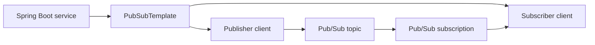

# Gửi nhận thông điệp bằng PubSubTemplate

## Mục tiêu bài học

Module **SPRING_CLOUD_PROVIDER_INTEGRATION** thực hành tích hợp Spring Boot với dịch vụ managed của **AWS, Azure và Google Cloud** qua các thư viện Spring Cloud tương ứng. Trong phần messaging của Google Cloud, Pub/Sub giúp các service trao đổi sự kiện bất đồng bộ mà không phụ thuộc trực tiếp vào vòng đời của nhau.

Bài này tập trung vào API **`PubSubTemplate`** của Spring Framework on Google Cloud. Sau khi đã hiểu topic và subscription, bạn sẽ học cách dùng template để:

1. Publish một chuỗi, payload JSON hoặc `PubsubMessage` tới topic.
2. Gửi attributes, ordering key và metadata phù hợp với hợp đồng message.
3. Nhận message bằng `subscribe()` hoặc `subscribeAndConvert()`.
4. Xác nhận message bằng `ack()`/`nack()` sau khi xử lý nghiệp vụ.
5. Pull message theo lô, chuyển đổi payload và ack theo batch.
6. Xử lý lỗi publish, lỗi chuyển đổi, duplicate và lỗi acknowledgment.
7. Kiểm thử publisher/subscriber bằng Pub/Sub emulator và Google Cloud sandbox.

> **Phạm vi ví dụ:** Các đoạn Maven/YAML minh họa Spring Framework on Google Cloud **7.5.2**, tương thích với Spring Boot **3.5.x** theo bảng tương thích hiện hành. Nếu dự án dùng Spring Boot 3.4.x, chọn dòng 6.x; nếu dùng Spring Boot 4.x, chọn dòng 8.x và kiểm tra thay đổi Jackson/API. Luôn import BOM để quản lý đồng bộ phiên bản.

## 1. `PubSubTemplate` đứng ở đâu trong ứng dụng?

`PubSubTemplate` là abstraction chính để Spring application publish tới topic và consume từ subscription. Starter Pub/Sub tự cấu hình các thành phần nền tảng, gồm publisher/subscriber factory, message converter, project ID và credentials.



Ứng dụng không cần tự tạo `Publisher` và `Subscriber` ở mỗi lần gọi. Thông thường, inject một bean `PubSubTemplate` vào service cần gửi/nhận message. Template cung cấp các API mức ứng dụng; các thao tác mạng thực tế do Google Cloud Java client thực hiện.

### Các nhóm API

| Nhóm | API tiêu biểu | Mục đích |
| --- | --- | --- |
| Publish | `publish(topic, payload)` | Gửi payload |
| Publish có metadata | `publish(topic, payload, headers)` | Gửi payload và attributes/headers |
| Publish message gốc | `publish(topic, PubsubMessage)` | Kiểm soát data, attributes, ordering key |
| Streaming pull | `subscribe(subscription, handler)` | Nhận message bất đồng bộ |
| Streaming pull có converter | `subscribeAndConvert(...)` | Nhận payload đã chuyển thành Java type |
| Synchronous pull | `pull(...)`, `pullAndConvert(...)` | Lấy một lô message và tự quyết định ack |
| Auto-ack pull | `pullAndAck(...)`, `pullNext(...)` | Lấy message và tự động ack |
| Acknowledgment | `ack(...)`, `nack(...)` | Xác nhận hoặc từ chối message |

Một khác biệt cần nhớ: `subscribe()` là luồng nhận bất đồng bộ chạy liên tục; `pull()` là lời gọi lấy một lô message. Các API `pullAndAck()` và `pullNext()` tự ack, vì vậy chỉ phù hợp khi ứng dụng có thể xác nhận ngay lúc nhận.

## 2. Chuẩn bị Spring Boot project

### 2.1. Dependency Maven

Sử dụng BOM Spring Framework on Google Cloud để các module cùng phiên bản:

```xml
<dependencyManagement>
    <dependencies>
        <dependency>
            <groupId>com.google.cloud</groupId>
            <artifactId>spring-cloud-gcp-dependencies</artifactId>
            <version>7.5.2</version>
            <type>pom</type>
            <scope>import</scope>
        </dependency>
    </dependencies>
</dependencyManagement>

<dependencies>
    <dependency>
        <groupId>com.google.cloud</groupId>
        <artifactId>spring-cloud-gcp-starter-pubsub</artifactId>
    </dependency>
    <dependency>
        <groupId>org.springframework.boot</groupId>
        <artifactId>spring-boot-starter-validation</artifactId>
    </dependency>
</dependencies>
```

`spring-cloud-gcp-starter-pubsub` mang theo các dependency cần thiết để tích hợp Pub/Sub. `spring-boot-starter-validation` được dùng trong ví dụ validate payload. Nếu ứng dụng đã có starter validation qua một module khác, không cần khai báo lặp lại.

### 2.2. Cấu hình project ID

Trong `application.yml`:

```yaml
spring:
  cloud:
    gcp:
      project-id: acme-commerce-dev
```

Đây là project sở hữu topic/subscription mặc định. `PubSubTemplate` cũng chấp nhận tên tài nguyên đầy đủ dạng `projects/{project}/topics/{topic}` hoặc `projects/{project}/subscriptions/{subscription}` khi truy cập tài nguyên ở project khác.

### 2.3. Credentials bằng ADC

Spring Framework on Google Cloud mặc định dùng **Application Default Credentials (ADC)** thông qua `CredentialsProvider`. Cách phù hợp:

| Môi trường | Cách lấy danh tính |
| --- | --- |
| Máy developer | `gcloud auth application-default login` với quyền dev |
| GKE | Workload Identity Federation for GKE |
| Cloud Run | Service account gắn với service |
| Compute Engine | Service account gắn với VM |
| CI/CD ngoài Google Cloud | Workload Identity Federation |

Không commit service account private key hoặc nhúng JSON key vào image. Khi nhận `PERMISSION_DENIED`, xác minh đúng principal, project và IAM binding; không mở rộng role toàn project chỉ để ứng dụng chạy được.

### 2.4. Kết nối emulator khi phát triển local

Khi chạy Pub/Sub emulator, cấu hình riêng cho profile local:

```yaml
# application-local.yml
spring:
  cloud:
    gcp:
      project-id: local-pubsub
      pubsub:
        emulator-host: 127.0.0.1:8085
```

`spring.cloud.gcp.pubsub.emulator-host` khiến client của starter kết nối emulator thay vì Pub/Sub production endpoint. Không bật cấu hình này trong profile cloud thật. Emulator giúp kiểm thử luồng message cơ bản nhưng không mô phỏng IAM/Workload Identity đầy đủ.

## 3. Hợp đồng message và chuyển đổi payload

### 3.1. Message có data và attributes

Pub/Sub message chứa payload dạng bytes, cùng các thuộc tính metadata:

| Thành phần | Dùng cho | Ví dụ |
| --- | --- | --- |
| `data` | Nội dung nghiệp vụ | JSON `OrderCreated` |
| `attributes` | Metadata chuỗi | `eventType=OrderCreated` |
| `orderingKey` | Sắp thứ tự theo nhóm | `customer-1024` |
| `messageId` | ID do Pub/Sub cấp sau publish | Dùng correlation/log |

Không đặt password, access token, dữ liệu thanh toán hoặc payload nhạy cảm vào attributes. Message có thể được lưu trong retention và gửi tới nhiều subscription; chỉ gửi dữ liệu consumer thực sự cần.

### 3.2. Converter mặc định

Nếu không cấu hình converter khác, `SimplePubSubMessageConverter` hỗ trợ trực tiếp:

- `String`
- `byte[]`
- `ByteString`
- `ByteBuffer`

Do đó cách đơn giản nhất là serialize payload JSON thành `String` trước khi publish, rồi parse ở subscriber. Khi muốn truyền POJO Java trực tiếp, cần cấu hình `PubSubMessageConverter` dùng Jackson.

### 3.3. Định nghĩa payload có version

Ví dụ event:

```java
import java.time.Instant;

public record OrderCreated(
        String eventId,
        String orderId,
        String customerId,
        Instant occurredAt,
        int schemaVersion
) {}
```

`eventId` nên do hệ thống nghiệp vụ tạo và ổn định qua các lần retry publish. Nó giúp subscriber deduplicate khi một event logic xuất hiện nhiều lần. `schemaVersion` giúp consumer biết cách đọc payload khi hợp đồng thay đổi.

### 3.4. Cấu hình Jackson converter

Với Spring Boot 3.x và Jackson 2, có thể đăng ký converter:

```java
import com.fasterxml.jackson.databind.ObjectMapper;
import com.google.cloud.spring.pubsub.support.converter.JacksonPubSubMessageConverter;
import com.google.cloud.spring.pubsub.support.converter.PubSubMessageConverter;
import org.springframework.context.annotation.Bean;
import org.springframework.context.annotation.Configuration;

@Configuration
public class PubSubMessageConfiguration {
    @Bean
    PubSubMessageConverter pubSubMessageConverter(ObjectMapper objectMapper) {
        return new JacksonPubSubMessageConverter(objectMapper);
    }
}
```

Spring Boot cung cấp `ObjectMapper` đã được cấu hình qua auto-configuration khi ứng dụng có Jackson trên classpath. Converter được starter tự động gắn vào `PubSubTemplate`. Nếu dự án dùng Spring Boot 4/Jackson 3, import `ObjectMapper` theo namespace Jackson của phiên bản đó; không trộn Jackson 2 và Jackson 3 trong cùng ví dụ.

Converter chỉ xử lý serialize/deserialize. Nó không thay thế kiểm tra schema, validation nghiệp vụ hoặc version compatibility. Hai ứng dụng publisher/subscriber phải thống nhất định dạng JSON và quy tắc đổi schema.

## 4. Publish message bằng `PubSubTemplate`

### 4.1. Gửi chuỗi đơn giản

```java
import com.google.cloud.spring.pubsub.core.PubSubTemplate;
import java.util.concurrent.CompletableFuture;
import org.springframework.stereotype.Service;

@Service
public class NotificationPublisher {
    private final PubSubTemplate pubSubTemplate;

    public NotificationPublisher(PubSubTemplate pubSubTemplate) {
        this.pubSubTemplate = pubSubTemplate;
    }

    public CompletableFuture<String> publish(String message) {
        return pubSubTemplate.publish("notifications", message);
    }
}
```

Tên topic ngắn `notifications` được hiểu trong project đã cấu hình. Có thể truyền tên đầy đủ nếu topic thuộc project khác:

```java
pubSubTemplate.publish(
        "projects/acme-commerce-prod/topics/notifications",
        message
);
```

### 4.2. Publish là bất đồng bộ

`publish()` trả `CompletableFuture<String>`. Khi hoàn tất thành công, giá trị trả về là message ID do Pub/Sub cấp. Khi thất bại, future hoàn tất exceptionally.

Ví dụ ghi nhận kết quả:

```java
public void publishOrder(OrderCreated event) {
    pubSubTemplate.publish("orders", event)
            .whenComplete((messageId, error) -> {
                if (error != null) {
                    // Ghi log lỗi đã làm sạch; đưa event vào luồng retry/outbox.
                    return;
                }
                // Có thể ghi nhận messageId để correlation.
            });
}
```

Không gọi `.get()` hoặc `.join()` trên future trong mọi request HTTP nếu không có lý do. Việc block thread web làm giảm throughput và có thể gây timeout dây chuyền. Nếu nghiệp vụ cần biết publish đã thành công trước khi trả response, hãy quản lý timeout và lỗi rõ ràng; với luồng giao dịch quan trọng, cân nhắc transactional outbox.

### 4.3. Gửi payload kèm attributes

Khi truyền `Map<String, String>` làm headers, converter dùng map để tạo metadata cho Pub/Sub message:

```java
import java.util.Map;
import java.util.concurrent.CompletableFuture;

public CompletableFuture<String> publishOrder(OrderCreated event) {
    Map<String, String> attributes = Map.of(
            "eventType", "OrderCreated",
            "schemaVersion", "1",
            "source", "order-service"
    );

    return pubSubTemplate.publish("orders", event, attributes);
}
```

Đoạn này yêu cầu `JacksonPubSubMessageConverter` đã được cấu hình. Với converter mặc định, hãy publish `String`/`byte[]` hoặc `PubsubMessage` đã được tạo sẵn.

### 4.4. Dùng `GcpPubSubHeaders.ORDERING_KEY`

Nếu subscription bật message ordering, truyền ordering key qua header chuyên biệt:

```java
import com.google.cloud.spring.pubsub.support.GcpPubSubHeaders;
import java.util.Map;

public CompletableFuture<String> publishOrder(OrderCreated event) {
    Map<String, String> headers = Map.of(
            "eventType", "OrderCreated",
            GcpPubSubHeaders.ORDERING_KEY, event.customerId()
    );

    return pubSubTemplate.publish("orders", event, headers);
}
```

Ngoài header, publisher phải bật ordering trong cấu hình và subscription phải được tạo với ordering phù hợp. Khi có nhiều publisher, dùng regional endpoint thống nhất để giữ thứ tự trong region. Ordering key không thay thế idempotency.

### 4.5. Publish `PubsubMessage` khi cần kiểm soát trực tiếp

Nếu muốn tự xây dựng data, attributes và ordering key, tạo message gốc:

```java
import com.google.protobuf.ByteString;
import com.google.pubsub.v1.PubsubMessage;

PubsubMessage message = PubsubMessage.newBuilder()
        .setData(ByteString.copyFromUtf8(jsonPayload))
        .putAttributes("eventType", "OrderCreated")
        .putAttributes("schemaVersion", "1")
        .setOrderingKey("customer-1024")
        .build();

CompletableFuture<String> result =
        pubSubTemplate.publish("orders", message);
```

Overload nhận `PubsubMessage` bỏ qua bước chuyển đổi payload của Spring converter. Cách này hữu ích khi tích hợp với một publisher khác đã thống nhất protobuf message hoặc khi cần kiểm soát metadata chính xác.

## 5. Nhận message bằng `subscribe()`

### 5.1. Streaming pull và callback

`subscribe(subscription, handler)` tạo subscriber chạy bất đồng bộ. Pub/Sub client liên tục pull message từ subscription rồi gọi handler khi có message. Tên subscription có thể là tên ngắn trong project mặc định hoặc tên đầy đủ:

```text
projects/acme-commerce-dev/subscriptions/inventory-sub
```

Ví dụ đọc payload raw:

```java
import com.google.cloud.spring.pubsub.core.PubSubTemplate;
import com.google.cloud.spring.pubsub.support.BasicAcknowledgeablePubsubMessage;
import com.google.cloud.pubsub.v1.Subscriber;
import org.springframework.stereotype.Component;

@Component
public class InventorySubscriber {
    private final PubSubTemplate pubSubTemplate;
    private final InventoryService inventoryService;
    private Subscriber subscriber;

    public InventorySubscriber(
            PubSubTemplate pubSubTemplate,
            InventoryService inventoryService) {
        this.pubSubTemplate = pubSubTemplate;
        this.inventoryService = inventoryService;
    }

    @EventListener(ApplicationReadyEvent.class)
    public void start() {
        subscriber = pubSubTemplate.subscribe(
                "inventory-sub",
                this::handleMessage
        );
    }

    private void handleMessage(BasicAcknowledgeablePubsubMessage message) {
        String payload = message.getPubsubMessage()
                .getData()
                .toStringUtf8();

        try {
            inventoryService.processJsonIdempotently(payload);
            message.ack().whenComplete((unused, error) -> {
                if (error != null) {
                    // Ghi nhận lỗi ack và correlation ID; không log payload.
                }
            });
        } catch (Exception processingError) {
            message.nack().whenComplete((unused, error) -> {
                if (error != null) {
                    // Ghi nhận lỗi nack; message có thể redeliver khi chưa ack.
                }
            });
        }
    }

    @PreDestroy
    public void stop() {
        if (subscriber != null) {
            subscriber.stopAsync();
        }
    }
}
```

Ví dụ trên minh họa lifecycle: bắt đầu nhận message sau khi Spring application sẵn sàng và yêu cầu subscriber dừng khi context đóng. Trong code hoàn chỉnh, thêm import cho `ApplicationReadyEvent`, `EventListener`, `PreDestroy` và quản lý thời gian chờ shutdown phù hợp với nền tảng triển khai.

### 5.2. `ack()` và `nack()` là bất đồng bộ

`BasicAcknowledgeablePubsubMessage` cung cấp:

| Method | Ý nghĩa | Kết quả |
| --- | --- | --- |
| `ack()` | Xác nhận message đã xử lý | `CompletableFuture<Void>` |
| `nack()` | Từ chối message, cho phép retry/redelivery | `CompletableFuture<Void>` |
| `getPubsubMessage()` | Lấy message gốc | `PubsubMessage` |
| `getProjectSubscriptionName()` | Lấy project/subscription nguồn | `ProjectSubscriptionName` |

Không bỏ qua future nếu cần quan sát lỗi ack/nack. Một lần gọi `ack()` không có nghĩa request đã được Pub/Sub xác nhận thành công ngay tại thời điểm gọi method. Nếu ack không hoàn tất, message có thể được giao lại.

**Thứ tự xử lý an toàn:**

```text
Nhận message
    ↓
Kiểm tra payload
    ↓
Xử lý nghiệp vụ + commit dữ liệu
    ↓
Gửi ACK
```

Không ack trước khi ghi database hoặc thực hiện side effect cần bảo toàn. Nếu xử lý thành công nhưng ack thất bại, message có thể xuất hiện lại; consumer cần idempotency theo `eventId`.

### 5.3. Đọc attributes và metadata

Khi cần đọc metadata, lấy từ `PubsubMessage` gốc:

```java
private void handleMessage(BasicAcknowledgeablePubsubMessage message) {
    var pubsubMessage = message.getPubsubMessage();
    String eventType = pubsubMessage.getAttributesOrDefault(
            "eventType", "UNKNOWN");
    String payload = pubsubMessage.getData().toStringUtf8();

    // Định tuyến theo eventType, sau đó validate payload.
}
```

Chỉ dùng attributes cho metadata không nhạy cảm như event type, schema version, source hoặc correlation ID. Không ghi nguyên payload vào log để debug.

### 5.4. Xử lý message lỗi

Không phải lỗi nào cũng nên được xử lý giống nhau:

| Loại lỗi | Hành động gợi ý |
| --- | --- |
| Database/API downstream tạm lỗi | `nack()` để retry theo subscription policy |
| Payload sai schema, có thể khắc phục sau khi sửa consumer | Nack/DLQ theo policy, điều tra rồi replay |
| Payload không hợp lệ vĩnh viễn | Ghi vào luồng quarantine/DLQ có kiểm soát rồi ack khi đã lưu bền vững |
| Event đã xử lý trước đó | Không lặp side effect; ack |
| Lỗi ack do mạng | Ghi nhận lỗi; chấp nhận khả năng redelivery và dựa vào idempotency |

Nếu mọi message sai đều `nack()` vô hạn, subscription có thể bị poison message chiếm tài nguyên. Cấu hình dead-letter policy ở subscription và theo dõi DLQ. Nếu ứng dụng tự publish message lỗi sang quarantine topic, chỉ ack message gốc sau khi việc lưu/quarantine đã thành công.

## 6. Nhận payload đã chuyển kiểu bằng `subscribeAndConvert()`

### 6.1. Dùng converter để nhận POJO

Khi đã cấu hình `JacksonPubSubMessageConverter`, có thể nhận trực tiếp `OrderCreated`:

```java
import com.google.cloud.spring.pubsub.core.PubSubTemplate;
import com.google.cloud.spring.pubsub.support.converter.ConvertedBasicAcknowledgeablePubsubMessage;
import com.google.cloud.pubsub.v1.Subscriber;

public void start() {
    subscriber = pubSubTemplate.subscribeAndConvert(
            "inventory-sub",
            this::handleOrderCreated,
            OrderCreated.class
    );
}

private void handleOrderCreated(
        ConvertedBasicAcknowledgeablePubsubMessage<OrderCreated> message) {
    try {
        OrderCreated event = message.getPayload();
        inventoryService.reserve(event);
        message.ack().whenComplete((unused, error) -> {
            if (error != null) {
                // Log lỗi ack đã làm sạch.
            }
        });
    } catch (Exception error) {
        message.nack().whenComplete((unused, nackError) -> {
            if (nackError != null) {
                // Log lỗi nack đã làm sạch.
            }
        });
    }
}
```

`ConvertedBasicAcknowledgeablePubsubMessage<T>` vừa có `getPayload()` vừa kế thừa `ack()`/`nack()`. Do đó việc chuyển đổi payload không làm mất khả năng acknowledgment.

### 6.2. Khi nào dùng `subscribe()` và khi nào dùng `subscribeAndConvert()`?

| Tiêu chí | `subscribe()` | `subscribeAndConvert()` |
| --- | --- | --- |
| Payload handler nhận | `BasicAcknowledgeablePubsubMessage` | `ConvertedBasicAcknowledgeablePubsubMessage<T>` |
| Đọc bytes/attributes gốc | Trực tiếp qua `getPubsubMessage()` | Vẫn truy cập được message gốc |
| Chuyển JSON thành POJO | Ứng dụng tự parse hoặc converter thủ công | Dùng converter cấu hình trong template |
| Kiểm soát lỗi parse | Dễ đặt trong callback nếu tự parse | Cần hiểu lỗi converter phát sinh ở bước chuyển đổi |
| Phù hợp | Payload nhiều định dạng, cần kiểm tra raw message | Hợp đồng payload ổn định, converter được cấu hình đúng |

Nếu payload có thể không hợp lệ và cần ghi nhận raw bytes trước khi quyết định nack/quarantine, `subscribe()` giúp kiểm soát quá trình decode trong handler. Nếu publisher/subscriber đã thống nhất schema và JSON converter, `subscribeAndConvert()` giúp code nghiệp vụ gọn hơn.

### 6.3. Không coi conversion là validation

Jackson chuyển JSON thành POJO không chứng minh dữ liệu nghiệp vụ hợp lệ. Ví dụ `orderId` có thể là chuỗi rỗng hoặc `schemaVersion` không được hỗ trợ. Sau khi nhận `getPayload()`, vẫn cần:

- Kiểm tra trường bắt buộc.
- Kiểm tra `schemaVersion`.
- Kiểm tra giới hạn kích thước/định dạng.
- Kiểm tra quyền và trạng thái nghiệp vụ.
- Xử lý event cũ/duplicate.

Với event version mới mà consumer chưa hỗ trợ, không ack âm thầm. Đưa vào DLQ hoặc quarantine theo quy trình tương thích schema.

## 7. Pull message theo lô

### 7.1. `pull()` trả về message chưa ack

Nếu ứng dụng muốn chủ động lấy một số lượng message rồi xử lý theo batch, dùng:

```java
import com.google.cloud.spring.pubsub.support.AcknowledgeablePubsubMessage;
import java.util.List;

int maxMessages = 20;
boolean returnImmediately = false;

List<AcknowledgeablePubsubMessage> messages =
        pubSubTemplate.pull("inventory-sub", maxMessages, returnImmediately);
```

Các message trả về **chưa được ack tự động**. Sau khi xử lý thành công, ứng dụng có thể ack từng message hoặc ack theo batch:

```java
List<AcknowledgeablePubsubMessage> succeeded = new ArrayList<>();
List<AcknowledgeablePubsubMessage> failed = new ArrayList<>();

for (AcknowledgeablePubsubMessage message : messages) {
    try {
        String payload = message.getPubsubMessage()
                .getData()
                .toStringUtf8();
        inventoryService.processIdempotently(payload);
        succeeded.add(message);
    } catch (Exception error) {
        failed.add(message);
    }
}

if (!succeeded.isEmpty()) {
    pubSubTemplate.ack(succeeded);
}
if (!failed.isEmpty()) {
    pubSubTemplate.nack(failed);
}
```

Các thao tác batch `ack()`/`nack()` trả `CompletableFuture<Void>`; trong code production cần theo dõi completion và lỗi của các future. Tập message gửi vào một lệnh batch phải cùng project ID. Nếu xử lý nhiều project, tách thành các nhóm trước khi ack/nack.

### 7.2. Pull và chuyển đổi payload

Nếu đã cấu hình converter:

```java
List<ConvertedAcknowledgeablePubsubMessage<OrderCreated>> messages =
        pubSubTemplate.pullAndConvert(
                "inventory-sub",
                20,
                false,
                OrderCreated.class
        );

for (var message : messages) {
    try {
        inventoryService.reserve(message.getPayload());
        message.ack();
    } catch (Exception error) {
        message.nack();
    }
}
```

`pullAndConvert()` chỉ chuyển payload; nó **không tự ack**. Đây là lựa chọn phù hợp khi cần batch nhưng vẫn giữ quyền quyết định message nào được xác nhận.

### 7.3. Cẩn trọng với API tự động ack

Các method sau tự ack message nhận được:

| Method | Hành vi |
| --- | --- |
| `pullAndAck(...)` | Pull một lô và ack tất cả message trả về |
| `pullAndAckAsync(...)` | Phiên bản bất đồng bộ của pull-and-ack |
| `pullNext(...)` | Pull một message và auto-ack |
| `pullNextAsync(...)` | Phiên bản bất đồng bộ của pull-next |

Không dùng các API này nếu còn phải parse, validate, ghi database hoặc gọi dịch vụ khác trước khi xác nhận. Khi message đã được ack mà xử lý nghiệp vụ thất bại sau đó, Pub/Sub không có lý do để redeliver message theo luồng thông thường.

### 7.4. `returnImmediately` và lựa chọn streaming

Với `pull()`, tham số `returnImmediately=true` khiến server phản hồi ngay cả khi chưa có đủ message để trả. Tài liệu Spring Framework on Google Cloud không khuyến nghị giá trị này vì có thể tạo phản hồi rỗng trong khi message vẫn đang chờ phía backend. Thông thường dùng `false`.

| Nhu cầu | API phù hợp |
| --- | --- |
| Consumer chạy liên tục, xử lý nền | `subscribe()` / `subscribeAndConvert()` |
| Job định kỳ xử lý tối đa N message | `pull()` / `pullAndConvert()` |
| Pull rồi ack ngay vì không cần xử lý thêm | `pullAndAck()` / `pullNext()` |
| Pull bất đồng bộ trong một workflow riêng | `pullAsync()` / `pullAndConvertAsync()` |

Không tạo vòng lặp pull liên tục với `returnImmediately=true` để mô phỏng streaming. Dùng `subscribe()` hoặc một cơ chế polling có backoff và giới hạn tải.

## 8. Acknowledgment deadline và xử lý lâu

### 8.1. Với streaming subscriber

`subscribe()` sử dụng underlying Pub/Sub `Subscriber` client. Client có cơ chế quản lý acknowledgment deadline trong lúc callback xử lý; có thể cấu hình giới hạn thời gian gia hạn:

```yaml
spring:
  cloud:
    gcp:
      pubsub:
        subscriber:
          max-ack-extension-period: 600
          parallel-pull-count: 2
```

Giá trị `600` là ví dụ theo giây, không phải lựa chọn phù hợp cho mọi workload. Nếu xử lý kéo dài hơn thời gian client có thể gia hạn, message có thể bị redeliver trong khi worker cũ còn chạy. Hãy đặt timeout nghiệp vụ, ack extension và flow control đồng bộ.

### 8.2. Với synchronous pull

`pull()` trả về `AcknowledgeablePubsubMessage`, cung cấp thêm:

- `getAckId()` để truy cập acknowledgment ID.
- `modifyAckDeadline(seconds)` để thay đổi deadline.
- `ack()`/`nack()` được kế thừa từ `BasicAcknowledgeablePubsubMessage`.

Ví dụ gia hạn deadline khi batch cần thêm thời gian:

```java
for (AcknowledgeablePubsubMessage message : messages) {
    message.modifyAckDeadline(120);
}
```

Trong code thực tế, theo dõi future từ `modifyAckDeadline()` và không gia hạn vô hạn. Deadline `0` có hiệu quả tương tự nack. Nếu thời gian xử lý không thể dự đoán, cân nhắc chia nhỏ công việc hoặc dùng workflow riêng thay vì giữ message outstanding quá lâu.

### 8.3. Idempotency là bắt buộc

Pub/Sub mặc định cung cấp at-least-once delivery. Một message có thể được giao lại nếu ack không hoàn tất, deadline hết hạn hoặc có sự cố. Với hệ thống giao dịch, lưu `eventId` trong bảng đã xử lý và đặt unique constraint:

```sql
CREATE TABLE processed_events (
    event_id VARCHAR(100) PRIMARY KEY,
    processed_at TIMESTAMP NOT NULL
);
```

Trong transaction nghiệp vụ, kiểm tra/chèn `eventId` trước khi tạo side effect. Nếu event đã xử lý, không lặp lại hành động; sau đó ack message. Exactly-once delivery (nếu subscription hỗ trợ và được bật) không biến database transaction hoặc HTTP call bên ngoài thành exactly-once.

## 9. Kiểm thử `PubSubTemplate`

### 12.1. Unit test publisher

Đơn vị kiểm thử publisher nên xác nhận:

- Gửi đúng topic.
- Payload/attributes được tạo đúng hợp đồng.
- Lỗi từ `CompletableFuture` được truyền về caller hoặc được xử lý.
- Event có `eventId` ổn định khi retry từ outbox.

Có thể mock `PubSubTemplate` trong unit test service và trả về `CompletableFuture.completedFuture("test-message-id")`. Test này xác minh logic ứng dụng, không chứng minh serialization thật hoặc quyền IAM.

### 12.2. Unit test subscriber

Tách business handler khỏi callback Pub/Sub:

```java
public class InventoryService {
    public void processIdempotently(OrderCreated event) {
        // Validate event, deduplicate eventId, update inventory.
    }
}
```

Test riêng các trường hợp:

1. Event hợp lệ cập nhật tồn kho một lần.
2. Cùng `eventId` được xử lý hai lần nhưng side effect chỉ xảy ra một lần.
3. Payload thiếu `orderId` bị validation từ chối.
4. Database exception được truyền lên để subscriber có thể nack.

Việc tách handler giúp test nghiệp vụ mà không cần khởi chạy Pub/Sub.

### 12.3. Integration test bằng emulator

Khởi chạy emulator:

```bash
gcloud beta emulators pubsub start \
  --project=local-pubsub \
  --host-port=127.0.0.1:8085
```

Chạy Spring Boot với profile local:

```yaml
spring:
  cloud:
    gcp:
      project-id: local-pubsub
      pubsub:
        emulator-host: 127.0.0.1:8085
```

Trong test:

1. Dùng `PubSubAdmin` tạo topic `orders` và subscription `inventory-sub`.
2. Khởi động subscriber hoặc gọi pull.
3. Publish một `OrderCreated` bằng `PubSubTemplate`.
4. Chờ consumer xử lý (dùng Awaitility hoặc polling có timeout).
5. Xác nhận dữ liệu được ghi và acknowledgment hoàn tất.
6. Publish event trùng `eventId` và xác nhận không lặp side effect.

Không dùng `Thread.sleep()` cố định dài trong test nếu có thể dùng điều kiện chờ với timeout. Test phải dọn topic/subscription hoặc dùng tên resource duy nhất để tránh ảnh hưởng lẫn nhau.

### 9.4. Kiểm thử cloud thật

Emulator không chứng minh IAM, Workload Identity, quota, DLQ service agent hoặc toàn bộ hành vi của Pub/Sub thật. Trên Google Cloud sandbox, cần kiểm tra:

| Ca test | Kết quả mong đợi |
| --- | --- |
| Publisher có `roles/pubsub.publisher` trên topic | Publish thành công |
| Publisher không có quyền trên topic khác | `PERMISSION_DENIED` |
| Subscriber có `roles/pubsub.subscriber` trên subscription | Pull/subscribe thành công |
| Subscriber không có quyền trên subscription khác | Bị từ chối |
| Payload lỗi và nack | Redelivery theo retry policy |
| Vượt delivery attempts | Message chuyển DLQ nếu IAM service agent đã được cấu hình |
| Subscriber xử lý lâu | Ack deadline extension/flow control hoạt động đúng |
| Ordering key được dùng | Thứ tự trong cùng key được giữ theo cấu hình |

### 9.5. Không dùng pull auto-ack trong test nghiệp vụ

`pullAndAck()` thuận tiện cho smoke test vì message được ack ngay. Nhưng nếu mục tiêu kiểm tra handler, validation hoặc database transaction, dùng `pull()`/`pullAndConvert()` để chỉ ack sau khi assertion và xử lý thành công. Nếu dùng auto-ack, một test assertion fail vẫn có thể làm message biến mất khỏi subscription.

## 10. Ví dụ hoàn chỉnh: publisher và subscriber cho OrderCreated

### 13.1. Payload

```java
import java.time.Instant;

public record OrderCreated(
        String eventId,
        String orderId,
        String customerId,
        Instant occurredAt,
        int schemaVersion
) {}
```

### 13.2. Publisher

```java
import com.google.cloud.spring.pubsub.core.PubSubTemplate;
import java.util.Map;
import java.util.concurrent.CompletableFuture;
import org.springframework.stereotype.Service;

@Service
public class OrderPublisher {
    private final PubSubTemplate pubSubTemplate;

    public OrderPublisher(PubSubTemplate pubSubTemplate) {
        this.pubSubTemplate = pubSubTemplate;
    }

    public CompletableFuture<String> publish(OrderCreated event) {
        Map<String, String> headers = Map.of(
                "eventType", "OrderCreated",
                "schemaVersion", Integer.toString(event.schemaVersion())
        );

        return pubSubTemplate.publish("orders", event, headers);
    }
}
```

### 13.3. Subscriber

```java
import com.google.cloud.spring.pubsub.core.PubSubTemplate;
import com.google.cloud.spring.pubsub.support.converter.ConvertedBasicAcknowledgeablePubsubMessage;
import com.google.cloud.pubsub.v1.Subscriber;
import jakarta.annotation.PreDestroy;
import org.springframework.boot.context.event.ApplicationReadyEvent;
import org.springframework.context.event.EventListener;
import org.springframework.stereotype.Component;

@Component
public class InventoryListener {
    private final PubSubTemplate pubSubTemplate;
    private final InventoryService inventoryService;
    private Subscriber subscriber;

    public InventoryListener(
            PubSubTemplate pubSubTemplate,
            InventoryService inventoryService) {
        this.pubSubTemplate = pubSubTemplate;
        this.inventoryService = inventoryService;
    }

    @EventListener(ApplicationReadyEvent.class)
    public void start() {
        subscriber = pubSubTemplate.subscribeAndConvert(
                "inventory-sub",
                this::handle,
                OrderCreated.class
        );
    }

    private void handle(
            ConvertedBasicAcknowledgeablePubsubMessage<OrderCreated> message) {
        try {
            inventoryService.processIdempotently(message.getPayload());
            message.ack().whenComplete((unused, error) -> {
                if (error != null) {
                    // Ghi nhận lỗi ack với eventId đã được làm sạch.
                }
            });
        } catch (Exception error) {
            message.nack().whenComplete((unused, nackError) -> {
                if (nackError != null) {
                    // Ghi nhận lỗi nack; không log toàn bộ payload.
                }
            });
        }
    }

    @PreDestroy
    public void stop() {
        if (subscriber != null) {
            subscriber.stopAsync();
        }
    }
}
```

### 13.4. Cấu hình

```yaml
spring:
  cloud:
    gcp:
      project-id: acme-commerce-dev
      pubsub:
        subscriber:
          parallel-pull-count: 2
          max-ack-extension-period: 600
          flow-control:
            max-outstanding-element-count: 100
            max-outstanding-request-bytes: 10485760
```

Ví dụ này giả định topic `orders` và subscription `inventory-sub` đã được tạo bằng IaC hoặc công cụ quản trị. Publisher service account cần `roles/pubsub.publisher` trên topic; subscriber service account cần `roles/pubsub.subscriber` trên subscription. Không cấp quyền tạo/xóa tài nguyên cho runtime service nếu không có nhu cầu.

## 11. Bài tập thực hành

Một hệ thống thương mại điện tử cần gửi event `PaymentAuthorized` từ `payment-service` sang `order-service`. Topic là `payments`, subscription là `orders-payment-sub`.

### Yêu cầu

1. Thêm Spring Framework on Google Cloud Pub/Sub starter và BOM tương thích Spring Boot.
2. Cấu hình project ID và ADC cho local, GKE hoặc Cloud Run.
3. Tạo record `PaymentAuthorized` gồm `eventId`, `paymentId`, `orderId`, `amount`, `currency`, `occurredAt`, `schemaVersion`.
4. Cấu hình Jackson converter để `PubSubTemplate` serialize/deserialize POJO.
5. Viết `PaymentPublisher` dùng `publish(topic, payload, headers)`; trả về `CompletableFuture<String>`.
6. Viết subscriber dùng `subscribeAndConvert()` và ack sau khi `order-service` cập nhật trạng thái đơn hàng thành công.
7. Nếu database lỗi tạm thời, nack message; nếu event trùng `eventId`, không lặp cập nhật và ack.
8. Viết unit test cho publisher và business handler.
9. Chạy integration test với Pub/Sub emulator.
10. Chạy cloud sandbox test với service account bị giới hạn quyền, kiểm tra cả allow và deny.

### Ma trận kiểm thử

| Tình huống | Kết quả mong đợi |
| --- | --- |
| Publish payload hợp lệ | Nhận message ID và subscription đọc được event |
| Converter chưa được cấu hình cho POJO | Test phát hiện lỗi serialize/deserialize |
| Subscriber xử lý thành công | Ack được gửi sau khi commit |
| Subscriber gặp database timeout | Nack và message có thể redeliver |
| Cùng `eventId` được giao lại | Không lặp side effect |
| Ack future thất bại | Ghi nhận lỗi, chấp nhận khả năng redelivery |
| Subscriber thiếu IAM role | Nhận `PERMISSION_DENIED` |
| Publisher không có quyền topic | Publish thất bại |
| Pull bằng `pullAndAck()` | Message bị ack ngay; không dùng để test xử lý nghiệp vụ |
| Emulator chạy local | Test serialization và flow cơ bản thành công |

### Tiêu chí hoàn thành

- Phân biệt được `publish`, `subscribe`, `subscribeAndConvert`, `pull` và `pullAndAck`.
- Publish có theo dõi kết quả bất đồng bộ.
- Payload POJO được serialize/deserialize thống nhất.
- Subscriber ack sau khi hoàn thành nghiệp vụ.
- Có idempotency và xử lý duplicate.
- Có unit test, emulator integration test và IAM sandbox test.

## 12. Cấu hình publisher/subscriber và kiểm soát tải

### 12.1. Subscriber concurrency

Spring Framework on Google Cloud cho phép cấu hình số pull worker và số thread:

```yaml
spring:
  cloud:
    gcp:
      pubsub:
        subscriber:
          parallel-pull-count: 2
          executor-threads: 8
          max-ack-extension-period: 600
          flow-control:
            max-outstanding-element-count: 100
            max-outstanding-request-bytes: 10485760
            limit-exceeded-behavior: Block
```

Các giá trị trên là ví dụ, không phải định mức production. `parallel-pull-count` tăng số luồng pull; `executor-threads` kiểm soát thread xử lý của subscriber; flow control giới hạn số message/byte outstanding để tránh nhận nhiều hơn năng lực xử lý hoặc bộ nhớ.

Có thể đặt cấu hình riêng cho subscription:

```yaml
spring:
  cloud:
    gcp:
      pubsub:
        subscription:
          inventory-sub:
            parallel-pull-count: 4
            executor-threads: 8
            flow-control:
              max-outstanding-element-count: 200
              max-outstanding-request-bytes: 20971520
              limit-exceeded-behavior: Block
```

Khi cấu hình cả global và per-subscription, cấu hình riêng của subscription được ưu tiên nếu không có custom factory/bean ghi đè. Đo throughput, latency, CPU và heap trước khi tăng concurrency. Nhiều thread hơn không tự động làm hệ thống nhanh hơn nếu database hoặc downstream API là bottleneck.

### 12.2. Publisher batching

Publisher có thể gom nhiều message thành batch để giảm overhead:

```yaml
spring:
  cloud:
    gcp:
      pubsub:
        publisher:
          batching:
            enabled: true
            element-count-threshold: 100
            request-byte-threshold: 1048576
            delay-threshold-seconds: 0.01
```

Batching là một đánh đổi giữa throughput và latency: publisher có thể chờ thêm message hoặc đến ngưỡng thời gian trước khi gửi batch. Với sự kiện cần phản hồi nhanh, đo end-to-end latency trước khi bật. Không coi batch publish là một transaction nguyên tử cho nhiều message; mỗi message vẫn cần event ID và cơ chế xử lý lỗi phù hợp.

### 12.3. RPC retry khác message retry

Các property `spring.cloud.gcp.pubsub.[publisher,subscriber].retry.*` cấu hình retry cho **gRPC/RPC request** khi gọi Pub/Sub gặp lỗi tạm thời. Chúng không quyết định subscription redeliver message sau nack hoặc ack deadline hết hạn.

| Cơ chế | Phạm vi |
| --- | --- |
| RPC retry | Gửi lại request publish/pull khi lời gọi gRPC gặp lỗi retryable |
| Message redelivery | Pub/Sub giao lại message chưa được ack |
| Business retry | Ứng dụng thử lại thao tác database/API hoặc phát event retry |

Không tăng RPC retry để xử lý một message poison. Với lỗi nghiệp vụ lặp lại, dùng retry policy của subscription, dead-letter topic hoặc quy trình quarantine.

## 13. Xử lý lỗi và độ tin cậy

### 13.1. Lỗi publish

`publish()` có thể thất bại do:

- Thiếu `roles/pubsub.publisher` trên topic.
- Sai project ID hoặc topic name.
- Network/gRPC unavailable, deadline hoặc quota.
- Payload vượt giới hạn kích thước hoặc metadata không hợp lệ.
- Publisher shutdown trong lúc có message đang chờ gửi.

Caller phải quan sát `CompletableFuture<String>` và có chiến lược retry phù hợp. Nếu request đầu tiên đã tới Pub/Sub nhưng response bị mất, retry ở tầng ứng dụng có thể tạo message thứ hai. Vì vậy, event nên có `eventId` ổn định và subscriber phải idempotent.

Trong hệ thống giao dịch, cân nhắc **transactional outbox**:

```text
Database transaction:
  cập nhật đơn hàng
  ghi outbox event
        ↓
Publisher worker đọc outbox
        ↓
publish() tới Pub/Sub
        ↓
đánh dấu outbox đã gửi
```

Nếu process crash sau khi publish nhưng trước khi đánh dấu outbox, worker có thể gửi lại. Consumer vẫn phải deduplicate bằng `eventId`.

### 13.2. Lỗi subscriber

| Lỗi | Hành động gợi ý |
| --- | --- |
| Database tạm unavailable | Nack để subscription retry |
| API downstream rate limit | Nack/backoff, tránh retry đồng loạt quá nhanh |
| JSON không parse được | Nack để chuyển DLQ hoặc lưu quarantine |
| Thiếu field bắt buộc | Không ack trước khi lưu lỗi vào quarantine |
| Event đã xử lý | Ack sau khi xác nhận idempotency |
| Ack future thất bại | Ghi nhận lỗi và chấp nhận redelivery; handler phải an toàn khi chạy lại |
| Subscriber shutdown | Dừng nhận message mới và để outstanding message được xử lý/expire theo lifecycle |

### 13.3. Không nuốt exception trong callback

Một phản mẫu:

```java
private void handle(BasicAcknowledgeablePubsubMessage message) {
    try {
        service.process(message);
    } catch (Exception ignored) {
        // Không log, không nack, không ack.
    }
}
```

Handler trên không cung cấp tín hiệu rõ ràng cho hệ thống vận hành. Message có thể hết ack deadline rồi redeliver, nhưng lỗi gốc bị mất. Thay vào đó, log mã lỗi/correlation ID đã làm sạch, gọi `nack()` khi có thể retry và theo dõi future của thao tác acknowledgment.

### 13.4. Dừng subscriber graceful

`subscribe()` trả về Google Cloud `Subscriber`, cho phép dừng listener khi ứng dụng shutdown:

```java
@PreDestroy
public void stop() {
    if (subscriber != null) {
        subscriber.stopAsync();
    }
}
```

Trong ứng dụng có traffic lớn, thiết kế shutdown grace period phù hợp với thời gian xử lý message, readiness và thời gian kết thúc của container. Không tắt process đột ngột khi còn transaction nghiệp vụ đang chạy. Nếu subscriber được tạo theo nhiều subscription, giữ và dừng từng instance tương ứng.

## Tổng kết

`PubSubTemplate` gom các thao tác publish, subscribe, pull và acknowledgment vào một abstraction phù hợp với Spring Boot. Publisher dùng `publish()` để gửi payload; kết quả là `CompletableFuture<String>` chứa message ID khi thành công. Subscriber có thể nhận raw message bằng `subscribe()` hoặc nhận POJO đã chuyển đổi bằng `subscribeAndConvert()`. Với pull, `pull()`/`pullAndConvert()` giữ quyền ack cho ứng dụng; `pullAndAck()`/`pullNext()` tự xác nhận nên chỉ dùng khi không cần xử lý thêm.

Thiết kế production cần quan sát lỗi publish và ack, xử lý idempotency, chọn converter nhất quán, giới hạn flow control, dừng subscriber graceful và kiểm thử cả lỗi quyền lẫn lỗi nghiệp vụ. `PubSubTemplate` giúp đơn giản hóa API; nó không tự giải quyết transaction, duplicate hoặc schema compatibility ở tầng ứng dụng.

## Tài liệu tham khảo

- [Spring Framework on Google Cloud 7.5.2 — Pub/Sub](https://googlecloudplatform.github.io/spring-cloud-gcp/reference/html/pubsub.html) — cấu hình, `PubSubTemplate`, publish, subscribe, pull, ack/nack và converter.
- [Spring Framework on Google Cloud — Getting Started and Compatibility](https://googlecloudplatform.github.io/spring-cloud-gcp/reference/html/getting-started.html) — BOM, starter và ma trận Spring Boot/Spring Cloud tương thích.
- [PubSubTemplate API](https://googleapis.dev/java/spring-cloud-gcp/latest/com/google/cloud/spring/pubsub/core/PubSubTemplate.html) — chữ ký API publish, subscribe, pull, ack và nack.
- [BasicAcknowledgeablePubsubMessage API](https://googleapis.dev/java/spring-cloud-gcp/latest/com/google/cloud/spring/pubsub/support/BasicAcknowledgeablePubsubMessage.html) — acknowledgment bất đồng bộ.
- [ConvertedBasicAcknowledgeablePubsubMessage API](https://googleapis.dev/java/spring-cloud-gcp/latest/com/google/cloud/spring/pubsub/support/converter/ConvertedBasicAcknowledgeablePubsubMessage.html) — payload đã chuyển kiểu và acknowledgment.
- [JacksonPubSubMessageConverter API](https://googleapis.dev/java/spring-cloud-gcp/latest/com/google/cloud/spring/pubsub/support/converter/JacksonPubSubMessageConverter.html) — chuyển đổi POJO với Jackson.
- [Google Cloud Pub/Sub — Publisher](https://docs.cloud.google.com/pubsub/docs/publisher) — publish message, ordering key và publisher client.
- [Google Cloud Pub/Sub — Subscriber](https://docs.cloud.google.com/pubsub/docs/subscriber) — pull, acknowledgment deadline và subscriber client.
- [Google Cloud Pub/Sub — Emulator](https://docs.cloud.google.com/pubsub/docs/emulator) — kiểm thử local và giới hạn emulator.
