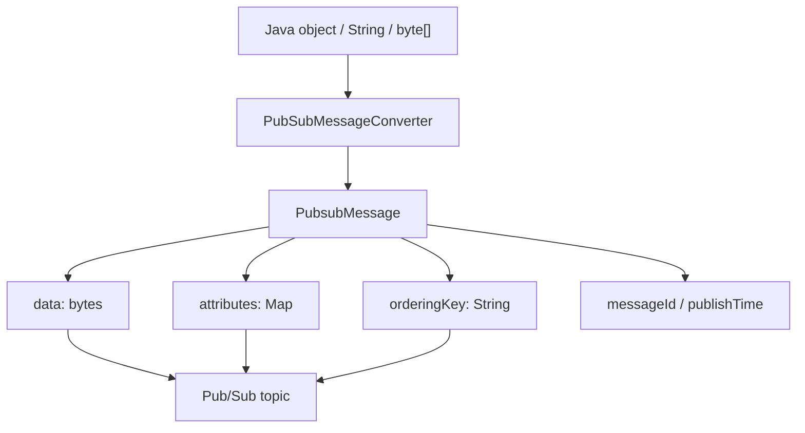

# Chuyển đổi payload, thuộc tính và ordering key

## Mục tiêu bài học

Module **SPRING_CLOUD_PROVIDER_INTEGRATION** thực hành tích hợp Spring Boot với dịch vụ managed của **AWS, Azure và Google Cloud** qua các thư viện Spring Cloud tương ứng. Với messaging, ứng dụng cần thống nhất cách mã hóa dữ liệu, truyền metadata và duy trì thứ tự xử lý khi nhiều message thuộc cùng một luồng nghiệp vụ.

Trong chương **Google Cloud Pub/Sub**, bài này đi sâu vào cách `PubSubTemplate` chuyển đổi dữ liệu Java thành `PubsubMessage`, cách sử dụng attributes và cách đặt ordering key. Sau bài học, bạn có thể:

1. Giải thích cấu trúc wire format của một Pub/Sub message.
2. Chọn `SimplePubSubMessageConverter` hoặc `JacksonPubSubMessageConverter` theo loại payload.
3. Cấu hình `PubSubMessageConverter` bean và xây dựng converter riêng khi cần.
4. Gửi/nhận attributes qua `PubSubTemplate` và đọc metadata ở subscriber.
5. Phân biệt Spring headers, Pub/Sub attributes và các trường đặc biệt như ordering key.
6. Sử dụng `GcpPubSubHeaders.ORDERING_KEY` và cấu hình publisher/subscription để bảo đảm thứ tự theo key.
7. Thiết kế schema version, validation, idempotency và kiểm thử converter/ordering.

> **Phiên bản ví dụ:** Phần cấu hình Jackson minh họa cho Spring Boot 3.x với Jackson 2. Nếu dự án dùng Spring Boot 4.x/Jackson 3, hãy dùng BOM tương thích và import `ObjectMapper` từ namespace Jackson 3 mà phiên bản đó hỗ trợ. Không trộn dependency Jackson 2 và Jackson 3 trong cùng một ứng dụng.

## 1. Một Pub/Sub message gồm những gì?

Pub/Sub không truyền một object Java trực tiếp. Trước khi gửi, ứng dụng phải biến payload thành bytes. Dịch vụ lưu và chuyển message dưới dạng cấu trúc gồm data, attributes và một số metadata riêng:



| Trường | Kiểu | Vai trò |
| --- | --- | --- |
| `data` | Bytes (`ByteString`) | Payload nghiệp vụ, ví dụ JSON hoặc protobuf |
| `attributes` | Map chuỗi - chuỗi | Metadata như `eventType`, `schemaVersion`, `source` |
| `orderingKey` | Chuỗi | Nhóm các message cần giữ thứ tự |
| `messageId` | Chuỗi do Pub/Sub cấp | Định danh message sau khi publish thành công |
| `publishTime` | Timestamp do Pub/Sub cấp | Thời điểm dịch vụ ghi nhận message |

`data`, `attributes` và `orderingKey` là phần publisher gửi lên. `messageId` và `publishTime` do Pub/Sub gán sau khi nhận. Không tự đặt `messageId` trong payload để thay thế ID nghiệp vụ; nếu cần nhận diện một event qua nhiều lần publish, tạo `eventId` riêng và giữ ổn định ở tầng ứng dụng.

Một ví dụ message ở dạng khái niệm:

```json
{
  "data": "eyJldmVudElkIjoiZXZ0LTEwMDEiLCJvcmRlcklkIjoib3JkLTEwMDEifQ==",
  "attributes": {
    "eventType": "OrderCreated",
    "schemaVersion": "1",
    "source": "order-service"
  },
  "orderingKey": "customer-1024"
}
```

Trong API JSON/REST, `data` được biểu diễn Base64 vì nội dung thực tế là bytes. Khi dùng Java client và `PubSubTemplate`, ứng dụng làm việc với `ByteString`/object đã chuyển đổi; không cần tự Base64 hóa payload trước khi gọi `publish()`.

## 2. `PubSubMessageConverter` chuyển đổi dữ liệu ra sao?

`PubSubMessageConverter` là hợp đồng chuyển đổi giữa object Java và `PubsubMessage`. Interface có hai thao tác chính:

```java
public interface PubSubMessageConverter {
    PubsubMessage toPubSubMessage(
            Object payload,
            Map<String, String> headers
    );

    <T> T fromPubSubMessage(
            PubsubMessage message,
            Class<T> payloadType
    );
}
```

`PubSubTemplate` sử dụng converter khi publish payload generic cùng headers; `subscribeAndConvert()` và `pullAndConvert()` sử dụng converter để biến bytes nhận được thành kiểu Java mà ứng dụng yêu cầu.

Các nguyên tắc:

- Converter quyết định cách serialize payload thành bytes.
- Converter nhận headers dưới dạng `Map<String, String>` để đưa metadata vào message.
- Converter chịu trách nhiệm đọc bytes và tạo đúng kiểu Java ở phía nhận.
- Converter không tự bảo đảm schema compatibility hoặc validation nghiệp vụ.
- Converter phải được dùng thống nhất giữa publisher và subscriber, hoặc tuân theo một wire format được công bố rõ ràng.

### 2.1. Converter mặc định: `SimplePubSubMessageConverter`

Nếu không khai báo converter khác, starter dùng `SimplePubSubMessageConverter`. Converter này hỗ trợ trực tiếp:

| Kiểu Java | Cách ánh xạ |
| --- | --- |
| `String` | Mã hóa/giải mã theo charset của converter |
| `byte[]` | Dùng trực tiếp bytes |
| `ByteString` | Dùng trực tiếp protobuf bytes |
| `ByteBuffer` | Đọc bytes từ buffer |

Ví dụ publish một JSON string:

```java
String json = """
        {
          "eventId": "evt-1001",
          "orderId": "ord-1001",
          "schemaVersion": 1
        }
        """;

pubSubTemplate.publish("orders", json);
```

Ở subscriber:

```java
pubSubTemplate.subscribe(
        "orders-sub",
        message -> {
            String json = message.getPubsubMessage()
                    .getData()
                    .toStringUtf8();
            // Parse và validate JSON trước khi xử lý nghiệp vụ.
            message.ack();
        }
);
```

Ưu điểm của converter mặc định là đơn giản, không áp đặt cấu trúc object và phù hợp khi ứng dụng tự quản lý serialization. Hạn chế là không tự chuyển POJO bất kỳ thành JSON. Nếu truyền record/POJO mà không có converter tương ứng, việc chuyển đổi sẽ thất bại.

### 2.2. Khi nào chọn converter mặc định?

Chọn `SimplePubSubMessageConverter` khi:

- Payload đã là `String`, `byte[]` hoặc protobuf `ByteString`.
- Nhiều ngôn ngữ cùng trao đổi một wire format.
- Ứng dụng muốn tự quản lý JSON/protobuf schema.
- Muốn kiểm tra raw bytes trước khi deserialize.

Ví dụ protobuf:

```java
ByteString payload = ByteString.copyFrom(orderCreatedProto.toByteArray());
pubSubTemplate.publish("orders", payload);
```

Subscriber có thể parse bằng generated protobuf class:

```java
OrderCreatedProto event =
        OrderCreatedProto.parseFrom(
                message.getPubsubMessage().getData()
        );
```

Nếu dùng protobuf, publisher và subscriber cần chia sẻ schema `.proto` hoặc artifact generated code tương thích. Không nên dùng Java serialization mặc định cho event liên dịch vụ vì định dạng này gắn chặt với class implementation và không phù hợp làm hợp đồng wire ổn định.

## 3. Dùng Jackson để chuyển POJO thành JSON

### 3.1. `JacksonPubSubMessageConverter`

Khi muốn truyền Java record/POJO trực tiếp, cấu hình `JacksonPubSubMessageConverter`. Converter dùng `ObjectMapper` để:

1. Serialize object thành JSON bytes khi publish.
2. Deserialize JSON bytes thành kiểu được yêu cầu khi subscribe/pull.

Đăng ký bean:

```java
import com.fasterxml.jackson.databind.ObjectMapper;
import com.google.cloud.spring.pubsub.support.converter.JacksonPubSubMessageConverter;
import com.google.cloud.spring.pubsub.support.converter.PubSubMessageConverter;
import org.springframework.context.annotation.Bean;
import org.springframework.context.annotation.Configuration;

@Configuration
public class PubSubConversionConfiguration {

    @Bean
    PubSubMessageConverter pubSubMessageConverter(ObjectMapper objectMapper) {
        return new JacksonPubSubMessageConverter(objectMapper);
    }
}
```

Spring Boot tự cấu hình `ObjectMapper` khi ứng dụng có Jackson starter phù hợp. Dùng chung mapper với REST API giúp thống nhất naming strategy, date/time module và các Jackson module khác. Nếu cần wire format riêng, tạo `ObjectMapper` riêng có cấu hình tường minh và kiểm thử độc lập.

Khi bean `PubSubMessageConverter` được đăng ký, starter tự wire converter vào `PubSubTemplate`. Một cách khác là gọi `setMessageConverter()` trên template, nhưng cấu hình qua bean thường dễ quản lý dependency và test hơn.

### 3.2. Định nghĩa event DTO ổn định

Ví dụ event `OrderCreated`:

```java
import java.time.Instant;

public record OrderCreated(
        String eventId,
        String orderId,
        String customerId,
        Instant occurredAt,
        int schemaVersion
) {}
```

Publish POJO:

```java
OrderCreated event = new OrderCreated(
        "evt-1001",
        "ord-1001",
        "customer-1024",
        Instant.now(),
        1
);

pubSubTemplate.publish("orders", event);
```

Nhận POJO:

```java
pubSubTemplate.subscribeAndConvert(
        "orders-sub",
        message -> {
            OrderCreated event = message.getPayload();
            orderService.processIdempotently(event);
            message.ack();
        },
        OrderCreated.class
);
```

`subscribeAndConvert()` trả payload Java đã được converter tạo. Nếu cần đọc raw attributes hoặc metadata gốc, subscriber vẫn có thể truy cập `getPubsubMessage()` từ acknowledgeable message.

### 3.3. Cẩn trọng với thời gian và kiểu dữ liệu

Hai ứng dụng có thể dùng cùng class field nhưng vẫn serialize khác nhau nếu cấu hình Jackson khác nhau. Cần thống nhất:

- Định dạng timestamp, timezone và precision.
- Naming strategy: camelCase hay snake_case.
- Quy tắc enum: tên enum hay mã nghiệp vụ.
- Số thập phân: precision và scale của tiền tệ.
- Field nullable, field bị bỏ qua và default value.
- Cách xử lý unknown fields khi consumer nhận schema mới.

Ví dụ, `Instant` nên được biểu diễn theo ISO-8601 UTC hoặc epoch theo hợp đồng đã công bố. Không để mỗi service tự chọn format.

### 3.4. Conversion không thay thế validation

JSON hợp lệ về cú pháp vẫn có thể sai nghiệp vụ:

```json
{
  "eventId": "",
  "orderId": null,
  "customerId": "customer-1024",
  "occurredAt": "not-a-time",
  "schemaVersion": 99
}
```

Jackson có thể từ chối một số kiểu sai ngay ở bước deserialize, nhưng không tự biết `eventId` phải khác rỗng hoặc `schemaVersion=99` có được hỗ trợ không. Sau khi convert, subscriber vẫn phải validate:

```java
public void validate(OrderCreated event) {
    if (event.eventId() == null || event.eventId().isBlank()) {
        throw new IllegalArgumentException("eventId is required");
    }
    if (event.orderId() == null || event.orderId().isBlank()) {
        throw new IllegalArgumentException("orderId is required");
    }
    if (event.schemaVersion() != 1) {
        throw new IllegalArgumentException("Unsupported schema version");
    }
}
```

Trong ứng dụng thực tế, dùng Jakarta Bean Validation hoặc validator riêng. Không ghi toàn bộ payload vào exception/log khi validation thất bại vì message có thể chứa dữ liệu cá nhân hoặc thông tin nhạy cảm.

## 4. Attributes và headers khi dùng `PubSubTemplate`

### 4.1. Attributes là metadata dạng chuỗi

Pub/Sub attributes là một map gồm key và value kiểu chuỗi. Chúng phù hợp với metadata nhỏ, có cấu trúc rõ ràng:

| Attribute | Ví dụ | Mục đích |
| --- | --- | --- |
| `eventType` | `OrderCreated` | Xác định loại event |
| `schemaVersion` | `1` | Chọn cách deserialize/validate |
| `source` | `order-service` | Nhận biết service phát event |
| `correlationId` | `req-8f31` | Liên kết log/trace |
| `tenantId` | `tenant-42` | Phân vùng xử lý nếu được phép |

Không đặt object lồng nhau, số nguyên hay boolean trực tiếp trong attributes; hãy chuyển thành chuỗi theo quy ước. Ví dụ `schemaVersion` được gửi là `"1"`, không phải JSON number. Payload nghiệp vụ vẫn nằm trong `data`.

Attributes không phải nơi lưu dữ liệu lớn. Hãy giữ metadata ngắn, có tên ổn định, tránh nhét toàn bộ JSON payload vào một attribute.

### 4.2. Publish với map headers

`PubSubTemplate.publish(topic, payload, headers)` nhận map chuỗi - chuỗi. Với converter mặc định hoặc Jackson converter, các header thông thường được ánh xạ thành `PubsubMessage.attributes`:

```java
Map<String, String> headers = Map.of(
        "eventType", "OrderCreated",
        "schemaVersion", "1",
        "source", "order-service",
        "correlationId", "req-8f31"
);

pubSubTemplate.publish("orders", event, headers);
```

Ở đây tên tham số là `headers` theo API Spring, còn khi message tới Pub/Sub chúng được lưu trong trường `attributes`. Đừng nhầm map này với HTTP headers hoặc với tất cả các header nội bộ của Spring.

### 4.3. Đọc attributes ở subscriber

Khi dùng raw subscriber:

```java
pubSubTemplate.subscribe("orders-sub", message -> {
    var pubsubMessage = message.getPubsubMessage();

    Map<String, String> attributes =
            pubsubMessage.getAttributesMap();

    String eventType = attributes.get("eventType");
    String schemaVersion = attributes.get("schemaVersion");
    String correlationId = attributes.get("correlationId");

    // Chọn handler theo eventType, kiểm tra version và xử lý.
    message.ack();
});
```

Với `subscribeAndConvert()`, vẫn có thể lấy message gốc từ acknowledgeable wrapper:

```java
pubSubTemplate.subscribeAndConvert(
        "orders-sub",
        message -> {
            OrderCreated event = message.getPayload();
            Map<String, String> attributes =
                    message.getPubsubMessage().getAttributesMap();

            // Đối chiếu event với metadata trước khi xử lý.
            message.ack();
        },
        OrderCreated.class
);
```

Không tin metadata một cách mù quáng. Ví dụ `eventType=OrderCreated` nhưng payload deserialize thành một loại khác hoặc schema version không được hỗ trợ thì phải từ chối/quarantine theo quy tắc consumer.

### 4.4. Tách metadata khỏi payload

Một quy ước dễ vận hành:

```text
data:
  eventId, orderId, customerId, occurredAt, business fields

attributes:
  eventType, schemaVersion, source, correlationId

orderingKey:
  customerId
```

Không lặp toàn bộ trường nghiệp vụ trong attributes chỉ để filter. Attributes có thể hỗ trợ routing/observability, nhưng payload vẫn là nguồn dữ liệu chuẩn để xử lý nghiệp vụ.

### 4.5. Quy tắc đặt tên và bảo mật

- Dùng tên attribute ổn định, thống nhất giữa producer và consumer.
- Quy định rõ chữ hoa/chữ thường và cách viết, ví dụ camelCase.
- Chỉ dùng string value; chuyển đổi kiểu theo hợp đồng đã công bố.
- Tránh đổi nghĩa một key đã phát hành; nếu cần thay đổi, thêm key/version mới.
- Không đưa token, password, API key, session ID hoặc dữ liệu nhạy cảm vào attributes.
- Không log toàn bộ map attributes nếu có thể chứa tenant ID hoặc dữ liệu nhạy cảm.
- Kiểm tra kích thước message/metadata theo giới hạn hiện hành của Pub/Sub trước khi publish.

## 5. Ordering key là trường riêng của Pub/Sub

### 5.1. Ordering key khác attribute

`orderingKey` là trường riêng trên `PubsubMessage`, không phải một attribute nghiệp vụ bình thường. Khi dùng converter, Spring cung cấp header đặc biệt:

```java
GcpPubSubHeaders.ORDERING_KEY
```

Header này được converter ánh xạ sang `PubsubMessage.orderingKey`. Nó không nên xuất hiện trong `attributes` như một cặp key/value thông thường.

Ví dụ:

```java
Map<String, String> headers = new HashMap<>();
headers.put("eventType", "OrderCreated");
headers.put("schemaVersion", "1");
headers.put(GcpPubSubHeaders.ORDERING_KEY, "customer-1024");

pubSubTemplate.publish("orders", event, headers);
```

`customer-1024` là ordering key. Các message có cùng key có thể được phân phối theo thứ tự trong cùng region nếu publisher và subscription được cấu hình ordering đúng.

### 5.2. Chọn key theo luồng nghiệp vụ

Ordering key nên đại diện cho nhóm message cần giữ thứ tự:

| Nghiệp vụ | Ordering key gợi ý |
| --- | --- |
| Trạng thái đơn hàng | `orderId` |
| Phiên làm việc của khách hàng | `customerId` |
| Thay đổi một tài khoản | `accountId` |
| Change data capture một bản ghi | Primary key của bản ghi |

Không dùng một key duy nhất cho toàn topic nếu không cần thứ tự toàn cục. Các message cùng key được tuần tự hóa, có thể giảm throughput; các key khác nhau có thể xử lý song song.

Ordering key không phải partition ID. Một topic có thể có rất nhiều key; mỗi key xác định một luồng thứ tự độc lập.

### 5.3. Điều kiện để ordering hoạt động

Để subscriber nhận message theo thứ tự:

1. Publisher phải gửi `orderingKey` cho từng message liên quan.
2. Bật message ordering trên publisher.
3. Tạo subscription với message ordering được bật.
4. Các publish cùng ordering key phải đi qua cùng region.
5. Subscriber phải giữ thứ tự xử lý; nếu tự đưa công việc sang thread/queue bất đồng bộ, ứng dụng phải duy trì thứ tự ở tầng đó.

Ví dụ cấu hình publisher trong `application.yml`:

```yaml
spring:
  cloud:
    gcp:
      pubsub:
        publisher:
          enable-message-ordering: true
          endpoint: "asia-southeast1-pubsub.googleapis.com:443"
```

Chọn regional endpoint theo nơi publisher được triển khai và region được phép lưu trữ message. Ví dụ trên chỉ minh họa một endpoint; cần đối chiếu danh sách endpoint theo region và message storage policy của topic.

Tạo subscription bật ordering bằng CLI:

```bash
gcloud pubsub subscriptions create orders-ordered-sub \
  --topic=orders \
  --enable-message-ordering
```

Ordering phải được bật trên subscription ngay khi tạo; không thể bật/tắt thuộc tính này sau khi subscription đã được tạo. Nếu thay đổi yêu cầu, tạo subscription mới với cấu hình phù hợp và chuyển consumer theo kế hoạch.

### 5.4. Ordering chỉ theo cùng key và cùng region

Giả sử publisher gửi:

```text
key=order-1001: OrderCreated
key=order-1001: OrderPaid
key=order-1001: OrderShipped

key=order-2002: OrderCreated
key=order-2002: OrderCancelled
```

Pub/Sub giữ thứ tự của từng nhóm key. Không có bảo đảm quan hệ thứ tự giữa `order-1001` và `order-2002`.

Nếu nhiều publisher gửi cùng key, Pub/Sub giữ thứ tự theo thứ tự dịch vụ nhận message trong cùng region. Nếu nghiệp vụ cần một thứ tự xác định giữa các publisher cùng lúc phát message cho cùng key, ứng dụng phải phối hợp trước khi publish, ví dụ dùng ownership/lock hoặc một producer duy nhất cho key đó.

Ordering key có giới hạn độ dài tối đa **1 KB**. Throughput publish trên mỗi ordering key được giới hạn mặc định ở **1 MB/giây**; tổng throughput của topic còn phụ thuộc quota publish theo region. Dùng ID ngắn, ổn định và không chứa dữ liệu bí mật. Nếu một key trở thành bottleneck, xem lại cardinality và cách phân chia luồng nghiệp vụ trước khi tăng quota.

### 5.5. Redelivery ảnh hưởng đến thứ tự

Pub/Sub vẫn có delivery semantics at-least-once. Nếu một message trong luồng ordering key bị redeliver, các message tiếp theo cùng key có thể cũng được redeliver để giữ thứ tự. Vì vậy:

- Consumer cần idempotency theo `eventId`.
- Không giả định mỗi message chỉ được callback đúng một lần.
- Không đưa side effect bất đồng bộ sang executor khác mà không bảo toàn thứ tự.
- Cân nhắc tác động latency khi một message đầu luồng bị lỗi hoặc chưa ack.

Ordering đảm bảo thứ tự giao nhận trong phạm vi đã cấu hình, không thay thế transaction hoặc idempotency.

### 5.6. Publish thất bại với ordering key

Khi một publish có ordering key thất bại theo cách không thể tiếp tục, publisher client có thể tạm dừng các lần publish tiếp theo cho cùng key để tránh phát sinh message sai thứ tự. Google Cloud Java Pub/Sub client cung cấp cơ chế `resumePublish(orderingKey)` để mở lại luồng sau khi ứng dụng xử lý lỗi.

`PubSubTemplate` trừu tượng hóa publisher client. Nếu nghiệp vụ yêu cầu kiểm soát trực tiếp việc resume theo key, hãy kiểm tra API được expose bởi phiên bản Spring Framework on Google Cloud đang dùng; có thể cần custom publisher integration hoặc dùng Java client ở tầng thấp hơn. Không retry vô hạn hoặc âm thầm bỏ message lỗi rồi tiếp tục gửi message sau cùng key.

## 6. Xây dựng `PubSubMessageConverter` riêng

### 6.1. Khi nào cần converter riêng?

Converter có sẵn thường đủ cho chuỗi, bytes và JSON. Viết converter riêng khi cần:

- Dùng protobuf hoặc một wire format đặc thù.
- Chuẩn hóa timestamp, decimal, enum hoặc naming convention.
- Thêm/bỏ metadata theo quy ước nội bộ.
- Ánh xạ một kiểu domain object thành schema message ổn định.
- Tách metadata đặc biệt khỏi attributes, ví dụ ordering key.

Không viết converter riêng chỉ để đổi tên một field nếu Jackson annotation hoặc cấu hình `ObjectMapper` đã đáp ứng. Converter là một phần của hợp đồng giao tiếp, nên cần test và version như code nghiệp vụ.

### 6.2. Ví dụ converter JSON có xử lý ordering key

Ví dụ dưới đây serialize payload bằng Jackson và ánh xạ các header thông thường thành attributes. Header `GcpPubSubHeaders.ORDERING_KEY` được lấy ra để gán vào trường `orderingKey` riêng:

```java
import com.fasterxml.jackson.core.JsonProcessingException;
import com.fasterxml.jackson.databind.ObjectMapper;
import com.google.cloud.spring.pubsub.support.GcpPubSubHeaders;
import com.google.cloud.spring.pubsub.support.converter.PubSubMessageConverter;
import com.google.protobuf.ByteString;
import com.google.pubsub.v1.PubsubMessage;
import java.io.IOException;
import java.util.HashMap;
import java.util.Map;

public class EventJsonMessageConverter implements PubSubMessageConverter {
    private final ObjectMapper objectMapper;

    public EventJsonMessageConverter(ObjectMapper objectMapper) {
        this.objectMapper = objectMapper;
    }

    @Override
    public PubsubMessage toPubSubMessage(
            Object payload,
            Map<String, String> headers) {
        try {
            byte[] json = objectMapper.writeValueAsBytes(payload);

            Map<String, String> attributes = new HashMap<>(
                    headers == null ? Map.of() : headers
            );
            String orderingKey =
                    attributes.remove(GcpPubSubHeaders.ORDERING_KEY);

            PubsubMessage.Builder builder = PubsubMessage.newBuilder()
                    .setData(ByteString.copyFrom(json))
                    .putAllAttributes(attributes);

            if (orderingKey != null && !orderingKey.isBlank()) {
                builder.setOrderingKey(orderingKey);
            }

            return builder.build();
        } catch (JsonProcessingException error) {
            throw new IllegalArgumentException(
                    "Cannot serialize Pub/Sub event payload", error);
        }
    }

    @Override
    public <T> T fromPubSubMessage(
            PubsubMessage message,
            Class<T> payloadType) {
        try {
            return objectMapper.readValue(
                    message.getData().toByteArray(),
                    payloadType
            );
        } catch (IOException error) {
            throw new IllegalArgumentException(
                    "Cannot deserialize Pub/Sub event payload", error);
        }
    }
}
```

Đăng ký converter:

```java
@Bean
PubSubMessageConverter pubSubMessageConverter(ObjectMapper objectMapper) {
    return new EventJsonMessageConverter(objectMapper);
}
```

Đây là ví dụ tối giản. Với converter production, bổ sung:

- Kiểm tra `payload` có thuộc nhóm type được phép serialize.
- Kiểm tra `headers` không chứa key trùng hoặc reserved key không hợp lệ.
- Chính sách charset và schema version rõ ràng.
- Giới hạn payload/attributes theo giới hạn Pub/Sub.
- Exception message không chứa payload hoặc secret.
- Unit test cho payload rỗng, JSON lỗi, kiểu không hỗ trợ và ordering key.

### 6.3. Converter không nên tự đoán schema

Tránh các cách làm:

- Serialize mọi object tùy ý mà không giới hạn kiểu dữ liệu.
- Lưu tên Java class vào attributes rồi deserialize bằng reflection không kiểm soát.
- Thay đổi format JSON theo từng release mà không version.
- Tự động chuyển unknown enum thành một trạng thái nghiệp vụ có thể gây side effect.
- Bỏ qua field không đọc được rồi ack message như thành công.

Một converter tốt giữ wire format ổn định, báo lỗi rõ ràng và để business handler quyết định cách xử lý event.

## 7. Header mapping và tích hợp Spring Integration

### 7.1. Phân biệt headers của Spring với attributes của Pub/Sub

Có hai lớp khái niệm:

| Khái niệm | API | Cách dùng |
| --- | --- | --- |
| Map headers của `PubSubTemplate` | `publish(topic, payload, Map<String,String>)` | Converter ánh xạ metadata sang attributes và xử lý header đặc biệt |
| Spring `MessageHeaders` | Spring Messaging | Metadata trong message nội bộ của ứng dụng |
| Pub/Sub attributes | `PubsubMessage.getAttributesMap()` | Metadata được truyền qua dịch vụ Pub/Sub |
| Header mapper | `PubSubHeaderMapper` của Spring Integration | Lọc/ánh xạ headers giữa Spring Message và Pub/Sub message |

Khi gọi trực tiếp `PubSubTemplate`, bạn truyền `Map<String, String>`; không cần tạo `MessageHeaders` hoặc `PubSubHeaderMapper`. Header mapper là chủ đề của channel adapter trong Spring Integration.

### 7.2. Lọc header khi dùng Spring Integration

Nếu ứng dụng sử dụng `PubSubMessageHandler`/`PubSubInboundChannelAdapter`, `PubSubHeaderMapper` cho phép chọn header nào được chuyển qua. Ví dụ:

```java
PubSubHeaderMapper headerMapper = new PubSubHeaderMapper();
headerMapper.setOutboundHeaderPatterns(
        "!authorization",
        "!password",
        "!internal_*",
        "*"
);
```

Các pattern được xét theo thứ tự; pattern xuất hiện trước có ưu tiên. Ví dụ trên loại bỏ các header nhạy cảm trước khi wildcard `*` cho phép các header còn lại.

`GcpPubSubHeaders.ORDERING_KEY` là header đặc biệt: mapper ánh xạ nó sang `PubsubMessage.orderingKey` và không đưa nó vào attributes thông thường. Khi publish qua converter, cũng phải giữ đúng semantics này.

### 7.3. Không truyền mọi HTTP header vào Pub/Sub

Không nên copy toàn bộ request headers từ HTTP vào Pub/Sub message. Các header như `Authorization`, `Cookie`, `Set-Cookie`, access token, trace baggage hoặc thông tin nội bộ có thể gây lộ dữ liệu hoặc làm message vượt giới hạn.

Thay vào đó, tạo allowlist metadata:

```java
Map<String, String> attributes = Map.of(
        "eventType", "OrderCreated",
        "schemaVersion", "1",
        "correlationId", correlationId,
        "source", "order-service"
);
```

Chỉ truyền thông tin cần thiết cho consumer và quan sát hệ thống.

## 8. Schema version và khả năng tương thích

### 8.1. Version trong payload và attributes

Có thể đặt `schemaVersion` trong payload, attributes hoặc cả hai:

```json
{
  "eventId": "evt-1001",
  "eventType": "OrderCreated",
  "schemaVersion": 2,
  "orderId": "ord-1001",
  "customerId": "customer-1024"
}
```

Attributes:

```text
eventType=OrderCreated
schemaVersion=2
```

Đặt version ở attributes giúp consumer/router có thể chọn handler trước khi deserialize toàn bộ payload. Đặt version trong payload giúp hợp đồng tự mô tả khi message được lưu hoặc replay. Nếu giữ ở cả hai nơi, cần quy định chúng phải khớp; không để metadata và payload chỉ ra hai version khác nhau.

### 8.2. Quy tắc thay đổi schema

| Thay đổi | Tác động | Cách triển khai |
| --- | --- | --- |
| Thêm field optional | Thường tương thích ngược nếu consumer xử lý unknown/missing field đúng | Consumer cũ bỏ qua field mới; consumer mới có default phù hợp |
| Thêm field required | Có thể làm consumer cũ/new producer không tương thích | Triển khai consumer hỗ trợ trước, sau đó mới publish field bắt buộc |
| Đổi tên field | Consumer cũ có thể không đọc được | Dùng alias/giai đoạn dual-write rồi ngừng field cũ |
| Đổi kiểu field | Dễ gây deserialize lỗi | Tạo field mới hoặc version mới |
| Đổi ý nghĩa enum | Có thể gây sai nghiệp vụ dù deserialize thành công | Thêm enum value và xử lý unknown rõ ràng |
| Xóa field | Có thể phá consumer cũ | Ngừng dùng trước, theo dõi rồi mới xóa ở version mới |

Pub/Sub hỗ trợ schema ở tầng dịch vụ, ví dụ Avro và Protocol Buffers. Nếu sử dụng Pub/Sub Schema, cần cấu hình topic/schema compatibility phù hợp; Jackson converter vẫn chỉ là cơ chế chuyển đổi JSON của ứng dụng, không tự đăng ký hoặc validate schema tại Pub/Sub.

### 8.3. Định tuyến bằng event type

Một subscriber có thể nhận nhiều loại event từ cùng subscription. Có thể đọc `eventType` từ attributes trước rồi chọn converter/handler tương ứng:

```java
String eventType = message.getPubsubMessage()
        .getAttributesOrDefault("eventType", "");

switch (eventType) {
    case "OrderCreated" -> handleOrderCreated(message);
    case "OrderCancelled" -> handleOrderCancelled(message);
    default -> quarantineUnknownEvent(message);
}
```

Nếu nhiều loại event có schema khác nhau, không deserialize tất cả thành cùng một DTO chỉ vì chúng cùng nằm trong topic. Chọn type theo hợp đồng đã công bố, kiểm tra version và xử lý unknown type theo quy trình quarantine/DLQ.

## 9. Kiểm thử payload, attributes và ordering key

### 9.1. Unit test converter

Converter có thể kiểm thử độc lập mà không cần kết nối Google Cloud:

```java
import static org.assertj.core.api.Assertions.assertThat;

import com.fasterxml.jackson.databind.ObjectMapper;
import com.google.cloud.spring.pubsub.support.GcpPubSubHeaders;
import com.google.cloud.spring.pubsub.support.converter.PubSubMessageConverter;
import com.google.pubsub.v1.PubsubMessage;
import java.time.Instant;
import java.util.Map;
import org.junit.jupiter.api.Test;

class PubSubMessageConverterTest {
    private final ObjectMapper objectMapper = new ObjectMapper()
            .findAndRegisterModules();
    private final PubSubMessageConverter converter =
            new JacksonPubSubMessageConverter(objectMapper);

    @Test
    void convertsPayloadAndAttributes() {
        OrderCreated event = new OrderCreated(
                "evt-1001",
                "ord-1001",
                "customer-1024",
                Instant.parse("2026-11-24T08:30:00Z"),
                1
        );

        PubsubMessage message = converter.toPubSubMessage(
                event,
                Map.of(
                        "eventType", "OrderCreated",
                        "schemaVersion", "1"
                )
        );

        assertThat(message.getAttributesMap())
                .containsEntry("eventType", "OrderCreated")
                .containsEntry("schemaVersion", "1");

        OrderCreated restored = converter.fromPubSubMessage(
                message,
                OrderCreated.class
        );
        assertThat(restored).isEqualTo(event);
    }

    @Test
    void mapsOrderingHeaderToDedicatedField() {
        PubsubMessage message = converter.toPubSubMessage(
                "payload",
                Map.of(
                        "eventType", "OrderCreated",
                        GcpPubSubHeaders.ORDERING_KEY, "customer-1024"
                )
        );

        assertThat(message.getOrderingKey()).isEqualTo("customer-1024");
        assertThat(message.getAttributesMap())
                .containsEntry("eventType", "OrderCreated")
                .doesNotContainKey(GcpPubSubHeaders.ORDERING_KEY);
    }
}
```

Test thứ hai dùng converter Jackson tích hợp của thư viện để xác minh header đặc biệt được chuyển vào trường riêng. Nếu dự án dùng custom converter, chạy cùng assertion để bảo đảm converter không vô tình lưu ordering key thành attribute.

### 9.2. Kiểm thử schema compatibility

Nên có các fixture JSON đại diện cho:

- Version hiện tại.
- Version cũ còn được hỗ trợ.
- Version mới có field optional.
- Unknown enum value.
- Thiếu field bắt buộc.
- Payload không phải JSON hoặc JSON bị cắt.

Kiểm tra cả hai bước: converter có deserialize được không và validator/handler có chấp nhận về mặt nghiệp vụ không. Một payload parse thành công không đồng nghĩa được phép thực thi.

### 9.3. Integration test bằng Pub/Sub emulator

Emulator hữu ích để xác minh:

1. `PubSubTemplate.publish()` chuyển object thành bytes đúng.
2. Attributes được gửi và đọc lại.
3. `subscribeAndConvert()` tạo đúng DTO.
4. Subscriber đọc được `orderingKey` từ `getPubsubMessage()`.
5. Converter hai chiều tạo cùng một object sau round-trip.

Chạy emulator và cấu hình profile local:

```bash
gcloud beta emulators pubsub start \
  --project=local-pubsub \
  --host-port=127.0.0.1:8085
```

```yaml
spring:
  cloud:
    gcp:
      project-id: local-pubsub
      pubsub:
        emulator-host: 127.0.0.1:8085
```

Không dùng emulator để kết luận IAM hoặc hành vi ordering production đã được xác minh. Với bảo đảm ordering theo region, cần kiểm thử trên Google Cloud sandbox bằng publisher endpoint và subscription đã cấu hình ordering.

### 9.4. Kiểm thử ordering trên sandbox

Tạo topic và subscription riêng cho test:

```bash
gcloud pubsub topics create orders-ordering-test

gcloud pubsub subscriptions create orders-ordering-test-sub \
  --topic=orders-ordering-test \
  --enable-message-ordering
```

Publish ba message cùng key và một message khác key:

```java
String key = "order-1001";

for (int sequence = 1; sequence <= 3; sequence++) {
    Map<String, String> headers = Map.of(
            "eventType", "OrderStatusChanged",
            "sequence", Integer.toString(sequence),
            GcpPubSubHeaders.ORDERING_KEY, key
    );

    pubSubTemplate.publish(
            "orders-ordering-test",
            "status-" + sequence,
            headers
    ).join();
}
```

Consumer ghi nhận sequence theo key. Kết quả mong đợi:

- Với `order-1001`, subscriber nhận sequence `1`, `2`, `3` theo thứ tự publish đã được Pub/Sub nhận.
- Message của key khác không có quan hệ thứ tự với `order-1001`.
- Khi redelivery xảy ra, consumer vẫn xử lý idempotent.

Trong test nhiều publisher, cùng ordering key phải được publish tới cùng region. Nếu các publisher chạy ở nhiều region, cấu hình regional endpoint giống nhau. Nếu cần thứ tự xác định giữa các publisher đồng thời, bổ sung cơ chế phối hợp phía ứng dụng.

### 9.5. Ma trận kiểm thử tổng hợp

| Tình huống | Kết quả cần xác minh |
| --- | --- |
| Publish `String` bằng converter mặc định | Bytes nhận được trùng nội dung |
| Publish POJO không có Jackson converter | Test phát hiện lỗi chuyển đổi |
| Jackson converter serialize record | JSON tuân theo wire contract |
| Publish attributes | Subscriber đọc đúng key/value |
| Publish `ORDERING_KEY` | Trường `orderingKey` được gán, không xuất hiện như attribute thường |
| Missing required field | Validation từ chối payload |
| Unknown schema version | Handler quarantine/DLQ theo chính sách |
| Ordering bật ở publisher nhưng tắt ở subscription | Không kết luận có guarantee ordered delivery |
| Nhiều publisher gửi cùng key khác region | Không có guarantee thứ tự liên vùng |
| Publish ordered key thất bại | Kiểm tra publisher có dừng key và quy trình resume |
| Attribute chứa token | Security test phát hiện và chặn trước publish |

## 10. Lỗi thường gặp và cách xử lý

| Triệu chứng | Nguyên nhân có thể | Hướng xử lý |
| --- | --- | --- |
| `No converter available` hoặc lỗi conversion | Gửi POJO nhưng vẫn dùng simple converter | Đăng ký `JacksonPubSubMessageConverter` hoặc custom converter |
| JSON parse thất bại | Publisher và subscriber dùng format/ObjectMapper khác nhau | Chuẩn hóa mapper, charset, date/time và schema version |
| Deserialize thành công nhưng xử lý sai | Thiếu validation hoặc sai `eventType` | Validate payload và metadata độc lập |
| Attribute không xuất hiện | Converter không map headers hoặc header bị filter | Kiểm tra map truyền vào `publish()` và converter |
| Ordering key nằm trong attributes | Custom converter không tách header đặc biệt | Lấy `GcpPubSubHeaders.ORDERING_KEY` ra và set `PubsubMessage.orderingKey` |
| Message không có ordering | Publisher chưa enable ordering hoặc key rỗng | Kiểm tra publisher property và key |
| Subscriber không giữ thứ tự | Subscription chưa bật ordering | Tạo subscription mới với ordering enabled |
| Thứ tự lệch khi nhiều publisher | Publisher gửi cùng key tới nhiều region | Dùng regional endpoint thống nhất và cơ chế phối hợp nếu cần |
| Publish sau một lỗi key không chạy | Publisher client đã tạm dừng ordering key | Xử lý lỗi, khôi phục key bằng API hỗ trợ của client |
| Metadata bị lộ | Copy toàn bộ HTTP/Spring headers | Dùng allowlist, loại bỏ credential và dữ liệu nhạy cảm |

### Checklist trước khi phát hành event

- Payload có schema và version rõ ràng.
- Attributes chỉ chứa metadata cần thiết và mọi value là string.
- `eventId` ổn định để deduplicate.
- Ordering key chỉ dùng khi nghiệp vụ cần thứ tự theo nhóm.
- Publisher và subscription cùng bật ordering nếu cần ordered delivery.
- Các publisher cùng key đi qua cùng region.
- Consumer có validation, idempotency và xử lý unknown version.
- Không log payload hoặc metadata nhạy cảm.

## 11. So sánh với AWS và Azure

Nguyên tắc chung giữa các cloud là tách payload nghiệp vụ khỏi metadata vận chuyển và xác định khóa phân vùng/thứ tự theo khả năng dịch vụ. Tuy nhiên, API và semantics không hoàn toàn giống nhau:

| Khái niệm | Google Cloud Pub/Sub | AWS | Azure |
| --- | --- | --- | --- |
| Payload | `PubsubMessage.data` bytes | SNS/SQS message body bytes/string | Service Bus message body hoặc Event Grid data |
| Metadata | `attributes: Map<String,String>` | SNS message attributes, SQS message attributes/system attributes | Application properties, system properties hoặc event metadata |
| Ordering key / partition | `orderingKey` trên message | SQS FIFO `MessageGroupId` | Service Bus `SessionId` hoặc partition key tùy dịch vụ |
| Deduplication | Consumer idempotency; exactly-once có phạm vi riêng | SQS FIFO deduplication window và consumer idempotency | Duplicate detection và consumer idempotency |
| Serialization | `PubSubMessageConverter`, JSON/protobuf | SDK serializer hoặc Spring Cloud AWS converter | Azure SDK serializer hoặc Spring Cloud Azure |
| Quyền | Google Cloud IAM | IAM role/policy | Azure RBAC/Managed Identity |

Không chuyển một ordering key của Pub/Sub thành một field bất kỳ rồi giả định có cùng semantics trên cloud khác. Ví dụ:

- Pub/Sub ordering key giữ thứ tự theo key trong cùng region khi publisher/subscription được cấu hình phù hợp.
- SQS FIFO dùng `MessageGroupId` để giữ thứ tự trong message group.
- Azure Service Bus sessions dùng `SessionId` để gom message và xử lý theo session.

Khi viết abstraction đa cloud, nên định nghĩa hợp đồng ở tầng ứng dụng, ví dụ `partitionKey`, `eventType`, `schemaVersion`, rồi adapter của từng provider ánh xạ sang trường tương ứng và kiểm thử riêng semantics của provider đó.

## 12. Bài tập thực hành

Một hệ thống bán hàng cần phát các event trạng thái đơn hàng:

```text
Topic: orders
Subscription: order-projection-sub

Event:
  OrderCreated
  OrderPaid
  OrderCancelled

Metadata:
  eventType
  schemaVersion
  source
  correlationId

Ordering:
  orderId
```

### Yêu cầu

1. Tạo record `OrderCreated` có `eventId`, `orderId`, `customerId`, `occurredAt`, `schemaVersion`.
2. Đăng ký `JacksonPubSubMessageConverter` dùng `ObjectMapper` của Spring Boot.
3. Viết publisher gửi POJO cùng attributes `eventType`, `schemaVersion`, `source`, `correlationId`.
4. Gửi `GcpPubSubHeaders.ORDERING_KEY` với giá trị `orderId`.
5. Bật `spring.cloud.gcp.pubsub.publisher.enable-message-ordering`.
6. Cấu hình publisher dùng regional endpoint phù hợp môi trường triển khai.
7. Tạo subscription mới với message ordering enabled.
8. Viết subscriber dùng `subscribeAndConvert()`; đọc attributes gốc để xác định event type và validate schema version.
9. Viết unit test converter round-trip, attributes và ordering key.
10. Chạy emulator integration test cho JSON/attributes, sau đó chạy ordering test trên Google Cloud sandbox.
11. Thử payload thiếu field, schema version không hỗ trợ, publish failure và duplicate event.
12. Ghi nhận cách consumer bảo đảm idempotency và giữ thứ tự khi callback gọi xử lý bất đồng bộ.

### Ma trận đánh giá

| Tiêu chí | Đạt khi |
| --- | --- |
| Payload conversion | POJO serialize/deserialize đúng wire format |
| Attributes | Consumer nhận đủ metadata, không có credential |
| Ordering key | Header đặc biệt ánh xạ sang trường `orderingKey` |
| Ordering setup | Publisher và subscription đều bật ordering |
| Regional routing | Các publisher cùng key gửi tới cùng region |
| Schema | Có version, validation và xử lý unknown version |
| Reliability | Duplicate không gây side effect lặp |
| Testing | Có unit, emulator và sandbox test |

## Tổng kết

`PubSubTemplate` không gửi object Java nguyên trạng. `PubSubMessageConverter` chuyển payload thành bytes và ánh xạ metadata vào `PubsubMessage`. `SimplePubSubMessageConverter` phù hợp với `String`, `byte[]`, `ByteString` và `ByteBuffer`; `JacksonPubSubMessageConverter` phù hợp khi ứng dụng muốn serialize/deserialize POJO bằng JSON. Với nhu cầu riêng, có thể triển khai `PubSubMessageConverter` và đăng ký thành bean.

Attributes là map chuỗi - chuỗi dành cho metadata; payload nghiệp vụ vẫn nằm trong `data`. `GcpPubSubHeaders.ORDERING_KEY` là header đặc biệt được ánh xạ sang trường `PubsubMessage.orderingKey`, không phải attribute thông thường. Muốn nhận message theo thứ tự, cần bật ordering ở publisher và subscription, gửi các message cùng key tới cùng region, đồng thời giữ idempotency và thứ tự ở tầng consumer.

Một hợp đồng event tốt có payload version rõ ràng, attributes allowlist, ordering key theo nhóm nghiệp vụ và test cho cả serialization lẫn redelivery. Những quy tắc này giúp ứng dụng Spring Boot tích hợp Pub/Sub ổn định và tạo nền tảng để ánh xạ sang dịch vụ messaging của AWS/Azure.

## Tài liệu tham khảo

- [Spring Framework on Google Cloud — Pub/Sub](https://googlecloudplatform.github.io/spring-cloud-gcp/reference/html/pubsub.html) — `PubSubTemplate`, converter, JSON support, attributes và ordering key.
- [Spring Framework on Google Cloud — Pub/Sub API configuration](https://googlecloudplatform.github.io/spring-cloud-gcp/reference/html/pubsub.html) — publisher ordering property và regional endpoint.
- [PubSubMessageConverter API](https://googleapis.dev/java/spring-cloud-gcp/latest/com/google/cloud/spring/pubsub/support/converter/PubSubMessageConverter.html) — hợp đồng `toPubSubMessage` và `fromPubSubMessage`.
- [SimplePubSubMessageConverter API](https://googleapis.dev/java/spring-cloud-gcp/latest/com/google/cloud/spring/pubsub/support/converter/SimplePubSubMessageConverter.html) — kiểu payload được hỗ trợ mặc định.
- [JacksonPubSubMessageConverter API](https://googleapis.dev/java/spring-cloud-gcp/latest/com/google/cloud/spring/pubsub/support/converter/JacksonPubSubMessageConverter.html) — chuyển đổi POJO bằng Jackson.
- [Google Cloud Pub/Sub — Publish messages](https://docs.cloud.google.com/pubsub/docs/publisher) — attributes, ordering key, regional endpoint và xử lý publish failure.
- [Google Cloud Pub/Sub — Order messages](https://docs.cloud.google.com/pubsub/docs/ordering) — ordering key, giới hạn key, subscription ordering và redelivery.
- [Google Cloud Pub/Sub — Retry requests with ordering keys](https://docs.cloud.google.com/pubsub/docs/retry-requests) — khôi phục publisher sau lỗi ordering key.
- [Google Cloud Pub/Sub — Emulator](https://docs.cloud.google.com/pubsub/docs/emulator) — kiểm thử local và giới hạn môi trường giả lập.
