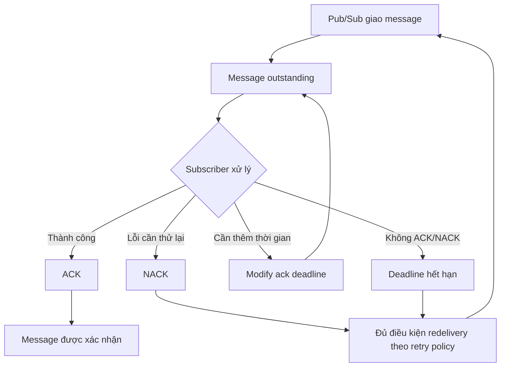
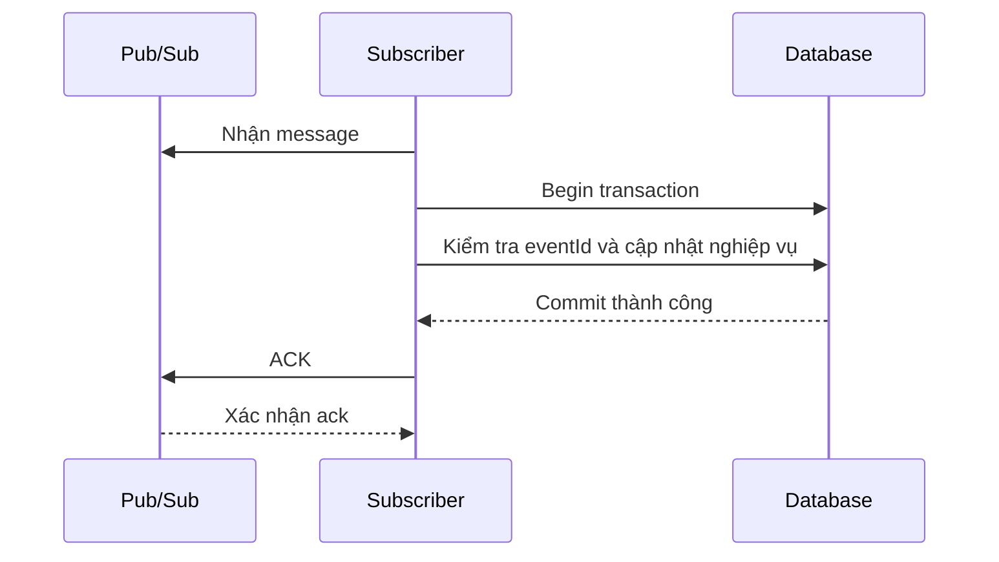

# Ack, nack, ack deadline và gia hạn thời gian xử lý

## Mục tiêu bài học

Module **SPRING_CLOUD_PROVIDER_INTEGRATION** thực hành tích hợp Spring Boot với các dịch vụ managed của **AWS, Azure và Google Cloud** qua thư viện Spring Cloud tương ứng. Với messaging, việc nhận message mới chỉ là một phần của luồng xử lý; subscriber còn phải quyết định khi nào message được xem là hoàn tất, khi nào cần giao lại và cần bao nhiêu thời gian để xử lý an toàn.

Trong Google Cloud Pub/Sub, ba thao tác quan trọng là:

- **Ack (acknowledge):** xác nhận subscriber đã xử lý message; Pub/Sub loại message khỏi trạng thái outstanding của subscription.
- **Nack (negative acknowledge):** báo subscriber chưa xử lý được; message đủ điều kiện được giao lại theo retry policy.
- **Modify ack deadline:** thay đổi thời hạn xác nhận của một message đang outstanding, thường để gia hạn khi cần xử lý lâu hơn.

Sau bài học, bạn có thể:

1. Mô tả vòng đời message từ lúc được giao đến khi ack, nack hoặc hết deadline.
2. Phân biệt ack deadline của subscription với lease management của client library.
3. Dùng `PubSubTemplate` để ack/nack từng message hoặc theo batch.
4. Gia hạn deadline thủ công khi dùng synchronous pull.
5. Cấu hình tự động gia hạn cho streaming subscriber của Spring Boot.
6. Chọn retry/backoff, dead-letter topic và flow control phù hợp.
7. Thiết kế idempotency, graceful shutdown, giám sát và kiểm thử lỗi giao nhận.

> **Phiên bản:** Ví dụ dùng API `PubSubTemplate` hiện hành của Spring Framework on Google Cloud. Các property Spring được nêu theo reference hiện hành; hãy chọn BOM tương thích với Spring Boot của dự án. Không trộn property của Spring Integration channel adapter với property của `PubSubTemplate` nếu ứng dụng không sử dụng adapter đó.

## 1. Vòng đời xác nhận một message

Khi Pub/Sub giao một message cho subscriber pull, message chuyển sang trạng thái **outstanding**. Subscriber cần xử lý rồi gửi acknowledgment trước khi deadline hết hạn, hoặc gia hạn deadline nếu cần thêm thời gian.



Một subscriber có thể gặp ba kết quả:

| Kết quả | Ý nghĩa | Hành vi tiếp theo |
| --- | --- | --- |
| Ack thành công | Xử lý hoàn tất | Message không còn outstanding ở subscription |
| Nack | Chưa xử lý được | Message được đưa về luồng retry; thời điểm giao lại còn phụ thuộc retry policy |
| Không ack và deadline hết hạn | Subscriber không xác nhận trong thời gian cho phép | Pub/Sub có thể redeliver message |

**Ack không phải là transaction commit của database.** Ứng dụng phải commit nghiệp vụ trước, sau đó mới ack. Nếu ack trước khi commit, process có thể crash sau ack và làm mất cơ hội giao lại message dù dữ liệu chưa được lưu.

Ngược lại, nếu database đã commit nhưng ack bị lỗi hoặc response bị mất, message có thể được giao lại. Đây là lý do subscriber cần idempotency.

## 2. Ack deadline của subscription

### 2.1. Deadline ban đầu

Ack deadline là thời gian ban đầu Pub/Sub chờ subscriber xác nhận một message sau khi giao. Giá trị này được cấu hình ở subscription:

| Thuộc tính | Giá trị |
| --- | --- |
| Mặc định | 10 giây |
| Tối thiểu | 10 giây |
| Tối đa cấu hình | 600 giây (10 phút) |

Ví dụ cập nhật subscription:

```bash
gcloud pubsub subscriptions update orders-sub \
  --ack-deadline=60
```

Lệnh trên đặt deadline ban đầu là 60 giây cho các lần giao message của subscription. Nó không thay đổi deadline hiện tại của từng message đã được giao; muốn đổi deadline cho message outstanding, subscriber phải gọi `ModifyAckDeadline` hoặc dùng client library quản lý lease.

### 2.2. Deadline là best-effort

Khoảng thời gian này không nên được hiểu như một timer chính xác tuyệt đối. Pub/Sub cố gắng không giao lại message đang outstanding trước khi deadline hết, nhưng có thể xuất hiện redelivery do sự cố hoặc điều kiện vận hành. Nếu cần semantics nghiêm ngặt hơn, đánh giá exactly-once delivery trên pull subscription và kiểm tra acknowledgment response theo khả năng của client.

Ack deadline ngắn có thể làm message redeliver trong khi worker cũ vẫn đang xử lý, gây duplicate và tăng tải. Deadline quá dài làm chậm quá trình giao lại khi worker chết hoặc bị mất kết nối. Với streaming pull, client library tự gia hạn deadline nên không cần đặt deadline subscription bằng thời gian xử lý dài nhất của mọi message.

### 2.3. Ý nghĩa với push subscription

Với push subscription, ack deadline còn được dùng làm timeout cho HTTP request gửi tới endpoint. Endpoint cần trả HTTP status được Pub/Sub xem là acknowledgment sau khi xử lý xong. Push subscriber không dùng `modifyAckDeadline` trên từng message theo cách pull subscriber làm; hãy thiết kế thời gian xử lý và timeout endpoint phù hợp với deadline của subscription.

## 3. Ack và nack bằng `PubSubTemplate`

### 3.1. Ack sau khi nghiệp vụ hoàn tất

`PubSubTemplate.subscribe()` nhận message bất đồng bộ dưới dạng `BasicAcknowledgeablePubsubMessage`. Message có các method `ack()` và `nack()`:

```java
import com.google.cloud.spring.pubsub.core.PubSubTemplate;
import com.google.cloud.spring.pubsub.support.BasicAcknowledgeablePubsubMessage;
import com.google.cloud.pubsub.v1.Subscriber;
import java.util.concurrent.CompletableFuture;

public class OrderSubscriber {
    private final PubSubTemplate pubSubTemplate;
    private final OrderService orderService;
    private Subscriber subscriber;

    public OrderSubscriber(
            PubSubTemplate pubSubTemplate,
            OrderService orderService) {
        this.pubSubTemplate = pubSubTemplate;
        this.orderService = orderService;
    }

    public void start() {
        subscriber = pubSubTemplate.subscribe(
                "orders-sub",
                this::handle
        );
    }

    private void handle(BasicAcknowledgeablePubsubMessage message) {
        String payload = message.getPubsubMessage()
                .getData()
                .toStringUtf8();

        try {
            orderService.processAndCommit(payload);
            CompletableFuture<Void> ackResult = message.ack();
            ackResult.whenComplete((unused, error) -> {
                if (error != null) {
                    // Ghi nhận lỗi ack và correlation ID đã làm sạch.
                }
            });
        } catch (Exception processingError) {
            CompletableFuture<Void> nackResult = message.nack();
            nackResult.whenComplete((unused, error) -> {
                if (error != null) {
                    // Ghi nhận lỗi nack; message có thể redeliver khi chưa ack.
                }
            });
        }
    }
}
```

Các method `ack()`/`nack()` là bất đồng bộ và trả `CompletableFuture<Void>`. Theo dõi future nếu cần biết request acknowledgment có hoàn tất hay không. Không ghi payload hoặc secret vào log trong callback lỗi.

Trong code production, nên phân loại lỗi trước khi nack: lỗi database tạm thời có thể retry; payload sai schema vĩnh viễn cần quarantine/DLQ để tránh lặp vô hạn.

### 3.2. Nack và redelivery

Nack báo Pub/Sub rằng subscriber không muốn xác nhận message. Về mặt giao thức, nack đặt ack deadline về 0, khiến message đủ điều kiện được giao lại. Tuy nhiên, thời điểm giao lại thực tế còn phụ thuộc subscription retry policy:

- `Retry immediately`: Pub/Sub thử giao lại ngay khi có thể.
- `Exponential backoff`: Pub/Sub áp dụng khoảng chờ tăng dần giữa các lần giao lại.

Vì vậy, không xem nack là một cơ chế retry có độ trễ cố định. Nếu subscriber liên tục nack một message, cần cấu hình backoff và dead-letter policy.

### 3.3. Ack/nack theo batch

Khi pull nhiều message, `PubSubTemplate` hỗ trợ xác nhận theo batch:

```java
List<AcknowledgeablePubsubMessage> succeeded = new ArrayList<>();
List<AcknowledgeablePubsubMessage> failed = new ArrayList<>();

for (AcknowledgeablePubsubMessage message : messages) {
    try {
        processAndCommit(message);
        succeeded.add(message);
    } catch (TransientProcessingException error) {
        failed.add(message);
    }
}

CompletableFuture<Void> ackFuture =
        succeeded.isEmpty()
                ? CompletableFuture.completedFuture(null)
                : pubSubTemplate.ack(succeeded);

CompletableFuture<Void> nackFuture =
        failed.isEmpty()
                ? CompletableFuture.completedFuture(null)
                : pubSubTemplate.nack(failed);
```

`ack(Collection)` và `nack(Collection)` hiệu quả hơn khi xác nhận nhiều message. Collection gửi trong một thao tác batch phải chứa message thuộc **cùng project**. Các method trả future; ứng dụng cần theo dõi kết quả và không giả định chỉ vì đã gọi method là toàn bộ batch đã được xác nhận.

## 4. Gia hạn deadline thủ công với `modifyAckDeadline`

### 4.1. Khi nào cần gia hạn thủ công?

Với synchronous/unary pull, ứng dụng nhận `AcknowledgeablePubsubMessage` và tự quản lý thời gian outstanding. Nếu xử lý lâu hơn deadline ban đầu, có thể gọi:

```java
message.modifyAckDeadline(120);
```

Tham số là số giây tính từ thời điểm request được gửi. Giá trị cho một lần sửa đổi nằm trong khoảng **0 đến 600 giây**:

- `0`: làm message có thể được giao lại ngay.
- `1` đến `600`: đặt deadline mới tính từ thời điểm request được xử lý.

`modifyAckDeadline()` không cập nhật cấu hình ack deadline mặc định của subscription. Nó chỉ tác động tới message/ack ID được chỉ định.

### 4.2. Ví dụ pull và gia hạn

```java
import com.google.cloud.spring.pubsub.core.PubSubTemplate;
import com.google.cloud.spring.pubsub.support.AcknowledgeablePubsubMessage;
import java.util.List;
import java.util.concurrent.CompletableFuture;

public void processBatch(PubSubTemplate pubSubTemplate) {
    List<AcknowledgeablePubsubMessage> messages =
            pubSubTemplate.pull("orders-sub", 10, false);

    for (AcknowledgeablePubsubMessage message : messages) {
        // Gia hạn thêm 120 giây cho message đang xử lý.
        CompletableFuture<Void> extension =
                message.modifyAckDeadline(120);

        extension.whenComplete((unused, error) -> {
            if (error != null) {
                // Ghi nhận lỗi gia hạn; không giả định message vẫn được giữ.
            }
        });

        try {
            processAndCommit(message);
            message.ack();
        } catch (Exception error) {
            message.nack();
        }
    }
}
```

Đây là ví dụ minh họa API. Với tác vụ dài, không nên chỉ gia hạn một lần rồi xử lý vô hạn. Cần theo dõi future, đặt timeout nghiệp vụ và lên lịch gia hạn tiếp theo trước khi deadline hiện tại hết hạn. Nếu worker chết, các lần gia hạn dừng lại và message có thể được giao lại.

### 4.3. Gia hạn nhiều lần

Nếu xử lý có thể kéo dài nhiều phút, mô hình lease thủ công là:

```text
Pull message
    ↓
Gia hạn deadline
    ↓
Xử lý một phần công việc
    ↓
Nếu chưa xong: gia hạn tiếp
    ↓
Nếu thành công: ACK
Nếu lỗi cần retry: NACK
```

Không gửi `modifyAckDeadline(600)` liên tục không giới hạn. Mục tiêu là giữ message trong thời gian xử lý hợp lý, đồng thời vẫn cho phép hệ thống phát hiện worker đã chết trong khoảng thời gian hữu hạn.

### 4.4. Ack ID có thể hết hạn

Mỗi lần giao message có acknowledgment ID gắn với lần giao đó. Khi deadline hết hạn và message được giao lại, subscriber mới nhận ack ID mới. Ack ID cũ có thể không còn hợp lệ; không giữ ack ID để xác nhận message sau khi nó đã bị redeliver.

Với subscription bật exactly-once delivery, request ack/modify deadline dùng ack ID hết hạn có thể trả lỗi. Khi đó cần xử lý lần giao mới theo ack ID mới; không retry mù quáng một ack ID đã hết hạn.

## 5. Tự động gia hạn trong streaming subscriber

### 5.1. Lease management của Java client

Khi dùng high-level streaming subscriber như `PubSubTemplate.subscribe()`, Google Cloud Java client tự quản lý lease cho message chưa được ack. Client định kỳ gửi các request `ModifyAckDeadline` để gia hạn message trong lúc callback đang xử lý.

Theo mặc định, high-level client có thể gia hạn tối đa khoảng **một giờ**. Spring Framework on Google Cloud để underlying client quyết định giá trị mặc định; có thể đặt giới hạn khác bằng:

```yaml
spring:
  cloud:
    gcp:
      pubsub:
        subscriber:
          max-ack-extension-period: 900
```

`max-ack-extension-period` được tính bằng giây. Ví dụ `900` cho phép client tự gia hạn lease tối đa 15 phút kể từ khi nhận message. Đây là tổng thời gian gia hạn tối đa, không phải thời lượng của từng request `ModifyAckDeadline`.

### 5.2. Khoảng gia hạn mỗi lần

Spring Framework on Google Cloud còn cung cấp các property:

| Property | Ý nghĩa | Đơn vị |
| --- | --- | --- |
| `spring.cloud.gcp.pubsub.subscriber.max-ack-extension-period` | Tổng thời gian tối đa client gia hạn deadline cho message | Giây |
| `spring.cloud.gcp.pubsub.subscriber.min-duration-per-ack-extension` | Giới hạn dưới của một lần gia hạn | Giây |
| `spring.cloud.gcp.pubsub.subscriber.max-duration-per-ack-extension` | Giới hạn trên của một lần gia hạn | Giây |

Ví dụ:

```yaml
spring:
  cloud:
    gcp:
      pubsub:
        subscriber:
          max-ack-extension-period: 900
          min-duration-per-ack-extension: 10
          max-duration-per-ack-extension: 60
```

Các giá trị là ví dụ để minh họa cấu hình. Chọn khoảng gia hạn theo phân bố thời gian xử lý thực tế và thời gian cần phát hiện worker lỗi. Gia hạn mỗi lần quá dài có thể làm chậm redelivery khi process chết; gia hạn quá ngắn làm tăng số request modify deadline.

### 5.3. Cấu hình riêng theo subscription

Nếu cùng một ứng dụng xử lý các loại message có thời gian khác nhau, có thể cấu hình riêng cho từng subscription:

```yaml
spring:
  cloud:
    gcp:
      pubsub:
        subscriber:
          max-ack-extension-period: 300
        subscription:
          invoice-sub:
            max-ack-extension-period: 1800
            min-duration-per-ack-extension: 10
            max-duration-per-ack-extension: 60
          notification-sub:
            max-ack-extension-period: 120
```

Ở ví dụ này, `invoice-sub` có thể xử lý tác vụ lâu hơn `notification-sub`. Khi autoconfiguration được sử dụng, cấu hình per-subscription được ưu tiên so với global. Custom `SubscriberFactory` hoặc bean tự cấu hình có thể ghi đè autoconfiguration, nên cần kiểm tra cấu hình thực tế nếu giá trị không được áp dụng.

### 5.4. Streaming pull khác synchronous pull

| Cách nhận | Quản lý deadline |
| --- | --- |
| `PubSubTemplate.subscribe()` | High-level subscriber client tự gia hạn lease cho message chưa ack |
| `subscribeAndConvert()` | Tương tự `subscribe()`, có thêm bước chuyển đổi payload |
| `PubSubTemplate.pull()` | Unary/synchronous pull; ứng dụng chủ động ack/nack và có thể gọi `modifyAckDeadline()` |
| `pullAndConvert()` | Chuyển đổi payload nhưng vẫn giữ quyền ack; ứng dụng quản lý deadline |
| `pullAndAck()` / `pullNext()` | Auto-ack khi nhận; không phù hợp nếu còn xử lý nghiệp vụ sau pull |

Với streaming subscriber, không cần tự gọi `modifyAckDeadline()` cho mỗi message trong trường hợp thông thường; client lease management đã thực hiện việc đó. Nếu dùng synchronous pull để xử lý lâu, phải tự gia hạn và quản lý ack ID.

## 6. Chọn deadline và giới hạn gia hạn

### 6.1. Đừng chỉ dùng thời gian trung bình

Thời gian xử lý message thường có phân bố lệch: phần lớn message hoàn thành nhanh, một số ít message cần thời gian lâu do database, API downstream hoặc dữ liệu lớn. Nếu chỉ chọn deadline dựa trên thời gian trung bình, nhóm message chậm dễ hết hạn và bị redeliver.

Nên đo:

- Median, p95 và p99 thời gian xử lý.
- Thời gian từ khi callback bắt đầu đến khi database commit.
- Thời gian gọi downstream và timeout của dependency.
- Thời gian ack request hoàn tất.
- Tỷ lệ deadline expiration và redelivery.

Đặt `max-ack-extension-period` lớn hơn khoảng thời gian xử lý cực đại hợp lệ cộng buffer, nhưng vẫn có giới hạn để hệ thống phát hiện worker mất khả năng xử lý. Nếu tác vụ có thể kéo dài hàng giờ, cân nhắc tách thành job/workflow riêng thay vì giữ một Pub/Sub message outstanding trong toàn bộ thời gian.

### 6.2. Deadline ngắn và dài có trade-off

| Thiết lập | Ưu điểm | Rủi ro |
| --- | --- | --- |
| Deadline ngắn | Message lỗi được giao lại nhanh hơn | Dễ duplicate nếu xử lý lâu hoặc subscriber quá tải |
| Deadline dài | Ít redelivery do xử lý chậm | Worker chết có thể làm message chờ lâu hơn |
| Gia hạn tự động | Thích ứng với thời gian xử lý khác nhau | Cần giới hạn tổng lease và giám sát gia hạn |
| Gia hạn thủ công | Kiểm soát theo từng message | Phải tự quản lý lịch, lỗi request và ack ID |

### 6.3. Đừng giữ message khi công việc đã có thể tách

Nếu một handler cần chờ người dùng duyệt, đợi file lớn hoặc thực hiện công việc nhiều giờ, hãy cân nhắc:

1. Ghi nhận trạng thái job bền vững.
2. Ack event khởi tạo sau khi đã lưu job.
3. Dùng worker/job queue hoặc workflow phù hợp để tiếp tục.
4. Phát event kết quả khi job hoàn tất.

Pub/Sub phù hợp cho việc thông báo và phân phối công việc ngắn/trung bình; lease dài không thay thế một hệ thống điều phối job.

## 7. Retry policy và dead-letter topic

### 7.1. Nack và hết deadline đi vào retry policy

Khi subscriber nack hoặc không ack trước khi deadline hết, Pub/Sub có thể giao lại message. Subscription hỗ trợ:

| Retry policy | Hành vi |
| --- | --- |
| Immediate retry | Thử giao lại ngay khi có thể |
| Exponential backoff | Tăng dần thời gian chờ giữa các lần giao lại |

Ví dụ cấu hình exponential backoff:

```bash
gcloud pubsub subscriptions update orders-sub \
  --min-retry-delay=10s \
  --max-retry-delay=300s
```

Nack làm message đủ điều kiện retry; không có nghĩa subscriber sẽ nhận lại đúng ngay lập tức. Retry policy, push backoff (nếu là push) và tình trạng dịch vụ ảnh hưởng thời điểm giao lại.

### 7.2. Khi nào nên nack?

| Tình huống | Cách xử lý |
| --- | --- |
| Database tạm thời unavailable | Nack, để retry/backoff |
| API downstream trả 429/503 | Nack hoặc áp dụng retry có giới hạn, tránh retry storm |
| Payload lỗi vĩnh viễn | Quarantine/DLQ; không nack vô hạn |
| Event đã xử lý | Ack sau khi xác nhận idempotency |
| Thiếu dependency hoặc cấu hình sai | Nack có kiểm soát và cảnh báo; ưu tiên khắc phục lỗi hệ thống |
| Message quá hạn nghiệp vụ | Đưa vào luồng xử lý expired/cancel theo rule, sau đó ack |

Không dùng nack như một cơ chế trì hoãn theo lịch nghiệp vụ. Nếu cần giao message vào một thời điểm cụ thể trong tương lai, cân nhắc Cloud Tasks hoặc scheduler/workflow phù hợp.

### 7.3. Dead-letter topic

Nếu message liên tục không thể xử lý, cấu hình dead-letter topic cho subscription để chuyển message sau một số lần giao lại. Số lần delivery được cấu hình trong khoảng 5–100; giá trị mặc định là 5. Việc chuyển DLQ là best-effort, vì vậy không dùng delivery attempt count như một bộ đếm chính xác tuyệt đối.

Ví dụ:

```bash
gcloud pubsub subscriptions update orders-sub \
  --dead-letter-topic=orders-dlq \
  --max-delivery-attempts=8
```

Topic DLQ phải tồn tại và Pub/Sub service agent cần các quyền cần thiết để publish vào DLQ và ack message nguồn. Nếu thiếu quyền service agent, message có thể không được chuyển như kỳ vọng.

### 7.4. Poison message và quarantine

Một message poison là message liên tục làm subscriber thất bại, ví dụ JSON không parse được, version không hỗ trợ hoặc dữ liệu nghiệp vụ không hợp lệ. Nếu chỉ nack, message có thể lặp lại và chiếm tài nguyên.

Một quy trình an toàn:

1. Phân loại lỗi có thể retry hay không.
2. Với lỗi vĩnh viễn, lưu message và metadata cần thiết vào quarantine/DLQ theo cơ chế bền vững.
3. Chỉ ack message nguồn sau khi lưu quarantine thành công.
4. Ghi event ID, message ID, subscription, error code và thời điểm.
5. Không ghi plaintext secret hoặc payload nhạy cảm vào log/ticket.
6. Replay sau khi sửa lỗi bằng quy trình có kiểm soát và idempotency.

## 8. Idempotency và transaction khi ack

### 8.1. Commit trước, ack sau

Một luồng an toàn cho subscriber xử lý database:



Nếu database commit thất bại, subscriber nack hoặc để deadline hết hạn theo chiến lược retry. Nếu database commit thành công nhưng ack thất bại, message có thể được giao lại; subscriber cần nhận diện event đã xử lý.

### 8.2. Deduplicate bằng event ID

`messageId` do Pub/Sub cấp nhận diện message cụ thể. Khi publisher retry cùng một sự kiện logic nhưng gửi lại thành một publish request mới, Pub/Sub có thể cấp message ID khác. Vì vậy, dùng `eventId` do nghiệp vụ tạo và giữ ổn định qua các lần retry:

```sql
CREATE TABLE processed_events (
    event_id VARCHAR(100) PRIMARY KEY,
    processed_at TIMESTAMP NOT NULL
);
```

Trong cùng transaction:

1. Insert `eventId` vào `processed_events`.
2. Nếu insert thành công, thực hiện side effect nghiệp vụ.
3. Commit.
4. Ack message.
5. Nếu unique constraint báo event đã tồn tại, bỏ qua side effect lặp rồi ack.

Đảm bảo việc insert event ID và cập nhật nghiệp vụ nằm trong cùng transaction. Nếu tách thành hai transaction, có thể xảy ra trạng thái event được đánh dấu processed nhưng side effect chưa hoàn thành.

### 8.3. Exactly-once không thay transaction

Pub/Sub hỗ trợ exactly-once delivery cho pull subscription trong phạm vi region khi bật và sử dụng client hỗ trợ đúng semantics. Tính năng này giúp xác nhận acknowledgment và giảm redelivery trong phạm vi dịch vụ, nhưng không biến database/API bên ngoài thành transaction exactly-once.

Publisher retry vẫn có thể tạo nhiều message riêng cho cùng event logic. Subscriber vẫn nên idempotent theo event ID.

## 9. Flow control và năng lực subscriber

### 9.1. Vì sao subscriber quá tải gây deadline expiration?

Nếu client pull nhiều message hơn khả năng xử lý, message nằm trong hàng đợi nội bộ và chờ worker. Trong lúc chờ, ack deadline có thể hết hạn hoặc lease extension bị giới hạn; Pub/Sub giao lại message, tạo thêm bản sao trong khi bản cũ vẫn đang được xử lý.

Điều này có thể tạo vòng lặp:

```text
Pull quá nhiều
    ↓
Worker backlog tăng
    ↓
Ack deadline/lease extension thất bại
    ↓
Message redelivery
    ↓
Backlog và duplicate tăng thêm
```

### 9.2. Giới hạn outstanding message/bytes

Spring Framework on Google Cloud cho phép cấu hình flow control:

```yaml
spring:
  cloud:
    gcp:
      pubsub:
        subscriber:
          parallel-pull-count: 2
          flow-control:
            max-outstanding-element-count: 100
            max-outstanding-request-bytes: 10485760
            limit-exceeded-behavior: Block
```

Giới hạn số lượng message và tổng byte outstanding để subscriber không nhận vượt năng lực. Giá trị phù hợp phụ thuộc:

- Thời gian xử lý p95/p99.
- Kích thước message.
- Số worker và thread.
- Heap/memory container.
- Throughput database/downstream API.

Giảm số message outstanding thường giúp giảm deadline expiration khi subscriber bị quá tải. Chỉ tăng `max-ack-extension-period` mà không giảm lượng message nhận vào có thể che dấu quá tải và kéo dài thời gian message bị giữ.

### 9.3. Chọn concurrency

`parallel-pull-count` tăng số luồng streaming pull; executor threads điều khiển thread xử lý. Tăng concurrency khi:

- Có đủ CPU/memory.
- Database/API downstream chịu được tải tăng.
- Handler có thể xử lý song song mà không phá ordering.

Nếu message cùng ordering key phải xử lý tuần tự, không tự đưa callback sang executor khác mà không giữ thứ tự. Flow control và concurrency cần được đo bằng backlog, latency và deadline expiration thay vì chọn theo cảm tính.

## 10. Spring Integration acknowledgment modes

Nếu ứng dụng dùng `PubSubInboundChannelAdapter` thay vì callback trực tiếp của `PubSubTemplate`, Spring Integration có ba chế độ acknowledgment:

| Ack mode | Flow thành công | Flow lỗi |
| --- | --- | --- |
| `AUTO` (mặc định) | Adapter ack | Adapter nack khi exception được truyền ngược về adapter |
| `AUTO_ACK` | Adapter ack | Không ack cũng không nack; message có thể hết deadline và redeliver |
| `MANUAL` | Không tự động ack/nack | Không tự động ack/nack; ứng dụng phải thao tác thủ công |

Ví dụ bật manual mode:

```java
@Bean
PubSubInboundChannelAdapter pubSubInboundChannelAdapter(
        MessageChannel inputChannel,
        PubSubTemplate pubSubTemplate) {
    PubSubInboundChannelAdapter adapter =
            new PubSubInboundChannelAdapter(pubSubTemplate, "orders-sub");
    adapter.setOutputChannel(inputChannel);
    adapter.setAckMode(AckMode.MANUAL);
    return adapter;
}
```

Trong flow, adapter gắn `BasicAcknowledgeablePubsubMessage` vào header `GcpPubSubHeaders.ORIGINAL_MESSAGE`. Lấy message gốc để ack/nack:

```java
@ServiceActivator(inputChannel = "ordersInput")
public void handle(Message<?> springMessage) {
    BasicAcknowledgeablePubsubMessage original =
            springMessage.getHeaders().get(
                    GcpPubSubHeaders.ORIGINAL_MESSAGE,
                    BasicAcknowledgeablePubsubMessage.class
            );

    try {
        orderService.processAndCommit(springMessage.getPayload());
        original.ack();
    } catch (Exception error) {
        original.nack();
    }
}
```

Lưu ý với error channel: nếu error handler bắt exception rồi kết thúc bình thường, adapter có thể xem flow đã xử lý thành công và ack theo `AUTO`/`AUTO_ACK`. Muốn kích hoạt hành vi lỗi mặc định, exception phải được truyền ngược lại adapter. Khi dùng `MANUAL`, handler chịu trách nhiệm quyết định ack/nack.

Không nhầm `AckMode.AUTO` của Spring Integration với `ack()` tự động của `PubSubTemplate.subscribe()`; hai abstraction có lifecycle và quy tắc xử lý lỗi riêng.

## 11. Theo dõi ack deadline và xử lý sự cố

### 11.1. Metrics quan trọng

Cloud Monitoring cung cấp các metric để phát hiện subscriber không ack đúng hạn:

| Metric | Ý nghĩa | Dấu hiệu cần chú ý |
| --- | --- | --- |
| `subscription/expired_ack_deadlines_count` | Số message hết ack deadline khi đang outstanding (pull/streaming pull) | Tăng liên tục cho thấy xử lý chậm, quá tải hoặc lease extension thất bại |
| `subscription/num_unacked_messages_by_region` | Số message chưa ack theo region | Backlog tăng kéo dài |
| `subscription/oldest_unacked_message_age_by_region` | Tuổi message chưa ack lâu nhất theo region | Message bị kẹt hoặc subscriber không theo kịp |
| `subscription/delivery_latency_health_score` | Điểm sức khỏe độ trễ giao nhận | Một tiêu chí không khỏe có thể chỉ ra nack/expired deadline/ack latency cao |
| `subscription/dead_letter_message_count` | Số message được chuyển sang DLQ | Poison message hoặc dependency lỗi kéo dài |

Với push subscription, theo dõi `subscription/push_request_count` và lọc theo response code; metric deadline expiration của pull không phải cách đo chính cho push delivery.

### 11.2. Cách đọc triệu chứng

| Quan sát | Nguyên nhân có thể | Hành động |
| --- | --- | --- |
| `expired_ack_deadlines_count` tăng | Handler chậm, worker crash hoặc lease extension không đủ | Kiểm tra thời gian xử lý, `max-ack-extension-period`, mạng và lỗi process |
| Backlog và oldest age cùng tăng | Subscriber không theo kịp tốc độ publish | Tăng capacity nếu dependency chịu tải; giảm outstanding và tìm bottleneck |
| Backlog thấp nhưng oldest age tăng | Một vài message bị kẹt hoặc poison | Tìm message gây lỗi, kiểm tra retry/DLQ |
| Nack tăng đột biến | Downstream dependency lỗi hoặc validation thất bại | Kiểm tra error class, retry/backoff và DLQ |
| Duplicate tăng cùng lúc deadline expiration | Subscriber quá tải hoặc xử lý lâu hơn lease | Giảm số message outstanding, điều chỉnh lease và concurrency |
| DLQ tăng | Message không xử lý được sau nhiều lần giao | Kiểm tra payload, code version, IAM service agent và quy trình replay |

### 11.3. Log có ích nhưng không lộ payload

Nên ghi nhận:

- `eventId` nghiệp vụ và Pub/Sub `messageId` nếu được phép.
- Subscription, attempt/flow stage và correlation ID.
- Thời điểm nhận, bắt đầu xử lý, commit và gửi ack.
- Thời gian xử lý và thời gian ack future hoàn tất.
- Loại exception, status code và số lần retry theo dữ liệu sẵn có.

Không log raw payload hoặc token. Dùng log structured để lọc theo subscription và error class.

## 12. Kiểm thử ack, nack và gia hạn

### 12.1. Unit test business handler

Tách xử lý nghiệp vụ khỏi callback Pub/Sub:

```java
public class OrderService {
    public void processAndCommit(String payload) {
        // Validate, deduplicate eventId, update order in one transaction.
    }
}
```

Kiểm thử:

1. Payload hợp lệ được commit một lần.
2. Cùng `eventId` xử lý lại không tạo side effect trùng.
3. Database timeout được truyền lên để subscriber nack.
4. Payload sai schema được quarantine hoặc chuyển DLQ theo policy.
5. Lỗi commit không được đánh dấu event là processed.

### 12.2. Test callback ack/nack

Mock `BasicAcknowledgeablePubsubMessage` để kiểm tra:

- Handler gọi `ack()` khi business handler thành công.
- Handler gọi `nack()` khi gặp lỗi retryable.
- Không gọi cả ack và nack cho cùng một lần giao.
- Future acknowledgment hoàn tất lỗi được ghi nhận.

Test mock chỉ xác minh logic điều phối trong ứng dụng; nó không chứng minh Pub/Sub đã nhận ack thật.

### 12.3. Integration test với emulator

Pub/Sub emulator có thể hỗ trợ kiểm thử luồng publish/subscribe, ack và nack cơ bản. Chạy emulator:

```bash
gcloud beta emulators pubsub start \
  --project=local-pubsub \
  --host-port=127.0.0.1:8085
```

Cấu hình profile:

```yaml
spring:
  cloud:
    gcp:
      project-id: local-pubsub
      pubsub:
        emulator-host: 127.0.0.1:8085
```

Trong test:

1. Tạo topic và subscription test.
2. Publish message bằng `PubSubTemplate`.
3. Dùng `subscribe()` hoặc `pull()` nhận message.
4. Xác minh ack sau khi business handler commit.
5. Nack một message và quan sát redelivery.
6. Dùng `pull()` để gọi `modifyAckDeadline()` và xác minh message còn outstanding trong thời gian test.

Emulator không thay thế kiểm thử lease management, retry timing, exactly-once, IAM hoặc quota trên dịch vụ thật. Không kết luận behavior production chỉ từ kết quả emulator.

### 12.4. Integration test trên Google Cloud sandbox

Trong project sandbox riêng, kiểm tra:

| Tình huống | Kết quả cần xác minh |
| --- | --- |
| Ack thành công | Message không còn outstanding |
| Nack | Message được retry theo retry policy |
| Không ack | Message được giao lại sau khi deadline/lease hết |
| Streaming handler xử lý lâu | Client tự gia hạn theo `max-ack-extension-period` |
| Worker bị kill | Lease extension dừng; message có thể redeliver |
| Unary pull và modify deadline | Deadline được gia hạn theo request |
| Ack ID đã hết hạn | Ack/modify request có thể thất bại; lần giao mới có ack ID mới |
| Nhiều message outstanding quá giới hạn | Flow control chặn hoặc áp dụng hành vi đã cấu hình |
| DLQ được cấu hình | Service agent có quyền và message lỗi được forward |

Không test bằng cách kill worker hoặc thu hồi IAM trên subscription production. Tạo tài nguyên sandbox và dữ liệu giả để thử các tình huống lỗi.

## 13. Bài tập thực hành

Một service `invoice-worker` xử lý message từ subscription `invoice-sub`. Thời gian xử lý bình thường là 2–5 giây; một số hóa đơn lớn cần 3–4 phút. Database có thể tạm thời trả lỗi và một số message có schema version cũ.

### Yêu cầu

1. Tạo `InvoiceCreated` có `eventId`, `invoiceId`, `schemaVersion`.
2. Dùng `PubSubTemplate.subscribeAndConvert()` để nhận DTO.
3. Commit cập nhật hóa đơn trong transaction rồi mới ack.
4. Nack khi database tạm unavailable; cấu hình exponential backoff.
5. Quarantine/DLQ message có schema không còn hỗ trợ.
6. Đặt `max-ack-extension-period` đủ cho thời gian xử lý 4 phút cộng buffer; giải thích giới hạn đã chọn.
7. Đặt flow control để subscriber không nhận nhiều message hơn năng lực database.
8. Tạo một ca unary pull dùng `modifyAckDeadline()` để gia hạn thủ công.
9. Viết idempotency test để cùng `eventId` không cập nhật hóa đơn hai lần.
10. Theo dõi `expired_ack_deadlines_count`, backlog và oldest unacked age.

### Ma trận đánh giá

| Tình huống | Kết quả mong đợi |
| --- | --- |
| Xử lý thành công trong 5 giây | Commit xong, ack thành công |
| Xử lý lâu 4 phút | Streaming client gia hạn lease trong giới hạn cấu hình |
| Worker crash khi xử lý | Message có thể redeliver; không mất nghiệp vụ |
| Database tạm lỗi | Nack và retry theo backoff |
| Schema version không hỗ trợ | Quarantine/DLQ, không retry vô hạn |
| Ack future lỗi | Ghi nhận lỗi, consumer an toàn khi redelivery |
| Subscriber quá tải | Flow control hạn chế outstanding |
| Duplicate cùng eventId | Side effect chỉ xảy ra một lần |

### Tiêu chí hoàn thành

- Phân biệt được ack, nack, deadline và lease extension.
- Dùng đúng API cho streaming subscriber và synchronous pull.
- Ack chỉ sau khi nghiệp vụ commit.
- Có idempotency và retry policy.
- Có giới hạn lease, flow control và DLQ.
- Có test unit, emulator và cloud sandbox.
- Có metric/alert cho deadline expiration và backlog.

## 14. Liên hệ với AWS và Azure

Các cloud provider đều có cơ chế xác nhận message và giao lại, nhưng API và semantics khác nhau:

| Khái niệm | Google Cloud Pub/Sub | AWS | Azure |
| --- | --- | --- | --- |
| Xác nhận message | `ack()` | SQS `DeleteMessage` sau khi xử lý | Service Bus `CompleteMessage` |
| Từ chối/giao lại | `nack()` hoặc deadline hết | SQS không delete; visibility timeout hết | `AbandonMessage` hoặc lock hết |
| Gia hạn thời gian | `ModifyAckDeadline` | SQS `ChangeMessageVisibility` | Service Bus `RenewMessageLock` |
| Thời hạn xử lý | Ack deadline + client lease management | Visibility timeout | Message lock duration và auto-renew |
| Chuyển message lỗi | Dead-letter topic | SQS DLQ/redrive policy | Service Bus dead-letter queue |
| Quyền | Google Cloud IAM | IAM role/policy | Azure RBAC/Managed Identity |

Một điểm tương đồng là message chưa được xác nhận có thể xuất hiện lại; consumer phải idempotent. Nhưng không ánh xạ máy móc `nack()` sang một API duy nhất ở provider khác: SQS, Service Bus và Pub/Sub có quy tắc retry, visibility/lock và dead-letter riêng.

## Tổng kết

Ack xác nhận message đã được xử lý; nack yêu cầu đưa message trở lại luồng retry; ack deadline xác định thời gian ban đầu Pub/Sub chờ subscriber xác nhận. Với streaming pull, high-level Java client tự gia hạn lease và Spring cho phép giới hạn bằng `spring.cloud.gcp.pubsub.subscriber.max-ack-extension-period`. Với synchronous pull, ứng dụng có thể gọi `modifyAckDeadline()` trên message và phải tự quản lý thời gian gia hạn.

Thiết kế đúng cần commit nghiệp vụ trước khi ack, idempotent khi redelivery, phân loại lỗi để nack hoặc đưa DLQ, giới hạn số message outstanding và giám sát deadline expiration. Deadline dài không sửa được subscriber quá tải; cần phối hợp lease, flow control, retry/backoff và năng lực downstream. Khi chuyển sang AWS/Azure, giữ nguyên nguyên tắc xử lý an toàn nhưng kiểm tra lại semantics visibility timeout/message lock của từng dịch vụ.

## Tài liệu tham khảo

- [Spring Framework on Google Cloud — Pub/Sub Operations & Template](https://googlecloudplatform.github.io/spring-cloud-gcp/reference/html/index.html) — `PubSubTemplate`, ack/nack, pull và acknowledgment API.
- [Spring Framework on Google Cloud — Publisher/Subscriber Configuration](https://googlecloudplatform.github.io/spring-cloud-gcp/reference/html/index.html) — `max-ack-extension-period`, min/max extension duration và flow control.
- [Google Cloud Pub/Sub — Subscription properties](https://docs.cloud.google.com/pubsub/docs/subscription-properties) — ack deadline, retry policy và dead-letter policy.
- [Google Cloud Pub/Sub — Extend ack time with lease management](https://docs.cloud.google.com/pubsub/docs/lease-management) — tự động gia hạn deadline của high-level client và quản lý thủ công.
- [Google Cloud Pub/Sub — ModifyAckDeadline API](https://docs.cloud.google.com/pubsub/docs/reference/rest/v1/projects.subscriptions/modifyAckDeadline) — thay đổi deadline theo từng ack ID.
- [Google Cloud Pub/Sub — Exactly-once delivery](https://docs.cloud.google.com/pubsub/docs/exactly-once-delivery) — giới hạn exactly-once và acknowledgment ID.
- [Google Cloud Pub/Sub — Monitor Pub/Sub](https://docs.cloud.google.com/pubsub/docs/monitoring) — metric deadline expiration, backlog, latency health và DLQ.
- [Google Cloud Pub/Sub — Troubleshoot pull subscriptions](https://docs.cloud.google.com/pubsub/docs/pull-troubleshooting) — nguyên nhân deadline hết hạn, duplicate và flow control.
