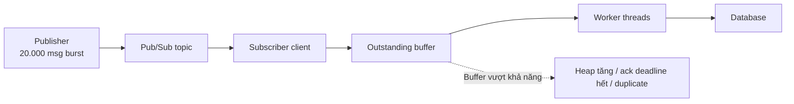
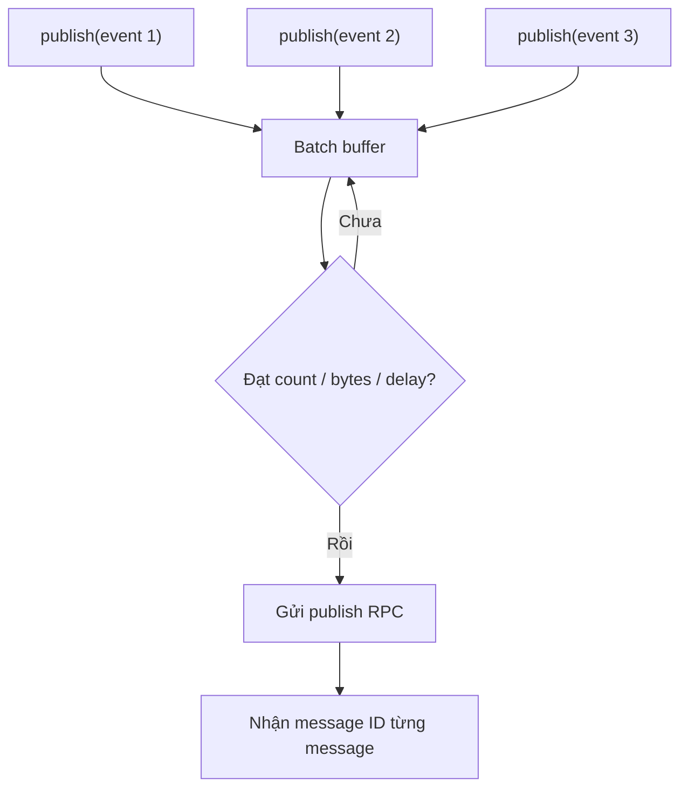

# Điều tiết luồng nhận, batching và mức song song

## Mục tiêu bài học

Module **SPRING_CLOUD_PROVIDER_INTEGRATION** thực hành tích hợp Spring Boot với các dịch vụ managed của **AWS, Azure và Google Cloud** qua thư viện Spring Cloud tương ứng. Với messaging, ứng dụng cần tiếp nhận và phát message theo năng lực thực tế của CPU, bộ nhớ, mạng và hệ thống downstream. Nếu Pub/Sub gửi nhanh hơn khả năng xử lý, subscriber có thể tích lũy backlog, hết ack deadline và xử lý trùng; nếu publisher tạo request nhanh hơn mạng có thể gửi, bộ nhớ sẽ tăng và publish có thể timeout.

Bài này tập trung vào ba cơ chế phối hợp với nhau:

- **Flow control:** giới hạn số message và tổng bytes đang outstanding để điều tiết tốc độ nhận hoặc phát.
- **Batching:** gom nhiều message publish vào một batch nhằm giảm overhead của RPC.
- **Concurrency:** điều chỉnh số luồng streaming pull và thread xử lý để tăng năng lực tiêu thụ.

Sau bài học, bạn có thể:

1. Phân biệt flow control phía subscriber và publisher.
2. Cấu hình giới hạn `max-outstanding-element-count` và `max-outstanding-request-bytes`.
3. Chọn `Block`, `Ignore` hoặc `ThrowException` theo mục tiêu vận hành.
4. Bật publisher batching và điều chỉnh ngưỡng message, bytes, thời gian chờ.
5. Phân biệt `parallel-pull-count`, `executor-threads`, số instance ứng dụng và số message xử lý đồng thời.
6. Cân bằng throughput, latency, heap, ack deadline và năng lực database/API downstream.
7. Thiết kế load test, quan sát backlog và xử lý tình trạng quá tải.

> **Phạm vi:** Ví dụ dùng Spring Framework on Google Cloud Pub/Sub Starter và `PubSubTemplate`. Property cụ thể có thể thay đổi theo BOM; hãy dùng tài liệu của đúng phiên bản Spring Cloud GCP/Spring Framework on Google Cloud mà dự án đã chọn. Các giá trị số trong ví dụ chỉ là điểm bắt đầu để đo tải, không phải định mức production.

## 1. Vì sao cần điều tiết luồng?

Giả sử `order-service` publish 20.000 message trong một khoảng thời gian ngắn, còn `inventory-worker` chỉ xử lý được 2.000 message mỗi phút. Nếu subscriber cứ nhận message không giới hạn, nhiều message sẽ nằm trong bộ nhớ chờ worker, trong khi database đã gần đạt giới hạn kết nối.



Flow control tạo giới hạn cho buffer ở client. Khi đạt ngưỡng, subscriber tạm dừng nhận thêm message cho đến khi các message đang xử lý được ack/nack. Ở phía publisher, flow control giới hạn lượng message đang chờ được gửi/xác nhận, tránh tích lũy request vô hạn trong bộ nhớ.

Batching giải quyết một vấn đề khác: publisher có thể gom nhiều message vào một request để giảm số RPC và tăng throughput. Batching không thay flow control; nếu publisher tạo message nhanh hơn khả năng gửi, vẫn cần giới hạn lượng message/bytes outstanding.

Concurrency quyết định có bao nhiêu luồng nhận và xử lý message. Tăng concurrency có thể tăng throughput khi CPU hoặc worker là bottleneck, nhưng có thể làm database/API downstream quá tải. Vì vậy cần phối hợp cả ba cơ chế.

## 2. Flow control phía subscriber

### 2.1. Message outstanding là gì?

Một message được xem là **outstanding** khi subscriber đã nhận nhưng Pub/Sub chưa nhận được ack hoặc nack. Trong thời gian đó, client phải giữ message và các thông tin cần thiết để xử lý/acknowledge.

Hai giới hạn chính:

| Thuộc tính | Ý nghĩa |
| --- | --- |
| `max-outstanding-element-count` | Số message tối đa đang outstanding trong subscriber client |
| `max-outstanding-request-bytes` | Tổng dung lượng message tối đa đang outstanding |

Khi một trong hai giới hạn bị chạm, subscriber client ngừng kéo thêm message cho tới khi lượng outstanding giảm xuống. Đây là backpressure ở phía client; nó không làm giảm tốc độ publish của producer ngay lập tức, nhưng giúp subscriber tránh nhận nhiều hơn khả năng xử lý.

Ví dụ: đặt tối đa 100 message và 10 MiB. Nếu subscriber nhận đủ 100 message dù tổng dung lượng mới là 2 MiB, client vẫn tạm dừng. Ngược lại, nếu 10 message lớn đã chiếm 10 MiB, client cũng dừng dù chưa đạt giới hạn 100 message.

### 2.2. Giới hạn theo số lượng và bytes

Chỉ giới hạn số message là chưa đủ nếu kích thước message biến động mạnh. 100 message nhỏ có thể chiếm vài trăm KB, nhưng 100 message lớn có thể tiêu thụ hàng chục MB.

Ước lượng bộ nhớ:

\[
\text{Outstanding bytes} \approx
\text{message count} \times \text{average message size}
\]

Đây chỉ là ước lượng payload; heap thực tế còn bao gồm object Java, protobuf, callback, buffer, metadata và bản sao dữ liệu trong quá trình deserialize.

Ví dụ, nếu message trung bình 64 KiB và giới hạn 200 message:

\[
200 \times 64\text{ KiB} = 12.5\text{ MiB}
\]

Nếu message có thể lớn hơn nhiều, giới hạn bytes có thể kích hoạt trước giới hạn count. Hãy dùng cả hai ngưỡng.

Trong nhiều phiên bản Java client, hai giới hạn này mặc định là không giới hạn nếu ứng dụng không cấu hình. Vì vậy, workload có traffic burst hoặc payload biến động nên đặt ngưỡng rõ ràng thay vì dựa vào default.

### 2.3. Hành vi khi vượt giới hạn

Java client hỗ trợ ba hành vi:

| Giá trị | Hành vi | Khi phù hợp |
| --- | --- | --- |
| `Block` | Chờ tới khi có capacity rồi mới tiếp tục | Worker nền, batch processing |
| `ThrowException` | Báo lỗi khi không thể nhận thêm vì vượt ngưỡng | Ứng dụng cần tự kiểm soát admission/reject |
| `Ignore` | Bỏ qua giới hạn flow control | Chủ yếu để debug; không phù hợp production vì có thể tăng memory và gây RPC failure |

Với subscriber streaming thông thường, `Block` là lựa chọn dễ kiểm soát: client tạm ngừng nhận thêm cho đến khi message đang outstanding được ack/nack. `Ignore` vô hiệu hóa tác dụng của giới hạn; nếu traffic tăng đột biến, heap có thể tăng đến mức process bị OOM.

### 2.4. Cấu hình subscriber flow control

Ví dụ trong `application.yml`:

```yaml
spring:
  cloud:
    gcp:
      pubsub:
        subscriber:
          flow-control:
            max-outstanding-element-count: 100
            max-outstanding-request-bytes: 10485760
            limit-exceeded-behavior: Block
```

Trong ví dụ:

- Tối đa 100 message outstanding.
- Tối đa khoảng 10 MiB message bytes outstanding.
- Khi chạm một trong hai giới hạn, subscriber tạm dừng nhận message.

Các ngưỡng cần dựa trên heap container, kích thước message và thời gian xử lý. Không copy nguyên các giá trị này vào production mà chưa load test.

### 2.5. Flow control không phải quota của Pub/Sub

Flow control ở đây là cơ chế **client-side** trong thư viện subscriber. Nó không thay đổi quota dịch vụ, không giới hạn số message publisher gửi lên topic và không làm backlog phía server biến mất. Nếu tốc độ publish luôn lớn hơn tốc độ consume, backlog vẫn tăng ở subscription; flow control chỉ giúp subscriber không nhận quá nhiều vào bộ nhớ của chính nó.

Nếu chênh lệch tốc độ là tạm thời, flow control giúp hấp thụ burst. Nếu chênh lệch kéo dài, cần tăng năng lực consumer, tối ưu xử lý hoặc giảm tốc producer.

## 3. Cấu hình flow control trong Spring Boot

### 3.1. Cấu hình global

Spring Framework on Google Cloud ánh xạ các property sau tới `FlowControlSettings` của Java client:

```yaml
spring:
  cloud:
    gcp:
      pubsub:
        subscriber:
          parallel-pull-count: 2
          executor-threads: 8
          flow-control:
            max-outstanding-element-count: 100
            max-outstanding-request-bytes: 10485760
            limit-exceeded-behavior: Block
```

| Property | Tác dụng |
| --- | --- |
| `subscriber.parallel-pull-count` | Số streaming pull worker |
| `subscriber.executor-threads` | Số thread executor được dùng bởi subscriber do factory tạo |
| `subscriber.flow-control.max-outstanding-element-count` | Giới hạn số message outstanding |
| `subscriber.flow-control.max-outstanding-request-bytes` | Giới hạn bytes outstanding |
| `subscriber.flow-control.limit-exceeded-behavior` | Hành vi khi chạm giới hạn |

Các giá trị `parallel-pull-count` và `executor-threads` có quan hệ nhưng không đồng nghĩa: một property điều chỉnh số luồng streaming pull; property còn lại điều chỉnh executor threads. Năng lực thực tế còn phụ thuộc flow control, thời gian callback và downstream.

### 3.2. Cấu hình riêng theo subscription

Nếu cùng ứng dụng nhận các loại message có kích thước và thời gian xử lý khác nhau, cấu hình per-subscription:

```yaml
spring:
  cloud:
    gcp:
      pubsub:
        subscriber:
          parallel-pull-count: 1
          executor-threads: 4
          flow-control:
            max-outstanding-element-count: 50
            max-outstanding-request-bytes: 5242880
        subscription:
          invoice-sub:
            parallel-pull-count: 3
            executor-threads: 8
            flow-control:
              max-outstanding-element-count: 150
              max-outstanding-request-bytes: 20971520
              limit-exceeded-behavior: Block
          notification-sub:
            parallel-pull-count: 1
            executor-threads: 2
            flow-control:
              max-outstanding-element-count: 30
              max-outstanding-request-bytes: 2097152
```

`invoice-sub` có thể cần throughput cao hơn; `notification-sub` có thể gọi email API chậm và cần giới hạn outstanding thấp hơn. Khi dùng autoconfiguration, cấu hình per-subscription được ưu tiên so với global. Nếu có custom `SubscriberFactory` hoặc bean cấu hình riêng, custom configuration có thể ghi đè autoconfiguration và làm property không được áp dụng như mong đợi.

### 3.3. Cấu hình theo subscription có thể tạo thêm thread pool

Tài liệu Spring Framework on Google Cloud lưu ý rằng đặt `executor-threads` riêng cho subscription có thể khiến thread pool được tạo cho cả cấu hình global/default và cấu hình riêng. Khi có nhiều subscription, hãy tính tổng số thread và memory, không chỉ nhìn giá trị của từng subscription.

Không cấu hình quá nhiều subscription-specific executor chỉ để tăng throughput. Nếu các subscription có cùng profile xử lý, dùng global settings; chỉ tách cấu hình khi workload thực sự khác nhau.

## 4. Publisher batching

### 4.1. Batching hoạt động như thế nào?

Publisher batching gom nhiều message vào một publish request thay vì gửi từng message bằng một RPC riêng. Một batch được gửi khi một trong các ngưỡng cấu hình đạt tới:

- Số message trong batch đạt `element-count-threshold`.
- Tổng dung lượng request đạt `request-byte-threshold`.
- Thời gian chờ kể từ lúc thêm message đầu tiên đạt `delay-threshold-seconds`.



Batching giảm số request và có thể tăng throughput khi publisher phát nhiều message nhỏ. Đổi lại, message đầu tiên trong batch có thể phải chờ tới khi batch đủ điều kiện gửi; vì vậy batching có thể tăng latency. Batching không gộp nhiều event thành một message nghiệp vụ và không làm batch trở thành transaction nguyên tử.

### 4.2. Cấu hình batching

Ví dụ trong `application.yml`:

```yaml
spring:
  cloud:
    gcp:
      pubsub:
        publisher:
          batching:
            enabled: true
            element-count-threshold: 100
            request-byte-threshold: 1048576
            delay-threshold-seconds: 0.01
```

Trong ví dụ, publisher gửi batch khi đạt 100 message, khoảng 1 MiB hoặc chờ 10 ms kể từ message đầu tiên. Ngưỡng thực tế còn chịu giới hạn kích thước request/message của Pub/Sub; không đặt batch lớn hơn giới hạn dịch vụ.

Batching bị tắt mặc định trong cấu hình Spring. Chỉ đặt các threshold mà không bật `publisher.batching.enabled` thì không nên được xem là đã bật batching; hãy kiểm tra property của đúng phiên bản thư viện.

### 4.3. Chọn ngưỡng theo mục tiêu

| Mục tiêu | Cách điều chỉnh | Đánh đổi |
| --- | --- | --- |
| Throughput cao, message nhỏ | Tăng count threshold và byte threshold | Batch lớn hơn, có thể tăng latency đầu batch |
| Latency thấp | Giảm delay threshold | Gửi batch nhỏ hơn, tăng số RPC |
| Payload lớn | Theo dõi byte threshold, giảm count threshold | Tránh batch vượt request size và tăng memory |
| Traffic không đều | Dùng delay threshold hữu hạn | Message ít traffic không phải chờ đủ count mới được gửi |
| Traffic burst | Batching kết hợp publisher flow control | Giảm RPC overhead nhưng vẫn giới hạn buffer |

Không tối ưu chỉ theo throughput. Đo latency p50/p95/p99 từ lúc ứng dụng gọi `publish()` đến lúc future hoàn tất; đồng thời theo dõi số message trong batch và publish error rate.

### 4.4. Batching không thay thế xử lý kết quả từng message

`PubSubTemplate.publish()` vẫn trả `CompletableFuture<String>` cho từng message. Khi batch được gửi, mỗi message có kết quả publish/message ID riêng. Ứng dụng phải quan sát future tương ứng và xử lý lỗi; không giả định tất cả message trong một batch đều thành công chỉ vì một future hoàn tất.

Không gọi `.join()` tuần tự cho từng message nếu mục tiêu là tận dụng batching. Cách đó biến publish bất đồng bộ thành đồng bộ và có thể ngăn buffer tích lũy đủ message để batch. Thay vào đó, giữ future có giới hạn, theo dõi kết quả và dùng outbox/retry khi nghiệp vụ yêu cầu độ tin cậy.

## 5. Publisher flow control

### 5.1. Vì sao publisher cũng cần flow control?

Nếu ứng dụng gọi `publish()` nhanh hơn publisher client có thể gửi dữ liệu, các message chờ publish và request outstanding tích lũy trong bộ nhớ. Khi quá tải, publisher có thể tăng heap hoặc gặp lỗi như `DEADLINE_EXCEEDED`.

Publisher flow control giới hạn:

- Số message đang chờ được gửi/xác nhận.
- Tổng bytes của các message đang outstanding.

Đây là giới hạn phía publisher client, khác với subscriber flow control. Nó không giới hạn số message được lưu trên topic và không thay quota publish của project.

### 5.2. Cấu hình publisher flow control

Property publisher flow control nằm dưới `publisher.batching.flow-control`:

```yaml
spring:
  cloud:
    gcp:
      pubsub:
        publisher:
          batching:
            enabled: true
            element-count-threshold: 100
            request-byte-threshold: 1048576
            delay-threshold-seconds: 0.01
            flow-control:
              max-outstanding-element-count: 500
              max-outstanding-request-bytes: 52428800
              limit-exceeded-behavior: Block
```

Trong ví dụ, publisher giữ tối đa 500 message và khoảng 50 MiB message bytes đang outstanding trước khi áp dụng flow control. Hai giới hạn count/bytes độc lập; giới hạn nào đạt trước sẽ điều tiết việc publish.

### 5.3. Chọn hành vi khi publisher đầy buffer

| Hành vi | Kết quả | Lưu ý |
| --- | --- | --- |
| `Block` | Thread gọi publish chờ tới khi có capacity | Phù hợp worker nền; không gọi trên event loop hoặc request thread nhạy latency nếu không kiểm soát blocking |
| `ThrowException` | Lời gọi vượt ngưỡng nhận exception | Phù hợp khi ứng dụng muốn từ chối nhanh, áp dụng admission control hoặc ghi vào outbox để thử lại |
| `Ignore` | Không áp dụng giới hạn | Chỉ nên dùng debug; có nguy cơ buffer và heap tăng không giới hạn |

Khi dùng `Block`, cần hiểu thread nào gọi `publish()`. Nếu đó là servlet request thread, thread có thể bị giữ khi publisher đầy. Có thể chuyển publish sang worker/outbox riêng, giới hạn queue nội bộ và trả trạng thái phù hợp cho caller.

### 5.4. Phối hợp batching và publisher flow control

Batching gom message để gửi hiệu quả; publisher flow control giới hạn lượng message/bytes đang chờ. Hai cơ chế bổ trợ nhau:

```text
Application calls publish()
        ↓
Publisher flow control checks capacity
        ↓
Batch buffer collects messages
        ↓
Count / bytes / delay threshold reached
        ↓
Publish RPC
        ↓
Each message future completes with ID or error
```

Nếu batch threshold quá lớn nhưng publisher flow control quá thấp, publisher có thể block trước khi batch đủ điều kiện. Ngược lại, nếu flow control quá cao, một burst lớn vẫn có thể chiếm nhiều heap. Hãy chọn hai nhóm ngưỡng cùng nhau và load test với kích thước message thực tế.

## 6. Mức song song và năng lực subscriber

### 6.1. Bốn mức cần phân biệt

Khi tăng khả năng xử lý, có bốn khái niệm thường bị nhầm:

| Thành phần | Điều chỉnh | Tác động |
| --- | --- | --- |
| Application instances | Số pod/container/VM chạy subscriber | Tăng số process và tài nguyên tổng |
| `parallel-pull-count` | Số streaming pull workers trong subscriber | Tăng số luồng nhận từ Pub/Sub |
| `executor-threads` | Số thread executor dùng bởi subscriber | Quyết định số callback có thể chạy đồng thời theo khả năng executor |
| Flow control | Số message/bytes outstanding tối đa | Giới hạn lượng công việc client nhận và giữ trong bộ nhớ |

Không thể suy ra concurrency thực tế chỉ bằng một property. Ví dụ, tăng `parallel-pull-count` nhưng giữ flow control ở 10 message thì tổng message outstanding vẫn bị giới hạn. Tăng executor threads nhưng database connection pool chỉ có 5 connection có thể làm nhiều callback cùng chờ connection thay vì tăng throughput.

### 6.2. Cấu hình số pull workers và executor

Ví dụ:

```yaml
spring:
  cloud:
    gcp:
      pubsub:
        subscriber:
          parallel-pull-count: 2
          executor-threads: 8
          flow-control:
            max-outstanding-element-count: 100
            max-outstanding-request-bytes: 10485760
```

`parallel-pull-count` có default thường là 1; `executor-threads` thường mặc định 4 trong cấu hình factory. Kiểm tra default theo BOM thực tế vì các dòng thư viện có thể thay đổi. Đừng đặt cả hai thành số rất lớn mà không đo CPU, heap, connection pool và downstream latency.

### 6.3. Scale out nhiều instance cùng subscription

Nhiều instance subscriber có thể cùng consume một subscription để chia tải. Khi tăng số instance:

- Pub/Sub phân phối message cho các client đang hoạt động.
- Mỗi client có flow control và buffer riêng.
- Tổng lượng outstanding trên toàn hệ thống có thể tăng theo số instance.
- Database/API downstream cũng nhận tổng tải lớn hơn.

Ví dụ nếu mỗi instance cho phép 100 message outstanding và chạy 10 instance, hệ thống có thể có khoảng 1.000 message đang được client giữ, tùy thời điểm và phân phối. Hãy tính tổng theo fleet, không chỉ theo một pod.

Scale out chỉ hữu ích nếu downstream còn capacity. Nếu database chỉ xử lý được 500 transaction/giây, tăng worker từ 10 lên 50 có thể làm connection contention và retry tăng mà throughput không tăng.

### 6.4. Ước lượng concurrency ban đầu

Một ước lượng đơn giản theo Little's Law:

\[
\text{Concurrency cần thiết} \approx
\text{Tốc độ đến (message/giây)} \times
\text{Thời gian xử lý trung bình (giây)}
\]

Ví dụ, subscriber cần xử lý 40 message/giây và mỗi message mất trung bình 0,25 giây:

\[
40 \times 0.25 = 10
\]

Khoảng 10 tác vụ đồng thời là điểm bắt đầu để duy trì tốc độ đó trong điều kiện ổn định. Sau đó cần thêm headroom cho biến động p95/p99, burst, retry và thời gian chờ dependency. Công thức không tính trực tiếp overhead, lock contention hoặc giới hạn database.

### 6.5. Message caching và phân phối không đều

Streaming pull có thể cache message ở client. Trong một số workload gồm nhiều message nhỏ nhưng xử lý từng message lâu, một subscriber có thể nhận và giữ nhiều message hơn các subscriber khác, khiến phân phối tải không đều dù có nhiều instance.

Tài liệu Spring Framework on Google Cloud mô tả trường hợp này và gợi ý dùng **synchronous pull**/`PubSubMessageSource` khi cần phân phối công việc đều hơn giữa các consumer. Đây không phải lựa chọn nhanh hơn trong mọi tình huống: streaming pull thường phù hợp workload liên tục và throughput cao; synchronous pull có thể hữu ích cho workload batch hoặc message nhỏ, xử lý chậm.

### 6.6. Dùng `PubSubMessageSource` khi cần poll

Nếu ứng dụng dùng Spring Integration, có thể tạo pollable source:

```java
@Bean
PubSubMessageSource invoiceMessageSource(PubSubTemplate pubSubTemplate) {
    PubSubMessageSource source =
            new PubSubMessageSource(pubSubTemplate, "invoice-sub");
    source.setAckMode(AckMode.MANUAL);
    source.setPayloadType(String.class);
    source.setBlockOnPull(true);
    source.setMaxFetchSize(50);
    return source;
}
```

Sau đó gắn source vào poller với khoảng thời gian phù hợp. `setMaxFetchSize()` điều chỉnh số message lấy trong một lần poll; `setBlockOnPull(true)` cho phép pull chờ message thay vì trả rỗng ngay. Với `AckMode.MANUAL`, flow phải ack/nack message gốc sau khi xử lý.

Không dùng synchronous pull polling với chu kỳ quá ngắn nếu không cần thiết; nó có thể tạo nhiều request rỗng. Chọn poll interval, batch size và block behavior theo latency mục tiêu và tải.

## 7. Backpressure xuyên suốt từ API đến database

### 7.1. Flow control không tự bảo vệ downstream

Giới hạn message outstanding chỉ kiểm soát lượng message client nhận. Nếu mỗi callback tạo thêm nhiều tác vụ bất đồng bộ rồi ack sớm, số công việc downstream có thể vượt flow control. Ví dụ callback đưa payload vào một executor không giới hạn, ack ngay và tiếp tục nhận message: Pub/Sub thấy message đã hoàn tất trong khi queue nội bộ vẫn phình ra.

Một quy tắc thiết kế:

- Chỉ ack sau khi công việc cần bảo toàn đã hoàn tất hoặc đã được ghi vào queue bền vững.
- Nếu handoff sang executor nội bộ, queue phải bounded và việc handoff phải có semantics rõ ràng.
- Đồng bộ giới hạn outstanding với worker pool và connection pool.
- Khi downstream quá tải, dừng nhận thêm hoặc nack/backoff theo chính sách, không tạo queue vô hạn.

### 7.2. Ví dụ tính ngân sách message

Giả sử một pod có:

| Thành phần | Giới hạn giả định |
| --- | ---: |
| Heap dành cho message/callback | 256 MiB |
| Dự phòng cho framework và business objects | 128 MiB |
| Dung lượng còn lại dành cho payload outstanding | 128 MiB |
| Kích thước message trung bình | 64 KiB |

Ước lượng thô cho số message:

\[
128\text{ MiB} / 64\text{ KiB} = 2048\text{ message}
\]

Không nên đặt flow control bằng đúng 2.048 message vì payload còn có overhead object, bytes copy, JSON DTO và biến động kích thước. Hãy bắt đầu thấp hơn đáng kể, theo dõi heap/GC và tăng dần trong load test. Giới hạn bytes cũng nên thấp hơn ngân sách heap lý thuyết.

### 7.3. Kết hợp với database connection pool

Nếu mỗi callback cần một connection database, concurrency xử lý không nên vượt xa số connection khả dụng cộng khả năng chờ có kiểm soát. Ví dụ pool có 20 connection nhưng subscriber cho phép 500 callback đồng thời; phần lớn callback có thể chỉ chờ connection, giữ message outstanding và tăng nguy cơ hết deadline.

Hãy đo:

- Active/idle/pending database connections.
- Thời gian chờ lấy connection.
- Transaction duration và lock wait.
- Subscriber processing latency.
- Ack deadline expiration và redelivery.

Nếu connection pool là bottleneck, tăng pull workers không giúp tăng throughput. Tối ưu query/transaction hoặc tăng capacity database trước khi tăng subscriber concurrency.

## 8. Quy trình tuning bằng load test

### 8.1. Xác định mục tiêu trước khi chỉnh cấu hình

Không bắt đầu bằng cách tăng `parallel-pull-count` hoặc batching. Trước hết xác định:

- Tốc độ publish bình thường và burst tối đa (message/giây).
- Kích thước message trung bình, p95 và lớn nhất.
- Processing latency p50/p95/p99.
- Throughput mục tiêu của subscriber.
- Backlog tối đa và thời gian cần để drain backlog.
- Giới hạn heap, CPU, database connection và downstream API.
- SLO về thời gian xử lý từ publish tới hoàn tất nghiệp vụ.

Ví dụ mục tiêu:

| Chỉ tiêu | Mục tiêu giả định |
| --- | ---: |
| Publish steady rate | 500 msg/s |
| Burst | 1.500 msg/s trong 2 phút |
| Message size p95 | 32 KiB |
| Subscriber throughput | Ít nhất 600 msg/s |
| Processing latency p95 | Dưới 2 giây |
| Ack deadline expiration | Gần 0 trong tải bình thường |
| Heap | Dưới 70% giới hạn container |

Đây là số liệu giả định cho bài lab; workload thực tế cần lấy từ production telemetry hoặc yêu cầu sản phẩm.

### 8.2. Ma trận thử nghiệm

Thay đổi từng nhóm cấu hình trong một lượt thử để biết yếu tố nào tạo khác biệt:

| Lượt | Subscriber flow control | Pull workers / executor | Publisher batching | Mục đích |
| --- | --- | --- | --- | --- |
| A | Giới hạn thấp | 1 / 4 | Tắt | Baseline, quan sát bottleneck |
| B | Tăng count/bytes vừa phải | Giữ nguyên | Tắt | Đo tác động buffer subscriber |
| C | Giữ flow control | Tăng pull workers | Tắt | Đo tác động số stream pull |
| D | Giữ flow control | Tăng executor threads | Tắt | Đo tác động callback concurrency |
| E | Giữ subscriber config | Giữ nguyên | Bật batch nhỏ | Đo throughput/latency publisher |
| F | Giữ subscriber config | Giữ nguyên | Batch lớn hơn | Xác định điểm throughput bắt đầu bão hòa và latency tăng |

Sau đó thử scale out số instance. Không thay đồng thời mọi giá trị vì khi kết quả thay đổi sẽ khó xác định nguyên nhân.

### 8.3. Kịch bản tải cần có

1. **Steady load:** publish đều trong thời gian đủ dài để thấy throughput ổn định.
2. **Burst load:** tăng tốc độ publish nhanh hơn consume trong một khoảng thời gian, sau đó trở lại mức bình thường.
3. **Large payload:** tăng kích thước message để kiểm tra giới hạn bytes và heap.
4. **Slow consumer:** cố ý làm handler chậm để kiểm tra flow control và deadline.
5. **Downstream degradation:** làm database/API sandbox chậm hoặc trả lỗi tạm thời.
6. **Scale out/in:** tăng rồi giảm số instance để kiểm tra khả năng cân bằng tải và drain.
7. **Recovery:** phục hồi dependency sau burst và đo thời gian backlog trở về mức bình thường.

Không dùng production dependency hoặc dữ liệu thật để tạo lỗi trong load test. Dùng project, subscription, database và API sandbox riêng.

### 8.4. Tiêu chí chấp nhận

Một cấu hình đạt yêu cầu khi:

- Throughput đạt mục tiêu mà không tăng vô hạn backlog.
- p95/p99 processing latency nằm trong SLO.
- Heap/GC/CPU còn headroom.
- Database pool không có hàng đợi chờ connection kéo dài.
- `expired_ack_deadlines_count` không tăng liên tục.
- Duplicate/redelivery được xử lý idempotent.
- Publisher không tích lũy future/message buffer không giới hạn.
- Sau burst, backlog drain trong thời gian đã đặt ra.

## 9. Metrics và quan sát vận hành

### 9.1. Metrics phía subscription

Theo dõi Cloud Monitoring metrics và metric ứng dụng:

| Metric | Ý nghĩa | Cách dùng |
| --- | --- | --- |
| `subscription/num_unacked_messages_by_region` | Số message chưa ack theo region | Đo backlog hiện tại |
| `subscription/oldest_unacked_message_age_by_region` | Tuổi của message chưa ack lâu nhất | Phát hiện consumer bị tụt lại hoặc message bị kẹt |
| `subscription/expired_ack_deadlines_count` | Số lần ack deadline hết hạn với pull subscriber | Phát hiện xử lý chậm, quá tải hoặc lease extension thất bại |
| `subscription/delivery_latency_health_score` | Điểm sức khỏe delivery latency | Theo dõi các điều kiện ảnh hưởng tới độ trễ giao message |
| `subscription/dead_letter_message_count` | Message được chuyển sang DLQ | Phát hiện poison message hoặc lỗi kéo dài |

Tên metric và nhãn có thể thay đổi theo loại subscription/phiên bản dịch vụ; tham khảo Cloud Monitoring metric catalog khi tạo dashboard.

### 9.2. Metrics phía publisher và ứng dụng

Ngoài metric Pub/Sub, instrument ứng dụng để theo dõi:

- Số lần gọi `publish()` mỗi giây.
- Số future publish đang pending.
- Publish success/failure và latency tới lúc future hoàn tất.
- Số message/bytes trong batch nếu ứng dụng có thể quan sát.
- Số lần publisher flow control block hoặc throw exception.
- Số callback subscriber đang chạy và thời gian xử lý.
- Số message outstanding ước lượng từ client settings và application telemetry.
- Queue depth nội bộ, heap, GC pause, CPU và database pool saturation.

Không ghi payload hoặc secret trong metric label. Dùng topic/subscription, event type và error class làm dimension có kiểm soát; tránh label có cardinality cao như `eventId` hoặc `customerId`.

### 9.3. Dashboard và alert

Dashboard nên có ít nhất bốn nhóm:

1. **Ingress:** publish rate, publish latency, publish errors.
2. **Backlog:** unacked messages, oldest unacked age, backlog drain rate.
3. **Processing:** handler throughput, p95/p99 processing time, nack, deadline expiration, DLQ.
4. **Resources:** CPU, heap, GC, active threads, database pool, downstream latency.

Alert nên dựa trên xu hướng và thời gian kéo dài, không chỉ một spike ngắn. Ví dụ: backlog và oldest age tăng liên tục trong vài phút; deadline expiration tăng cùng lúc; hoặc publisher error rate vượt ngưỡng. Đặt alert theo SLO và khả năng phản ứng của đội vận hành.

## 10. Quy trình điều chỉnh khi có bottleneck

### 10.1. Backlog tăng, CPU subscriber thấp

Khả năng có giới hạn ở concurrency/flow control hoặc dependency đang chờ I/O:

1. Kiểm tra executor threads và số pull workers.
2. Kiểm tra database connection wait và downstream latency.
3. Nếu worker rảnh và dependency còn capacity, tăng concurrency từng bước.
4. Nếu flow control quá thấp, tăng count/bytes vừa phải.
5. Đo lại p95/p99 và deadline expiration.

### 10.2. Backlog tăng, CPU/heap cao

Đây có thể là quá tải ở subscriber:

1. Giảm số message outstanding nếu heap/GC bị áp lực.
2. Giảm concurrency nếu CPU bị tranh chấp hoặc downstream bị bão hòa.
3. Tối ưu deserialize, business handler và database transaction.
4. Scale out nếu mỗi instance đã gần mức sử dụng tối ưu.
5. Kiểm tra message size và payload có đang quá lớn không.

### 10.3. Publish latency cao nhưng subscriber còn capacity

Kiểm tra publisher:

1. Xác minh mạng, region/endpoint và publish error.
2. Bật batching nếu traffic đủ lớn và latency budget cho phép.
3. Điều chỉnh count/bytes/delay threshold từng bước.
4. Cấu hình publisher flow control để giới hạn buffer.
5. Theo dõi số future pending và thời gian hoàn tất.

### 10.4. Deadline expiration tăng sau khi tăng concurrency

Tăng concurrency có thể làm handler nhận thêm message nhưng cũng gây tranh chấp CPU/database. Hãy kiểm tra:

- Outstanding message có tăng vượt năng lực worker không?
- Database pool có pending request hoặc transaction time tăng không?
- `max-ack-extension-period` có đủ cho p99 hợp lệ không?
- Callback có chuyển công việc sang executor nội bộ rồi ack quá sớm không?
- Một số message poison hoặc ordering key nóng có làm tắc hàng đợi không?

Không giải quyết mọi deadline expiration bằng cách tăng lease. Nếu nguyên nhân là quá tải, cần giảm outstanding hoặc tăng capacity thực tế.

## 11. Lỗi cấu hình thường gặp

| Triệu chứng | Nguyên nhân có thể | Hướng xử lý |
| --- | --- | --- |
| Heap tăng khi traffic burst | Flow control không giới hạn hoặc `Ignore` | Đặt count/bytes limit và dùng `Block`/`ThrowException` phù hợp |
| Subscriber không nhận thêm message | Flow control đang block vì outstanding chưa ack/nack | Kiểm tra callback, ack/nack future và downstream latency |
| Tăng `parallel-pull-count` nhưng throughput không tăng | Executor/DB/downstream là bottleneck | Đo từng tầng, tăng đúng capacity |
| Nhiều thread chờ connection | Executor lớn hơn DB pool | Cân bằng concurrency với connection pool |
| Publisher buffer tăng | Publish rate vượt tốc độ gửi, flow control không giới hạn | Đặt publisher flow control, batching và bounded producer queue |
| Publish latency tăng sau bật batching | Delay/count threshold quá cao hoặc traffic thưa | Giảm delay threshold, cân bằng latency/throughput |
| Publish bị block lâu | Publisher flow control dùng `Block` trên request thread | Chuyển publish sang worker/outbox và kiểm soát queue |
| Subscriber phân phối không đều | Streaming pull message caching trong workload nhỏ/chậm | Cân nhắc synchronous pull/`PubSubMessageSource`, đo lại |
| `DEADLINE_EXCEEDED` khi publish burst | Quá nhiều publish request outstanding hoặc mạng không theo kịp | Publisher flow control, batching và điều chỉnh tốc độ producer |
| Backlog không giảm sau scale out | Downstream hoặc hot key là bottleneck | Tối ưu downstream, xem partition/order key và transaction |

## 12. Bài tập thực hành

Một hệ thống xử lý hóa đơn nhận `InvoiceCreated` từ topic `invoices`. Mỗi message trung bình 48 KiB, p95 xử lý 800 ms; database test chịu được khoảng 40 transaction/giây. Trong giờ cao điểm, publisher phát 100 message/giây trong 3 phút, còn bình thường phát 25 message/giây.

### Yêu cầu

1. Cấu hình subscriber flow control theo count và bytes; giải thích vì sao cần cả hai giới hạn.
2. Đặt `parallel-pull-count` và `executor-threads` ban đầu, tính concurrency gần đúng theo arrival rate và processing time.
3. Không để subscriber concurrency làm database vượt khả năng 40 transaction/giây.
4. Bật publisher batching và chọn count/bytes/delay threshold phù hợp latency budget.
5. Cấu hình publisher flow control để giới hạn message/bytes đang chờ gửi.
6. Chạy steady load 25 msg/s và burst 100 msg/s trong sandbox.
7. Đo backlog, oldest unacked age, deadline expiration, heap, CPU và database pool.
8. Thử tăng pull workers, executor threads và số instance riêng từng lượt.
9. Thử message payload lớn hơn để kiểm tra byte flow control.
10. So sánh streaming pull với `PubSubMessageSource` khi nhiều message nhỏ cần xử lý chậm.

### Ma trận đánh giá

| Tình huống | Kết quả cần đạt |
| --- | --- |
| Traffic steady 25 msg/s | Subscriber xử lý ổn định, backlog không tăng dài hạn |
| Burst 100 msg/s | Buffer bounded, heap không tăng vô hạn |
| Message p95 48 KiB | Byte limit kích hoạt đúng trước khi heap quá tải |
| Database đạt capacity | Subscriber không tạo queue nội bộ không giới hạn |
| Publisher burst | Batching giảm RPC overhead, flow control giới hạn pending publish |
| Scale out | Throughput tăng nếu downstream còn capacity |
| Dependency chậm | Backlog tăng có kiểm soát, không tạo deadline expiration dây chuyền |
| Sau burst | Backlog drain trong thời gian mục tiêu |

### Tiêu chí hoàn thành

- Phân biệt publisher và subscriber flow control.
- Giải thích được ba ngưỡng batching và trade-off latency/throughput.
- Phân biệt `parallel-pull-count`, `executor-threads` và số instance.
- Có cấu hình global/per-subscription và flow control publisher.
- Có số liệu load test và giải thích bottleneck.
- Không để queue/message outstanding tăng vô hạn.

## 13. So sánh với AWS và Azure

Các cloud provider đều có cơ chế giới hạn buffer hoặc điều tiết consumer, nhưng tên gọi và vị trí cấu hình khác nhau:

| Mục tiêu | Google Cloud Pub/Sub | AWS | Azure |
| --- | --- | --- | --- |
| Subscriber flow control | `maxOutstandingElementCount`, `maxOutstandingRequestBytes` trong Java client | SQS consumer concurrency, batch size, visibility timeout và giới hạn xử lý của poller | Service Bus processor `MaxConcurrentCalls`, `PrefetchCount` |
| Publisher batching | Pub/Sub Java publisher batching settings | SDK batching cho SNS/SQS/EventBridge theo dịch vụ/client | Service Bus sender batching |
| Giới hạn buffer publisher | Publisher flow control theo outstanding count/bytes | Client-side buffering, request/concurrency limit | Sender/processor client options và bounded queue |
| Scale consumer | Nhiều subscriber instance cùng subscription | Nhiều SQS poller/consumer cùng queue | Nhiều Service Bus processor/receiver |
| Backpressure | Client flow control + pause streaming pull | Điều chỉnh poller, batch, visibility timeout và worker pool | Prefetch/concurrency, lock duration và worker pool |

Không ánh xạ máy móc `parallel-pull-count` thành một property của provider khác. Khi chuyển cloud, giữ mục tiêu vận hành (bounded memory, throughput, latency, downstream capacity) rồi thiết kế lại theo semantics của SDK/service đích.

## Tổng kết

Flow control bảo vệ client khỏi việc nhận hoặc phát nhiều message hơn khả năng giữ và xử lý. Ở subscriber, giới hạn outstanding count/bytes điều tiết lượng message đã nhận nhưng chưa ack/nack. Ở publisher, flow control giới hạn message/bytes đang chờ gửi. Batching gom nhiều message thành một request để tăng hiệu quả RPC, đổi lại có thể tăng latency do phải chờ count, bytes hoặc delay threshold.

`parallel-pull-count`, `executor-threads`, số instance và flow control điều chỉnh các tầng khác nhau; tăng một giá trị không bảo đảm throughput tăng nếu database/API downstream đã bão hòa. Hãy chọn cấu hình bằng load test, đo backlog, oldest unacked age, deadline expiration, publish latency, heap, CPU và connection pool. Khi tải cao kéo dài, tối ưu hoặc scale capacity thực tế thay vì chỉ tăng buffer.

## Tài liệu tham khảo

- [Spring Framework on Google Cloud — Pub/Sub configuration](https://googlecloudplatform.github.io/spring-cloud-gcp/reference/html/pubsub.html) — subscriber parallel pull, executor threads, publisher batching và flow-control properties.
- [Spring Framework on Google Cloud — Pollable Message Source](https://googlecloudplatform.github.io/spring-cloud-gcp/reference/html/index.html) — synchronous pull, `PubSubMessageSource`, block-on-pull và fetch size.
- [Google Cloud Pub/Sub — Handle transient spikes with flow control](https://docs.cloud.google.com/pubsub/docs/flow-control) — subscriber flow control, outstanding message/bytes và scaling.
- [Google Cloud Pub/Sub — Publish messages with flow control](https://docs.cloud.google.com/pubsub/docs/flow-control-messages) — publisher flow control và batching.
- [Google Cloud Java — FlowControlSettings](https://docs.cloud.google.com/java/docs/reference/gax/latest/com.google.api.gax.batching.FlowControlSettings) — count, bytes và limit exceeded behavior.
- [Google Cloud Pub/Sub — Monitor Pub/Sub](https://docs.cloud.google.com/pubsub/docs/monitoring) — backlog, oldest unacked age và deadline expiration metrics.
- [Google Cloud Pub/Sub — Subscriber client library](https://docs.cloud.google.com/pubsub/docs/subscriber) — streaming pull, concurrency và acknowledgment.
