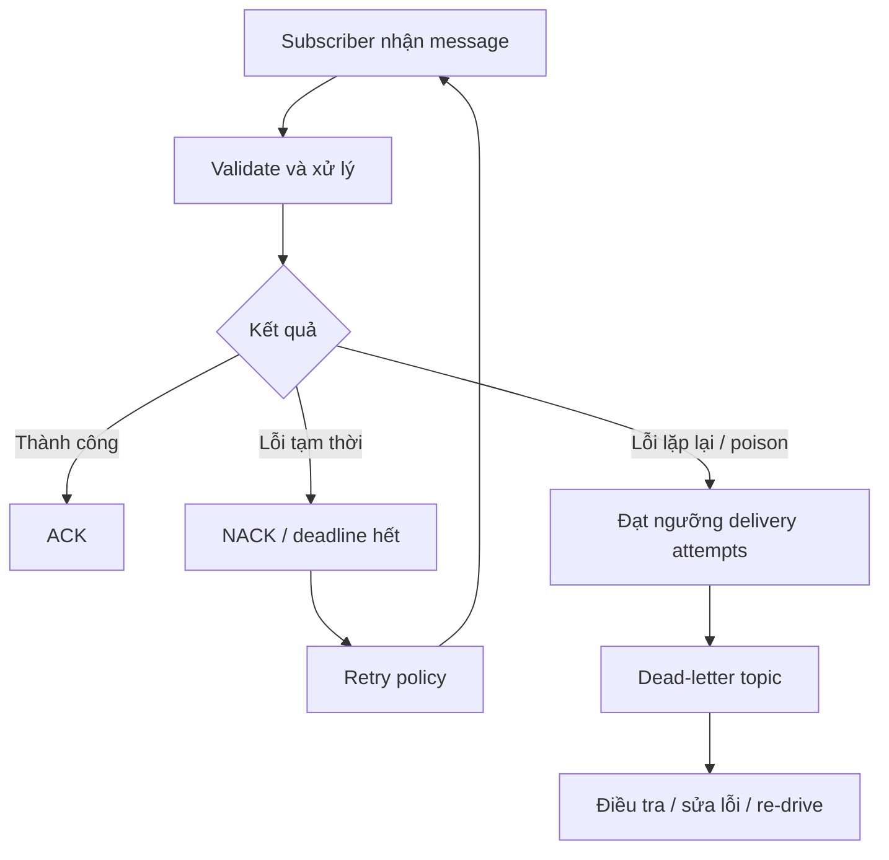
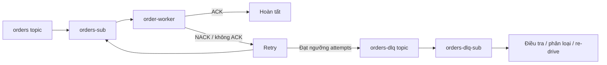

# Retry policy, dead-letter topic và phát lại thông điệp

## Mục tiêu bài học

Module **SPRING_CLOUD_PROVIDER_INTEGRATION** thực hành tích hợp Spring Boot với các dịch vụ managed của **AWS, Azure và Google Cloud** qua thư viện Spring Cloud tương ứng. Với hệ thống event-driven, message có thể thất bại do dependency tạm thời, payload sai định dạng, consumer chưa hỗ trợ schema hoặc lỗi lập trình. Ứng dụng cần có chiến lược retry, nơi lưu message không thể xử lý và cách phát lại an toàn sau khi khắc phục sự cố.

Trong Google Cloud Pub/Sub, ba cơ chế liên quan nhưng phục vụ mục đích khác nhau:

- **Retry policy:** quyết định Pub/Sub chờ bao lâu trước khi giao lại một message chưa được ack.
- **Dead-letter topic (DLQ):** nơi Pub/Sub chuyển tiếp message đã thất bại nhiều lần để điều tra và xử lý riêng.
- **Replay (seek):** thay đổi trạng thái acknowledgment của subscription để phát lại message đã ack hoặc bỏ qua một phần backlog.

Sau bài học, bạn có thể:

1. Phân biệt immediate retry và exponential backoff.
2. Cấu hình retry policy ở subscription bằng Google Cloud CLI.
3. Tạo dead-letter topic, gắn với subscription và cấp IAM cho Pub/Sub service agent.
4. Theo dõi delivery attempt và metadata của message được chuyển vào DLQ.
5. Thiết kế quy trình quarantine, điều tra và re-drive message.
6. Tạo snapshot và dùng seek để replay message theo snapshot hoặc timestamp.
7. Phân biệt replay bằng seek với việc publish lại message từ DLQ.
8. Tích hợp retry/DLQ vào Spring Boot, theo dõi vận hành và kiểm thử tình huống lỗi.

## 1. Phân loại lỗi khi xử lý message

Trước khi cấu hình retry, cần phân biệt lỗi tạm thời và lỗi không thể tự khắc phục bằng cách giao lại:

| Nhóm lỗi | Ví dụ | Hướng xử lý |
| --- | --- | --- |
| Tạm thời | Database timeout, HTTP 503, rate limit | Nack và retry với backoff |
| Phụ thuộc chưa sẵn sàng | Dịch vụ downstream đang deploy hoặc mất kết nối | Retry có giới hạn, cảnh báo dependency |
| Dữ liệu không hợp lệ | JSON lỗi, thiếu field bắt buộc | Quarantine/DLQ, không retry vô hạn |
| Không tương thích schema | Consumer chưa hỗ trợ `schemaVersion` mới | DLQ hoặc giữ lại để xử lý sau khi cập nhật consumer |
| Lỗi nghiệp vụ vĩnh viễn | Đơn hàng đã bị hủy, trạng thái không cho phép chuyển tiếp | Xử lý theo business rule rồi ack hoặc quarantine |
| Lỗi code | Null pointer, bug khi xử lý một event cụ thể | DLQ để điều tra và phát hành bản sửa |

Retry phù hợp với lỗi có khả năng biến mất sau một khoảng thời gian. Nếu message sai định dạng hoặc code luôn crash với cùng payload, giao lại ngay chỉ tạo vòng lặp tốn tài nguyên. DLQ giúp cô lập nhóm message đó để consumer chính tiếp tục xử lý các message khác.



## 2. Retry policy của subscription

### 2.1. Retry là hành vi mặc định

Pub/Sub tự động thử giao lại message khi subscriber không xác nhận được. Retry policy là thuộc tính của **subscription**; bạn không bật/tắt cơ chế redelivery, nhưng có thể chọn cách chờ trước lần giao tiếp theo.

Hai kiểu chính:

| Kiểu | Hành vi | Mặc định |
| --- | --- | --- |
| Immediate redelivery | Thử giao lại ngay khi có thể sau nack hoặc ack deadline hết | Có |
| Exponential backoff | Tăng dần khoảng chờ giữa các lần giao thất bại của cùng message | Không |

Immediate redelivery có thể hữu ích khi lỗi rất ngắn, nhưng nếu database hoặc API downstream đang lỗi kéo dài, subscriber có thể nhận lại message liên tục. Nhiều message lỗi cùng lúc có thể tạo retry storm và làm dependency khó phục hồi.

### 2.2. Exponential backoff

Exponential backoff thêm khoảng chờ tăng dần giữa các lần giao thất bại:

```text
Lần giao đầu thất bại
        ↓
Chờ min retry delay
        ↓
Thất bại tiếp
        ↓
Tăng khoảng chờ
        ↓
Tiếp tục tăng đến max retry delay
```

Các giới hạn cấu hình:

| Thuộc tính | Giá trị |
| --- | --- |
| Minimum retry delay mặc định | 10 giây |
| Maximum retry delay mặc định | 600 giây |
| Khoảng cấu hình hợp lệ | 0 đến 600 giây |

Exponential backoff được áp dụng theo từng message, không phải một timer toàn subscription. Các message khác vẫn có thể được giao trong khi một message đang chờ retry, trừ khi ordered delivery làm các message cùng ordering key bị phụ thuộc thứ tự.

Backoff được kích hoạt khi:

- Subscriber gửi negative acknowledgment (nack).
- Ack deadline của message hết hạn.

Khoảng chờ là best-effort; thời gian giao lại thực tế có thể khác giá trị cấu hình. Không dùng retry policy để lên lịch giao message vào một thời điểm nghiệp vụ cụ thể. Nếu cần scheduled delivery, đánh giá Cloud Tasks.

### 2.3. Cấu hình khi tạo subscription

Tạo topic và subscription có exponential backoff:

```bash
gcloud pubsub topics create orders

gcloud pubsub subscriptions create orders-sub \
  --topic=orders \
  --min-retry-delay=10s \
  --max-retry-delay=300s
```

Lệnh ví dụ đặt minimum 10 giây và maximum 5 phút. Tài khoản chạy lệnh cần quyền quản lý topic/subscription trong project.

### 2.4. Cập nhật retry policy của subscription hiện có

Có thể cập nhật policy mà không cần tạo lại subscription:

```bash
gcloud pubsub subscriptions update orders-sub \
  --min-retry-delay=15s \
  --max-retry-delay=300s
```

Nếu muốn quay lại immediate redelivery, xóa các giá trị retry delay bằng các option clear tương ứng của `gcloud pubsub subscriptions update` theo phiên bản CLI đang dùng. Trước khi thay đổi production, kiểm tra `gcloud pubsub subscriptions describe orders-sub` để xác nhận policy hiện tại.

### 2.5. Retry policy và push backoff

Với push subscription, Pub/Sub còn có **push backoff** khi endpoint trả lỗi hoặc không phản hồi đúng hạn. Push backoff độc lập với subscription retry policy. Nếu cả hai được cấu hình, thời gian chờ giao lại chịu ảnh hưởng của cả hai; khi push backoff dài hơn retry backoff, việc giao lại có thể đợi theo push backoff.

Khi điều tra push delivery chậm, kiểm tra cả HTTP response/timeout của endpoint, push backoff và retry policy. Đừng chỉ tăng exponential backoff mà không xem endpoint có đang trả lỗi liên tục hay không.

### 2.6. Retry không phải cơ chế xử lý mọi lỗi

- Nack hàng loạt message có thể khiến Pub/Sub điều tiết delivery của subscription và một số message không nhận đủ backoff như cấu hình.
- Exponential backoff là best-effort, không phải lịch hẹn chính xác.
- Retry không bảo đảm mỗi message chỉ được xử lý một lần.
- Publisher RPC retry là cơ chế khác: nó thử lại request publish khi client gặp lỗi mạng/tạm thời. Một publish thành công nhưng response bị mất có thể dẫn tới message trùng với message ID khác.

Consumer vẫn cần idempotency bằng event ID nghiệp vụ.

## 3. Dead-letter topic là gì?

### 3.1. DLQ tách message lỗi khỏi luồng chính

Dead-letter topic là một topic nhận message mà subscriber không thể xử lý sau nhiều lần giao. Bạn cấu hình DLQ trên **subscription**, không phải trên topic nguồn, vì mỗi subscription có chính sách xử lý lỗi riêng.



Khi Pub/Sub chuyển message sang DLQ:

- Message được gửi tới dead-letter topic dưới dạng một message mới.
- Pub/Sub bổ sung attributes nhận diện subscription nguồn và số lần giao.
- Message nguồn được loại khỏi subscription ban đầu sau khi chuyển tiếp.
- Một subscription riêng trên DLQ topic cho phép consumer điều tra hoặc xử lý message lỗi.

DLQ topic nên có subscription gắn vào. Message publish tới topic không có subscription có thể không được giữ để xử lý.

### 3.2. Số lần giao lại

Thuộc tính `maxDeliveryAttempts` có phạm vi:

| Thuộc tính | Giá trị |
| --- | --- |
| Mặc định | 5 |
| Tối thiểu | 5 |
| Tối đa | 100 |

Delivery attempt được tính gần đúng theo công thức: **1 + tổng số lần NACK + tổng số lần ack deadline hết hạn**. Pub/Sub chỉ theo dõi attempt khi DLQ được cấu hình đúng và có đủ IAM permissions. Việc chuyển tiếp DLQ vẫn là best-effort:

- Có thể chuyển message sớm hơn số lần cấu hình.
- Có thể thử giao thêm vài lần trước khi chuyển.
- Delivery attempt tracking có thể reset, nhất là khi pull subscription không có subscriber hoạt động.

Vì vậy, không dùng `maxDeliveryAttempts` làm bộ đếm chính xác hoặc điều kiện nghiệp vụ. Nó là ngưỡng vận hành để cô lập message lỗi.

### 3.3. Chọn số lần giao

| Loại workload | Điểm bắt đầu tham khảo | Lý do |
| --- | ---: | --- |
| Event gọi API phụ thuộc có thể phục hồi nhanh | 5–8 | Giới hạn số lần thử trước khi cô lập |
| Job phụ thuộc database có bảo trì ngắn | 8–12 | Cho phép nhiều lần retry hơn |
| Payload thường sai schema nếu producer lỗi | 5 | Nhanh chóng đưa poison message vào DLQ |
| Tác vụ cần can thiệp vận hành | 5–10 | Tránh message lặp lâu và dễ quan sát |

Đây là điểm bắt đầu để thiết kế, không phải cấu hình chuẩn cho mọi hệ thống. Cần xét retry backoff, thời gian phục hồi dependency, retention và SLO xử lý.

## 4. Tạo và cấu hình dead-letter topic

### 4.1. Tạo topic và subscription cho DLQ

Tạo DLQ topic và subscription trước khi gắn policy vào subscription nguồn:

```bash
gcloud pubsub topics create orders-dlq

gcloud pubsub subscriptions create orders-dlq-sub \
  --topic=orders-dlq
```

`orders-dlq-sub` là nơi consumer vận hành đọc các message được chuyển tiếp. Nếu không có subscription trên DLQ topic, message được publish tới đó có thể không được giữ để điều tra/re-drive.

### 4.2. Gắn DLQ vào subscription nguồn

Tạo subscription mới có retry và dead-letter policy:

```bash
gcloud pubsub subscriptions create orders-sub \
  --topic=orders \
  --min-retry-delay=10s \
  --max-retry-delay=300s \
  --dead-letter-topic=orders-dlq \
  --max-delivery-attempts=8
```

Nếu subscription đã tồn tại:

```bash
gcloud pubsub subscriptions update orders-sub \
  --min-retry-delay=10s \
  --max-retry-delay=300s \
  --dead-letter-topic=orders-dlq \
  --max-delivery-attempts=8
```

DLQ topic phải khác topic mà subscription nguồn đang consume. Nếu DLQ topic ở project khác, chỉ rõ project sở hữu topic bằng `--dead-letter-topic-project`.

### 4.3. Cấp quyền cho Pub/Sub service agent

Đây là bước bắt buộc. Pub/Sub cần hai quyền để forward message:

1. `roles/pubsub.publisher` trên DLQ topic để publish message.
2. `roles/pubsub.subscriber` trên subscription nguồn để ack message sau khi chuyển tiếp.

Pub/Sub service agent của project sở hữu subscription có dạng:

```text
service-PROJECT_NUMBER@gcp-sa-pubsub.iam.gserviceaccount.com
```

Lấy project number:

```bash
gcloud projects describe acme-commerce-dev \
  --format="value(projectNumber)"
```

Sau khi thay `PROJECT_NUMBER` bằng giá trị trả về:

```bash
PUBSUB_SERVICE_ACCOUNT="service-PROJECT_NUMBER@gcp-sa-pubsub.iam.gserviceaccount.com"

gcloud pubsub topics add-iam-policy-binding orders-dlq \
  --member="serviceAccount:${PUBSUB_SERVICE_ACCOUNT}" \
  --role="roles/pubsub.publisher"

gcloud pubsub subscriptions add-iam-policy-binding orders-sub \
  --member="serviceAccount:${PUBSUB_SERVICE_ACCOUNT}" \
  --role="roles/pubsub.subscriber"
```

Nếu DLQ topic ở project khác, cấp `roles/pubsub.publisher` trên topic ở project DLQ; role subscriber vẫn được cấp trên subscription nguồn. Trong mô hình cross-project, kiểm tra service agent thuộc đúng project sở hữu subscription nguồn.

Không cấp các quyền này cho runtime service account của `order-worker`; đó là quyền dành cho Pub/Sub service agent. Runtime consumer chỉ cần quyền consume trên subscription của chính nó.

### 4.4. Ví dụ tạo subscription bằng `PubSubAdmin`

Ứng dụng Spring có thể provision subscription bằng `PubSubAdmin`:

```java
import com.google.cloud.spring.pubsub.core.PubSubAdmin;
import com.google.pubsub.v1.DeadLetterPolicy;
import com.google.pubsub.v1.Subscription;
import org.springframework.stereotype.Component;

@Component
public class PubSubProvisioner {
    private final PubSubAdmin pubSubAdmin;

    public PubSubProvisioner(PubSubAdmin pubSubAdmin) {
        this.pubSubAdmin = pubSubAdmin;
    }

    public void createOrdersSubscription() {
        String deadLetterTopic =
                "projects/acme-commerce-dev/topics/orders-dlq";

        Subscription subscription = Subscription.newBuilder()
                .setName("projects/acme-commerce-dev/subscriptions/orders-sub")
                .setTopic("projects/acme-commerce-dev/topics/orders")
                .setDeadLetterPolicy(
                        DeadLetterPolicy.newBuilder()
                                .setDeadLetterTopic(deadLetterTopic)
                                .setMaxDeliveryAttempts(8)
                                .build()
                )
                .build();

        pubSubAdmin.createSubscription(subscription);
    }
}
```

Đây là ví dụ cho tài nguyên cùng project đã cấu hình. Trong môi trường production, ưu tiên Terraform hoặc pipeline provisioning để kiểm soát IAM và thay đổi tài nguyên. Nếu dùng code khởi tạo, cần xử lý `ALREADY_EXISTS`, tên resource đầy đủ và quyền quản trị phù hợp; không cấp `Pub/Sub Editor` cho mọi runtime service chỉ để tạo subscription.

### 4.5. Xác minh cấu hình

Sau khi tạo policy và cấp quyền:

```bash
gcloud pubsub subscriptions describe orders-sub
gcloud pubsub topics get-iam-policy orders-dlq
gcloud pubsub subscriptions get-iam-policy orders-sub
```

Kiểm tra:

- `deadLetterPolicy.deadLetterTopic` trỏ đúng DLQ topic.
- `maxDeliveryAttempts` nằm trong khoảng 5–100.
- Pub/Sub service agent có publisher role trên DLQ topic.
- Pub/Sub service agent có subscriber role trên subscription nguồn.
- DLQ topic có subscription để consumer vận hành đọc message.

## 5. Theo dõi delivery attempt và message được forward

### 5.1. Delivery attempt trên subscriber

Khi subscription có dead-letter policy, Pub/Sub cung cấp thông tin số lần delivery:

- Pull API có trường `delivery_attempt`.
- Push delivery có trường `deliveryAttempt`.
- Với Java và C# client library, số lần delivery được đưa vào message attribute `googclient_deliveryattempt`.

Ví dụ đọc từ `PubSubTemplate`:

```java
pubSubTemplate.subscribe("orders-sub", message -> {
    String attempt = message.getPubsubMessage()
            .getAttributesOrDefault("googclient_deliveryattempt", "unknown");

    String eventId = message.getPubsubMessage()
            .getAttributesOrDefault("eventId", "unknown");

    log.info("Received order event; deliveryAttempt={}, eventId={}",
            attempt, eventId);

    // Xử lý nghiệp vụ, sau đó ack/nack.
});
```

Delivery attempt có thể không có khi chưa cấu hình DLQ hoặc client không cung cấp field. Đây là dữ liệu quan sát, không phải bộ đếm chính xác vì tracking có thể reset và forwarding là best-effort.

### 5.2. Attributes được thêm khi forward sang DLQ

Pub/Sub thêm các attributes sau vào message được chuyển tiếp:

| Attribute | Ý nghĩa |
| --- | --- |
| `CloudPubSubDeadLetterSourceDeliveryCount` | Số lần delivery tới subscription nguồn |
| `CloudPubSubDeadLetterSourceSubscription` | Tên subscription nguồn |
| `CloudPubSubDeadLetterSourceSubscriptionProject` | Project chứa subscription nguồn |
| `CloudPubSubDeadLetterSourceTopicPublishTime` | Thời điểm message gốc được publish |
| `CloudPubSubDeadLetterSourceDeliveryErrorMessage` | Lý do delivery thất bại; chỉ có với export subscription |

Message được forward là message mới, vì vậy đừng dựa vào `messageId` của DLQ để thay thế `eventId` nghiệp vụ. Giữ event ID trong payload/attributes để có thể đối chiếu nguồn, chống trùng và re-drive.

### 5.3. Đọc message từ DLQ subscription

Consumer DLQ nên phục vụ điều tra và vận hành riêng. Ví dụ:

```java
pubSubTemplate.subscribe("orders-dlq-sub", message -> {
    var pubsubMessage = message.getPubsubMessage();
    var attributes = pubsubMessage.getAttributesMap();

    String sourceSubscription =
            attributes.get("CloudPubSubDeadLetterSourceSubscription");
    String deliveryCount =
            attributes.get("CloudPubSubDeadLetterSourceDeliveryCount");
    String eventId =
            attributes.getOrDefault("eventId", "unknown");

    log.warn(
            "Dead-letter event received; sourceSubscription={}, attempts={}, eventId={}",
            sourceSubscription, deliveryCount, eventId
    );

    // Lưu record điều tra bền vững rồi mới ACK DLQ message.
    deadLetterRegistry.record(pubsubMessage, attributes);
    message.ack();
});
```

`deadLetterRegistry.record()` là thành phần ứng dụng cần triển khai để lưu metadata/payload theo chính sách bảo mật. Ack message DLQ sau khi đã lưu bền vững hoặc chuyển vào workflow xử lý khác. Nếu ack DLQ trước khi ghi nhận lỗi, sự cố ở registry có thể làm mất dấu vết vận hành.

### 5.4. Monitoring DLQ

Cloud Monitoring có metric:

```text
subscription/dead_letter_message_count
```

Metric này ghi nhận số message Pub/Sub forward từ subscription nguồn. Theo dõi cùng:

- Backlog và oldest unacked age của subscription nguồn.
- Nack count và ack deadline expiration.
- Số message trên `orders-dlq-sub`.
- Tốc độ xử lý và tuổi message trong DLQ.
- Lỗi permission của service agent.

Khi DLQ count tăng đột biến, kiểm tra phiên bản consumer, schema producer, dependency và IAM. Không chỉ tăng `maxDeliveryAttempts` để che dấu lỗi.

## 6. Re-drive message từ DLQ

### 6.1. DLQ không tự sửa hoặc tự chạy lại message

DLQ là nơi cô lập message không xử lý được. Pub/Sub không tự kiểm tra nguyên nhân lỗi, sửa payload hoặc đưa message trở lại topic nguồn sau khi đã forward. Đội vận hành cần xác định nguyên nhân, chọn cách xử lý và quyết định có phát lại hay không.

Một quy trình re-drive có kiểm soát:

1. Consumer của `orders-dlq-sub` đọc message và metadata nguồn.
2. Lưu bản ghi điều tra gồm event ID, source subscription, delivery count, publish time và error classification.
3. Xác định nguyên nhân: bug consumer, schema incompatibility, dữ liệu sai hoặc dependency.
4. Sửa consumer/configuration hoặc chuẩn hóa payload theo quy trình được phê duyệt.
5. Chọn một nhóm message cần re-drive, không tự động phát lại toàn bộ DLQ.
6. Publish lại payload nghiệp vụ tới topic nguồn hoặc topic retry chuyên biệt.
7. Giữ nguyên `eventId` nghiệp vụ để consumer idempotent.
8. Chỉ ack message ở DLQ sau khi bản ghi điều tra và quyết định re-drive đã được lưu bền vững.

### 6.2. Phân biệt message ID và event ID

Khi Pub/Sub forward message, message trên DLQ là một message mới và có thể có message ID mới. Nếu re-drive bằng cách publish lại payload, Pub/Sub lại cấp một message ID mới. Vì vậy:

- `messageId` dùng để đối chiếu một lần publish cụ thể.
- `eventId` do ứng dụng tạo dùng để nhận diện cùng một sự kiện logic.
- `CloudPubSubDeadLetterSourceSubscription` giúp biết subscription nào đã không xử lý được.
- `CloudPubSubDeadLetterSourceDeliveryCount` hỗ trợ điều tra số lần delivery.

Không sinh `eventId` mới khi re-drive cùng một event logic. Nếu thay đổi payload có chủ đích, lưu liên kết giữa event gốc và event đã chuẩn hóa để audit.

### 6.3. Không re-drive trực tiếp mọi message

Một quy trình re-drive an toàn cần có:

- **Allowlist:** chỉ chọn event type/schema version đã được sửa.
- **Rate limit:** publish theo tốc độ mà consumer và downstream chịu được.
- **Batch nhỏ:** bắt đầu với một nhóm nhỏ, quan sát rồi mới tăng.
- **Idempotency:** cùng event ID không tạo side effect lặp.
- **Audit:** lưu người/automation khởi chạy, thời điểm, số lượng và kết quả.
- **Stop condition:** dừng nếu DLQ tăng lại, error rate tăng hoặc backlog vượt ngưỡng.

Nếu message lỗi do dữ liệu không thể sửa, giữ lại trong DLQ/quarantine để xử lý thủ công hoặc đánh dấu không thể khôi phục theo chính sách dữ liệu. Không publish vòng lặp message lỗi trở lại topic nguồn.

### 6.4. Ví dụ thiết kế re-drive service

Phần đọc DLQ và publish lại cần một decoder biết định dạng message được forward. Tách logic này khỏi callback Pub/Sub:

```java
public record DeadLetterRecord(
        String eventId,
        String sourceSubscription,
        String sourceProject,
        String deliveryCount,
        byte[] originalPayload,
        Map<String, String> originalAttributes
) {}

public interface DeadLetterDecoder {
    DeadLetterRecord decode(PubsubMessage message);
}
```

Service re-drive:

```java
import com.google.cloud.spring.pubsub.core.PubSubTemplate;
import com.google.cloud.spring.pubsub.support.BasicAcknowledgeablePubsubMessage;
import com.google.pubsub.v1.PubsubMessage;
import java.util.HashMap;
import java.util.Map;
import org.springframework.stereotype.Service;

@Service
public class OrderDeadLetterRedriver {
    private final PubSubTemplate pubSubTemplate;
    private final DeadLetterDecoder decoder;
    private final DeadLetterRegistry registry;

    public OrderDeadLetterRedriver(
            PubSubTemplate pubSubTemplate,
            DeadLetterDecoder decoder,
            DeadLetterRegistry registry) {
        this.pubSubTemplate = pubSubTemplate;
        this.decoder = decoder;
        this.registry = registry;
    }

    public void redrive(BasicAcknowledgeablePubsubMessage dlqMessage) {
        DeadLetterRecord record = decoder.decode(dlqMessage.getPubsubMessage());

        registry.markRedriveStarted(
                record.eventId(),
                record.sourceSubscription(),
                record.deliveryCount()
        );

        Map<String, String> attributes =
                new HashMap<>(record.originalAttributes());
        attributes.put("redriven", "true");
        attributes.put("redriveSource", record.sourceSubscription());

        pubSubTemplate.publish(
                "orders",
                record.originalPayload(),
                attributes
        ).whenComplete((messageId, publishError) -> {
            if (publishError != null) {
                registry.markRedriveFailed(record.eventId(), publishError);
                return;
            }

            registry.markRedrivePublished(record.eventId(), messageId);
            dlqMessage.ack().whenComplete((unused, ackError) -> {
                if (ackError != null) {
                    registry.markDlqAckFailed(record.eventId(), ackError);
                }
            });
        });
    }
}
```

`DeadLetterDecoder` và `DeadLetterRegistry` là thành phần ứng dụng cần triển khai theo wire format, chính sách audit và schema thực tế. Ví dụ giả định decoder đã tách payload/attributes gốc khỏi metadata forward; không copy các `CloudPubSubDeadLetter...` system attributes như thể chúng là metadata nghiệp vụ. Trong production, chỉ ack DLQ message sau khi kết quả publish đã thành công và trạng thái re-drive đã được ghi nhận; nếu publish thành công nhưng ack DLQ thất bại, có thể re-drive trùng nên consumer nguồn vẫn phải idempotent.

## 7. Replay subscription bằng snapshot và seek

### 7.1. Replay khác re-drive

Pub/Sub có tính năng **seek** để thay đổi trạng thái acknowledgment của message trong một subscription:

- Replay message đã ack bằng cách đánh dấu chúng chưa ack.
- Bỏ qua backlog bằng cách đánh dấu message chưa ack thành ack.
- Khôi phục trạng thái ack tại một snapshot đã tạo trước đó.

Seek không publish một message mới và không thay đổi payload. Nó thay đổi trạng thái delivery của message đã được Pub/Sub giữ lại cho subscription. Re-drive từ DLQ là ứng dụng tự publish lại message; hai quy trình có mục tiêu khác nhau.

| Nhu cầu | Cách phù hợp |
| --- | --- |
| Consumer mới xử lý lại message đã ack sai | Snapshot/seek hoặc seek timestamp |
| Replay cùng tập dữ liệu đã biết để test | Snapshot/seek |
| Bỏ qua backlog cũ không còn giá trị | Seek tới thời điểm tương lai |
| Chỉ xử lý lại một số message đã vào DLQ | DLQ consumer và re-drive có chọn lọc |
| Sửa payload rồi gửi lại event | Re-drive/publish event mới theo quy trình ứng dụng |

### 7.2. Snapshot là gì?

Snapshot là bản ghi bền vững về trạng thái acknowledgment của một subscription tại thời điểm tạo. Snapshot cho phép khôi phục message state nếu deploy consumer mới gây ack nhầm hoặc làm mất khả năng xử lý.

Đặc điểm:

- Snapshot giữ trạng thái ack của các message thuộc subscription tại thời điểm tạo.
- Snapshot giữ các message chưa ack trong backlog tại thời điểm snapshot và message mới publish sau thời điểm snapshot.
- Snapshot có tuổi thọ tối đa 7 ngày.
- Thời gian sống phụ thuộc tuổi của message chưa ack cũ nhất trong backlog nguồn: xấp xỉ 7 ngày trừ tuổi message đó.
- Không thể tạo snapshot nếu nó sẽ hết hạn trong vòng chưa đầy 1 giờ.

Snapshot không phải bản sao payload vô thời hạn. Hãy tạo snapshot gần thời điểm deploy/thay đổi consumer và kiểm tra thời hạn còn lại.

### 7.3. Tạo snapshot trước khi deploy

Ví dụ:

```bash
gcloud pubsub snapshots create orders-before-deploy \
  --subscription=orders-sub
```

Liệt kê snapshot:

```bash
gcloud pubsub snapshots list
```

Khi không còn cần snapshot:

```bash
gcloud pubsub snapshots delete orders-before-deploy
```

Quy trình triển khai an toàn:

1. Tạo snapshot trước khi rollout consumer mới.
2. Deploy consumer mới và quan sát lỗi/ack.
3. Nếu phát hiện consumer ack nhầm hoặc làm hỏng xử lý, dừng/rollback consumer.
4. Seek subscription về snapshot.
5. Khởi động consumer đã sửa và theo dõi backlog/duplicate.
6. Xóa snapshot khi hết thời gian cần bảo vệ và đã xác minh xử lý ổn định.

### 7.4. Seek về snapshot

```bash
gcloud pubsub subscriptions seek orders-sub \
  --snapshot=orders-before-deploy
```

Snapshot có thể được dùng để seek một subscription khác nếu subscription đích gắn với **cùng topic**. Cách này hữu ích khi tạo subscription mới để chạy lại tập dữ liệu đã biết. Snapshot không thể dùng cho subscription thuộc topic khác.

Sau khi seek, message không nhất thiết xuất hiện tức thì. Seek có tính nhất quán eventual đối với delivery; có thể mất khoảng một phút để thay đổi có hiệu lực đầy đủ. Hệ thống bảo đảm các message cần được giao lại cuối cùng sẽ được giao ít nhất một lần, vì vậy consumer vẫn cần idempotency.

### 7.5. Seek theo timestamp

Có thể seek subscription tới một thời điểm:

```bash
gcloud pubsub subscriptions seek orders-sub \
  --time="PAST_TIMESTAMP"
```

Thay `PAST_TIMESTAMP` bằng timestamp UTC nằm trong quá khứ và nằm trong khoảng retention còn hiệu lực.

Khi seek về quá khứ, message có publish time sau timestamp sẽ được đánh dấu chưa ack để giao lại; message trước timestamp được đánh dấu ack. Để replay message đã ack theo timestamp, cần bật retention cho acknowledged messages ở subscription hoặc bật message retention ở topic.

Bật retain acknowledged messages:

```bash
gcloud pubsub subscriptions update orders-sub \
  --retain-acked-messages
```

Khi bật tùy chọn này, acknowledged messages được giữ theo thời gian retention của subscription (mặc định 7 ngày nếu không đổi). Chỉ bật khi có yêu cầu replay và đã tính đến chi phí lưu trữ.

### 7.6. Timestamp replay có giới hạn

Seek theo timestamp dựa vào `publishTime` do Pub/Sub server ghi nhận, không dựa vào `occurredAt` trong payload. Do đó:

- Clock skew giữa server có thể ảnh hưởng ranh giới thời gian.
- Thời điểm publish request tới Pub/Sub khác thời điểm event thực sự xảy ra trong hệ thống nguồn.
- Timestamp seek không phải bộ lọc chính xác theo event time nghiệp vụ.

Nếu cần replay theo business time, cân nhắc tạo subscription riêng và lọc event theo `occurredAt` ở consumer, hoặc lưu sự kiện vào kho dữ liệu có khả năng truy vấn theo event time.

### 7.7. Seek tới tương lai để bỏ backlog

Seek tới thời điểm tương lai đánh dấu các message trước thời điểm đó là đã ack, qua đó bỏ qua backlog hiện có:

```bash
gcloud pubsub subscriptions seek orders-sub \
  --time="FUTURE_TIMESTAMP"
```

Thay `FUTURE_TIMESTAMP` bằng timestamp UTC nằm trong tương lai so với thời điểm chạy lệnh.

Đây là thao tác có tính phá hủy đối với khả năng giao lại message trong subscription. Chỉ thực hiện khi đã xác nhận backlog không còn cần xử lý, có phê duyệt vận hành và đã lưu snapshot nếu cần khôi phục. Không dùng lệnh này để dọn backlog chỉ vì consumer đang chậm.

### 7.8. Seek và retry/DLQ

Khi seek subscription có dead-letter policy:

- Delivery attempt của message được reset về 0.
- Retry delay của message được reset sau seek.
- Consumer có thể nhận lại message và cần xử lý như một lần giao mới.

Seek không xóa message đã được forward sang DLQ. Message đã chuyển sang DLQ nằm ở DLQ topic/subscription; muốn xử lý lại chúng cần quy trình re-drive riêng.

## 8. Tích hợp retry và DLQ trong Spring Boot

### 8.1. Consumer quyết định ack/nack

Spring Framework on Google Cloud cung cấp `PubSubTemplate` để nhận message. Retry policy và dead-letter policy được cấu hình trên subscription ở Google Cloud; callback Spring quyết định ack hay nack:

```java
import com.google.cloud.spring.pubsub.core.PubSubTemplate;
import com.google.cloud.spring.pubsub.support.BasicAcknowledgeablePubsubMessage;
import com.google.cloud.pubsub.v1.Subscriber;
import org.springframework.stereotype.Component;

@Component
public class OrderConsumer {
    private final PubSubTemplate pubSubTemplate;
    private final OrderService orderService;
    private Subscriber subscriber;

    public OrderConsumer(
            PubSubTemplate pubSubTemplate,
            OrderService orderService) {
        this.pubSubTemplate = pubSubTemplate;
        this.orderService = orderService;
    }

    public void start() {
        subscriber = pubSubTemplate.subscribe(
                "orders-sub",
                this::handle
        );
    }

    private void handle(BasicAcknowledgeablePubsubMessage message) {
        String payload = message.getPubsubMessage()
                .getData()
                .toStringUtf8();

        try {
            orderService.processIdempotently(payload);
            message.ack().whenComplete((unused, error) -> {
                if (error != null) {
                    // Ghi nhận ack failure; message có thể được giao lại.
                }
            });
        } catch (TransientDependencyException error) {
            message.nack();
        } catch (InvalidEventException error) {
            // NACK để DLQ cô lập theo policy.
            // Nếu dùng quarantine riêng, chỉ ACK sau khi đã lưu bền vững.
            message.nack();
        }
    }
}
```

Ví dụ minh họa phân loại lỗi. Nếu subscription có DLQ, nack hoặc không ack sẽ đưa message vào retry flow và cuối cùng có thể được forward. Với lỗi vĩnh viễn, có thể ghi message vào quarantine store trước rồi ack nguồn; nếu muốn Pub/Sub tự chuyển vào DLQ, nack và để policy xử lý. Không ack message sai trước khi đã lưu đủ dữ liệu để điều tra.

### 8.2. Không tự triển khai retry loop trong callback

Không nên viết vòng lặp gọi lại `orderService.process()` nhiều lần bên trong callback rồi mới ack/nack. Cách đó:

- Giữ message outstanding trong suốt thời gian retry nội bộ.
- Chiếm worker thread và connection lâu.
- Có thể vượt ack extension/processing timeout.
- Không tận dụng được backoff và DLQ policy của subscription.

Để Pub/Sub retry message, callback nên kết thúc bằng nack khi lỗi có thể thử lại. Nếu cần retry nghiệp vụ với lịch riêng hoặc nhiều bước, lưu trạng thái vào workflow/job store và dùng Cloud Tasks/Workflows phù hợp.

### 8.3. Quản lý tài nguyên subscription

Trong Spring, `PubSubAdmin` có thể tạo topic/subscription; `PubSubTemplate` xử lý publish/consume. Tuy nhiên, `PubSubTemplate` không thay thế công cụ vận hành snapshot/seek. Hãy dùng Google Cloud CLI, Console hoặc Pub/Sub API/`SubscriptionAdminClient` cho các thao tác replay.

Trong production, nên:

- Provision retry/DLQ/IAM bằng Terraform hoặc pipeline hạ tầng.
- Cấp runtime service account quyền consume đúng subscription.
- Cấp publisher/subscriber role của DLQ cho Pub/Sub service agent.
- Lưu cấu hình retry/DLQ cùng version hạ tầng để có thể review.
- Dùng snapshot như một phần runbook trước các đợt thay đổi consumer có rủi ro.

### 8.4. Tách subscription DLQ khỏi consumer chính

Không gắn consumer nghiệp vụ chính vào DLQ topic nếu nó không có logic xử lý message lỗi. Tạo một consumer riêng để:

- Ghi metadata vào dead-letter registry.
- Phân loại lỗi theo event type, source subscription và delivery count.
- Gửi cảnh báo tới hệ thống vận hành theo chính sách nội bộ.
- Đưa message vào quy trình re-drive sau khi đã sửa lỗi.

Giới hạn concurrency và quyền truy cập của DLQ consumer. Message trong DLQ có thể chứa dữ liệu nhạy cảm tương tự message gốc; áp dụng retention, IAM và log policy phù hợp.

## 9. Monitoring và troubleshooting

### 9.1. Metrics cần theo dõi

| Metric/field | Ý nghĩa | Cách sử dụng |
| --- | --- | --- |
| `subscription/dead_letter_message_count` | Số message được forward từ subscription nguồn | Phát hiện DLQ tăng bất thường |
| `subscription/num_unacked_messages_by_region` | Backlog chưa ack | Biết consumer có theo kịp publish không |
| `subscription/oldest_unacked_message_age_by_region` | Tuổi message chưa ack lâu nhất | Phát hiện message bị kẹt |
| `subscription/expired_ack_deadlines_count` | Số lần ack deadline hết hạn của pull subscriber | Phát hiện xử lý chậm hoặc worker quá tải |
| `googclient_deliveryattempt` | Số lần delivery ở Java client khi DLQ policy được bật | Điều tra message lặp |
| `CloudPubSubDeadLetterSourceSubscription` | Subscription nguồn | Xác định luồng gây lỗi |

Kết hợp metrics Pub/Sub với log ứng dụng, processing latency, database/API error rate và version consumer đang triển khai. Một DLQ tăng có thể do schema incompatibility, bug consumer, IAM thiếu hoặc dependency lỗi kéo dài.

### 9.2. Các lỗi thường gặp

| Triệu chứng | Nguyên nhân có thể | Hướng xử lý |
| --- | --- | --- |
| Message nack liên tục nhưng không vào DLQ | Dead-letter policy chưa gắn đúng hoặc service agent thiếu IAM | Kiểm tra subscription policy và quyền publisher/subscriber của service agent |
| `maxDeliveryAttempts` không có tác dụng như kỳ vọng | Attempt count best-effort/reset khi subscriber không hoạt động | Không xem ngưỡng là số lần chính xác; kiểm tra delivery attempts và IAM |
| DLQ topic có message nhưng không đọc được | Chưa tạo subscription trên DLQ topic hoặc consumer thiếu quyền | Tạo `orders-dlq-sub`, cấp `roles/pubsub.subscriber` |
| Message forward nhưng không có metadata mong đợi | Đang đọc nhầm attributes hoặc dùng client API khác | Kiểm tra `CloudPubSubDeadLetter...` và `googclient_deliveryattempt` |
| Retry quá nhanh làm downstream tiếp tục lỗi | Immediate retry hoặc backoff quá ngắn | Cấu hình exponential backoff phù hợp |
| Push delivery chậm dù retry delay thấp | Push backoff dài hơn retry policy | Kiểm tra HTTP response và push backoff |
| Seek theo timestamp không replay message đã ack | Chưa bật acknowledged message retention hoặc message đã hết retention | Bật `retain-acked-messages`/topic retention trước khi cần replay |
| Seek không có tác dụng ngay | Eventual consistency của seek | Chờ propagation và kiểm tra delivery sau khoảng thời gian phù hợp |
| Snapshot không tạo được | Snapshot sẽ hết hạn trong vòng dưới một giờ do backlog quá cũ | Xử lý backlog/retention hoặc chọn kế hoạch recovery khác |
| Replay tạo side effect lặp | Consumer không idempotent | Deduplicate bằng event ID và transaction |

### 9.3. Kiểm tra cấu hình khi DLQ không hoạt động

Thực hiện theo thứ tự:

1. `gcloud pubsub subscriptions describe orders-sub` để xác nhận `deadLetterPolicy`.
2. Kiểm tra DLQ topic có tồn tại và có subscription.
3. Xác định project number của project sở hữu subscription nguồn.
4. Kiểm tra service agent `service-PROJECT_NUMBER@gcp-sa-pubsub.iam.gserviceaccount.com`.
5. Xác minh publisher role trên DLQ topic.
6. Xác minh subscriber role trên subscription nguồn.
7. Kiểm tra `subscription/dead_letter_message_count`.
8. Kiểm tra message có delivery attempt metadata khi consumer nhận.

Nếu topic DLQ nằm ở project khác, kiểm tra IAM ở đúng project sở hữu topic. Đừng chỉ kiểm tra role của service account ứng dụng vì Pub/Sub service agent mới là principal forward message.

## 10. Kiểm thử retry, DLQ và replay

### 10.1. Unit test phân loại lỗi

Tách business handler khỏi callback Pub/Sub để kiểm thử:

- Event hợp lệ được xử lý và commit.
- Database timeout được phân loại là lỗi retryable.
- Payload sai schema được phân loại là lỗi permanent/quarantine.
- Duplicate event ID không tạo side effect lặp.
- Registry lưu DLQ thất bại thì không ack message nguồn trước khi lưu thành công.

### 10.2. Integration test trên Google Cloud sandbox

Emulator không mô phỏng đầy đủ IAM, service agent và forwarding behavior. Dùng project sandbox để kiểm tra:

| Ca test | Kết quả mong đợi |
| --- | --- |
| Consumer nack message | Pub/Sub thử giao lại theo retry policy |
| Exponential backoff | Khoảng chờ tăng dần trong giới hạn cấu hình |
| Consumer không ack | Message được redeliver sau deadline |
| Đạt delivery attempts | Message được forward sang DLQ theo best-effort |
| Service agent thiếu publisher role | Forwarding thất bại hoặc không hoạt động như mong đợi; log/metrics chỉ ra lỗi quyền |
| Service agent đủ hai role | Message có thể được forward và ack khỏi subscription nguồn |
| DLQ subscription nhận message | Metadata nguồn và event ID có thể được ghi nhận |
| Seek về snapshot | Message state theo snapshot được giao lại |
| Seek về timestamp | Message retained sau timestamp được đánh dấu chưa ack |
| Seek tới tương lai | Backlog cũ bị bỏ qua; chỉ thử trên subscription test |

### 10.3. Kiểm thử re-drive

Test re-drive cần xác minh:

1. Decoder lấy đúng payload gốc và business attributes.
2. System attributes của DLQ không bị đưa nhầm vào message nghiệp vụ.
3. `eventId` được giữ nguyên.
4. Publish failure không làm ack DLQ message.
5. Publish thành công nhưng ack DLQ thất bại không tạo side effect trùng ở consumer nguồn.
6. Re-drive có rate limit, audit và stop condition.

### 10.4. Kiểm thử snapshot trước khi rollout

Trong subscription sandbox:

1. Tạo snapshot trước khi deploy consumer mới.
2. Publish một số event test và xác nhận ack.
3. Mô phỏng consumer ack sai hoặc ghi kết quả sai.
4. Seek về snapshot.
5. Xác nhận message được giao lại.
6. Chạy consumer đã sửa và kiểm tra idempotency.

Không thực hiện test seek/purge trên subscription production đang phục vụ nghiệp vụ thật.

## 11. Bài tập thực hành tổng hợp

Một hệ thống bán hàng có topic `orders` và subscription `orders-sub`. `order-worker` gọi database và inventory API. Trong giờ cao điểm, inventory API có thể trả HTTP 503 trong vài phút. Ngoài ra, một số event cũ có schema version không còn được hỗ trợ.

### Yêu cầu

1. Tạo topic `orders-dlq` và subscription `orders-dlq-sub`.
2. Gắn exponential backoff vào `orders-sub`, ví dụ min 10 giây và max 300 giây.
3. Gắn dead-letter topic với `maxDeliveryAttempts=8`.
4. Cấp `roles/pubsub.publisher` cho Pub/Sub service agent trên DLQ topic.
5. Cấp `roles/pubsub.subscriber` cho Pub/Sub service agent trên subscription nguồn.
6. Viết consumer phân loại lỗi tạm thời và lỗi schema.
7. Ghi `eventId`, source subscription và delivery count vào dead-letter registry.
8. Viết DLQ consumer chỉ ack sau khi registry lưu thành công.
9. Viết re-drive service có allowlist schema version, rate limit và audit.
10. Tạo snapshot trước khi deploy consumer mới.
11. Thử seek về snapshot và timestamp trên subscription sandbox.
12. Theo dõi DLQ count, backlog, oldest unacked age và delivery attempt.

### Ma trận đánh giá

| Tình huống | Kết quả mong đợi |
| --- | --- |
| Inventory API trả 503 ngắn hạn | Nack và retry theo exponential backoff |
| Inventory API phục hồi | Consumer xử lý thành công và ack |
| Event schema cũ không hỗ trợ | Được cô lập vào DLQ/quarantine, không retry vô hạn |
| DLQ service agent thiếu role | Test phát hiện forwarding permission chưa đầy đủ |
| DLQ service agent đủ quyền | Message được forward theo best-effort |
| DLQ consumer ghi registry lỗi | Không ack DLQ message |
| Re-drive event đã xử lý trước đó | Idempotency ngăn side effect trùng |
| Consumer mới ack nhầm | Seek về snapshot có thể phục hồi message retained |
| Replay timestamp không có retention | Test phát hiện không thể replay message đã ack |
| DLQ count tăng bất thường | Dashboard/alert xác định được subscription nguồn |

### Tiêu chí hoàn thành

- Phân biệt retry, DLQ, replay và re-drive.
- Cấu hình immediate/exponential backoff đúng subscription.
- Cấp đúng IAM cho Pub/Sub service agent.
- Có DLQ subscription và consumer điều tra.
- Re-drive giữ event ID, có rate limit và audit.
- Tạo snapshot/seek và hiểu retention/expiry.
- Có unit test, sandbox test và dashboard theo dõi.

## 12. So sánh với AWS và Azure

| Nhu cầu | Google Cloud Pub/Sub | AWS | Azure |
| --- | --- | --- | --- |
| Retry delivery | Subscription retry policy | SQS visibility timeout/redelivery và consumer retry | Service Bus abandon/lock expiry và delivery count |
| Backoff | Immediate hoặc exponential backoff | Consumer delay/retry strategy và visibility timeout | Lock renewal, retry policy và application scheduling |
| Dead-letter | Dead-letter topic trên subscription | SQS dead-letter queue/redrive policy | Service Bus dead-letter queue |
| Replay | Snapshot và seek theo timestamp | Redrive DLQ hoặc replay từ nguồn lưu trữ/event archive | Resubmit từ DLQ hoặc event archive theo dịch vụ |
| Theo dõi attempt | `delivery_attempt`/`googclient_deliveryattempt` | `ApproximateReceiveCount` của SQS | `DeliveryCount` của Service Bus |
| Quyền | Google Cloud IAM và Pub/Sub service agent | IAM role/policy | Azure RBAC/Managed Identity |

Các dịch vụ có cùng mục tiêu nhưng semantics khác nhau. Pub/Sub seek thay đổi ack state của subscription; re-drive SQS/Service Bus thường là thao tác gửi lại message từ DLQ. Khi chuyển cloud, cần thiết kế lại retention, attempt count, lock/visibility timeout, replay và quyền dịch vụ.

## Tổng kết

Retry policy xử lý lỗi tạm thời bằng immediate redelivery hoặc exponential backoff. Dead-letter topic cô lập message không thể xử lý sau một số lần giao lại; policy được cấu hình trên subscription và cần cấp publisher role trên DLQ topic cùng subscriber role trên subscription nguồn cho Pub/Sub service agent. Số lần delivery là best-effort, không phải bộ đếm chính xác.

Replay bằng snapshot/seek thay đổi trạng thái acknowledgment của subscription để giao lại message đã ack hoặc bỏ qua backlog. Snapshot ghi nhận ack state tại một thời điểm và có tuổi thọ tối đa 7 ngày; seek theo timestamp cần message retention cho dữ liệu đã ack. Re-drive từ DLQ là quy trình ứng dụng đọc message lỗi và publish lại có kiểm soát. Dù dùng cơ chế nào, consumer vẫn cần idempotency, event ID ổn định, audit và monitoring.

## Tài liệu tham khảo

- [Google Cloud Pub/Sub — Subscription retry policy](https://docs.cloud.google.com/pubsub/docs/subscription-retry-policy) — immediate redelivery, exponential backoff và push backoff.
- [Google Cloud Pub/Sub — Dead-letter topics](https://docs.cloud.google.com/pubsub/docs/dead-letter-topics) — delivery attempts, service agent IAM, metadata forward và monitoring.
- [Google Cloud Pub/Sub — Replay and purge messages with seek](https://docs.cloud.google.com/pubsub/docs/replay-overview) — snapshot, seek, retention và eventual consistency.
- [Google Cloud Pub/Sub — Replay a message by seeking to a snapshot or timestamp](https://docs.cloud.google.com/pubsub/docs/replay-message) — CLI workflow và ví dụ replay.
- [Google Cloud Pub/Sub — Subscription properties](https://docs.cloud.google.com/pubsub/docs/subscription-properties) — retry, dead-letter và retention settings.
- [Google Cloud Pub/Sub — Retry publish requests](https://docs.cloud.google.com/pubsub/docs/retry-requests) — phân biệt retry publish RPC với message redelivery.
- [Spring Framework on Google Cloud — Pub/Sub](https://googlecloudplatform.github.io/spring-cloud-gcp/reference/html/pubsub.html) — `PubSubTemplate`, `PubSubAdmin` và cấu hình dead-letter policy.
- [Google Cloud Pub/Sub — Monitor Pub/Sub](https://docs.cloud.google.com/pubsub/docs/monitoring) — backlog, deadline expiration và DLQ metrics.
