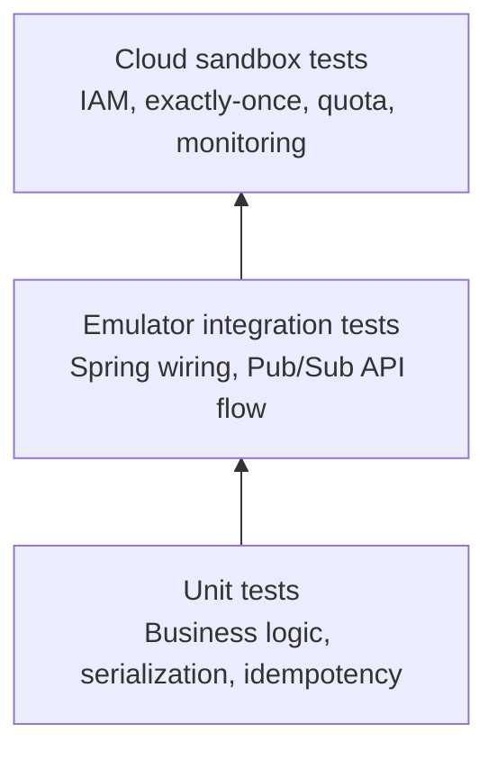

# Pub/Sub emulator và khác biệt với dịch vụ thật

## Mục tiêu bài học

Module **SPRING_CLOUD_PROVIDER_INTEGRATION** thực hành tích hợp Spring Boot với các dịch vụ managed của **AWS, Azure và Google Cloud** qua các thư viện Spring Cloud tương ứng. Khi phát triển với Google Cloud Pub/Sub, không phải mọi lần chạy ứng dụng đều cần kết nối tới project cloud thật. Pub/Sub emulator cung cấp một server cục bộ để tạo topic/subscription, publish và nhận message, qua đó hỗ trợ phát triển, kiểm thử integration và chạy CI mà không phát sinh tài nguyên Pub/Sub production.

Emulator là một bản giả lập có phạm vi tính năng giới hạn. Nó giúp kiểm tra luồng ứng dụng và tương tác client, nhưng không thay thế việc xác minh IAM, quota, latency, monitoring, exactly-once, retention hay hành vi của các dịch vụ tích hợp trên Pub/Sub thật.

Sau bài học, bạn có thể:

1. Giải thích emulator dùng để làm gì và giới hạn của nó.
2. Cài đặt, khởi động, cấu hình host/port và dừng Pub/Sub emulator.
3. Cấu hình Spring Boot kết nối emulator bằng `spring.cloud.gcp.pubsub.emulator-host`.
4. Hiểu vì sao Java client cần cấu hình emulator tường minh dù đã có `PUBSUB_EMULATOR_HOST`.
5. Tạo topic/subscription, publish, pull và ACK message bằng `PubSubAdmin`/`PubSubTemplate`.
6. Viết integration test và chạy emulator trong Testcontainers.
7. Phân biệt tính năng được hỗ trợ với các RPC/tính năng còn thiếu.
8. Thiết kế test pyramid: unit test, emulator integration test và cloud sandbox test.
9. Ngăn test/local profile kết nối nhầm project production.
10. Đánh giá khác biệt giữa emulator, Pub/Sub thật và emulator của các cloud provider khác.

## 1. Pub/Sub emulator là gì?

### 1.1. Vai trò

Pub/Sub emulator là server cục bộ do Google Cloud CLI cung cấp. Ứng dụng dùng Cloud Client Libraries để gọi endpoint emulator thay cho endpoint Pub/Sub trên Google Cloud.

Các thao tác sau có thể thực hiện cục bộ:

- Tạo topic và subscription.
- Publish message và đọc message bằng pull.
- Gửi message tới local push endpoint.
- ACK/NACK và quan sát redelivery trong các luồng được emulator hỗ trợ.
- Kiểm thử một số tính năng như ordering, retry policy, dead-letter topic, replay, schema Avro và filtering.

Emulator phù hợp cho:

- Phát triển tính năng publish/consume mà không cần project cloud.
- Integration test cho serialization, converter, header, routing và business handler.
- Kiểm thử ACK/NACK, retry và duplicate ở mức luồng cơ bản.
- CI chạy lặp lại với project ID giả lập và dữ liệu test cô lập.
- Debug request/response giữa Spring application và Pub/Sub client.

### 1.2. Emulator không phải production thu nhỏ

Khi khởi động, emulator hiển thị thông báo tương tự:

```text
This is the Pub/Sub fake.
Implementation may be incomplete or differ from the real system.
Server started, listening on 8085
```

Thông báo này nhắc rằng emulator mô phỏng API ở một phạm vi nhất định. Không suy ra rằng mọi RPC, IAM policy, quota, latency, ordering guarantee hay semantics delivery giống production.

### 1.3. Những việc emulator không làm thay

| Nhu cầu | Dùng emulator? | Nơi cần xác minh cuối |
| --- | --- | --- |
| Serialize/deserialize payload | Có | Unit/integration test |
| Tạo topic/subscription cơ bản | Có | Emulator hoặc sandbox |
| Publish và pull | Có | Emulator hoặc sandbox |
| Spring Integration adapter/binder | Có thể kiểm thử luồng cơ bản | Sandbox cho semantics broker |
| IAM, service account và quyền theo resource | Không | Project cloud thật |
| Authenticated push và OIDC JWT production | Không nên dựa vào emulator | Sandbox |
| Exactly-once delivery và ACK response | Không dùng emulator làm bằng chứng | Pull subscription thật trong một region |
| Quota, throughput, latency và autoscaling | Không | Sandbox/load test |
| Retention, expiration và billing | Không phản ánh đầy đủ | Project cloud thật |
| BigQuery subscription delivery | Không | Pub/Sub thật |

## 2. Cài đặt và khởi động emulator

### 2.1. Điều kiện cần

Máy phát triển cần:

- Google Cloud CLI (`gcloud`).
- Pub/Sub emulator component.
- JDK tương thích với ứng dụng Spring Boot.
- Docker nếu muốn chạy emulator bằng Testcontainers.
- Ứng dụng sử dụng Google Cloud Pub/Sub Client Library hoặc Spring Framework on Google Cloud.

Cài component:

```bash
gcloud components install pubsub-emulator
gcloud components update
```

Nếu Google Cloud CLI được cài bằng package manager hoặc môi trường không hỗ trợ `gcloud components`, cài bản Cloud CLI có emulator component theo hướng dẫn của hệ điều hành.

### 2.2. Khởi động trên localhost

Ví dụ chạy emulator với project ID giả lập `local-pubsub`:

```bash
gcloud beta emulators pubsub start \
  --project=local-pubsub \
  --host-port=127.0.0.1:8085 \
  --data-dir=.local/pubsub-emulator
```

Giải thích:

| Tham số | Ý nghĩa |
| --- | --- |
| `--project` | Project ID dùng để định danh tài nguyên trong emulator; không cần là project Google Cloud thật |
| `--host-port` | Địa chỉ và cổng emulator lắng nghe |
| `--data-dir` | Thư mục emulator dùng để lưu/đọc dữ liệu và cấu hình cục bộ |

Mặc định emulator thường lắng nghe ở `[::1]:8085` (IPv6 localhost). Nếu ứng dụng không kết nối được do môi trường tắt IPv6, chỉ định `127.0.0.1:8085` như ví dụ.

Không bind `0.0.0.0` trên máy dùng chung hoặc mạng không tin cậy nếu không cần truy cập từ container/thiết bị khác. Nếu buộc phải bind ra interface khác, giới hạn network access ở firewall/container network.

### 2.3. Lấy endpoint bằng `env-init`

Sau khi khởi động emulator, có thể xem các biến môi trường cần thiết:

```bash
gcloud beta emulators pubsub env-init
```

Kết quả thường chứa `PUBSUB_EMULATOR_HOST` và có thể có `PUBSUB_PROJECT_ID`. Port có thể thay đổi nếu emulator được cấu hình dùng port động; hãy lấy giá trị từ lần khởi động hiện tại thay vì hard-code output cũ.

Trên Linux/macOS, có thể nạp output vào shell hiện tại:

```bash
$(gcloud beta emulators pubsub env-init)
```

Trên Windows Command Prompt:

```bat
gcloud beta emulators pubsub env-init > set_vars.cmd
set_vars.cmd
```

Trong PowerShell, nếu đã cố định host/port như ví dụ:

```powershell
$env:PUBSUB_EMULATOR_HOST = "127.0.0.1:8085"
$env:PUBSUB_PROJECT_ID = "local-pubsub"
```

`PUBSUB_PROJECT_ID` là tùy chọn với nhiều client, nhưng hữu ích để tránh project ID bị suy ra từ cấu hình cloud thật.

### 2.4. Dừng emulator và bỏ biến môi trường

Nhấn `Ctrl+C` trong terminal đang chạy emulator. Sau đó xóa biến môi trường trong shell hiện tại để ứng dụng không tiếp tục trỏ tới endpoint cũ:

Linux/macOS:

```bash
unset PUBSUB_EMULATOR_HOST
unset PUBSUB_PROJECT_ID
```

PowerShell:

```powershell
Remove-Item Env:PUBSUB_EMULATOR_HOST -ErrorAction SilentlyContinue
Remove-Item Env:PUBSUB_PROJECT_ID -ErrorAction SilentlyContinue
```

Không để biến `PUBSUB_EMULATOR_HOST` tồn tại trong terminal production hoặc deployment environment. Nếu ứng dụng không còn trỏ tới emulator, nó có thể kết nối tới endpoint cloud theo credentials/project cấu hình.

### 2.5. Vòng đời dữ liệu emulator

Topic, subscription và message được tạo trong emulator thuộc môi trường local. Tài liệu emulator mô tả tài nguyên/message tồn tại theo vòng đời phiên emulator; CLI cũng cung cấp `--data-dir` để lưu/đọc dữ liệu và cấu hình của lần chạy.

Với test tự động, nên:

- Dùng `data-dir` riêng cho từng workspace/test suite nếu cần cô lập.
- Tạo tên topic/subscription có prefix test hoặc UUID.
- Dọn subscription trước topic khi test kết thúc.
- Không dựa vào dữ liệu còn lại từ lần chạy trước.
- Không đưa thư mục emulator data vào Git.

## 3. Kết nối Spring Boot tới emulator

### 3.1. Cấu hình Spring Framework on Google Cloud

Spring Boot starter Pub/Sub hỗ trợ property `spring.cloud.gcp.pubsub.emulator-host`. Khi property có giá trị, auto-configuration tạo Pub/Sub client kết nối tới emulator.

Tạo file `application-emulator.yml`:

```yaml
spring:
  cloud:
    gcp:
      project-id: local-pubsub
      pubsub:
        emulator-host: ${PUBSUB_EMULATOR_HOST:127.0.0.1:8085}
```

Kích hoạt profile:

```bash
SPRING_PROFILES_ACTIVE=emulator ./mvnw spring-boot:run
```

Trong PowerShell:

```powershell
$env:SPRING_PROFILES_ACTIVE = "emulator"
./mvnw spring-boot:run
```

Đối với Windows, có thể chạy `mvnw.cmd spring-boot:run` tùy dự án.

`spring.cloud.gcp.project-id` đặt project ID cho Spring Cloud GCP. Nếu cần override riêng project cho Pub/Sub, có thể dùng `spring.cloud.gcp.pubsub.project-id` theo phiên bản thư viện đang dùng.

### 3.2. Phân biệt biến môi trường và property Spring

Hai cách cấu hình có vai trò khác nhau:

| Cách | Thành phần sử dụng | Ý nghĩa |
| --- | --- | --- |
| `PUBSUB_EMULATOR_HOST` | Google Cloud client libraries ở nhiều ngôn ngữ; Java cần cấu hình client tường minh | Chỉ ra endpoint emulator |
| `spring.cloud.gcp.pubsub.emulator-host` | Spring Framework on Google Cloud auto-configuration | Chỉ định host/port emulator cho Pub/Sub client do Spring tạo |
| `spring.cloud.gcp.project-id` | Spring Framework on Google Cloud | Chỉ định project ID mặc định |

Với Spring Boot starter, cấu hình `emulator-host` trực tiếp là cách rõ ràng nhất. Không giả định chỉ đặt `PUBSUB_EMULATOR_HOST` sẽ khiến mọi Java client tự chuyển endpoint.

### 3.3. Java client thuần cần cấu hình tường minh

Khác với nhiều ngôn ngữ, Java Pub/Sub client library yêu cầu ứng dụng sửa cấu hình client để dùng emulator. Mẫu cấu hình cơ bản:

```java
import com.google.api.gax.core.CredentialsProvider;
import com.google.api.gax.core.NoCredentialsProvider;
import com.google.api.gax.grpc.GrpcTransportChannel;
import com.google.api.gax.rpc.FixedTransportChannelProvider;
import com.google.api.gax.rpc.TransportChannelProvider;
import com.google.cloud.pubsub.v1.TopicAdminClient;
import com.google.cloud.pubsub.v1.TopicAdminSettings;
import com.google.pubsub.v1.TopicName;
import io.grpc.ManagedChannel;
import io.grpc.ManagedChannelBuilder;

String hostPort = System.getenv("PUBSUB_EMULATOR_HOST");
if (hostPort == null || hostPort.isBlank()) {
    throw new IllegalStateException("PUBSUB_EMULATOR_HOST is not set");
}

ManagedChannel channel = ManagedChannelBuilder
        .forTarget(hostPort)
        .usePlaintext()
        .build();

TransportChannelProvider channelProvider =
        FixedTransportChannelProvider.create(
                GrpcTransportChannel.create(channel));

CredentialsProvider credentialsProvider =
        NoCredentialsProvider.create();

TopicAdminSettings topicAdminSettings = TopicAdminSettings.newBuilder()
        .setTransportChannelProvider(channelProvider)
        .setCredentialsProvider(credentialsProvider)
        .build();

try (TopicAdminClient topicAdminClient =
             TopicAdminClient.create(topicAdminSettings)) {
    topicAdminClient.createTopic(
            TopicName.of("local-pubsub", "orders"));
} finally {
    channel.shutdown();
}
```

Đây là ví dụ cấu hình `TopicAdminClient`. Khi tạo `SubscriptionAdminClient`, `Publisher` hoặc `Subscriber`, áp dụng cùng `TransportChannelProvider` và `NoCredentialsProvider`. Đóng channel/client đúng lifecycle để không giữ thread hoặc connection sau test.

Emulator không thực hiện IAM authentication như production; `NoCredentialsProvider` phù hợp với client kết nối emulator. Không dùng cấu hình này cho môi trường production.

### 3.4. Tách profile emulator khỏi profile cloud

Ví dụ cấu trúc:

```text
src/main/resources/
  application.yml
  application-emulator.yml
  application-dev.yml
  application-prod.yml
```

Quy tắc:

- `application-emulator.yml` chứa `emulator-host` và project ID giả lập.
- `application-dev.yml`/`application-prod.yml` không chứa host emulator.
- Không dùng cùng một biến môi trường cho cả emulator host và cloud endpoint.
- CI phải bật profile emulator một cách tường minh.
- Pipeline production không được đặt `SPRING_PROFILES_ACTIVE=emulator`.

Có thể thêm guard khởi động ở môi trường non-local để từ chối nếu `emulator-host` được cấu hình. Đây là biện pháp phòng tránh lỗi deploy nhầm, không thay thế kiểm soát cấu hình của pipeline.

## 4. Tạo tài nguyên và chạy luồng message bằng Spring

### 4.1. `PubSubAdmin` tạo topic và subscription

Google Cloud Console và lệnh `gcloud pubsub` không làm việc với emulator. Dùng Cloud Client Libraries hoặc Spring `PubSubAdmin` để quản lý tài nguyên:

```java
import com.google.cloud.spring.pubsub.core.PubSubAdmin;
import org.springframework.boot.ApplicationRunner;
import org.springframework.context.annotation.Bean;
import org.springframework.context.annotation.Configuration;

@Configuration
public class EmulatorResources {

    @Bean
    ApplicationRunner createPubSubResources(PubSubAdmin pubSubAdmin) {
        return args -> {
            pubSubAdmin.createTopic("orders");
            pubSubAdmin.createSubscription("orders-sub", "orders", 60);
        };
    }
}
```

Ví dụ dành cho emulator mới khởi động với data directory sạch. Nếu resource đã tồn tại, `createTopic`/`createSubscription` có thể ném `AlreadyExistsException`; trong test lặp lại, dùng tên tài nguyên duy nhất hoặc kiểm tra/list resource trước khi tạo. Không bắt mọi exception rồi bỏ qua vì có thể che lỗi kết nối hoặc cấu hình.

### 4.2. Publish message bằng `PubSubTemplate`

```java
import com.google.cloud.spring.pubsub.core.PubSubTemplate;
import java.util.concurrent.TimeUnit;
import org.springframework.stereotype.Service;

@Service
public class EmulatorPublisher {
    private final PubSubTemplate pubSubTemplate;

    public EmulatorPublisher(PubSubTemplate pubSubTemplate) {
        this.pubSubTemplate = pubSubTemplate;
    }

    public String publish(String payload) throws Exception {
        return pubSubTemplate.publish("orders", payload)
                .get(10, TimeUnit.SECONDS);
    }
}
```

`publish()` trả kết quả bất đồng bộ; `.get()` trong ví dụ chỉ phù hợp cho test hoặc luồng cần chờ có timeout. Không block request thread vô hạn trong production.

### 4.3. Pull và ACK message

```java
import com.google.cloud.spring.pubsub.core.PubSubTemplate;
import com.google.cloud.spring.pubsub.support.AcknowledgeablePubsubMessage;
import java.util.List;
import java.util.concurrent.TimeUnit;
import org.springframework.stereotype.Service;

@Service
public class EmulatorConsumer {
    private final PubSubTemplate pubSubTemplate;

    public EmulatorConsumer(PubSubTemplate pubSubTemplate) {
        this.pubSubTemplate = pubSubTemplate;
    }

    public String receiveOne() throws Exception {
        List<AcknowledgeablePubsubMessage> messages =
                pubSubTemplate.pull("orders-sub", 1, false);

        if (messages.isEmpty()) {
            return null;
        }

        AcknowledgeablePubsubMessage message = messages.get(0);
        String payload = message.getPubsubMessage()
                .getData()
                .toStringUtf8();

        // Chỉ ACK sau khi xử lý test hoàn tất.
        message.ack().get(10, TimeUnit.SECONDS);
        return payload;
    }
}
```

`pull()` không tự ACK message. Nếu test thất bại trước khi ACK, message vẫn outstanding và có thể được giao lại sau ack deadline. Khi kiểm thử duplicate/retry, đây là hành vi cần quan sát.

### 4.4. Kiểm tra tài nguyên bằng API

`PubSubAdmin` có thể liệt kê topic/subscription:

```java
import com.google.pubsub.v1.Subscription;
import com.google.pubsub.v1.Topic;
import java.util.List;

List<String> topics = pubSubAdmin.listTopics().stream()
        .map(Topic::getName)
        .toList();

List<String> subscriptions = pubSubAdmin.listSubscriptions().stream()
        .map(Subscription::getName)
        .toList();
```

Tên resource trong response là tên đầy đủ theo project. Khi viết assertion, so sánh tên đầy đủ hoặc chuẩn hóa suffix theo convention của ứng dụng.

### 4.5. Dọn tài nguyên sau test

Xóa subscription trước topic:

```java
pubSubAdmin.deleteSubscription("orders-sub");
pubSubAdmin.deleteTopic("orders");
```

Nếu nhiều test chạy song song, mỗi test cần tên topic/subscription riêng. Không để một test xóa tài nguyên mà test khác đang sử dụng.

## 5. Integration test với Spring Boot

### 5.1. Cấu hình test profile

`src/test/resources/application-emulator.yml`:

```yaml
spring:
  cloud:
    gcp:
      project-id: local-pubsub-test
      pubsub:
        emulator-host: ${PUBSUB_EMULATOR_HOST:127.0.0.1:8085}
```

Dependency starter Pub/Sub và BOM phải tương thích với Spring Boot của dự án. Test nên chạy trên project ID riêng để tránh dùng chung tài nguyên với ứng dụng local khác.

### 5.2. Ví dụ integration test

```java
import static org.assertj.core.api.Assertions.assertThat;

import com.google.cloud.spring.pubsub.core.PubSubAdmin;
import com.google.cloud.spring.pubsub.core.PubSubTemplate;
import com.google.cloud.spring.pubsub.support.AcknowledgeablePubsubMessage;
import java.util.List;
import java.util.UUID;
import java.util.concurrent.TimeUnit;
import org.junit.jupiter.api.AfterEach;
import org.junit.jupiter.api.BeforeEach;
import org.junit.jupiter.api.Test;
import org.springframework.beans.factory.annotation.Autowired;
import org.springframework.boot.test.context.SpringBootTest;
import org.springframework.test.context.ActiveProfiles;

@SpringBootTest
@ActiveProfiles("emulator")
class PubSubEmulatorIntegrationTest {

    @Autowired
    PubSubAdmin pubSubAdmin;

    @Autowired
    PubSubTemplate pubSubTemplate;

    private final String suffix = UUID.randomUUID().toString().substring(0, 8);
    private final String topic = "orders-" + suffix;
    private final String subscription = "orders-sub-" + suffix;

    @BeforeEach
    void createResources() {
        pubSubAdmin.createTopic(topic);
        pubSubAdmin.createSubscription(subscription, topic, 60);
    }

    @AfterEach
    void deleteResources() {
        pubSubAdmin.deleteSubscription(subscription);
        pubSubAdmin.deleteTopic(topic);
    }

    @Test
    void publishesAndReceivesMessage() throws Exception {
        String expected = "order-created-" + suffix;

        pubSubTemplate.publish(topic, expected)
                .get(10, TimeUnit.SECONDS);

        List<AcknowledgeablePubsubMessage> messages =
                pubSubTemplate.pull(subscription, 1, false);

        assertThat(messages).hasSize(1);

        AcknowledgeablePubsubMessage received = messages.get(0);
        assertThat(received.getPubsubMessage()
                .getData()
                .toStringUtf8()).isEqualTo(expected);

        received.ack().get(10, TimeUnit.SECONDS);
    }
}
```

Test này xác minh Spring auto-configuration, resource provisioning, publish, pull, payload và ACK. Nó không xác minh IAM production, quota, exactly-once hay latency thực tế.

### 5.3. Test asynchronous subscriber

Nếu ứng dụng dùng `PubSubTemplate.subscribe()` hoặc `PubSubInboundChannelAdapter`, test có thể dùng `CountDownLatch`:

```java
import static org.assertj.core.api.Assertions.assertThat;

import com.google.cloud.spring.pubsub.core.PubSubTemplate;
import com.google.cloud.spring.pubsub.support.BasicAcknowledgeablePubsubMessage;
import com.google.cloud.pubsub.v1.Subscriber;
import java.util.concurrent.CountDownLatch;
import java.util.concurrent.TimeUnit;
import java.util.concurrent.atomic.AtomicReference;

CountDownLatch received = new CountDownLatch(1);
AtomicReference<Throwable> failure = new AtomicReference<>();

Subscriber subscriber = pubSubTemplate.subscribe(
        subscription,
        message -> {
            try {
                String payload = message.getPubsubMessage()
                        .getData()
                        .toStringUtf8();
                assertThat(payload).isEqualTo(expected);
                message.ack().get(10, TimeUnit.SECONDS);
                received.countDown();
            } catch (Exception | AssertionError error) {
                message.nack();
                failure.set(error);
                received.countDown();
            }
        });

pubSubTemplate.publish(topic, expected).get(10, TimeUnit.SECONDS);

try {
    assertThat(received.await(10, TimeUnit.SECONDS)).isTrue();
    assertThat(failure.get()).isNull();
} finally {
    subscriber.stopAsync().awaitTerminated();
}
```

Trong test thực tế, đặt `subscriber` ở scope có thể cleanup trong `@AfterEach`/`@AfterAll`. Không để callback assertion thất bại mà không báo về test thread; có thể ghi exception vào `AtomicReference` rồi assert sau khi latch hoàn tất.

### 5.4. Cô lập test chạy song song

Để tránh test ảnh hưởng lẫn nhau:

- Dùng topic/subscription có suffix duy nhất.
- Không dùng project ID của môi trường thật.
- Mỗi test tự tạo và xóa resource của nó.
- Đặt timeout rõ ràng cho publish, pull và latch.
- Không dựa vào thứ tự thực thi test.
- Nếu emulator dùng chung giữa nhiều test suite, phân vùng resource bằng prefix theo build/job.

## 6. Chạy emulator bằng Testcontainers

### 6.1. Khi nào dùng Testcontainers?

Testcontainers có module `gcloud` cung cấp `PubSubEmulatorContainer`. Cách này giúp test tự khởi động emulator trong Docker và tự dừng container sau test, không yêu cầu developer chạy emulator thủ công.

Module Testcontainers GCloud hiện được đánh dấu incubating; pin phiên bản Testcontainers và kiểm tra thay đổi API khi nâng version.

Dependency Maven (quản lý version bằng Testcontainers BOM):

```xml
<dependencyManagement>
    <dependencies>
        <dependency>
            <groupId>org.testcontainers</groupId>
            <artifactId>testcontainers-bom</artifactId>
            <version>${testcontainers.version}</version>
            <type>pom</type>
            <scope>import</scope>
        </dependency>
    </dependencies>
</dependencyManagement>

<dependencies>
    <dependency>
        <groupId>org.testcontainers</groupId>
        <artifactId>gcloud</artifactId>
        <scope>test</scope>
    </dependency>
</dependencies>
```

### 6.2. Khởi động container và truyền endpoint cho Spring

```java
import org.junit.jupiter.api.AfterAll;
import org.junit.jupiter.api.Test;
import org.springframework.beans.factory.annotation.Autowired;
import org.springframework.boot.test.context.SpringBootTest;
import com.google.cloud.spring.pubsub.core.PubSubAdmin;
import org.testcontainers.containers.PubSubEmulatorContainer;
import org.testcontainers.utility.DockerImageName;
import org.springframework.test.context.DynamicPropertyRegistry;
import org.springframework.test.context.DynamicPropertySource;

@SpringBootTest
class PubSubContainerTest {

    @Autowired
    PubSubAdmin pubSubAdmin;

    static final PubSubEmulatorContainer emulator =
            new PubSubEmulatorContainer(
                    DockerImageName.parse(
                            "gcr.io/google.com/cloudsdktool/google-cloud-cli:583.0.0-emulators"));

    static {
        emulator.start();
    }

    @DynamicPropertySource
    static void pubsubProperties(DynamicPropertyRegistry registry) {
        registry.add(
                "spring.cloud.gcp.pubsub.emulator-host",
                emulator::getEmulatorEndpoint);
        registry.add(
                "spring.cloud.gcp.project-id",
                () -> "test-project");
    }

    @AfterAll
    static void stopEmulator() {
        emulator.stop();
    }

    @Test
    void createsTopicThroughSpringConfiguration() {
        pubSubAdmin.createTopic("container-test-topic");
    }
}
```

Đây là mẫu lifecycle tối giản để minh họa cách lấy endpoint động. Trong test suite thật, đặt container ở base test class hoặc shared singleton phù hợp để tránh khởi động container cho từng test class. Đảm bảo container được dừng ngay cả khi test thất bại; có thể dùng extension/lifecycle của Testcontainers thay cho static block nếu dự án đã chuẩn hóa cách quản lý container.

### 6.3. Lợi ích và đánh đổi

| Cách chạy | Ưu điểm | Đánh đổi |
| --- | --- | --- |
| Emulator cài bằng gcloud | Dễ debug, dùng được lâu khi phát triển local | Developer phải cài CLI và tự quản lý process |
| Testcontainers | CI tự quản lý container, endpoint/port động, môi trường test cô lập | Cần Docker và thời gian tải image/start container |
| Pub/Sub sandbox thật | Kiểm tra IAM và semantics dịch vụ thật | Cần project, credentials, cleanup, quota và quản lý chi phí |

## 7. Tính năng emulator hỗ trợ

Theo tài liệu Google Cloud Pub/Sub emulator hiện hành, các nhóm tính năng sau được liệt kê là được hỗ trợ:

| Tính năng | Có thể kiểm thử ở emulator | Phạm vi test gợi ý |
| --- | --- | --- |
| Publish message | Có | Payload, attributes, message ID, lỗi serialize |
| Pull subscription | Có | Pull, ACK/NACK và luồng consumer |
| Push subscription | Có | HTTP endpoint local và JSON envelope |
| Message ordering | Có | Ordering key và luồng message cùng key cơ bản |
| Replay | Có | Snapshot/seek ở các luồng được hỗ trợ |
| Dead-letter topic | Có | Forward message lỗi và consumer DLQ cơ bản |
| Retry policy | Có | Redelivery khi message chưa ACK |
| Schema Avro | Có | Schema validation/serialization trong phạm vi emulator |
| Subscription filtering | Có | Filter expression cơ bản |

Được liệt kê hỗ trợ không có nghĩa semantics, timing và hiệu năng giống production. Đặc biệt, retry timing, ordering under concurrency và DLQ forwarding vẫn cần sandbox test nếu là yêu cầu quan trọng của hệ thống.

## 8. Giới hạn đã biết và khác biệt với Pub/Sub thật

### 8.1. IAM không được hỗ trợ

Emulator không thực hiện IAM operations. Vì vậy:

- Không kiểm thử được `roles/pubsub.publisher`, `roles/pubsub.subscriber` hoặc permission theo resource.
- Không kiểm thử được service account, Workload Identity hoặc service agent.
- Không dùng emulator để xác minh authenticated push OIDC JWT.
- Không thể chứng minh production runtime có least privilege.

Trong local, client emulator thường dùng `NoCredentialsProvider` hoặc Spring emulator auto-configuration. IAM phải được kiểm thử trên project sandbox thật với service account riêng.

### 8.2. Retention và subscription expiration

Emulator không hỗ trợ cấu hình message retention; message được giữ vô thời hạn trong phạm vi emulator. Subscription expiration cũng không được mô phỏng; subscription không tự hết hạn.

Điều này ảnh hưởng test:

- Không dùng emulator để xác minh message bị xóa theo retention.
- Không dùng emulator để xác minh subscription tự hết hạn.
- Không suy ra chi phí lưu trữ hoặc hành vi backlog của production.
- Dùng sandbox test để kiểm tra retention policy và subscription lifecycle.

### 8.3. Các RPC và tính năng chưa đầy đủ

| Giới hạn | Tác động |
| --- | --- |
| `UpdateTopic` RPC không hỗ trợ | Không kiểm thử được mọi thay đổi topic qua API này |
| `UpdateSnapshot` RPC không hỗ trợ | Không kiểm thử được cập nhật snapshot |
| IAM operations không hỗ trợ | Không kiểm thử quyền truy cập |
| BigQuery subscription có thể tạo nhưng không gửi message tới BigQuery | Không dùng emulator để xác minh export tới BigQuery |
| Seek theo timestamp trên ordered subscription không hỗ trợ | Test replay timestamp cần sandbox nếu ordering được bật |
| Topic/subscription có thể tạo với SMT nhưng message không được transform | Không dùng emulator để xác minh Single Message Transform |
| Schema Protocol Buffers có giới hạn được nêu trong tài liệu emulator | Không mặc định rằng Avro và Protobuf có cùng mức hỗ trợ |

Tài liệu Google liệt kê hỗ trợ Avro schema và đồng thời nêu Protocol Buffer schema trong mục known limitations. Khi dùng Protobuf schema, xác minh trên Pub/Sub thật và phiên bản emulator hiện tại.

### 8.4. Exactly-once delivery

Không dùng emulator để kết luận exactly-once delivery hoạt động như production. Tính năng exactly-once có giới hạn pull/StreamingPull, regional affinity và ACK response; emulator không phải môi trường để xác minh server guarantee, quota hay response semantics của dịch vụ thật.

Nếu ứng dụng dựa vào exactly-once:

- Unit test idempotency/inbox trên database.
- Emulator test publish/consume và logic ACK cơ bản.
- Sandbox test trên pull subscription thật bật exactly-once.
- Kiểm tra subscriber cùng region và ACK response bằng client library phù hợp.

### 8.5. Push endpoint và HTTPS

Emulator cho phép test push endpoint local bằng HTTP không mã hóa, ví dụ `http://127.0.0.1:8081/pubsub`. Pub/Sub production chỉ chấp nhận push endpoint bảo mật HTTPS.

Vì vậy, emulator có thể kiểm tra:

- HTTP controller nhận envelope.
- Base64 payload decoding.
- ACK/NACK theo HTTP status.
- Retry cơ bản khi endpoint trả lỗi.

Nhưng không chứng minh:

- TLS certificate và public endpoint production.
- OIDC token signing/validation.
- IAM invoker role hoặc service account token creator.
- Network ingress, load balancer hoặc VPC Service Controls.

### 8.6. Không có Google Cloud Console hoặc `gcloud pubsub`

Emulator không hỗ trợ Google Cloud Console hoặc các lệnh quản lý tài nguyên như:

```bash
gcloud pubsub topics create orders
gcloud pubsub subscriptions create orders-sub --topic=orders
```

Các lệnh trên thao tác với dịch vụ cloud thật. Đối với emulator, dùng `PubSubAdmin`, Java Pub/Sub client library hoặc công cụ test gọi client API.

Lệnh `gcloud beta emulators pubsub start` và `env-init` vẫn được dùng để khởi động/cấu hình emulator; chúng khác với nhóm `gcloud pubsub` quản lý tài nguyên cloud.

## 9. Bảng đối chiếu emulator và dịch vụ thật

| Khía cạnh | Emulator | Pub/Sub thật |
| --- | --- | --- |
| Endpoint | Local host/port | Google Cloud regional/global endpoint |
| Project ID | Chuỗi định danh giả lập, không cần project thật | Project Google Cloud thật |
| Authentication | Không mô phỏng IAM đầy đủ; client emulator có thể dùng no credentials | OAuth2, service account, Workload Identity và IAM |
| Topic/subscription | Tạo bằng client library | Console, `gcloud`, API, IaC hoặc client library |
| Publish/pull | Hỗ trợ luồng cơ bản | Dịch vụ managed, quota và SLA theo dịch vụ |
| Push | Có thể dùng HTTP local | HTTPS public endpoint, có thể authenticated push |
| Retry/DLQ | Có hỗ trợ cơ bản | Retry/DLQ với semantics và IAM production |
| Retention | Không cấu hình được; message giữ vô thời hạn trong emulator | Theo topic/subscription retention và giới hạn dịch vụ |
| Subscription expiration | Không mô phỏng expiration | Có lifecycle/expiration policy |
| Exactly-once | Không dùng để xác minh guarantee | Có cho pull subscription trong phạm vi region |
| Quota và billing | Không đại diện production quota/cost | Có quota, usage và billing |
| Monitoring | Log local | Cloud Monitoring, metrics và alert |
| Latency/throughput | Phụ thuộc máy chạy emulator | Phụ thuộc region, tải, network và quota |
| BigQuery export | Subscription có thể tạo nhưng không gửi dữ liệu | Tích hợp export thật |

## 10. Chiến lược kiểm thử theo tầng

### 10.1. Unit test

Unit test không cần emulator:

- Kiểm tra serializer/deserializer.
- Validate schema và event ID.
- Kiểm tra business handler và idempotency.
- Kiểm tra retry classification.
- Kiểm tra mapping headers/attributes.
- Mock publisher interface để kiểm tra cách ứng dụng xử lý publish failure.

Unit test nhanh, dễ chạy song song và tập trung vào logic nghiệp vụ.

### 10.2. Emulator integration test

Dùng emulator để xác minh:

- Spring Boot auto-configuration tới emulator.
- `PubSubAdmin` tạo topic/subscription.
- `PubSubTemplate` publish/pull.
- Spring Integration inbound/outbound adapter.
- Stream binder với destination/group ở mức cơ bản.
- Payload converter, headers và attributes.
- ACK/NACK và redelivery cơ bản.
- Filter, ordering, retry/DLQ trong các luồng được emulator hỗ trợ.

Không assert thời gian retry tuyệt đối hoặc throughput production. Dùng timeout đủ rộng để tránh test flaky do scheduler/CI.

### 10.3. Cloud sandbox integration test

Dùng project sandbox cho những yêu cầu phụ thuộc dịch vụ thật:

- IAM policy và service account.
- Authenticated push OIDC JWT.
- Exactly-once delivery và ACK response.
- Retention, subscription expiration.
- BigQuery subscription.
- Schema Protocol Buffers nếu ứng dụng sử dụng.
- SMT.
- Quota, metrics, alert và latency.
- Cross-region behavior và ordering semantics cần đảm bảo.

Sandbox nên có topic/subscription riêng, service account riêng, naming prefix và cleanup job. Không dùng project production cho integration test.

### 10.4. Test pyramid



Số lượng unit test thường lớn nhất; emulator test xác minh tích hợp thực tế của client; sandbox test ít hơn nhưng bao phủ những semantics emulator không mô phỏng được.

## 11. Chạy emulator trong CI

### 11.1. Quy trình CI cơ bản

Một job CI có thể thực hiện:

1. Khởi động Pub/Sub emulator bằng service/container.
2. Chờ endpoint `127.0.0.1:8085` sẵn sàng.
3. Đặt `SPRING_PROFILES_ACTIVE=emulator`.
4. Chạy unit test và emulator integration test.
5. Thu thập log khi test thất bại.
6. Dừng emulator/container và xóa tài nguyên tạm.

Không chạy test emulator song song với test cloud thật bằng cùng một profile/configuration.

### 11.2. Health check endpoint

Emulator dùng gRPC endpoint. Có thể kiểm tra port đang lắng nghe trước khi khởi động Spring test. Tránh chỉ dùng `Start-Sleep` cố định vì máy CI có thể cần thời gian khởi động khác nhau.

Ví dụ PowerShell kiểm tra TCP port:

```powershell
$deadline = (Get-Date).AddSeconds(30)
$ready = $false
while ((Get-Date) -lt $deadline) {
    $client = [System.Net.Sockets.TcpClient]::new()
    try {
        $client.Connect("127.0.0.1", 8085)
        $ready = $true
        break
    }
    catch {
        Start-Sleep -Milliseconds 250
    }
    finally {
        $client.Dispose()
    }
}

if (-not $ready) {
    throw "Pub/Sub emulator did not become ready within 30 seconds."
}
```

Trong CI Linux, có thể dùng healthcheck của container hoặc script chờ TCP port tương đương.

### 11.3. Tránh test chạy nhầm cloud

Đặt các guard:

- Emulator profile bắt buộc phải có `emulator-host`.
- Project ID test dùng tên cố định như `local-pubsub-test`, không lấy từ project production.
- CI test không mount service account key production.
- Không dùng ADC production trong job emulator.
- Cloud sandbox test dùng profile/credentials riêng và tên resource có prefix.
- Khi không kết nối được emulator, test phải fail; không tự fallback sang Pub/Sub thật.

## 12. Troubleshooting

| Triệu chứng | Nguyên nhân có thể | Hướng xử lý |
| --- | --- | --- |
| Connection refused | Emulator chưa chạy hoặc sai port | Kiểm tra log khởi động và `PUBSUB_EMULATOR_HOST` |
| IPv6 localhost không truy cập được | Máy tắt IPv6 hoặc client dùng địa chỉ khác | Chạy emulator với `--host-port=127.0.0.1:8085` |
| Spring vẫn gọi Pub/Sub thật | Thiếu `spring.cloud.gcp.pubsub.emulator-host` hoặc profile chưa bật | Kiểm tra active profile và effective configuration |
| Java client bỏ qua `PUBSUB_EMULATOR_HOST` | Java client cần cấu hình channel/credentials tường minh | Dùng Spring `emulator-host` hoặc `TransportChannelProvider` |
| `UNAUTHENTICATED`/credential error | Client đang dùng auth provider không phù hợp với emulator | Dùng Spring emulator property hoặc `NoCredentialsProvider` cho client thuần |
| Topic/subscription đã tồn tại | Dữ liệu cũ còn trong emulator data directory | Dùng tên test riêng hoặc kiểm tra/list trước khi tạo |
| Pull trả danh sách rỗng | Publish chưa hoàn tất, sai subscription hoặc pull return immediately | Chờ publish future, kiểm tra tên resource và dùng `returnImmediately=false` |
| Message được giao lại | Chưa ACK hoặc ACK chưa hoàn tất | Kiểm tra ack future/deadline và cleanup test |
| Test phụ thuộc thứ tự | Dùng chung topic/subscription hoặc data directory | Tạo resource riêng và dọn sau mỗi test |
| Push test không dùng HTTPS | Emulator cho phép HTTP local, production không cho phép | Chạy HTTPS sandbox để kiểm tra production endpoint |
| IAM test luôn pass/không có tác dụng | Emulator không hỗ trợ IAM | Chuyển test sang project sandbox |
| BigQuery subscription không có dữ liệu | Emulator tạo resource nhưng không gửi BigQuery | Test với Pub/Sub thật |
| Seek timestamp ordered subscription lỗi | Emulator không hỗ trợ trường hợp này | Kiểm tra trên sandbox |
| `gcloud pubsub` không hoạt động | Emulator không hỗ trợ lệnh này | Dùng `PubSubAdmin` hoặc client library |

### 12.1. Checklist chẩn đoán

1. Xác nhận process emulator đang chạy.
2. Kiểm tra host/port mà emulator log báo.
3. Kiểm tra `PUBSUB_EMULATOR_HOST` hoặc `spring.cloud.gcp.pubsub.emulator-host`.
4. Kiểm tra active Spring profile.
5. Kiểm tra project ID và tên topic/subscription.
6. Kiểm tra Java client có dùng plaintext channel và no-credentials provider nếu cấu hình thủ công.
7. Kiểm tra publish future đã hoàn tất.
8. Kiểm tra subscription nhận message và ACK/NACK.
9. Kiểm tra data directory/test isolation.
10. Nếu lỗi liên quan IAM/retention/exactly-once, chuyển sang sandbox thay vì tiếp tục debug emulator.

## 13. Bài tập thực hành tổng hợp

Một ứng dụng Spring Boot xử lý `OrderCreated` qua Pub/Sub. Service `order-worker` nhận message từ topic `orders`, kiểm tra payload, ghi order vào database và ACK. Khi lỗi dependency tạm thời, message được NACK để retry. Khi payload không hợp lệ, ứng dụng lưu quarantine.

### Yêu cầu A — Chạy emulator local

1. Cài Pub/Sub emulator.
2. Khởi động emulator với project ID `local-pubsub` và host `127.0.0.1:8085`.
3. Đặt `PUBSUB_EMULATOR_HOST`.
4. Tạo `application-emulator.yml` với `spring.cloud.gcp.pubsub.emulator-host`.
5. Kích hoạt profile `emulator`.
6. Dùng `PubSubAdmin` tạo topic `orders` và subscription `orders-sub`.
7. Publish một `OrderCreated`.
8. Pull message, kiểm tra payload và ACK.
9. Dừng emulator và xóa biến môi trường.

### Yêu cầu B — Integration test

1. Viết `@SpringBootTest` với profile emulator.
2. Dùng topic/subscription có suffix duy nhất.
3. Kiểm tra publish/pull/ACK.
4. Kiểm tra message không ACK được giao lại.
5. Kiểm tra duplicate event ID không tạo order trùng.
6. Dọn subscription trước topic.
7. Chạy test với Testcontainers nếu CI có Docker.

### Yêu cầu C — So sánh với sandbox

Chạy thêm các test trên project sandbox:

1. Kiểm tra IAM của runtime service account.
2. Kiểm tra authenticated push OIDC nếu dùng push.
3. Kiểm tra exactly-once trên pull subscription thật nếu ứng dụng yêu cầu.
4. Kiểm tra retention và DLQ policy.
5. Kiểm tra metrics/alert trong Cloud Monitoring.
6. Ghi lại các khác biệt quan sát được so với emulator.

### Ma trận đánh giá

| Tình huống | Emulator | Sandbox |
| --- | --- | --- |
| Tạo topic/subscription bằng client | Thành công | Thành công nếu IAM cho phép |
| Publish/pull/ACK cơ bản | Kiểm thử được | Kiểm thử được |
| Serialization và Spring wiring | Kiểm thử được | Kiểm thử được |
| IAM deny/allow | Không xác minh | Bắt buộc |
| Exactly-once delivery | Không dùng làm bằng chứng | Bắt buộc nếu ứng dụng yêu cầu |
| Retention/expiration | Không xác minh | Bắt buộc nếu ứng dụng yêu cầu |
| BigQuery export | Không xác minh | Bắt buộc nếu ứng dụng dùng |
| Throughput/latency | Không đại diện production | Load test trên sandbox phù hợp |

### Tiêu chí hoàn thành

- Khởi động/dừng emulator và cấu hình đúng host/port.
- Spring Boot kết nối emulator qua profile riêng.
- Tạo topic/subscription bằng `PubSubAdmin`.
- Publish, pull và ACK message bằng `PubSubTemplate`.
- Có integration test cô lập tài nguyên.
- Nêu được các tính năng emulator hỗ trợ và các giới hạn chính.
- Có kế hoạch sandbox test cho IAM, exactly-once, retention, quota và monitoring.
- Không có đường fallback âm thầm sang project production khi emulator không chạy.

## 14. So sánh với emulator và dịch vụ của AWS/Azure

| Tiêu chí | Google Cloud Pub/Sub emulator | AWS LocalStack/SQS-SNS | Azure Service Bus Emulator |
| --- | --- | --- | --- |
| Mục tiêu | Giả lập API Pub/Sub cho client library | Giả lập nhiều AWS service qua endpoint local | Giả lập một phần Azure Service Bus |
| Cách kết nối | Pub/Sub emulator host/port, Java cần cấu hình client | Endpoint URL/SDK endpoint override | Local connection string/endpoint theo emulator |
| Tạo resource | Cloud Client Libraries/Spring `PubSubAdmin` | AWS SDK/CLI tương thích LocalStack tùy service | SDK/AMQP và công cụ hỗ trợ theo emulator |
| IAM/identity | Không hỗ trợ IAM operations | Không phản ánh đầy đủ IAM AWS thật | Không phản ánh đầy đủ Entra ID/RBAC thật |
| Feature coverage | Publish, push/pull, ordering, retry, DLQ, replay, Avro, filtering; có các giới hạn đã nêu | Tùy service và phiên bản LocalStack | Chỉ một tập con tính năng Service Bus |
| Production validation | Cần Pub/Sub sandbox | Cần AWS account sandbox | Cần Azure namespace sandbox |

Các emulator có mục tiêu tương tự nhưng không có mức tương thích hoàn toàn giống nhau. Khi xây test đa cloud, giữ business contract và test suite chung; dùng adapter/test fixture riêng để kiểm tra behavior đặc thù của từng provider.

## Tổng kết

Pub/Sub emulator giúp Spring Boot phát triển và kiểm thử cục bộ các luồng tạo topic/subscription, publish, pull/push và xử lý message. Với Spring Framework on Google Cloud, cấu hình `spring.cloud.gcp.pubsub.emulator-host` là cách đơn giản để auto-configuration kết nối emulator. Java client thuần cần cấu hình channel/endpoint và credentials provider tường minh; chỉ đặt `PUBSUB_EMULATOR_HOST` không bảo đảm client tự chuyển endpoint.

Emulator hỗ trợ nhiều luồng cơ bản như publish, push/pull, ordering, retry, DLQ, replay, Avro và filtering. Tuy nhiên, IAM không được hỗ trợ; retention và subscription expiration không được mô phỏng; BigQuery subscription không gửi dữ liệu; một số RPC, Protobuf schema, timestamp seek với ordering và SMT có giới hạn. Emulator cũng không đại diện quota, latency, throughput, monitoring, exactly-once hoặc production push authentication.

Hãy dùng unit test cho business logic, emulator integration test cho Spring/client wiring và project sandbox cho IAM, exactly-once, retention, quota, monitoring cùng các tính năng không được emulator hỗ trợ. Tách profile emulator khỏi profile cloud, dùng project ID giả lập và fail fast khi emulator không chạy để tránh test vô tình gửi message lên project production.

## Tài liệu tham khảo

- [Google Cloud Pub/Sub — Testing apps locally with the emulator](https://docs.cloud.google.com/pubsub/docs/emulator) — cài đặt, khởi động, env variables, Java client, tính năng hỗ trợ và known limitations.
- [Google Cloud SDK — gcloud beta emulators pubsub start](https://docs.cloud.google.com/sdk/gcloud/reference/beta/emulators/pubsub/start) — `--data-dir`, `--host-port` và lệnh khởi động.
- [Google Cloud SDK — gcloud beta emulators pubsub env-init](https://docs.cloud.google.com/sdk/gcloud/reference/beta/emulators/pubsub/env-init) — tạo biến môi trường cho endpoint emulator.
- [Spring Framework on Google Cloud — Cloud Pub/Sub](https://googlecloudplatform.github.io/spring-cloud-gcp/reference/html/pubsub.html) — `emulator-host`, `PubSubAdmin`, `PubSubTemplate`, publish/pull và ACK.
- [Spring Framework on Google Cloud — Spring Integration](https://googlecloudplatform.github.io/spring-cloud-gcp/reference/html/spring-integration.html) — inbound/outbound adapter và `PubSubMessageSource`.
- [Testcontainers — GCloud module](https://java.testcontainers.org/modules/gcloud/) — `PubSubEmulatorContainer` và cách chạy emulator trong integration test.
- [Google Cloud Pub/Sub — Exactly-once delivery](https://docs.cloud.google.com/pubsub/docs/exactly-once-delivery) — phạm vi exactly-once và yêu cầu kiểm thử trên dịch vụ thật.
- [Google Cloud Pub/Sub — Monitoring](https://docs.cloud.google.com/pubsub/docs/monitoring) — metrics và giám sát trên môi trường cloud.
