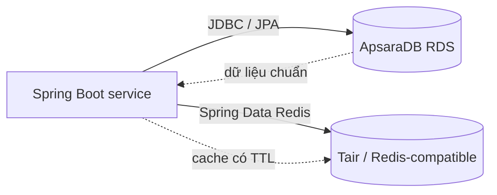

# Kết nối RDS hoặc Redis qua thư viện dữ liệu tương ứng

Khi triển khai Spring Boot trên Alibaba Cloud, ứng dụng thường cần một nơi lưu dữ liệu quan hệ bền vững và một kho key-value có độ trễ thấp. Hai lựa chọn managed phổ biến là **ApsaraDB RDS** cho dữ liệu quan hệ và **Tair (Redis OSS-compatible)** cho cache hoặc dữ liệu truy cập nhanh.

Điểm quan trọng là chọn đúng thư viện truy cập dữ liệu ở tầng ứng dụng. Với RDS, Spring Boot sử dụng JDBC driver cùng `DataSource`, Spring JDBC hoặc Spring Data JPA. Với Tair, Spring Data Redis sử dụng client như Lettuce hoặc Jedis. Đây là các tích hợp chuẩn của hệ sinh thái Spring; không cần một starter Spring Cloud Alibaba riêng chỉ để mở kết nối JDBC hoặc Redis. Spring Cloud Alibaba có thể vẫn được dùng cho những năng lực khác của hệ thống như cấu hình tập trung, discovery hoặc messaging.

Sau bài học, bạn có thể:

- Phân biệt vai trò của RDS và Redis-compatible Tair trong một ứng dụng.
- Chuẩn bị endpoint, VPC, whitelist và tài khoản để ứng dụng kết nối an toàn.
- Cấu hình Spring Boot kết nối RDS bằng JDBC/JPA và Tair bằng Spring Data Redis.
- Viết lớp truy cập dữ liệu, đặt timeout và giới hạn connection pool hợp lý.
- Kiểm thử kết nối, nhận diện lỗi mạng/xác thực/TLS và tránh các cấu hình không an toàn.

## 1. Chọn dịch vụ và thư viện phù hợp

| Nhu cầu | Dịch vụ Alibaba Cloud | Thư viện Spring thường dùng | Vai trò dữ liệu |
|---|---|---|---|
| Dữ liệu nghiệp vụ có quan hệ, ràng buộc, giao dịch và truy vấn SQL | ApsaraDB RDS for MySQL hoặc PostgreSQL | JDBC, Spring JDBC, Spring Data JPA hoặc MyBatis | Nguồn dữ liệu chính, lưu trữ bền vững |
| Cache, session, counter, rate limit hoặc dữ liệu key-value có TTL | Tair (Redis OSS-compatible) | Spring Data Redis với Lettuce hoặc Jedis | Tăng tốc truy cập; thường không thay thế cơ sở dữ liệu chính |

Một kiến trúc điển hình là RDS giữ dữ liệu chuẩn, còn Redis giữ bản sao có thời hạn của những dữ liệu thường được đọc:



Không nên chọn Redis chỉ vì thao tác đọc nhanh. RDS phù hợp khi cần transaction, foreign key, unique constraint, truy vấn quan hệ và backup/restore theo mô hình cơ sở dữ liệu. Redis phù hợp với dữ liệu có thể tái tạo, có thời hạn hoặc cần thao tác key-value nhanh. Nếu dùng Redis làm nơi lưu dữ liệu duy nhất, phải đánh giá riêng persistence, replication, backup, eviction policy và khả năng khôi phục; không mặc định rằng cache có cùng bảo đảm lưu trữ với RDS.

## 2. Chuẩn bị kết nối trên Alibaba Cloud

### 2.1. Chuẩn bị ApsaraDB RDS

Trước khi cấu hình Spring, lấy các thông tin sau từ trang chi tiết instance RDS:

1. Engine và phiên bản, ví dụ MySQL hoặc PostgreSQL.
2. Endpoint nội bộ (private endpoint), port và tên database.
3. Tài khoản database dành riêng cho ứng dụng và quyền được cấp.
4. VPC, region và địa chỉ IP của máy chạy ứng dụng.
5. Trạng thái TLS và CA certificate nếu bật mã hóa kết nối.

Ưu tiên đặt ứng dụng và RDS trong cùng VPC, cùng region, sau đó dùng private endpoint. Thêm IP riêng của ECS hoặc security group phù hợp vào whitelist/security group của RDS. Nếu ứng dụng nằm ở VPC khác, cần thiết lập kết nối mạng liên VPC (chẳng hạn VPC peering hoặc giải pháp kết nối mạng tương ứng) trước khi thử kết nối.

Public endpoint chỉ nên được bật khi thực sự cần truy cập từ ngoài VPC. Khi dùng endpoint công khai, whitelist phải giới hạn đúng public IP/CIDR của máy ứng dụng; không mở `0.0.0.0/0`. Sau khi hoàn tất nhu cầu truy cập bên ngoài, tắt hoặc giải phóng public endpoint nếu không còn cần thiết. Lưu ý: có private endpoint không đồng nghĩa public endpoint đã tự động bị tắt.

Tạo database account với quyền tối thiểu cần thiết. Ví dụ, tài khoản runtime chỉ cần `SELECT`, `INSERT`, `UPDATE`, `DELETE` trên schema nghiệp vụ; tác vụ migration có thể dùng tài khoản riêng với quyền DDL cao hơn. Không dùng tài khoản quản trị instance trong cấu hình ứng dụng.

### 2.2. Chuẩn bị Tair (Redis OSS-compatible)

Trong Alibaba Cloud Console, lấy endpoint VPC, port (thường là `6379` nhưng phải kiểm tra giá trị thực tế), loại kiến trúc và thông tin tài khoản của instance. Đối với ECS/ACK, ưu tiên kết nối qua VPC và cấu hình whitelist cho IP riêng hoặc security group tương ứng. Tair thường chỉ cấp endpoint nội bộ mặc định; muốn truy cập qua Internet phải cấu hình whitelist trước rồi mới xin public endpoint.

Tair hỗ trợ nhiều kiểu xác thực:

- **Mật khẩu của tài khoản mặc định:** tương thích cách đăng nhập Redis truyền thống; không cần username riêng trong cấu hình client.
- **Username và password:** nên ưu tiên cho môi trường production và khi cần tách quyền/tài khoản theo ứng dụng. Tài khoản tùy chỉnh sử dụng username và password riêng.
- **Password-free access trong VPC:** chỉ hoạt động trong phạm vi VPC và có giới hạn riêng. Không nên xem đây là lựa chọn mặc định cho production; cần đánh giá whitelist, phạm vi client có thể truy cập và audit.

Nếu bật TLS trên Tair, kiểm tra loại instance/kiến trúc có hỗ trợ hay không, tải CA certificate do Alibaba Cloud cung cấp và cấu hình client xác thực certificate. Việc bật TLS có thể ảnh hưởng endpoint và gây gián đoạn ngắn khi dịch vụ áp dụng thay đổi; cần triển khai theo cửa sổ bảo trì và bảo đảm ứng dụng có khả năng kết nối lại.

## 3. Kết nối RDS bằng Spring Boot

### 3.1. Thêm dependency

Ví dụ dưới đây sử dụng MySQL và Spring Data JPA. Hãy dùng Spring Boot dependency management/BOM của dự án để quản lý phiên bản tương thích; không tự ghim phiên bản JDBC driver nếu không có lý do cụ thể.

```xml
<dependencies>
    <dependency>
        <groupId>org.springframework.boot</groupId>
        <artifactId>spring-boot-starter-data-jpa</artifactId>
    </dependency>

    <dependency>
        <groupId>com.mysql</groupId>
        <artifactId>mysql-connector-j</artifactId>
        <scope>runtime</scope>
    </dependency>
</dependencies>
```

Nếu RDS dùng PostgreSQL, thay MySQL Connector/J bằng driver `org.postgresql:postgresql`. Nếu chỉ cần SQL trực tiếp, có thể dùng `spring-boot-starter-jdbc` thay cho `spring-boot-starter-data-jpa`; không cần đưa cả JPA và JDBC starter vào chỉ để có một `DataSource`, vì JPA đã kéo theo các thành phần JDBC cần thiết.

### 3.2. Cấu hình DataSource bằng biến môi trường

Không ghi endpoint, username hoặc password thực vào Git. Ví dụ `application.yml`:

```yaml
spring:
  datasource:
    url: ${RDS_JDBC_URL}
    username: ${RDS_USERNAME}
    password: ${RDS_PASSWORD}
    hikari:
      maximum-pool-size: ${RDS_POOL_MAX:10}
      minimum-idle: ${RDS_POOL_MIN:2}
      connection-timeout: 30000
      validation-timeout: 5000
  jpa:
    open-in-view: false
    hibernate:
      ddl-auto: validate
    properties:
      hibernate:
        jdbc:
          time_zone: UTC
```

Ví dụ giá trị URL cho MySQL (thay placeholder bằng endpoint và database thực tế):

```text
RDS_JDBC_URL=jdbc:mysql://<private-endpoint>:3306/<database>?serverTimezone=UTC
```

Với PostgreSQL, URL có dạng:

```text
jdbc:postgresql://<private-endpoint>:5432/<database>
```

Nếu instance yêu cầu TLS, cấu hình SSL theo hướng dẫn của engine/driver và CA certificate của instance. Với MySQL Connector/J, có thể dùng chế độ xác minh danh tính máy chủ như `sslMode=VERIFY_IDENTITY` sau khi trust chain đã được cấu hình đúng; không chỉ bật mã hóa mà bỏ qua xác minh certificate. Với PostgreSQL JDBC, lựa chọn tương đương thường là `sslmode=verify-full` cùng CA phù hợp. Tham số chính xác cần theo phiên bản engine, driver và chính sách TLS của instance.

Spring Boot tự cấu hình `DataSource` từ `spring.datasource.*`; HikariCP thường là connection pool mặc định khi có mặt trên classpath. Hãy đặt `maximum-pool-size` theo tải và giới hạn connection của RDS, không sao chép giá trị mẫu một cách máy móc. Tổng số kết nối tiềm năng xấp xỉ `pool-size mỗi instance × số replica ứng dụng`, cộng với kết nối migration, tác vụ nền và công cụ vận hành. Khi có nhiều replica, mỗi pool nhỏ cũng có thể tạo tổng tải lớn lên database.

`ddl-auto: validate` yêu cầu schema đã tồn tại và để Hibernate kiểm tra mapping khi khởi động; nó không tự tạo bảng. Dùng Flyway hoặc Liquibase để quản lý migration có kiểm soát. Tránh `ddl-auto: update` trên production vì thay đổi schema tự động có thể không phù hợp với quy trình release và rollback.

### 3.3. Tạo repository và truy cập dữ liệu

Ví dụ entity tối giản cho bảng `customer`:

```java
import jakarta.persistence.Column;
import jakarta.persistence.Entity;
import jakarta.persistence.GeneratedValue;
import jakarta.persistence.GenerationType;
import jakarta.persistence.Id;
import jakarta.persistence.Table;

@Entity
@Table(name = "customer")
public class Customer {
    @Id
    @GeneratedValue(strategy = GenerationType.IDENTITY)
    private Long id;

    @Column(nullable = false, length = 120)
    private String name;

    protected Customer() {
    }

    public Customer(String name) {
        this.name = name;
    }

    public Long getId() {
        return id;
    }

    public String getName() {
        return name;
    }
}
```

Repository có thể được khai báo bằng interface:

```java
import org.springframework.data.jpa.repository.JpaRepository;

public interface CustomerRepository extends JpaRepository<Customer, Long> {
}
```

Spring Data JPA tạo implementation cho repository khi ứng dụng khởi động. Có thể inject repository vào service và đặt ranh giới transaction tại service:

```java
import org.springframework.stereotype.Service;
import org.springframework.transaction.annotation.Transactional;

@Service
public class CustomerService {
    private final CustomerRepository customers;

    public CustomerService(CustomerRepository customers) {
        this.customers = customers;
    }

    @Transactional
    public Customer create(String name) {
        return customers.save(new Customer(name));
    }
}
```

Trong dự án thực tế, bổ sung validation, xử lý lỗi nghiệp vụ, phân trang và index theo truy vấn. Không trả trực tiếp entity persistence ra API nếu điều đó làm lộ cấu trúc dữ liệu; nên ánh xạ sang DTO. Transaction nên bao quanh một đơn vị nghiệp vụ rõ ràng, tránh giữ transaction mở trong khi gọi dịch vụ mạng chậm.

## 4. Kết nối Tair bằng Spring Data Redis

### 4.1. Thêm dependency

```xml
<dependency>
    <groupId>org.springframework.boot</groupId>
    <artifactId>spring-boot-starter-data-redis</artifactId>
</dependency>
```

Starter này mặc định sử dụng Lettuce và cung cấp các abstraction của Spring Data Redis. Nên để Spring Boot BOM quản lý phiên bản Lettuce tương thích. Chỉ chuyển sang Jedis khi có lý do về API, vận hành hoặc tương thích; khi đó cần loại Lettuce khỏi dependency và thêm Jedis theo hướng dẫn phiên bản Spring Boot đang dùng. Không thêm đồng thời nhiều client chỉ vì nghĩ rằng cần cả hai.

### 4.2. Cấu hình endpoint, tài khoản và TLS

Ví dụ `application.yml` cho tài khoản có username/password:

```yaml
spring:
  data:
    redis:
      host: ${REDIS_HOST}
      port: ${REDIS_PORT:6379}
      password: ${REDIS_PASSWORD}
      database: ${REDIS_DATABASE:0}
      timeout: 2s
      ssl:
        enabled: ${REDIS_SSL_ENABLED:false}
```

Với tài khoản mặc định chỉ xác thực bằng password, không khai báo thuộc tính `username`. Với tài khoản tùy chỉnh, thêm `username: ${REDIS_USERNAME}` vào cấu hình và truyền cả username lẫn password. Không ghép chuỗi `username:password` vào password property nếu client đã nhận hai trường riêng; định dạng `user:password` trong một trường thường dành cho một số công cụ/kiểu kết nối cụ thể.

Chỉ bật `spring.data.redis.ssl.enabled` khi TLS đã được bật trên instance và client đã tin cậy CA certificate tương ứng. Nếu instance yêu cầu trust material riêng, cấu hình SSL bundle/trust store theo Spring Boot và driver đang sử dụng. Không tắt kiểm tra certificate để xử lý nhanh lỗi handshake.

Đối với Tair cluster chạy proxy mode, ứng dụng thường kết nối qua proxy endpoint như một Redis endpoint thông thường. Nếu dùng direct-connection endpoint của cluster, client phải hỗ trợ Redis Cluster protocol và cấu hình cluster tương ứng; không cấu hình standalone chỉ vì endpoint có một hostname. Kiểm tra kiến trúc instance và hướng dẫn client được Alibaba Cloud hỗ trợ trước khi chọn chế độ. Một số cấu hình direct connection yêu cầu phiên bản Lettuce đủ mới.

### 4.3. Sử dụng StringRedisTemplate

Spring Boot có thể tự cấu hình `RedisConnectionFactory` và `StringRedisTemplate` từ các thuộc tính trên. Ví dụ service cache một chuỗi với TTL:

```java
import java.time.Duration;
import org.springframework.data.redis.core.StringRedisTemplate;
import org.springframework.stereotype.Service;

@Service
public class ProductCache {
    private final StringRedisTemplate redis;

    public ProductCache(StringRedisTemplate redis) {
        this.redis = redis;
    }

    public void put(String productId, String json) {
        redis.opsForValue().set(
            "product:" + productId,
            json,
            Duration.ofMinutes(10)
        );
    }

    public String get(String productId) {
        return redis.opsForValue().get("product:" + productId);
    }

    public void evict(String productId) {
        redis.delete("product:" + productId);
    }
}
```

`StringRedisTemplate` phù hợp khi ứng dụng chủ động serialize dữ liệu thành chuỗi, chẳng hạn JSON. Với object phức tạp, chọn serializer JSON có schema rõ ràng và kiểm soát kiểu dữ liệu; tránh Java native serialization cho dữ liệu có thể đến từ nguồn không tin cậy. Đặt prefix cho key (`product:`, `session:`...), quy định TTL và kích thước value để tránh xung đột key hoặc tăng bộ nhớ ngoài dự kiến.

### 4.4. Áp dụng cache-aside đúng cách

Một luồng đọc cache-aside cơ bản:

1. Tạo key ổn định, ví dụ `product:42`.
2. Đọc Redis. Nếu có dữ liệu còn hạn, trả kết quả.
3. Nếu cache miss, đọc bản ghi từ RDS.
4. Serialize kết quả và ghi Redis với TTL phù hợp.
5. Khi cập nhật hoặc xóa dữ liệu gốc, invalidation hoặc cập nhật cache theo một chính sách nhất quán.

RDS vẫn là nguồn dữ liệu chuẩn trong mô hình này. Khi ghi dữ liệu, thường cập nhật RDS trước rồi xóa cache sau khi transaction commit (có thể dùng `@TransactionalEventListener(phase = TransactionPhase.AFTER_COMMIT)`). Nếu ghi cache trước khi transaction database commit, cache có thể chứa dữ liệu mà transaction sau đó rollback. Cache-aside vẫn có khoảng thời gian dữ liệu cũ; TTL, invalidation, versioning và cơ chế xử lý cache miss phải được thiết kế theo yêu cầu nhất quán của nghiệp vụ.

Không dùng cache để che giấu một truy vấn RDS không có index hoặc thiết kế schema kém. Trước hết tối ưu truy vấn và đo đạc; sau đó mới thêm cache ở những điểm đọc lặp lại có lợi ích rõ ràng.

## 5. Quản lý secret, quyền và kết nối bền vững

- Lưu `RDS_PASSWORD` và `REDIS_PASSWORD` trong secret store của môi trường triển khai (ví dụ Alibaba Cloud Secrets Manager hoặc hệ thống quản lý secret của nền tảng), rồi inject vào process/container lúc chạy. Không commit `.env`, file YAML chứa mật khẩu, log hoặc pipeline output có secret.
- Tạo tài khoản riêng cho từng ứng dụng hoặc workload; chỉ cấp quyền database/keyspace cần thiết. Tách tài khoản migration khỏi tài khoản runtime.
- Ưu tiên private endpoint, VPC và whitelist hẹp. Không dùng `0.0.0.0/0` để “thử cho chạy”. Public endpoint phải có lý do, whitelist đúng IP và được thu hồi khi hết nhu cầu.
- Bật TLS khi chính sách bảo mật yêu cầu hoặc dữ liệu đi qua mạng không tin cậy; xác minh CA/hostname thay vì bỏ qua certificate validation.
- Giới hạn pool theo tổng số replica và quota kết nối của dịch vụ. Đặt timeout hữu hạn cho việc mượn kết nối, truy vấn và Redis command; không để request web chờ vô hạn.
- Thiết kế retry có chọn lọc. Lỗi timeout tạm thời có thể retry với backoff và jitter nếu thao tác idempotent; không retry vô hạn hoặc retry mù một lệnh ghi có thể đã được server thực thi.
- Theo dõi số connection đang dùng/chờ của Hikari, thời gian query, slow query, Redis latency, timeout, authentication failure và memory/eviction của Tair.

## 6. Kiểm thử tích hợp

### 6.1. Kiểm tra theo từng lớp

Nên kiểm tra từ ngoài vào trong để khoanh vùng lỗi:

1. **DNS và endpoint:** hostname có phân giải đúng trong môi trường chạy ứng dụng không?
2. **Mạng:** route tới VPC, security group, port và whitelist có cho phép traffic từ workload không?
3. **Xác thực:** username/password có đúng loại tài khoản và đúng instance không?
4. **TLS:** client có tin cậy CA, hostname có khớp certificate và TLS version có tương thích không?
5. **Ứng dụng:** Spring có tạo được `DataSource`/`RedisConnectionFactory`, repository và lệnh đọc/ghi có chạy được không?

Với RDS, có thể thử kết nối bằng MySQL/PostgreSQL client từ chính ECS/container hoặc môi trường có cùng network path. Sau đó kiểm tra thao tác SQL đơn giản như `SELECT 1` và một vòng tạo/đọc/xóa bản ghi trên database kiểm thử. Với Tair, dùng `redis-cli` hoặc một chương trình test để xác minh `PING`/`PONG`, sau đó thử `SET`/`GET`/`DEL` trên key kiểm thử. Kiểm tra TCP port thành công chỉ chứng minh đường mạng có thể tiếp cận; nó chưa chứng minh xác thực và quyền truy cập đã đúng.

### 6.2. Kiểm thử tự động trong CI

Không nên để integration test phụ thuộc vào RDS/Tair production. Có thể dùng Testcontainers với MySQL/Redis tương ứng hoặc dựng dịch vụ test riêng. Testcontainers giúp mỗi lần chạy có môi trường cô lập và có thể tái tạo; cấu hình Spring test bằng `@DynamicPropertySource` hoặc service connection tương thích với phiên bản Spring Boot đang dùng.

Ví dụ kiểm thử service cache khi test profile đã trỏ tới Redis dùng riêng cho test:

```java
import static org.assertj.core.api.Assertions.assertThat;

import org.junit.jupiter.api.Test;
import org.springframework.beans.factory.annotation.Autowired;
import org.springframework.boot.test.context.SpringBootTest;

@SpringBootTest
class ProductCacheIntegrationTest {
    @Autowired
    private ProductCache cache;

    @Test
    void storesAndReadsValue() {
        cache.put("test-42", "{\"name\":\"keyboard\"}");

        assertThat(cache.get("test-42"))
            .isEqualTo("{\"name\":\"keyboard\"}");

        cache.evict("test-42");
        assertThat(cache.get("test-42")).isNull();
    }
}
```

Với repository JPA, viết integration test tạo một entity, đọc lại bằng repository rồi dọn dữ liệu. Khi dùng `@DataJpaTest`, lưu ý test slice có thể thay datasource bằng embedded database; nếu chủ đích kiểm thử database bên ngoài, cấu hình rõ `@AutoConfigureTestDatabase(replace = NONE)` và chỉ trỏ tới database test. Không chạy test ghi/xóa trên dữ liệu production.

## 7. Chẩn đoán lỗi thường gặp

| Triệu chứng | Nguyên nhân có thể | Hướng kiểm tra |
|---|---|---|
| RDS `Connection timed out` hoặc không mở được socket | Sai endpoint/port, khác VPC/region, route hoặc whitelist/security group chưa đúng | Xác minh private endpoint, network path và IP nguồn thực tế của workload |
| RDS báo access denied | Sai password, sai database account hoặc quyền schema chưa đủ | Kiểm tra account, password secret và grant; không đổi sang tài khoản admin để né lỗi |
| RDS `Too many connections` | Tổng pool của các replica vượt giới hạn hoặc kết nối không được đóng | Tính tổng `maximum-pool-size`, kiểm tra leak và cân nhắc database proxy khi phù hợp |
| RDS `Unknown host` | Endpoint sai, DNS nội bộ không phân giải hoặc cấu hình môi trường thiếu | Kiểm tra hostname, resolver và biến môi trường thực tế (không in secret) |
| RDS/Tair `SSLHandshakeException` | TLS chưa bật ở dịch vụ, CA thiếu/hết hạn, hostname không khớp hoặc TLS version không tương thích | Kiểm tra trạng thái TLS, CA chain, hostname endpoint và trust store |
| Redis `NOAUTH`, `WRONGPASS` | Sai password hoặc dùng sai định dạng tài khoản mặc định/tùy chỉnh | Kiểm tra có cần username không; tài khoản tùy chỉnh dùng username và password riêng |
| Redis timeout hoặc `ERR client ip is not in whitelist` | Sai loại IP (private/public), whitelist chưa cập nhật hoặc network path sai | Đối chiếu endpoint VPC/public với đúng IP nguồn và kiểm tra whitelist |
| Redis cluster trả lỗi redirect hoặc key không truy cập đúng shard | Dùng direct endpoint nhưng client đang cấu hình standalone, hoặc client không hỗ trợ cluster protocol | Kiểm tra proxy/direct mode và cấu hình Redis Cluster/client version |

Khi chẩn đoán, không đưa password, URL có credential hoặc toàn bộ environment variables vào log/ticket. Chỉ ghi endpoint đã được phép công khai, mã lỗi, thời điểm, request/correlation ID và thông tin mạng không nhạy cảm.

## 8. RDS và Redis: ranh giới trách nhiệm

| Tiêu chí | ApsaraDB RDS | Tair (Redis-compatible) |
|---|---|---|
| Mô hình dữ liệu | Bảng, hàng, quan hệ và SQL | Key-value, cấu trúc dữ liệu Redis |
| Giao dịch | Transaction theo engine SQL | Lệnh nguyên tử/transaction Redis với ngữ nghĩa khác; không thay thế transaction RDS |
| Lưu trữ chính | Phù hợp dữ liệu nghiệp vụ bền vững | Thường dùng cache hoặc dữ liệu truy cập nhanh; cần đánh giá persistence nếu lưu dữ liệu chính |
| Tích hợp Spring | JDBC, Spring JDBC, JPA, MyBatis | Spring Data Redis, Lettuce/Jedis |
| Lưu ý vận hành | Pool connection, query/index, migration, backup và replica | TTL, eviction, key design, memory, connection và cache invalidation |

Không có transaction phân tán tự động giữa RDS và Redis chỉ vì cả hai được inject vào cùng một Spring service. Nếu một nghiệp vụ ghi cả hai nơi, hãy xác định nguồn dữ liệu chuẩn, thứ tự cập nhật, hành vi khi một bên lỗi và cơ chế phục hồi. Với cache, cách đơn giản thường là commit RDS trước rồi invalidate cache; với yêu cầu đồng bộ phức tạp hơn, cân nhắc outbox/event-driven và thiết kế idempotent.

## 9. Checklist trước khi đưa lên môi trường thật

- [ ] Ứng dụng dùng đúng engine driver và Spring starter; phiên bản được quản lý bởi BOM tương thích.
- [ ] Endpoint/port lấy từ đúng instance và đúng region; production ưu tiên private endpoint.
- [ ] VPC, route, whitelist và security group chỉ cho phép workload cần thiết.
- [ ] Tài khoản runtime có quyền tối thiểu; migration dùng credential riêng.
- [ ] Secret được inject lúc chạy, không nằm trong source control hoặc log.
- [ ] TLS và CA certificate được cấu hình đúng nếu bật mã hóa.
- [ ] Pool size, timeout và retry được tính theo số replica và giới hạn dịch vụ.
- [ ] Schema được quản lý bằng migration; Redis key có namespace và TTL phù hợp.
- [ ] Integration test chạy trên dữ liệu/dịch vụ test, không chạm production.
- [ ] Có metric, log đã lọc secret, cảnh báo và quy trình xử lý lỗi kết nối.

## 10. Kết luận

Kết nối managed database trên Alibaba Cloud không đòi hỏi thay đổi cách viết tầng truy cập dữ liệu của Spring Boot: RDS được truy cập qua JDBC/DataSource và thư viện SQL phù hợp; Tair được truy cập qua Spring Data Redis cùng Lettuce hoặc Jedis. Phần đặc thù của cloud provider nằm chủ yếu ở endpoint, VPC, whitelist, tài khoản, TLS, giới hạn kết nối và vận hành instance. Tách rõ các phần này giúp ứng dụng giữ được abstraction của Spring, đồng thời vẫn tận dụng được bảo mật và khả năng quản lý của dịch vụ managed.

## Tài liệu tham khảo

- [Spring Boot — SQL Databases](https://docs.spring.io/spring-boot/reference/data/sql.html): cấu hình `DataSource`, JDBC, JPA và connection pool.
- [Spring Boot — Working with NoSQL Technologies](https://docs.spring.io/spring-boot/reference/data/nosql.html): Redis auto-configuration, Lettuce/Jedis, `StringRedisTemplate` và SSL.
- [Alibaba Cloud — ApsaraDB RDS connections and networks](https://help.aliyun.com/en/rds/apsaradb-rds-for-mysql/connections-and-networks/): private/public endpoint, whitelist, security group và TLS.
- [Alibaba Cloud — Tair connection prerequisites](https://help.aliyun.com/en/redis/user-guide/connection-preparation): VPC và whitelist cho client.
- [Alibaba Cloud — Connect to a Tair instance by using client code](https://help.aliyun.com/en/redis/user-guide/use-a-client-to-connect-to-an-apsaradb-for-redis-instance): endpoint, tài khoản và client Java/Spring Data Redis.
- [Alibaba Cloud — Tair authentication methods](https://help.aliyun.com/en/redis/user-guide/logon-methods): password-only, username/password và password-free access.
- [Alibaba Cloud — Enable TLS encryption for Tair](https://help.aliyun.com/en/redis/user-guide/enable-tls-encryption): điều kiện bật TLS và CA certificate.
