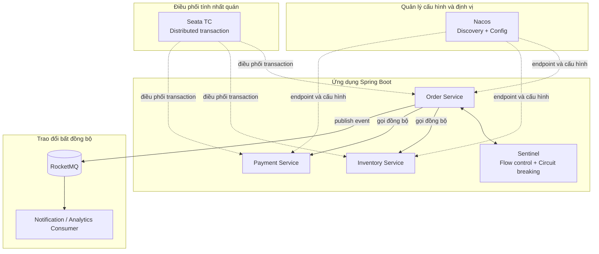

# Ranh giới với Nacos, Sentinel, Seata và RocketMQ

Trong một hệ thống Spring Boot chạy trên Alibaba Cloud, Nacos, Sentinel, Seata và RocketMQ thường xuất hiện cùng nhau. Chúng giải quyết những vấn đề khác nhau: **Nacos quản lý cấu hình và khám phá dịch vụ; Sentinel bảo vệ ứng dụng trước lưu lượng và lỗi; Seata điều phối giao dịch phân tán; RocketMQ truyền thông điệp bất đồng bộ**. Hiểu đúng ranh giới giúp chọn đúng công cụ, tránh dùng message queue như transaction manager hoặc kỳ vọng service registry tự bảo vệ hệ thống khi quá tải.

Bài học đặt các thành phần này trong bối cảnh Spring Cloud Alibaba và các dịch vụ managed tương ứng của Alibaba Cloud. Mục tiêu không phải cài tất cả vào mọi ứng dụng, mà là biết thành phần nào giải quyết yêu cầu nào, chúng có thể phối hợp ở đâu và trách nhiệm nào vẫn thuộc về mã nghiệp vụ.

Sau bài học, bạn có thể:

- Phân biệt vai trò của Nacos, Sentinel, Seata và RocketMQ.
- Nhận diện ranh giới giữa thư viện tích hợp Spring Cloud Alibaba và dịch vụ managed trên Alibaba Cloud.
- Chọn mô hình đồng bộ, giao dịch phân tán hoặc sự kiện bất đồng bộ theo yêu cầu nhất quán.
- Cấu hình và vận hành các thành phần với endpoint riêng, quyền tối thiểu, timeout và cơ chế phục hồi phù hợp.
- Tránh các giả định sai về exactly-once, transaction xuyên nhiều dịch vụ, lưu trữ secret và khả năng chịu lỗi.

## 1. Bốn thành phần, bốn trách nhiệm

| Thành phần | Câu hỏi mà nó trả lời | Trách nhiệm chính | Không thay thế |
|---|---|---|---|
| Nacos | Dịch vụ ở đâu? Cấu hình hiện tại là gì? | Service discovery và centralized configuration | API Gateway, message broker, secret vault, transaction coordinator |
| Sentinel | Khi lưu lượng tăng hoặc dependency lỗi, ứng dụng cần tự bảo vệ thế nào? | Flow control, circuit breaking, hotspot/system protection | Retry queue, durable messaging, distributed transaction |
| Seata | Một nghiệp vụ trải qua nhiều service/database cần phối hợp commit hoặc rollback ra sao? | Điều phối distributed transaction theo mode được chọn | Message broker, distributed lock tổng quát, giải pháp cho mọi workflow dài hạn |
| RocketMQ | Làm sao gửi và xử lý sự kiện mà không buộc hai service phải gọi nhau đồng bộ? | Durable messaging, buffering, consumer group, retry và event-driven integration | Service registry, database transaction manager, cache hoặc nguồn dữ liệu nghiệp vụ |

Một cách nhớ ngắn gọn:

- Nacos giúp **tìm và cấu hình** thành phần.
- Sentinel giúp **giới hạn và cô lập** tác động của sự cố.
- Seata giúp **điều phối transaction** qua nhiều nhánh dịch vụ.
- RocketMQ giúp **chuyển giao thông điệp** giữa producer và consumer.



Sơ đồ chỉ thể hiện các mối quan hệ có thể có. Một ứng dụng không nhất thiết cần cả bốn thành phần; Nacos có thể được thay bằng một nền tảng discovery/config khác, Sentinel có thể được thay bằng cơ chế bảo vệ khác, và nghiệp vụ có thể chọn event-driven thay cho distributed transaction.

## 2. Phân biệt framework tích hợp và dịch vụ managed

Spring Cloud Alibaba cung cấp các adapter và abstraction để ứng dụng Spring Boot giao tiếp với những thành phần trong hệ sinh thái Alibaba. Các thư viện này chạy trong process ứng dụng hoặc cung cấp client để gọi một dịch vụ từ xa. Dịch vụ managed lại là hạ tầng được Alibaba Cloud vận hành, ví dụ:

| Năng lực | Thành phần/thư viện trong ứng dụng | Dịch vụ hoặc cách triển khai trên Alibaba Cloud |
|---|---|---|
| Discovery và config | Nacos client, Spring Cloud Alibaba Nacos Discovery/Config | MSE Nacos hoặc Nacos tự vận hành |
| Traffic protection | Sentinel core, Spring Cloud Alibaba Sentinel adapter | Sentinel Dashboard/AHAS hoặc dashboard và rule service do tổ chức vận hành, tùy mô hình |
| Distributed transaction | Seata client và Seata Server (TC) | Seata Server tự vận hành hoặc dịch vụ tương thích được cung cấp trong phạm vi sản phẩm/region cụ thể; cần xác nhận khả năng hỗ trợ thực tế |
| Messaging | RocketMQ client hoặc Spring Cloud Stream RocketMQ Binder | ApsaraMQ for RocketMQ hoặc RocketMQ tự vận hành |

Không nên đồng nhất tên thư viện với tên sản phẩm cloud. Thêm Nacos starter không tự tạo một Nacos cluster; thêm RocketMQ Binder không tự cấp topic, consumer group, ACL hoặc endpoint. Ứng dụng vẫn cần endpoint, mạng, danh tính, quyền và cấu hình dịch vụ tương ứng.

Spring Cloud Alibaba, Spring Boot và Spring Cloud có ma trận tương thích theo release train. Trước khi thêm dependency, chọn một bộ phiên bản được tài liệu chính thức hỗ trợ và dùng BOM tương ứng để quản lý dependency. Không trộn starter từ nhiều release train hoặc tự nâng riêng một client transitive mà không kiểm tra tương thích. Các property và cách bootstrap cấu hình có thể thay đổi giữa các thế hệ Spring Boot/Spring Cloud; ví dụ trong bài mang tính định hướng, cần đối chiếu với release đang dùng.

## 3. Nacos: discovery và centralized configuration

### 3.1. Nacos chịu trách nhiệm điều gì?

Nacos có hai năng lực thường được Spring Cloud Alibaba sử dụng:

**Service discovery:** instance đăng ký tên dịch vụ, địa chỉ và metadata vào registry. Client có thể tìm instance của một service theo service name; Spring Cloud LoadBalancer hoặc thành phần gọi dịch vụ phù hợp thực hiện lựa chọn instance. Registry cung cấp thông tin định vị, còn việc gọi HTTP/gRPC, xác thực request, cân bằng tải và kiểm soát truy cập vẫn thuộc về client, gateway và hạ tầng mạng.

**Configuration management:** ứng dụng lấy cấu hình theo namespace, group và data ID. Cấu hình tập trung giúp tách cấu hình khỏi artifact, quản lý môi trường và cập nhật các giá trị được hỗ trợ refresh. Không phải mọi property đều có thể thay đổi an toàn khi ứng dụng đang chạy; các giá trị như datasource pool, thread pool hoặc cấu trúc bean có thể cần restart hay quy trình rollout.

Nacos không phải API Gateway. Nó không tự thực thi authentication/authorization cho mọi request nghiệp vụ, không thay thế service mesh và không tự tạo message channel giữa hai service. Nacos cũng không nên được xem là secret vault chuyên dụng: mật khẩu, private key và token cần được quản lý theo cơ chế secret phù hợp, có kiểm soát quyền, mã hóa, rotation và audit.

### 3.2. Cấu hình discovery và config

Với một ứng dụng Spring Boot dùng Spring Cloud Alibaba, cấu hình endpoint Nacos thường được truyền qua biến môi trường:

```yaml
spring:
  application:
    name: order-service
  cloud:
    nacos:
      discovery:
        server-addr: ${NACOS_SERVER_ADDR}
        namespace: ${NACOS_NAMESPACE}
      config:
        server-addr: ${NACOS_SERVER_ADDR}
        namespace: ${NACOS_NAMESPACE}
        file-extension: yaml
```

Đây là cấu trúc minh họa. Với các phiên bản Spring Boot/Spring Cloud Alibaba mới, cách nạp config có thể yêu cầu `spring.config.import` hoặc cơ chế bootstrap tương ứng; hãy dùng đúng hướng dẫn của release đang triển khai. Cấu hình endpoint, namespace và thông tin xác thực cho discovery/config có thể được tách riêng nếu môi trường yêu cầu.

Các khái niệm cần thống nhất:

- **Namespace:** tách môi trường hoặc miền quản trị, chẳng hạn dev, staging, production. Không nên dựa vào tên namespace đơn thuần làm ranh giới bảo mật; vẫn phải cấu hình quyền và mạng.
- **Group:** phân nhóm cấu hình hoặc dịch vụ theo quy ước của tổ chức.
- **Data ID:** định danh một cấu hình, thường gắn với tên ứng dụng và định dạng file.
- **Service name:** tên logic mà instance đăng ký và consumer dùng để khám phá.

Tránh để nhiều ứng dụng ghi đè cùng một Data ID ngoài chủ đích. Đặt quy ước tên rõ ràng, review thay đổi cấu hình, phân quyền theo namespace/group và có quy trình rollback. Nếu dùng MSE Nacos, lấy endpoint private/public, namespace và thông tin xác thực từ đúng instance/region; ưu tiên private endpoint trong VPC.

### 3.3. Những điều Nacos không bảo đảm

- Registry có địa chỉ instance không đồng nghĩa instance đang khỏe ở mức nghiệp vụ. Health check, timeout và retry vẫn cần thiết.
- Cập nhật config thành công không bảo đảm mọi bean trong ứng dụng tự thay đổi an toàn.
- Nếu Nacos tạm thời không truy cập được, ứng dụng có thể tiếp tục dùng cấu hình/cache cục bộ tùy client và trạng thái; hành vi khởi động mới, refresh và discovery khi lỗi phải được kiểm thử.
- Namespace không tự thay thế IAM, ACL, network policy hoặc secret manager.

## 4. Sentinel: bảo vệ ứng dụng khi tải tăng hoặc dependency lỗi

### 4.1. Sentinel kiểm soát điều gì?

Sentinel cung cấp các cơ chế bảo vệ runtime, thường bao gồm:

- **Flow control:** giới hạn số request hoặc tỷ lệ request đi vào một resource trong khoảng thời gian.
- **Circuit breaking/degradation:** tạm ngăn gọi dependency khi tỷ lệ lỗi, thời gian phản hồi hoặc điều kiện được cấu hình vượt ngưỡng; sau thời gian nghỉ, cho phép thử lại theo cơ chế half-open tương ứng.
- **Hotspot parameter flow control:** giới hạn theo giá trị tham số nóng, ví dụ một `productId` đang nhận lượng truy cập bất thường.
- **System protection:** bảo vệ ứng dụng dựa trên chỉ số tải hệ thống và điều kiện được hỗ trợ.

Sentinel bảo vệ resource trong ứng dụng, chẳng hạn một API, một method hoặc một lời gọi dependency đã được instrument. Nó không lưu message để xử lý sau, không tự sửa lỗi nghiệp vụ và không đảm bảo một request bị chặn sẽ được thực hiện lại. Nếu cần retry bất đồng bộ bền vững, hãy dùng cơ chế retry có giới hạn hoặc message broker.

### 4.2. Đánh dấu resource và xử lý bị chặn

Ví dụ một method có thể bị Sentinel bảo vệ bằng annotation:

```java
import com.alibaba.csp.sentinel.annotation.SentinelResource;
import com.alibaba.csp.sentinel.slots.block.BlockException;
import org.springframework.stereotype.Service;

@Service
public class InventoryQueryService {

    @SentinelResource(
        value = "inventory-query",
        blockHandler = "handleBlocked"
    )
    public int available(String sku) {
        return queryInventoryFromDatabase(sku);
    }

    public int handleBlocked(String sku, BlockException exception) {
        // Có thể trả trạng thái giới hạn hoặc chuyển sang fallback phù hợp.
        throw new InventoryTemporarilyUnavailableException(sku, exception);
    }

    private int queryInventoryFromDatabase(String sku) {
        // Thực hiện truy vấn thực tế.
        return 0;
    }
}
```

Đoạn mã minh họa cách gắn resource và handler; cần bảo đảm method signature của `blockHandler` khớp tham số method gốc và thêm `BlockException` ở cuối. Với Spring AOP, kiểm tra cách gọi qua proxy; self-invocation trong cùng bean có thể không đi qua interceptor như mong đợi. Không bắt `BlockException` rồi trả về một kết quả giả có vẻ hợp lệ nếu điều đó làm sai dữ liệu nghiệp vụ.

Sentinel Dashboard hỗ trợ quan sát và quản lý rule, nhưng cần phân biệt cách dashboard đẩy rule với cơ chế lưu trữ rule bền vững. Nếu rule chỉ nằm trong memory của ứng dụng, restart có thể làm mất rule. Production cần cấu hình rule data source có persistence (ví dụ Nacos nếu release và integration hỗ trợ) hoặc một cơ chế quản lý rule tương đương; đồng thời bảo vệ dashboard và quyền thay đổi rule.

### 4.3. Thiết kế rule có ý nghĩa

Không đặt một ngưỡng QPS tùy ý cho toàn bộ hệ thống. Đo baseline, xác định giới hạn dependency và ngân sách độ trễ, sau đó đặt rule cho resource quan trọng. Ví dụ:

- API xem tồn kho có thể giới hạn theo SKU nóng để một sản phẩm viral không chiếm toàn bộ pool.
- Lời gọi sang dịch vụ khuyến mãi có thể dùng circuit breaker vì đây là dependency không thiết yếu cho mọi luồng checkout.
- API đăng nhập cần rate limit và cơ chế chống lạm dụng ở nhiều lớp; Sentinel chỉ là một phần của thiết kế.
- Consumer RocketMQ có thể cần giới hạn concurrency để tránh làm quá tải RDS khi backlog được xử lý nhanh.

Flow control và circuit breaker có mục tiêu khác nhau: flow control chủ động giới hạn lưu lượng theo rule; circuit breaker phản ứng với trạng thái lỗi/độ trễ của resource. Kết hợp chúng cần tránh tạo hiệu ứng từ chối dây chuyền. Cần quan sát số request pass/block, tỷ lệ exception, thời gian phản hồi và trạng thái circuit trước khi điều chỉnh.

## 5. Seata: điều phối distributed transaction

### 5.1. Vì sao cần Seata?

Một transaction JDBC thông thường chỉ quản lý thay đổi trong một database connection/transaction boundary. Khi một nghiệp vụ gọi nhiều service, mỗi service có thể ghi vào database riêng. Nếu service đầu tiên commit nhưng service sau thất bại, hệ thống có thể rơi vào trạng thái một phần đã cập nhật.

Seata cung cấp mô hình distributed transaction với các vai trò chính:

- **TM (Transaction Manager):** bắt đầu, commit hoặc rollback global transaction theo ranh giới nghiệp vụ.
- **RM (Resource Manager):** quản lý branch transaction trên resource/database mà service sử dụng.
- **TC (Transaction Coordinator):** điều phối trạng thái global transaction và các branch transaction.

Trong Spring, Seata có thể tích hợp với transaction boundary của service, ví dụ annotation `@GlobalTransactional` trên phương thức điều phối. Một số cấu hình dùng Nacos làm registry/config cho Seata Server (TC); đây là tích hợp hạ tầng tùy chọn. Nacos chỉ giúp định vị/lấy cấu hình TC, còn quyết định commit/rollback thuộc về Seata.

### 5.2. Các mode transaction và trade-off

| Mode | Ý tưởng | Khi phù hợp | Chi phí/ràng buộc |
|---|---|---|---|
| AT | Ghi nhận dữ liệu trước/sau và dùng undo log để hỗ trợ rollback tự động theo cơ chế của Seata | Database và SQL nằm trong phạm vi hỗ trợ; muốn giảm lượng mã bù thủ công | Cần `undo_log`, kiểm tra tương thích SQL/schema, global lock và xử lý xung đột |
| TCC | Mỗi participant triển khai Try, Confirm, Cancel | Nghiệp vụ cần kiểm soát rõ bước giữ chỗ, xác nhận và hoàn tác | Phải thiết kế ba hành vi đúng, idempotent và xử lý Cancel/Confirm lặp |
| Saga | Chuỗi local transaction cùng các compensation action | Workflow dài, có nhiều bước và chấp nhận eventual consistency | Compensation là nghiệp vụ thực, không phải rollback vật lý; cần theo dõi trạng thái và xử lý bù thất bại |
| XA | Dùng chuẩn XA/two-phase commit qua resource manager hỗ trợ | Môi trường cần semantics XA và chấp nhận chi phí khóa/coordination | Tăng độ phức tạp, thời gian giữ resource và phụ thuộc driver/database |

Không có mode nào miễn phí. AT không phải phép màu áp dụng được cho mọi SQL; TCC đòi hỏi thiết kế nghiệp vụ; Saga không làm các bước đã hoàn thành biến mất mà chạy hành động bù; XA có thể giữ lock lâu và ảnh hưởng throughput. Chọn mode sau khi xác định mức nhất quán, thời gian transaction, loại database và khả năng phục hồi.

### 5.3. Ví dụ ranh giới global transaction

Giả sử `order-service` tạo đơn hàng và `inventory-service` trừ tồn kho trên hai database. Nếu nghiệp vụ yêu cầu cả hai nhánh cùng thành công hoặc cùng rollback trong phạm vi Seata hỗ trợ, transaction boundary có thể đặt ở service điều phối:

```java
import io.seata.spring.annotation.GlobalTransactional;
import org.springframework.stereotype.Service;

@Service
public class CheckoutService {
    private final OrderRepository orders;
    private final InventoryClient inventory;

    public CheckoutService(OrderRepository orders, InventoryClient inventory) {
        this.orders = orders;
        this.inventory = inventory;
    }

    @GlobalTransactional(name = "checkout-create-order", rollbackFor = Exception.class)
    public Order checkout(CheckoutCommand command) {
        Order order = orders.save(Order.pending(command));
        inventory.reserve(command.sku(), command.quantity(), order.getId());
        return order;
    }
}
```

Đây là ví dụ khái niệm, không phải lớp có thể chạy độc lập: `InventoryClient` phải gọi service tham gia transaction theo cấu hình Seata tương thích, các database resource phải được đăng ký đúng, và mỗi participant cần cấu hình mode phù hợp. Với AT mode, database branch thường cần bảng `undo_log` theo schema/phiên bản Seata. Không chỉ thêm annotation là mọi lời gọi HTTP tùy ý tự động tham gia cùng transaction; cần kiểm tra propagation, context truyền qua RPC, datasource proxy và phiên bản tích hợp.

### 5.4. Giới hạn và vận hành Seata

- Global transaction nên ngắn. Không giữ transaction mở trong khi chờ người dùng, gọi API bên thứ ba chậm hoặc xử lý một workflow kéo dài nhiều phút.
- TC là thành phần quan trọng. Cần cấu hình cluster, registry, storage, network và giám sát trạng thái transaction; kiểm tra hành vi khi TC mất kết nối.
- AT cần kiểm tra loại database, SQL, DDL, isolation và xung đột ghi. `undo_log` phải được tạo và bảo trì đúng.
- TCC cần bảo đảm Try/Confirm/Cancel có thể được gọi lại an toàn; Cancel có thể đến sau timeout dù Try đã thành công.
- Saga cần trạng thái workflow bền vững, timeout và hành động compensation có thể retry.
- Không đưa thao tác không thể hoàn tác (ví dụ gửi email hoặc gọi cổng thanh toán không có API void/refund) vào một giả định rollback database thuần túy.

Seata không phải distributed lock tổng quát và không thay thế RocketMQ. Nếu nghiệp vụ chỉ cần phát một sự kiện sau khi cập nhật database, transactional outbox hoặc RocketMQ transaction message có thể phù hợp hơn một global transaction kéo dài qua nhiều service.

## 6. RocketMQ: messaging và event-driven integration

### 6.1. RocketMQ đảm nhiệm điều gì?

RocketMQ tách producer và consumer theo thời gian. Producer gửi message tới topic; broker lưu và chuyển message cho consumer group. Consumer có thể xử lý độc lập, mở rộng số instance và tiếp tục xử lý backlog khi tải tăng trở lại.

Các khái niệm cần phân biệt:

- **Topic:** miền thông điệp, thường biểu diễn một loại event hoặc luồng nghiệp vụ.
- **Tag/Key:** metadata giúp phân loại hoặc truy vết message theo cách broker hỗ trợ.
- **Producer:** ứng dụng phát message.
- **Consumer group:** nhóm consumer cùng chia sẻ cách tiêu thụ một subscription; mỗi group có tiến độ/offset riêng theo mô hình broker.
- **Retry và dead-letter queue (DLQ):** xử lý message thất bại theo policy; sau số lần retry hoặc điều kiện nhất định, message có thể chuyển sang DLQ để điều tra.
- **Ordering:** thứ tự chỉ được bảo đảm trong phạm vi và chế độ ordering mà broker hỗ trợ, thường gắn với sharding key/queue; không mặc định toàn topic có thứ tự tuyệt đối.

RocketMQ không phải database. Message được lưu theo retention và cấu hình broker, còn dữ liệu nghiệp vụ chuẩn vẫn nên nằm trong database phù hợp. Queue có thể bị backlog; consumer có thể xử lý lại message; vì vậy logic tiêu thụ phải idempotent.

### 6.2. Tích hợp với Spring Cloud Stream

Trong hệ sinh thái Spring Cloud Alibaba, RocketMQ có thể được tích hợp qua RocketMQ Binder của Spring Cloud Stream. Dùng BOM/release train tương thích và dependency binder đúng phiên bản dự án. Ví dụ khai báo binding producer:

```yaml
spring:
  cloud:
    stream:
      rocketmq:
        binder:
          name-server: ${ROCKETMQ_NAME_SERVER}
      bindings:
        orderCreated-out-0:
          destination: order-created
          content-type: application/json
```

Producer có thể gửi event qua `StreamBridge`:

```java
import org.springframework.cloud.stream.function.StreamBridge;
import org.springframework.stereotype.Component;

@Component
public class OrderEventPublisher {
    private final StreamBridge streamBridge;

    public OrderEventPublisher(StreamBridge streamBridge) {
        this.streamBridge = streamBridge;
    }

    public void publish(OrderCreated event) {
        boolean accepted = streamBridge.send("orderCreated-out-0", event);
        if (!accepted) {
            throw new IllegalStateException("Không gửi được OrderCreated event");
        }
    }
}
```

Tên property binder và cách khai báo consumer có thể khác theo phiên bản Spring Cloud Stream Binder. Khi dùng ApsaraMQ for RocketMQ, cấu hình thêm endpoint/name server, ACL credentials, instance/topic/group và network access theo hướng dẫn của đúng edition. Không đặt access key hoặc secret trực tiếp trong file cấu hình được commit.

Một consumer function có thể được khai báo theo mô hình functional của Spring Cloud Stream:

```java
import java.util.function.Consumer;
import org.springframework.context.annotation.Bean;
import org.springframework.context.annotation.Configuration;

@Configuration
public class OrderEventConsumerConfiguration {
    @Bean
    Consumer<OrderCreated> orderCreated() {
        return event -> {
            // Xử lý idempotent: kiểm tra eventId/orderId trước khi áp dụng.
            processOrderCreated(event);
        };
    }

    private void processOrderCreated(OrderCreated event) {
        // Ghi nhận tác vụ downstream.
    }
}
```

Consumer binding thường được cấu hình bằng destination và group cho function tương ứng. Đặt consumer group ổn định theo ứng dụng/môi trường; không tạo group ngẫu nhiên mỗi lần khởi động nếu muốn tiếp tục tiến độ tiêu thụ đã lưu.

### 6.3. Retry, idempotency và ordering

Không nên giả định message được giao đúng một lần. Trong hệ thống phân tán, producer có thể timeout sau khi broker đã nhận message; consumer có thể commit xử lý nhưng mất kết nối trước khi xác nhận; broker có thể giao lại message. Vì vậy:

- Mỗi event nên có `eventId` duy nhất, `occurredAt`, `aggregateId` và version/schema rõ ràng.
- Consumer lưu dấu đã xử lý hoặc dùng unique constraint/idempotency key để một event được giao lại không tạo tác động trùng.
- Retry chỉ áp dụng cho lỗi tạm thời; lỗi dữ liệu không hợp lệ cần route sang DLQ hoặc luồng xử lý thủ công.
- Có backoff và giới hạn retry; tránh retry nhanh vô hạn làm tăng tải lên dependency đang lỗi.
- Nếu cần ordering theo đơn hàng, dùng key/sharding key theo `orderId` và cấu hình producer/consumer đúng chế độ ordered message; vẫn phải thiết kế xử lý event trễ hoặc trùng.
- Theo dõi backlog, consumer lag, retry rate, DLQ count, message age và thời gian xử lý.

### 6.4. Transaction message và transactional outbox

RocketMQ có khái niệm transaction message trong một số phiên bản/edition: producer gửi half message, thực hiện local transaction, rồi commit hoặc rollback message; broker có thể hỏi lại trạng thái local transaction khi chưa nhận được kết quả. Cơ chế này phối hợp trạng thái message với local transaction theo giao thức RocketMQ, nhưng không tự biến nhiều database và nhiều service thành một global ACID transaction.

Một lựa chọn khác là transactional outbox: ghi thay đổi nghiệp vụ và một bản ghi outbox trong cùng local database transaction; một publisher đọc outbox và gửi event lên RocketMQ, sau đó đánh dấu đã gửi. Cách này tránh khoảng trống “database đã commit nhưng publish message thất bại”, miễn là publisher retry và consumer idempotent. Có thể dùng CDC để đọc outbox tùy kiến trúc.

Chọn transaction message hoặc outbox theo yêu cầu, phiên bản broker, cách triển khai và năng lực vận hành. Không kết luận rằng dùng RocketMQ transaction message thì consumer chắc chắn chỉ chạy một lần; consumer vẫn phải idempotent.

## 7. Khi nào phối hợp các thành phần?

### 7.1. Nacos kết hợp Sentinel

Nacos có thể lưu cấu hình hoặc rule source cho Sentinel nếu integration được hỗ trợ và cấu hình đúng. Trong quan hệ này, Nacos là nơi phân phối/lưu cấu hình; Sentinel mới là runtime áp dụng flow control và circuit breaking. Nacos không tự thực thi rule Sentinel. Cần kiểm tra rule source có persistence, refresh và quyền truy cập; tránh cấu hình dashboard là nguồn duy nhất nếu restart có thể làm mất rule.

### 7.2. Nacos kết hợp Seata

Seata Server (TC) có thể đăng ký và lấy cấu hình qua Nacos trong một số deployment. Nacos giúp client định vị TC và quản lý cấu hình; TC vẫn là coordinator chịu trách nhiệm trạng thái global transaction. Nếu Nacos tạm thời lỗi, cần đánh giá riêng hành vi discovery/config của Seata và các transaction đang chạy.

### 7.3. Sentinel bảo vệ producer và consumer RocketMQ

Sentinel có thể giới hạn resource xử lý message hoặc lời gọi downstream của consumer. Điều đó giúp tránh consumer kéo backlog quá nhanh rồi làm quá tải RDS. Tuy nhiên, khi consumer bị block, cần hiểu binder/client xử lý exception, retry, reconsume và ack như thế nào. Đừng biến block thành vòng retry tức thời; hãy đặt concurrency, backoff, retry limit và DLQ phù hợp.

### 7.4. Seata và RocketMQ giải quyết hai kiểu nhất quán khác nhau

Seata phù hợp khi một nghiệp vụ cần phối hợp commit/rollback giữa các participant trong phạm vi transaction được hỗ trợ. RocketMQ phù hợp khi service phát event và các consumer xử lý độc lập theo eventual consistency. Hai công cụ có thể cùng tồn tại trong một hệ thống, nhưng cần xác định rõ ranh giới:

- Nếu cần cập nhật đồng bộ order và inventory trong một global transaction ngắn, Seata có thể phù hợp.
- Nếu cần gửi thông báo, cập nhật search index, analytics hoặc đồng bộ read model sau khi order đã commit, RocketMQ thường phù hợp hơn.
- Nếu chỉ cần phát event sau khi local database commit, cân nhắc outbox hoặc transaction message trước khi đưa RocketMQ vào cùng một Seata global transaction.

Không nên bọc toàn bộ quá trình consumer xử lý message vào một global transaction dài. Nếu consumer nhận event rồi gọi nhiều service, hãy xác định transaction boundary nhỏ, retry và compensation cho từng bước.

## 8. Ví dụ chọn kiến trúc cho luồng đặt hàng

Giả sử một nền tảng thương mại điện tử có `order-service`, `inventory-service`, `payment-service` và `notification-service`.

| Bước nghiệp vụ | Lựa chọn có thể dùng | Lý do |
|---|---|---|
| Các service đăng ký và tìm endpoint của nhau | Nacos Discovery | Định vị instance theo service name |
| Lấy cấu hình endpoint, timeout và feature flag | Nacos Config hoặc config platform phù hợp | Tách cấu hình theo môi trường |
| Giới hạn API xem tồn kho khi một SKU nóng | Sentinel | Bảo vệ resource trước tải đột biến |
| Checkout cần phối hợp order và reserve inventory đồng bộ | Seata, nếu mode/database và nghiệp vụ phù hợp | Điều phối global transaction ngắn qua các branch được hỗ trợ |
| Gửi email/push sau khi order commit | RocketMQ | Tách notification khỏi đường đi đồng bộ của checkout |
| Cập nhật báo cáo hoặc search index | RocketMQ consumer riêng | Cho phép xử lý bất đồng bộ và mở rộng độc lập |

Luồng này không có nghĩa mọi thao tác thanh toán đều có thể rollback bằng Seata. Cổng thanh toán bên ngoài có thể có trạng thái riêng và API refund/void riêng; cần thiết kế state machine, idempotency key và reconciliation. Tương tự, notification không nên nằm trong transaction checkout: nếu email provider lỗi, đơn hàng vẫn có thể được tạo và notification được retry sau.

## 9. Bảo mật và vận hành

Các thành phần này thường nằm trên đường đi quan trọng của hệ thống. Mỗi thành phần cần endpoint, network path, credential và quyền riêng.

| Thành phần | Bảo vệ truy cập | Chỉ số nên theo dõi |
|---|---|---|
| Nacos | Private endpoint trong VPC, authentication/ACL, phân quyền namespace/group, TLS nếu được hỗ trợ; không lưu secret tùy tiện trong config | Đăng ký/heartbeat, số instance healthy, lỗi query config, thời gian lấy config, lỗi auth |
| Sentinel | Bảo vệ dashboard, hạn chế quyền thay đổi rule, persistence rule, giới hạn network tới dashboard | Pass/block count, exception ratio, response time, circuit state, rule load failure |
| Seata | Bảo vệ TC endpoint, giới hạn service account và network, bảo mật registry/config, lưu trữ trạng thái/undo log phù hợp | Global/branch transaction đang chạy, commit/rollback rate, timeout, lock conflict, TC health |
| RocketMQ | ACL theo producer/consumer, TLS/network isolation nếu hỗ trợ, phân quyền topic/group, rotate credential | Produce/consume TPS, consumer lag, retry, DLQ, message age, broker availability |

Một số nguyên tắc chung:

- Không commit AccessKey, SecretKey, password hoặc token vào Git, image/container layer hay log.
- Dùng RAM/secret manager hoặc nền tảng quản lý secret để inject credential runtime; phân quyền theo workload và rotate định kỳ.
- Ưu tiên private endpoint và network segmentation. Không mở endpoint công khai rộng chỉ để kiểm thử nhanh.
- Đặt timeout, retry và circuit breaker có giới hạn; tránh retry lồng nhau ở HTTP client, Sentinel, Seata và message consumer làm khuếch đại tải.
- Kiểm thử tình huống mất kết nối Nacos, Sentinel rule source, Seata TC và RocketMQ broker. Ghi rõ hành vi mong đợi khi khởi động mới, khi đang có request và khi đang xử lý backlog.
- Dùng correlation ID/trace ID xuyên qua HTTP và message headers; log event ID và transaction ID nhưng không log payload nhạy cảm.

## 10. Những nhầm lẫn thường gặp

| Nhầm lẫn | Ranh giới chính xác |
|---|---|
| “Có Nacos là có API Gateway.” | Nacos cung cấp registry/config; gateway vẫn xử lý routing, authentication, rate limit ở biên và policy HTTP. |
| “Nacos config là nơi lưu mọi secret.” | Config center không mặc nhiên có đầy đủ vòng đời secret, rotation và audit như secret manager. |
| “Sentinel retry request bị block sau đó.” | Sentinel quyết định pass/block/degrade; retry và lưu công việc để xử lý sau là trách nhiệm của client/workflow/message broker. |
| “Seata khiến mọi lời gọi HTTP tự động rollback.” | Chỉ các participant/resource được tích hợp và cấu hình đúng mới tham gia transaction; side effect bên ngoài cần compensation riêng. |
| “RocketMQ bảo đảm consumer chạy đúng một lần.” | Message có thể được giao lại; consumer phải idempotent và quản lý retry/DLQ. |
| “Transaction message của RocketMQ thay thế Seata trong mọi trường hợp.” | Transaction message phối hợp local transaction với trạng thái message; nó không tự điều phối nhiều database/service thành global ACID transaction. |
| “Dùng cả bốn sẽ làm hệ thống đáng tin cậy hơn.” | Mỗi thành phần thêm dependency vận hành. Chỉ đưa vào khi có yêu cầu cụ thể và có năng lực giám sát/phục hồi. |

## 11. Checklist chọn và triển khai

- [ ] Xác định vấn đề là discovery/config, traffic protection, distributed transaction hay asynchronous messaging.
- [ ] Kiểm tra Spring Boot, Spring Cloud và Spring Cloud Alibaba thuộc release train tương thích.
- [ ] Chọn dịch vụ managed/cluster cụ thể, region, VPC endpoint, ACL và credential.
- [ ] Với Nacos, thống nhất namespace/group/Data ID/service name và quy trình thay đổi config.
- [ ] Với Sentinel, xác định resource, baseline, rule, fallback, persistence và bảo vệ dashboard.
- [ ] Với Seata, chọn AT/TCC/Saga/XA theo database và nghiệp vụ; cấu hình TC, datasource/resource và rollback/compensation.
- [ ] Với RocketMQ, thiết kế topic, group, key, ordering, retry, DLQ, retention và idempotency.
- [ ] Xác định timeout/retry/circuit breaker không xung đột giữa các tầng.
- [ ] Kiểm thử mất kết nối, restart, duplicate message, consumer lag, transaction timeout và config/rule refresh.
- [ ] Có dashboard, alert, trace và runbook cho từng dependency quan trọng.

## 12. Kết luận

Nacos, Sentinel, Seata và RocketMQ bổ sung cho nhau vì mỗi thành phần giải quyết một lớp vấn đề riêng. Nacos định vị dịch vụ và phân phối cấu hình; Sentinel bảo vệ resource trước lưu lượng hoặc dependency bất ổn; Seata điều phối transaction phân tán trong phạm vi participant và mode được hỗ trợ; RocketMQ vận chuyển sự kiện bất đồng bộ với retry và consumer group. Spring Cloud Alibaba giúp Spring Boot tích hợp các năng lực này, còn việc cấp endpoint, mạng, quyền, persistence và vận hành dịch vụ managed vẫn cần được thiết kế riêng. Chọn theo yêu cầu nghiệp vụ và kiểm thử failure mode sẽ tạo ra hệ thống dễ hiểu, dễ vận hành hơn việc thêm tất cả starter cùng lúc.

## Tài liệu tham khảo

- [Spring Cloud Alibaba — Documentation](https://sca.aliyun.com/en/docs/): hướng dẫn tích hợp Nacos, Sentinel, Seata và RocketMQ theo release train.
- [Nacos — Official Documentation](https://nacos.io/en/docs/latest/what-is-nacos/): service discovery và configuration management.
- [Alibaba Cloud MSE — Nacos](https://www.alibabacloud.com/help/en/mse/product-overview/what-is-microservices-engine): dịch vụ managed cho năng lực microservices, bao gồm Nacos theo edition hỗ trợ.
- [Sentinel — Official Documentation](https://sentinelguard.io/en-us/docs/introduction.html): flow control, circuit breaking và dashboard/rule management.
- [Seata — Official Documentation](https://seata.apache.org/docs/overview/what-is-seata/): kiến trúc TM/RM/TC và các transaction mode.
- [Apache RocketMQ — Documentation](https://rocketmq.apache.org/docs/): topic, consumer, retry, ordering và transaction message.
- [Alibaba Cloud ApsaraMQ for RocketMQ](https://www.alibabacloud.com/help/en/apsaramq-for-rocketmq/): managed RocketMQ instances, endpoint, ACL và client integration.
