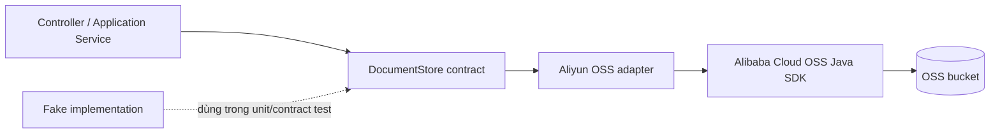

# Bọc SDK Alibaba Cloud trong adapter và kiểm thử hợp đồng

SDK của Alibaba Cloud giúp Spring Boot gọi các dịch vụ managed như Object Storage Service (OSS), ApsaraDB, Tair hoặc ApsaraMQ. Tuy nhiên, nếu controller và service nghiệp vụ gọi trực tiếp class của SDK, mã ứng dụng sẽ phụ thuộc chặt vào tên class, exception, kiểu request/response, credential provider và vòng đời client của nhà cung cấp. Khi đổi phiên bản SDK hoặc thay dịch vụ, thay đổi có thể lan qua nhiều module.

Một cách tổ chức dễ bảo trì là tạo **adapter** giữa ứng dụng và SDK. Ứng dụng định nghĩa một contract nhỏ theo ngôn ngữ nghiệp vụ; adapter chuyển contract đó thành lời gọi SDK Alibaba Cloud và ánh xạ kết quả/lỗi về kiểu dữ liệu của ứng dụng. Kiểm thử hợp đồng xác nhận mọi implementation tuân theo cùng hành vi, còn integration test xác nhận adapter thực sự tương tác đúng với dịch vụ managed.

Trong bài này, ví dụ dùng OSS để minh họa vì thao tác lưu tài liệu có ranh giới rõ ràng. Các nguyên tắc tương tự áp dụng cho SDK khác: giữ vendor types ở bên trong adapter, quản lý client như tài nguyên dùng chung, xác thực credential đúng cách, kiểm soát timeout/retry và kiểm tra hành vi với dịch vụ thật.

Sau bài học, bạn có thể:

- Thiết kế port/interface theo use case thay vì sao chép API của SDK.
- Tạo Spring bean cho OSS client và quản lý vòng đời đúng cách.
- Viết adapter để chuyển request, response và exception giữa domain với SDK.
- Xây dựng contract test có thể chạy cho fake implementation và adapter thật.
- Phân biệt unit test, adapter contract test, integration test và kiểm thử failure mode.
- Bảo vệ credential, giới hạn quyền, quan sát lỗi và nâng cấp SDK mà ít ảnh hưởng mã nghiệp vụ.

## 1. Vì sao cần adapter?

Giả sử một service lưu hồ sơ người dùng vào OSS. Nếu service gọi trực tiếp SDK:

```java
public class ProfileService {
    private final OSS ossClient;

    public void saveAvatar(String key, byte[] image) {
        ossClient.putObject("profile-bucket", key,
            new ByteArrayInputStream(image));
    }
}
```

Mã nghiệp vụ hiện biết `OSS`, bucket, API `putObject` và cách SDK nhận dữ liệu. Nếu sau này chuyển sang SDK generation khác, thay bucket strategy, bổ sung mã hóa hoặc dùng nhà cung cấp khác, `ProfileService` cũng phải thay đổi. Unit test của service thường phải mock trực tiếp type của Alibaba SDK, khiến test gắn với chi tiết triển khai.

Adapter tạo một ranh giới:



Ứng dụng chỉ biết `DocumentStore`. Adapter biết `OSS`, bucket, endpoint, credential provider và exception SDK. Fake implementation có thể dùng trong unit test; cùng một contract test có thể chạy trên fake và adapter thật.

### 1.1. Adapter không phải lớp bọc một-một toàn bộ SDK

Một interface như `AliyunOssClientFacade` có đủ mọi method của SDK nhưng đổi tên method thường không tạo ra ranh giới hữu ích. Interface nên mô tả việc ứng dụng cần làm, chẳng hạn:

- Lưu một tài liệu với content type.
- Đọc nội dung tài liệu.
- Kiểm tra metadata hoặc sự tồn tại.
- Xóa tài liệu.

Không đưa các khái niệm chỉ thuộc SDK như `PutObjectRequest`, `OSSObject`, `OSSException`, `ClientConfiguration` hoặc `ObjectMetadata` ra khỏi adapter. Dùng kiểu Java hoặc kiểu domain do ứng dụng định nghĩa. Khi cần tính năng vendor-specific, có thể mở rộng contract có chủ đích hoặc cung cấp một capability riêng thay vì để mọi module gọi SDK trực tiếp.

### 1.2. Chọn ranh giới theo trách nhiệm

| Trách nhiệm | Nơi nên đặt |
|---|---|
| Quy tắc tên tài liệu, quyền nghiệp vụ, ai được đọc/xóa | Application/domain service |
| Contract lưu/đọc tài liệu và kiểu kết quả trung lập | Port/interface của ứng dụng |
| Endpoint, region, bucket, credential provider, HTTP timeout | Cấu hình adapter và Spring bean |
| Chuyển request, response, metadata và exception SDK | Adapter Alibaba Cloud |
| Retry nghiệp vụ, idempotency và xử lý lỗi cuối cùng | Application service hoặc policy được thiết kế rõ |
| Kết nối thật, quyền RAM, TLS, VPC và bucket policy | Integration environment và hạ tầng |

## 2. Thiết kế contract cho ứng dụng

Ví dụ contract tối thiểu cho tài liệu nhỏ:

```java
import java.util.Optional;

public interface DocumentStore {
    StoredDocumentMetadata put(
        String key,
        byte[] content,
        String contentType
    );

    byte[] get(String key);

    Optional<StoredDocumentMetadata> head(String key);

    void delete(String key);
}
```

Kiểu dữ liệu trả về không phụ thuộc Alibaba SDK:

```java
public record StoredDocumentMetadata(
    String key,
    long contentLength,
    String contentType,
    String etag
) {}
```

Contract cần quy định rõ semantics, không chỉ liệt kê method:

| Thao tác | Hành vi cần thống nhất |
|---|---|
| `put` | Tạo hoặc ghi đè theo chính sách đã chọn; trả metadata của object vừa lưu; không nhận key rỗng hoặc content null |
| `get` | Trả đúng byte đã lưu; object không tồn tại thì ném `DocumentNotFoundException` |
| `head` | Trả `Optional.empty()` khi object không tồn tại; lỗi xác thực/mạng phải được báo riêng, không giả thành empty |
| `delete` | Nên idempotent: xóa object đã tồn tại hoặc chưa tồn tại đều cho kết quả thành công nếu nghiệp vụ chọn semantics này |
| Lỗi khác | Chuyển thành exception ứng dụng, giữ nguyên cause để log/trace; không rò rỉ type SDK |

Một số quyết định khác cần được ghi rõ trong contract: key có phân biệt hoa thường không, content type có bắt buộc không, giới hạn kích thước, object có được ghi đè không, metadata nào được giữ, và thao tác nào được xem là retryable. Không để mỗi implementation tự diễn giải khác nhau.

Ví dụ exception trung lập:

```java
public class DocumentStoreException extends RuntimeException {
    public DocumentStoreException(String message, Throwable cause) {
        super(message, cause);
    }
}

public class DocumentNotFoundException extends DocumentStoreException {
    public DocumentNotFoundException(String key, Throwable cause) {
        super("Document not found: " + key, cause);
    }
}
```

Trong code production, cần cân nhắc không đưa key có chứa dữ liệu cá nhân vào message log; có thể dùng mã định danh đã che hoặc correlation ID.

### 2.1. Kích thước dữ liệu và streaming

Contract `byte[]` đơn giản cho tài liệu nhỏ, nhưng giữ toàn bộ file trong heap. Nếu lưu video, archive hoặc file lớn, hãy thiết kế streaming API (ví dụ nhận `InputStream` cùng content length và trả về một download handle có `close()`), đồng thời hỗ trợ multipart upload/download. Không đọc toàn bộ object vào bộ nhớ chỉ vì SDK có một overload trả byte array. Contract phải quy định rõ ai sở hữu và đóng stream, điều gì xảy ra khi stream lỗi giữa chừng và cách hủy multipart upload dang dở.

## 3. Cấu hình SDK và vòng đời Spring bean

Client SDK thường chứa HTTP connection pool, retry policy và credential provider. Tạo client mới cho mỗi request là tốn kém và có thể làm cạn socket. Hãy tạo một client dùng chung theo lifecycle ứng dụng, cấu hình timeout/connection pool có chủ đích và đóng client khi Spring context dừng.

Ví dụ cấu hình OSS Java SDK V1 theo API builder hiện hành của SDK V1:

```java
import com.aliyun.oss.ClientBuilderConfiguration;
import com.aliyun.oss.OSS;
import com.aliyun.oss.OSSClientBuilder;
import com.aliyun.oss.common.auth.CredentialsProvider;
import com.aliyun.oss.common.auth.CredentialsProviderFactory;
import com.aliyun.oss.common.comm.SignVersion;
import org.springframework.context.annotation.Bean;
import org.springframework.context.annotation.Configuration;

@Configuration
public class OssClientConfiguration {

    @Bean(destroyMethod = "shutdown")
    OSS ossClient(OssProperties properties) {
        CredentialsProvider credentialsProvider =
            CredentialsProviderFactory.newEnvironmentVariableCredentialsProvider();

        ClientBuilderConfiguration clientConfig = new ClientBuilderConfiguration();
        clientConfig.setSignatureVersion(SignVersion.V4);
        clientConfig.setConnectionTimeout(5_000);
        clientConfig.setSocketTimeout(15_000);
        clientConfig.setMaxErrorRetry(2);

        return OSSClientBuilder.create()
            .endpoint(properties.endpoint())
            .region(properties.region())
            .credentialsProvider(credentialsProvider)
            .clientConfiguration(clientConfig)
            .build();
    }
}
```

Đây là ví dụ với OSS Java SDK V1. SDK V1 và OSS SDK for Java 2.0 có package, builder, credential provider và API khác nhau; không trộn hai thế hệ trong cùng một implementation. Chọn một thế hệ SDK và dùng đúng tài liệu/API của nó. Để tạo client trong môi trường thật, ưu tiên RAM role/workload identity hoặc credential provider có khả năng lấy và làm mới credential tạm thời. Environment-variable provider ở ví dụ phù hợp cho môi trường đã inject credential an toàn; không commit giá trị credential vào repository.

`OssProperties` có thể được khai báo bằng `@ConfigurationProperties`:

```java
import jakarta.validation.constraints.NotBlank;
import org.springframework.boot.context.properties.ConfigurationProperties;
import org.springframework.validation.annotation.Validated;

@Validated
@ConfigurationProperties(prefix = "app.oss")
public record OssProperties(
    @NotBlank String endpoint,
    @NotBlank String region,
    @NotBlank String bucket
) {}
```

Đăng ký properties bằng `@ConfigurationPropertiesScan` hoặc `@EnableConfigurationProperties(OssProperties.class)` theo cấu trúc dự án. Ví dụ cấu hình:

```yaml
app:
  oss:
    endpoint: ${OSS_ENDPOINT}
    region: ${OSS_REGION}
    bucket: ${OSS_BUCKET}
```

Không cần đưa AccessKey vào `OssProperties` nếu credential provider đã chịu trách nhiệm tìm credential. Tách endpoint/region/bucket khỏi credential giúp cấu hình môi trường rõ ràng và giảm nguy cơ vô tình log secret.

### 3.1. Quản lý credential

Ưu tiên danh tính workload có quyền tối thiểu. Ví dụ workload trên ECS có thể sử dụng RAM role được gán cho instance; các môi trường khác dùng cơ chế role/credential provider mà Alibaba Cloud hỗ trợ. Nếu cần STS, credential provider phải làm mới token trước khi hết hạn và xử lý lỗi khi không lấy được token mới.

Nếu buộc phải sử dụng AccessKey dài hạn:

- Tạo RAM user riêng cho workload và chỉ cấp action/resource cần thiết.
- Lưu secret trong secret manager hoặc hệ thống cấp phát credential an toàn.
- Inject secret khi runtime; không lưu trong Git, Dockerfile, image layer, log hoặc exception message.
- Có quy trình rotate và xác minh ứng dụng nhận credential mới.
- Không dùng AccessKey của tài khoản chính (root) cho ứng dụng.

### 3.2. Timeout và retry ở client

Đặt connect timeout, socket/read timeout và thời gian chờ connection pool theo SLA. Retry mặc định của SDK có thể đã bật; cần tính tổng số lần thử khi ứng dụng còn có retry ở service, HTTP layer hoặc job scheduler. Ví dụ hai tầng mỗi tầng retry ba lần có thể tạo tối đa nhiều request hơn dự kiến.

Chỉ retry lỗi tạm thời và thao tác có semantics an toàn. Upload cùng một object key có thể ghi đè object trước; nếu retry sau khi không rõ request đầu đã thành công hay chưa, phải xác định việc ghi đè có chấp nhận được không. Với thao tác tạo tài nguyên hoặc phát sinh side effect, dùng idempotency key hoặc kiểm tra trạng thái trước khi retry. Không retry lỗi 403, sai credential, sai bucket hoặc request validation như thể đó là lỗi mạng tạm thời.

## 4. Cài đặt adapter cho OSS

Ví dụ implementation sử dụng `OSS` từ SDK V1. Mọi kiểu SDK chỉ xuất hiện trong package adapter:

```java
import com.aliyun.oss.ClientException;
import com.aliyun.oss.OSS;
import com.aliyun.oss.OSSException;
import com.aliyun.oss.model.OSSObject;
import com.aliyun.oss.model.ObjectMetadata;
import com.aliyun.oss.model.PutObjectResult;
import java.io.ByteArrayInputStream;
import java.io.IOException;
import java.io.InputStream;
import java.util.Optional;

public class AliyunOssDocumentStore implements DocumentStore {
    private final OSS client;
    private final String bucket;

    public AliyunOssDocumentStore(OSS client, String bucket) {
        this.client = client;
        this.bucket = bucket;
    }

    @Override
    public StoredDocumentMetadata put(
        String key,
        byte[] content,
        String contentType
    ) {
        validateKey(key);
        if (content == null) {
            throw new IllegalArgumentException("content must not be null");
        }

        ObjectMetadata metadata = new ObjectMetadata();
        metadata.setContentLength(content.length);
        metadata.setContentType(contentType);

        try {
            PutObjectResult result = client.putObject(
                bucket,
                key,
                new ByteArrayInputStream(content),
                metadata
            );
            return new StoredDocumentMetadata(
                key,
                content.length,
                contentType,
                result.getETag()
            );
        } catch (OSSException | ClientException exception) {
            throw new DocumentStoreException("OSS put failed", exception);
        }
    }

    @Override
    public byte[] get(String key) {
        validateKey(key);
        try {
            OSSObject object = client.getObject(bucket, key);
            try (InputStream input = object.getObjectContent()) {
                return input.readAllBytes();
            }
        } catch (OSSException exception) {
            if ("NoSuchKey".equals(exception.getErrorCode())) {
                throw new DocumentNotFoundException(key, exception);
            }
            throw new DocumentStoreException("OSS get failed", exception);
        } catch (ClientException | IOException exception) {
            throw new DocumentStoreException("OSS get failed", exception);
        }
    }

    @Override
    public Optional<StoredDocumentMetadata> head(String key) {
        validateKey(key);
        try {
            ObjectMetadata metadata = client.getObjectMetadata(bucket, key);
            return Optional.of(new StoredDocumentMetadata(
                key,
                metadata.getContentLength(),
                metadata.getContentType(),
                metadata.getETag()
            ));
        } catch (OSSException exception) {
            if ("NoSuchKey".equals(exception.getErrorCode())) {
                return Optional.empty();
            }
            throw new DocumentStoreException("OSS head failed", exception);
        } catch (ClientException exception) {
            throw new DocumentStoreException("OSS head failed", exception);
        }
    }

    @Override
    public void delete(String key) {
        validateKey(key);
        try {
            client.deleteObject(bucket, key);
        } catch (OSSException | ClientException exception) {
            throw new DocumentStoreException("OSS delete failed", exception);
        }
    }

    private static void validateKey(String key) {
        if (key == null || key.isBlank()) {
            throw new IllegalArgumentException("key must not be blank");
        }
    }
}
```

Implementation trên thể hiện ý tưởng và dùng API OSS Java SDK V1. Với dự án cụ thể, kiểm tra chữ ký method và exception theo đúng SDK version đã chọn. Có thể bổ sung giới hạn content size, kiểm tra content type, checksum, metadata nghiệp vụ và key prefix. Không đưa key trực tiếp từ URL/path người dùng vào OSS; tạo object key từ ID do server quản lý để tránh ghi đè hoặc truy cập ngoài phạm vi.

### 4.1. Đăng ký adapter bằng Spring

```java
import org.springframework.context.annotation.Bean;
import org.springframework.context.annotation.Configuration;

@Configuration
public class DocumentStoreConfiguration {

    @Bean
    DocumentStore documentStore(OSS ossClient, OssProperties properties) {
        return new AliyunOssDocumentStore(ossClient, properties.bucket());
    }
}
```

Application service chỉ inject contract:

```java
import org.springframework.stereotype.Service;

@Service
public class ProfileDocumentService {
    private final DocumentStore documents;

    public ProfileDocumentService(DocumentStore documents) {
        this.documents = documents;
    }

    public StoredDocumentMetadata saveAvatar(String userId, byte[] image) {
        String key = "avatars/" + userId + "/profile";
        return documents.put(key, image, "image/jpeg");
    }
}
```

Service không biết OSS endpoint, bucket, `OSSObject` hoặc `OSSException`. Nếu sau này thay implementation, service giữ nguyên miễn là contract và semantics được bảo toàn.

## 5. Ánh xạ lỗi và xác định retry policy

Không để exception SDK lan tới controller hoặc domain. Adapter chuyển lỗi về một nhóm lỗi ứng dụng có ý nghĩa:

| Lỗi từ dịch vụ/client | Ánh xạ ở adapter | Xử lý ở tầng ứng dụng |
|---|---|---|
| Object không tồn tại | `DocumentNotFoundException` hoặc `Optional.empty()` theo method | Trả 404 hoặc xử lý nghiệp vụ tương ứng |
| Không đủ quyền / credential không hợp lệ | `DocumentStoreException` kèm cause và mã phân loại an toàn | Báo lỗi cấu hình/quyền, không retry liên tục |
| Bucket/endpoint/region sai | Lỗi cấu hình hoặc lỗi dịch vụ đã phân loại | Dừng rollout, sửa cấu hình/hạ tầng |
| Timeout hoặc lỗi mạng tạm thời | Lỗi truy cập dịch vụ có cause | Retry có giới hạn nếu thao tác idempotent; nếu không, kiểm tra trạng thái trước |
| Quota/rate limit | Lỗi giới hạn tài nguyên | Backoff, giảm concurrency hoặc tăng quota theo chính sách |
| Lỗi input/content không hợp lệ | `IllegalArgumentException` hoặc validation exception của ứng dụng | Trả lỗi đầu vào, không retry |

Không nên chỉ bắt mọi exception rồi trả `Optional.empty()`. Cách đó biến lỗi quyền, lỗi mạng và lỗi server thành “không tìm thấy”, khiến ứng dụng có thể tạo dữ liệu trùng hoặc che giấu outage.

Không nên chỉ dựa vào HTTP status để quyết định retry. Hãy xem error code, request ID, loại thao tác và khả năng request đã được thực thi. Giữ exception gốc làm cause để đội vận hành có thể tìm mã lỗi/request ID; lọc credential và dữ liệu nhạy cảm trước khi ghi log.

## 6. Kiểm thử hợp đồng là gì?

Một contract test là bộ kiểm thử mô tả **hành vi mà mọi implementation của interface phải tuân thủ**. Với `DocumentStore`, bộ test có thể yêu cầu:

1. `put` rồi `get` trả đúng byte ban đầu.
2. `head` trả đúng length và content type.
3. `head` cho key chưa tồn tại trả `Optional.empty()`.
4. `get` cho key chưa tồn tại ném `DocumentNotFoundException`.
5. `delete` xóa object và có semantics idempotent theo contract.
6. Lỗi xác thực hoặc lỗi mạng không bị biến thành kết quả “không tồn tại”.

Contract test khác mock-based unit test. Mock test có thể xác nhận service gọi `documents.put(...)`, nhưng không chứng minh implementation OSS lưu đúng byte hoặc ánh xạ `NoSuchKey` chính xác. Contract test chạy trên implementation thật sẽ kiểm tra hành vi tại ranh giới adapter. Integration test bổ sung kiểm tra endpoint, credential, bucket policy, TLS, region và kết nối thực tế.

## 7. Viết contract test dùng chung

Ví dụ dùng JUnit 5 và AssertJ. Abstract test class chứa các hành vi mà mọi implementation phải đáp ứng:

```java
import static org.assertj.core.api.Assertions.assertThat;
import static org.assertj.core.api.Assertions.assertThatThrownBy;

import java.nio.charset.StandardCharsets;
import java.util.UUID;
import org.junit.jupiter.api.AfterEach;
import org.junit.jupiter.api.BeforeEach;
import org.junit.jupiter.api.Test;

abstract class DocumentStoreContractTest {
    protected abstract DocumentStore store();

    private String key;

    @BeforeEach
    void createUniqueKey() {
        key = "contract-tests/" + UUID.randomUUID();
    }

    @AfterEach
    void cleanup() {
        store().delete(key);
    }

    @Test
    void storesAndReadsExactBytes() {
        byte[] expected = "hello-oss".getBytes(StandardCharsets.UTF_8);

        StoredDocumentMetadata saved = store().put(key, expected, "text/plain");

        assertThat(saved.key()).isEqualTo(key);
        assertThat(saved.contentLength()).isEqualTo(expected.length);
        assertThat(store().get(key)).containsExactly(expected);
    }

    @Test
    void exposesMetadata() {
        byte[] content = new byte[] {1, 2, 3, 4};
        store().put(key, content, "application/octet-stream");

        assertThat(store().head(key))
            .isPresent()
            .get()
            .extracting(StoredDocumentMetadata::contentLength)
            .isEqualTo(4L);
    }

    @Test
    void reportsMissingObjectConsistently() {
        assertThat(store().head(key)).isEmpty();
        assertThatThrownBy(() -> store().get(key))
            .isInstanceOf(DocumentNotFoundException.class);
    }

    @Test
    void deleteIsIdempotent() {
        store().put(key, new byte[] {9}, "application/octet-stream");

        store().delete(key);
        store().delete(key);

        assertThat(store().head(key)).isEmpty();
    }
}
```

Trong dự án thật, cleanup nên chạy trong `finally`/`@AfterEach` và chỉ xóa key được test tạo ra. Nếu thao tác delete có thể thất bại do service outage, báo rõ lỗi cleanup để không che mất lỗi chính của test. Nếu adapter cần test semantics ghi đè, thêm test riêng cho `put` cùng key hai lần.

### 7.1. Chạy cùng contract suite trên fake

Fake implementation lưu dữ liệu trong map và được dùng để kiểm thử nhanh:

```java
import java.util.Map;
import java.util.Optional;
import java.util.concurrent.ConcurrentHashMap;

class InMemoryDocumentStore implements DocumentStore {
    private final Map<String, byte[]> objects = new ConcurrentHashMap<>();
    private final Map<String, String> contentTypes = new ConcurrentHashMap<>();

    @Override
    public StoredDocumentMetadata put(String key, byte[] content, String contentType) {
        objects.put(key, content.clone());
        contentTypes.put(key, contentType);
        return new StoredDocumentMetadata(key, content.length, contentType, "fake-etag");
    }

    @Override
    public byte[] get(String key) {
        byte[] content = objects.get(key);
        if (content == null) {
            throw new DocumentNotFoundException(key, null);
        }
        return content.clone();
    }

    @Override
    public Optional<StoredDocumentMetadata> head(String key) {
        byte[] content = objects.get(key);
        if (content == null) return Optional.empty();
        return Optional.of(new StoredDocumentMetadata(
            key, content.length, contentTypes.get(key), "fake-etag"
        ));
    }

    @Override
    public void delete(String key) {
        objects.remove(key);
        contentTypes.remove(key);
    }
}
```

Test class cụ thể:

```java
class InMemoryDocumentStoreTest extends DocumentStoreContractTest {
    private final DocumentStore store = new InMemoryDocumentStore();

    @Override
    protected DocumentStore store() {
        return store;
    }
}
```

Fake giúp chạy contract suite nhanh và phát hiện thay đổi interface vô tình làm sai behavior. Tuy nhiên, fake không chứng minh OSS có cùng semantics về ACL, ETag, consistency, timeout, multipart hoặc mã lỗi. Không kết thúc kiểm thử tại fake.

### 7.2. Chạy contract suite trên adapter OSS thật

Một test tích hợp có thể bật bằng system property và dùng bucket test riêng:

```java
import org.junit.jupiter.api.condition.EnabledIfSystemProperty;
import org.springframework.beans.factory.annotation.Autowired;
import org.springframework.boot.test.context.SpringBootTest;
import org.springframework.test.context.ActiveProfiles;

@SpringBootTest
@ActiveProfiles("oss-test")
@EnabledIfSystemProperty(named = "oss.integration", matches = "true")
class AliyunOssDocumentStoreContractTest extends DocumentStoreContractTest {
    @Autowired
    private DocumentStore documentStore;

    @Override
    protected DocumentStore store() {
        return documentStore;
    }
}
```

Test profile nhận endpoint, region, bucket và credential từ environment/secret store. Chạy có chủ đích, ví dụ `mvn test -Doss.integration=true`, trong pipeline đã được cấp quyền truy cập bucket test. Không dùng bucket production. Prefix test phải riêng, có cleanup và có thể áp dụng lifecycle rule để dọn object nếu pipeline bị hủy giữa chừng.

Khi dùng `@SpringBootTest`, bảo đảm configuration test tạo đúng `DocumentStore` implementation và không vô tình nạp fake. Có thể dùng `@ConditionalOnProperty` hoặc profile để chọn adapter, nhưng không cho phép production khởi động với fake do thiếu endpoint.

## 8. Contract của adapter và contract giữa các service

Hai khái niệm thường được gọi chung là contract testing nhưng kiểm tra hai ranh giới khác nhau:

| Loại kiểm thử | Ranh giới | Ví dụ |
|---|---|---|
| Adapter contract test | Port/interface nội bộ và các implementation | Fake và `AliyunOssDocumentStore` đều tuân thủ put/get/head/delete |
| Provider integration test | Adapter và dịch vụ Alibaba Cloud thật | Credential, bucket policy, TLS, endpoint, region, upload/download |
| Consumer-driven contract test | Consumer service và provider service qua HTTP/event | Consumer kỳ vọng một response hoặc event schema; provider xác minh đáp ứng hợp đồng |
| SDK/client compatibility test | Adapter và phiên bản SDK/client cụ thể | Nâng SDK không làm thay đổi mapping, timeout, retry hoặc serialization |

Với OSS, adapter contract test và provider integration test thường quan trọng hơn consumer-driven HTTP contract vì ứng dụng đang gọi một object storage service. Với RocketMQ hoặc API giữa các microservice, contract test cho message schema/API cũng cần thiết. Không dùng WireMock để giả toàn bộ OSS rồi kết luận đã xác minh IAM, chữ ký request hoặc bucket policy.

## 9. Kiểm thử lỗi và tính chất đặc thù của provider

Ngoài luồng thành công, adapter cần được kiểm thử các tình huống:

- Key không tồn tại: `head` trả empty, `get` báo not found.
- Bucket không tồn tại hoặc sai region/endpoint.
- Credential hết hạn, sai chữ ký hoặc RAM policy từ chối action.
- Client timeout, DNS lỗi, kết nối bị reset và response không xác định.
- Object lớn cần multipart; upload bị ngắt giữa chừng và cleanup multipart.
- Hai request đồng thời ghi cùng key; semantics overwrite/versioning được hiểu rõ.
- Content type, user metadata, checksum và byte integrity.
- TLS certificate không hợp lệ hoặc endpoint hostname không khớp.
- Credential rotation trong khi ứng dụng vẫn chạy.

Một số lưu ý khi viết assertion:

- Không giả định ETag luôn là MD5 của toàn bộ nội dung. Multipart upload, encryption và cách dịch vụ tạo ETag có thể làm giá trị này khác checksum nội dung.
- Không giả định mọi lỗi `404` đều có cùng error code giữa mọi API/SDK. Phân loại theo mã lỗi và operation cụ thể, sau đó kiểm tra bằng integration test.
- Không giả định delete object không tồn tại sẽ trả lỗi. Nếu contract yêu cầu idempotent delete, adapter phải bảo đảm semantics đó cho mọi implementation.
- Không giả định fake/local emulator mô phỏng đầy đủ OSS ACL, signature, lifecycle, versioning hoặc consistency.
- Không so sánh presigned URL theo chuỗi tuyệt đối vì signature và expiration có thể khác; kiểm tra URL được tạo đúng endpoint, method, thời hạn và phạm vi quyền.

## 10. Observability và bảo mật trong adapter

Adapter là nơi phù hợp để ghi nhận metric kỹ thuật vì nó biết operation và kết quả gọi SDK. Các metric hữu ích:

- Số request theo operation (`put`, `get`, `head`, `delete`) và kết quả.
- Latency p50/p95/p99, timeout và số lần retry.
- Số byte upload/download và tỷ lệ lỗi theo kích thước.
- Lỗi phân loại theo nhóm (not found, access denied, throttling, network, server error).
- Số multipart upload dang dở nếu ứng dụng quản lý trạng thái này.

Log nên có operation, bucket alias, key đã che hoặc ID nghiệp vụ, duration, request ID từ provider nếu SDK cung cấp và correlation ID. Không log AccessKey, SecurityToken, presigned URL đầy đủ, nội dung file hoặc header có credential. Không dùng object key tùy ý làm metric label vì cardinality có thể tăng không giới hạn.

Về quyền truy cập:

- Chỉ cấp `PutObject`, `GetObject`, `HeadObject` hoặc quyền tương ứng theo use case; không cấp quyền quản trị bucket nếu không cần.
- Tách bucket/prefix theo môi trường và dữ liệu nhạy cảm.
- Dùng private endpoint khi phù hợp với VPC và vị trí workload.
- Bật HTTPS và xác minh certificate; không tắt SSL verification.
- Nếu phát presigned URL, giới hạn thời hạn, method và object cụ thể; không dùng URL dài hạn làm cơ chế chia sẻ.
- Kiểm tra bucket policy và RAM policy cùng nhau; một policy cho phép không có nghĩa mọi lớp kiểm soát khác đều bỏ qua.

## 11. Nâng cấp SDK mà không làm lan thay đổi

Khi nâng OSS SDK V1, chuyển sang OSS SDK for Java 2.0 hoặc đổi sang một dịch vụ khác, hãy thay đổi trong adapter trước:

1. Đọc migration guide và xác định thay đổi package, builder, credential provider, exception, stream lifecycle và retry behavior.
2. Cập nhật dependency version bằng BOM hoặc dependency management được kiểm soát.
3. Chỉ sửa implementation adapter và cấu hình client; giữ contract ổn định nếu semantics không đổi.
4. Chạy contract suite trên fake và adapter thật.
5. Chạy integration test với bucket test để xác minh auth, endpoint, metadata, upload/download và failure mapping.
6. So sánh metrics/latency/error rate khi canary.
7. Chỉ xóa implementation cũ sau khi rollout ổn định và có đường rollback.

Nếu SDK mới thay đổi semantics (ví dụ multipart, streaming, retry hoặc checksum), không nên cố giấu khác biệt bằng cách đổi tên method. Cập nhật contract và versioning có chủ đích, rồi cập nhật consumer/test tương ứng. Adapter giúp khoanh vùng thay đổi; nó không thể làm hai API có semantics khác nhau trở thành tương đương một cách tự động.

## 12. Checklist hoàn thành

- [ ] Contract mô tả hành vi thành công, object không tồn tại, delete, overwrite, kích thước và lỗi.
- [ ] Không có type hoặc exception của Alibaba SDK rò ra application/domain layer.
- [ ] SDK client được tạo một lần theo lifecycle ứng dụng, có timeout và được đóng đúng cách.
- [ ] Credential provider dùng danh tính workload/STS/secret runtime; không nhúng AccessKey vào source.
- [ ] Adapter ánh xạ lỗi và giữ nguyên cause; không biến lỗi quyền/mạng thành not found.
- [ ] Unit test bao phủ logic ứng dụng; contract suite chạy trên fake.
- [ ] Cùng contract suite chạy trên adapter thật với bucket/prefix test riêng.
- [ ] Có failure test cho auth, timeout, missing key, region, retry và upload lớn.
- [ ] Metrics/log không chứa secret hoặc dữ liệu nhạy cảm; có request/correlation ID.
- [ ] Đã kiểm tra giới hạn của fake/emulator và semantics riêng của OSS.
- [ ] Có kế hoạch nâng SDK, canary và rollback.

## 13. Kết luận

Adapter tạo ranh giới rõ giữa nghiệp vụ Spring Boot và SDK Alibaba Cloud. Contract nhỏ giúp ứng dụng mô tả đúng use case; adapter chịu trách nhiệm chuyển đổi API, credential, metadata và exception; contract test giữ hành vi nhất quán giữa fake và implementation thật; integration test xác minh kết nối với dịch vụ managed. Kết hợp các lớp kiểm thử này với client lifecycle, timeout, retry, least privilege và observability sẽ giúp nâng SDK hoặc thay provider có kiểm soát hơn.

## Tài liệu tham khảo

- [Alibaba Cloud OSS Java SDK V1](https://www.alibabacloud.com/help/en/oss/developer-reference/oss-java-sdk/): cài đặt SDK, client builder, credential provider, timeout, retry và shutdown.
- [Alibaba Cloud OSS SDK for Java 2.0](https://www.alibabacloud.com/help/en/oss/developer-reference/oss-sdk-for-java-2-0/): API thế hệ 2, credential provider và lifecycle `AutoCloseable`.
- [Alibaba Cloud SDK for Java](https://www.alibabacloud.com/help/en/sdk/developer-reference/java): hướng dẫn SDK Java và credential cho OpenAPI.
- [Spring Boot — Externalized Configuration](https://docs.spring.io/spring-boot/reference/features/external-config.html): cấu hình qua environment và `@ConfigurationProperties`.
- [Spring Boot — Testing](https://docs.spring.io/spring-boot/reference/testing/index.html): kiểm thử Spring context và integration.
- [JUnit 5 User Guide](https://junit.org/junit5/docs/current/user-guide/): lifecycle, test inheritance và conditional execution.
