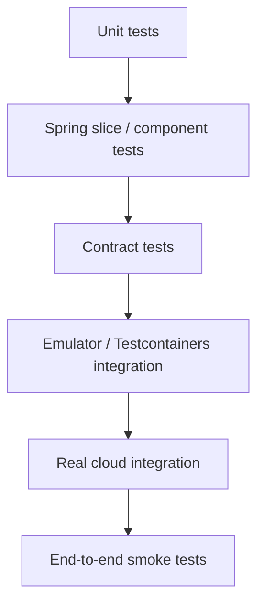
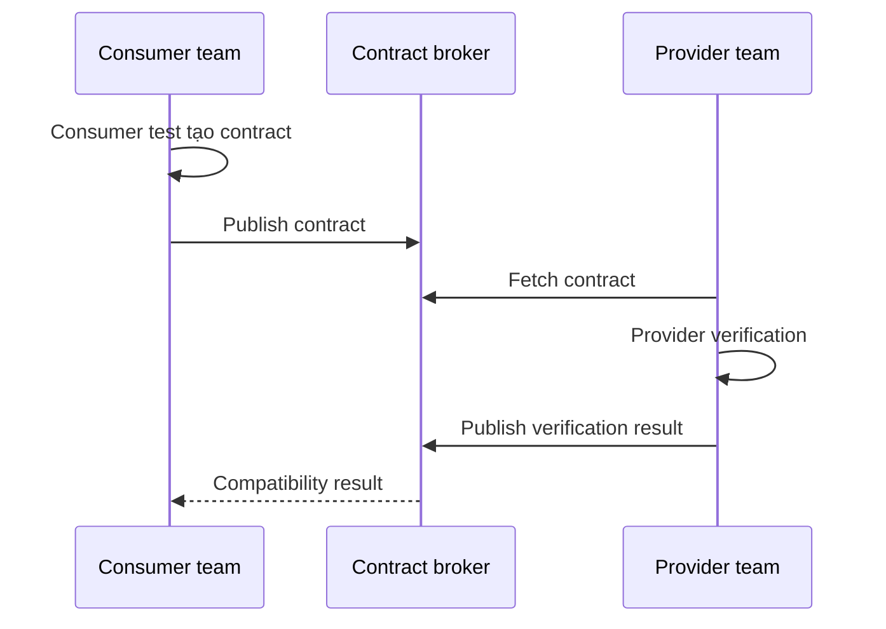
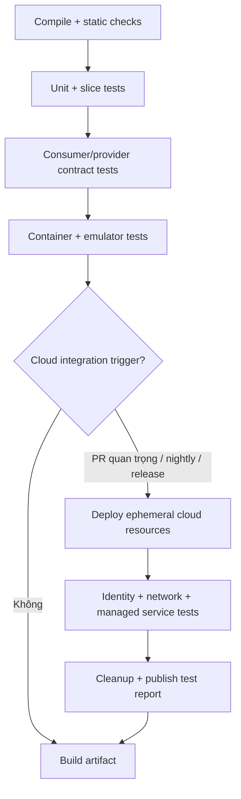

# Phân biệt unit test, kiểm thử hợp đồng và kiểm thử trên dịch vụ thật

> **Chương:** Kiểm thử tích hợp  
> **Module:** SPRING_CLOUD_PROVIDER_INTEGRATION  
> **Mục tiêu:** Xây dựng chiến lược kiểm thử cho ứng dụng Spring Boot tích hợp dịch vụ managed của AWS, Azure và Google Cloud; phân biệt unit test, component/integration test, contract test, emulator test và kiểm thử trên cloud thật; chọn đúng cấp kiểm thử cho từng rủi ro.

## 1. Vì sao một bài test pass chưa chứng minh tích hợp cloud hoạt động?

Một service Spring Boot có thể nhận yêu cầu tạo tài liệu, lưu file vào object storage, ghi metadata vào database, phát event lên message broker và đọc secret từ secret manager. Mỗi bước có thể hoạt động riêng nhưng toàn bộ luồng vẫn lỗi khi triển khai:

- Unit test chứng minh service tạo đúng metadata nhưng không chứng minh SDK gọi đúng API của object storage.
- Test với mock xác nhận publisher được gọi nhưng không chứng minh message thực sự được broker nhận.
- Emulator chấp nhận request nhưng môi trường cloud từ chối do IAM/RBAC thiếu quyền.
- Integration test trên cloud thành công với tài khoản developer có quyền rộng nhưng workload identity production không có quyền đó.
- Consumer nhận message đúng trong một lần chạy nhưng xử lý trùng khi broker redeliver.
- Local test chạy được qua public endpoint nhưng production dùng private endpoint, DNS hoặc network policy khác.

Vì vậy, kiểm thử tích hợp cloud cần nhiều cấp. Mỗi cấp trả lời một câu hỏi khác nhau và có chi phí, tốc độ, độ tin cậy khác nhau.

**Mục tiêu không phải chạy mọi test ở mọi cấp.** Hãy đặt mỗi assertion ở cấp thấp nhất có thể kiểm tra đúng rủi ro, rồi bổ sung một số kiểm thử trên dịch vụ thật cho những hành vi emulator không thể xác nhận.

## 2. Bản đồ các cấp kiểm thử

| Cấp kiểm thử | Phạm vi | Câu hỏi chính | Tốc độ/chi phí |
| --- | --- | --- | --- |
| **Unit test** | Một class hoặc domain service, dependency được thay bằng fake/mock | Logic nghiệp vụ có đúng không? | Nhanh, rẻ |
| **Slice test** | Một lát Spring như MVC, JSON, JPA | Cấu hình/lớp framework cụ thể có đúng không? | Nhanh |
| **Component test** | Một component cùng các adapter liên quan, có thể dùng dependency local | Các class và cấu hình trong component có phối hợp đúng không? | Trung bình |
| **Contract test** | Giao kèo giữa consumer và provider hoặc schema của event | Hai phía có hiểu cùng một contract không? | Nhanh đến trung bình |
| **Emulator/container integration test** | Ứng dụng kết nối service giả lập hoặc container thật chạy local | SDK, serialization, protocol và flow có hoạt động với implementation này không? | Trung bình |
| **Real cloud integration test** | Tài nguyên managed thật trong account/project test | Identity, IAM/RBAC, network, quota và behavior cloud có đúng không? | Chậm hơn, có chi phí |
| **End-to-end test** | Một workflow qua nhiều service và cloud resource | Người dùng có hoàn tất được hành trình quan trọng không? | Chậm, dễ nhiễu |

Một test có tên `@SpringBootTest` chưa mặc nhiên là integration test với cloud thật. Nếu test thay Service Bus, S3, Pub/Sub hoặc Key Vault bằng mock, nó chỉ xác minh Spring context và cách component gọi mock. Phải nhìn vào dependency thực sự đang chạy để phân loại test.



Sơ đồ thể hiện lộ trình tăng dần về phạm vi. Contract test có thể chạy độc lập song song với component test; không bắt buộc tất cả test phải phụ thuộc tuần tự như pipeline trên.

## 3. Unit test: kiểm tra logic không phụ thuộc cloud

Unit test tập trung vào quyết định nghiệp vụ của class. Không khởi động Spring ApplicationContext, không mở kết nối cloud, không cần Docker và không cần credential.

Ví dụ domain service quyết định object key, retention và event cần phát:

```java
public class DocumentService {

    private final DocumentRepository repository;
    private final ObjectStoragePort storage;
    private final EventPublisher publisher;

    public DocumentService(
            DocumentRepository repository,
            ObjectStoragePort storage,
            EventPublisher publisher) {
        this.repository = repository;
        this.storage = storage;
        this.publisher = publisher;
    }

    public Document create(CreateDocument command) {
        String key = "documents/" + command.documentId() + "/original";

        storage.put(key, command.content(), command.contentType());

        Document document = new Document(
                command.documentId(),
                key,
                command.ownerId(),
                DocumentStatus.UPLOADED);

        repository.save(document);

        publisher.publish(new DocumentUploaded(
                command.documentId(),
                key,
                command.ownerId()));

        return document;
    }
}
```

Unit test có thể dùng fake hoặc Mockito để kiểm tra:

- Object key được tạo đúng theo quy tắc domain.
- File rỗng hoặc content type không được phép bị từ chối.
- Repository nhận đúng trạng thái.
- Event chứa đúng document ID và storage key.
- Lỗi validation không gọi storage hoặc publisher.
- Quy tắc retry/idempotency ở tầng nghiệp vụ không tạo side effect trùng.

Ví dụ với JUnit 5 và Mockito:

```java
@ExtendWith(MockitoExtension.class)
class DocumentServiceTest {

    @Mock DocumentRepository repository;
    @Mock ObjectStoragePort storage;
    @Mock EventPublisher publisher;

    @InjectMocks DocumentService service;

    @Test
    void createsDocumentAndPublishesEvent() {
        CreateDocument command = new CreateDocument(
                "doc-123",
                "user-7",
                "application/pdf",
                new byte[] {1, 2, 3});

        Document result = service.create(command);

        assertEquals(DocumentStatus.UPLOADED, result.status());

        verify(storage).put(
                "documents/doc-123/original",
                command.content(),
                "application/pdf");

        verify(repository).save(any(Document.class));
        verify(publisher).publish(any(DocumentUploaded.class));
    }
}
```

Unit test này xác minh logic điều phối của DocumentService. Nó không xác minh object storage có nhận file, database có commit hay broker có lưu event.

### 3.1. Thiết kế port để unit test không phụ thuộc SDK

Đặt interface ở phía ứng dụng:

```java
public interface ObjectStoragePort {
    void put(String key, byte[] content, String contentType);
    byte[] get(String key);
    void delete(String key);
}

public interface EventPublisher {
    void publish(DocumentUploaded event);
}
```

Adapter triển khai các interface này bằng AWS SDK, Azure SDK hoặc Google Cloud client library. Domain service chỉ phụ thuộc port. Nhờ vậy:

- Unit test có thể dùng fake đơn giản.
- Contract test có thể xác minh payload và semantics của port.
- Integration test có thể thay adapter bằng implementation thật kết nối emulator hoặc cloud.
- Thay provider không buộc domain logic phải biết class SDK của provider.

Không tạo interface cho mọi class chỉ để mock. Port có ích khi nó biểu diễn ranh giới bên ngoài như storage, messaging, secret hoặc payment provider.

### 3.2. Những gì không nên kiểm tra bằng unit test

Không dùng unit test để kết luận:

- IAM role hoặc Azure RBAC đã được cấp đúng.
- Bucket/container/queue/topic tồn tại.
- SDK version tương thích với service endpoint.
- TLS, DNS, private endpoint hoặc firewall hoạt động.
- Message được broker giao cho consumer.
- Eventual consistency của một managed service.

Đó là các rủi ro cần test ở cấp component, emulator hoặc cloud thật.

## 4. Slice test và component test trong Spring Boot

### 4.1. Slice test kiểm tra một phần Spring

Spring Boot cung cấp các annotation test theo lát:

| Annotation | Phạm vi thường dùng |
| --- | --- |
| `@WebMvcTest` | MVC controller, validation, JSON mapping và web layer |
| `@JsonTest` | Jackson/JSON serialization và deserialization |
| `@DataJpaTest` | JPA repositories và persistence slice |
| `@RestClientTest` | HTTP client, request/response mapping và mock server support |
| `@SpringBootTest` | Tạo ApplicationContext của ứng dụng Spring Boot |

Slice test giúp phát hiện lỗi cấu hình và mapping nhanh. Ví dụ `@JsonTest` kiểm tra event DTO serialize thành JSON theo schema contract; `@WebMvcTest` kiểm tra API validation và error response.

Slice test thường không kết nối cloud. Nếu có mock bean cho `ObjectStoragePort`, test chỉ xác minh web layer gọi port đúng.

### 4.2. Component test kiểm tra adapter cùng Spring wiring

Component test có thể khởi tạo Spring context nhỏ hoặc đầy đủ nhưng chỉ thay những dependency ngoài phạm vi. Ví dụ kiểm tra adapter mapping:

- Storage adapter chuyển key, content type và metadata thành đúng request SDK.
- Messaging adapter đặt đúng `MessageId`, `CorrelationId`, `SessionId` và application properties.
- Secret adapter không ghi secret ra log và xử lý secret rotation đúng.
- Retry wrapper chỉ retry lỗi transient, không retry lỗi permission hoặc payload.

Khi test adapter, hãy tránh mock chính đối tượng mà bạn muốn kiểm tra. Nếu mock `S3Client` rồi chỉ verify method call, test không kiểm tra request serialization, endpoint hoặc service response thực tế. Test đó vẫn hữu ích như component/unit test nhưng không phải cloud integration test.

## 5. Contract test: kiểm tra hai phía có cùng hiểu một giao kèo

Contract test kiểm tra cách một consumer sử dụng provider và cách provider đáp ứng yêu cầu đó. Contract thường mô tả:

- HTTP method, path, query, header và response shape.
- Event name, schema version, payload fields và metadata.
- Message key, correlation ID, ordering requirement hoặc delivery semantics được hai phía thỏa thuận.
- Error response và behavior khi dữ liệu thiếu/không hợp lệ.

Contract test đặc biệt hữu ích khi nhiều team phát triển và deploy độc lập. Nó giúp phát hiện breaking change trước khi cần dựng toàn bộ hệ thống cùng nhau.

### 5.1. Consumer-driven contract test

Trong consumer-driven contract testing, consumer mô tả những tương tác mà nó thực sự cần. Framework tạo contract từ các test đó; provider chạy verification để chứng minh implementation vẫn đáp ứng contract.

Quy trình khái quát:

1. Consumer viết test cho API client hoặc message consumer với mock do contract tool cung cấp.
2. Test sinh contract artifact.
3. Contract được publish lên Pact Broker hoặc chia sẻ qua artifact repository.
4. Provider tải contract tương ứng.
5. Provider verification chạy từng interaction với provider đang chạy và so sánh kết quả.
6. Consumer/provider publish kết quả verification để pipeline biết cặp version nào tương thích.



Pact là công cụ consumer-driven contract testing phổ biến. Contract test không cần khởi chạy tất cả microservice cùng lúc; provider verification có thể chạy trên provider local với dependency ngoài được stub.

### 5.2. Contract test không phải mock test thông thường

| Mock/unit test | Contract test |
| --- | --- |
| Kiểm tra một class theo giả định do test tự định nghĩa | Kiểm tra tương tác theo contract được chia sẻ giữa consumer và provider |
| Mock thường nằm trong cùng codebase | Contract artifact có thể được chia sẻ giữa team/repository |
| Không có provider verification bắt buộc | Có bước provider xác minh contract |
| Không tự phát hiện provider thay đổi API | Có thể phát hiện provider không còn đáp ứng consumer contract |

Mock test có thể là bước tạo consumer contract, nhưng chỉ mock trong unit test không chứng minh provider thật đáp ứng contract.

### 5.3. Contract cho REST API

Với REST, contract có thể dựa trên OpenAPI, JSON Schema hoặc Pact:

- OpenAPI mô tả API surface và schema.
- JSON Schema mô tả cấu trúc dữ liệu.
- Pact mô tả interaction cụ thể mà consumer cần.
- Provider verification kiểm tra implementation thực tế.

OpenAPI lint hoặc schema validation đơn lẻ không chứng minh behavior của provider đúng; cần kiểm tra các interaction quan trọng.

### 5.4. Contract cho asynchronous message

Với message broker, contract nên định nghĩa:

| Thành phần | Ví dụ |
| --- | --- |
| Event type | `DocumentUploaded` |
| Schema version | `1` |
| Payload | `documentId`, `objectKey`, `ownerId`, `occurredAt` |
| Metadata | `eventId`, `correlationId`, `contentType` |
| Compatibility rule | Consumer mới vẫn đọc event version cũ |
| Delivery assumptions | At-least-once, có thể redelivery |
| Ordering requirement | Theo aggregate/session key nếu có |
| Error behavior | Poison message, retry, DLQ |

Contract test kiểm tra producer phát đúng event shape và consumer có thể deserialize/diễn giải event. Nó không chứng minh broker đang cấp IAM permission hoặc thực hiện delivery guarantee ngoài cấu hình thực tế.

Ví dụ schema JSON minh họa:

```json
{
  "$id": "DocumentUploaded.v1",
  "type": "object",
  "required": [
    "eventId",
    "documentId",
    "objectKey",
    "occurredAt"
  ],
  "properties": {
    "eventId": { "type": "string" },
    "documentId": { "type": "string" },
    "objectKey": { "type": "string" },
    "ownerId": { "type": "string" },
    "occurredAt": { "type": "string", "format": "date-time" }
  },
  "additionalProperties": false
}
```

Quy tắc `additionalProperties` phải được quyết định rõ. Đặt `false` giúp strict validation nhưng có thể khiến consumer cũ từ chối field mới. Với event evolution, cần chọn compatibility policy: thêm field optional, không đổi nghĩa field cũ, versioning khi breaking change và kiểm thử producer/consumer cùng policy.

### 5.5. Contract test không kiểm tra cloud provider API

Một Pact contract giữa Order Service và Inventory Service không chứng minh AWS S3, Azure Blob Storage hay Google Cloud Storage đang hoạt động đúng. Nó kiểm tra giao kèo của các service do ứng dụng kiểm soát.

Đối với API của cloud provider:

- Dùng SDK chính thức và contract/version tương ứng của SDK.
- Dùng emulator hoặc service thật để kiểm tra request/response behavior.
- Dùng cloud integration test để kiểm tra IAM/RBAC, network, quota và policy.
- Không tự viết Pact contract giả định thay cho API specification chính thức của provider.

## 6. Emulator và Testcontainers: kiểm thử với dependency chạy local

Emulator mô phỏng API hoặc behavior của managed service. Testcontainers quản lý vòng đời container trong test. Hai khái niệm này khác nhau:

- **Emulator:** implementation thay thế của một cloud service.
- **Testcontainers:** cơ chế khởi chạy và quản lý container dependency.
- **Real service container:** ví dụ PostgreSQL hoặc Redis thật chạy trong container, không phải emulator cloud.

Dùng emulator giúp test adapter qua protocol/API thực tế hơn mock. Tuy nhiên emulator chỉ đáng tin trong phạm vi feature nó hỗ trợ.

### 6.1. Spring Boot + Testcontainers cho database

Ví dụ dùng PostgreSQL container làm database integration test:

```java
import org.junit.jupiter.api.Test;
import org.springframework.beans.factory.annotation.Autowired;
import org.springframework.boot.test.context.SpringBootTest;
import org.springframework.boot.testcontainers.service.connection.ServiceConnection;
import org.springframework.test.context.ActiveProfiles;
import org.testcontainers.junit.jupiter.Container;
import org.testcontainers.junit.jupiter.Testcontainers;
import org.testcontainers.containers.PostgreSQLContainer;

import static org.assertj.core.api.Assertions.assertThat;

@Testcontainers
@SpringBootTest
@ActiveProfiles("integration")
class DocumentRepositoryIT {

    @Container
    @ServiceConnection
    static PostgreSQLContainer<?> postgres =
            new PostgreSQLContainer<>("postgres:16-alpine");

    @Autowired
    DocumentRepository repository;

    @Test
    void persistsAndLoadsDocument() {
        Document document = new Document(
                "doc-it-001",
                "documents/doc-it-001/original",
                "user-it",
                DocumentStatus.UPLOADED);

        repository.save(document);

        assertThat(repository.findById("doc-it-001"))
                .isPresent()
                .get()
                .extracting(Document::status)
                .isEqualTo(DocumentStatus.UPLOADED);
    }
}
```

`@ServiceConnection` cho Spring Boot tự tạo connection details từ container được hỗ trợ. Cần dependency `spring-boot-testcontainers` ở scope test. Với container hoặc emulator không có factory hỗ trợ, dùng `@DynamicPropertySource` để truyền endpoint/port vào cấu hình ứng dụng.

Test này kiểm tra JPA mapping và SQL trên PostgreSQL thật trong container. Nó không kiểm tra IAM hoặc cloud storage.

### 6.2. Dùng Testcontainers cho emulator

Một test có thể khởi động emulator container trước khi tạo Spring context, lấy mapped port rồi cấu hình SDK endpoint. Mẫu khái niệm:

```java
@Testcontainers
@SpringBootTest
class ObjectStorageAdapterIT {

    @Container
    static GenericContainer<?> storageEmulator =
            new GenericContainer<>(
                    DockerImageName.parse("emulator-image:version"))
                    .withExposedPorts(8080);

    @DynamicPropertySource
    static void emulatorProperties(DynamicPropertyRegistry registry) {
        registry.add(
                "app.storage.endpoint",
                () -> "http://"
                        + storageEmulator.getHost()
                        + ":"
                        + storageEmulator.getMappedPort(8080));
    }

    @Autowired
    ObjectStoragePort storage;

    @Test
    void uploadsAndReadsObject() {
        storage.put("it/doc-1", new byte[] {1, 2, 3},
                "application/octet-stream");

        assertArrayEquals(
                new byte[] {1, 2, 3},
                storage.get("it/doc-1"));
    }
}
```

`emulator-image:version`, port, credentials và property key là placeholder theo emulator cụ thể, không phải image dùng chung cho AWS/Azure/GCP. Pin image version; không dùng tag `latest` vì emulator update có thể làm test thay đổi ngoài ý muốn.

### 6.3. AWS: LocalStack

LocalStack cung cấp môi trường giả lập cho nhiều API AWS và có module Testcontainers. Có thể dùng để kiểm tra adapter với các dịch vụ được hỗ trợ như S3, SQS, SNS hoặc DynamoDB.

Nên kiểm tra:

- Tạo bucket/queue/table theo test fixture.
- Upload/download object và metadata.
- Publish/consume message.
- Mapping error code và retry behavior.
- Resource cleanup và endpoint override.

Giới hạn:

- Feature coverage khác nhau theo service, API và edition.
- Một số advanced feature cần gói/edition phù hợp.
- IAM policy, account behavior, quotas, VPC endpoint và các control plane behavior có thể khác AWS thật.
- Test pass trên LocalStack không chứng minh production role có đúng permission.

Dùng AWS test account để xác minh workload identity, IAM policy, KMS, private networking, resource policy và các feature quan trọng không được emulator bao phủ.

### 6.4. Azure: emulator theo từng dịch vụ

Không có một emulator duy nhất thay thế toàn bộ Azure. Chọn emulator theo dịch vụ:

| Dịch vụ | Công cụ local thường dùng | Điều cần kiểm tra trên Azure thật |
| --- | --- | --- |
| Blob Storage | Azurite | Microsoft Entra ID, RBAC, managed identity, private endpoint, lifecycle/policy |
| Service Bus | Azure Service Bus emulator | Entra ID, partitioning, JMS, AMQP WebSockets, cloud metrics/alerts và feature khác biệt |
| Database | Container database tương ứng hoặc emulator của dịch vụ | Firewall, identity, tier, backup/HA và cloud-specific behavior |
| Key Vault | Mock/test double hoặc service test riêng | Managed Identity, RBAC/access policy, network, rotation và audit |

Azure Service Bus emulator hữu ích cho test local bằng AMQP TCP, nhưng có giới hạn: không hỗ trợ JMS, partitioned entities, AMQP WebSockets hoặc Microsoft Entra ID; dữ liệu/entity không persist sau khi container restart. Do đó không dùng emulator để kết luận JMS, partitioning, RBAC hoặc private networking hoạt động đúng trên cloud.

Azurite phù hợp với API Storage được hỗ trợ cho phát triển local. Nó không thay thế kiểm thử identity/RBAC và tất cả behavior của Azure Storage production.

### 6.5. Google Cloud: emulator theo dịch vụ

Google Cloud cung cấp emulator cho một số dịch vụ, ví dụ Pub/Sub emulator:

- Tạo topic/subscription.
- Publish message.
- Pull/push message theo feature emulator hỗ trợ.
- Kiểm tra serialization, ack/nack và flow ứng dụng.
- Chạy test không cần gửi request tới project production.

Pub/Sub emulator có thể kiểm tra nhiều behavior message nhưng không hỗ trợ IAM operations. Một số behavior như retention, subscription expiration hoặc tính năng nâng cao có thể khác service thật. Với workload push, emulator cho phép HTTP local; production endpoint cần HTTPS. Hãy kiểm tra giới hạn hiện hành trước khi dựa vào emulator.

Với Cloud Storage, Firestore, Secret Manager hoặc BigQuery, chọn emulator/fake theo dịch vụ và xác minh feature coverage. Nếu không có emulator đủ phù hợp, dùng fake ở unit test và dành một số integration test cho project cloud test.

## 7. Kiểm thử trên dịch vụ cloud thật: khi nào cần?

Emulator không thể xác nhận tất cả các lớp kiểm soát của cloud. Real cloud integration test cần thiết khi rủi ro liên quan tới:

- Microsoft Entra ID, AWS IAM hoặc Google Cloud IAM.
- Managed/workload identity và token audience/scope.
- Resource policy, bucket policy, key policy hoặc role binding.
- Private endpoint, VPC/VNet, DNS, firewall và TLS.
- Quota, throttling, regional behavior và service limits.
- Encryption bằng KMS/Key Vault/Cloud KMS.
- Service tier, partitioning, sessions, ordering hoặc feature-specific behavior.
- Audit log, monitoring, metrics, tracing và alert.
- Deployment configuration, IaC và permission boundary.

Không cần chạy mọi test nghiệp vụ trên cloud thật. Chọn một bộ smoke/integration test nhỏ, tập trung vào feature mà emulator không thể chứng minh.

### 7.1. Tách cloud test account/project

Dùng account/subscription/project riêng cho test:

- Không dùng production resource hoặc production data.
- Tạo resource theo prefix chứa pipeline run ID hoặc commit SHA.
- Gắn tag/label như `environment=test`, `owner=integration-tests`, `expires-at`.
- Dùng bucket/container/queue/topic riêng cho từng suite hoặc test run.
- Tạo data fixture xác định và cleanup sau test.
- Có scheduled janitor xóa resource hết hạn nếu pipeline bị dừng trước cleanup.
- Hạn chế quota và ngân sách cho test project.

Tên tài nguyên cần unique vì nhiều pipeline có thể chạy đồng thời. Không dùng chung queue hoặc bucket cho các test song song nếu test có thể xóa hoặc consume data của nhau.

### 7.2. Chạy bằng đúng identity của workload

Một test chạy bằng quyền Owner/Administrator có thể pass dù ứng dụng production thiếu quyền. Hãy kiểm tra bằng identity tương đương workload:

- AWS: IAM role được assume qua CI OIDC hoặc role test; kiểm tra action/resource scope.
- Azure: Managed Identity hoặc service principal test với Azure RBAC Data Sender/Receiver/Storage roles.
- Google Cloud: service account hoặc Workload Identity Federation với IAM roles cần thiết.

Không lưu access key, SAS token, client secret hoặc service account key trong repository. Ưu tiên OIDC/workload identity federation của CI. Tạo role tối thiểu theo service và resource test.

Có thể có hai loại kiểm thử quyền:

1. **Positive permission test:** thao tác ứng dụng cần làm thành công.
2. **Negative permission test:** thao tác ngoài phạm vi quyền phải bị từ chối.

Negative test nên dùng identity được thiết kế riêng; không cố ý thu hồi quyền của identity dùng chung trong khi pipeline khác đang chạy.

### 7.3. Kiểm tra network giống môi trường triển khai

Nếu production dùng private endpoint hoặc private service access, test runner cũng phải chạy trong network path phù hợp. Một test từ laptop gọi public endpoint không chứng minh pod trong private subnet resolve DNS và kết nối đúng.

Kiểm tra:

- DNS private zone và hostname resolution.
- Firewall egress/ingress.
- TLS certificate chain và hostname verification.
- Proxy/service mesh nếu có.
- VNet/VPC route và endpoint policy.
- Connection timeout, retry và failover.

### 7.4. Tạo và dọn resource an toàn

Mẫu lifecycle của một cloud integration test:

```java
class CloudResourceFixture implements AutoCloseable {

    private final String runId =
            UUID.randomUUID().toString().replace("-", "");

    private final String bucketName =
            "it-documents-" + runId;

    void create() {
        // Tạo bucket/container hoặc queue riêng cho test run.
        // Gắn tag/label để janitor có thể tìm và dọn.
    }

    @Override
    public void close() {
        // Xóa object/message trước, sau đó xóa resource.
        // Cleanup phải idempotent và có log khi thất bại.
    }
}
```

Trong JUnit, quản lý fixture bằng `@BeforeAll/@AfterAll` hoặc `try-with-resources`. Đảm bảo cleanup chạy ngay cả khi assertion thất bại. Với resource có eventual deletion, không giả định xóa xong tức thì; poll trạng thái tới timeout hữu hạn.

## 8. Một bộ test mẫu cho Spring Boot tích hợp managed service

Giả sử Document Service dùng PostgreSQL, object storage và message broker.

### 8.1. Unit test cho domain service

Kiểm tra:

- Tạo document key.
- Validate owner, file size, content type.
- Chọn trạng thái ban đầu.
- Sinh event đúng schema.
- Không phát event nếu business validation fail.

Không mở Spring context hoặc cloud connection.

### 8.2. Integration test cho persistence

Dùng PostgreSQL Testcontainers để kiểm tra:

- Entity mapping.
- Unique constraint và transaction rollback.
- Migration schema.
- Query/index cần thiết.
- Inbox/outbox persistence và concurrent claim.

Không dùng H2 để kết luận PostgreSQL SQL hoặc transaction semantics tương đương. In-memory database có thể hữu ích cho test logic đơn giản nhưng không thay thế engine production.

### 8.3. Adapter test với emulator

Dùng LocalStack/Azurite/Service Bus emulator/Pub/Sub emulator phù hợp để kiểm tra:

- SDK client config và endpoint override.
- Request mapping, payload encoding và metadata.
- Upload/read hoặc send/receive cơ bản.
- Error mapping và serialization.
- Cleanup resource và test isolation.

Test phải xác nhận kết quả ở phía service, không chỉ verify rằng SDK method được gọi.

### 8.4. Contract test giữa service

Giả sử Document Service phát `DocumentUploaded.v1`, Preview Worker consume event đó:

- Producer test tạo event theo schema contract.
- Consumer test đọc payload contract và xử lý tương thích.
- Provider verification kiểm tra service phát event đáp ứng contract.
- Kiểm thử compatibility khi thêm field optional hoặc tăng schema version.
- Kiểm tra consumer xử lý event cũ còn trong backlog.

Nếu event được phát qua topic với nhiều subscription, contract phải mô tả mỗi consumer thực sự phụ thuộc vào field nào. Không để consumer phụ thuộc vào field nội bộ chưa được cam kết.

### 8.5. Real cloud integration test

Chạy một test nhỏ trên test account/project:

1. Workload test xác thực bằng đúng identity.
2. Tạo hoặc truy cập resource test.
3. Upload object và đọc lại.
4. Publish event lên queue/topic.
5. Consumer test nhận message và ghi kết quả.
6. Xác minh metadata, encryption và policy quan trọng.
7. Cleanup tài nguyên và ghi lại lỗi cleanup.

Nếu test dùng Service Bus session, KMS, Key Vault RBAC hoặc private endpoint, hãy tạo test riêng cho feature đó thay vì chỉ chạy happy path chung.
## 9. Kiểm thử asynchronous flow và eventual consistency

Cloud integration thường bất đồng bộ. Sau khi publish event, consumer có thể chưa xử lý ngay. Sau khi tạo resource, metadata/index có thể chưa xuất hiện ngay ở một số dịch vụ.

Không dùng sleep cố định dài như `Thread.sleep(10000)` để chờ mọi test. Dùng polling có timeout:

```java
await()
        .atMost(Duration.ofSeconds(30))
        .pollInterval(Duration.ofMillis(250))
        .untilAsserted(() -> {
            DocumentStatus status =
                    documentRepository.findStatus("doc-it-001");

            assertThat(status).isEqualTo(DocumentStatus.PREVIEW_READY);
        });
```

Dùng Awaitility hoặc polling helper tương đương. Timeout phải phản ánh SLA của test environment; không tăng timeout vô hạn để che một consumer bị treo.

### 9.1. Kiểm thử message delivery semantics

Với broker at-least-once, cùng message có thể được giao nhiều lần. Test cần mô phỏng:

- Consumer commit database nhưng complete/ack thất bại.
- Consumer crash trước commit.
- Message bị redeliver sau lock expiry.
- Producer timeout sau khi broker đã nhận message.
- Retry/DLQ khi payload không hợp lệ.
- Event bị replay.

Assert kết quả nghiệp vụ chỉ được áp dụng một lần nhờ idempotency/inbox. Không assert rằng callback chỉ chạy đúng một lần.

### 9.2. Kiểm thử ordering và concurrency

Nếu workload yêu cầu ordering:

- Gửi nhiều event cùng aggregate/session ID.
- Gửi event cho hai aggregate khác nhau.
- Xác minh thứ tự trong một aggregate.
- Xác minh các aggregate độc lập vẫn có thể xử lý song song.
- Mô phỏng retry hoặc DLQ replay và kiểm tra business sequence.

Không dựa vào thứ tự log timestamp để xác minh ordering; lưu sequence/version đã áp dụng vào database hoặc audit record.

### 9.3. Kiểm thử timeout, retry và throttling

Dùng fault injection hoặc stub dependency để mô phỏng:

- Connect timeout.
- Read timeout.
- HTTP 429/503 hoặc provider throttling.
- DNS failure.
- Credential expired/permission denied.
- Connection reset trong lúc send/settlement.

Phân biệt lỗi transient và permanent. Test phải chứng minh backoff có giới hạn, retry không giữ thread/lock quá lâu và lỗi vĩnh viễn không tạo retry loop vô hạn.

## 10. Kiểm thử identity, secret và bảo mật

Một ứng dụng có thể truy cập storage thành công bằng developer credential nhưng thất bại khi chạy bằng Managed Identity. Đây là lý do identity phải được test trong môi trường cloud.

| Rủi ro | Test nên có |
| --- | --- |
| IAM/RBAC thiếu quyền | Positive test cho đúng action và negative test cho action không được cấp |
| Credential chain chọn nhầm identity | Log identity metadata an toàn; xác minh principal/object ID trong cloud test |
| Secret rotation | Đổi version secret, xác minh client refresh theo chính sách |
| Token hết hạn | Kiểm tra refresh/re-auth và retry |
| KMS/Key Vault/Cloud KMS | Encrypt/decrypt bằng đúng identity và key policy |
| Private endpoint | Chạy test từ network path của workload |
| TLS | Xác minh certificate chain và hostname |
| Secret bị log | Capture logs và assert không có secret/token/connection string |

Không ghi secret thật vào test fixture. Dùng synthetic secret và test vault/project riêng. Khi cần xác minh rotation, tạo version test mới rồi kiểm tra ứng dụng sử dụng version theo chính sách cache/refresh.

## 11. Kiểm thử hạ tầng và cấu hình cloud

Code ứng dụng có thể đúng nhưng IaC tạo bucket, queue hoặc role sai. Kiểm thử hạ tầng cần tách với test business logic:

- Format/lint IaC.
- Validate module và variable.
- Static security/policy checks.
- Plan/diff review.
- Emulator test cho resource API được hỗ trợ.
- Deploy ephemeral environment và kiểm tra resource thực tế.
- Xác minh policy, encryption, network và lifecycle.
- Teardown environment.

Một test Terraform plan không chứng minh quyền truy cập runtime. Một test ứng dụng gọi storage thành công không chứng minh bucket policy chỉ cấp đúng phạm vi. Cần test cả resource configuration và runtime behavior.

### 11.1. Kiểm tra resource policy và quyền tối thiểu

Ví dụ test có thể xác minh:

- App role chỉ đọc/ghi prefix bucket test cần thiết.
- App role không được xóa bucket hoặc thay policy.
- Service Bus consumer có quyền receive nhưng không có quyền manage entity.
- Key Vault identity chỉ đọc secret được chỉ định.
- GCP service account không có project-wide Editor nếu chỉ cần quyền trên một resource.

Test negative permission cần phân biệt lỗi access denied với lỗi network hoặc resource not found. Assert theo mã lỗi/exception phù hợp, không chỉ assert rằng “có exception”.

## 12. Thiết kế test data và isolation

Integration test dễ flaky khi test dùng chung tài nguyên hoặc dữ liệu.

### 12.1. Dữ liệu độc lập

- Mỗi test có ID riêng.
- Bucket/container dùng prefix riêng.
- Queue/topic/subscription hoặc database schema riêng khi cần.
- Không phụ thuộc thứ tự chạy test.
- Không dùng dữ liệu do test khác tạo.
- Reset trạng thái trước và sau test.

### 12.2. Chạy song song

Khi chạy parallel:

- Không dùng một queue chung nếu consumer của test A có thể nhận message test B.
- Đặt correlation ID và test run ID vào metadata.
- Tạo subscription hoặc entity riêng nếu cần.
- Dùng unique constraint/lease để tránh hai test cùng claim một row.
- Đảm bảo cleanup chỉ xóa resource của test run hiện tại.

### 12.3. Cleanup và resource rò rỉ

Một pipeline có thể bị hủy trước `@AfterAll`. Cloud resource không tự biến mất chỉ vì JVM dừng. Hãy dùng:

- Tag/label có owner và expiry.
- TTL hoặc lifecycle policy nếu dịch vụ hỗ trợ.
- Scheduled cleanup job.
- Bộ lọc resource theo project/account và test prefix.
- Dashboard theo dõi resource test còn tồn tại.

Cleanup phải idempotent: xóa resource đã không tồn tại không làm pipeline thất bại theo cách che mất lỗi gốc. Tuy nhiên, ghi lại cleanup failure để nhóm vận hành biết có resource rò rỉ.

## 13. Tổ chức test suite trong Maven/Gradle

Có thể phân nhóm theo tag hoặc source set:

| Nhóm | Ví dụ tên | Chạy ở đâu |
| --- | --- | --- |
| Unit | `*Test` | Mọi commit |
| Slice | `*SliceTest` | Pull request |
| Contract | `*ContractTest` | Pull request và provider build |
| Container/emulator | `*IntegrationTest` | Pull request hoặc CI runner có Docker |
| Real cloud | `*CloudIT` | Pipeline riêng, nightly hoặc trước release |
| E2E | `*E2ETest` | Staging/pre-release |

Ví dụ JUnit tags:

```java
@Tag("unit")
class DocumentPolicyTest {
}

@Tag("contract")
class DocumentEventContractTest {
}

@Tag("cloud")
class AzureStorageCloudIT {
}
```

Maven Surefire/Failsafe hoặc Gradle test tasks có thể chọn tag/group tương ứng. Tên task và plugin config tùy build hiện tại; giữ một quy ước nhất quán và đảm bảo CI thật sự chạy các nhóm cần thiết.

### 13.1. Pipeline gợi ý



Các nhóm nhanh nên chạy trên mọi pull request. Real cloud suite có thể chạy theo lịch, trước release hoặc với thay đổi liên quan IAM/network/provider adapter. Không bỏ qua cloud suite vô thời hạn vì chi phí; hãy có trigger rõ ràng và báo trạng thái test gần nhất.

### 13.2. Phân biệt flaky test và bug thật

Khi test cloud thất bại:

1. Ghi correlation ID, request ID, region, resource ID và timestamp.
2. Phân loại lỗi auth, network, throttling, quota, eventual consistency hoặc assertion.
3. Kiểm tra retry có che mất lỗi gốc không.
4. Chạy lại test có giới hạn để xác định tính lặp lại.
5. Không thêm sleep dài hoặc retry vô hạn để làm pipeline xanh.
6. Nếu test flaky do chia sẻ resource, sửa isolation thay vì chỉ rerun.

Test report cần cho biết test chạy với emulator hay cloud thật, region/tier, SDK version và identity type. Không đưa credential hoặc payload nhạy cảm vào report.

## 14. Ma trận kiểm thử theo provider và dịch vụ

| Provider | Dịch vụ | Unit/contract | Emulator/container | Cloud thật cần xác minh |
| --- | --- | --- | --- | --- |
| AWS | S3 | Object key, metadata, error mapping | LocalStack nếu API cần được hỗ trợ | IAM, bucket policy, KMS, VPC endpoint, lifecycle |
| AWS | SQS/SNS | Event schema, routing contract | LocalStack | IAM, DLQ/redrive, visibility, FIFO/dedup, KMS |
| AWS | DynamoDB | Repository mapping, conditional write | LocalStack hoặc DynamoDB Local | IAM, TTL/streams, capacity/throttling, global tables |
| Azure | Blob Storage | Blob key, metadata, content type | Azurite | Entra ID, RBAC, private endpoint, encryption/lifecycle |
| Azure | Service Bus | Message schema, settlement contract | Service Bus emulator | Entra ID, partitioning, sessions, JMS, network, metrics |
| Azure | Key Vault | Secret adapter behavior | Fake/test double hoặc service test riêng | Managed Identity, RBAC, network, rotation/audit |
| Google Cloud | Cloud Storage | Object metadata/contract | Emulator/fake nếu phù hợp | IAM, CMEK, retention, VPC Service Controls |
| Google Cloud | Pub/Sub | Event schema, ack/idempotency | Pub/Sub emulator | IAM, push HTTPS, dead-letter/retry policy, ordering |
| Google Cloud | Firestore | Repository mapping | Firestore emulator | IAM, indexes, consistency, backup và quota |
| Google Cloud | Secret Manager | Secret adapter behavior | Fake/test double | IAM, version rotation, audit, network |

Bảng này là điểm bắt đầu, không phải cam kết rằng emulator hỗ trợ mọi API. Luôn kiểm tra feature matrix/version của emulator và SDK trước khi chọn test.

## 15. Ví dụ kế hoạch kiểm thử cho một luồng hoàn chỉnh

**Luồng:** người dùng upload PDF; Spring Boot lưu file vào object storage, ghi metadata vào PostgreSQL, phát `DocumentUploaded`; Preview Worker nhận event, tạo preview rồi cập nhật trạng thái.

| Test | Cấp | Assertion |
| --- | --- | --- |
| Validate file type/size | Unit | File không hợp lệ bị từ chối |
| Generate object key | Unit | Key ổn định và không chứa path traversal |
| Serialize DocumentUploaded | Contract | Schema/version/required fields đúng |
| Save document metadata | Testcontainers DB | Row và transaction đúng |
| Upload/download object | Emulator | Nội dung và metadata khớp |
| Publish/consume event | Emulator | Message được nhận, correlation ID đúng |
| Consumer redelivery | Emulator hoặc cloud | Inbox ngăn side effect trùng |
| Identity storage/broker | Cloud thật | Workload identity có đúng role |
| Encryption/private endpoint | Cloud thật | KMS/Key Vault và network policy hoạt động |
| End-to-end preview | Cloud staging | Document đạt PREVIEW_READY trong timeout |
| Cleanup | Cloud test fixture | Object, message và resource test được dọn |

Không cần một test E2E xác minh mọi lỗi. Chia assertion thành nhiều test nhỏ giúp xác định nguyên nhân nhanh và giảm số lần chạy cloud đắt tiền.

## 16. Những sai lầm thường gặp

### 16.1. Mock SDK rồi gọi đó là integration test

Mock S3Client/BlobClient/PubSub client chỉ kiểm tra cách adapter gọi SDK. Đặt tên test chính xác; dùng emulator hoặc service thật để kiểm tra giao tiếp.

### 16.2. Dùng emulator làm bằng chứng về IAM

Emulator thường không tái tạo đầy đủ identity, IAM/RBAC, policy và network. Test auth bằng đúng identity trên cloud test account/project.

### 16.3. Chỉ test bằng quyền admin

Quyền rộng che lỗi permission. Dùng workload identity và role tối thiểu tương tự production.

### 16.4. Chạy test trên resource dùng chung

Test có thể consume/xóa message của test khác, ghi đè object hoặc dọn resource của pipeline khác. Dùng namespace/prefix/test run ID riêng.

### 16.5. Assert xử lý message đúng một lần

At-least-once delivery cho phép redelivery. Assert business effect chỉ xảy ra một lần nhờ idempotency, không assert callback chỉ chạy một lần.

### 16.6. Không kiểm tra cleanup

Cloud resource bị bỏ lại gây chi phí và nhiễu các lần chạy sau. Dùng expiry tag, janitor và cleanup idempotent.

### 16.7. Dùng sleep cố định cho async test

Sleep làm test chậm và vẫn flaky. Dùng polling với timeout, kiểm tra trạng thái cuối và giữ log/trace đủ để chẩn đoán.

### 16.8. Đưa cloud integration test vào mọi commit mà không phân loại

Một suite cloud dài có thể làm feedback loop chậm và tiêu tốn quota. Giữ unit/contract/emulator nhanh trên PR; chạy cloud suite theo trigger rủi ro, nightly và trước release.

## 17. Bài thực hành: kiểm thử Document Service trên ba cấp

**Bối cảnh:** Document Service dùng PostgreSQL, object storage và message broker. Hãy thiết kế test để phân biệt logic ứng dụng, contract giữa service và behavior của managed cloud.

### Phần A — Unit test

- Tạo port `ObjectStoragePort` và `EventPublisher`.
- Viết test cho validation, object key và event payload.
- Dùng fake/mock để xác minh business rule.
- Thêm test lỗi và idempotency.

### Phần B — Contract test

- Định nghĩa `DocumentUploaded.v1`.
- Viết consumer contract cho Preview Worker.
- Viết producer test xác minh event schema.
- Kiểm tra backward compatibility khi thêm field optional.
- Ghi rõ delivery semantics và metadata cần thiết.

### Phần C — Testcontainers và emulator

- Khởi động PostgreSQL bằng Testcontainers.
- Chạy ứng dụng Spring Boot với profile `integration`.
- Dùng emulator phù hợp cho storage và messaging.
- Upload/đọc object, publish/consume event.
- Mô phỏng redelivery và xác minh inbox.

### Phần D — Cloud integration test

- Tạo account/project/subscription test.
- Cấp identity với quyền tối thiểu.
- Tạo resource theo test run ID.
- Xác minh upload, encryption, event delivery và policy.
- Kiểm tra private endpoint nếu production dùng private network.
- Cleanup và xác minh không còn resource.

### Phần E — Pipeline

- Chạy unit/slice/contract trên pull request.
- Chạy Testcontainers/emulator trên CI.
- Chạy cloud integration nightly hoặc trước release.
- Lưu test report với provider, region, SDK version và resource ID.
- Thêm janitor dọn resource quá hạn.

**Tiêu chí hoàn thành:** người học phân biệt đúng năm nhóm test chính; giải thích được mock, contract, emulator và real cloud chứng minh điều gì; viết được Spring Boot test với Testcontainers; thiết kế được identity-aware cloud test; và tạo pipeline có isolation, cleanup, chi phí và báo cáo rõ ràng.

---

## 18. Checklist trước khi merge hoặc release

| Nhóm | Câu hỏi |
| --- | --- |
| Unit | Business rule có được test độc lập khỏi cloud SDK không? |
| Spring slice | MVC/JSON/JPA mapping có test đúng phạm vi không? |
| Contract | Consumer và provider đã verify cùng contract version chưa? |
| Event schema | Có kiểm tra backward compatibility và metadata không? |
| Emulator | Feature test dùng emulator có nằm trong supported feature set không? |
| Testcontainers | Container version đã pin và cleanup lifecycle đúng chưa? |
| Real cloud | Có test các rủi ro emulator không thể xác minh không? |
| Identity | Test dùng workload identity với quyền tối thiểu chưa? |
| Network | Test runner có cùng network path cần thiết không? |
| Data isolation | Resource/data có unique theo test run không? |
| Async | Dùng polling timeout thay vì sleep cố định chưa? |
| Reliability | Có test redelivery, retry, duplicate và DLQ không? |
| Security | Report/log có loại bỏ secret và payload nhạy cảm không? |
| Cost | Có budget, expiry tag và cleanup job không? |
| CI | Nhóm test nhanh và cloud test có trigger/gating rõ ràng không? |
| Observability | Có correlation ID, request ID và SDK/provider version để chẩn đoán không? |

## Ghi nhớ

- **Unit test** xác minh logic nghiệp vụ; mock không chứng minh cloud service nhận request.
- **Slice/component test** xác minh Spring wiring và adapter trong phạm vi đã khởi chạy.
- **Contract test** xác minh consumer và provider hiểu cùng giao kèo; Pact không thay thế test IAM hoặc cloud API.
- **Emulator/Testcontainers** giúp kiểm tra protocol/API trong phạm vi feature hỗ trợ; không giả định emulator tương đương cloud thật.
- **Real cloud integration test** cần cho identity, IAM/RBAC, network, quota, encryption và behavior đặc thù provider.
- **End-to-end test** xác minh một số workflow quan trọng, không thay thế các test nhỏ hơn.
- Dùng test account/project, workload identity, resource unique, expiry tag và cleanup để kiểm soát an toàn/chi phí.
- Với async messaging, test redelivery và idempotency; không giả định callback chỉ chạy một lần.
- Pipeline nên chạy test nhanh thường xuyên và chạy cloud test theo rủi ro, nightly hoặc trước release.

Khi tích hợp Spring Boot với dịch vụ managed của AWS, Azure và Google Cloud, hãy chọn cấp kiểm thử theo câu hỏi cần trả lời. Dùng unit test cho domain logic, contract test cho giao kèo giữa service, emulator cho API behavior có hỗ trợ, và cloud thật cho identity/network/policy cùng các tính năng quan trọng. Kết hợp các cấp này tạo feedback nhanh mà vẫn kiểm chứng được rủi ro triển khai thực tế.

### Tài liệu chính thức

- [Spring Boot — Testing Spring Boot Applications](https://docs.spring.io/spring-boot/reference/testing/spring-boot-applications.html)
- [Spring Boot — Testcontainers and Service Connections](https://docs.spring.io/spring-boot/reference/testing/testcontainers.html)
- [Testcontainers — Getting Started](https://testcontainers.com/getting-started/)
- [Testcontainers — LocalStack module](https://testcontainers.com/modules/localstack/)
- [Pact — Introduction and Consumer-Driven Contracts](https://docs.pact.io/)
- [Pact — How Pact Works](https://docs.pact.io/getting_started/how_pact_works)
- [Pact — Provider Verification](https://docs.pact.io/getting_started/verifying_pacts)
- [AWS — Testing Serverless Applications](https://docs.aws.amazon.com/lambda/latest/dg/testing-guide.html)
- [AWS Prescriptive Guidance — Test AWS infrastructure with LocalStack](https://docs.aws.amazon.com/prescriptive-guidance/latest/patterns/test-aws-infra-localstack-terraform.html)
- [Microsoft Learn — Azure Service Bus Emulator Overview](https://learn.microsoft.com/en-us/azure/service-bus-messaging/overview-emulator)
- [Microsoft Learn — Test locally with the Azure Service Bus emulator](https://learn.microsoft.com/en-us/azure/service-bus-messaging/test-locally-with-service-bus-emulator)
- [Google Cloud — Test locally with the Pub/Sub emulator](https://docs.cloud.google.com/pubsub/docs/emulator)

Kiểm tra phiên bản Spring Boot, Testcontainers, emulator image, cloud SDK và feature coverage trước khi triển khai test. Emulator là công cụ phát triển/kiểm thử có phạm vi cụ thể; chỉ cloud test trong môi trường identity/network phù hợp mới xác minh được các điều kiện triển khai managed service.
