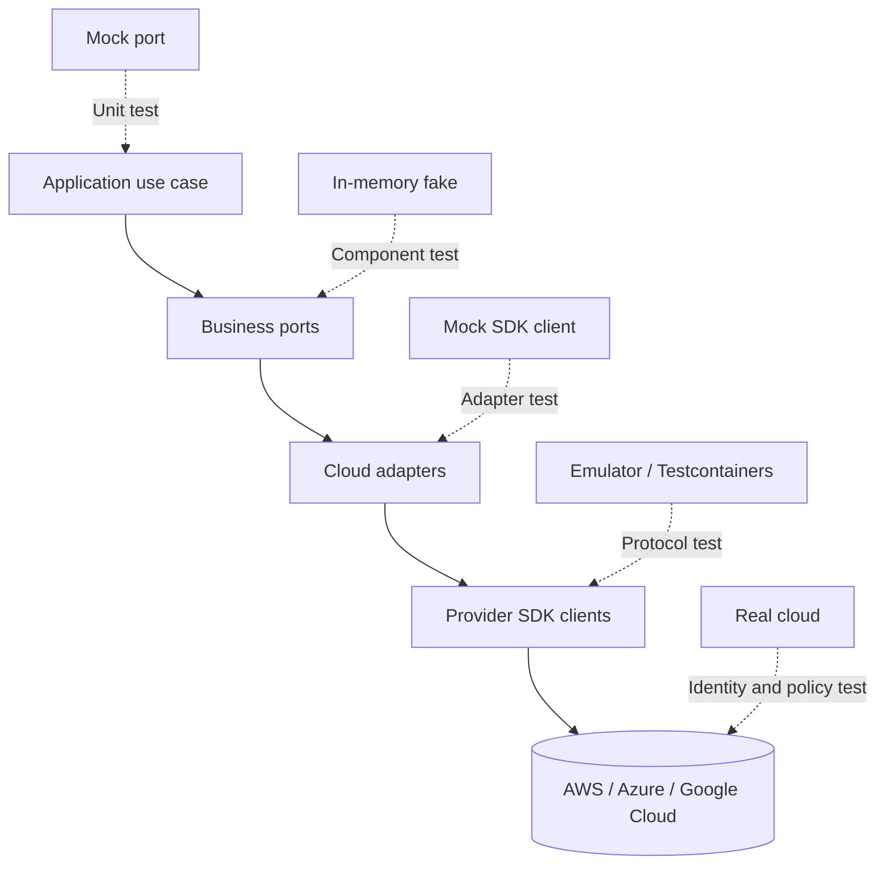

# Mock giao diện nghiệp vụ và giả lập client ở ranh giới thích hợp

> **Chương:** Kiểm thử tích hợp  
> **Module:** SPRING_CLOUD_PROVIDER_INTEGRATION  
> **Mục tiêu:** Biết đặt test double đúng ranh giới trong ứng dụng Spring Boot tích hợp cloud; dùng mock cho port nghiệp vụ, fake cho component cần trạng thái, mock SDK client để kiểm tra adapter mapping và nhận biết khi nào cần emulator hoặc dịch vụ cloud thật.

## 1. Mock đúng ranh giới giúp test nhanh mà vẫn có ý nghĩa

Một ứng dụng Spring Boot có thể dùng S3, Azure Blob Storage hoặc Google Cloud Storage để lưu file; dùng SQS, Service Bus hoặc Pub/Sub để phát sự kiện; và đọc cấu hình nhạy cảm từ Secrets Manager, Key Vault hoặc Secret Manager.

Nếu unit test gọi trực tiếp các dịch vụ cloud, test sẽ phụ thuộc credential, network, quota và trạng thái tài nguyên. Nếu mock mọi class trong ứng dụng, test có thể pass dù các component không phối hợp đúng. Cách làm phù hợp là đặt test double ở **ranh giới mà ứng dụng sở hữu và kiểm soát**:

- Ở tầng use case/domain, thay dependency bên ngoài bằng các interface nghiệp vụ (port).
- Ở tầng adapter, thay client SDK bằng mock để kiểm tra request được ánh xạ đúng.
- Ở component test, dùng fake có trạng thái để nhiều class phối hợp mà không cần network.
- Khi cần xác minh protocol/API, dùng emulator hoặc container.
- Khi cần xác minh IAM/RBAC, identity, network và behavior đặc thù provider, chạy test trên cloud thật.



Không có một loại test double phù hợp cho mọi tầng. Chọn theo câu hỏi cần trả lời. Mock một port nghiệp vụ giúp kiểm tra use case; mock SDK client giúp kiểm tra adapter tạo request đúng; fake lưu trạng thái giúp kiểm tra nhiều component phối hợp; emulator/cloud thật mới kiểm tra được giao tiếp với service.

## 2. Phân biệt dummy, stub, fake, mock và spy

Các từ này mô tả cách test thay thế hoặc quan sát dependency:

| Loại | Cách hoạt động | Dùng khi |
| --- | --- | --- |
| **Dummy** | Đối tượng chỉ được truyền vào để đủ tham số, không được sử dụng | Constructor hoặc method cần tham số nhưng test không quan tâm |
| **Stub** | Trả về dữ liệu đã định trước | Cần điều khiển kết quả để kiểm tra một nhánh nghiệp vụ |
| **Fake** | Cài đặt đơn giản nhưng có trạng thái và hành vi chạy được | Cần nhiều component đọc/ghi cùng một mô hình dữ liệu trong test |
| **Mock** | Ghi nhận lời gọi và cho phép xác minh tương tác | Cần kiểm tra một port được gọi với dữ liệu đúng hoặc lỗi được xử lý đúng |
| **Spy** | Bọc đối tượng thật, ghi nhận lời gọi nhưng vẫn chạy method thật theo mặc định | Cần quan sát một collaborator thật trong trường hợp hẹp |

Một đối tượng có thể đóng nhiều vai trò tùy cách dùng. Ví dụ Mockito mock được cấu hình trả về giá trị như stub, rồi được verify như mock.

### 2.1. Quy tắc chọn nhanh

- Dùng **stub** khi điều bạn quan tâm là kết quả trả về.
- Dùng **mock** khi tương tác là một phần của contract nghiệp vụ, chẳng hạn publisher phải phát event sau khi use case thành công.
- Dùng **fake** khi test cần một dependency có trạng thái nhất quán, chẳng hạn object storage trong bộ nhớ hoặc event recorder.
- Dùng **spy** tiết chế. Method thật vẫn chạy và có thể mở file, gọi network, ghi database hoặc phát message.
- Dùng **dummy** cho tham số không được sử dụng; đừng biến dummy thành fake giả vờ hoạt động.

Mock không tốt hơn fake hay ngược lại. Test double tốt là test double giữ đúng những semantics mà test cần, không mô phỏng cả một cloud provider.

## 3. Đặt port ở ranh giới nghiệp vụ

Use case nên phụ thuộc vào interface mô tả khả năng ứng dụng cần, không phụ thuộc class SDK của nhà cung cấp.

Ví dụ một service quản lý tài liệu cần lưu object và phát event:

```java
public interface ObjectStoragePort {
    StoredObject put(
            String key,
            byte[] content,
            String contentType);

    Optional<StoredObject> get(String key);

    void delete(String key);
}

public interface DocumentRepository {
    Document save(Document document);
    Optional<Document> findById(String documentId);
}

public interface DocumentEventPort {
    void publish(DocumentUploaded event);
}

public record StoredObject(
        String key,
        byte[] content,
        String contentType,
        String etag) {
}

public record DocumentUploaded(
        String eventId,
        String documentId,
        String objectKey,
        String ownerId) {
}
```

Port là contract của ứng dụng. Adapter có thể triển khai ObjectStoragePort bằng AWS SDK, Azure SDK hoặc Google Cloud client library. Use case không cần biết tên bucket, container, S3Client, BlobClient hay Storage.

Ví dụ use case rút gọn:

```java
import org.springframework.stereotype.Service;

@Service
public class UploadDocumentUseCase {

    private final ObjectStoragePort storage;
    private final DocumentRepository documents;
    private final DocumentEventPort events;

    public UploadDocumentUseCase(
            ObjectStoragePort storage,
            DocumentRepository documents,
            DocumentEventPort events) {
        this.storage = storage;
        this.documents = documents;
        this.events = events;
    }

    public Document upload(UploadDocumentCommand command) {
        validate(command);

        String key = "documents/"
                + command.documentId()
                + "/original";

        storage.put(
                key,
                command.content(),
                command.contentType());

        Document document = documents.save(
                Document.uploaded(
                        command.documentId(),
                        command.ownerId(),
                        key));

        events.publish(new DocumentUploaded(
                command.eventId(),
                command.documentId(),
                key,
                command.ownerId()));

        return document;
    }

    private void validate(UploadDocumentCommand command) {
        if (command.content().length == 0) {
            throw new InvalidDocumentException("File không được rỗng");
        }
        if (!"application/pdf".equals(command.contentType())) {
            throw new InvalidDocumentException("Chỉ chấp nhận PDF");
        }
    }
}
```

Đây là ví dụ tập trung vào cách kiểm thử port. Trong hệ thống cần phát event bền vững, DocumentEventPort thường được triển khai bằng transactional outbox để business state và event record cùng commit trong database; không suy ra rằng mock test này kiểm tra được tính nguyên tử giữa DB và broker.

### 3.1. Không đưa SDK type vào business port

Tránh interface kiểu:

```java
public interface StoragePort {
    PutObjectResponse putObject(
            PutObjectRequest request,
            RequestBody body);
}
```

Interface này chỉ đổi tên SDK, khiến use case vẫn phụ thuộc AWS. Thay vào đó, nhận key, content và content type ở mức nghiệp vụ; adapter tự tạo PutObjectRequest.

Tương tự, không trả BlobItem, BlobClient, StorageObject hoặc PubsubMessage trực tiếp từ use case nếu domain không cần chúng. Hãy chuyển thành DTO/value object của ứng dụng.

## 4. Unit test: mock port nghiệp vụ

Unit test nên tập trung vào kết quả và side effect có ý nghĩa với use case. Không cần khởi động Spring hoặc tạo client cloud.

Ví dụ dùng JUnit 5 và Mockito:

```java
@ExtendWith(MockitoExtension.class)
class UploadDocumentUseCaseTest {

    @Mock
    ObjectStoragePort storage;

    @Mock
    DocumentRepository documents;

    @Mock
    DocumentEventPort events;

    private UploadDocumentUseCase useCase;

    @BeforeEach
    void setUp() {
        useCase = new UploadDocumentUseCase(
                storage,
                documents,
                events);
    }

    @Test
    void storesDocumentAndPublishesEvent() {
        UploadDocumentCommand command =
                new UploadDocumentCommand(
                        "event-101",
                        "doc-101",
                        "user-7",
                        "application/pdf",
                        new byte[] {1, 2, 3});

        when(documents.save(any(Document.class)))
                .thenAnswer(invocation -> invocation.getArgument(0));

        Document result = useCase.upload(command);

        assertEquals("doc-101", result.id());
        assertEquals(DocumentStatus.UPLOADED, result.status());

        verify(storage).put(
                "documents/doc-101/original",
                command.content(),
                "application/pdf");

        ArgumentCaptor<DocumentUploaded> eventCaptor =
                ArgumentCaptor.forClass(DocumentUploaded.class);

        verify(events).publish(eventCaptor.capture());

        assertEquals("event-101", eventCaptor.getValue().eventId());
        assertEquals("doc-101", eventCaptor.getValue().documentId());
        assertEquals(
                "documents/doc-101/original",
                eventCaptor.getValue().objectKey());
    }
}
```

Test xác minh use case tạo key, lưu trạng thái và phát event với ID tương ứng. ArgumentCaptor hữu ích khi cần kiểm tra payload được gửi ra port. Không cần kiểm tra từng lời gọi nội bộ như String.concat, constructor hay helper method.

### 4.1. Kiểm tra lỗi ở đúng ranh giới

Port nên biểu diễn lỗi mà ứng dụng hiểu được. Ví dụ adapter có thể ánh xạ provider exception thành StorageAccessDeniedException hoặc StorageUnavailableException.

```java
@Test
void doesNotSaveOrPublishWhenStorageRejectsWrite() {
    UploadDocumentCommand command =
            new UploadDocumentCommand(
                    "event-102",
                    "doc-102",
                    "user-7",
                    "application/pdf",
                    new byte[] {1, 2, 3});

    when(storage.put(
            anyString(),
            any(byte[].class),
            anyString()))
            .thenThrow(new StorageAccessDeniedException("write denied"));

    assertThrows(
            StorageAccessDeniedException.class,
            () -> useCase.upload(command));

    verifyNoInteractions(documents, events);
}
```

Test này kiểm tra use case không lưu metadata hoặc phát event khi thao tác storage thất bại. Nó không kiểm tra IAM của AWS/Azure/GCP; permission thực tế cần test bằng identity trên cloud test environment.

### 4.2. Dùng stub cho nhánh nghiệp vụ

Khi chỉ cần điều khiển một kết quả, stub là đủ:

```java
when(storage.get("documents/doc-101/original"))
        .thenReturn(Optional.of(
                new StoredObject(
                        "documents/doc-101/original",
                        new byte[] {1, 2, 3},
                        "application/pdf",
                        "etag-1")));
```

Không cần verify(storage).get(...) nếu assertion đầu ra đã chứng minh use case sử dụng dữ liệu đó và tương tác không phải contract cần kiểm tra. Chỉ verify tương tác có ý nghĩa, ví dụ không gửi event khi validation thất bại.

## 5. Fake có trạng thái cho component test

Mock phù hợp khi test một class. Khi cần nhiều component cùng đọc/ghi một storage hoặc event stream, fake thường dễ hiểu hơn.

Ví dụ object storage trong bộ nhớ:

```java
public final class InMemoryObjectStorage
        implements ObjectStoragePort {

    private final Map<String, StoredObject> objects =
            new ConcurrentHashMap<>();

    @Override
    public StoredObject put(
            String key,
            byte[] content,
            String contentType) {

        byte[] copy = Arrays.copyOf(content, content.length);

        StoredObject stored = new StoredObject(
                key,
                copy,
                contentType,
                "fake-etag");

        objects.put(key, stored);
        return copyOf(stored);
    }

    @Override
    public Optional<StoredObject> get(String key) {
        return Optional.ofNullable(objects.get(key))
                .map(InMemoryObjectStorage::copyOf);
    }

    @Override
    public void delete(String key) {
        objects.remove(key);
    }

    private static StoredObject copyOf(StoredObject value) {
        return new StoredObject(
                value.key(),
                Arrays.copyOf(value.content(), value.content().length),
                value.contentType(),
                value.etag());
    }
}
```

Fake sao chép byte array để test không vô tình thay đổi trạng thái bên trong bằng cách sửa mảng đã truyền vào hoặc nhận ra. ConcurrentHashMap giúp truy cập an toàn khi test chạy song song trong cùng instance; nếu fake không hỗ trợ concurrency thì phải ghi rõ giới hạn và không dùng nó để kiểm tra hành vi đa luồng.

Một event recorder đơn giản:

```java
public final class RecordingDocumentEventPort
        implements DocumentEventPort {

    private final List<DocumentUploaded> events =
            new CopyOnWriteArrayList<>();

    @Override
    public void publish(DocumentUploaded event) {
        events.add(event);
    }

    public List<DocumentUploaded> publishedEvents() {
        return List.copyOf(events);
    }
}
```

Fake repository có thể dùng một map để lưu document theo ID:

```java
public final class InMemoryDocumentRepository
        implements DocumentRepository {

    private final Map<String, Document> documents =
            new ConcurrentHashMap<>();

    @Override
    public Document save(Document document) {
        documents.put(document.id(), document);
        return document;
    }

    @Override
    public Optional<Document> findById(String documentId) {
        return Optional.ofNullable(documents.get(documentId));
    }
}
```

Fake giúp component test chạy qua use case và các adapter giả mà không cần Mockito cho mọi dependency:

```java
@Test
void uploadedDocumentCanBeReadBackFromFakeStorage() {
    InMemoryObjectStorage storage =
            new InMemoryObjectStorage();

    RecordingDocumentEventPort events =
            new RecordingDocumentEventPort();

    InMemoryDocumentRepository documents =
            new InMemoryDocumentRepository();

    UploadDocumentUseCase useCase =
            new UploadDocumentUseCase(
                    storage,
                    documents,
                    events);

    UploadDocumentCommand command =
            new UploadDocumentCommand(
                    "event-201",
                    "doc-201",
                    "user-8",
                    "application/pdf",
                    new byte[] {4, 5, 6});

    useCase.upload(command);

    StoredObject stored = storage
            .get("documents/doc-201/original")
            .orElseThrow();

    assertArrayEquals(
            new byte[] {4, 5, 6},
            stored.content());

    assertTrue(documents.findById("doc-201").isPresent());
    assertEquals(1, events.publishedEvents().size());
}
```

Fake có trạng thái giúp kiểm tra flow xuyên nhiều class. Tuy nhiên nó không mô phỏng bucket policy, IAM, retry của SDK, eventual consistency, multipart upload hay giới hạn dịch vụ. Đừng dùng fake để kết luận các behavior đó đúng trên cloud.

### 5.1. Fake phải giữ đúng contract cần dùng

Một fake chỉ nên mô phỏng những semantics mà ứng dụng thực sự phụ thuộc:

- put rồi get trả lại cùng nội dung và content type.
- delete làm object không còn được đọc thấy.
- Key trùng có behavior overwrite hoặc conflict giống contract đã chọn.
- get object không tồn tại trả về cùng kiểu kết quả mà port cam kết.
- Event recorder giữ lại event ID và correlation metadata nếu consumer cần chúng.

Không tự tạo một fake giống S3 hoặc Service Bus với hàng chục tính năng. Việc mô phỏng không đầy đủ có thể tạo cảm giác an toàn sai. Khi test phụ thuộc vào lock, visibility timeout, session, DLQ hoặc redelivery, dùng emulator/provider test phù hợp.

## 6. Chạy cùng contract suite cho fake và adapter

Một cách giảm lệch giữa fake và adapter cloud là viết một bộ test contract cho port. Bộ test xác định hành vi mà mọi implementation phải đáp ứng.

Ví dụ contract của object storage:

```java
abstract class ObjectStoragePortContractTest {

    protected abstract ObjectStoragePort createStorage();

    @Test
    void putAndGetPreservesContentAndContentType() {
        ObjectStoragePort storage = createStorage();

        byte[] content = new byte[] {7, 8, 9};

        storage.put(
                "contract/doc-1",
                content,
                "application/pdf");

        StoredObject loaded = storage
                .get("contract/doc-1")
                .orElseThrow();

        assertArrayEquals(content, loaded.content());
        assertEquals("application/pdf", loaded.contentType());
    }

    @Test
    void deleteMakesObjectUnavailable() {
        ObjectStoragePort storage = createStorage();

        storage.put(
                "contract/doc-2",
                new byte[] {1},
                "application/octet-stream");

        storage.delete("contract/doc-2");

        assertTrue(storage.get("contract/doc-2").isEmpty());
    }
}
```

Chạy contract suite với fake:

```java
class InMemoryObjectStorageContractTest
        extends ObjectStoragePortContractTest {

    @Override
    protected ObjectStoragePort createStorage() {
        return new InMemoryObjectStorage();
    }
}
```

Có thể tạo subclass tương tự cho adapter AWS/Azure/GCP và cung cấp bucket/container test riêng. Khi chạy trên emulator hoặc cloud thật, test fixture phải tạo resource, cấu hình endpoint/identity và cleanup. Contract suite không cần kiểm tra IAM; đó là một bộ test khác.

Contract suite có thể làm lộ ra fake đang cho phép hành vi mà adapter thật không hỗ trợ. Ví dụ, nếu port cam kết overwrite luôn thành công nhưng một provider adapter đang dùng conditional write, cần điều chỉnh contract hoặc adapter thay vì sửa fake để che khác biệt.

## 7. Mock SDK client ở adapter test

Adapter là nơi chuyển contract nghiệp vụ thành request của provider. Unit test adapter có thể mock SDK client để xác minh:

- Đúng bucket/container/topic/queue.
- Đúng object key hoặc destination.
- Đúng content type, metadata và message properties.
- Đúng timeout/retry option nếu adapter tự cấu hình.
- Provider exception được ánh xạ sang lỗi của ứng dụng.

Đây là tầng thích hợp để mock SDK client vì adapter là nơi biết SDK. Use case không nên mock PutObjectRequest, BlobClient hay PubsubMessage.

### 7.1. Ví dụ adapter S3 với AWS SDK for Java 2.x

Để tập trung vào lệnh ghi object, ví dụ dưới đây dùng một port hẹp dành cho writer. Nếu ứng dụng dùng một ObjectStoragePort đầy đủ, adapter production cần triển khai cả get và delete theo contract đó.

Implementation rút gọn:

```java
import software.amazon.awssdk.core.sync.RequestBody;
import software.amazon.awssdk.services.s3.S3Client;
import software.amazon.awssdk.services.s3.model.PutObjectRequest;
import software.amazon.awssdk.services.s3.model.PutObjectResponse;

public interface ObjectWriterPort {
    StoredObject put(String key, byte[] content, String contentType);
}

public final class S3ObjectStorageAdapter
        implements ObjectWriterPort {

    private final S3Client s3;
    private final String bucket;

    public S3ObjectStorageAdapter(
            S3Client s3,
            String bucket) {
        this.s3 = s3;
        this.bucket = bucket;
    }

    @Override
    public StoredObject put(
            String key,
            byte[] content,
            String contentType) {

        PutObjectRequest request = PutObjectRequest.builder()
                .bucket(bucket)
                .key(key)
                .contentType(contentType)
                .build();

        PutObjectResponse response = s3.putObject(
                request,
                RequestBody.fromBytes(content));

        return new StoredObject(
                key,
                Arrays.copyOf(content, content.length),
                contentType,
                response.eTag());
    }

}
```

Test adapter bằng Mockito:

```java
import software.amazon.awssdk.core.sync.RequestBody;
import software.amazon.awssdk.services.s3.S3Client;
import software.amazon.awssdk.services.s3.model.PutObjectRequest;
import software.amazon.awssdk.services.s3.model.PutObjectResponse;
import org.junit.jupiter.api.BeforeEach;
import org.junit.jupiter.api.Test;
import org.junit.jupiter.api.extension.ExtendWith;
import org.mockito.ArgumentCaptor;
import org.mockito.Mock;
import org.mockito.junit.jupiter.MockitoExtension;

import static org.mockito.ArgumentMatchers.any;
import static org.mockito.Mockito.verify;
import static org.mockito.Mockito.when;
import static org.junit.jupiter.api.Assertions.assertEquals;

@ExtendWith(MockitoExtension.class)
class S3ObjectStorageAdapterTest {

    @Mock
    S3Client s3;

    private S3ObjectStorageAdapter adapter;

    @BeforeEach
    void setUp() {
        adapter = new S3ObjectStorageAdapter(
                s3,
                "integration-test-bucket");
    }

    @Test
    void mapsBusinessRequestToS3PutObjectRequest() {
        when(s3.putObject(
                any(PutObjectRequest.class),
                any(RequestBody.class)))
                .thenReturn(PutObjectResponse.builder()
                        .eTag("etag-123")
                        .build());

        adapter.put(
                "documents/doc-7/original.pdf",
                new byte[] {1, 2, 3},
                "application/pdf");

        ArgumentCaptor<PutObjectRequest> requestCaptor =
                ArgumentCaptor.forClass(PutObjectRequest.class);

        verify(s3).putObject(
                requestCaptor.capture(),
                any(RequestBody.class));

        PutObjectRequest request = requestCaptor.getValue();

        assertEquals("integration-test-bucket", request.bucket());
        assertEquals(
                "documents/doc-7/original.pdf",
                request.key());
        assertEquals("application/pdf", request.contentType());
    }
}
```

Test này kiểm tra adapter ánh xạ đúng bucket, key và content type sang PutObjectRequest. Nó không gửi HTTP request, không kiểm tra chữ ký AWS, credential chain, IAM hoặc việc object thực sự được lưu. AWS SDK v2 sử dụng S3Client.putObject(PutObjectRequest, RequestBody); xem ví dụ SDK chính thức để đối chiếu request shape.

### 7.2. Áp dụng cùng nguyên tắc cho Azure và Google Cloud

| Adapter | Client SDK có thể mock | Assertion ở adapter test |
| --- | --- | --- |
| Azure Blob Storage | BlobClient hoặc interface hẹp bao quanh client | Container/blob name, upload options, content type, metadata |
| Azure Service Bus | ServiceBusSenderClient hoặc publisher wrapper | Destination, body, message ID, correlation ID, session ID |
| Google Cloud Storage | Storage | Bucket, object name, content, content type, metadata |
| Google Pub/Sub | Publisher hoặc publisher wrapper | Topic, data bytes, attributes, ordering key |
| AWS SQS/SNS | SqsClient, SnsClient | Queue URL/topic ARN, body, message attributes, group/dedup ID |
| AWS Secrets Manager | SecretsManagerClient | Secret ID, version stage và cách xử lý response |

SDK client có thể là interface, class final hoặc có API phức tạp tùy provider/version. Nếu việc mock SDK quá khó, adapter có thể phụ thuộc một interface hẹp do module adapter sở hữu. Nhưng interface đó phải làm rõ hành vi cần thiết, không sao chép toàn bộ SDK thành một lớp wrapper không mang thêm giá trị.

### 7.3. Kiểm tra ánh xạ lỗi

Adapter nên chuyển provider exception thành lỗi ổn định mà ứng dụng hiểu:

| Lỗi provider | Lỗi port có thể trả | Quyết định của ứng dụng |
| --- | --- | --- |
| Access denied / permission denied | StorageAccessDeniedException | Không retry tự động; cần sửa quyền |
| Throttling / rate limit | StorageThrottledException | Retry có backoff và giới hạn |
| Timeout / connection reset | StorageUnavailableException | Có thể retry theo policy |
| Object not found | ObjectNotFoundException hoặc Optional.empty() | Xử lý theo nghiệp vụ |
| Invalid request / unsupported feature | StorageRequestException | Không retry mù quáng |

Unit test adapter có thể cấu hình mock SDK ném provider exception rồi xác minh adapter ánh xạ đúng. Không để business use case phải bắt S3Exception, BlobStorageException hoặc exception riêng của Google SDK.

## 8. Thay bean trong Spring test context

Khi cần kiểm tra wiring của Spring, có thể thay một bean trong ApplicationContext bằng Mockito mock. Với Spring Framework 6.2+ dùng @MockitoBean và @MockitoSpyBean.

Ví dụ kiểm tra use case được Spring inject đúng port:

```java
import org.junit.jupiter.api.Test;
import org.springframework.beans.factory.annotation.Autowired;
import org.springframework.boot.test.context.SpringBootTest;
import org.springframework.test.context.bean.override.mockito.MockitoBean;

import static org.junit.jupiter.api.Assertions.assertEquals;
import static org.mockito.ArgumentMatchers.any;
import static org.mockito.ArgumentMatchers.anyString;
import static org.mockito.Mockito.verify;
import static org.mockito.Mockito.when;

@SpringBootTest
class UploadDocumentSpringTest {

    @Autowired
    UploadDocumentUseCase useCase;

    @MockitoBean(enforceOverride = true)
    DocumentRepository documents;

    @MockitoBean(enforceOverride = true)
    ObjectStoragePort storage;

    @MockitoBean(enforceOverride = true)
    DocumentEventPort events;

    @Test
    void springInjectsMockedPortsIntoUseCase() {
        when(storage.put(
                anyString(),
                any(byte[].class),
                anyString()))
                .thenReturn(new StoredObject(
                        "documents/doc-9/original",
                        new byte[] {1},
                        "application/pdf",
                        "etag-test"));

        when(documents.save(any(Document.class)))
                .thenAnswer(invocation -> invocation.getArgument(0));

        UploadDocumentCommand command =
                validCommand("doc-9");

        Document result = useCase.upload(command);

        assertEquals("doc-9", result.id());

        verify(storage).put(
                "documents/doc-9/original",
                command.content(),
                "application/pdf");
        verify(events).publish(any(DocumentUploaded.class));
    }
}
```

Ví dụ minh họa việc override cả ba port trong context bằng mock; test không mở database hoặc cloud connection. Nếu muốn kiểm tra repository thật, bỏ override DocumentRepository và cấu hình test database phù hợp. Không trộn mock và bean thật mà không chủ ý. enforceOverride = true yêu cầu bean tương ứng đã tồn tại trong context, giúp phát hiện thiếu wiring thay vì tự tạo mock bean mới.

Nếu có nhiều bean cùng implement một port, dùng @Qualifier hoặc chỉ rõ bean name. Tên field cũng có thể được dùng làm qualifier fallback; giữ tên nhất quán giữa test class giúp Spring tái sử dụng context.

### 8.1. @MockitoBean và @MockBean theo phiên bản

- Spring Framework 6.2 trở lên cung cấp @MockitoBean và @MockitoSpyBean.
- Spring Boot 3.4 đánh dấu @MockBean/@SpyBean deprecated để chuyển sang annotation của Spring Framework.
- Spring Boot 4.0 đã loại bỏ hỗ trợ @MockBean/@SpyBean; dùng @MockitoBean/@MockitoSpyBean.
- Với dự án Spring Boot cũ hơn 3.4, kiểm tra version Spring Framework trước khi dùng @MockitoBean; có thể phải dùng annotation cũ của Boot.

Không đổi annotation một cách máy móc khi nâng version. Hãy kiểm tra dependency tree và version thực tế của Spring Framework.

### 8.2. Khi nào dùng @TestConfiguration với fake?

Nếu nhiều test cần cùng một fake stateful, có thể cung cấp fake qua test configuration:

```java
@TestConfiguration(proxyBeanMethods = false)
class FakeStorageTestConfiguration {

    @Bean
    @Primary
    ObjectStoragePort fakeObjectStoragePort() {
        return new InMemoryObjectStorage();
    }

    @Bean
    @Primary
    DocumentEventPort recordingDocumentEventPort() {
        return new RecordingDocumentEventPort();
    }
}
```

Import configuration trong test:

```java
@SpringBootTest
@ActiveProfiles("test")
@Import(FakeStorageTestConfiguration.class)
class DocumentComponentTest {
    // Inject use case và kiểm tra trạng thái của fake.
}
```

@Primary giúp Spring chọn fake khi có nhiều bean cùng type. Tuy nhiên, bean cloud thật vẫn có thể được khởi tạo nếu configuration production còn hoạt động. Hãy tách provider adapter configuration bằng profile/conditional phù hợp hoặc dùng @MockitoBean để thay đúng bean cần thay. Không dựa vào @Primary để giả định mọi client cloud đã bị vô hiệu hóa.

### 8.3. Cẩn thận với spy và Spring AOP

@MockitoSpyBean bọc instance thật. Method thật chạy khi test gọi spy, trừ khi được stub. Điều này có thể kích hoạt network, transaction, cache hoặc retry.

Với spy, when(spy.method()) có thể gọi method thật ngay lúc stubbing. Khi cần tránh side effect, dùng doReturn(...).when(spy).method(...) hoặc doThrow(...). Không spy lên cloud SDK client để giả lập request; mock port hoặc SDK client ở adapter test sẽ rõ ràng hơn.

Một bean bị thay bằng @MockitoBean là mock object; nó không còn tự động chạy các Spring AOP proxy như @Transactional, @Cacheable hoặc @Retryable của bean gốc. Vì vậy, không dùng test đã mock bean đó để kết luận transaction/cache/retry advice hoạt động đúng.

## 9. Ranh giới nào nên mock, fake, emulator hoặc dùng cloud thật?

| Thành phần cần kiểm tra | Test double phù hợp | Điều test có thể chứng minh | Điều test không chứng minh |
| --- | --- | --- | --- |
| Use case/domain service | Mock các business port | Quyết định nghiệp vụ, dữ liệu truyền qua port, nhánh lỗi | SDK request, IAM, network |
| Nhiều component phối hợp | In-memory fake | Luồng đọc/ghi và trạng thái trong ứng dụng | Protocol hoặc consistency của cloud |
| Cloud adapter mapping | Mock SDK client | Request, metadata, exception mapping | HTTP, auth, service behavior |
| SDK và protocol | Emulator hoặc container | Request/response trong feature emulator hỗ trợ | IAM/RBAC và mọi cloud-specific behavior |
| Workload identity và resource policy | Cloud test account/project | Principal, quyền, network, encryption và policy thật | Không thay thế toàn bộ E2E |
| Workflow xuyên nhiều service | Một số E2E test trên staging | Hành trình nghiệp vụ quan trọng | Mọi nhánh lỗi hoặc mọi adapter combination |

Ví dụ:

- Unit test UploadDocumentUseCase mock ObjectStoragePort.
- Adapter test S3ObjectStorageAdapter mock S3Client.
- Component test dùng InMemoryObjectStorage và RecordingDocumentEventPort.
- Integration test dùng LocalStack/Azurite/Service Bus emulator/Pub/Sub emulator theo feature cần xác minh.
- Cloud test dùng IAM role, Managed Identity hoặc Workload Identity Federation trong account/project test.

Đừng đặt mock ở quá sâu. Nếu use case mock S3Client, nó đã phụ thuộc chi tiết AWS. Đừng đặt fake ở quá cao nếu test cần xác minh HTTP/AMQP protocol. Đặt test double đúng ranh giới làm test có ý nghĩa hơn và giảm số lượng mock phải bảo trì.

## 10. Những thứ không nên mock

### 10.1. Không mock value object và DTO đơn giản

Không mock DocumentId, Money, DocumentUploaded, UploadDocumentCommand hoặc StoredObject. Tạo object thật giúp test kiểm tra đúng dữ liệu và tránh hành vi không thực tế.

### 10.2. Không mock class đang kiểm tra

Nếu test mục tiêu là S3ObjectStorageAdapter, không mock chính adapter. Mock S3Client và kiểm tra adapter tạo request đúng. Nếu test mục tiêu là use case, mock port mà use case sử dụng.

### 10.3. Không mock mọi method rồi verify toàn bộ

verifyNoMoreInteractions hoặc InOrder trên mọi dependency dễ khiến test gắn chặt với thứ tự implementation. Chỉ xác minh thứ tự khi thứ tự là contract nghiệp vụ, ví dụ không phát event khi ghi storage thất bại.

### 10.4. Không mock static SDK builder khi có thể inject client

Tránh mock static builder hoặc global singleton để thay endpoint/credential. Tạo SDK client ở configuration, inject vào adapter; test adapter truyền mock client trực tiếp. Điều này giúp test không phụ thuộc global state.

### 10.5. Không giả lập IAM bằng một boolean

Một fake như if authorized thì return object, else throw AccessDenied chỉ test nhánh xử lý lỗi của ứng dụng. Nó không chứng minh IAM policy, role assignment, token audience hoặc resource policy thực tế đúng.

### 10.6. Không giả lập message broker quá mức

Fake event publisher có thể ghi lại event. Nó không cần mô phỏng mọi tính năng của broker như visibility timeout, lock renewal, duplicate detection, ordering, session, DLQ hoặc redelivery. Nếu ứng dụng phụ thuộc những semantics đó, test bằng emulator hoặc cloud service tương ứng.

## 11. Những lỗi thường gặp khi dùng Mockito và fake

| Triệu chứng | Nguyên nhân | Cách sửa |
| --- | --- | --- |
| Test use case cần nhiều mock không liên quan | Class đang làm quá nhiều việc hoặc test vượt quá boundary | Tách use case hoặc gom port theo khả năng nghiệp vụ |
| Test pass nhưng adapter gửi sai key | Chỉ mock port ở unit test | Thêm adapter test và kiểm tra request SDK |
| Test component không phản ánh cloud | Fake quá đơn giản hoặc semantics sai | Viết shared port contract suite và chạy với adapter |
| Spring context tạo client thật ngoài ý muốn | Chỉ thêm fake @Primary, không loại config production | Dùng profile/conditional hoặc override bean chính xác |
| @MockitoBean không tìm đúng bean | Nhiều candidate, thiếu qualifier hoặc sai field name | Dùng @Qualifier/bean name |
| Spy làm test gọi network | Method thật chạy khi stubbing/invocation | Dùng mock port hoặc doReturn khi thực sự cần spy |
| Test phụ thuộc thứ tự method call | Verify quá nhiều chi tiết nội bộ | Chỉ verify interaction thuộc contract |
| Test không kiểm tra body thực | Chỉ verify SDK method được gọi | Dùng emulator/service thật cho serialization và protocol |
| Fake pass nhưng cloud fail | Fake không mô phỏng permission, quota, retry hoặc consistency | Thêm cloud integration test cho rủi ro đó |

## 12. Bài thực hành: kiểm thử Document Service với mock và fake

**Bối cảnh:** Document Service dùng object storage và event publisher. Hãy viết test ở ba ranh giới: use case, fake component và provider adapter.

### Phần A — Mock business port

- Viết UploadDocumentUseCase.
- Mock ObjectStoragePort, DocumentRepository và DocumentEventPort.
- Dùng stub để trả kết quả storage.
- Dùng ArgumentCaptor kiểm tra event ID, document ID và object key.
- Làm storage ném StorageAccessDeniedException.
- Xác minh repository và event port không được gọi khi storage thất bại.

### Phần B — Fake stateful component

- Viết InMemoryObjectStorage.
- Viết InMemoryDocumentRepository.
- Viết RecordingDocumentEventPort.
- Chạy use case bằng các fake.
- Xác minh object có thể đọc lại, metadata được lưu và event được ghi nhận.
- Thay đổi content array sau put; xác minh fake không bị thay đổi nếu contract yêu cầu defensive copy.

### Phần C — Mock provider SDK client

- Viết S3ObjectStorageAdapter.
- Inject S3Client vào constructor.
- Mock S3Client.
- Capture PutObjectRequest.
- Xác minh bucket, key và content type.
- Mô phỏng provider exception và kiểm tra adapter ánh xạ thành lỗi của port.

### Phần D — Spring test context

- Dùng @SpringBootTest để khởi tạo use case.
- Dùng @MockitoBean(enforceOverride = true) thay ObjectStoragePort.
- Xác minh bean được inject đúng.
- Viết một test riêng với @TestConfiguration để cung cấp fake stateful.
- Đảm bảo production cloud adapter không khởi tạo trong test profile nếu không cần.

### Phần E — Shared contract suite

- Viết ObjectStoragePortContractTest.
- Chạy suite với InMemoryObjectStorage.
- Chạy cùng suite với adapter AWS/Azure/GCP trên emulator hoặc cloud test resource.
- Bổ sung test IAM/RBAC riêng bằng workload identity.
- Ghi rõ assertion nào chỉ kiểm tra port contract, assertion nào kiểm tra provider behavior.

**Tiêu chí hoàn thành:** người học chọn đúng mock/stub/fake/spy; thiết kế port không phụ thuộc SDK; viết unit test kiểm tra hành vi use case; dùng fake có trạng thái cho component test; mock SDK client để kiểm tra adapter mapping; và phân biệt rõ những gì cần emulator hoặc cloud thật.

---

## 13. Checklist chọn test double

| Câu hỏi | Nếu câu trả lời là “có” |
| --- | --- |
| Tôi đang test quyết định nghiệp vụ? | Mock business port hoặc dùng stub cho kết quả |
| Tôi cần nhiều component cùng đọc/ghi trạng thái? | Dùng fake có trạng thái |
| Tôi đang test mapping từ port sang SDK request? | Mock SDK client và capture request |
| Tôi cần kiểm tra Spring bean wiring? | Dùng @MockitoBean hoặc test configuration |
| Tôi cần giữ behavior của object thật nhưng quan sát lời gọi? | Cân nhắc spy, kiểm soát side effect |
| Tôi cần kiểm tra HTTP/AMQP protocol? | Dùng emulator hoặc dịch vụ thật |
| Tôi cần kiểm tra IAM/RBAC hoặc workload identity? | Dùng cloud test account/project với identity tương ứng |
| Fake có mô phỏng đúng contract port không? | Chạy shared contract suite |
| Test verify quá nhiều lời gọi nội bộ? | Giảm verification về các interaction có ý nghĩa |
| Mock bean có vô hiệu hóa AOP cần kiểm tra không? | Tách test transaction/cache/retry sang test không mock bean đó |

## Ghi nhớ

- Mock **business port** ở unit test để kiểm tra use case mà không phụ thuộc SDK.
- Dùng **stub** để điều khiển kết quả, **fake** để giữ trạng thái, **mock** để xác minh interaction và **spy** khi thật sự cần quan sát object thật.
- Mock **SDK client** ở adapter test để kiểm tra request mapping, metadata và exception translation.
- Dùng @MockitoBean/@MockitoSpyBean cho Spring test context với Spring Framework 6.2+; lưu ý @MockBean/@SpyBean đã deprecated trong Spring Boot 3.4 và bị loại bỏ ở Boot 4.0.
- Fake nên mô phỏng đúng port contract, không giả làm một cloud provider đầy đủ.
- Chạy cùng contract suite với fake và adapter để phát hiện sai khác semantics.
- Mock/fake không xác minh IAM/RBAC, credential, network, protocol hoặc managed-service behavior.
- Dùng emulator/cloud thật đúng lúc và đúng feature cần kiểm tra.

Khi kiểm thử Spring Boot tích hợp AWS, Azure và Google Cloud, hãy bắt đầu từ ranh giới của ứng dụng. Mock port để cô lập use case, fake để kiểm tra component có trạng thái, mock SDK client để xác minh adapter mapping. Khi câu hỏi chuyển sang protocol, identity hoặc policy của cloud, chuyển sang emulator hoặc dịch vụ thật thay vì mở rộng mock thành một bản mô phỏng không đầy đủ.

### Tài liệu chính thức

- [Spring Framework — @MockitoBean and @MockitoSpyBean](https://docs.spring.io/spring-framework/reference/testing/annotations/integration-spring/annotation-mockitobean.html)
- [Spring Boot — Testing Spring Boot Applications](https://docs.spring.io/spring-boot/reference/testing/index.html)
- [Spring Boot 4.0 Migration Guide — @MockBean and @SpyBean removal](https://github.com/spring-projects/spring-boot/wiki/Spring-Boot-4.0-Migration-Guide)
- [Mockito — API and stubbing/verification reference](https://javadoc.io/doc/org.mockito/mockito-core/latest/org/mockito/Mockito.html)
- [AWS SDK for Java 2.x — Amazon S3 examples](https://docs.aws.amazon.com/sdk-for-java/latest/developer-guide/java_s3_code_examples.html)
- [AWS SDK for Java 2.x — S3 client migration and putObject](https://docs.aws.amazon.com/sdk-for-java/latest/developer-guide/migration-s3-client.html)

Kiểm tra Spring Boot/Spring Framework version và SDK version của dự án trước khi áp dụng annotation hoặc API trong ví dụ. Các đoạn code minh họa ranh giới và cách tổ chức test; cần bổ sung model, repository, bean configuration và test fixture phù hợp với ứng dụng thực tế.
