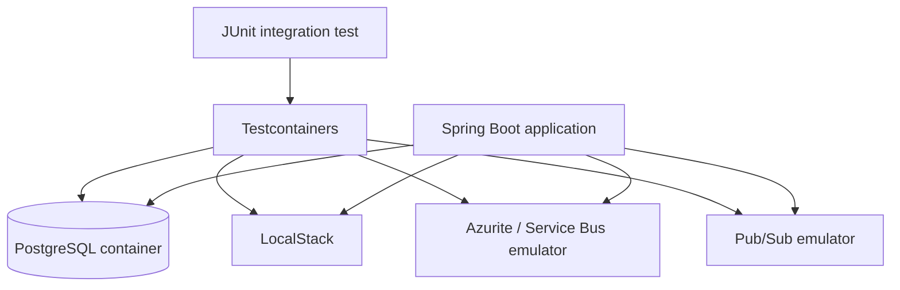
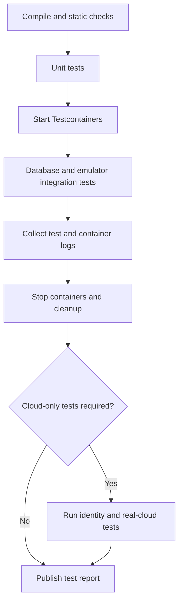

# Dùng Testcontainers để quản lý dịch vụ hoặc môi trường giả lập

> **Chương:** Kiểm thử tích hợp  
> **Module:** SPRING_CLOUD_PROVIDER_INTEGRATION  
> **Mục tiêu:** Dùng Testcontainers for Java để khởi chạy, cấu hình, kết nối, kiểm thử và dọn dẹp các dependency trong container; tích hợp container với Spring Boot; quản lý emulator cho AWS, Azure và Google Cloud; tổ chức lifecycle ổn định trên máy phát triển và CI.

## 1. Testcontainers giải quyết vấn đề gì?

Một bài integration test thường cần database, message broker, object storage hoặc dịch vụ giả lập. Nếu test giả định các dịch vụ đó đã được cài trên máy developer, test phụ thuộc trạng thái máy và dễ xung đột port, version hoặc dữ liệu. Nếu test chỉ dùng mock, test không xác minh được request/response qua giao thức thật.

Testcontainers cho phép test Java khởi chạy dependency trong container trước khi chạy assertion, lấy endpoint/port thực tế rồi dừng và xóa container sau khi hoàn tất. Test có thể chạy PostgreSQL, SQL Server, LocalStack, Azurite hoặc emulator khác với cấu hình được khai báo ngay trong source test.

Với module Spring Cloud Provider Integration, Testcontainers hữu ích ở ba nhóm:

- **Service container:** chạy database hoặc broker thực như PostgreSQL, SQL Server, Kafka, RabbitMQ.
- **Cloud emulator:** chạy implementation giả lập API cloud như LocalStack, Azurite, Azure Service Bus emulator hoặc Google Pub/Sub emulator.
- **Test environment nhiều container:** kết hợp nhiều dependency cần thiết, ví dụ Azure Service Bus emulator cần SQL Server và một Docker network chung.



Testcontainers quản lý vòng đời container và kết nối tới container. Nó không tự biến emulator thành bản sao đầy đủ của cloud, không cấp IAM/RBAC production và không tự kiểm tra private networking của môi trường triển khai. Những phần đó vẫn cần cloud integration test phù hợp.

## 2. Các khái niệm cần nắm

| Khái niệm | Ý nghĩa |
| --- | --- |
| Container image | Image dùng để khởi chạy service, ví dụ postgres:16-alpine |
| Container instance | Một service đang chạy được Testcontainers quản lý |
| Module | Lớp tiện ích có sẵn cho service cụ thể, ví dụ PostgreSQL, LocalStack, Azure hoặc GCloud |
| GenericContainer | API tổng quát để khởi chạy image chưa có module chuyên biệt |
| Exposed port | Cổng trong container được ánh xạ sang cổng host ngẫu nhiên |
| Wait strategy | Điều kiện xác định service đã sẵn sàng nhận request |
| Startup strategy | Điều kiện xác định container đã đạt trạng thái chạy hoặc kết thúc đúng ý định |
| Docker network | Mạng riêng cho nhiều container liên lạc bằng alias |
| @Container | Khai báo container được JUnit Testcontainers extension quản lý |
| @Testcontainers | Kích hoạt extension cho JUnit Jupiter |
| @ServiceConnection | Để Spring Boot tạo ConnectionDetails từ container có factory hỗ trợ |
| @DynamicPropertySource | Đưa host, port hoặc endpoint động vào Spring Environment |

Phân biệt **container đang chạy** và **service đã sẵn sàng**. Một container có thể ở trạng thái running trong khi database đang recovery hoặc emulator chưa nạp cấu hình. Test chỉ nên bắt đầu khi service đạt điều kiện readiness cần thiết.

## 3. Chuẩn bị dependency và môi trường chạy

Testcontainers cần một container runtime tương thích Docker API. Thông thường đó là Docker Engine hoặc Docker Desktop. Một số runtime khác có thể dùng được nhưng cần cấu hình và kiểm tra tương thích riêng. CI runner cũng phải có quyền truy cập Docker daemon hoặc một môi trường Testcontainers Cloud phù hợp.

### 3.1. Dependency với Maven

Có thể quản lý các module cùng version bằng Testcontainers BOM. Ví dụ dưới đây dùng version 2.0.5 theo tài liệu Testcontainers hiện hành; dự án nên pin version đã được xác minh cùng JDK, Spring Boot và SDK đang sử dụng.

```xml
<dependencyManagement>
    <dependencies>
        <dependency>
            <groupId>org.testcontainers</groupId>
            <artifactId>testcontainers-bom</artifactId>
            <version>2.0.5</version>
            <type>pom</type>
            <scope>import</scope>
        </dependency>
    </dependencies>
</dependencyManagement>

<dependencies>
    <dependency>
        <groupId>org.testcontainers</groupId>
        <artifactId>testcontainers</artifactId>
        <scope>test</scope>
    </dependency>

    <dependency>
        <groupId>org.testcontainers</groupId>
        <artifactId>testcontainers-junit-jupiter</artifactId>
        <scope>test</scope>
    </dependency>

    <dependency>
        <groupId>org.testcontainers</groupId>
        <artifactId>testcontainers-postgresql</artifactId>
        <scope>test</scope>
    </dependency>

    <dependency>
        <groupId>org.springframework.boot</groupId>
        <artifactId>spring-boot-testcontainers</artifactId>
        <scope>test</scope>
    </dependency>
</dependencies>
```

Driver PostgreSQL, ví dụ org.postgresql:postgresql, vẫn phải có trong test runtime. Module Testcontainers cung cấp container class, không tự thêm driver JDBC mà ứng dụng cần.

### 3.2. Dependency với Gradle

```groovy
dependencies {
    testImplementation platform("org.testcontainers:testcontainers-bom:2.0.5")

    testImplementation "org.testcontainers:testcontainers"
    testImplementation "org.testcontainers:testcontainers-junit-jupiter"
    testImplementation "org.testcontainers:testcontainers-postgresql"

    testImplementation "org.springframework.boot:spring-boot-testcontainers"
    testRuntimeOnly "org.postgresql:postgresql"
}
```

Khi dùng emulator trong Gradle, thêm các module cần thiết theo cùng BOM:

```groovy
dependencies {
    testImplementation "org.testcontainers:testcontainers-localstack"
    testImplementation "org.testcontainers:testcontainers-azure"
    testImplementation "org.testcontainers:testcontainers-gcloud"
    testImplementation "org.testcontainers:testcontainers-mssqlserver"
}
```

Khi cần module cloud emulator, thêm module tương ứng:

```xml
<dependency>
    <groupId>org.testcontainers</groupId>
    <artifactId>testcontainers-localstack</artifactId>
    <scope>test</scope>
</dependency>

<dependency>
    <groupId>org.testcontainers</groupId>
    <artifactId>testcontainers-azure</artifactId>
    <scope>test</scope>
</dependency>

<dependency>
    <groupId>org.testcontainers</groupId>
    <artifactId>testcontainers-gcloud</artifactId>
    <scope>test</scope>
</dependency>

<dependency>
    <groupId>org.testcontainers</groupId>
    <artifactId>testcontainers-mssqlserver</artifactId>
    <scope>test</scope>
</dependency>
```

Testcontainers 2.x đổi artifact ID của các module sang tiền tố testcontainers- và chuyển một số container class sang package theo module, ví dụ org.testcontainers.postgresql.PostgreSQLContainer, org.testcontainers.localstack.LocalStackContainer và org.testcontainers.mssqlserver.MSSQLServerContainer. Các module Azure/GCloud có thể được đánh dấu incubating và API có thể thay đổi. Kiểm tra tài liệu của đúng version trước khi dùng; không sao chép class/package từ major version cũ sang version mới.

### 3.3. Pin image version

Nên pin version image trong test:

```java
new PostgreSQLContainer<>(
        DockerImageName.parse("postgres:16.4-alpine"));
```

Không dùng tag latest cho test CI. Một image mới có thể thay đổi behavior, entrypoint hoặc API mà không có thay đổi source test. Khi nâng image, cập nhật có chủ đích và chạy lại suite liên quan.

## 4. Quản lý lifecycle với JUnit 5

Testcontainers cung cấp JUnit Jupiter extension. @Testcontainers bật extension; @Container đánh dấu field container cần được quản lý.

### 4.1. Container static dùng chung trong một test class

Field static được khởi chạy một lần trước các test method của class và dừng sau test method cuối cùng:

```java
import org.junit.jupiter.api.Test;
import org.testcontainers.containers.GenericContainer;
import org.testcontainers.junit.jupiter.Container;
import org.testcontainers.junit.jupiter.Testcontainers;
import org.testcontainers.utility.DockerImageName;

import static org.assertj.core.api.Assertions.assertThat;

@Testcontainers
class RedisContainerIT {

    @Container
    static final GenericContainer<?> redis =
            new GenericContainer<>(
                    DockerImageName.parse("redis:7.4-alpine"))
                    .withExposedPorts(6379);

    @Test
    void redisContainerIsRunning() {
        assertThat(redis.isRunning()).isTrue();
    }
}
```

Đây là lựa chọn phù hợp khi nhiều test method trong cùng class có thể dùng chung một service. Dữ liệu test vẫn cần được cô lập bằng key hoặc namespace riêng.

### 4.2. Container instance dùng riêng cho mỗi test method

Field không static được khởi chạy trước mỗi method và dừng sau method đó:

```java
@Testcontainers
class IsolatedRedisIT {

    @Container
    final GenericContainer<?> redis =
            new GenericContainer<>(
                    DockerImageName.parse("redis:7.4-alpine"))
                    .withExposedPorts(6379);

    @Test
    void firstTestGetsFreshContainer() {
        assertThat(redis.isRunning()).isTrue();
    }

    @Test
    void secondTestAlsoGetsFreshContainer() {
        assertThat(redis.isRunning()).isTrue();
    }
}
```

Cách này tăng isolation nhưng tốn thời gian pull/start container. Dùng khi test cần trạng thái sạch hoàn toàn hoặc thay đổi cấu hình giữa các test.

### 4.3. So sánh lifecycle

| Khai báo | Thời điểm start | Thời điểm stop | Phù hợp |
| --- | --- | --- | --- |
| static @Container | Trước method đầu tiên của class | Sau method cuối cùng của class | Nhiều test chia sẻ service |
| Instance @Container | Trước từng method | Sau từng method | Test cần container riêng |
| Container bean do Spring quản lý | Khi Spring tạo context | Khi Spring hủy context | Spring context được cache và dùng lại |
| Manual start()/stop() | Theo code test | Theo code test | Dependency phức tạp hoặc cần thứ tự start rõ |

JUnit Jupiter extension hiện được tài liệu Testcontainers mô tả là hỗ trợ container static và instance; extension đã được kiểm thử với chạy tuần tự. Chạy test song song cần xem xét kỹ vì nhiều test có thể dùng chung container, resource hoặc state. Không bật parallel execution chỉ vì container có thể start độc lập.

### 4.4. Tránh xung đột với Spring TestContext cache

Spring có thể giữ ApplicationContext trong cache sau khi một test class kết thúc. Trong khi đó, JUnit extension có thể đã dừng container static của class. Test class tiếp theo tái sử dụng context có thể gặp bean còn giữ endpoint của container đã dừng.

Khi container là dependency của bean Spring và context cần được tái sử dụng, ưu tiên quản lý container như Spring bean hoặc import container declaration theo hướng dẫn Spring Boot. Cách đó giúp container sống cùng vòng đời context và dừng sau các bean phụ thuộc.

## 5. Đợi service sẵn sàng trước khi test

Testcontainers có wait strategy mặc định dựa trên port được expose bắt đầu lắng nghe. Mặc định thường chờ tối đa 60 giây cho port đầu tiên. Điều này chỉ chứng minh có process đang listen, chưa chắc service đã sẵn sàng xử lý nghiệp vụ.

### 5.1. Chờ HTTP health endpoint

```java
import java.time.Duration;
import org.testcontainers.containers.GenericContainer;
import org.testcontainers.containers.wait.strategy.Wait;
import org.testcontainers.utility.DockerImageName;

GenericContainer<?> emulator =
        new GenericContainer<>(
                DockerImageName.parse("example/emulator:1.4.0"))
                .withExposedPorts(8080)
                .waitingFor(
                        Wait.forHttp("/health")
                                .forStatusCode(200))
                .withStartupTimeout(Duration.ofMinutes(2));
```

Chỉ dùng HTTP wait khi image thực sự có health endpoint. Nếu endpoint yêu cầu authentication hoặc trả status khác, cấu hình điều kiện tương ứng.

### 5.2. Chờ log báo sẵn sàng

```java
GenericContainer<?> broker =
        new GenericContainer<>(
                DockerImageName.parse("example/broker:1.4.0"))
                .withExposedPorts(9092)
                .waitingFor(
                        Wait.forLogMessage(".*started and ready.*\\n", 1))
                .withStartupTimeout(Duration.ofMinutes(2));
```

Log regex phải khớp thông báo ổn định của image đã pin. Nếu log message thay đổi, test sẽ timeout; hãy xem container logs trước khi tăng timeout.

### 5.3. Startup strategy và wait strategy

- Startup strategy kiểm tra container có đạt trạng thái chạy hoặc one-shot completion theo yêu cầu không.
- Wait strategy kiểm tra service bên trong container đã sẵn sàng để client kết nối chưa.

Một container chạy thành công chưa đảm bảo endpoint hoạt động. Ngược lại, một one-shot container chạy migration có thể hoàn tất rồi thoát; khi đó cần startup strategy phù hợp với container job, không chờ port.

## 6. Kết nối tới container: host, mapped port và Docker network

### 6.1. Không hard-code localhost và port

Testcontainers thường ánh xạ cổng container sang cổng host ngẫu nhiên để tránh xung đột:

```java
import io.lettuce.core.RedisClient;
import io.lettuce.core.RedisURI;

String host = redis.getHost();
Integer port = redis.getMappedPort(6379);

RedisClient client = RedisClient.create(
        RedisURI.create(host, port));
```

Không giả định port 6379 trên host luôn được dùng. Cũng không giả định host luôn là localhost; môi trường CI, Docker Desktop hoặc remote runtime có thể trả host khác.

### 6.2. Kết nối giữa các container qua Docker network

Nếu application cũng chạy trong container, không dùng mapped port của host để container khác kết nối. Tạo network chung và dùng network alias cùng port nội bộ:

```java
import org.testcontainers.containers.Network;
import org.testcontainers.containers.GenericContainer;
import org.testcontainers.postgresql.PostgreSQLContainer;
import org.testcontainers.utility.DockerImageName;

Network network = Network.newNetwork();

PostgreSQLContainer<?> database =
        new PostgreSQLContainer<>("postgres:16-alpine")
                .withNetwork(network)
                .withNetworkAliases("test-db");

GenericContainer<?> worker =
        new GenericContainer<>(
                DockerImageName.parse("example/worker:1.0.0"))
                .withNetwork(network)
                .withEnv("DB_HOST", "test-db")
                .withEnv("DB_PORT", "5432");

database.start();
worker.start();
// Sau khi test xong, stop worker rồi database và đóng network.
```

Container trong cùng network gọi nhau qua alias test-db:5432. Test JVM ở host vẫn dùng getHost() và getMappedPort() để kết nối.

### 6.3. Dependency giữa nhiều container

Một số emulator cần service phụ trợ. Hãy tạo network chung, khai báo dependency rõ và start theo thứ tự cần thiết. Ví dụ Azure Service Bus emulator cần SQL Server; Event Hubs emulator có thể cần Azurite. Đừng chỉ expose port ra host rồi mong các container tự tìm được nhau qua localhost.

## 7. Tích hợp Testcontainers với Spring Boot

Spring Boot có hai cơ chế thường dùng để truyền thông tin kết nối từ container vào application context: @ServiceConnection và @DynamicPropertySource.

Service connections được Spring Boot giới thiệu từ dòng 3.1. Dự án cần dependency spring-boot-testcontainers ở test scope; kiểm tra version Boot đang dùng trước khi sao chép ví dụ.

### 7.1. @ServiceConnection cho container có hỗ trợ sẵn

@ServiceConnection yêu cầu dependency spring-boot-testcontainers. Spring Boot dùng ContainerConnectionDetailsFactory để tạo ConnectionDetails phù hợp cho các loại container đã được hỗ trợ.

Ví dụ PostgreSQL:

```java
import org.junit.jupiter.api.Test;
import org.springframework.beans.factory.annotation.Autowired;
import org.springframework.boot.test.context.SpringBootTest;
import org.springframework.boot.testcontainers.service.connection.ServiceConnection;
import org.testcontainers.postgresql.PostgreSQLContainer;
import org.testcontainers.junit.jupiter.Container;
import org.testcontainers.junit.jupiter.Testcontainers;

import static org.assertj.core.api.Assertions.assertThat;

@SpringBootTest
@Testcontainers
class DocumentRepositoryIT {

    @Container
    @ServiceConnection
    static final PostgreSQLContainer<?> postgres =
            new PostgreSQLContainer<>(
                    "postgres:16-alpine")
                    .withDatabaseName("documents")
                    .withUsername("test")
                    .withPassword("test-only-password");

    @Autowired
    DocumentRepository repository;

    @Test
    void savesDocumentUsingContainerDatabase() {
        Document document = Document.uploaded(
                "doc-it-1",
                "user-it",
                "documents/doc-it-1/original");

        repository.save(document);

        assertThat(repository.findById("doc-it-1"))
                .isPresent();
    }
}
```

Spring Boot tự tạo connection details cho PostgreSQL container được hỗ trợ. Không cần tự viết spring.datasource.url nếu auto-configuration nhận được service connection.

### 7.2. Khi nào dùng @DynamicPropertySource?

Dùng @DynamicPropertySource khi:

- Container không có ConnectionDetailsFactory phù hợp.
- Ứng dụng dùng property tùy chỉnh.
- Emulator cung cấp endpoint hoặc connection string riêng.
- Cần cấu hình endpoint động cho SDK client của AWS/Azure/Google Cloud.

Ví dụ với một emulator có endpoint động:

```java
import org.springframework.test.context.DynamicPropertyRegistry;
import org.springframework.test.context.DynamicPropertySource;
import org.springframework.boot.test.context.SpringBootTest;
import org.testcontainers.containers.GenericContainer;
import org.testcontainers.junit.jupiter.Container;
import org.testcontainers.junit.jupiter.Testcontainers;
import org.testcontainers.utility.DockerImageName;

@SpringBootTest
@Testcontainers
class CloudAdapterIT {

    @Container
    static final GenericContainer<?> emulator =
            new GenericContainer<>(
                    DockerImageName.parse("example/emulator:1.0.0"))
                    .withExposedPorts(8080);

    @DynamicPropertySource
    static void emulatorProperties(
            DynamicPropertyRegistry registry) {

        registry.add(
                "app.cloud.endpoint",
                () -> "http://" + emulator.getHost()
                        + ":" + emulator.getMappedPort(8080));
    }
}
```

app.cloud.endpoint là property do ứng dụng tự định nghĩa. Adapter configuration phải đọc property này và tạo SDK client trỏ tới emulator.

### 7.3. @ServiceConnection không tự hiểu mọi cloud emulator

Spring Boot chỉ tự tạo connection details cho các container/service có factory tương ứng. Với GenericContainer hoặc emulator cloud tùy chỉnh, có thể cần chỉ định @ServiceConnection(name = "...") nếu Spring Boot có factory phù hợp cho service đó. Nếu không có factory, dùng @DynamicPropertySource hoặc test configuration để cấu hình client.

Không thêm @ServiceConnection rồi giả định mọi AWS/Azure/GCP SDK tự động chuyển sang emulator.

## 8. Quản lý PostgreSQL container làm dependency nền

Ví dụ database thường là nơi phù hợp nhất để bắt đầu với Testcontainers vì module PostgreSQL có sẵn và Spring Boot hỗ trợ service connection.

```java
import org.junit.jupiter.api.Test;
import org.springframework.beans.factory.annotation.Autowired;
import org.springframework.boot.test.context.SpringBootTest;
import org.springframework.boot.testcontainers.service.connection.ServiceConnection;
import org.springframework.jdbc.core.JdbcTemplate;
import org.testcontainers.junit.jupiter.Container;
import org.testcontainers.junit.jupiter.Testcontainers;
import org.testcontainers.postgresql.PostgreSQLContainer;

import static org.assertj.core.api.Assertions.assertThat;

@Testcontainers
@SpringBootTest
class DocumentPersistenceIT {

    @Container
    @ServiceConnection
    static final PostgreSQLContainer<?> postgres =
            new PostgreSQLContainer<>("postgres:16-alpine")
                    .withDatabaseName("provider_it")
                    .withUsername("test")
                    .withPassword("test-only-password");

    @Autowired
    JdbcTemplate jdbcTemplate;

    @Test
    void migrationCreatesExpectedTable() {
        Integer count = jdbcTemplate.queryForObject(
                """
                select count(*)
                from information_schema.tables
                where table_name = 'documents'
                """,
                Integer.class);

        assertThat(count).isEqualTo(1);
    }
}
```

Test này dùng PostgreSQL thật chạy trong container. Nó phù hợp để kiểm tra SQL, migration, constraint, transaction và query behavior. Nó không cần truy cập cloud account.

## 9. AWS: dùng LocalStack module

Testcontainers có module LocalStack để chạy một số AWS API local. Các service thường được dùng trong integration test gồm S3, SQS, SNS và DynamoDB, tùy feature/version của LocalStack.

### 9.1. Dependency và container

Dependency Maven:

```xml
<dependency>
    <groupId>org.testcontainers</groupId>
    <artifactId>testcontainers-localstack</artifactId>
    <scope>test</scope>
</dependency>
```

Ví dụ khởi chạy LocalStack:

```java
import org.testcontainers.localstack.LocalStackContainer;
import org.testcontainers.utility.DockerImageName;
import org.testcontainers.junit.jupiter.Container;
import org.testcontainers.junit.jupiter.Testcontainers;

@Testcontainers
class S3LocalStackIT {

    @Container
    static final LocalStackContainer localstack =
            new LocalStackContainer(
                    DockerImageName.parse(
                            "localstack/localstack:<pinned-version>"))
                    .withServices("s3", "sqs")
                    .withEnv(
                            "LOCALSTACK_AUTH_TOKEN",
                            System.getenv("LOCALSTACK_AUTH_TOKEN"));
}
```

Từ ngày 23-03-2026, image localstack/localstack yêu cầu biến môi trường LOCALSTACK_AUTH_TOKEN; nếu thiếu, container sẽ không khởi động. Lấy token từ secret store của developer/CI, không ghi token vào source hoặc test report. Hãy pin image version được tổ chức phê duyệt thay cho placeholder <pinned-version>.

### 9.2. Tạo AWS SDK client trỏ vào LocalStack

```java
import org.testcontainers.localstack.LocalStackContainer;
import software.amazon.awssdk.auth.credentials.AwsBasicCredentials;
import software.amazon.awssdk.auth.credentials.StaticCredentialsProvider;
import software.amazon.awssdk.regions.Region;
import software.amazon.awssdk.services.s3.S3Client;

static S3Client createS3Client(LocalStackContainer localstack) {
    AwsBasicCredentials credentials =
            AwsBasicCredentials.create(
                    localstack.getAccessKey(),
                    localstack.getSecretKey());

    return S3Client.builder()
            .endpointOverride(localstack.getEndpoint())
            .credentialsProvider(
                    StaticCredentialsProvider.create(credentials))
            .region(Region.of(localstack.getRegion()))
            .build();
}
```

Test có thể tạo bucket, upload object rồi đọc lại:

```java
import org.junit.jupiter.api.Test;
import org.testcontainers.localstack.LocalStackContainer;
import software.amazon.awssdk.core.sync.RequestBody;
import software.amazon.awssdk.services.s3.S3Client;
import software.amazon.awssdk.services.s3.model.CreateBucketRequest;
import software.amazon.awssdk.services.s3.model.GetObjectRequest;
import software.amazon.awssdk.services.s3.model.PutObjectRequest;

import static org.assertj.core.api.Assertions.assertThat;

@Test
void uploadsObjectToLocalStack() {
    try (S3Client s3 = createS3Client(localstack)) {
        String bucket = "it-documents";

        s3.createBucket(
                CreateBucketRequest.builder()
                        .bucket(bucket)
                        .build());

        s3.putObject(
                PutObjectRequest.builder()
                        .bucket(bucket)
                        .key("documents/doc-1.pdf")
                        .contentType("application/pdf")
                        .build(),
                RequestBody.fromBytes(
                        new byte[] {1, 2, 3}));

        byte[] loaded = s3.getObjectAsBytes(
                GetObjectRequest.builder()
                        .bucket(bucket)
                        .key("documents/doc-1.pdf")
                        .build())
                .asByteArray();

        assertThat(loaded).containsExactly(1, 2, 3);
    }
}
```

Ví dụ tập trung vào S3 API. Với Spring Boot, có thể tạo bean S3Client trong test configuration hoặc truyền endpoint, access key, secret key và region qua @DynamicPropertySource để adapter production dùng cấu hình đó.

### 9.3. Giới hạn cần nhớ

LocalStack giúp kiểm tra request mapping và nhiều service API được hỗ trợ, nhưng không thay thế AWS thật cho mọi tính năng. Hãy dùng IAM role/account test để xác minh permission, resource policy, KMS, VPC endpoint, quota, regional behavior và các tính năng chưa được LocalStack hỗ trợ đầy đủ.

## 10. Azure: Azurite và Service Bus emulator

Testcontainers có Azure module chứa container class cho Azurite, Event Hubs emulator, Service Bus emulator và Cosmos DB emulator. Tại thời điểm tài liệu được tham chiếu, Azure module được đánh dấu **incubating**; kiểm tra release note vì API có thể thay đổi.

### 10.1. Azurite cho Blob Storage

Dependency:

```xml
<dependency>
    <groupId>org.testcontainers</groupId>
    <artifactId>testcontainers-azure</artifactId>
    <scope>test</scope>
</dependency>
```

Ví dụ:

```java
import com.azure.storage.blob.BlobContainerClient;
import com.azure.storage.blob.BlobClient;
import com.azure.storage.blob.BlobServiceClient;
import com.azure.storage.blob.BlobServiceClientBuilder;
import java.io.ByteArrayInputStream;
import java.io.ByteArrayOutputStream;
import org.junit.jupiter.api.Test;
import org.testcontainers.azure.AzuriteContainer;
import org.testcontainers.junit.jupiter.Container;
import org.testcontainers.junit.jupiter.Testcontainers;

import static org.assertj.core.api.Assertions.assertThat;

@Testcontainers
class BlobAzuriteIT {

    @Container
    static final AzuriteContainer azurite =
            new AzuriteContainer(
                    "mcr.microsoft.com/azure-storage/azurite:3.33.0");

    @Test
    void uploadsBlobToAzurite() {
        BlobServiceClient service =
                new BlobServiceClientBuilder()
                        .connectionString(
                                azurite.getConnectionString())
                        .buildClient();

        BlobContainerClient container =
                service.createBlobContainerIfNotExists("it-documents");

        BlobClient blob = container.getBlobClient("doc-1.pdf");
        blob.upload(
                new ByteArrayInputStream(new byte[] {1, 2, 3}),
                3,
                true);

        ByteArrayOutputStream output = new ByteArrayOutputStream();
        blob.download(output);

        assertThat(output.toByteArray())
                .containsExactly(1, 2, 3);
    }
}
```

Azurite cung cấp connection string qua getConnectionString(). Nếu SDK Azure gửi API version mà image Azurite đang dùng chưa hỗ trợ, module có withCommandOptions(...) để thêm flag phù hợp, ví dụ --skipApiVersionCheck. Chỉ dùng tùy chọn này khi đã xác định nguyên nhân tương thích; không dùng để che một API request sai.

### 10.2. Service Bus emulator cần SQL Server

Azure Service Bus emulator cần SQL Server container làm dependency và cấu hình entity. Hai container cần chung Docker network để emulator kết nối SQL Server bằng hostname nội bộ.

Thêm module SQL Server cho Testcontainers 2.x:

```xml
<dependency>
    <groupId>org.testcontainers</groupId>
    <artifactId>testcontainers-mssqlserver</artifactId>
    <scope>test</scope>
</dependency>
```

Ví dụ lifecycle rút gọn:

```java
import com.github.dockerjava.api.model.Capability;
import org.testcontainers.azure.ServiceBusEmulatorContainer;
import org.testcontainers.containers.Network;
import org.testcontainers.mssqlserver.MSSQLServerContainer;
import org.testcontainers.utility.MountableFile;

Network network = Network.newNetwork();

MSSQLServerContainer<?> sql =
        new MSSQLServerContainer<>(
                "mcr.microsoft.com/mssql/server:2022-CU14-ubuntu-22.04")
                .acceptLicense()
                .withPassword("TestOnly!Password123")
                .withCreateContainerCmdModifier(cmd ->
                        cmd.getHostConfig().withCapAdd(Capability.SYS_PTRACE))
                .withNetwork(network);

sql.start();

ServiceBusEmulatorContainer serviceBus =
        new ServiceBusEmulatorContainer(
                "mcr.microsoft.com/azure-messaging/servicebus-emulator:1.1.2")
                .acceptLicense()
                .withConfig(
                        MountableFile.forClasspathResource(
                                "/service-bus-config.json"))
                .withNetwork(network)
                .withMsSqlServerContainer(sql);

serviceBus.start();
// Sau khi test xong: serviceBus.stop(); sql.stop(); network.close().
```

Đặt cấu hình entity trong src/test/resources/service-bus-config.json. Ví dụ rút gọn:

```json
{
  "UserConfig": {
    "Namespaces": [
      {
        "Name": "sbemulatorns",
        "Queues": [
          {
            "Name": "documents",
            "Properties": {
              "DefaultMessageTimeToLive": "PT1H",
              "LockDuration": "PT1M",
              "MaxDeliveryCount": 3,
              "RequiresSession": false
            }
          }
        ],
        "Topics": []
      }
    ],
    "Logging": {
      "Type": "File"
    }
  }
}
```

Trong test class, đặt phần start ở @BeforeAll và phần stop ở @AfterAll, hoặc dùng lifecycle helper của module theo version đang dùng. Khi tự quản lý, dừng emulator trước SQL Server và đóng network trong finally để không bỏ lại container khi assertion thất bại.

Sau khi start, tạo client bằng connection string của emulator:

```java
import com.azure.messaging.servicebus.ServiceBusClientBuilder;
import com.azure.messaging.servicebus.ServiceBusMessage;
import com.azure.messaging.servicebus.ServiceBusSenderClient;

ServiceBusSenderClient sender =
        new ServiceBusClientBuilder()
                .connectionString(serviceBus.getConnectionString())
                .sender()
                .queueName("documents")
                .buildClient();

sender.sendMessage(
        new ServiceBusMessage("document-created"));
```

Ví dụ trên xác minh kết nối và send cơ bản. Emulator có giới hạn về feature và không chứng minh Entra ID, JMS, partitioning, AMQP WebSockets hoặc private endpoint production. Dùng namespace Azure test thật cho những hành vi đó.

### 10.3. Khi nào dùng Azure module?

- Dùng Azurite để test Blob/Queue/Table Storage API trong phạm vi được hỗ trợ.
- Dùng Service Bus emulator để test AMQP send/receive cơ bản và cấu hình queue/topic.
- Dùng Event Hubs emulator cho producer/consumer flow phù hợp.
- Dùng Cosmos DB emulator khi cần kiểm tra client/API local.
- Chạy cloud integration test riêng cho Entra ID, RBAC, Managed Identity, private networking, tier và feature chưa được emulator hỗ trợ.

## 11. Google Cloud: Pub/Sub emulator

Testcontainers có GCloud module cho một số emulator, bao gồm Pub/Sub, Firestore, Bigtable, Datastore, Spanner và BigQuery. Module GCloud cũng được đánh dấu incubating; kiểm tra API theo version.

### 11.1. Khởi chạy Pub/Sub emulator

Dependency:

```xml
<dependency>
    <groupId>org.testcontainers</groupId>
    <artifactId>testcontainers-gcloud</artifactId>
    <scope>test</scope>
</dependency>
```

Container:

```java
import org.testcontainers.gcloud.PubSubEmulatorContainer;
import org.testcontainers.junit.jupiter.Container;
import org.testcontainers.junit.jupiter.Testcontainers;
import org.testcontainers.utility.DockerImageName;

@Testcontainers
class PubSubEmulatorIT {

    @Container
    static final PubSubEmulatorContainer pubsub =
            new PubSubEmulatorContainer(
                    DockerImageName.parse(
                            "gcr.io/google.com/cloudsdktool/google-cloud-cli:583.0.0-emulators"));
}
```

Lấy endpoint qua getEmulatorEndpoint(). Ứng dụng cần trỏ Google Cloud Pub/Sub client tới endpoint này và dùng project ID giả lập dành riêng cho test. Với Java client library, cấu hình channel provider tới endpoint emulator và dùng NoCredentialsProvider; không sử dụng credential production khi gọi emulator.

Ví dụ truyền endpoint cho adapter configuration:

```java
import org.springframework.test.context.DynamicPropertyRegistry;
import org.springframework.test.context.DynamicPropertySource;

@DynamicPropertySource
static void pubsubProperties(DynamicPropertyRegistry registry) {
    registry.add(
            "app.google.pubsub.emulator-host",
            pubsub::getEmulatorEndpoint);
    registry.add(
            "app.google.pubsub.project-id",
            () -> "provider-integration-test");
}
```

Các property app.google.pubsub.* là cấu hình của ứng dụng minh họa. Adapter phải đọc chúng để cấu hình endpoint, project ID và no-credentials mode. Không giả định Spring Boot tự động cấu hình Google Cloud client từ @ServiceConnection.

### 11.2. Giới hạn của Pub/Sub emulator

Pub/Sub emulator hữu ích để kiểm tra tạo topic/subscription, publish, pull, push local, ordering và một số retry/DLQ flow. Tuy nhiên:

- IAM operations không được hỗ trợ.
- Message retention và subscription expiration không giống cloud service đầy đủ.
- Push test có thể dùng HTTP local; production push endpoint cần HTTPS.
- Dữ liệu emulator tồn tại theo phiên emulator và mất khi container bị xóa/recreate.
- Một số tính năng nâng cao hoặc RPC chưa được hỗ trợ.

Do đó, emulator phù hợp cho integration test protocol và message flow cơ bản; dùng project test thật để xác minh IAM, service account, push HTTPS, quota, retention và các feature quan trọng khác.

## 12. Cấu hình container nhiều dependency và test fixture

Một test environment có thể gồm database, broker, emulator và application. Nên gom cấu hình container dùng chung vào fixture hoặc test configuration có ranh giới rõ.

### 12.1. Dùng @TestConfiguration khi nhiều Spring test chia sẻ container

Ví dụ với PostgreSQL container được Spring quản lý:

```java
import org.springframework.boot.test.context.TestConfiguration;
import org.springframework.boot.testcontainers.service.connection.ServiceConnection;
import org.springframework.context.annotation.Bean;
import org.testcontainers.postgresql.PostgreSQLContainer;

@TestConfiguration(proxyBeanMethods = false)
class DatabaseContainerConfiguration {

    @Bean
    @ServiceConnection
    PostgreSQLContainer<?> postgresContainer() {
        return new PostgreSQLContainer<>("postgres:16-alpine")
                .withDatabaseName("provider_it")
                .withUsername("test")
                .withPassword("test-only-password");
    }
}
```

Import vào test:

```java
import org.springframework.boot.test.context.SpringBootTest;
import org.springframework.context.annotation.Import;

@SpringBootTest
@Import(DatabaseContainerConfiguration.class)
class DocumentServiceIT {
    // Spring tạo container trước bean phụ thuộc và dừng sau context.
}
```

Container bean được tạo một lần theo lifecycle của Spring context. Nếu nhiều test class dùng cùng context configuration, chúng có thể dùng cùng container instance. Vì vậy cần đảm bảo test data isolation; không giả định mỗi test method có database trống.

### 12.2. Tách cấu hình theo profile

Một cấu trúc thường dùng:

```text
src/
  main/
    java/
      .../storage/
      .../messaging/
  test/
    java/
      .../unit/
      .../integration/
      .../cloud/
    resources/
      application-test.yml
      service-bus-config.json
```

Profile test có thể thay endpoint và credential local. Không để application-test.yml vô tình chứa production endpoint hoặc secret thật. Với cloud test, cấu hình identity nên lấy từ workload identity/CI secret provider, không commit vào source.

## 13. Quản lý dữ liệu, isolation và cleanup

Container bị xóa sẽ làm mất state bên trong container nếu không gắn volume. Nhưng Testcontainers không tự dọn resource đã tạo ở cloud thật, cũng không tự bảo đảm các test trong cùng container không ghi đè dữ liệu của nhau.

### 13.1. Cô lập dữ liệu

- Dùng bucket/container/queue/topic/database/schema riêng hoặc prefix có test run ID.
- Dùng ID ngẫu nhiên cho object và message.
- Không để test phụ thuộc thứ tự chạy.
- Không dùng chung consumer group/queue giữa test song song nếu chúng có thể consume message của nhau.
- Xóa test data sau assertion hoặc reset fixture trước mỗi test.
- Ghi correlation ID để lọc log và message của test hiện tại.

### 13.2. Cleanup container và resource bên trong

Testcontainers thường tự dừng/xóa container sau lifecycle. Với tài nguyên tạo bên trong emulator, có thể để container mới cho mỗi class/test để state được reset, hoặc xóa resource qua SDK trong teardown.

Với cloud test thật, phải xóa bucket/object/queue/topic và database resource đã tạo. Gắn tag/label có owner và expiry để cleanup job có thể tìm tài nguyên còn sót khi CI bị hủy đột ngột.

### 13.3. Reusable containers

Testcontainers có tính năng reusable container cho máy developer. Đây là tính năng experimental, container không tự dừng sau test và tài liệu không khuyến nghị dùng trong CI. Nó có thể làm state cũ ảnh hưởng lần chạy sau.

Không bật reuse làm mặc định cho test suite. Nếu developer chủ động dùng để giảm thời gian local, cần có quy trình reset data và hiểu container sẽ tiếp tục chạy sau test.

## 14. Logs, diagnostics và troubleshooting

Khi container không khởi động hoặc test timeout, lấy log container trước khi tăng timeout:

```java
String logs = container.getLogs();
System.err.println(logs);
```

Có thể dùng withLogConsumer(...) để chuyển log sang test logger. Với failure trong CI, lưu container logs cùng test report nhưng loại bỏ secret hoặc connection string nhạy cảm.

| Triệu chứng | Nguyên nhân thường gặp | Cách xử lý |
| --- | --- | --- |
| Không tìm thấy Docker environment | Docker daemon không chạy hoặc CI runner không cấp socket/remote runtime | Kiểm tra container runtime và Testcontainers diagnostics |
| Pull image thất bại | Registry rate limit, thiếu quyền hoặc image tag sai | Xác thực registry, pin image hợp lệ, dùng mirror được phê duyệt |
| Container running nhưng test timeout | Service chưa ready hoặc wait strategy sai | Dùng HTTP/log/health wait đúng service |
| Connection refused | Dùng sai host/port hoặc app khởi động trước emulator | Dùng getHost(), getMappedPort() và readiness wait |
| Container-to-container không kết nối | Không cùng Docker network hoặc dùng localhost | Dùng network alias và port nội bộ |
| Spring context dùng endpoint cũ | Container dừng nhưng context còn trong cache | Quản lý container theo Spring context hoặc sửa lifecycle |
| Test pass riêng nhưng fail khi chạy cả suite | Shared state, port, resource hoặc parallel race | Cô lập dữ liệu và kiểm soát parallel execution |
| Azure Service Bus emulator không start | Thiếu SQL Server, network, config hoặc license acceptance | Kiểm tra dependency container, file config và logs |
| LocalStack không start | Thiếu LOCALSTACK_AUTH_TOKEN hoặc image/version không phù hợp | Cấp token từ secret store và pin image |
| Pub/Sub client báo auth/protocol | Client chưa dùng emulator endpoint hoặc vẫn dùng credential chain production | Cấu hình endpoint emulator và no-credentials mode |
| Cleanup để lại resource cloud | Pipeline bị cancel hoặc teardown lỗi | Dùng expiry label và janitor job |

## 15. Tổ chức Testcontainers trong CI

CI cần có container runtime khả dụng, quyền pull image và network cho các container liên lạc. Với image riêng tư, cấu hình registry authentication trong CI secret store. Không đưa Docker credentials hoặc LocalStack token vào log.

Một pipeline hợp lý:



Khuyến nghị:

- Chạy unit test không cần Docker ở mọi pull request.
- Chạy integration test containerized trên runner có Docker API.
- Cache image layer hoặc dùng registry mirror theo chính sách CI; không cache state dữ liệu test.
- Pin image version và Testcontainers dependency.
- Giới hạn parallelism theo CPU, RAM và quota Docker host.
- Luôn thu thập logs khi container start hoặc test fail.
- Đảm bảo cleanup chạy cả khi test failure; container runtime cũng cần có cleanup mechanism.
- Tách cloud integration test cần IAM/RBAC hoặc private network thành job có identity và network phù hợp.

Testcontainers không yêu cầu ứng dụng chạy trong Docker. JVM test có thể chạy trên host và kết nối container qua mapped port. Nếu đóng gói cả test runner trong container, cần chú ý Docker socket, host discovery và network path.

## 16. Bài thực hành: xây test environment cho Document Service

**Bối cảnh:** Document Service dùng PostgreSQL để lưu metadata, Azure Blob hoặc S3 để lưu file, và một message broker để phát DocumentUploaded. Hãy tạo test environment có thể chạy lặp lại trên máy developer và CI.

### Phần A — PostgreSQL

- Thêm Testcontainers BOM và JUnit Jupiter module.
- Tạo PostgreSQLContainer với database/user riêng cho test.
- Dùng @ServiceConnection nếu Spring Boot auto-configuration hỗ trợ.
- Chạy migration và kiểm tra repository, transaction, unique constraint.

### Phần B — Object storage

- Chọn LocalStack cho S3 hoặc Azurite cho Azure Blob.
- Pin image version.
- Khởi chạy container và lấy endpoint/connection string động.
- Cấu hình SDK client qua test configuration hoặc @DynamicPropertySource.
- Upload object, đọc lại nội dung và metadata.
- Xác minh cleanup và test data isolation.

### Phần C — Messaging emulator

- Chọn LocalStack SQS, Azure Service Bus emulator hoặc Google Pub/Sub emulator theo provider.
- Nếu dùng Service Bus emulator, khởi chạy SQL Server trên cùng network và mount entity configuration.
- Tạo queue/topic/subscription trong fixture.
- Publish message và xác minh consumer nhận đúng payload, correlation ID.
- Mô phỏng retry/redelivery trong phạm vi emulator hỗ trợ.

### Phần D — Spring context lifecycle

- Dùng @Testcontainers và @Container cho test class độc lập.
- Nếu nhiều test class chia sẻ Spring context, chuyển container thành Spring-managed bean hoặc dùng container configuration import.
- Dùng @DynamicPropertySource cho endpoint động của emulator.
- Xác minh test class sau không dùng endpoint của container đã dừng.

### Phần E — CI và cleanup

- Chạy test trên CI runner có Docker-compatible runtime.
- Lưu container logs khi failure.
- Dùng resource name có test run ID.
- Cleanup bucket/object/message và container.
- Tạo janitor cho cloud resource còn sót.
- Tách test IAM/RBAC thật khỏi test emulator.

**Tiêu chí hoàn thành:** người học có thể thêm Testcontainers vào Maven/Gradle, chọn lifecycle phù hợp, chờ service readiness, kết nối bằng mapped endpoint, cấu hình Spring Boot, chạy ít nhất một database container và một cloud emulator, đồng thời cô lập dữ liệu và dọn dẹp sau test.

---

## 17. Checklist trước khi merge

| Nhóm | Câu hỏi |
| --- | --- |
| Dependency | Testcontainers core, JUnit module và service module đã cùng version/BOM chưa? |
| Runtime | Developer/CI có Docker API-compatible runtime không? |
| Image | Image tag đã pin và có thể pull trong CI không? |
| Lifecycle | Container static hay instance phù hợp phạm vi test? |
| Spring context | Container có sống lâu bằng context đang cache không? |
| Readiness | Wait strategy kiểm tra service ready, không chỉ container running chưa? |
| Endpoint | Dùng getHost() và mapped port, không hard-code localhost/port chưa? |
| Network | Các container phụ thuộc có cùng network và alias đúng chưa? |
| Configuration | Emulator config được mount và load thành công chưa? |
| Credentials | Credential emulator/test có tách khỏi production secret không? |
| Isolation | Resource và message có unique theo test run không? |
| Cleanup | Container và resource cloud đều có cleanup path chưa? |
| Parallelism | Có shared queue/database hoặc race condition khi chạy song song không? |
| Diagnostics | Có log container và request ID khi test fail không? |
| Emulator limits | Test có phân biệt emulator behavior với cloud behavior thật không? |
| CI | Pipeline có trigger riêng cho cloud identity/network test không? |

## Ghi nhớ

- Testcontainers quản lý vòng đời service/container để integration test có dependency xác định và lặp lại được.
- Dùng module chuyên biệt khi có; dùng GenericContainer khi cần chạy image chưa có module.
- static @Container chia sẻ container trong một class; instance field tạo container riêng cho mỗi test method.
- Wait strategy phải xác minh service readiness; container running chưa đủ.
- Dùng getHost() và getMappedPort() khi JVM test kết nối từ host; dùng network alias khi container kết nối container.
- @ServiceConnection chỉ hoạt động tự động với loại container có factory phù hợp; dùng @DynamicPropertySource cho endpoint emulator tùy chỉnh.
- Spring context cache có thể sống lâu hơn JUnit container lifecycle; quản lý container theo Spring context khi cần.
- LocalStack, Azurite, Service Bus emulator và Pub/Sub emulator đều có giới hạn; không dùng chúng để kết luận IAM/RBAC hoặc mọi behavior managed cloud đúng.
- Pin dependency/image, cô lập test data, thu thập logs và dọn container/resource sau test.
- Reusable containers còn experimental và không phù hợp làm mặc định cho CI.

Testcontainers giúp kiểm thử ứng dụng Spring Boot với service dependency gần thực tế hơn mà vẫn quản lý được vòng đời và chi phí. Hãy dùng container để xác minh API/protocol trong phạm vi emulator hỗ trợ; dùng cloud test thật cho identity, policy, network và feature đặc thù provider. Khi endpoint, readiness, lifecycle và cleanup được khai báo rõ trong test, integration suite sẽ ổn định hơn trên cả máy developer lẫn CI.

### Tài liệu chính thức

- [Testcontainers for Java — JUnit 5 Quickstart](https://java.testcontainers.org/quickstart/junit_5_quickstart/)
- [Testcontainers for Java — JUnit Jupiter lifecycle](https://java.testcontainers.org/test_framework_integration/junit_5/)
- [Testcontainers for Java — Startup and wait strategies](https://java.testcontainers.org/features/startup_and_waits/)
- [Testcontainers for Java — Networking](https://java.testcontainers.org/features/networking/)
- [Testcontainers for Java — General container runtime requirements](https://java.testcontainers.org/supported_docker_environment/)
- [Testcontainers for Java — PostgreSQL module](https://java.testcontainers.org/modules/databases/postgres/)
- [Testcontainers for Java — LocalStack module](https://java.testcontainers.org/modules/localstack/)
- [Testcontainers for Java — Azure module](https://java.testcontainers.org/modules/azure/)
- [Testcontainers for Java — GCloud module](https://java.testcontainers.org/modules/gcloud/)
- [Testcontainers for Java — Releases and 2.x migration notes](https://github.com/testcontainers/testcontainers-java/releases)
- [Spring Boot — Testcontainers and service connections](https://docs.spring.io/spring-boot/reference/testing/testcontainers.html)
- [Google Cloud — Testing apps locally with the Pub/Sub emulator](https://docs.cloud.google.com/pubsub/docs/emulator)

Kiểm tra Testcontainers version, module status, emulator image và SDK compatibility trước khi nâng cấp. Các module Azure/GCloud có thể thay đổi API trong giai đoạn incubating; ví dụ trên cần được đối chiếu với version thực tế của dự án trước khi đưa vào build.
