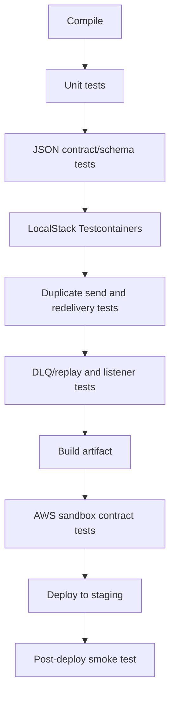

# Kiểm thử gửi trùng, xử lý lại và tương thích schema thông điệp

Một hệ thống Spring Boot dùng Amazon Simple Queue Service (Amazon SQS) cần chịu được producer gửi lại sau timeout, consumer nhận lại message sau visibility timeout, message lỗi được phát lại từ dead-letter queue (DLQ), và payload thay đổi qua nhiều phiên bản ứng dụng. Các tình huống này thường không xuất hiện trong một unit test đơn giản, vì chúng phụ thuộc vào hành vi của queue, serialization, acknowledgment và trạng thái database.

Kiểm thử tích hợp cần chứng minh ba điều: **gửi lặp không tạo tác dụng phụ trùng**, **message có thể được xử lý lại an toàn**, và **producer/consumer khác phiên bản vẫn hiểu được hợp đồng dữ liệu đã công bố**. Với Spring Cloud AWS 3.4.1, có thể dùng `SqsTemplate`, `@SqsListener`, Testcontainers và LocalStack để kiểm thử phần lớn luồng trong CI; một số hành vi dịch vụ như IAM, KMS, FIFO deduplication và DLQ redrive vẫn cần xác minh trên AWS test account.

## 1. Mục tiêu học tập

Sau bài học, bạn có thể:

- Phân biệt duplicate send, redelivery và duplicate side effect trong bài kiểm thử.
- Thiết lập SQS integration test bằng Testcontainers LocalStack và Spring Cloud AWS 3.4.1.
- Kiểm thử FIFO deduplication với `MessageDeduplicationId` và content-based deduplication.
- Kiểm thử redelivery khi message chưa được acknowledge hoặc bị mất acknowledgment.
- Xác minh consumer idempotent bằng `eventId`, inbox table và unique constraint.
- Kiểm thử message lỗi đi vào DLQ, managed redrive và manual replay.
- Xây dựng contract test cho JSON schema, event type và message attributes.
- Kiểm thử tương thích giữa producer/consumer phiên bản cũ và mới.
- Phân chia kiểm thử LocalStack, AWS sandbox và production smoke test.
- Tránh test flaky bằng queue cô lập, Awaitility, dữ liệu ổn định và cleanup có kiểm soát.

## 2. Ba loại trùng lặp cần kiểm thử riêng

| Loại | Nguyên nhân | Điều cần xác minh |
|---|---|---|
| **Duplicate send** | Producer gửi lại cùng event vì timeout hoặc không nhận response | FIFO deduplication loại lần gửi trùng trong cửa sổ 5 phút; Standard có thể chứa nhiều bản sao |
| **Redelivery** | Consumer không xóa message, xử lý vượt visibility timeout hoặc DeleteMessage thất bại | Message có thể được nhận lại; receipt handle của lần nhận mới khác lần trước |
| **Duplicate side effect** | Consumer chạy cùng tác vụ nghiệp vụ nhiều lần | Database/API chỉ áp dụng tác dụng phụ một lần nhờ idempotency |

Một test chỉ gửi cùng message hai lần không chứng minh consumer idempotent. Một test chỉ gọi service hai lần cũng không chứng minh SQS redeliver đúng cách. Hãy viết các test độc lập cho từng ranh giới rồi có ít nhất một integration test kết nối chúng thành luồng end-to-end.

## 3. Chiến lược kiểm thử theo tầng

Không cần chạy mọi kịch bản với AWS thật. Chia kiểm thử theo phạm vi cần xác minh:

| Tầng | Công cụ | Phạm vi phù hợp |
|---|---|---|
| Unit test | JUnit, Mockito, AssertJ | Logic idempotency, event routing, mapping và validation |
| Contract/schema test | Jackson, JSON fixtures, JSON Schema validator nếu dùng | Tương thích payload giữa producer và consumer |
| Integration test local | Testcontainers + LocalStack | SqsTemplate, SqsAsyncClient, queue, FIFO, listener, visibility và luồng DLQ cơ bản |
| AWS contract test | AWS test account riêng | IAM, KMS, queue policy, FIFO deduplication, DLQ redrive, quota và hành vi dịch vụ thật |
| Smoke test sau deploy | AWS staging/pre-production | Xác minh credentials, endpoint, queue policy và một message tổng hợp |

LocalStack giúp test chạy lặp lại và không cần gọi AWS thật. Tuy nhiên, emulator không phải hợp đồng cuối cùng của AWS; các hành vi có phụ thuộc dịch vụ managed, policy, quota hoặc KMS phải được xác minh thêm trong một môi trường AWS cô lập.

## 4. Dependencies cho Spring Cloud AWS 3.4.1

Dùng Spring Cloud AWS BOM để đồng bộ các module. Với ứng dụng Spring Boot 3.x và Spring Cloud AWS 3.4.1, chọn phiên bản Testcontainers tương thích với Spring Boot/Testcontainers API đang dùng; ví dụ dưới đây dùng dòng Testcontainers 1.20.x.

```xml
<properties>
    <testcontainers.version>1.20.4</testcontainers.version>
</properties>

<dependencyManagement>
    <dependencies>
        <dependency>
            <groupId>io.awspring.cloud</groupId>
            <artifactId>spring-cloud-aws-dependencies</artifactId>
            <version>3.4.1</version>
            <type>pom</type>
            <scope>import</scope>
        </dependency>
        <dependency>
            <groupId>org.testcontainers</groupId>
            <artifactId>testcontainers-bom</artifactId>
            <version>${testcontainers.version}</version>
            <type>pom</type>
            <scope>import</scope>
        </dependency>
    </dependencies>
</dependencyManagement>

<dependencies>
    <dependency>
        <groupId>io.awspring.cloud</groupId>
        <artifactId>spring-cloud-aws-starter-sqs</artifactId>
    </dependency>

    <dependency>
        <groupId>org.springframework.boot</groupId>
        <artifactId>spring-boot-starter-test</artifactId>
        <scope>test</scope>
    </dependency>
    <dependency>
        <groupId>org.springframework.boot</groupId>
        <artifactId>spring-boot-testcontainers</artifactId>
        <scope>test</scope>
    </dependency>
    <dependency>
        <groupId>io.awspring.cloud</groupId>
        <artifactId>spring-cloud-aws-testcontainers</artifactId>
        <scope>test</scope>
    </dependency>
    <dependency>
        <groupId>org.testcontainers</groupId>
        <artifactId>junit-jupiter</artifactId>
        <scope>test</scope>
    </dependency>
    <dependency>
        <groupId>org.testcontainers</groupId>
        <artifactId>localstack</artifactId>
        <scope>test</scope>
    </dependency>
    <dependency>
        <groupId>org.awaitility</groupId>
        <artifactId>awaitility</artifactId>
        <scope>test</scope>
    </dependency>
</dependencies>
```

`spring-cloud-aws-testcontainers` bổ sung tích hợp `@ServiceConnection` cho LocalStack. Dependency `localstack` ở ví dụ dùng Testcontainers 1.x, phù hợp với class `org.testcontainers.containers.localstack.LocalStackContainer` thường dùng trong ứng dụng Spring Boot 3.x. Testcontainers 2.x đổi artifact/package; không trộn hai thế hệ API trong cùng test suite.

## 5. Khởi động LocalStack bằng Testcontainers

LocalStack cung cấp endpoint SQS cục bộ. Testcontainers tạo container riêng cho test run, cấp endpoint và port động, giúp các build CI không tranh chấp một port cố định.

Với Spring Boot 3.x và Spring Cloud AWS 3.4.1, có thể dùng `@ServiceConnection`:

```java
import org.springframework.boot.test.context.TestConfiguration;
import org.springframework.boot.testcontainers.service.connection.ServiceConnection;
import org.springframework.context.annotation.Bean;
import org.testcontainers.containers.localstack.LocalStackContainer;
import org.testcontainers.utility.DockerImageName;

@TestConfiguration(proxyBeanMethods = false)
class LocalStackSqsTestConfiguration {

    @Bean
    @ServiceConnection
    LocalStackContainer localStackContainer() {
        LocalStackContainer container = new LocalStackContainer(
            DockerImageName.parse("localstack/localstack:<approved-version>")
        ).withServices(LocalStackContainer.Service.SQS);

        String authToken = System.getenv("LOCALSTACK_AUTH_TOKEN");
        if (authToken != null && !authToken.isBlank()) {
            container.withEnv("LOCALSTACK_AUTH_TOKEN", authToken);
        }
        return container;
    }
}
```

Đưa cấu hình vào test:

```java
import org.springframework.boot.test.context.SpringBootTest;
import org.springframework.context.annotation.Import;

@SpringBootTest
@Import(LocalStackSqsTestConfiguration.class)
class SqsIntegrationTest {
    // Inject SqsTemplate và SqsAsyncClient từ Spring context.
}
```

`@ServiceConnection` tự cấu hình region và credentials của Spring Cloud AWS để trỏ đến LocalStack. Chọn và pin image tag được tổ chức phê duyệt; tránh dùng `latest` để kết quả CI không thay đổi ngoài ý muốn. Từ ngày 23/03/2026, image `localstack/localstack` yêu cầu `LOCALSTACK_AUTH_TOKEN`; nếu image được chọn yêu cầu token, truyền token từ CI secret/environment variable và không commit token vào source code.

Nếu không dùng service connection, có thể dùng `@DynamicPropertySource` để cung cấp endpoint, region và credentials từ container. Không cấu hình endpoint LocalStack cho profile production.

## 6. Cô lập queue và dữ liệu giữa các test

Mỗi test hoặc test class nên dùng queue name riêng, ví dụ `orders-it-<uuid>` và `orders-it-<uuid>.fifo`. Việc này tránh message còn sót từ test trước làm sai kết quả test sau.

```java
import java.util.UUID;
import java.util.Map;
import software.amazon.awssdk.services.sqs.SqsAsyncClient;
import software.amazon.awssdk.services.sqs.model.CreateQueueRequest;
import software.amazon.awssdk.services.sqs.model.QueueAttributeName;

String queueName = "orders-it-" + UUID.randomUUID() + ".fifo";

String queueUrl = sqsAsyncClient.createQueue(CreateQueueRequest.builder()
    .queueName(queueName)
    .attributes(Map.of(
        QueueAttributeName.FIFO_QUEUE, "true",
        QueueAttributeName.CONTENT_BASED_DEDUPLICATION, "false"
    ))
    .build()).join().queueUrl();
```

Sau test, xóa queue đã tạo:

```java
sqsAsyncClient.deleteQueue(request -> request.queueUrl(queueUrl)).join();
```

Nếu dùng `@SqsListener`, bảo đảm queue tồn tại trước khi listener container bắt đầu poll. Có thể tạo queue trong test infrastructure trước khi context khởi động hoặc cấu hình queue auto-creation rõ ràng. Không để test phụ thuộc vào queue dùng chung do một test khác tạo.

Với test song song, dùng queue name duy nhất cho mỗi test invocation và không dùng chung message group/deduplication ID giữa các test. Cleanup phải xóa queue và các tài nguyên liên quan ngay cả khi assertion thất bại.

## 7. Kiểm thử FIFO duplicate send

FIFO deduplication loại lần gửi lặp có cùng `MessageDeduplicationId` trong cửa sổ 5 phút. Test nên gửi cùng event ID hai lần, sau đó xác minh chỉ có một message được giao.

Ví dụ producer:

```java
import io.awspring.cloud.sqs.operations.SqsTemplate;

// OrderEvent.java
record OrderEvent(
    String eventId,
    String orderId,
    long version,
    String eventType
) {}

// OrderPublisher.java
public class OrderPublisher {
    private final SqsTemplate sqsTemplate;

    public OrderPublisher(SqsTemplate sqsTemplate) {
        this.sqsTemplate = sqsTemplate;
    }

    public void publish(String queueUrl, OrderEvent event) {
        sqsTemplate.send(to -> to
            .queue(queueUrl)
            .payload(event)
            .messageGroupId("order-" + event.orderId())
            .messageDeduplicationId(event.eventId())
        );
    }
}
```

Test gửi hai lần cùng một event:

```java
import static org.assertj.core.api.Assertions.assertThat;

import org.junit.jupiter.api.Test;
import org.springframework.beans.factory.annotation.Autowired;
import software.amazon.awssdk.services.sqs.SqsAsyncClient;
import software.amazon.awssdk.services.sqs.model.ReceiveMessageResponse;

class FifoDuplicateSendTest extends SqsIntegrationTestBase {

    @Autowired OrderPublisher publisher;
    @Autowired SqsAsyncClient sqsAsyncClient;

    @Test
    void sameDeduplicationIdProducesOneDeliverableMessage() {
        OrderEvent event = new OrderEvent(
            "evt-" + UUID.randomUUID(), "order-42", 7, "ORDER_PAID"
        );

        publisher.publish(queueUrl, event);
        publisher.publish(queueUrl, event); // Cùng eventId, groupId và payload.

        ReceiveMessageResponse first = sqsAsyncClient.receiveMessage(request -> request
            .queueUrl(queueUrl)
            .maxNumberOfMessages(10)
            .waitTimeSeconds(1)
        ).join();

        assertThat(first.messages()).hasSize(1);
        var received = first.messages().get(0);
        assertThat(received.body()).contains(event.eventId());

        sqsAsyncClient.deleteMessage(request -> request
            .queueUrl(queueUrl)
            .receiptHandle(received.receiptHandle())
        ).join();

        ReceiveMessageResponse second = sqsAsyncClient.receiveMessage(request -> request
            .queueUrl(queueUrl)
            .maxNumberOfMessages(10)
            .waitTimeSeconds(1)
        ).join();

        assertThat(second.messages()).isEmpty();
    }
}
```

`SqsIntegrationTestBase` đại diện cho test base tạo queue FIFO cô lập và dọn queue sau test. Ví dụ dùng AWS SDK để quan sát message và xóa bằng receipt handle; phần gửi vẫn đi qua `SqsTemplate` như ứng dụng thật. FIFO giữ trạng thái deduplication ID trong cửa sổ 5 phút kể cả sau khi message đã được nhận hoặc xóa.

Không chờ đủ 5 phút trong mỗi test CI. Test nhanh xác minh hai lần gửi trong cùng cửa sổ. Một AWS contract test riêng có thể xác minh behavior ngoài cửa sổ, nhưng cần thiết kế thời gian chạy và cleanup phù hợp. Không giả lập đồng hồ client để kết luận thời gian deduplication phía server.

## 8. Kiểm thử content-based deduplication

Content-based deduplication tạo ID bằng SHA-256 của **message body**, không bao gồm message attributes. Test cần chứng minh hai body giống nhau có thể bị xem là cùng message dù attributes khác nhau.

Ma trận kiểm thử:

| Body | Attributes | Kết quả mong đợi khi content-based dedup bật |
|---|---|---|
| Giống nhau | Giống nhau | Lần gửi thứ hai bị deduplicate trong 5 phút |
| Giống nhau | Khác nhau | Vẫn có thể bị deduplicate vì attributes không nằm trong hash |
| Khác nhau | Giống nhau | Hash khác, có thể tạo hai message |
| Khác cách serialize | Dữ liệu nghiệp vụ tương đương | Hash có thể khác do body bytes khác nhau |

Với event nghiệp vụ, explicit `MessageDeduplicationId = eventId` thường dễ kiểm soát hơn content-based dedup. Test phải xác minh producer giữ nguyên event ID khi retry; nếu tạo UUID mới mỗi lần gọi `publish()`, SQS sẽ coi đó là các lần gửi khác nhau.

## 9. Kiểm thử redelivery khi không acknowledge

Để xác minh redelivery, nhận một message nhưng cố ý không gọi `DeleteMessage`. Sau khi visibility timeout hết, nhận lại message và so sánh `MessageId`, `ReceiptHandle`.

```java
@Test
void messageIsDeliveredAgainWhenItIsNotDeleted() {
    String body = "{\"eventId\":\"evt-redelivery-1\"}";
    sqsAsyncClient.sendMessage(request -> request
        .queueUrl(standardQueueUrl)
        .messageBody(body)
    ).join();

    var firstResponse = sqsAsyncClient.receiveMessage(request -> request
        .queueUrl(standardQueueUrl)
        .maxNumberOfMessages(1)
        .visibilityTimeout(1)
        .waitTimeSeconds(1)
    ).join();
    assertThat(firstResponse.messages()).hasSize(1);
    var first = firstResponse.messages().get(0);

    AtomicReference<software.amazon.awssdk.services.sqs.model.Message> redelivered =
        new AtomicReference<>();

    await().atMost(Duration.ofSeconds(8))
        .pollInterval(Duration.ofMillis(200))
        .untilAsserted(() -> {
            var response = sqsAsyncClient.receiveMessage(request -> request
                .queueUrl(standardQueueUrl)
                .maxNumberOfMessages(1)
                .waitTimeSeconds(1)
            ).join();
            assertThat(response.messages()).hasSize(1);
            redelivered.set(response.messages().get(0));
        });

    assertThat(redelivered.get().messageId()).isEqualTo(first.messageId());
    assertThat(redelivered.get().receiptHandle()).isNotEqualTo(first.receiptHandle());

    // Dùng receipt handle mới nhất để xóa message sau khi test.
    sqsAsyncClient.deleteMessage(request -> request
        .queueUrl(standardQueueUrl)
        .receiptHandle(redelivered.get().receiptHandle())
    ).join();
}
```

Ví dụ cố ý bỏ qua delete lần đầu và đặt visibility một giây cho lần receive đầu. `Awaitility` chờ message xuất hiện lại thay vì dùng `Thread.sleep()` cố định. Trong test thực tế, cần xử lý trường hợp response đầu rỗng và chỉ lấy phần tử sau khi đã kiểm tra danh sách có message.

Standard queue dùng at-least-once delivery; một message có thể được giao trùng ngay cả trong những tình huống hiếm. FIFO deduplication ở producer cũng không loại bỏ redelivery do consumer không xóa message.

## 10. Kiểm thử idempotent consumer

Redelivery chỉ an toàn nếu consumer không lặp tác dụng phụ. Một cách phổ biến là lưu `eventId` trong bảng inbox/processed event có unique constraint và cập nhật dữ liệu nghiệp vụ trong cùng transaction.

```sql
CREATE TABLE processed_event (
    event_id      varchar(128) PRIMARY KEY,
    processed_at  timestamptz NOT NULL DEFAULT now()
);
```

Service dùng thao tác claim atomically:

```java
@Transactional
public void handle(OrderEvent event) {
    boolean firstDelivery = inboxRepository.insertIfAbsent(event.eventId());
    if (!firstDelivery) {
        return;
    }

    orderService.apply(event);
}
```

`insertIfAbsent` phải dựa trên unique constraint và trả về false khi event đã được ghi nhận. Nếu `orderService.apply()` thất bại, transaction phải rollback cả inbox row để lần nhận tiếp theo có thể xử lý lại. Không commit inbox trước rồi thực hiện side effect ở một transaction khác nếu không có quy trình phục hồi tương ứng.

Test gọi service hai lần với cùng event ID:

```java
@Test
void duplicateEventDoesNotApplyBusinessEffectTwice() {
    OrderEvent event = new OrderEvent("evt-100", "order-42", 7, "ORDER_PAID");

    orderEventHandler.handle(event);
    orderEventHandler.handle(event);

    assertThat(inboxRepository.countByEventId(event.eventId())).isEqualTo(1);
    assertThat(orderRepository.findById("order-42").orElseThrow().paidEventCount())
        .isEqualTo(1);
}
```

Đây là integration test ở tầng service/database; nên chạy với database engine tương ứng production khi SQL, locking hoặc unique constraint có ý nghĩa. H2 có thể hữu ích cho test nhanh nhưng không thay thế hoàn toàn PostgreSQL/MySQL nếu production phụ thuộc cú pháp hoặc concurrency semantics riêng.

## 11. Kiểm thử listener bất đồng bộ

`@SqsListener` chạy bất đồng bộ so với test method. Không publish rồi assert ngay lập tức. Dùng Awaitility để chờ trạng thái bền vững mong đợi, ví dụ row trong database hoặc một sự kiện đã được xử lý.

```java
@SpringBootTest
@Import(LocalStackSqsTestConfiguration.class)
class OrderListenerIntegrationTest {

    @Autowired SqsTemplate sqsTemplate;
    @Autowired OrderRepository orderRepository;

    @Test
    void listenerPersistsPublishedEvent() {
        OrderEvent event = new OrderEvent(
            "evt-" + UUID.randomUUID(), "order-77", 1, "ORDER_CREATED"
        );

        sqsTemplate.send(to -> to
            .queue("orders-listener-it")
            .payload(event)
        );

        await().atMost(Duration.ofSeconds(10)).untilAsserted(() ->
            assertThat(orderRepository.existsByExternalEventId(event.eventId())).isTrue()
        );
    }
}
```

Queue `orders-listener-it` phải được tạo trước khi container listener bắt đầu poll, hoặc test phải cấu hình rõ chiến lược auto-create. Để test song song, dùng queue name động và inject queue name qua property. Không dùng `@Transactional` ở test method như cách duy nhất để dọn dữ liệu nếu listener chạy ở thread/transaction khác; cleanup bằng fixture/repository sau khi assertion hoàn tất.

## 12. Kiểm thử DLQ và replay

Một replay test nên xác minh cả ba giai đoạn: message đi vào DLQ, nguyên nhân được khắc phục, và message trở lại luồng xử lý mà không lặp side effect.

### 12.1. Xác minh message vào DLQ

Tạo source queue với `RedrivePolicy` trỏ đến DLQ, đặt `maxReceiveCount` nhỏ trong test. Cho listener thất bại và không acknowledge cho đến khi message vượt ngưỡng nhận. Sau đó nhận từ DLQ và xác minh `eventId`, payload và metadata vẫn được giữ.

Không kiểm thử bằng cách gọi `receiveMessage` tùy tiện quá nhiều lần vì mỗi lần nhận có thể làm tăng receive count và đẩy message vào DLQ sớm hơn dự kiến. Dùng một consumer test có hành vi lỗi xác định, log receive count và timeout rõ ràng.

### 12.2. Managed redrive bằng SQS API

`StartMessageMoveTask` di chuyển message từ DLQ sang source queue hoặc destination queue cùng loại. Đây là thao tác bất đồng bộ; dùng `ListMessageMoveTasks` để chờ trạng thái hoàn tất. SQS không hỗ trợ lọc hoặc biến đổi message trong managed redrive.

```java
var started = sqsAsyncClient.startMessageMoveTask(request -> request
    .sourceArn(dlqArn)
    .destinationArn(sourceQueueArn)
    .maxNumberOfMessagesPerSecond(10)
).join();

String taskHandle = started.taskHandle();
```

Trong AWS contract test, dùng task handle để truy vấn trạng thái bằng `ListMessageMoveTasks` và chỉ kết luận thành công khi task hoàn tất. Giới hạn tốc độ redrive ở mức thấp trong test để tránh làm quá tải source queue hoặc dependency. Không chạy redrive trên DLQ production chỉ để kiểm thử.

### 12.3. Manual replay khi cần biến đổi schema

Managed redrive giữ nguyên payload. Nếu cần chuyển message schema v1 sang v2, dùng một replay service riêng:

1. Đọc message từ DLQ và lưu bản ghi audit.
2. Deserialize bằng reader tương thích schema cũ.
3. Biến đổi sang schema đích bằng mapper có version rõ ràng.
4. Gửi tới queue đích.
5. Chỉ xóa message gốc sau khi destination xác nhận đã nhận message.
6. Giữ `eventId` của cùng một sự kiện nghiệp vụ; thêm `replayAttempt`/`replayedAt` để quan sát replay.

Nếu kết quả send không xác định do timeout, retry bằng cùng event ID để giữ idempotency. Nếu gửi message mới mang ý nghĩa nghiệp vụ mới, tạo event ID mới và liên kết với event gốc qua `causationId`/`correlationId`.

Test quan trọng là giả lập destination send thất bại và xác minh message gốc vẫn còn trong DLQ. Một test khác xác minh gửi thành công rồi mới xóa message gốc. Như vậy replay không làm mất message duy nhất đang lưu.

## 13. Tương thích schema giữa các phiên bản

Message có thể nằm trong queue lâu hơn một lần deploy. Producer phiên bản mới và consumer phiên bản cũ có thể cùng hoạt động trong thời gian rolling deployment. Hợp đồng message cần hỗ trợ các tổ hợp phiên bản đó.

| Thay đổi schema | Tác động | Hướng xử lý |
|---|---|---|
| Thêm field tùy chọn | Consumer cũ có thể gặp field chưa biết | Cho phép bỏ qua field lạ có chủ đích hoặc version event mới |
| Thêm field bắt buộc | Consumer mới không đọc được message cũ nếu thiếu dữ liệu | Default hợp lệ, nullable có quy tắc hoặc event version mới |
| Đổi tên field | Consumer cũ/mới có thể không map được | Dùng `@JsonAlias` trong giai đoạn chuyển tiếp |
| Đổi kiểu dữ liệu | Deserialize hoặc ngữ nghĩa có thể sai | Thêm field mới hoặc tạo event version mới |
| Xóa field | Consumer cũ có thể cần field đó | Deprecate trước, theo dõi usage rồi mới xóa |
| Đổi package Java | Type header FQCN có thể không resolve | Dùng `eventType` ổn định thay cho tên class Java |
| Thay đổi ý nghĩa field | Deserialize vẫn thành công nhưng nghiệp vụ sai | Tạo schema/event version mới; không chỉ dựa vào kiểu dữ liệu |

### 13.1. Backward và forward compatibility

- **Backward compatibility:** consumer mới đọc được message do producer cũ phát ra.
- **Forward compatibility:** consumer cũ đọc được message do producer mới phát ra, thường nhờ field mới là tùy chọn và consumer bỏ qua field lạ.
- **Full compatibility:** hỗ trợ cả hai chiều theo quy tắc schema đã chọn.

Không mặc định rằng một thay đổi JSON là tương thích chỉ vì Jackson deserialize thành công. Test phải xác minh cả ý nghĩa nghiệp vụ: default có hợp lệ không, field bị thiếu có làm thay đổi kết quả không và consumer cũ có bỏ qua một field quan trọng không.

## 14. Contract test bằng JSON fixtures và ObjectMapper

Lưu các payload đại diện vào `src/test/resources/contracts/`, ví dụ:

```text
contracts/
  orders/
    order-created-v1.json
    order-created-v2.json
    order-paid-v1.json
    order-paid-v2.json
    invalid-missing-event-id.json
```

Fixture là hợp đồng đã phát hành; không tự tạo lại fixture từ class đang kiểm thử trong cùng test, vì làm vậy có thể khiến producer và consumer cùng sai theo một cách mà test vẫn pass.

Ví dụ DTO mới hỗ trợ tên field cũ và giá trị mặc định:

```java
import com.fasterxml.jackson.annotation.JsonAlias;
import com.fasterxml.jackson.annotation.JsonIgnoreProperties;

@JsonIgnoreProperties(ignoreUnknown = true)
public record OrderCreatedV2(
    String eventId,
    String orderId,
    @JsonAlias("customerRef") String customerId,
    String currency
) {
    public OrderCreatedV2 {
        if (currency == null || currency.isBlank()) {
            currency = "USD";
        }
    }
}
```

Test đọc fixture cũ:

```java
@Test
void newConsumerReadsV1Fixture() throws Exception {
    String json = resource("contracts/orders/order-created-v1.json");

    OrderCreatedV2 event = objectMapper.readValue(json, OrderCreatedV2.class);

    assertThat(event.eventId()).isEqualTo("evt-v1-100");
    assertThat(event.customerId()).isEqualTo("customer-42");
    assertThat(event.currency()).isEqualTo("USD");
}
```

Test consumer cũ đọc fixture mới:

```java
@JsonIgnoreProperties(ignoreUnknown = true)
public record OrderCreatedV1(
    String eventId,
    String orderId,
    String customerId
) {}

@Test
void oldConsumerIgnoresNewOptionalFields() throws Exception {
    String json = resource("contracts/orders/order-created-v2.json");

    OrderCreatedV1 event = objectMapper.readValue(json, OrderCreatedV1.class);

    assertThat(event.eventId()).isEqualTo("evt-v2-100");
    assertThat(event.customerId()).isEqualTo("customer-42");
}
```

`@JsonIgnoreProperties(ignoreUnknown = true)` là quyết định hợp đồng có chủ đích. Nếu field lạ có thể thay đổi ý nghĩa nghiệp vụ, nên từ chối schema version không hỗ trợ thay vì bỏ qua âm thầm. `@JsonAlias` giúp đọc tên cũ; producer mới vẫn nên phát một tên canonical thống nhất.

### 14.1. Kiểm thử schemaVersion và eventType

Nếu queue chứa nhiều event, body nên có `eventType` và `schemaVersion` ổn định:

```json
{
  "eventId": "evt-200",
  "eventType": "order.created",
  "schemaVersion": 2,
  "data": {
    "orderId": "order-77",
    "customerId": "customer-42"
  }
}
```

Test cần xác minh:

- Version được hỗ trợ ánh xạ tới đúng DTO/handler.
- Version cũ được chuyển đổi bằng mapper đã định nghĩa.
- Version tương lai không hỗ trợ tạo lỗi rõ ràng và đi theo quy trình DLQ.
- Thiếu `eventId` hoặc `eventType` bắt buộc bị từ chối trước khi tạo side effect.
- Message attribute `eventType` và trường `eventType` trong body không mâu thuẫn nếu ứng dụng dùng cả hai.

Không deserialize class tùy ý từ FQCN do producer gửi. Dùng allowlist `eventType`/`schemaVersion` để chọn DTO đã được ứng dụng hỗ trợ.

## 15. Kiểm thử message attributes và metadata

Body và message attributes là hai phần độc lập. Một contract test cần kiểm tra cả hai:

| Thành phần | Ví dụ | Assertion |
|---|---|---|
| Body | `eventId`, `orderId`, `schemaVersion` | JSON deserialize và validation thành công |
| `eventType` attribute | `order.created.v2` | Listener đọc được header `Sqs_MA_eventType` |
| `correlationId` | `req-123` | Trace xuyên producer/consumer được giữ |
| `tenantId` | `tenant-42` | Định tuyến đúng tenant và không trộn dữ liệu |
| Message system attribute | `ApproximateReceiveCount` | Retry test quan sát receive count tăng |

Nếu dùng content-based deduplication, nhớ rằng SQS hash body chứ không hash message attributes. Test nên gửi cùng body với attributes khác nhau để xác minh producer không dựa vào attributes như một phần của dedup identity.

## 16. Ma trận kiểm thử producer/consumer phiên bản

| Producer | Consumer | Kịch bản | Kết quả mong đợi |
|---|---|---|---|
| v1 | v1 | Cùng schema | Pass |
| v1 | v2 | Consumer mới đọc payload cũ | Pass với default/alias đã thiết kế |
| v2 | v1 | Consumer cũ đọc payload mới | Pass nếu chỉ thêm field tùy chọn và bỏ qua field lạ; nếu breaking change thì fail có kiểm soát |
| v2 | v2 | Cùng schema mới | Pass |
| v3 | v2 | Version tương lai chưa hỗ trợ | Reject rõ ràng, không tạo side effect, đi DLQ/quarantine |
| Producer ngoài Java | Spring consumer | JSON theo contract, không có Java type header | Deserialize theo event type/kiểu listener đã cấu hình |
| Spring producer | Consumer ngoài Java | JSON body và attributes chuẩn | Consumer không cần biết package/class Java |

Chạy ma trận này trước khi phát hành producer hoặc consumer mới. Khi rolling deployment, kiểm thử cả trường hợp consumer cũ vẫn chạy trong lúc producer mới bắt đầu gửi event.

## 17. Test managed redrive trên AWS sandbox

LocalStack phù hợp cho luồng DLQ cơ bản, nhưng redrive task, IAM, KMS và policy có thể khác theo phiên bản emulator. Dùng AWS sandbox riêng để kiểm thử:

1. Tạo source queue và DLQ cùng loại, cùng account/Region.
2. Cấu hình `RedrivePolicy` với `maxReceiveCount` nhỏ trong môi trường test.
3. Gửi event tổng hợp, làm consumer thất bại cho đến khi message vào DLQ.
4. Sửa consumer hoặc cấu hình test để xử lý thành công.
5. Gọi `StartMessageMoveTask` từ DLQ về source queue hoặc destination cùng loại.
6. Dùng `ListMessageMoveTasks` chờ task hoàn tất; chỉ hủy khi test cần dừng task đang chạy.
7. Xác minh message quay lại queue và consumer xử lý đúng một tác dụng phụ.
8. Xóa queue, policy và dữ liệu test sau khi hoàn tất.

Redrive task là bất đồng bộ. Không assert message đã xuất hiện ngay sau `StartMessageMoveTask`. Dùng polling assertion có giới hạn thời gian và kiểm tra trạng thái task. Không chạy test trên DLQ chứa dữ liệu thật.

## 18. Tránh flaky test và false positive

| Nguyên nhân | Cách khắc phục |
|---|---|
| Test đọc queue dùng chung | Tạo queue riêng theo test/run và cleanup sau test |
| Assert ngay sau khi publish | Dùng Awaitility chờ side effect hoặc message state |
| Dùng `Thread.sleep()` cố định | Dùng `await().atMost(...).untilAsserted(...)` |
| Dedup test dùng ID ngẫu nhiên cho mỗi lần retry | Tạo event một lần và giữ nguyên `eventId`/dedup ID |
| Kiểm thử 5 phút bằng fake clock client | Nhớ deduplication clock ở SQS server; dùng AWS contract test cho cửa sổ thực |
| Chỉ kiểm tra số message sau receive đầu | Kiểm tra receipt handle, delete và receive lại để phân biệt redelivery |
| Test replay xóa DLQ message trước khi send đích thành công | Chỉ delete sau khi destination chấp nhận message |
| Fixture JSON được sinh từ DTO đang test | Lưu fixture độc lập như hợp đồng đã phát hành |
| Parallel test dùng chung FIFO group | Dùng group ID và queue name riêng cho từng test |
| LocalStack được dùng làm bằng chứng IAM/KMS | Chạy AWS sandbox contract test cho policy và encryption |
| Test listener không tạo queue trước khi container start | Chuẩn bị queue trước lifecycle start hoặc cấu hình auto-create rõ ràng |
| LocalStack image thay đổi ngoài ý muốn | Pin image tag và cung cấp auth token qua CI secret nếu image yêu cầu |

Không dùng `@DirtiesContext` cho mọi test chỉ để dọn queue; context restart làm test suite chậm. Ưu tiên queue name động, cleanup resource rõ ràng và dùng chung Spring context khi an toàn.

## 19. CI pipeline gợi ý



Các test LocalStack có thể chạy trong pull request nếu CI có Docker và quyền tải image. AWS sandbox tests nên dùng role riêng, queue prefix riêng và cleanup tự động; không cấp quyền production cho pipeline test. Smoke test sau deploy chỉ gửi event tổng hợp và xác minh một đường đi cơ bản.

## 20. Troubleshooting

| Triệu chứng | Nguyên nhân có thể | Hướng điều tra |
|---|---|---|
| FIFO duplicate test nhận hai message | Dedup ID khác nhau, queue không phải FIFO hoặc test gửi ngoài cửa sổ 5 phút | Kiểm tra queue attributes, event ID và timestamp |
| FIFO test chỉ nhận một message nhưng side effect vẫn lặp | Redelivery hoặc consumer xử lý lại sau commit | Kiểm tra visibility, delete failure và inbox unique key |
| Redelivery test không nhận lại | Message đã bị xóa, visibility chưa hết hoặc test dùng sai queue URL | Kiểm tra acknowledgment mode, receipt handle và visibility timeout |
| Test listener timeout | Queue chưa tồn tại, listener không start, sai endpoint hoặc payload conversion lỗi | Kiểm tra container startup, queue URL, logs và endpoint LocalStack |
| Message vào DLQ quá sớm | Test vô tình nhận message nhiều lần hoặc `maxReceiveCount` quá thấp | Ghi receive count và giảm số lần poll trong test |
| Redrive task AccessDenied | Thiếu quyền trên DLQ/destination/KMS | Kiểm tra IAM action và resource ARN |
| Schema test pass dù field quan trọng bị thiếu | DTO dùng nullable/default quá rộng hoặc fixture không đại diện dữ liệu thật | Bổ sung validation và fixture lỗi |
| Consumer cũ lỗi với field mới | Unknown properties bị từ chối hoặc thay đổi schema breaking | Chính sách ignore unknown có chủ đích hoặc phát event version mới |
| LocalStack container không khởi động | Image yêu cầu auth token hoặc Docker/image tag không hợp lệ | Kiểm tra image pin, Docker và `LOCALSTACK_AUTH_TOKEN` |

## 21. Bài tập thực hành

**Bài 1 — FIFO duplicate send:** Dùng `SqsTemplate` gửi cùng event ID hai lần vào FIFO queue. Xác minh chỉ một message được giao trong cửa sổ deduplication.

**Bài 2 — Standard redelivery:** Nhận message nhưng không xóa, đặt visibility ngắn và xác minh message được giao lại với receipt handle mới.

**Bài 3 — Idempotent consumer:** Tạo inbox table với unique constraint. Gửi lại cùng event hai lần và xác minh database chỉ áp dụng một side effect.

**Bài 4 — Listener async:** Publish event, chờ repository cập nhật bằng Awaitility và xác minh listener đã acknowledge sau khi xử lý thành công.

**Bài 5 — DLQ:** Tạo source queue/DLQ, làm listener lỗi vượt `maxReceiveCount`, xác minh message nằm trong DLQ.

**Bài 6 — Managed redrive:** Dùng AWS sandbox gọi `StartMessageMoveTask`, poll trạng thái và xác minh message được xử lý lại.

**Bài 7 — Manual replay:** Giả lập lỗi khi gửi destination; xác minh message gốc không bị xóa. Sau đó gửi thành công và xóa message gốc.

**Bài 8 — Schema backward compatibility:** Đọc fixture v1 bằng DTO v2, kiểm tra alias và default.

**Bài 9 — Schema forward compatibility:** Đọc fixture v2 bằng DTO v1 có chính sách unknown field rõ ràng; kiểm tra consumer không bỏ qua field ảnh hưởng nghiệp vụ.

**Bài 10 — Version routing:** Gửi schema version được hỗ trợ và không được hỗ trợ; xác minh event hợp lệ được route đúng, event không hỗ trợ đi vào error/DLQ path.

## 22. Câu hỏi tự kiểm tra

1. Duplicate send khác redelivery như thế nào? **Duplicate send do producer gửi lại; redelivery do message chưa được xóa và được SQS giao lại.**
2. Vì sao FIFO deduplication không thay thế inbox/idempotency? **Deduplication chỉ xử lý lần gửi trùng trong cửa sổ 5 phút; consumer vẫn có thể redeliver hoặc nhận lại sau lỗi acknowledgment.**
3. Vì sao test bất đồng bộ nên dùng Awaitility? **Để chờ trạng thái cuối với timeout có giới hạn thay vì phụ thuộc một khoảng sleep cố định.**
4. Vì sao queue name nên duy nhất cho mỗi test? **Để message tồn dư hoặc test chạy song song không làm nhiễu kết quả.**
5. `MessageId` và `ReceiptHandle` có giống nhau không? **Không; receipt handle đại diện cho một lần nhận và thay đổi khi message được nhận lại.**
6. Managed redrive có thể sửa payload không? **Không; SQS di chuyển message nguyên trạng, cần manual replay nếu phải biến đổi schema.**
7. Backward compatibility là gì? **Consumer mới đọc được message do producer cũ phát ra.**
8. Forward compatibility là gì? **Consumer cũ đọc được message mới trong phạm vi thay đổi được thiết kế tương thích.**
9. Vì sao fixture JSON cần được lưu độc lập với DTO? **Để test kiểm tra hợp đồng đã phát hành thay vì tạo dữ liệu theo cùng implementation đang kiểm thử.**
10. Test LocalStack có chứng minh IAM/KMS production đúng không? **Không; các quyền, policy và encryption cần AWS sandbox contract test.**

## 23. Tài liệu tham khảo

- [Spring Cloud AWS 3.4.1 — Testing](https://docs.awspring.io/spring-cloud-aws/docs/3.4.1/reference/html/index.html): `spring-cloud-aws-testcontainers`, `@ServiceConnection` và `LocalstackAwsClientFactory`.
- [Spring Cloud AWS 3.4.1 — SQS Integration](https://docs.awspring.io/spring-cloud-aws/docs/3.4.1/reference/html/index.html): `SqsTemplate`, listener container, acknowledgment và message conversion.
- [Testcontainers — Testing AWS service integrations using LocalStack](https://testcontainers.com/guides/testing-aws-service-integrations-using-localstack/): thiết lập Spring Boot, LocalStack và Awaitility cho integration test.
- [Testcontainers — LocalStack Module](https://java.testcontainers.org/modules/localstack/): container API, AWS SDK client và dependency module.
- [AWS — Exactly-once processing in FIFO queues](https://docs.aws.amazon.com/AWSSimpleQueueService/latest/SQSDeveloperGuide/FIFO-queues-exactly-once-processing.html): cửa sổ deduplication 5 phút và content-based deduplication.
- [AWS — SendMessage API](https://docs.aws.amazon.com/AWSSimpleQueueService/latest/APIReference/API_SendMessage.html): `MessageDeduplicationId`, `MessageGroupId` và content-based deduplication.
- [AWS — Configure a dead-letter queue redrive](https://docs.aws.amazon.com/AWSSimpleQueueService/latest/SQSDeveloperGuide/sqs-configure-dead-letter-queue-redrive.html): managed redrive, tốc độ di chuyển và giới hạn biến đổi message.
- [AWS — StartMessageMoveTask API](https://docs.aws.amazon.com/AWSSimpleQueueService/latest/APIReference/API_StartMessageMoveTask.html): bắt đầu redrive task bất đồng bộ.

**Ghi nhớ:** Test duplicate send, redelivery, replay và schema compatibility như các hợp đồng riêng. LocalStack giúp kiểm thử tích hợp nhanh trong CI; AWS sandbox xác minh các hành vi dịch vụ managed. Dùng event ID ổn định, inbox/idempotency, fixture JSON độc lập và Awaitility để chứng minh hệ thống xử lý lại an toàn qua nhiều phiên bản.
