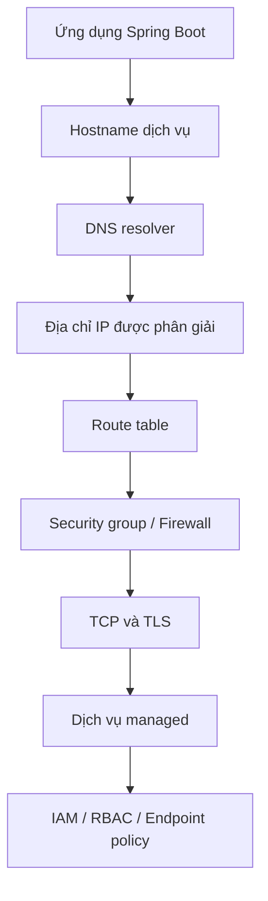

# Cấu hình mạng, DNS, egress và endpoint riêng khi triển khai

Khi triển khai một ứng dụng Spring Boot sử dụng dịch vụ managed của AWS, Azure hoặc Google Cloud, kết nối thành công phụ thuộc vào cả cấu hình ứng dụng lẫn hạ tầng mạng. Ứng dụng có thể khởi động bình thường nhưng vẫn không gửi được message, đọc object, truy vấn dữ liệu hoặc lấy secret nếu subnet không có đường đi phù hợp, DNS phân giải sai hoặc firewall chặn kết nối.

Trong module `SPRING_CLOUD_PROVIDER_INTEGRATION`, bài học này tập trung vào cách chuẩn bị đường kết nối từ workload Spring Boot đến dịch vụ managed. Ta sẽ phân biệt kết nối công khai và kết nối riêng, kiểm soát lưu lượng đi ra, cấu hình DNS cho private endpoint, rồi kiểm tra đường mạng từ chính môi trường chạy ứng dụng.

## Mục tiêu

Sau bài học, bạn có thể:

- Mô tả đường đi của request từ ứng dụng trong private subnet đến dịch vụ managed.
- Thiết kế DNS và route để hostname dịch vụ phân giải đến địa chỉ phù hợp.
- Chọn NAT, firewall, service endpoint hoặc private endpoint theo yêu cầu kết nối.
- Nhận biết các thành phần tương ứng trên AWS, Azure và Google Cloud.
- Kiểm tra DNS, TCP, TLS và quyền truy cập theo từng lớp khi triển khai gặp lỗi.

## 1. Nhìn đường đi của một request

Một request từ Spring Boot đến dịch vụ managed thường đi qua các bước sau:

1. Ứng dụng lấy hostname của dịch vụ từ cấu hình hoặc SDK của cloud provider.
2. Resolver trong môi trường chạy ứng dụng truy vấn DNS để lấy địa chỉ IP.
3. Route table chọn đường đi cho địa chỉ đích.
4. Security group, network security group, firewall hoặc chính sách mạng quyết định có cho phép kết nối hay không.
5. Kết nối TCP được thiết lập, sau đó TLS xác thực chứng thư của dịch vụ.
6. Dịch vụ kiểm tra danh tính, IAM/RBAC và chính sách riêng của endpoint trước khi xử lý request.

Vì vậy, một lỗi `AccessDenied` thường thuộc lớp danh tính hoặc chính sách, trong khi timeout có thể bắt nguồn từ DNS, route hoặc firewall. Không nên xử lý mọi lỗi kết nối bằng cách thay endpoint URL hay cấp thêm quyền.



Ứng dụng thường nên sử dụng hostname chuẩn do SDK hoặc nhà cung cấp dịch vụ công bố. Private DNS có thể khiến hostname đó phân giải thành IP riêng trong mạng nội bộ. Cách này giữ nguyên hostname dùng cho TLS và giúp ứng dụng không phải lưu IP của endpoint.

## 2. Thiết kế mạng cho workload

Trước khi cấu hình Spring Boot, xác định nơi workload chạy và những đích mà workload cần truy cập. Ví dụ, một service chạy trên Kubernetes có thể nằm trong private subnet, gọi Amazon SQS, Azure Service Bus hoặc Google Cloud Pub/Sub, đồng thời lấy secret và gửi telemetry đến hệ thống giám sát.

### 2.1. Đặt workload trong subnet phù hợp

Workload xử lý dữ liệu nội bộ thường được đặt trong private subnet hoặc mạng tương đương. Máy ảo hay pod không cần địa chỉ IP công khai chỉ để gọi API của dịch vụ managed. Đường đi ra ngoài có thể được cung cấp qua NAT gateway, firewall hoặc private endpoint.

Khi thiết kế subnet, hãy kiểm tra:

- Subnet có đủ địa chỉ IP cho số lượng instance, pod và network interface dự kiến hay không.
- Route table có route đến endpoint, NAT, firewall, peering, VPN hoặc transit gateway cần thiết hay không.
- Chính sách mạng cho phép đúng giao thức và cổng, thường là HTTPS trên TCP 443.
- Các subnet ở nhiều Availability Zone hoặc zone có cấu hình endpoint và route tương ứng hay không.
- Đường trả về có hợp lệ. Một route một chiều không tạo thành kết nối TCP hoàn chỉnh.

Không phải mọi dịch vụ managed đều dùng TCP 443 trong mọi trường hợp. Hãy kiểm tra giao thức và cổng thực tế của dịch vụ, đặc biệt với cơ sở dữ liệu, cache hoặc giao thức streaming.

### 2.2. Phân biệt ingress và egress

`Ingress` là lưu lượng đi vào workload; `egress` là lưu lượng đi ra khỏi workload. Một ứng dụng có thể không nhận kết nối trực tiếp từ Internet nhưng vẫn cần egress để gọi API cloud, hệ thống xác thực, dịch vụ bên thứ ba hoặc endpoint nội bộ.

Lập danh sách đích egress theo chức năng, ví dụ:

| Đích cần truy cập | Lý do | Cách kết nối thường dùng |
|---|---|---|
| API dịch vụ managed | Gửi message, đọc object hoặc truy vấn dữ liệu | Private endpoint hoặc đường HTTPS được kiểm soát |
| Dịch vụ cấp token/danh tính | Lấy hoặc làm mới thông tin xác thực khi mô hình triển khai yêu cầu | Endpoint danh tính được nhà cung cấp chỉ định |
| Secret manager | Đọc cấu hình nhạy cảm lúc khởi động hoặc khi cần | Private endpoint hoặc egress HTTPS có kiểm soát |
| API đối tác | Gọi webhook hoặc dịch vụ bên ngoài | NAT kết hợp firewall/proxy và allowlist |
| Hệ thống telemetry | Gửi log, metric và trace | Endpoint riêng hoặc egress HTTPS theo chính sách |

NAT cho phép workload dùng địa chỉ IP riêng mở kết nối ra ngoài qua một địa chỉ nguồn được dịch. NAT tự nó không phải bộ lọc ứng dụng theo hostname và cũng không biến kết nối đến dịch vụ cloud thành kết nối riêng. Nếu cần giới hạn đích, hãy kết hợp firewall, proxy, route và chính sách egress phù hợp.

### 2.3. Kiểm soát theo nguyên tắc tối thiểu

Chỉ mở các đích, cổng và giao thức mà ứng dụng cần. Ví dụ, nếu ứng dụng chỉ gọi API HTTPS của một dịch vụ managed qua private endpoint, quy tắc mạng nên giới hạn nguồn là workload và đích là network interface hoặc dải địa chỉ endpoint thích hợp.

Hãy tính cả lưu lượng DNS đến resolver, luồng phản hồi của kết nối và các endpoint danh tính mà runtime cần. Một chính sách egress quá chặt có thể khiến ứng dụng không lấy được thông tin xác thực dù endpoint dữ liệu đã thông mạng. Các địa chỉ metadata hoặc identity endpoint nội bộ của nền tảng cũng cần được xử lý theo hướng dẫn của môi trường chạy.

## 3. DNS và private endpoint

DNS ánh xạ hostname thành địa chỉ IP. Với private endpoint, DNS thường là thành phần quyết định để ứng dụng đi đến IP riêng của dịch vụ.

### 3.1. DNS công khai và DNS riêng

Với kết nối công khai, hostname dịch vụ thường phân giải thành địa chỉ có thể truy cập qua Internet hoặc backbone công khai của nhà cung cấp. Workload cần route egress phù hợp và chính sách firewall cho phép kết nối.

Với kết nối riêng, nhà cung cấp tạo một endpoint có địa chỉ IP trong mạng của khách hàng hoặc trong mạng được kết nối riêng. Một private DNS zone hoặc cơ chế DNS tương đương ánh xạ hostname dịch vụ đến địa chỉ endpoint đó. Ứng dụng vẫn gọi hostname, còn resolver nội bộ trả về địa chỉ riêng.

Đây là mô hình DNS split-horizon: cùng một hostname có thể trả về kết quả khác nhau tùy nơi truy vấn. Bên trong VPC/VNet, hostname có thể trả về IP riêng; bên ngoài mạng đó, hostname có thể trả về kết quả công khai.

### 3.2. Những điểm phải kiểm tra

- Private DNS zone đã được liên kết với đúng VPC, VNet hoặc mạng cần sử dụng chưa?
- Resolver của workload có truy vấn được zone đó không?
- Nếu dùng DNS tùy chỉnh, conditional forwarding có chuyển truy vấn của zone riêng đến đúng resolver không?
- Nếu nhiều VPC/VNet kết nối qua peering, VPN hoặc transit network, DNS có được chia sẻ hoặc forward tương ứng không? Kết nối mạng không tự động bảo đảm DNS riêng được nhìn thấy ở mọi mạng.
- Bản ghi DNS có trỏ đến endpoint còn tồn tại và đúng vùng/region không?
- TTL và cache DNS trong hệ điều hành, container hoặc JVM có làm chậm việc nhận cấu hình mới không?

Không nên ghi cứng IP private endpoint trong `application.yml`. IP có thể thay đổi khi endpoint được tạo lại, mở rộng hoặc thay đổi kiến trúc. Dùng hostname ổn định giúp DNS quản lý việc ánh xạ và giữ nguyên tên máy chủ dùng để xác thực TLS.

### 3.3. TLS vẫn xác thực hostname

Khi DNS phân giải hostname thành IP riêng, ứng dụng vẫn nên kết nối bằng hostname dịch vụ. TLS sử dụng hostname trong quá trình xác thực chứng thư và SNI. Kết nối trực tiếp bằng IP hoặc tắt kiểm tra chứng thư có thể gây lỗi xác thực và làm suy yếu bảo mật.

Nếu ứng dụng dùng proxy HTTPS, service mesh hoặc TLS inspection, cần kiểm tra chuỗi chứng thư và chính sách của thành phần trung gian. Không khắc phục lỗi chứng thư bằng cách vô hiệu hóa hostname verification.

## 4. Các lựa chọn egress và endpoint

| Phương án | Đặc điểm | Khi phù hợp |
|---|---|---|
| Public endpoint qua NAT | Workload dùng IP riêng, kết nối đến hostname công khai qua NAT | Dịch vụ chưa hỗ trợ private endpoint hoặc yêu cầu truy cập công khai được chấp nhận |
| Egress firewall/proxy | Kiểm soát đích, cổng, log và chính sách đi ra | Cần allowlist, kiểm toán hoặc kiểm soát truy cập Internet tập trung |
| Private endpoint | Tạo điểm kết nối riêng từ mạng workload đến dịch vụ | Cần đưa lưu lượng đến dịch vụ qua IP riêng; có thể tắt public access ở phía dịch vụ nếu dịch vụ hỗ trợ |
| Service endpoint hoặc private API access | Cung cấp đường truy cập được nhà cung cấp tối ưu hoặc giới hạn theo mạng | Dịch vụ hỗ trợ cơ chế riêng của nền tảng, nhưng yêu cầu khác với private endpoint có IP riêng |

Private endpoint và NAT giải quyết hai nhu cầu khác nhau. Private endpoint cung cấp đường đến một dịch vụ cụ thể. NAT cung cấp đường egress tổng quát hơn. Một workload có thể cần cả hai: private endpoint cho dịch vụ managed và NAT/firewall cho API đối tác hoặc endpoint công khai khác.

## 5. Cách triển khai trên từng cloud provider

Tên tài nguyên và thao tác cấu hình khác nhau theo nhà cung cấp. Hãy chọn cơ chế theo loại dịch vụ cụ thể và region đang triển khai; không phải mọi dịch vụ managed đều hỗ trợ cùng một loại endpoint.

### 5.1. AWS: VPC endpoint, Route 53 và NAT Gateway

AWS cung cấp hai nhóm VPC endpoint thường gặp:

- **Interface endpoint** dựa trên AWS PrivateLink. Endpoint tạo network interface với IP riêng trong subnet đã chọn. Security group gắn với endpoint kiểm soát lưu lượng đi vào network interface. Khi bật private DNS phù hợp, hostname dịch vụ chuẩn có thể phân giải thành IP riêng trong VPC.
- **Gateway endpoint** hiện được dùng cho một số dịch vụ như Amazon S3 và DynamoDB. Gateway endpoint được gắn vào route table và dùng prefix list của dịch vụ. Cơ chế này khác interface endpoint và không tạo network interface riêng trong subnet.

Các bước cấu hình điển hình:

1. Xác định service name và region của VPC endpoint cần tạo.
2. Với interface endpoint, chọn subnet ở các Availability Zone cần hỗ trợ, gắn security group cho phép workload kết nối đến cổng dịch vụ và bật private DNS nếu kiến trúc DNS đáp ứng yêu cầu.
3. Với gateway endpoint, gắn endpoint vào các route table của subnet cần truy cập dịch vụ; xem xét endpoint policy để giới hạn tài nguyên được phép truy cập.
4. Kiểm tra security group của workload cho phép egress đến endpoint. Kiểm tra network ACL nếu đang dùng quy tắc stateless.
5. Nếu cần truy cập Internet hoặc API công khai khác, cấu hình NAT Gateway và route table tương ứng; dùng AWS Network Firewall hoặc proxy khi cần lọc egress chi tiết.

Route 53 Resolver xử lý DNS trong VPC. Nếu dùng DNS on-premises hoặc DNS tập trung, có thể cần Route 53 Resolver inbound/outbound endpoint và rule để forward truy vấn giữa các môi trường. VPC peering hoặc Transit Gateway cung cấp kết nối mạng nhưng không tự động thay thế cấu hình chia sẻ DNS.

Ví dụ, workload gọi Amazon SQS qua interface endpoint có thể tiếp tục sử dụng hostname theo region như `sqs.ap-southeast-1.amazonaws.com`. Khi private DNS được cấu hình đúng trong VPC, resolver nội bộ trả về IP riêng của endpoint. Ứng dụng không cần thay hostname thành IP network interface.

### 5.2. Azure: Private Endpoint, Private DNS Zone và NAT Gateway

Azure Private Endpoint tạo network interface trong subnet của VNet và cung cấp IP riêng để truy cập một tài nguyên dịch vụ được hỗ trợ. Tài nguyên có thể có nhiều subresource; ví dụ Azure Storage có các endpoint riêng cho Blob, File, Queue, Table hoặc Data Lake Storage. Cần tạo đúng subresource mà ứng dụng sử dụng.

Private DNS Zone giúp hostname dịch vụ được ánh xạ đến IP private endpoint. Ví dụ thường gặp:

| Dịch vụ | Private DNS zone thường dùng |
|---|---|
| Azure Blob Storage | `privatelink.blob.core.windows.net` |
| Azure Key Vault | `privatelink.vaultcore.azure.net` |
| Azure Service Bus | `privatelink.servicebus.windows.net` |

Tên zone và cách phân giải có thể thay đổi theo loại cloud, region hoặc dịch vụ. Luôn đối chiếu tài liệu của đúng tài nguyên. Khi tạo private endpoint, cấu hình DNS zone group hoặc cơ chế DNS tương ứng để duy trì bản ghi. Liên kết zone với các VNet có workload cần truy cập.

Các bước cấu hình điển hình:

1. Tạo Private Endpoint cho đúng tài nguyên và subresource.
2. Phê duyệt kết nối nếu quy trình của tài nguyên yêu cầu chủ sở hữu xác nhận.
3. Cấu hình Private DNS Zone, zone group và liên kết VNet.
4. Kiểm tra NSG, route table/UDR và Azure Firewall để bảo đảm workload có thể đến IP private endpoint.
5. Nếu workload cần gọi API công khai khác, cấu hình NAT Gateway hoặc đường egress qua Azure Firewall theo chính sách của tổ chức.

Nếu VNet dùng DNS tùy chỉnh, máy chủ DNS đó phải phân giải được private zone, thường thông qua conditional forwarding đến Azure DNS Private Resolver hoặc cơ chế forwarder được thiết kế cho mạng. Chỉ liên kết private DNS zone với VNet sẽ không đủ nếu workload thực tế truy vấn một DNS server không biết zone đó.

### 5.3. Google Cloud: Private Service Connect, Cloud DNS và Cloud NAT

Google Cloud có một số cơ chế kết nối riêng, trong đó Private Service Connect (PSC) cho phép consumer tạo endpoint riêng để truy cập dịch vụ được công bố hỗ trợ. PSC có thể dùng cho dịch vụ do nhà cung cấp hoặc producer công bố, cũng như các trường hợp truy cập Google APIs theo cấu hình tương ứng.

Với Google APIs, cần phân biệt PSC với **Private Google Access**. Private Google Access cho phép tài nguyên trong subnet không có external IP truy cập một số Google APIs thông qua đường mạng do Google cung cấp, theo điều kiện và cấu hình được hỗ trợ. PSC tạo endpoint consumer với địa chỉ IP nội bộ và thường cần cấu hình DNS để hostname dịch vụ trỏ đến endpoint đó.

Các bước cấu hình điển hình:

1. Xác định API hoặc dịch vụ có hỗ trợ PSC hay Private Google Access và chọn đúng mô hình.
2. Với PSC, tạo endpoint/forwarding rule theo hướng dẫn của dịch vụ và chọn địa chỉ IP nội bộ phù hợp.
3. Dùng Cloud DNS để tạo private zone hoặc bản ghi DNS ánh xạ hostname cần dùng đến endpoint. Nếu DNS nằm ở mạng khác, cấu hình DNS peering hoặc forwarding phù hợp.
4. Kiểm tra VPC firewall rules và route để workload có thể truy cập endpoint.
5. Nếu cần egress Internet tổng quát từ workload không có external IP, cấu hình Cloud NAT; dùng firewall policy hoặc proxy phù hợp nếu cần kiểm soát đích.

Cloud NAT hỗ trợ lưu lượng đi ra và không tạo endpoint riêng cho từng dịch vụ. Tương tự NAT trên các cloud khác, Cloud NAT không thay thế PSC hay chính sách firewall.

### 5.4. So sánh nhanh

| Nhu cầu | AWS | Azure | Google Cloud |
|---|---|---|---|
| Endpoint riêng đến dịch vụ | Interface VPC endpoint / PrivateLink | Private Endpoint | Private Service Connect |
| Đường riêng đến một số API/dịch vụ nền tảng | VPC endpoint theo dịch vụ | Service Endpoint hoặc Private Endpoint tùy dịch vụ | Private Google Access hoặc PSC tùy API |
| DNS riêng | Route 53 private hosted zone / Resolver | Azure Private DNS Zone / DNS Private Resolver | Cloud DNS private zone / forwarding / peering |
| NAT egress | NAT Gateway | NAT Gateway | Cloud NAT |
| Kiểm soát mạng | Security group, NACL, Network Firewall | NSG, UDR, Azure Firewall | VPC firewall rules, firewall policies |

Không thể thay thế trực tiếp một loại endpoint bằng loại cùng tên ở cloud khác. Hãy so sánh phạm vi dịch vụ, cách DNS hoạt động, chính sách endpoint, route, chi phí và giới hạn vùng trước khi chọn.

## 6. Cấu hình Spring Boot để dùng hostname ổn định

Thông thường, cấu hình mạng và private DNS nằm ở hạ tầng. Ứng dụng chỉ cần dùng hostname đúng của dịch vụ hoặc hostname nội bộ được tổ chức công bố. Tránh đưa IP private endpoint vào source code.

Ví dụ một ứng dụng Spring Boot gọi API nội bộ qua HTTPS:

```yaml
# application.yml
app:
  partner:
    base-url: ${PARTNER_BASE_URL:https://partner.internal.example}

management:
  endpoint:
    health:
      probes:
        enabled: true
```

Có thể bind cấu hình bằng `@ConfigurationProperties`:

```java
import java.net.URI;
import org.springframework.boot.context.properties.ConfigurationProperties;

@ConfigurationProperties(prefix = "app.partner")
public record PartnerProperties(URI baseUrl) {
}
```

Và tạo HTTP client dùng hostname đó:

```java
import org.springframework.context.annotation.Bean;
import org.springframework.context.annotation.Configuration;
import org.springframework.web.client.RestClient;

@Configuration
class PartnerClientConfiguration {

    @Bean
    RestClient partnerRestClient(PartnerProperties properties) {
        return RestClient.builder()
                .baseUrl(properties.baseUrl().toString())
                .build();
    }
}
```

Đăng ký `PartnerProperties` bằng `@ConfigurationPropertiesScan` hoặc `@EnableConfigurationProperties(PartnerProperties.class)` trong ứng dụng. Giá trị `PARTNER_BASE_URL` được cung cấp qua cấu hình môi trường triển khai. DNS trong mạng runtime chịu trách nhiệm ánh xạ hostname đến địa chỉ endpoint phù hợp.

Với AWS, Azure hoặc Google Cloud SDK, ưu tiên cấu hình region, project, identity và tên tài nguyên theo hướng dẫn của thư viện Spring Cloud/provider tương ứng. Khi private DNS đã được thiết lập cho hostname dịch vụ chuẩn, SDK thường có thể tiếp tục dùng endpoint mặc định theo region. Chỉ cấu hình endpoint override khi dịch vụ hoặc kiến trúc thực sự yêu cầu; endpoint override sai region hoặc sai hostname có thể làm hỏng TLS, chữ ký request hoặc định tuyến.

Không lưu credential trong URL hoặc file cấu hình được commit. Dùng workload identity/managed identity/service account và secret manager theo mô hình triển khai. Đồng thời bảo đảm đường mạng đến endpoint danh tính và secret manager hoạt động.

## 7. Kiểm tra từ đúng môi trường chạy

Kiểm tra từ máy laptop không chứng minh được pod hoặc VM trong private subnet có cùng kết quả. Hãy chạy các lệnh chẩn đoán từ container, pod hoặc máy ảo thực sự chạy ứng dụng, với cùng DNS và route.

### 7.1. Kiểm tra DNS

```bash
getent hosts sqs.ap-southeast-1.amazonaws.com
```

Hoặc:

```bash
nslookup sqs.ap-southeast-1.amazonaws.com
```

Khi dùng private endpoint, xác minh kết quả phù hợp với thiết kế và là địa chỉ private trong mạng dự kiến. Nếu vẫn nhận IP công khai, kiểm tra private DNS zone, liên kết VPC/VNet, DNS resolver và conditional forwarding.

### 7.2. Kiểm tra TCP và TLS

```bash
nc -vz sqs.ap-southeast-1.amazonaws.com 443
```

```bash
curl -v --connect-timeout 5 \
  https://sqs.ap-southeast-1.amazonaws.com/
```

Đối với một số API, request GET không có chữ ký có thể trả về lỗi HTTP hoặc lỗi xác thực. Điều đó vẫn có thể chứng minh DNS, TCP và TLS đã hoạt động. Đừng coi mọi mã HTTP khác 2xx là lỗi mạng.

Có thể xem thông tin TLS bằng:

```bash
openssl s_client \
  -connect sqs.ap-southeast-1.amazonaws.com:443 \
  -servername sqs.ap-southeast-1.amazonaws.com
```

Giữ hostname trong `-servername` để kiểm tra SNI và chứng thư theo tên dịch vụ.

### 7.3. Kiểm tra từ ứng dụng

Sau khi DNS, TCP và TLS hoạt động, kiểm tra request bằng SDK hoặc HTTP client thật của ứng dụng. Xác nhận region, project, subscription/queue/bucket, endpoint URL, danh tính runtime và quyền IAM/RBAC. Một request đến đúng dịch vụ vẫn có thể bị từ chối do endpoint policy, resource policy, firewall ở cấp dịch vụ hoặc quyền danh tính.

## 8. Quy trình xử lý lỗi theo lớp

| Triệu chứng | Lớp cần kiểm tra trước | Hướng xử lý |
|---|---|---|
| `UnknownHostException` hoặc DNS timeout | DNS | Kiểm tra resolver, private zone, bản ghi và conditional forwarding |
| DNS trả về IP công khai ngoài dự kiến | DNS | Kiểm tra liên kết zone, private DNS setting và cache DNS |
| `Connection timed out` | Route/firewall | Kiểm tra route table, NAT/endpoint, NSG/security group và firewall rule |
| `Connection refused` | Đích/cổng | Xác minh IP, port, listener và endpoint service health |
| TLS handshake hoặc hostname verification thất bại | TLS/proxy | Kiểm tra SNI, chứng thư, trust store và hostname đang gọi |
| HTTP 401/403 hoặc `AccessDenied` | Danh tính/chính sách | Kiểm tra workload identity, IAM/RBAC, endpoint policy và resource policy |
| Chỉ một số pod hoặc zone bị lỗi | Phân bố mạng | So sánh subnet, route, DNS cache, endpoint ENI/IP và policy giữa các zone |

Một cách chẩn đoán hiệu quả là đi từ ngoài vào trong: xác minh hostname phân giải đúng, sau đó xác minh TCP, TLS, rồi mới kiểm tra xác thực và quyền. Ghi nhận thời điểm, region, subnet/zone, hostname và IP đã phân giải để so sánh giữa instance hoạt động và instance lỗi. Không đưa token, secret hoặc nội dung nhạy cảm vào log chẩn đoán.

## 9. Ví dụ thiết kế: Spring Boot gọi dịch vụ managed từ private subnet

Giả sử `order-service` chạy trên Kubernetes trong private subnet và cần gửi message đến dịch vụ queue của cloud provider. Ứng dụng dùng SDK theo region và workload identity để lấy thông tin xác thực.

Thiết kế có thể gồm:

1. Đặt node/pod trong subnet riêng, không gán public IP cho workload.
2. Tạo private endpoint được dịch vụ queue hỗ trợ trong cùng mạng hoặc mạng có kết nối được định tuyến.
3. Cấu hình private DNS để hostname queue chuẩn phân giải đến endpoint riêng.
4. Cho phép workload kết nối đến endpoint trên cổng dịch vụ; giới hạn nguồn theo security group hoặc firewall policy.
5. Cho phép các endpoint danh tính mà SDK/runtime cần sử dụng. Nếu có API công khai khác, định tuyến egress qua NAT và firewall theo allowlist.
6. Gán quyền gửi message cho workload identity và giới hạn tài nguyên đích.
7. Kiểm tra DNS, TCP, TLS từ pod, sau đó gửi một message thử nghiệm bằng SDK.

Khi chuyển môi trường từ staging sang production, các hostname và cấu hình ứng dụng có thể giữ nguyên nếu dùng cùng quy ước tên dịch vụ. Mạng production cần có endpoint, DNS zone, route và chính sách tương ứng. Nếu hai môi trường dùng chung DNS zone hoặc resolver, cần bảo đảm bản ghi không trỏ staging sang endpoint production hoặc ngược lại.

## 10. Checklist trước khi triển khai

- [ ] Đã xác định workload chạy ở VPC, VNet, VPC network, subnet và zone nào.
- [ ] Đã lập danh sách hostname, giao thức và cổng mà ứng dụng cần truy cập.
- [ ] Đã chọn public endpoint, service endpoint, private endpoint hoặc NAT theo từng đích.
- [ ] Route table và firewall cho phép đường đi và đường phản hồi cần thiết.
- [ ] Private DNS zone được liên kết đúng mạng; DNS tùy chỉnh có forwarding phù hợp.
- [ ] Hostname được dùng trong ứng dụng khớp với chứng thư TLS; không hardcode IP endpoint.
- [ ] Workload identity và endpoint lấy token/secret có thể hoạt động trong chính sách egress.
- [ ] Endpoint policy, IAM/RBAC và resource policy giới hạn quyền theo nhu cầu.
- [ ] Đã kiểm tra DNS, TCP, TLS và request SDK từ môi trường runtime thực tế.
- [ ] Đã kiểm tra cấu hình ở các subnet/zone và môi trường triển khai khác nhau.

## Kết luận

Kết nối đến dịch vụ managed cần được thiết kế đồng thời ở lớp mạng, DNS, TLS và danh tính. NAT cung cấp egress tổng quát; private endpoint tạo đường riêng đến dịch vụ cụ thể; DNS quyết định hostname dẫn đến địa chỉ nào; firewall và route kiểm soát đường đi; IAM/RBAC quyết định workload được phép làm gì sau khi kết nối thành công. Khi triển khai Spring Boot trên AWS, Azure hoặc Google Cloud, hãy xác minh từng lớp từ chính môi trường runtime để tìm đúng nguyên nhân và giữ cấu hình endpoint ổn định, an toàn.
