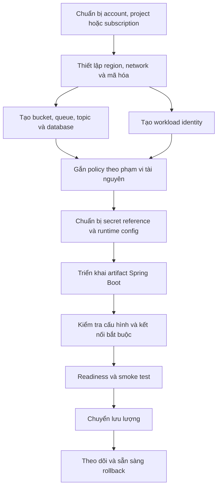

# Thứ tự khởi tạo tài nguyên, cấp quyền và đưa ứng dụng vào phục vụ

Khi triển khai một ứng dụng Spring Boot sử dụng dịch vụ managed của AWS, Azure hoặc Google Cloud, việc đưa image lên máy chủ mới chỉ là một phần của quy trình. Ứng dụng còn cần tài nguyên đích như bucket, queue, topic, cơ sở dữ liệu và kho bí mật; cần một danh tính chạy ứng dụng; cần quyền truy cập đúng phạm vi; và cần cấu hình endpoint, vùng triển khai cùng thông tin tham chiếu đến secret. Nếu các bước này diễn ra sai thứ tự, ứng dụng có thể khởi động trước khi queue được tạo, nhận lỗi `AccessDenied` dù tài nguyên đã tồn tại, hoặc phục vụ lưu lượng khi các dependency chưa sẵn sàng.

Trong module `SPRING_CLOUD_PROVIDER_INTEGRATION`, quy trình triển khai cần được nhìn như một chuỗi phụ thuộc giữa Spring Boot và các dịch vụ managed trên nhiều cloud provider. Mục tiêu của bài này là xác định thứ tự khởi tạo, phân biệt quyền quản trị tài nguyên với quyền sử dụng dữ liệu, cấu hình danh tính runtime và kiểm tra ứng dụng trước khi chuyển lưu lượng thật.

## Kết quả cần đạt

Sau bài học, bạn có thể:

- Lập thứ tự triển khai dựa trên quan hệ phụ thuộc giữa network, tài nguyên managed, danh tính, policy và ứng dụng.
- Tách việc tạo hạ tầng khỏi vòng đời khởi động của Spring Boot.
- Cấp quyền tối thiểu cho workload identity trên AWS, Azure và Google Cloud.
- Đưa cấu hình và secret vào ứng dụng bằng cơ chế phù hợp với môi trường chạy.
- Thiết lập readiness, smoke test, chuyển lưu lượng và rollback có kiểm soát.
- Chẩn đoán lỗi thường gặp do tài nguyên chưa sẵn sàng, quyền chưa có hiệu lực hoặc cấu hình sai.

## 1. Xem triển khai như một đồ thị phụ thuộc

Một ứng dụng thường sử dụng nhiều tài nguyên cùng lúc. Ví dụ, dịch vụ xử lý đơn hàng có thể cần:

- Một bucket để lưu hóa đơn hoặc tệp đính kèm.
- Một queue để nhận yêu cầu xử lý nền.
- Một topic để phát sự kiện đơn hàng.
- Một cơ sở dữ liệu để lưu trạng thái nghiệp vụ.
- Một secret store để giữ thông tin nhạy cảm hoặc tham chiếu đến khóa mã hóa.
- Một danh tính runtime để truy cập các dịch vụ trên.

Các thành phần này không thể được tạo theo thứ tự tùy ý. Policy gắn với một tài nguyên cần biết tài nguyên và principal đích. Ứng dụng cần endpoint và tên tài nguyên trước khi khởi động. Quy trình triển khai vì vậy nên tuân theo quan hệ phụ thuộc thay vì một danh sách lệnh rời rạc.



Sơ đồ thể hiện các phụ thuộc chính. Việc tạo workload identity và tạo tài nguyên có thể thực hiện song song sau khi chuẩn bị phạm vi cloud; bước gắn quyền chỉ hoàn tất khi cả principal lẫn tài nguyên đích đã tồn tại. Một số nền tảng cho phép tạo role binding trước hoặc trong lúc tạo tài nguyên bằng IaC, nhưng dependency logic vẫn phải được biểu diễn rõ trong cấu hình triển khai.

### Các giai đoạn triển khai

| Giai đoạn | Công việc | Điều kiện để chuyển bước |
|---|---|---|
| 1. Chuẩn bị nền tảng | Chọn account/project/subscription, region, network, subnet, DNS, firewall và khóa mã hóa | Môi trường và kết nối đến dịch vụ đích đã được xác định |
| 2. Tạo tài nguyên | Tạo bucket, queue, topic, database và secret store | Tài nguyên có tên, region, endpoint và cấu hình bảo vệ đúng |
| 3. Tạo danh tính | Tạo role, managed identity hoặc service account cho workload | Danh tính có thể được nền tảng triển khai gắn vào workload |
| 4. Cấp quyền | Gắn role hoặc policy vào đúng tài nguyên và đúng thao tác | Principal có quyền cần thiết trên data plane |
| 5. Chuẩn bị cấu hình | Cung cấp tên tài nguyên, endpoint, region và secret reference | Cấu hình đã được kiểm tra, không chứa credential tĩnh trong mã nguồn |
| 6. Triển khai ứng dụng | Đưa artifact vào runtime và gắn danh tính | Instance hoặc pod chạy với đúng cấu hình và identity |
| 7. Xác minh và phục vụ | Kiểm tra readiness, smoke test rồi chuyển traffic | Dependency bắt buộc hoạt động và ứng dụng xử lý được yêu cầu mẫu |

Không phải môi trường nào cũng cần tất cả loại tài nguyên. Hãy chỉ tạo thành phần mà ứng dụng thực sự sử dụng. Tên tài nguyên nên có quy ước theo ứng dụng, môi trường và region, ví dụ `orders-prod-invoices-ap-southeast-1`, để tránh nhầm lẫn giữa development, staging và production.

## 2. Tạo hạ tầng trước khi triển khai ứng dụng

Việc tạo tài nguyên cloud nên được quản lý bằng Infrastructure as Code (IaC) hoặc một quy trình provisioning có thể lặp lại. Có thể sử dụng AWS CloudFormation hoặc CDK, Azure Bicep hoặc ARM, Terraform, hay công cụ triển khai hạ tầng phù hợp với tổ chức. Điều quan trọng là trạng thái mong muốn được khai báo rõ, có thể review, tái chạy an toàn và truy vết được.

### Chuẩn bị phạm vi và kết nối

Trước khi tạo dịch vụ managed, xác định:

1. Account, project hoặc subscription sở hữu tài nguyên.
2. Region được phép sử dụng và region của từng dịch vụ.
3. Network path từ runtime đến dịch vụ: public endpoint, private endpoint, VPC/VNet, subnet, route, DNS và firewall.
4. Chính sách mã hóa, retention, backup, versioning và logging.
5. Quota, giới hạn kết nối và giới hạn throughput dự kiến.

Một bucket có thể đã tồn tại nhưng ứng dụng vẫn không truy cập được nếu workload nằm trong private subnet mà DNS hoặc route đến private endpoint chưa đúng. Tương tự, queue đúng tên nhưng nằm ở region khác có thể khiến SDK gọi nhầm endpoint. Do đó, kiểm tra network và region là một phần của preflight, không phải việc xử lý sau khi ứng dụng đã chạy.

### Khởi tạo tài nguyên theo quan hệ sử dụng

Hãy tạo các tài nguyên nền trước các thành phần phụ thuộc vào chúng. Ví dụ, nếu queue dùng khóa mã hóa do khách hàng quản lý, khóa và policy của khóa cần sẵn sàng trước khi tạo hoặc cấu hình queue. Nếu database cần subnet group hoặc private DNS, các thành phần mạng phải tồn tại trước.

Một quy trình IaC tốt có các đặc điểm sau:

- **Idempotent:** chạy lại không tạo thêm tài nguyên trùng hoặc làm thay đổi ngoài dự kiến.
- **Có dependency rõ ràng:** biểu diễn quan hệ giữa network, key, resource, identity và policy.
- **Có phân tách môi trường:** development, staging và production không dùng chung bucket hoặc queue ngoài chủ đích.
- **Có bảo vệ dữ liệu:** bật mã hóa, backup, versioning hoặc retention theo yêu cầu của loại dữ liệu.
- **Có đầu ra rõ ràng:** xuất tên tài nguyên, ARN/resource ID, endpoint và region để bước triển khai ứng dụng sử dụng.

Không nên để mỗi instance Spring Boot tự tạo bucket, queue hay database khi khởi động. Cách làm này buộc ứng dụng giữ quyền quản trị hạ tầng, tạo race condition khi nhiều instance khởi động đồng thời và khiến rollback ứng dụng có thể ảnh hưởng đến tài nguyên dùng chung. Spring Boot nên sử dụng tài nguyên đã được provisioning và chỉ giữ quyền data plane cần cho nghiệp vụ.

## 3. Tạo workload identity và cấp quyền theo nguyên tắc tối thiểu

Ứng dụng cần được cloud provider nhận diện bằng một principal. Principal này có thể là IAM role, managed identity hoặc service account. Khi runtime hỗ trợ danh tính workload, SDK có thể lấy credential ngắn hạn từ môi trường thực thi. Cách này giúp tránh lưu access key hoặc service account key lâu dài trong image, file cấu hình hay biến môi trường.

Hai câu hỏi phải được trả lời riêng:

- **Ứng dụng chạy dưới danh tính nào?** Đây là workload identity được gắn vào VM, container task, pod hoặc dịch vụ serverless.
- **Danh tính đó được phép làm gì?** Đây là role/policy được gắn trên account, project, subscription hoặc tài nguyên cụ thể.

Tạo identity không tự động cấp quyền truy cập dữ liệu. Ngược lại, một policy có vẻ đúng cũng không có tác dụng nếu workload đang chạy bằng principal khác.

### Phân biệt quyền control plane và data plane

Quyền control plane cho phép tạo, sửa hoặc xóa tài nguyên. Quyền data plane cho phép đọc hoặc ghi dữ liệu bên trong tài nguyên. Ví dụ, quyền tạo bucket không đồng nghĩa với quyền đọc object trong bucket; quyền quản lý tài nguyên Service Bus không đồng nghĩa với quyền nhận message; quyền quản trị một project không nên được dùng làm mặc định cho ứng dụng xử lý request.

| Nhu cầu của ứng dụng | Loại quyền cần cấp | Ví dụ thao tác |
|---|---|---|
| Đọc hóa đơn trong object storage | Data plane, chỉ đọc | Get object hoặc đọc blob |
| Ghi hóa đơn mới | Data plane, ghi object | Put object hoặc tạo blob |
| Nhận message từ queue | Data plane, nhận/consume | Receive hoặc consume message |
| Gửi message | Data plane, gửi | Send hoặc publish message |
| Đọc secret khi chạy | Quyền đọc secret | Get secret value hoặc access secret version |
| Tạo hoặc xóa bucket/queue | Control plane | Create/delete resource; thường dành cho pipeline hạ tầng |

Một identity có thể cần nhiều quyền nếu ứng dụng thực sự thực hiện nhiều loại thao tác. Hãy cấp quyền theo từng tài nguyên và thao tác cần thiết, tránh dùng role quản trị rộng chỉ để làm cho lỗi `403` biến mất.

### AWS

Trên AWS, workload có thể sử dụng IAM role được gắn với EC2 instance profile, ECS task role hoặc cơ chế danh tính workload trên EKS như IRSA hay EKS Pod Identity. AWS SDK sử dụng credential provider chain để lấy credential từ môi trường runtime. Ứng dụng nên dựa vào cơ chế này thay vì khai báo access key và secret key cố định trong `application.yml`.

Policy nên giới hạn resource ARN và action. Ví dụ, dịch vụ chỉ tải hóa đơn từ một bucket thì chỉ cần quyền đọc object trong bucket đó; nếu cần ghi object, bổ sung quyền ghi tương ứng. Quyền truy cập SQS, SNS, S3, Secrets Manager hoặc Parameter Store cần được cấp theo đúng dịch vụ và thao tác thực tế. Với tài nguyên mã hóa bằng customer-managed KMS key, principal có thể cần thêm quyền sử dụng khóa theo key policy và IAM policy.

Ví dụ minh họa policy data plane tối thiểu cho một workload chỉ đọc object từ một bucket (thay ARN bằng tài nguyên của môi trường):

```json
{
  "Version": "2012-10-17",
  "Statement": [
    {
      "Effect": "Allow",
      "Action": ["s3:GetObject"],
      "Resource": "arn:aws:s3:::orders-prod-invoices/*"
    }
  ]
}
```

Policy trên không cấp quyền liệt kê bucket, ghi object, xóa object hay quản trị bucket. Nếu ứng dụng cần những thao tác đó, hãy bổ sung action và resource tương ứng sau khi xác nhận yêu cầu nghiệp vụ.

### Azure

Trên Azure, ứng dụng có thể dùng system-assigned hoặc user-assigned managed identity. Runtime như Azure App Service, Azure Container Apps, máy ảo hoặc môi trường Kubernetes có thể cung cấp danh tính phù hợp. SDK Azure thường tích hợp với `DefaultAzureCredential` để tìm credential từ môi trường chạy.

Azure phân biệt role quản lý tài nguyên với role truy cập dữ liệu. Chẳng hạn, `Contributor` ở phạm vi resource group không tự động thay thế role data plane để đọc blob. Một ứng dụng ghi blob có thể cần role dữ liệu như `Storage Blob Data Contributor` trên storage account hoặc container phù hợp; ứng dụng đọc secret từ Key Vault cần role data plane tương ứng, chẳng hạn `Key Vault Secrets User`, tại đúng vault hoặc phạm vi được cho phép. Ứng dụng gửi/nhận message từ Service Bus cũng cần role data plane phù hợp với thao tác gửi hoặc nhận.

Role assignment có thể mất một khoảng thời gian để có hiệu lực. Khi triển khai lần đầu, pipeline nên chờ và kiểm tra quyền bằng một thao tác xác minh có giới hạn, thay vì khởi động lại liên tục hoặc mở rộng role thành quyền quản trị.

### Google Cloud

Trên Google Cloud, workload thường chạy dưới một service account được gắn với Compute Engine, Cloud Run hoặc GKE. Với GKE, Workload Identity Federation for GKE cho phép Kubernetes workload sử dụng quyền của Google Cloud service account mà không cần phân phối key file. Ứng dụng Java có thể dùng Application Default Credentials (ADC) để lấy credential từ môi trường runtime.

Hãy gán IAM role ở phạm vi hẹp nhất có thể. Ví dụ, workload chỉ đọc object có thể cần role đọc object trên bucket; workload gửi sự kiện Pub/Sub cần quyền publish trên topic; workload nhận message cần quyền subscribe trên subscription; workload đọc secret cần quyền truy cập secret version phù hợp. Tránh gắn role Owner hoặc Editor cho service account của ứng dụng.

### Xác minh principal thực tế

Sau khi gắn identity và role, hãy xác minh ứng dụng đang nhận đúng principal. Có thể kiểm tra thông tin danh tính bằng lệnh CLI của provider trong pipeline hoặc dùng một thao tác truy cập tài nguyên không phá hủy. Không ghi access token, secret value hoặc credential vào log. Nếu có nhiều lớp identity (node, pod, task, service), hãy kiểm tra identity ở đúng lớp mà tiến trình Java đang sử dụng.

## 4. Chuẩn bị secret và cấu hình runtime

Sau khi tài nguyên và quyền đã sẵn sàng, pipeline có thể cung cấp các giá trị cấu hình cần thiết cho ứng dụng. Phân loại rõ:

- **Cấu hình không nhạy cảm:** tên bucket, queue, topic, region, endpoint, timeout và feature flag.
- **Thông tin nhạy cảm:** mật khẩu database, token bên ngoài, khóa ký hoặc giá trị bí mật khác.
- **Thông tin xác thực cloud:** nên lấy từ workload identity và credential chain của provider, không đóng gói vào artifact.

Giá trị nhạy cảm nên được lưu trong secret manager của provider hoặc hệ thống quản lý secret được tổ chức phê duyệt. Ứng dụng nhận tham chiếu đến secret hoặc lấy secret bằng SDK khi cần, với quyền đọc được cấp riêng. Không commit secret vào Git, Docker image, file `application.yml`, log pipeline hay output của lệnh triển khai.

Ví dụ cấu hình Spring Boot giữ các tên tài nguyên ở dạng biến môi trường:

```yaml
spring:
  application:
    name: orders-service

app:
  storage:
    invoice-bucket: ${APP_INVOICE_BUCKET}
  messaging:
    orders-queue: ${APP_ORDERS_QUEUE}
    events-topic: ${APP_EVENTS_TOPIC}

management:
  endpoint:
    health:
      probes:
        enabled: true
  endpoints:
    web:
      exposure:
        include: health,info
```

Các biến môi trường trên được pipeline hoặc runtime cung cấp theo từng môi trường. Cấu hình này không chứa credential cloud. Các starter Spring Cloud tương ứng sẽ sử dụng SDK và cơ chế credential của provider để truy cập dịch vụ. Tên property và cách khai báo endpoint cụ thể phụ thuộc phiên bản Spring Cloud AWS, Spring Cloud Azure hoặc Google Cloud Spring đang dùng; hãy theo BOM và tài liệu của đúng phiên bản dự án, không trộn cấu hình giữa các thế hệ thư viện.

Khi secret được xoay vòng, cần xác định ứng dụng đọc giá trị một lần lúc khởi động hay có thể tải lại trong runtime. Nếu ứng dụng cache secret, hãy thiết kế thời hạn cache, cơ chế refresh và cách xử lý khi secret cũ bị thu hồi. Không giả định rằng đổi giá trị trong secret manager sẽ tự động cập nhật một bean hoặc connection pool đang chạy.

## 5. Triển khai artifact và kiểm tra trạng thái sẵn sàng

Chỉ triển khai artifact sau khi các đầu ra hạ tầng và quyền cần thiết đã được xác minh. Artifact nên bất biến giữa các môi trường; cấu hình môi trường và identity được gắn tại thời điểm triển khai. Nhờ vậy, cùng một image có thể được kiểm thử ở staging rồi phát hành lên production mà không cần build lại với secret hoặc endpoint được nhúng sẵn.

### Trình tự khi ứng dụng khởi động

Khi tiến trình Spring Boot bắt đầu:

1. Spring đọc cấu hình và xác thực các giá trị bắt buộc như region, tên bucket và queue.
2. SDK của cloud provider lấy credential từ workload identity hoặc credential chain.
3. Client kết nối đến endpoint và thực hiện thao tác tối thiểu cần thiết.
4. Ứng dụng khởi tạo consumer, producer hoặc connection pool theo cấu hình.
5. Readiness chuyển sang trạng thái sẵn sàng khi các dependency bắt buộc có thể phục vụ nghiệp vụ.

Không nên dùng `@PostConstruct` để tạo tài nguyên hạ tầng hoặc thực hiện một chuỗi gọi mạng kéo dài. Khởi tạo client có thể diễn ra khi tạo bean, nhưng thao tác kiểm tra dependency cần có timeout, retry có giới hạn và thông báo lỗi đủ rõ. Nếu dịch vụ bên ngoài tạm thời chưa sẵn sàng, ứng dụng cần có chính sách khởi động lại hoặc giữ trạng thái chưa sẵn sàng phù hợp với nền tảng triển khai.

### Liveness và readiness

Liveness trả lời câu hỏi tiến trình có còn hoạt động hay không. Readiness trả lời câu hỏi instance có thể nhận request nghiệp vụ hay chưa. Hai trạng thái có mục đích khác nhau:

- Liveness thường không nên phụ thuộc vào database, queue hoặc object storage. Nếu một dịch vụ cloud tạm thời gián đoạn, việc liveness liên tục thất bại có thể khiến nền tảng khởi động lại hàng loạt instance và làm sự cố nặng hơn.
- Readiness có thể bao gồm dependency bắt buộc để instance chưa nhận traffic khi chưa thể xử lý đúng nghiệp vụ.
- Dependency tùy chọn nên được thể hiện bằng trạng thái suy giảm hoặc metric phù hợp, tránh chặn toàn bộ ứng dụng khi tính năng không thiết yếu gặp lỗi.

Spring Boot Actuator hỗ trợ health endpoint và readiness/liveness probe. Có thể bật probe bằng cấu hình như ví dụ ở trên, sau đó cấu hình nền tảng triển khai gọi đúng endpoint. Nếu bổ sung `HealthIndicator` cho dependency, hãy đặt timeout ngắn, tránh gọi thao tác tốn kém mỗi lần probe và không trả secret hoặc thông tin nội bộ nhạy cảm trong response.

### Smoke test trước khi mở traffic

Readiness xanh là điều kiện cần, nhưng chưa đủ để chứng minh toàn bộ luồng nghiệp vụ hoạt động. Trước khi chuyển traffic, chạy smoke test có kiểm soát, chẳng hạn:

- Gửi một request kiểm tra đến endpoint của ứng dụng.
- Đọc một object kiểm thử hoặc ghi object vào prefix dành riêng cho smoke test.
- Gửi một message thử vào queue/topic và xác nhận consumer hoặc subscriber xử lý được.
- Thực hiện truy vấn đơn giản đến database bằng tài khoản runtime.
- Đọc một secret kiểm thử nếu ứng dụng cần secret đó.

Smoke test phải dùng dữ liệu thử riêng, có timeout và cleanup phù hợp. Không dùng thao tác xóa hoặc ghi đè dữ liệu production thật để kiểm tra quyền. Nếu ứng dụng có thể nhận message trước khi traffic HTTP được mở, hãy bảo đảm consumer chỉ bắt đầu xử lý khi cấu hình và quyền đã sẵn sàng.

## 6. Chuyển lưu lượng và quản lý rollback

Sau khi smoke test thành công, chuyển traffic theo chiến lược phù hợp với nền tảng: rolling update, canary hoặc blue-green. Với canary, bắt đầu bằng một tỷ lệ nhỏ, theo dõi lỗi và latency rồi mới tăng dần. Theo dõi tối thiểu:

- Tỷ lệ HTTP 5xx, timeout và lỗi nghiệp vụ.
- Thời gian phản hồi p50/p95/p99.
- Số lần retry, số message tồn đọng, dead-letter queue và tuổi message lâu nhất.
- Lỗi truy cập cloud như `AccessDenied`, `Forbidden`, `PERMISSION_DENIED` hoặc lỗi xác thực.
- Connection pool, quota, throttling và giới hạn request của dịch vụ managed.
- Chi phí hoặc mức sử dụng tài nguyên có thay đổi bất thường sau khi phát hành.

Nếu chỉ số vượt ngưỡng, dừng rollout hoặc chuyển traffic về phiên bản trước. Rollback ứng dụng không đồng nghĩa rollback toàn bộ hạ tầng. Bucket, queue và database có thể chứa dữ liệu đang được phiên bản cũ sử dụng; không xóa chúng như một phần mặc định của rollback. Thay đổi schema database nên theo hướng mở rộng trước, tương thích cả phiên bản cũ và mới, rồi mới loại bỏ cấu trúc cũ ở một lần phát hành sau.

Một kế hoạch rollback cần xác định trước:

1. Phiên bản artifact ổn định gần nhất.
2. Cách chuyển traffic về phiên bản đó.
3. Tính tương thích của schema, message format và object format.
4. Cách xử lý message đã được phiên bản mới phát ra.
5. Những thay đổi IAM hoặc secret nào có thể giữ nguyên an toàn và những thay đổi nào cần khôi phục.

Không thu hồi role hoặc xóa tài nguyên ngay khi rollback nếu phiên bản cũ vẫn cần sử dụng chúng. Việc dọn dẹp nên là một bước hạ tầng riêng, có kiểm tra dependency và chính sách lưu giữ dữ liệu.

## 7. Ví dụ quy trình triển khai cho dịch vụ xử lý đơn hàng

Giả sử `orders-service` chạy trên một nền tảng container và sử dụng object storage để lưu hóa đơn, queue để xử lý tác vụ nền, cùng secret manager để đọc thông tin kết nối database. Quy trình phát hành production có thể được tổ chức như sau:

| Thứ tự | Pipeline thực hiện | Kiểm tra đầu ra |
|---:|---|---|
| 1 | Chọn account/project/subscription và region production | Đúng môi trường, đúng region, đúng network |
| 2 | Provision bucket, queue và secret store bằng IaC | Resource ID, endpoint và tên tài nguyên được xuất ra |
| 3 | Tạo workload identity cho container | Runtime có thể gắn identity vào task, pod hoặc service |
| 4 | Gắn quyền đọc/ghi object, nhận message và đọc secret | Policy giới hạn đúng resource và action |
| 5 | Kiểm tra network, DNS, private endpoint và quyền truy cập | Thao tác xác minh thành công từ đúng runtime context |
| 6 | Triển khai image đã được kiểm thử | Image digest và cấu hình release được ghi nhận |
| 7 | Kiểm tra startup, readiness và smoke test | Các luồng nghiệp vụ tối thiểu thành công |
| 8 | Chuyển traffic theo từng đợt | Error rate và latency nằm trong ngưỡng |
| 9 | Theo dõi sau phát hành và đóng release | Không còn lỗi mới; có thể truy vết phiên bản và tài nguyên |

Ví dụ cấu hình triển khai chỉ truyền thông tin không nhạy cảm:

```yaml
env:
  - name: APP_INVOICE_BUCKET
    value: orders-prod-invoices
  - name: APP_ORDERS_QUEUE
    value: orders-prod-processing
  - name: APP_EVENTS_TOPIC
    value: orders-prod-events
  - name: CLOUD_REGION
    value: ap-southeast-1
```

Đây là ví dụ cấu trúc cấu hình container, không phải manifest hoàn chỉnh cho một nền tảng cụ thể. Identity được cấu hình tại workload hoặc dịch vụ triển khai theo cách của provider. Secret database được lấy từ secret manager bằng quyền của identity hoặc được runtime mount theo cơ chế được quản trị; không thêm secret value vào đoạn YAML này.

Điểm quan trọng trong ví dụ là pipeline kiểm tra quyền từ chính môi trường runtime mà ứng dụng sẽ chạy. Một lệnh CLI chạy bằng tài khoản cá nhân của người triển khai thành công không chứng minh container có quyền tương tự. Hãy xác minh bằng workload identity hoặc một job kiểm thử được gắn cùng identity và network policy.

## 8. Xử lý lỗi theo đúng giai đoạn

| Triệu chứng | Nguyên nhân thường gặp | Cách kiểm tra và xử lý |
|---|---|---|
| `AccessDenied`, `Forbidden` hoặc `PERMISSION_DENIED` | Sai principal, thiếu data-plane role, policy sai resource scope hoặc role chưa có hiệu lực | Xác minh principal runtime; kiểm tra action, resource và phạm vi role; chờ propagation có giới hạn rồi thử lại |
| Không phân giải được hostname hoặc timeout kết nối | DNS, route, firewall, private endpoint hoặc region sai | Kiểm tra từ network namespace của workload; xác minh endpoint và DNS của đúng môi trường |
| Không tìm thấy bucket, queue hoặc topic | Sai tên, sai account/project, sai region hoặc IaC chưa hoàn tất | Đối chiếu output provisioning với runtime config; xác minh resource tồn tại trong đúng scope |
| Ứng dụng khởi động được nhưng readiness luôn lỗi | Dependency bắt buộc chưa sẵn sàng, credential không hợp lệ hoặc health check quá chặt | Xem log đã loại bỏ secret; kiểm tra từng dependency bằng timeout ngắn; phân biệt dependency bắt buộc và tùy chọn |
| Chạy local thành công nhưng deploy thất bại | Local dùng profile hoặc credential cá nhân; runtime dùng identity khác | Xác minh identity thực tế của pod/task/service; kiểm tra role binding và credential chain |
| Một số instance lỗi quyền, instance khác hoạt động | Rollout không đồng nhất, identity hoặc cấu hình khác nhau, propagation chưa hoàn tất | So sánh revision, identity, region và config của instance lỗi với instance khỏe |
| Sau khi xoay secret, kết nối database vẫn dùng mật khẩu cũ | Ứng dụng hoặc connection pool cache secret | Kiểm tra cơ chế refresh, thời gian cache và vòng đời connection; triển khai refresh có kiểm soát |
| Queue backlog tăng sau phát hành | Consumer chưa chạy, thiếu quyền nhận message, lỗi deserialize hoặc throughput giảm | Kiểm tra consumer startup, quyền receive/subscribe, dead-letter và metric xử lý |

Khi điều tra lỗi, hãy kiểm tra theo thứ tự: cấu hình môi trường, principal thực tế, policy và phạm vi tài nguyên, network/endpoint, rồi mới đến logic tích hợp trong ứng dụng. Thứ tự này giúp phân biệt lỗi nền tảng với lỗi code và tránh thay đổi nhiều thành phần cùng lúc.

## 9. Checklist trước khi đưa ứng dụng vào phục vụ

Trước mỗi lần phát hành, xác nhận các điểm sau:

- [ ] Đúng account/project/subscription, môi trường và region.
- [ ] Tài nguyên managed đã tồn tại với cấu hình mã hóa, backup, retention và network phù hợp.
- [ ] Workload identity được gắn vào đúng task, pod, VM hoặc service.
- [ ] Policy chỉ cấp các thao tác data plane mà ứng dụng cần trên đúng tài nguyên.
- [ ] Secret được lưu trong secret manager; log và artifact không chứa giá trị bí mật.
- [ ] Runtime config có đủ tên tài nguyên, endpoint và region.
- [ ] Ứng dụng lấy credential từ identity hoặc credential chain phù hợp.
- [ ] Startup có timeout và retry hợp lý; readiness phản ánh dependency bắt buộc.
- [ ] Smoke test xác minh được các luồng lưu trữ, messaging và dữ liệu cần thiết.
- [ ] Có chiến lược rollout, ngưỡng dừng và phiên bản rollback.
- [ ] Dashboard và log có thể liên kết release với instance, identity và tài nguyên liên quan.

## Kết luận

Thứ tự triển khai đúng bắt đầu từ nền tảng và tài nguyên, tiếp đến workload identity và quyền truy cập, sau đó mới cấu hình và phát hành ứng dụng. Khi tách provisioning khỏi vòng đời Spring Boot, dùng quyền tối thiểu và xác minh từ đúng runtime identity, ứng dụng sẽ có quá trình khởi động dễ dự đoán hơn trên AWS, Azure và Google Cloud. Readiness, smoke test và rollout có kiểm soát hoàn tất chuỗi đó trước khi ứng dụng nhận lưu lượng production.
