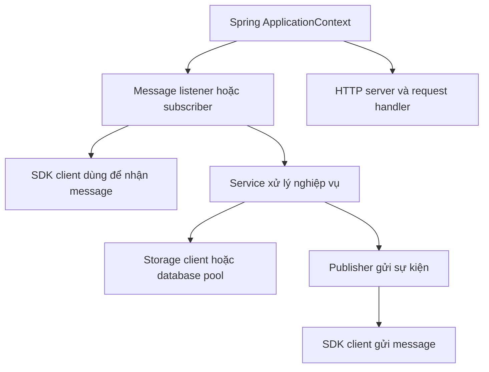

# Đóng listener và client đúng vòng đời khi ứng dụng dừng

Một ứng dụng Spring Boot tích hợp với AWS, Azure hoặc Google Cloud thường duy trì nhiều thành phần sống lâu hơn một request: message listener, subscriber, publisher, SDK client, connection pool và executor. Khi tiến trình dừng, các thành phần này phải được đóng theo đúng thứ tự. Nếu đóng SDK client trước listener, callback đang xử lý có thể thất bại khi cần ghi dữ liệu hoặc xác nhận message. Nếu dừng listener quá muộn, ứng dụng có thể tiếp tục nhận công việc mới trong lúc JVM đã bắt đầu đóng context. Nếu publisher bị đóng khi vẫn còn message đang gửi, sự kiện có thể chưa được chuyển đến dịch vụ đích.

Trong module `SPRING_CLOUD_PROVIDER_INTEGRATION`, vòng đời của listener và client là một phần của tích hợp dịch vụ managed. Bài học tập trung vào quy trình shutdown có kiểm soát: ngừng nhận công việc mới, hoàn tất công việc đang xử lý, xác nhận message đúng thời điểm, sau đó mới đóng client và tài nguyên dùng chung. Quy trình cần hoạt động nhất quán khi ứng dụng chạy trên AWS, Azure hoặc Google Cloud, dù API cụ thể của từng SDK có khác nhau.

## Kết quả cần đạt

Sau bài học, bạn có thể:

- Phân biệt dừng listener, drain công việc đang chạy và đóng SDK client.
- Sử dụng vòng đời bean của Spring để quản lý tài nguyên dài hạn.
- Thiết lập graceful shutdown cho web server và các thành phần Spring.
- Xác định thứ tự đóng listener, publisher, client, connection pool và executor.
- Xử lý an toàn message đang được nhận khi tiến trình bị yêu cầu dừng.
- Đặt timeout shutdown phù hợp với runtime container và deadline của cloud platform.
- Kiểm tra shutdown qua log, metric và thử nghiệm triển khai.

## 1. Vì sao thứ tự đóng tài nguyên quan trọng?

Một tiến trình Spring Boot có thể khởi tạo các thành phần theo quan hệ như sau:



Listener phụ thuộc vào client nhận message. Handler có thể phụ thuộc vào storage, database và publisher. Vì vậy, khi dừng ứng dụng, thứ tự cần đi theo chiều ngược của quan hệ sử dụng: ngừng nhận công việc mới trước, để handler hoàn tất khi các dependency vẫn còn mở, sau đó mới đóng client.

Hãy phân biệt ba thao tác:

1. **Stop listener:** ngừng polling, pull hoặc nhận callback mới. Thao tác này không nhất thiết đóng client dùng chung.
2. **Drain:** chờ các request hoặc message handler đang chạy hoàn tất trong khoảng thời gian cho phép. Trong giai đoạn này, handler vẫn có thể cần database, storage hoặc publisher.
3. **Close client:** giải phóng kết nối mạng, thread, channel, connection pool và tài nguyên SDK. Sau bước này, không thành phần nào được tiếp tục sử dụng client đó.

`stop()` và `close()` không phải lúc nào cũng đồng nghĩa. Một số SDK có thao tác stop để ngừng nhận công việc nhưng vẫn giữ client cho lần khởi động lại; thao tác close giải phóng hoàn toàn tài nguyên. Một số client chỉ cung cấp close hoặc shutdown. Cần đọc hợp đồng vòng đời của API đang dùng và chọn một nơi chịu trách nhiệm đóng tài nguyên.

### Thứ tự shutdown khuyến nghị

| Thứ tự | Hành động | Mục đích |
|---:|---|---|
| 1 | Đánh dấu instance đang dừng và loại khỏi luồng nhận traffic | Tránh giao thêm request mới cho instance |
| 2 | Ngừng nhận message mới từ listener/subscriber | Giữ ổn định số lượng công việc đang xử lý |
| 3 | Chờ request và message handler đang chạy hoàn tất | Cho phép nghiệp vụ commit dữ liệu và hoàn thành publish cần thiết |
| 4 | Xác nhận, abandon hoặc để message được giao lại theo kết quả xử lý | Tránh mất message hoặc xác nhận quá sớm |
| 5 | Dừng listener/subscriber hoàn toàn | Giải phóng consumer và callback liên quan |
| 6 | Hoàn tất các lệnh publish đang chờ và flush buffer | Đảm bảo sự kiện đã được gửi hoặc lỗi được ghi nhận |
| 7 | Đóng publisher, storage client, database pool và SDK client | Giải phóng kết nối cùng thread nền |
| 8 | Dừng executor, scheduler và hoàn tất Spring context | Cho phép JVM kết thúc gọn gàng |

Trong thực tế, Spring có thể phối hợp một số bước thông qua `SmartLifecycle`, `LifecycleProcessor` và quá trình destroy bean. Không cần tự triển khai toàn bộ chuỗi nếu framework hoặc starter đã quản lý thành phần đó. Điều cần bảo đảm là quan hệ phụ thuộc và thứ tự dừng vẫn đúng.

## 2. Vòng đời bean trong Spring

Spring quản lý vòng đời của singleton bean từ lúc tạo đến lúc ApplicationContext đóng. Với tài nguyên dài hạn, hãy đăng ký chúng thành bean để container biết cách khởi tạo và giải phóng. Tránh tạo SDK client bằng `new` bên trong từng request hoặc giữ một client trong static field không có chủ sở hữu vòng đời rõ ràng.

### `@Bean` và destroy method

Với một SDK client có phương thức `close()`, có thể khai báo bean và chỉ định destroy method:

```java
@Configuration
class CloudClientConfiguration {

    @Bean(destroyMethod = "close")
    S3Client invoiceS3Client() {
        return S3Client.builder().build();
    }
}
```

Khi Spring đóng context, bean sẽ được giải phóng theo lifecycle mà container quản lý. Ví dụ trên minh họa AWS SDK for Java v2; cấu hình region, endpoint và credential provider cần được cung cấp theo môi trường thực tế. Nếu một starter đã tự tạo và quản lý client, hãy dùng bean do starter cung cấp hoặc cấu hình lifecycle theo tài liệu của starter. Không tạo thêm một client trùng lặp chỉ để tự đóng.

Spring cũng hỗ trợ các cơ chế như `DisposableBean`, `@PreDestroy` và destroy method trên `@Bean`. Chọn một cơ chế chính cho mỗi tài nguyên. Nếu cùng một client bị đóng từ `@PreDestroy`, `DisposableBean` và một callback khác, shutdown có thể gọi close nhiều lần hoặc chạy trong khi listener vẫn sử dụng client.

`@PreDestroy` phù hợp cho cleanup ngắn, đồng bộ và cục bộ, ví dụ giải phóng một tài nguyên do bean sở hữu. Với listener cần dừng nhận message, chờ callback và hoàn tất bất đồng bộ, nên dùng lifecycle API mà thành phần đó cung cấp thay vì nhét toàn bộ quy trình vào một `@PreDestroy` tùy tiện.

### `Lifecycle` và `SmartLifecycle`

Spring cung cấp `Lifecycle` và `SmartLifecycle` cho các thành phần cần được start/stop cùng ApplicationContext. `SmartLifecycle` bổ sung callback hoàn tất dừng, hỗ trợ tự khởi động và phase để điều phối thứ tự.

- Khi context khởi động, thành phần có phase thấp thường được start trước.
- Khi context dừng, phase cao thường được stop trước.
- `stop(Runnable callback)` cần gọi callback khi thành phần đã dừng xong; nếu không, Spring có thể phải chờ đến hết timeout của phase.
- `isRunning()` phải phản ánh trạng thái thực tế để Spring điều phối chính xác.

Nếu listener và client đều do ứng dụng quản lý bằng `SmartLifecycle`, listener cần dừng trước client mà nó sử dụng. Có thể đặt phase của listener cao hơn phase của client. Ví dụ dưới đây mô tả ý tưởng cho một wrapper nội bộ; `ManagedListener` là abstraction của ứng dụng và cần được nối với API listener thực tế của provider:

```java
final class OrdersListenerLifecycle implements SmartLifecycle {

    private final ManagedListener listener;
    private volatile boolean running;

    OrdersListenerLifecycle(ManagedListener listener) {
        this.listener = listener;
    }

    @Override
    public void start() {
        listener.start();
        running = true;
    }

    @Override
    public void stop(Runnable callback) {
        try {
            listener.stopAndDrain();
            running = false;
        } finally {
            callback.run();
        }
    }

    @Override
    public void stop() {
        listener.stopAndDrain();
        running = false;
    }

    @Override
    public boolean isRunning() {
        return running;
    }

    @Override
    public int getPhase() {
        return 100;
    }
}
```

Trong ví dụ, `ManagedListener` là interface minh họa chứ không phải class có sẵn trong Spring. `stopAndDrain()` phải có timeout và bảo đảm listener ngừng nhận công việc mới trước khi chờ handler hiện tại. Không để callback chạy ngay sau khi yêu cầu dừng bất đồng bộ nếu listener vẫn còn hoạt động; callback chỉ được gọi khi thao tác stop đã hoàn tất hoặc đã kết thúc theo timeout được định nghĩa.

Phase chỉ là một công cụ điều phối. Nếu framework đã quản lý listener hoặc có dependency bean rõ ràng, hãy ưu tiên cơ chế lifecycle sẵn có. Spring thường hủy dependent bean trước dependency của nó; vì vậy, khi listener bean nhận client qua constructor hoặc tham số factory method, quan hệ phụ thuộc này cũng giúp Spring đóng listener trước client. Tuy nhiên, hãy kiểm tra cách starter tạo bean và không giả định dependency được ghi nhận nếu client được tra cứu thủ công qua static holder.

## 3. Graceful shutdown của Spring Boot

Đối với HTTP server, graceful shutdown cho phép server ngừng nhận kết nối hoặc request mới và chờ request đang xử lý trong giới hạn cấu hình. Bật chế độ này bằng cấu hình:

```yaml
server:
  shutdown: graceful

spring:
  lifecycle:
    timeout-per-shutdown-phase: 30s
```

`server.shutdown: graceful` yêu cầu web server thực hiện shutdown có kiểm soát. `spring.lifecycle.timeout-per-shutdown-phase` đặt thời gian tối đa cho mỗi phase của lifecycle processor; đây không phải một ngân sách tổng cố định cho mọi hoạt động dọn dẹp của tiến trình. Chọn giá trị dựa trên thời gian xử lý thực tế, timeout của orchestrator và giới hạn dừng của nền tảng. Property và hành vi chi tiết cần được đối chiếu với phiên bản Spring Boot của ứng dụng.

Graceful shutdown của web server không tự động chứng minh mọi message listener, publisher hoặc client tùy chỉnh đã drain đúng cách. Những thành phần này cần được quản lý bởi lifecycle bean hoặc cơ chế shutdown tương ứng của starter. Không nên dựa vào việc JVM kết thúc để các thread nền tự dừng.

### Dừng nhận traffic và dừng nhận message

HTTP traffic và message traffic có thể được điều phối bởi hai cơ chế khác nhau. Khi một instance bắt đầu shutdown:

- Readiness cần chuyển sang trạng thái không sẵn sàng để load balancer hoặc orchestrator ngừng gửi request mới.
- Web server bắt đầu graceful shutdown để xử lý các request đang hoạt động.
- Message listener cần được yêu cầu ngừng poll/pull hoặc ngừng nhận callback mới.
- Handler đã nhận message cần tiếp tục truy cập được các client nghiệp vụ cho đến khi xử lý xong hoặc timeout.

Nếu ứng dụng dùng cùng một endpoint readiness cho cả web server và listener, hãy xác định rõ semantics. Một instance có thể không còn nhận HTTP traffic nhưng vẫn cần hoàn tất message đã nhận. Ngược lại, một worker không có HTTP server vẫn cần một cơ chế báo hiệu ngừng nhận message.

## 4. Xử lý message đang chạy khi shutdown

Đây là phần dễ gây lỗi dữ liệu nhất. Khi listener nhận một message, broker thường đánh dấu message là đang được xử lý trong một khoảng thời gian hoặc một lease. Nếu ứng dụng dừng giữa chừng, broker có thể giao lại message khi lease hoặc visibility timeout hết hạn. Điều đó là hành vi bình thường của hệ thống messaging và ứng dụng cần thiết kế để chịu được redelivery.

### Chỉ xác nhận sau khi nghiệp vụ đã hoàn tất

Với message yêu cầu ghi database và phát sự kiện, trình tự thường cần là:

1. Đọc và xác thực message.
2. Thực hiện nghiệp vụ và commit trạng thái bền vững.
3. Phát sự kiện cần thiết, hoặc ghi sự kiện vào transactional outbox để publisher xử lý sau.
4. Chỉ xác nhận message sau khi điều kiện hoàn tất đã được đáp ứng.

Nếu xác nhận trước khi commit, message có thể bị mất khỏi queue dù nghiệp vụ chưa được lưu. Nếu commit xong nhưng shutdown xảy ra trước khi xác nhận, message có thể được giao lại. Vì vậy, handler nên idempotent: xử lý lại cùng message không tạo đơn hàng trùng, trừ tiền hai lần hoặc phát sinh side effect không kiểm soát.

Một `messageId`, idempotency key hoặc business key ổn định có thể được dùng để phát hiện lần xử lý lặp. Việc ghi dấu đã xử lý nên được thực hiện trong cùng transaction với thay đổi nghiệp vụ nếu hệ thống hỗ trợ. Với side effect ngoài transaction, cần thiết kế deduplication, outbox hoặc cơ chế bù trừ phù hợp.

### Lease, visibility timeout và acknowledgement deadline

Tên gọi và cách gia hạn phụ thuộc broker:

| Nền tảng | Cơ chế cần theo dõi | Hành vi khi handler chưa hoàn tất |
|---|---|---|
| Amazon SQS | Visibility timeout | Message có thể hiển thị lại sau timeout; có thể gia hạn visibility trong lúc xử lý |
| Azure Service Bus | Peek-lock và lock duration | Message bị giao lại khi lock hết hạn; có thể renew lock nếu xử lý lâu |
| Google Cloud Pub/Sub | Ack deadline | Message có thể được giao lại nếu chưa ack; subscriber có thể gia hạn ack deadline |

Thời gian drain phải được tính cùng với giới hạn lease/lock/ack deadline. Nếu handler có thể chạy lâu hơn thời gian lock, hãy cấu hình gia hạn phù hợp khi hệ thống còn hoạt động. Khi shutdown bắt đầu, cần quyết định rõ có tiếp tục gia hạn cho công việc đang drain hay dừng gia hạn để broker giao lại sau deadline. Không giữ lock vô thời hạn khi tiến trình không còn khả năng hoàn tất công việc.

Nếu handler không thể hoàn tất trong ngân sách shutdown, hãy để broker giao lại message hoặc thực hiện abandon/nack theo semantics của provider. Không ack message chỉ để shutdown nhanh hơn. Lỗi xử lý cần được phân loại để retry, dead-letter hoặc chuyển sang quy trình phục hồi theo chính sách queue/subscription.

### Giới hạn thời gian drain

Không phải handler nào cũng có thể dừng ngay. Đặt giới hạn cho thời gian chờ và xác định hành động khi hết hạn:

- Handler có thể hoàn tất trong thời gian còn lại: cho phép tiếp tục, sau đó ack khi an toàn.
- Handler có thể hủy an toàn trước khi commit: hủy và để message được giao lại.
- Handler đã commit nhưng chưa ack: chấp nhận khả năng redelivery và dựa vào idempotency.
- Handler đang gọi hệ thống bên ngoài không hỗ trợ hủy: đặt timeout cho lời gọi và xác định cách đối soát kết quả không rõ ràng.

Không dùng `Thread.interrupt()` như cách duy nhất để hủy mọi handler. Nhiều lời gọi SDK hoặc thao tác I/O không phản ứng theo cách mong muốn với interrupt. Cần timeout ở tầng HTTP client, database, broker và nghiệp vụ, đồng thời bảo đảm transaction được rollback hoặc hoàn tất đúng trạng thái.

## 5. Đóng listener và client theo cloud provider

Các provider có API và tên khái niệm khác nhau, nhưng nguyên tắc không đổi: dừng nguồn nhận trước, chờ callback đang chạy, rồi đóng client. Một client dùng chung có thể phục vụ nhiều listener hoặc publisher; chỉ đóng nó sau khi mọi thành phần phụ thuộc đã dừng.

### AWS: SQS, SNS và AWS SDK

Với Spring Cloud AWS SQS, listener container quản lý quá trình polling và dispatch message đến handler. Hãy để Spring quản lý lifecycle của container nếu container được đăng ký đúng cách. Khi ApplicationContext đóng, container cần ngừng polling và hoàn tất hoặc kết thúc có kiểm soát các message đang xử lý trước khi `SqsAsyncClient` hoặc client liên quan bị đóng.

Các điểm cần kiểm tra:

- Listener container được tạo thành bean và nhận `SqsAsyncClient` qua dependency injection.
- Cấu hình shutdown của container cho phép dừng polling và chờ inflight message theo giới hạn phù hợp với phiên bản Spring Cloud AWS đang dùng.
- Visibility timeout đủ cho thời gian xử lý bình thường; xử lý dài có cơ chế gia hạn visibility.
- Message chỉ được delete/ack sau khi xử lý thành công theo acknowledgement mode đã chọn.
- `SqsAsyncClient`, `SnsAsyncClient` hoặc client storage được đóng sau khi listener và các thao tác gửi đang chờ hoàn tất.

Ví dụ cấu hình client dạng bean:

```java
@Configuration
class AwsClientConfiguration {

    @Bean(destroyMethod = "close")
    SqsAsyncClient sqsAsyncClient() {
        return SqsAsyncClient.builder().build();
    }
}
```

Listener container cần nhận bean `SqsAsyncClient` này qua cấu hình container. API builder và tùy chọn shutdown của Spring Cloud AWS thay đổi theo phiên bản; hãy dùng cấu hình của phiên bản BOM dự án đang quản lý. Không gọi `sqsAsyncClient.close()` từ handler hoặc từ mỗi listener nếu client được chia sẻ.

Với publisher bất đồng bộ, giữ các future của lệnh gửi quan trọng. Khi shutdown, ngừng nhận lệnh publish mới, chờ future hoàn tất trong timeout, ghi nhận lỗi chưa gửi được rồi mới đóng SNS/SQS async client. Nếu sự kiện phải đi cùng transaction database, cân nhắc transactional outbox thay vì cố gửi đồng bộ trong `@PreDestroy`.

### Azure: Service Bus và Azure SDK

Với Azure Service Bus, `ServiceBusProcessorClient` nhận và dispatch message đến callback. Trước khi đóng client được dùng chung, dừng processor để ngừng nhận message mới và chờ callback đang chạy theo cơ chế của SDK. Sau đó mới đóng processor và các sender/receiver client mà ứng dụng sở hữu.

Các điểm cần kiểm tra:

- Processor được tạo ở phạm vi ứng dụng, không tạo lại cho mỗi request.
- `stop()` được gọi khi shutdown để dừng nhận message; `close()` giải phóng processor và tài nguyên liên quan theo hợp đồng SDK.
- Message được complete sau khi nghiệp vụ hoàn tất; lỗi có thể được abandon hoặc dead-letter theo phân loại.
- Nếu dùng Peek-Lock, thời gian xử lý và lock renewal phải phù hợp với ngân sách drain.
- Sender client chỉ đóng sau khi các lần gửi đang chờ đã hoàn tất hoặc timeout và được ghi nhận.

Ví dụ minh họa thứ tự cho Azure SDK for Java:

```java
void stopProcessor(ServiceBusProcessorClient processor) {
    processor.stop();
    processor.close();
}
```

Đoạn mã chỉ mô tả thứ tự gọi API; trong ứng dụng Spring, hãy đặt processor trong bean lifecycle được quản lý và không gọi đoạn mã này từ nhiều nơi. Cần kiểm tra API cụ thể của phiên bản `azure-messaging-servicebus` đang sử dụng, đặc biệt nếu callback còn chạy hoặc ứng dụng có nhiều processor dùng chung cấu hình.

Với Azure Blob Storage hoặc Key Vault, client thường được dùng bởi handler trong lúc drain. Chỉ đóng các client do ứng dụng sở hữu sau khi listener và request handler đã dừng. Nếu SDK/client được starter hoặc một factory quản lý, tuân theo lifecycle của factory thay vì đóng thủ công cùng một đối tượng.

### Google Cloud: Pub/Sub và client Java

Với Google Cloud Pub/Sub, `Subscriber` nhận message bất đồng bộ. Khi shutdown, gọi stop để subscriber ngừng nhận công việc mới và chờ trạng thái terminated trong một giới hạn thời gian. Chỉ sau khi subscriber dừng mới đóng các client khác mà callback có thể sử dụng.

Publisher có buffer và future cho các lệnh publish. Trước khi đóng publisher, ngừng phát lệnh mới, chờ các future quan trọng hoàn tất hoặc flush theo API đang dùng, rồi gọi shutdown và chờ termination. Nếu timeout, ghi nhận các message chưa xác nhận gửi thành công để cơ chế outbox hoặc retry xử lý lại.

Ví dụ với Google Cloud Pub/Sub Java client:

```java
void stopSubscriber(Subscriber subscriber) throws Exception {
    subscriber.stopAsync();
    subscriber.awaitTerminated(30, TimeUnit.SECONDS);
}

void closePublisher(Publisher publisher) throws Exception {
    publisher.shutdown();
    publisher.awaitTermination(30, TimeUnit.SECONDS);
}
```

Đây là ví dụ cho các lớp `Subscriber` và `Publisher` của thư viện Pub/Sub Java. Khi dùng Spring Cloud GCP hoặc Spring Integration, adapter/channel có thể quản lý subscriber thay cho ứng dụng. Hãy dừng adapter hoặc endpoint do Spring quản lý trước, rồi mới đóng template/client mà adapter sử dụng. Không tạo một subscriber song song bên ngoài Spring chỉ để gọi shutdown nếu starter đã sở hữu subscriber.

### So sánh thứ tự theo provider

| Thành phần | Dừng nhận công việc | Drain/hoàn tất | Đóng sau cùng |
|---|---|---|---|
| AWS SQS | Dừng polling của listener container | Chờ handler; delete message sau xử lý thành công | SQS client và client nghiệp vụ được chia sẻ |
| Azure Service Bus | Dừng processor | Chờ callback; complete/abandon/dead-letter theo kết quả | Processor, sender/receiver và client dùng chung |
| Google Pub/Sub | Stop subscriber hoặc adapter | Chờ callback; ack sau xử lý thành công | Subscriber và publisher/client dùng chung |
| Object storage | Không có listener nhận message; ngừng nhận request mới | Chờ upload/download đang chạy | S3, Blob Storage hoặc Cloud Storage client |
| Database | Ngừng nhận handler mới | Chờ transaction và connection đang dùng hoàn tất | DataSource/connection pool |

Tên API và khả năng drain phụ thuộc phiên bản SDK, Spring Cloud starter và cấu hình listener. Bảng này mô tả thứ tự trách nhiệm, không phải cam kết mọi client có cùng phương thức `stop()` hoặc `close()`.

## 6. Đóng publisher, connection pool và executor

Listener không phải tài nguyên duy nhất có thể giữ JVM sống. Một ứng dụng thường còn có:

- Publisher bất đồng bộ với buffer hoặc future chưa hoàn tất.
- Database connection pool có connection đang được transaction sử dụng.
- HTTP client có request đang chờ response.
- Executor phục vụ callback, scheduler hoặc retry task.
- Cache refresh, credential refresh và telemetry exporter có thread nền.

Đóng các thành phần theo quan hệ sử dụng. Ví dụ, không đóng executor trước khi callback của listener hoàn tất nếu callback chạy trên executor đó. Không đóng DataSource trước khi transaction đang chạy được kết thúc. Không đóng HTTP client trước khi các request outbound quan trọng được drain hoặc timeout.

Với publisher, nên có một bước ngừng nhận lệnh gửi mới. Nếu ứng dụng tiếp tục nhận request trong lúc publisher đang shutdown, request có thể gặp lỗi `RejectedExecutionException` hoặc lỗi client đã đóng. Với connection pool, để framework quản lý bean lifecycle và đặt timeout cho transaction/query để shutdown không bị treo vô hạn.

Không nên gọi `System.exit()` để ép tiến trình dừng khi timeout vừa hết. Hãy để orchestrator áp dụng giới hạn termination của nó. Nếu buộc phải kết thúc công việc đang chạy, ứng dụng cần ghi nhận trạng thái để retry hoặc đối soát sau khi khởi động lại.

## 7. Ngân sách shutdown trong container và cloud runtime

Graceful shutdown chỉ hoạt động nếu ứng dụng có đủ thời gian. Orchestrator thường gửi tín hiệu dừng rồi chờ một khoảng grace period trước khi cưỡng bức kết thúc container. Ngân sách này cần lớn hơn tổng thời gian dành cho các phase cần thiết, nhưng vẫn phải có giới hạn để rollout không bị treo.

Ví dụ cấu hình Kubernetes:

```yaml
spec:
  terminationGracePeriodSeconds: 60
  containers:
    - name: orders-service
      image: example/orders-service:1.4.0
```

Khi pod bị terminate, Kubernetes thực hiện lifecycle hook nếu có, gửi tín hiệu dừng đến container và chờ trong grace period. Ứng dụng Java thường nhận `SIGTERM`, từ đó Spring đóng ApplicationContext và thực hiện lifecycle callbacks. Nếu thời gian grace period hết, container có thể bị kill trước khi cleanup hoàn tất.

Đặt ngân sách theo phép tính thực tế. Ví dụ, với grace period 60 giây, có thể dành tối đa 10 giây để ngừng nhận công việc mới, 30 giây để drain handler và request, 10 giây để flush publisher và đóng client, còn lại là khoảng dự phòng. Các khoảng này chỉ là ví dụ lập kế hoạch; phải đo thời gian thực tế của hệ thống và tránh cấu hình nhiều phase chờ nối tiếp vượt quá tổng grace period.

Nếu dùng `preStop`, hook nên thực hiện một hành động có ý nghĩa như gọi endpoint nội bộ để đánh dấu instance đang draining hoặc thực hiện thao tác cần thiết cho load balancer. Thời gian chạy hook cũng tiêu thụ grace period. Tránh thêm một khoảng `sleep` cố định mà không dựa trên thời gian hội tụ thực tế của routing.

Các nền tảng như ECS, App Service, Container Apps, Cloud Run hoặc GKE có cách điều phối termination và giới hạn thời gian khác nhau. Hãy xác minh deadline của runtime đang dùng, cách nó gửi tín hiệu, và cách load balancer ngừng chuyển request. Không giả định rằng mọi nền tảng đều cấp cùng một grace period hoặc gọi cùng lifecycle hook.

## 8. Cấu hình timeout và thứ tự dừng

Timeout shutdown cần phối hợp ở nhiều lớp:

| Lớp | Timeout cần có | Câu hỏi cần trả lời |
|---|---|---|
| Request/handler | Thời gian tối đa cho nghiệp vụ | Một công việc có thể giữ tài nguyên bao lâu? |
| SDK call | Connect/read/API timeout | Lời gọi đang chờ có kết thúc trước deadline không? |
| Message lease/lock | Visibility, lock duration hoặc ack deadline | Broker sẽ giao lại message vào thời điểm nào? |
| Listener drain | Thời gian chờ inflight handler | Listener có đủ thời gian dừng an toàn không? |
| Spring lifecycle | Timeout mỗi phase | Spring chờ mỗi nhóm bean dừng tối đa bao lâu? |
| Runtime termination | Grace period của container/service | Khi nào tiến trình bị cưỡng bức kết thúc? |

Không đặt timeout độc lập mà không tính tổng. Ví dụ, nếu một handler có timeout 45 giây nhưng runtime chỉ cho 30 giây shutdown, ứng dụng không thể chờ handler hoàn tất theo cấu hình đó. Tương tự, nếu listener drain hết 30 giây rồi publisher lại chờ 30 giây trong một grace period 45 giây, runtime có thể kill tiến trình trước khi publisher kết thúc.

Timeout cần hữu hạn và có log khi hết hạn. Khi hết thời gian, thành phần phải chuyển sang hành vi xác định: hủy an toàn, để message được giao lại, ghi nhận publish chưa hoàn tất hoặc cho phép orchestrator kết thúc theo deadline. Không chờ vô hạn trong callback shutdown.

## 9. Kiểm thử shutdown và quan sát vận hành

Không thể xác minh graceful shutdown chỉ bằng cách thấy log `Started ...` hoặc `ApplicationContext closed`. Hãy kiểm thử các tình huống thực tế trong môi trường staging:

1. Gửi một đợt message liên tục rồi yêu cầu dừng instance. Xác nhận listener ngừng nhận message mới.
2. Tạo một handler có thời gian xử lý dài nhưng nằm trong timeout. Xác nhận handler hoàn tất, commit và ack đúng thứ tự.
3. Dừng instance giữa lúc handler chạy. Xác nhận message được giao lại hoặc được xử lý tiếp theo chính sách, không bị mất.
4. Giả lập publisher đang có future chưa hoàn tất. Xác nhận shutdown chờ trong giới hạn và ghi nhận lỗi nếu timeout.
5. Tạo request HTTP đang chạy rồi terminate instance. Xác nhận request được drain hoặc client nhận lỗi có thể retry theo thiết kế.
6. Khởi động lại ứng dụng và kiểm tra không có listener cũ, thread nền hoặc consumer trùng lặp còn hoạt động.

Nên quan sát các chỉ số:

- Số message đang xử lý tại thời điểm shutdown.
- Thời gian từ tín hiệu `SIGTERM` đến khi listener dừng.
- Thời gian drain p50/p95/p99 và số handler vượt deadline.
- Số message được ack, abandon, nack hoặc redeliver trong cửa sổ shutdown.
- Số publish future còn pending, publish thất bại và thời gian flush.
- Số connection còn mở, thread nền còn sống và timeout khi đóng client.
- Tỷ lệ request bị từ chối trong lúc instance chuyển sang draining.

Log shutdown nên có correlation ID hoặc release ID, tên listener, loại client và thời gian thực hiện từng phase. Không ghi message payload nhạy cảm, access token hoặc secret. Log nên phân biệt `shutdown requested`, `listener stopped`, `inflight drained`, `publisher flushed` và `client closed` để điều tra được điểm bị treo.

## 10. Các lỗi thường gặp

| Triệu chứng | Nguyên nhân | Cách xử lý |
|---|---|---|
| `Client is closed` trong message handler | SDK client bị đóng trước khi handler hoàn tất | Sửa lifecycle ordering; drain listener trước khi đóng client |
| Message xuất hiện lại sau khi instance dừng | Handler chưa ack hoặc lock/visibility hết hạn | Xác minh đây là redelivery dự kiến; bảo đảm handler idempotent và chỉ ack sau commit |
| Message mất dù nghiệp vụ chưa hoàn tất | Ack/delete diễn ra trước khi commit hoặc trước khi side effect bền vững | Chuyển acknowledgement về sau commit; cân nhắc transactional outbox |
| Shutdown vượt quá grace period | Handler, SDK call hoặc lifecycle phase chờ quá lâu | Đặt timeout từng lớp, đo drain và điều chỉnh ngân sách runtime |
| Publisher mất một số sự kiện cuối cùng | Đóng client trước khi future hoàn tất hoặc buffer được flush | Ngừng nhận lệnh mới, chờ publish pending và ghi nhận timeout |
| JVM không thoát | Executor, scheduler, subscriber hoặc thread SDK còn hoạt động | Xác định thread sở hữu; dừng component và đóng client đúng lifecycle |
| Callback shutdown không bao giờ hoàn tất | `SmartLifecycle.stop(Runnable)` không gọi callback hoặc chờ tác vụ vô hạn | Gọi callback đúng lúc; thêm timeout và xử lý lỗi rõ ràng |
| Shutdown gọi close nhiều lần | Nhiều bean/callback cùng sở hữu một client | Chỉ định một owner; inject client dùng chung và đóng ở đúng bean |
| Instance vẫn nhận request khi đang dừng | Readiness hoặc load balancer chưa cập nhật | Đánh dấu draining sớm và kiểm tra propagation của routing |

Khi điều tra, bắt đầu từ log tín hiệu dừng và xác định phase cuối cùng đã hoàn tất. Sau đó kiểm tra listener còn polling hay không, số handler đang chạy, dependency nào còn được gọi và client nào đã đóng. Cách này giúp tìm đúng thành phần giữ tiến trình sống hoặc gây lỗi trong thời gian drain.

## 11. Checklist trước khi phát hành

- [ ] Mọi listener, subscriber, publisher và SDK client dài hạn đều có owner vòng đời rõ ràng.
- [ ] Listener được dừng trước client mà listener hoặc handler sử dụng.
- [ ] Ứng dụng ngừng nhận request/message mới khi bắt đầu shutdown.
- [ ] Handler đang chạy có timeout và chính sách drain rõ ràng.
- [ ] Message chỉ được ack/complete sau khi nghiệp vụ đã đạt trạng thái bền vững.
- [ ] Handler có idempotency để chịu được redelivery sau shutdown.
- [ ] Publisher chờ các lệnh gửi quan trọng hoàn tất hoặc ghi nhận timeout.
- [ ] Database pool, storage client và executor chỉ đóng sau khi thành phần phụ thuộc đã dừng.
- [ ] Spring Boot graceful shutdown và lifecycle timeout phù hợp phiên bản đang dùng.
- [ ] Tổng thời gian shutdown nằm trong grace period của runtime.
- [ ] Có log và metric cho từng phase, timeout và số message inflight.
- [ ] Đã thử terminate instance khi đang có request, message và publish hoạt động.

## Kết luận

Đóng listener và client an toàn cần đi theo thứ tự ngược với quan hệ sử dụng tài nguyên. Ứng dụng trước tiên ngừng nhận công việc mới, drain request và message đang chạy, hoàn tất acknowledgement hoặc publish theo trạng thái nghiệp vụ, rồi mới đóng listener, SDK client, connection pool và executor. Spring lifecycle giúp điều phối các bước này khi bean được đăng ký đúng cách; timeout ở Spring và runtime bảo đảm shutdown có giới hạn. Khi kết hợp idempotency, log và kiểm thử terminate trong lúc tải đang hoạt động, ứng dụng Spring Boot có thể dừng ổn định trên AWS, Azure và Google Cloud mà vẫn giữ được tính toàn vẹn của message và dữ liệu.
