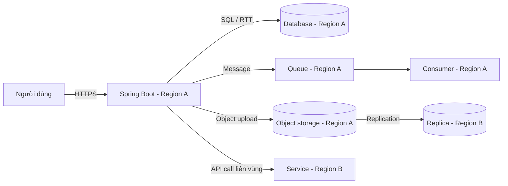

# Lựa chọn region và đánh giá độ trễ, lưu lượng liên vùng

Khi triển khai Spring Boot cùng các dịch vụ managed của AWS, Azure hoặc Google Cloud, vị trí đặt ứng dụng và vị trí đặt dữ liệu ảnh hưởng trực tiếp đến thời gian phản hồi, độ ổn định và hóa đơn hạ tầng. Chọn region gần người dùng là một điểm khởi đầu hữu ích, nhưng chưa đủ: ứng dụng thường phải gọi cơ sở dữ liệu, object storage, hàng đợi và các API nội bộ. Một ứng dụng đặt gần người dùng nhưng gọi cơ sở dữ liệu ở xa vẫn có thể có độ trễ cao.

Bài học này trình bày cách chọn region dựa trên ràng buộc dữ liệu, vị trí người dùng và các phụ thuộc của ứng dụng; cách đo độ trễ theo phân vị; cách nhận diện và ước lượng lưu lượng liên vùng; và cách kiểm chứng quyết định bằng một thử nghiệm có thể lặp lại. Các ví dụ dùng Spring Boot để làm rõ cấu hình và quan sát ở tầng ứng dụng. Tên region và khả năng của từng dịch vụ cần được xác nhận theo tài khoản, dịch vụ và thời điểm triển khai thực tế.

## Mục tiêu

Sau bài học, bạn có thể:

- Phân biệt region, zone, vị trí lưu trữ dữ liệu và endpoint của dịch vụ managed.
- Chọn region dựa trên độ trễ đầu cuối, yêu cầu dữ liệu, khả năng phục hồi, tính sẵn có của dịch vụ và chi phí.
- Đo p50, p95, p99, thông lượng, tỷ lệ lỗi và độ trễ giữa các thành phần từ môi trường gần với production.
- Lập bản đồ luồng dữ liệu để phát hiện lưu lượng liên vùng và các khoản phí mạng liên quan.
- Giải thích sự khác nhau trong cách AWS, Azure và Google Cloud gắn vị trí với tài nguyên.
- Đưa ra quyết định triển khai một region, dự phòng đa region hoặc phục vụ đa region dựa trên bằng chứng.

## 1. Hiểu đúng về region và vị trí tài nguyên

**Region** là một khu vực địa lý mà nhà cung cấp cloud dùng để nhóm hạ tầng. Trong một region thường có nhiều **availability zone (AZ)** hoặc zone độc lập về một phần hạ tầng. Zone giúp phân tán rủi ro trong cùng khu vực; region giúp phân tán rủi ro địa lý lớn hơn. Tên gọi, số lượng zone và mức độ độc lập khác nhau giữa các nhà cung cấp.

Không phải mọi tài nguyên đều có cùng phạm vi vị trí:

| Phạm vi | Ý nghĩa khi thiết kế |
|---|---|
| Zonal | Tài nguyên gắn với một zone cụ thể; cần xem xét khả năng dự phòng sang zone khác. |
| Regional | Tài nguyên được quản lý trong một region; dịch vụ có thể tự phân tán qua nhiều zone hoặc yêu cầu người dùng chọn zone. |
| Multi-region / dual-region | Dữ liệu hoặc dịch vụ trải trên nhiều region theo chính sách của dịch vụ; vị trí sao chép và tính nhất quán phụ thuộc cấu hình. |
| Global | Endpoint hoặc mặt phẳng quản lý có phạm vi toàn cầu; điều đó không có nghĩa mọi dữ liệu được lưu ở mọi nơi hoặc mọi yêu cầu đều có độ trễ thấp. |
| Edge / CDN | Nội dung hoặc điểm vào được đưa gần người dùng; thường phù hợp với nội dung cache được và không thay thế việc đặt cơ sở dữ liệu giao dịch gần ứng dụng. |

Vì vậy, cần phân biệt ba khái niệm: vị trí nơi ứng dụng chạy, vị trí dữ liệu được lưu và vị trí endpoint mà ứng dụng gọi. Một endpoint toàn cầu có thể định tuyến đến tài nguyên ở một region cụ thể. Một bucket multi-region có thể phục vụ từ nhiều vị trí, nhưng cách định tuyến, độ nhất quán và giá truyền dữ liệu vẫn do dịch vụ quy định.

### 1.1. Ba nhà cung cấp gắn vị trí theo những cách khác nhau

| Nhà cung cấp | Khái niệm vị trí | Điểm cần kiểm tra |
|---|---|---|
| AWS | Region và Availability Zone. Nhiều dịch vụ là regional; một số dịch vụ hoặc endpoint có phạm vi global. | S3 bucket được tạo trong một region; một số tính năng sao chép hoặc endpoint đa region có cấu hình riêng. Kiểm tra region có được bật trong tài khoản và dịch vụ có sẵn tại đó hay không. |
| Microsoft Azure | Region và Availability Zone. Một số dịch vụ có region pair hoặc tùy chọn geo-redundancy. | Region pair không tự động có nghĩa ứng dụng đã được triển khai dự phòng. Kiểm tra SKU, zone redundancy, vị trí primary/secondary và khả năng failover của từng dịch vụ. |
| Google Cloud | Region và zone. Một số dịch vụ có vị trí regional, dual-region, multi-region hoặc global. | Vị trí của bucket, dataset, cluster và subnet có thể được khai báo riêng. VPC là global nhưng subnet là regional; không suy ra vị trí workload từ phạm vi VPC. |

Không nên ánh xạ tên region giữa các nhà cung cấp theo cách coi chúng là cùng một địa điểm vật lý. Các region có tên tương tự có thể khác về vị trí trung tâm dữ liệu, tuyến mạng, độ sẵn có của dịch vụ và chính sách dữ liệu.

## 2. Các tiêu chí chọn region

Chọn region theo thứ tự từ ràng buộc bắt buộc đến tối ưu vận hành. Nếu dữ liệu phải ở một quốc gia hoặc khu vực nhất định, đây là điều kiện loại trừ: một region có độ trễ thấp nhưng không đáp ứng yêu cầu lưu trú dữ liệu không phải lựa chọn hợp lệ.

### 2.1. Yêu cầu dữ liệu và tuân thủ

Xác định dữ liệu nào được phép lưu ở đâu, dữ liệu nào được phép sao chép qua biên giới, thời gian lưu giữ và yêu cầu xóa. Cần xem xét cả bản sao dự phòng, snapshot, log, bản xuất dữ liệu, bản sao đọc và dữ liệu gửi sang hệ thống phân tích. Chỉ chọn region sau khi đã xác định vị trí thực tế của các bản sao do dịch vụ managed tạo ra.

Đừng mặc định rằng region của ứng dụng quyết định vị trí dữ liệu. Ví dụ, ứng dụng có thể chạy ở Singapore nhưng kết nối tới database ở một region khác; dữ liệu vẫn được xử lý và lưu theo vị trí của database cùng chính sách sao chép của nó.

### 2.2. Độ trễ tới người dùng và tới phụ thuộc

Liệt kê các nhóm người dùng chính và các dịch vụ mà một request quan trọng phải gọi. Với một luồng tạo đơn hàng, các phụ thuộc có thể gồm API xác thực, database, dịch vụ tồn kho, message broker và object storage. Đo cả đường đi từ người dùng đến ứng dụng và từ ứng dụng đến từng phụ thuộc.

Đặt ứng dụng gần người dùng có thể giảm thời gian truyền request/response. Đặt ứng dụng cùng region với database và broker thường giảm số chặng mạng quan trọng. Khi hai mục tiêu xung đột, hãy đo độ trễ đầu cuối của luồng nghiệp vụ thay vì tối ưu một kết nối riêng lẻ.

### 2.3. Tính sẵn có và khả năng phục hồi

Kiểm tra dịch vụ managed, loại instance, tính năng zone redundancy, giới hạn quota và cơ chế sao chép có sẵn trong region dự kiến. Với phương án dự phòng, xác định RTO (thời gian mục tiêu để khôi phục) và RPO (mức mất dữ liệu tối đa có thể chấp nhận). Sao chép bất đồng bộ thường có độ trễ sao chép; chuyển vùng không đảm bảo dữ liệu ở hai nơi đã đồng bộ hoàn toàn.

### 2.4. Chi phí toàn bộ

So sánh tổng chi phí của kiến trúc, gồm compute, database, storage, bản sao dự phòng, request tới dịch vụ, truyền dữ liệu, NAT gateway, peering hoặc kết nối riêng và vận hành. Region có giá compute thấp hơn có thể đắt hơn khi dữ liệu phải truyền liên tục tới một database hoặc dịch vụ ở xa.

### 2.5. Khả năng vận hành

Đánh giá mức trưởng thành của nhóm với region, công cụ giám sát, quy trình hỗ trợ, quota, khả năng triển khai tự động và quy trình khôi phục. Một kiến trúc đa region làm tăng số môi trường, luồng dữ liệu, secret, dashboard và tình huống cần diễn tập. Chỉ thêm region khi lợi ích về độ trễ hoặc khả năng phục hồi bù được chi phí vận hành đó.

## 3. Đo độ trễ đúng cách

Độ trễ của một request không chỉ là thời gian truyền qua mạng. Nó còn gồm phân giải DNS, thiết lập kết nối và TLS, thời gian chờ trong pool, xử lý ở server, truy vấn dữ liệu, hàng đợi, retry và serialization. Một phép đo ping thấp không chứng minh API có độ trễ thấp.

Có thể hình dung:

```text
Độ trễ đầu cuối
  = DNS + kết nối/TLS
  + thời gian truyền mạng
  + thời gian chờ và xử lý ở từng dịch vụ
  + retry / backoff (nếu có)
  + chuyển đổi dữ liệu và xử lý ở ứng dụng
```

Các thành phần có thể chồng lấp khi hệ thống xử lý song song, vì vậy đây là mô hình phân tích chứ không phải công thức cộng chính xác cho mọi request.

### 3.1. Dùng phân vị thay vì chỉ dùng trung bình

| Chỉ số | Cách đọc | Khi nào hữu ích |
|---|---|---|
| p50 | 50% request hoàn tất trong thời gian này hoặc nhanh hơn. | Mức trải nghiệm điển hình. |
| p95 | 95% request hoàn tất trong thời gian này hoặc nhanh hơn. | Phát hiện phần đuôi ảnh hưởng tới phần lớn người dùng chậm. |
| p99 | 99% request hoàn tất trong thời gian này hoặc nhanh hơn. | Theo dõi các trường hợp chậm hiếm nhưng có tác động lớn. |
| Throughput | Số request hoặc byte xử lý trong một đơn vị thời gian. | Đánh giá năng lực khi tăng tải. |
| Error rate | Tỷ lệ request lỗi hoặc timeout. | Phát hiện region hoặc tuyến mạng không ổn định. |

Trung bình có thể che khuất một nhóm request rất chậm. Khi so sánh hai region, dùng cùng workload và so sánh p50, p95, p99, throughput và error rate. Ghi lại số lượng mẫu và khoảng thời gian đo; p99 từ vài chục request không đủ tin cậy.

### 3.2. Đo từ nơi ứng dụng thực sự chạy

Thực hiện phép đo từ cùng loại mạng, subnet, runtime và cấu hình kết nối dự kiến dùng trong production. Đo từ laptop của kỹ sư chỉ giúp kiểm tra sơ bộ vì đường truyền Internet, VPN, DNS và vị trí máy có thể khác production.

Với mỗi phụ thuộc, ghi nhận tối thiểu:

- Region và zone của workload, cùng vị trí của tài nguyên đích.
- DNS lookup, thời gian connect, TLS handshake và thời gian chờ kết nối nếu công cụ hỗ trợ.
- Thời gian gọi dịch vụ, mã phản hồi, timeout, retry và số lần thử.
- Kích thước request/response và số byte truyền.
- p50, p95, p99, throughput và tỷ lệ lỗi trong từng cửa sổ đo.

Đo ở tải thấp để tìm độ trễ nền, sau đó tăng tải theo mức dự kiến. Pool cạn, giới hạn kết nối, throttling hoặc hàng đợi tăng có thể khiến p95/p99 xấu đi dù độ trễ mạng nền không đổi.

### 3.3. Quan sát trong Spring Boot

Với Spring Boot, có thể dùng Micrometer và OpenTelemetry để ghi nhận thời gian của request và các lời gọi phụ thuộc. Tạo metric riêng cho từng nhóm dịch vụ hoặc thao tác, ví dụ `inventory.lookup`, `orders.database.write` và `storage.object.read`; tránh đưa ID người dùng, object key hoặc giá trị có cardinality cao vào tên tag.

Ví dụ dưới đây minh họa cách đo một thao tác bằng Micrometer. Trong ứng dụng thực tế, ưu tiên instrumentation của HTTP client, JDBC, messaging và SDK đã dùng; đo thủ công chỉ cho phần chưa được instrument tự động.

```java
import io.micrometer.core.instrument.MeterRegistry;
import io.micrometer.core.instrument.Timer;
import org.springframework.stereotype.Component;

@Component
public class InventoryGatewayMetrics {
    private final MeterRegistry registry;
    private final InventoryClient client;

    public InventoryGatewayMetrics(MeterRegistry registry, InventoryClient client) {
        this.registry = registry;
        this.client = client;
    }

    public InventoryItem find(String sku) {
        return Timer.builder("dependency.call")
                .description("Thời gian gọi dịch vụ phụ thuộc")
                .tag("dependency", "inventory")
                .tag("operation", "lookup")
                .register(registry)
                .record(() -> client.find(sku));
    }
}
```

Metric này ghi thời gian của lời gọi ở tầng ứng dụng. Để tách thời gian mạng khỏi thời gian xử lý phía dịch vụ, cần thêm distributed tracing hoặc metric phía server. Cấu hình histogram/percentile và việc xuất metric phụ thuộc backend quan sát; không nên bật percentile client-side tùy tiện cho mọi metric vì có thể tăng chi phí bộ nhớ và telemetry.

### 3.4. Thiết kế phép thử so sánh region

1. Chọn một luồng nghiệp vụ đại diện và xác định các phụ thuộc bắt buộc.
2. Dựng cùng phiên bản ứng dụng, cấu hình runtime, kích thước dữ liệu và loại dịch vụ tại các region cần so sánh.
3. Làm nóng ứng dụng và connection pool; tách kết quả cold start khỏi kết quả steady state.
4. Chạy tải thấp, tải trung bình và tải đỉnh dự kiến; giữ cùng phân bố request và kích thước payload.
5. Thu thập p50/p95/p99, throughput, error rate, timeout, retry, CPU, connection pool và byte truyền.
6. Lặp lại ở nhiều thời điểm để nhận diện biến động tuyến mạng và tải nền.
7. Ghi rõ giới hạn thử nghiệm: loại tài khoản, quota, dịch vụ, cấu hình bảo mật và vị trí máy tạo tải.

Không kết luận từ một lần chạy hoặc từ một phép đo ICMP. Nếu chênh lệch nhỏ hơn độ biến động giữa các lần chạy, hãy xem hai lựa chọn là chưa phân biệt được và đánh giá thêm chi phí, tính sẵn có cùng vận hành.

## 4. Nhận diện lưu lượng liên vùng

Lưu lượng liên vùng xuất hiện khi dữ liệu đi từ tài nguyên ở region này tới tài nguyên ở region khác. Nó có thể phát sinh trong luồng request đồng bộ, đọc/ghi database, sao chép object, truyền message, backup, log, truy vấn phân tích và đồng bộ cache.

### 4.1. Vẽ luồng dữ liệu trước khi ước lượng

Với mỗi luồng, ghi rõ nguồn, đích, region, chiều truyền, tần suất, kích thước trung bình và cơ chế retry. Phân biệt dữ liệu ứng dụng chủ động gửi với bản sao do dịch vụ managed tự tạo.

Ví dụ:



Trong sơ đồ, database, queue và storage cùng Region A giúp các thao tác thường xuyên đi trong cùng khu vực. Sao chép storage và lời gọi tới Service ở Region B vẫn tạo lưu lượng liên vùng. Nếu Consumer chuyển sang Region B, message delivery và xử lý có thể tạo thêm lưu lượng hai chiều.

### 4.2. Những nguồn lưu lượng thường bị bỏ sót

- **Database:** ứng dụng ở region A truy vấn database ở region B; mỗi lần round trip làm tăng độ trễ và có thể phát sinh phí truyền dữ liệu.
- **Message broker:** producer và consumer ở hai region; message có thể được sao chép hoặc truyền qua kết nối liên vùng.
- **Object storage:** tải file từ bucket ở region khác, replication, inventory, backup và restore.
- **Logging và monitoring:** agent gửi log, trace hoặc metric tới workspace ở region khác; payload telemetry lớn có thể tạo chi phí đáng kể.
- **NAT, peering và kết nối riêng:** lưu lượng đi qua NAT gateway, VPC/VNet peering, transit gateway, VPN hoặc private link có thể có phí xử lý hoặc truyền dữ liệu riêng.
- **Retry và polling:** retry do timeout, polling quá thường xuyên hoặc gửi lại payload lớn làm tăng số byte thực tế.
- **Cross-zone:** lưu lượng giữa zone trong cùng region có thể có quy tắc tính phí riêng. Không gộp nó với cross-region khi phân tích.

### 4.3. Ước lượng byte và chi phí

Ước lượng trước bằng số byte thực tế ở tầng ứng dụng hoặc network flow log, sau đó đối chiếu với công cụ tính giá và hóa đơn của nhà cung cấp. Một mô hình đơn giản cho một luồng là:

```text
Byte truyền mỗi tháng
  = số lượt gọi mỗi ngày
  × số ngày trong tháng
  × byte trung bình mỗi lượt
  × hệ số retry / sao chép
```

Ví dụ minh họa: một dịch vụ gửi 2.000.000 message mỗi ngày, mỗi message có kích thước trung bình 12 KiB và được sao chép một lần sang region khác. Trước khi tính overhead giao thức, dữ liệu payload được truyền xấp xỉ:

```text
2.000.000 × 12 KiB × 30 ≈ 686 GiB mỗi tháng
```

Con số này chỉ là payload ước lượng. Phải cộng thêm header, metadata, retry, bản sao phụ, phản hồi và các luồng khác; đồng thời xác định đơn vị GiB/GB mà hệ thống tính giá sử dụng.

Chi phí mạng không thể tính bằng một đơn giá chung cho mọi dịch vụ. Tùy nhà cung cấp và tuyến truyền, hóa đơn có thể gồm phí data transfer out, phí liên vùng, phí inter-zone, phí NAT gateway, phí thiết bị mạng, phí request hoặc phí replication. Dùng bảng giá và pricing calculator hiện hành cho đúng dịch vụ, region nguồn, region đích, loại kết nối và bậc lưu lượng. Không giả định lưu lượng nội bộ cloud luôn miễn phí.

Có thể tổ chức bảng kiểm kê như sau:

| Luồng | Nguồn → đích | Dữ liệu/tháng | Tần suất | Mục đích | Cần xác minh chi phí |
|---|---|---:|---|---|---|
| API đồng bộ | App A → Database B | Byte đọc/ghi | Theo request | Giao dịch | Transfer, kết nối, retry |
| Message | Producer A → Consumer B | Số message × kích thước | Theo sự kiện | Xử lý nền | Broker, replication, network |
| Object replication | Bucket A → Bucket B | Byte object thay đổi | Theo lịch/sự kiện | DR | Replication, request, transfer |
| Telemetry | Workload A → Workspace B | Byte log/trace/metric | Liên tục | Quan sát | Ingestion và transfer |

## 5. Khác biệt khi triển khai trên AWS, Azure và Google Cloud

Các nguyên tắc đo lường giống nhau, nhưng cách chọn vị trí và tính phí phụ thuộc dịch vụ cụ thể.

### 5.1. AWS

- Chọn region cho EC2, ECS/EKS, RDS, SQS, SNS và các dịch vụ regional khác theo vị trí workload và dữ liệu. Kiểm tra dịch vụ, instance family và tính năng có sẵn trong region.
- Với AWS SDK for Java v2, region của client xác định endpoint dịch vụ regional mặc định. Khi dùng Spring Cloud AWS auto-configuration, có thể cấu hình region tĩnh qua `spring.cloud.aws.region.static` hoặc để SDK sử dụng region provider chain phù hợp với môi trường triển khai.
- S3 bucket có vị trí region khi tạo. Sao chép liên region cần cấu hình replication và quyền phù hợp; endpoint đa region hoặc cơ chế truy cập toàn cầu không làm mất đi chi phí truyền dữ liệu và yêu cầu nhất quán.
- Kiểm tra data transfer giữa AZ, giữa region, tới Internet, NAT Gateway và các thành phần mạng như Transit Gateway hoặc peering theo đúng tuyến thực tế.

Ví dụ cấu hình region tĩnh cho Spring Cloud AWS:

```yaml
spring:
  cloud:
    aws:
      region:
        static: ${AWS_REGION:ap-southeast-1}
```

Chỉ dùng cấu hình tĩnh khi môi trường có chủ đích cố định region. Với workload chạy trên hạ tầng AWS, cân nhắc cơ chế cung cấp region và credentials của môi trường để tránh cấu hình lệch giữa các tài khoản hoặc deployment.

### 5.2. Microsoft Azure

- Chọn Azure region cho App Service, AKS, Azure SQL, Storage Account, Service Bus và các dịch vụ liên quan. Kiểm tra SKU, zone redundancy và tính năng geo-redundancy vì không phải mọi lựa chọn đều có ở mọi region.
- Region pair là một phần trong chiến lược phục hồi của Azure và có thể hỗ trợ một số hoạt động cập nhật hoặc khôi phục. Pair không tự động triển khai ứng dụng, database hay failover logic sang region còn lại.
- Với Azure Storage, endpoint thường gắn với Storage Account. Ứng dụng cấu hình endpoint và danh tính; vị trí tài khoản cùng tùy chọn redundancy quyết định nơi lưu dữ liệu và bản sao.
- Với Spring Cloud Azure, cấu hình account, endpoint và credential theo dịch vụ. Không thêm một thuộc tính `region` giả định cho mọi client; vị trí thường được quyết định khi tạo tài nguyên Azure.
- Kiểm tra phí bandwidth, peering, NAT Gateway, Private Link và các dịch vụ mạng theo đường đi thực tế.

Ví dụ endpoint Blob Storage được cấp qua cấu hình môi trường:

```yaml
app:
  storage:
    blob-endpoint: ${AZURE_STORAGE_BLOB_ENDPOINT}
```

Endpoint phải trỏ tới Storage Account đã được tạo ở vị trí mong muốn. Dùng Managed Identity hoặc cơ chế credential phù hợp với môi trường để xác thực; không đặt account key hay client secret trực tiếp trong file cấu hình.

### 5.3. Google Cloud

- Chọn region và zone cho Compute Engine, GKE, Cloud SQL, Memorystore và các dịch vụ regional khác. Một số dịch vụ có vị trí multi-region hoặc global với semantics riêng.
- VPC network có phạm vi global, trong khi subnet có phạm vi regional. Một VPC global không khiến VM, GKE node hoặc subnet tự động nằm ở mọi region.
- Cloud Storage bucket có location khi tạo, có thể là regional, dual-region hoặc multi-region tùy nhu cầu. Lựa chọn location ảnh hưởng vị trí lưu trữ, khả năng sẵn có và quy tắc giá.
- BigQuery dataset cũng có location; job và dữ liệu tương tác cần tuân thủ yêu cầu location tương thích. Không mặc định dataset ở một location có thể được truy vấn như dữ liệu local từ mọi nơi mà không có ràng buộc.
- Kiểm tra Network egress, inter-region transfer, Cloud NAT, VPC Network Peering và phí của dịch vụ đích.

Với Google Cloud Storage, vị trí được gắn vào bucket khi tạo; client Java thường dùng endpoint mặc định và truy cập bucket theo tên. Ví dụ tạo bucket regional bằng CLI:

```bash
gcloud storage buckets create gs://my-app-assets --location=asia-southeast1
```

Không thay đổi location của bucket bằng cách chỉ đổi cấu hình client. Nếu cần chuyển dữ liệu, hãy lập kế hoạch sao chép sang bucket mới, kiểm tra quyền, retention, lifecycle và cập nhật ứng dụng.

### 5.4. Bảng đối chiếu khi thiết kế

| Câu hỏi | AWS | Azure | Google Cloud |
|---|---|---|---|
| Vị trí workload | Region/AZ của compute và dịch vụ. | Region/zone của compute và dịch vụ. | Region/zone của compute và dịch vụ. |
| Vị trí object storage | Region của S3 bucket; replication là cấu hình riêng. | Region của Storage Account; redundancy quyết định bản sao. | Location của bucket: regional, dual-region hoặc multi-region. |
| Mô hình mạng | VPC gắn với một region; subnet và các kết nối liên vùng có thiết kế riêng. | VNet gắn với một region; peering và các dịch vụ mạng có phạm vi riêng. | VPC global; subnet regional. |
| Điều cần xác minh | Region enablement, endpoint, transfer và replication. | SKU, region pair, redundancy, bandwidth và failover. | Resource location, location compatibility, egress và replication. |

Các dòng trong bảng là định hướng kiểm tra. Hãy tra tài liệu và bảng giá của dịch vụ đang dùng trước khi chốt kiến trúc.

## 6. Các mẫu kiến trúc và đánh đổi

### 6.1. Một region, nhiều zone

Đặt ứng dụng và các phụ thuộc dữ liệu chính trong một region, phân tán workload qua nhiều zone nếu dịch vụ hỗ trợ. Đây thường là lựa chọn dễ vận hành cho hệ thống mới: đường gọi ngắn, dữ liệu ít phải truyền xa và quy trình triển khai đơn giản hơn. Tuy nhiên, kiến trúc này vẫn chịu rủi ro sự cố ở cấp region và cần có backup/DR phù hợp.

### 6.2. Một region chính, một region dự phòng

Region chính xử lý traffic bình thường; region dự phòng giữ hạ tầng tối thiểu hoặc được dựng khi cần. Dữ liệu được sao chép theo chính sách đã chọn. Cần xác định rõ:

- Cơ chế phát hiện sự cố và điều kiện kích hoạt failover.
- Cách chuyển DNS, load balancer hoặc endpoint của client.
- RPO dựa trên replication lag và RTO dựa trên thời gian khởi động, khôi phục và xác minh.
- Cách tránh split-brain khi cả hai region cùng nhận ghi.
- Quy trình failback và đối soát dữ liệu sau khi region chính phục hồi.

Phương án này giảm chi phí chạy song song toàn bộ workload, nhưng thời gian khôi phục có thể dài hơn. Phải diễn tập định kỳ; một bản sao chưa từng được khôi phục thử chưa phải bằng chứng DR hoạt động.

### 6.3. Active-active nhiều region

Nhiều region cùng phục vụ người dùng. Mô hình này có thể giảm độ trễ cho người dùng ở nhiều địa lý và tăng khả năng chịu lỗi, nhưng làm phức tạp định tuyến, cache, session, ghi dữ liệu và đồng bộ. Nếu hai region cùng ghi một thực thể, cần có chiến lược phân vùng dữ liệu, conflict resolution hoặc một nơi điều phối ghi. Sao chép đồng bộ có thể tăng độ trễ theo RTT; sao chép bất đồng bộ có thể tạo độ trễ dữ liệu và xung đột khi failover.

Không triển khai active-active chỉ vì có thể tạo hai deployment. Trước tiên xác định request nào có thể xử lý độc lập theo region, dữ liệu nào cần chia vùng, và người dùng có thực sự cần truy cập local hay không.

### 6.4. Đặt CDN hoặc cache gần người dùng

CDN phù hợp với nội dung tĩnh hoặc nội dung có thể cache an toàn. Cache ứng dụng có thể giảm số lần gọi dịch vụ ở xa, nhưng phải quản lý TTL, invalidation, dữ liệu nhạy cảm và tính nhất quán. CDN không giải quyết được độ trễ của giao dịch cần đọc/ghi database mỗi lần.

## 7. Ví dụ thiết kế: ứng dụng Spring Boot phục vụ nhiều thị trường

Giả sử một hệ thống đặt hàng có người dùng chủ yếu ở Đông Nam Á. Ứng dụng Spring Boot chạy ở một region gần nhóm người dùng chính; database giao dịch, queue và object storage quan trọng cũng được đặt cùng region. Một region thứ hai giữ bản sao dữ liệu và môi trường khôi phục.

Luồng xử lý đề xuất:

1. Request đặt hàng đi vào endpoint gần nhóm người dùng chính.
2. Spring Boot xác thực request và ghi giao dịch vào database cùng region.
3. Ứng dụng phát sự kiện vào queue cùng region; consumer xử lý tác vụ nền tại đó.
4. Object storage cùng region lưu file thường xuyên được đọc/ghi.
5. Backup hoặc replication chuyển dữ liệu cần thiết sang region dự phòng theo lịch và chính sách đã định.
6. Metric và trace được thu thập để biết request nào đang gọi qua region khác.

Trước khi mở rộng, đo hai phương án: toàn bộ workload và dữ liệu chính cùng region; và ứng dụng ở region A nhưng database hoặc broker ở region B. So sánh p95/p99 của luồng đặt hàng, timeout, retry, byte liên vùng và chi phí dự kiến. Nếu đặt database ở region B khiến mỗi giao dịch phải chờ nhiều round trip, lợi ích compute rẻ hơn có thể không bù được độ trễ và phí mạng.

Ví dụ cấu hình trung lập theo nhà cung cấp trong Spring Boot:

```yaml
app:
  cloud:
    deployment-region: ${APP_REGION:ap-southeast-1}
    primary-data-region: ${PRIMARY_DATA_REGION:ap-southeast-1}
    dr-region: ${DR_REGION:ap-southeast-2}
```

Đây là metadata do ứng dụng quản lý để log, kiểm tra cấu hình và gắn nhãn quan sát; nó không tự di chuyển tài nguyên cloud. Giá trị mặc định chỉ phục vụ ví dụ. Khi triển khai thật, hãy cấp giá trị theo môi trường và xác minh region của từng tài nguyên.

Có thể kiểm tra cấu hình lúc khởi động để phát hiện sai lệch:

```java
import org.springframework.boot.context.properties.ConfigurationProperties;

@ConfigurationProperties(prefix = "app.cloud")
public record CloudLocationProperties(
        String deploymentRegion,
        String primaryDataRegion,
        String drRegion) {

    public boolean primaryDataIsCoLocated() {
        return deploymentRegion != null
                && deploymentRegion.equals(primaryDataRegion);
    }
}
```

Đăng ký properties theo cách phù hợp với cấu hình Spring Boot của dự án. Có thể phát cảnh báo nếu `primaryDataIsCoLocated()` là false, hoặc từ chối khởi động trong môi trường production nếu chính sách yêu cầu app và database phải cùng region. Việc kiểm tra này chỉ xác nhận giá trị cấu hình; pipeline triển khai hoặc policy cloud vẫn cần kiểm tra vị trí thật của tài nguyên.

## 8. Quy trình ra quyết định có thể lặp lại

Áp dụng quy trình sau cho mỗi workload hoặc thay đổi region:

1. **Chốt ràng buộc:** ghi rõ residency, compliance, region được phép, RTO/RPO và dịch vụ bắt buộc.
2. **Lập bản đồ phụ thuộc:** liệt kê compute, database, queue, storage, cache, API ngoài, log và nơi lưu backup; ghi vị trí từng tài nguyên.
3. **Chọn ứng viên:** loại region không đáp ứng ràng buộc; với phần còn lại, so sánh tính sẵn có dịch vụ, zone, quota và khoảng cách mạng tới người dùng.
4. **Đo workload:** chạy cùng bộ kiểm thử từ môi trường gần production; lưu p50/p95/p99, throughput, error rate và byte truyền.
5. **Ước lượng chi phí:** phân loại byte theo tuyến, chiều truyền và dịch vụ; đối chiếu pricing calculator và hóa đơn thử nghiệm.
6. **Đánh giá phục hồi:** kiểm tra backup, replication lag, failover, failback và khả năng phục hồi thật.
7. **Ghi quyết định:** lưu lý do chọn region, các giả định, số đo, chi phí dự kiến và điều kiện phải đánh giá lại.
8. **Theo dõi sau triển khai:** dùng telemetry và billing để so sánh thực tế với giả định; đánh giá lại khi traffic, dữ liệu hoặc dịch vụ thay đổi.

Có thể dùng bảng chấm điểm để so sánh các ứng viên sau khi đã vượt qua các điều kiện bắt buộc. Ví dụ trọng số dưới đây chỉ là mẫu để nhóm thống nhất cách đánh giá, không phải chuẩn chung:

| Tiêu chí | Trọng số mẫu | Bằng chứng |
|---|---:|---|
| Độ trễ p95/p99 của luồng nghiệp vụ | 35% | Kết quả load test từ môi trường chạy thật. |
| Tổng chi phí dự kiến | 25% | Compute, storage, request, transfer và phí mạng. |
| Khả năng phục hồi | 20% | RTO/RPO, replication lag, kết quả diễn tập. |
| Khả năng vận hành và dịch vụ sẵn có | 20% | Quota, tính năng, công cụ, hỗ trợ và độ phức tạp. |

Yêu cầu dữ liệu và tuân thủ là cổng kiểm soát trước khi chấm điểm, không nên biến thành một tiêu chí có thể bù bằng điểm số ở tiêu chí khác.

## 9. Sai lầm thường gặp

| Sai lầm | Hệ quả | Cách khắc phục |
|---|---|---|
| Chọn region chỉ theo khoảng cách địa lý | Tuyến mạng, peering và vị trí phụ thuộc có thể khiến độ trễ thực tế cao. | Đo từ môi trường chạy ứng dụng và kiểm tra toàn bộ đường đi. |
| Đặt app gần người dùng nhưng database ở xa | Mỗi request giao dịch chịu nhiều RTT. | Co-locate database và workload quan trọng hoặc dùng read model/replica phù hợp. |
| Chỉ nhìn latency trung bình | p95/p99 và timeout bị che khuất. | Theo dõi phân vị, error rate và số lượng mẫu. |
| Coi endpoint global là dữ liệu global | Có thể vi phạm residency hoặc phát sinh transfer. | Kiểm tra vị trí tài nguyên và semantics của dịch vụ. |
| Bỏ qua telemetry, backup và replication | Hóa đơn và lưu lượng liên vùng bị đánh giá thấp. | Đưa mọi luồng dữ liệu vào bản đồ và dự toán. |
| Coi region pair là DR hoàn chỉnh | Ứng dụng hoặc database có thể không tự failover. | Thiết kế và diễn tập toàn bộ quy trình phục hồi. |
| Tối ưu compute đơn lẻ | Tiết kiệm compute nhưng tăng phí mạng và độ trễ. | So sánh tổng chi phí của luồng nghiệp vụ. |
| Tăng retry để che timeout | Tải và byte truyền tăng, có thể tạo retry storm. | Đặt timeout, backoff, jitter, giới hạn retry và quan sát nguyên nhân gốc. |

## 10. Checklist trước khi chốt region

- [ ] Đã xác định nơi dữ liệu chính, bản sao, backup, log và telemetry được lưu.
- [ ] Region ứng viên đáp ứng yêu cầu residency, compliance, quota và dịch vụ.
- [ ] Đã xác định vị trí của app, database, broker, storage và API phụ thuộc.
- [ ] Đã đo p50/p95/p99, throughput và error rate từ môi trường gần production.
- [ ] Đã thử tải ở mức bình thường và mức đỉnh dự kiến.
- [ ] Đã lập bản đồ byte liên vùng, liên zone, Internet và các tuyến qua NAT/peering/private connection.
- [ ] Đã dùng giá hiện hành cho đúng region, dịch vụ, chiều truyền và bậc lưu lượng.
- [ ] Đã xác định RTO/RPO, replication lag, failover và failback.
- [ ] Đã ghi lại giả định và ngưỡng cần đánh giá lại khi traffic hoặc dữ liệu tăng.

## Kết luận

Region là một quyết định kiến trúc ảnh hưởng đồng thời đến độ trễ, vị trí dữ liệu, khả năng phục hồi và chi phí mạng. Hãy bắt đầu từ ràng buộc dữ liệu, đặt các phụ thuộc thường xuyên cùng khu vực khi phù hợp, đo phân vị từ môi trường chạy thật và lập bản đồ mọi luồng byte qua region. Với AWS, Azure và Google Cloud, cần kiểm tra semantics vị trí theo từng dịch vụ vì cấu hình region của client không thay thế vị trí tài nguyên. Quyết định tốt là quyết định có số đo, giả định rõ ràng và quy trình kiểm chứng sau triển khai.
