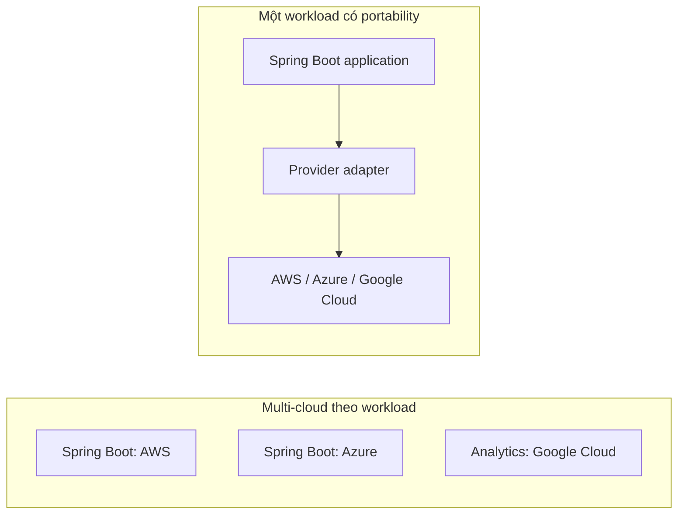
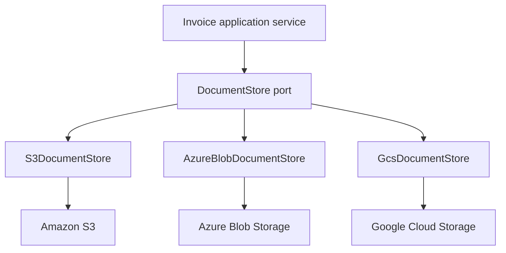

# Phân biệt dùng nhiều nhà cung cấp và khả năng chuyển đổi nhà cung cấp

> **Chương:** Đa đám mây  
> **Học phần:** SPRING_CLOUD_PROVIDER_INTEGRATION — thực hành tích hợp Spring Boot với dịch vụ managed của AWS, Azure và Google Cloud qua các thư viện Spring Cloud tương ứng. Bài này giúp lựa chọn chiến lược multi-cloud và xác định mức độ portability cần thiết cho một ứng dụng.

Một doanh nghiệp có thể chạy hệ thống trên AWS và Azure cùng lúc, nhưng điều đó không có nghĩa ứng dụng có thể chuyển từ AWS sang Azure trong vài giờ. Một hệ thống có thể đóng gói bằng container và triển khai trên Kubernetes ở ba cloud, nhưng vẫn phụ thuộc sâu vào IAM, database, object storage, messaging và secret manager của từng nhà cung cấp.

**Multi-cloud** nói về việc sử dụng nhiều cloud provider trong chiến lược vận hành. **Portability** nói về khả năng di chuyển ứng dụng, dữ liệu và quy trình vận hành giữa các môi trường với mức thay đổi chấp nhận được. Hai mục tiêu có thể hỗ trợ nhau, nhưng không đồng nghĩa.

Trong Spring Boot, Spring Cloud và SDK của AWS, Azure, Google Cloud, ta có thể xây các adapter để thay thế một số dịch vụ. Tuy nhiên, mỗi dịch vụ có semantics, mô hình bảo mật, giới hạn và cách tính phí riêng. Một abstraction tốt cần bảo vệ nghiệp vụ khỏi chi tiết không cần thiết, đồng thời không che giấu những khác biệt có ảnh hưởng đến correctness, security hoặc chi phí.

## 1. Mục tiêu học tập

Sau bài này, bạn có thể:

1. Phân biệt multi-cloud, hybrid cloud, portability, interoperability và vendor lock-in.
2. Giải thích vì sao triển khai cùng một container trên nhiều cloud chưa tạo ra portability toàn diện.
3. Chọn chiến lược multi-cloud theo yêu cầu kinh doanh, tuân thủ, độ sẵn sàng và năng lực vận hành.
4. Đánh giá dịch vụ AWS, Azure và Google Cloud theo semantics thay vì chỉ so tên sản phẩm.
5. Xác định ranh giới abstraction phù hợp trong ứng dụng Spring Boot.
6. Thiết kế port/interface nghiệp vụ và provider adapter có thể thay thế.
7. Hiểu vai trò và giới hạn của Spring Cloud Stream, Spring Cloud Function và các thư viện tích hợp cloud.
8. Xây dựng contract test, integration test và quy trình chuyển đổi nhà cung cấp.
9. Ước lượng chi phí, rủi ro và công việc phát sinh khi vận hành nhiều cloud.

## 2. Các khái niệm không nên đánh đồng

### 2.1. Multi-cloud

Multi-cloud là chiến lược sử dụng dịch vụ từ ít nhất hai cloud provider độc lập, ví dụ AWS và Azure. Tổ chức có thể:

- Chạy các workload khác nhau trên các provider khác nhau.
- Chạy cùng một workload trên nhiều provider để tăng khả năng phục hồi.
- Dùng một provider cho compute, provider khác cho analytics hoặc AI.
- Phân vùng workload theo quốc gia, yêu cầu pháp lý hoặc vị trí dữ liệu.
- Dùng provider thứ hai làm môi trường DR (disaster recovery).

Multi-cloud mô tả **phân bố workload và dịch vụ**. Ứng dụng có thể được thiết kế hoàn toàn theo dịch vụ native của từng cloud.

### 2.2. Portability

Portability là khả năng chuyển ứng dụng hoặc thành phần của ứng dụng sang môi trường khác mà không phải viết lại toàn bộ. Mức portability phụ thuộc vào phạm vi:

- **Build portability:** source code và artifact có thể build bằng toolchain phổ biến.
- **Runtime portability:** ứng dụng chạy được trên runtime/container/Kubernetes tương đương.
- **Configuration portability:** cấu hình có thể chuyển đổi mà không sửa logic nghiệp vụ.
- **Identity portability:** workload có thể lấy danh tính và credential ở môi trường đích theo cách được kiểm soát.
- **Service portability:** storage, messaging, database, cache và secret có adapter thay thế.
- **Data portability:** dữ liệu, schema, metadata và lịch sử có thể xuất/nhập với chi phí hợp lý.
- **Operational portability:** monitoring, logging, backup, incident response và deployment có quy trình tương đương.

Một ứng dụng có thể portable ở runtime nhưng không portable ở data hoặc identity.

### 2.3. Interoperability

Interoperability là khả năng các hệ thống khác nhau trao đổi dữ liệu và phối hợp hoạt động. Ví dụ:

- AWS-hosted service gửi event đến Azure-hosted service qua HTTPS hoặc broker có giao thức chung.
- Spring Boot trên GKE gọi API của workload chạy trên ECS.
- Hệ thống dùng OIDC/OAuth2 để liên kết danh tính giữa các môi trường.

Interoperability không yêu cầu có thể chuyển toàn bộ ứng dụng sang provider khác. Một hệ thống có thể interoperable nhưng vẫn phụ thuộc mạnh vào dịch vụ native.

### 2.4. Hybrid cloud

Hybrid cloud kết hợp cloud public với hạ tầng private/on-premises hoặc cloud riêng. Multi-cloud tập trung vào nhiều provider; hybrid cloud tập trung vào sự kết hợp giữa môi trường cloud và hạ tầng riêng. Một tổ chức có thể đồng thời triển khai cả hai chiến lược.

### 2.5. Vendor lock-in

Vendor lock-in xảy ra khi chi phí, thời gian, rủi ro hoặc độ phức tạp khiến việc rời nhà cung cấp trở nên khó khăn. Lock-in có nhiều dạng:

- **Technical:** code gọi trực tiếp SDK/API, dùng database hoặc event semantics đặc thù.
- **Data:** dữ liệu lớn, định dạng riêng, replication/egress tốn kém.
- **Operational:** đội ngũ, dashboard, runbook và quy trình phụ thuộc provider.
- **Commercial:** hợp đồng, discount, committed spend hoặc phí thoát dữ liệu.
- **Organizational:** kỹ năng, quyền sở hữu và quy trình nội bộ gắn với một provider.

Không phải lock-in nào cũng xấu. Dùng dịch vụ native có thể giảm công vận hành và tận dụng tính năng quan trọng. Mục tiêu là hiểu rõ mức phụ thuộc và bảo đảm tổ chức có phương án phù hợp với rủi ro kinh doanh.

## 3. Multi-cloud không tự động tạo portability

Xem hai kiến trúc minh họa:



Ở kiến trúc bên trái, các workload có thể được phân chia theo năng lực provider. Chúng không nhất thiết có thể chuyển đổi cho nhau. Ở kiến trúc bên phải, một ứng dụng có adapter để chọn dịch vụ tương ứng. Cách này tăng khả năng thay thế, nhưng yêu cầu thiết kế, kiểm thử và vận hành nhiều adapter.

Một số ví dụ:

| Tình huống | Multi-cloud? | Có portability? |
|---|---|---|
| API chạy trên AWS, data warehouse chạy trên Google Cloud | Có | Không nhất thiết |
| Ứng dụng chạy trên EKS và AKS nhưng dùng DynamoDB | Có | Runtime có thể portable; data chưa portable |
| Worker chạy trên Azure, DR workload trên AWS nhưng backup chỉ ở Azure | Có | DR chưa hoàn chỉnh |
| Một Spring Boot artifact chạy trên ba cloud, dùng interface storage với ba adapter | Có thể | Có ở phạm vi storage contract đã định nghĩa |
| Hai provider chỉ trao đổi event qua HTTPS | Có thể | Có interoperability; chưa chắc chuyển workload được |

Muốn đạt portability, phải kiểm tra toàn bộ dependency và quy trình vận hành, không chỉ nơi container được khởi chạy.

## 4. Vì sao doanh nghiệp chọn multi-cloud?

Không nên chọn multi-cloud chỉ vì muốn “tránh lock-in”. Mỗi mục tiêu kinh doanh tạo ra một kiến trúc khác nhau.

### 4.1. Yêu cầu pháp lý và vị trí dữ liệu

Một số workload phải lưu hoặc xử lý dữ liệu tại khu vực cụ thể. Doanh nghiệp có thể chọn provider có region, chứng nhận, hợp đồng hoặc dịch vụ đáp ứng yêu cầu tại khu vực đó.

Cần kiểm tra nơi lưu dữ liệu chính, bản sao, backup, log, telemetry, key material và metadata. Chọn region của database không đủ để kết luận toàn bộ dữ liệu ở đúng jurisdiction.

### 4.2. Tận dụng năng lực riêng của provider

Một provider có thể phù hợp hơn cho một workload vì:

- Dịch vụ AI/analytics có tính năng cần thiết.
- Database managed có khả năng vận hành hoặc throughput phù hợp.
- Dịch vụ identity tích hợp với hệ sinh thái doanh nghiệp.
- Network, edge, IoT hoặc GPU capacity phù hợp.
- Region, SLA hoặc mô hình hỗ trợ đáp ứng yêu cầu.

Khi chọn dịch vụ chuyên biệt, phải ghi rõ tính năng nào là lý do chấp nhận lock-in.

### 4.3. Resilience và disaster recovery

Provider thứ hai có thể là nơi khôi phục nếu provider chính gặp sự cố diện rộng. Tuy nhiên, DR multi-cloud cần:

- Bản sao dữ liệu có thể sử dụng được ở provider đích.
- Identity, network, DNS, certificate, secret và key có sẵn.
- Artifact và deployment pipeline có thể triển khai ở môi trường DR.
- Runbook, quyền truy cập khẩn cấp và người chịu trách nhiệm.
- Kiểm thử failover/failback định kỳ.

Một cluster standby chưa có dữ liệu mới, secret hoặc route mạng chưa phải DR sẵn sàng.

### 4.4. M&A và phân tách tổ chức

Sau sáp nhập, các đơn vị có thể đang sử dụng provider khác nhau. Trong giai đoạn chuyển đổi, multi-cloud cho phép tích hợp hệ thống dần dần mà không buộc di chuyển tất cả ngay lập tức.

### 4.5. Đàm phán và lựa chọn thương mại

Khả năng có phương án thay thế có thể giúp tổ chức đàm phán. Nhưng chi phí vận hành thực tế của hai cloud có thể lớn hơn lợi ích giá. Cần tính tổng chi phí sở hữu (TCO), gồm compute, storage, egress, network, support, security, nhân lực và kiểm thử.

## 5. Khi nào nên đầu tư portability?

Portability đáng đầu tư khi có một hoặc nhiều điều kiện:

- Có yêu cầu hợp đồng/pháp lý phải chuyển workload hoặc dữ liệu.
- Rủi ro tập trung vào một provider vượt ngưỡng chấp nhận.
- Workload có khả năng được chuyển trong vòng đời sản phẩm.
- Provider hiện tại không còn đáp ứng chi phí, region, SLA hoặc tính năng.
- Tổ chức có DR target yêu cầu chạy trên provider khác.
- Một lớp dịch vụ có thể thay thế với chi phí abstraction thấp và lợi ích rõ.

Portability ít có giá trị khi:

- Workload có thời gian sống ngắn hoặc phụ thuộc tính năng native sâu.
- Dữ liệu quá lớn/đặc thù để chuyển trong RTO/RPO đã cam kết.
- Provider thứ hai không đáp ứng được SLA, compliance hoặc throughput.
- Chi phí duy trì abstraction, adapter và test cao hơn rủi ro lock-in.

### Đánh giá theo rủi ro thay đổi

Đừng hỏi chung “ứng dụng có portable không?”. Hãy hỏi cụ thể:

1. Nếu thay object storage, phải sửa những package nào?
2. Nếu đổi broker, event ordering, retry và dead-letter có còn đúng không?
3. Nếu database đích không hỗ trợ feature hiện tại, nghiệp vụ nào bị ảnh hưởng?
4. Nếu identity provider khác, workload lấy token/credential bằng cách nào?
5. Nếu region/provider ngừng hoạt động, dữ liệu mới nhất có ở đâu?
6. Bao lâu để triển khai, đồng bộ dữ liệu, kiểm tra và rollback?

## 6. So sánh dịch vụ theo semantics, không theo tên gọi

Các provider đều có object storage, queue, database và secret manager. Tên sản phẩm tương tự không đảm bảo hành vi giống nhau.

| Năng lực | AWS | Microsoft Azure | Google Cloud | Khác biệt cần đánh giá |
|---|---|---|---|---|
| Object storage | Amazon S3 | Azure Blob Storage | Cloud Storage | Versioning, generation/ETag, lifecycle, consistency, retention, event notification |
| Messaging/event | SQS, SNS, EventBridge, Kinesis, MSK | Service Bus, Event Grid, Event Hubs | Pub/Sub | Ordering, delivery, ack, retry, DLQ, partition, replay, transaction |
| Relational database | RDS/Aurora | Azure SQL, Azure Database for PostgreSQL | Cloud SQL, AlloyDB | Engine/version, extensions, HA, backup, replica, SQL dialect |
| NoSQL | DynamoDB | Cosmos DB | Firestore/Bigtable | Data model, query, partition key, consistency, transaction, index |
| Secret/key | Secrets Manager, SSM Parameter Store, KMS | Key Vault | Secret Manager, Cloud KMS | Version, rotation, key custody, IAM, audit, network access |
| Workload identity | IAM role, IRSA, task role | Managed Identity, Workload Identity | Service Account, Workload Identity Federation | Trust binding, token exchange, audience, scope, lifecycle |

Ví dụ, queue FIFO của một provider không thể được thay thế bằng topic pub/sub bất kỳ mà vẫn giữ nguyên thứ tự và semantics. Object version ID của S3 cũng không tương đương hoàn toàn với generation của Cloud Storage hoặc version ID của Azure Blob.

### Đặt tiêu chí so sánh

Với mỗi capability, ghi lại:

- API và data model.
- Delivery/consistency guarantees.
- Giới hạn kích thước, throughput và quota.
- Timeout, retry, idempotency và ordering.
- Transaction boundary.
- Encryption, key management và access control.
- Backup, restore, retention và deletion.
- Observability, audit và support.
- Giá theo request, throughput, storage, egress và operation.

Chỉ sau khi có các tiêu chí này mới quyết định dùng abstraction chung hay provider-specific feature.

## 7. Portability trong hệ sinh thái Spring Boot và Spring Cloud

Spring cung cấp nhiều cơ chế giúp tích hợp cloud, nhưng không có một API chung tự động làm cho mọi managed service của AWS, Azure và Google Cloud tương đương.

### 7.1. Provider starter và SDK

Các bộ thư viện như Spring Cloud AWS, Spring Cloud Azure và Spring Cloud GCP giúp Spring Boot tích hợp với dịch vụ của provider:

- Tự cấu hình client theo convention và dependency.
- Kết nối với credential chain/identity của môi trường.
- Bind properties vào bean.
- Tích hợp lifecycle, health indicator hoặc Spring abstraction tùy module.
- Cung cấp template, client hoặc adapter cho service tương ứng.

Chúng làm việc với API và mô hình của provider. Việc dùng Spring Boot không làm cho `S3Template`, Azure Blob client và Google Cloud Storage client trở thành cùng một contract.

Ví dụ: ứng dụng có thể inject một bean storage service do Spring Cloud AWS cung cấp, nhưng nếu chuyển sang Azure thì cần dependency, credential configuration và adapter tương ứng.

### 7.2. Spring Cloud Stream

Spring Cloud Stream cung cấp programming model dựa trên function và binding cho messaging. Ứng dụng có thể viết function nhận/gửi message rồi cấu hình binder cho broker được hỗ trợ.

```java
package com.example.orders.messaging;

import java.util.function.Consumer;
import org.springframework.context.annotation.Bean;
import org.springframework.context.annotation.Configuration;

@Configuration
public class OrderEventFunctions {

    @Bean
    Consumer<OrderCreated> orderCreated() {
        return event -> {
            // Gọi application service để xử lý nghiệp vụ.
        };
    }

    public record OrderCreated(
            String eventId,
            String orderId,
            String tenantId) {
    }
}
```

Binding có thể được cấu hình bằng properties:

```yaml
spring:
  cloud:
    function:
      definition: orderCreated
    stream:
      bindings:
        orderCreated-in-0:
          destination: orders.created
          group: invoice-projection
```

Đoạn trên là programming model chung. Cần thêm binder dependency và cấu hình riêng cho broker/provider được chọn. Không có nghĩa chỉ đổi tên binder là có thể chuyển mọi queue/topic giữa các cloud mà không điều chỉnh semantics.

Những khác biệt vẫn cần kiểm thử:

- Consumer group và subscription model.
- Partition key, ordering và concurrency.
- Acknowledgement, retry, backoff và dead-letter.
- Message retention, replay và seek.
- Transaction và exactly-once claim.
- Header mapping, schema registry và payload size.
- Authentication, network endpoint và quota.

Spring Cloud Stream giúp giảm coupling vào API gửi/nhận message cơ bản. Nó không xóa khác biệt vận hành hoặc đảm bảo semantics giống nhau giữa mọi binder.

### 7.3. Spring Cloud Function

Spring Cloud Function tách business function khỏi cách triển khai/transport. Function có thể chạy trong Spring Boot hoặc được đóng gói cho môi trường function/serverless tương thích. Tuy nhiên, deployment package, event source mapping, timeout, concurrency, cold start, retry và identity vẫn phụ thuộc runtime/provider.

Không nên hiểu “function portable” là toàn bộ ứng dụng serverless portable.

### 7.4. Container và Kubernetes

Container image và Kubernetes manifest giúp chuẩn hóa runtime, deployment và một phần networking. Chúng không tự chuẩn hóa:

- Cloud IAM/workload identity.
- Load balancer, ingress, DNS và private networking.
- Persistent volume và storage class.
- Managed database, broker, secret manager.
- Autoscaling metric, quota, node pool và region.
- Backup/restore và service-level guarantees.

Một ứng dụng chạy trên EKS, AKS và GKE vẫn có thể gọi dịch vụ native của provider tương ứng.

## 8. Thiết kế abstraction đúng ranh giới

Abstraction tốt xuất phát từ **use case nghiệp vụ**. Nó biểu diễn hành động mà ứng dụng cần, không cố tạo bản sao tổng quát của toàn bộ SDK cloud.

### 8.1. Bắt đầu từ port nghiệp vụ

Ví dụ, invoice service cần lưu và đọc chứng từ:

```java
package com.example.invoice.document;

import java.io.InputStream;
import java.time.Instant;

public interface DocumentStore {

    StoredDocument put(
            String tenantId,
            String documentId,
            InputStream content,
            String contentType,
            long contentLength);

    DocumentContent get(String tenantId, String documentId);

    void delete(String tenantId, String documentId);

    record StoredDocument(
            String documentId,
            String version,
            String checksum,
            Instant storedAt) {
    }

    record DocumentContent(
            InputStream content,
            String contentType,
            long contentLength,
            String version,
            String checksum) {
    }
}
```

Port chỉ chứa khái niệm nghiệp vụ cần thiết. Nó không đưa `S3Object`, `BlobClient`, `BlobId` hoặc class SDK vào domain model.

### 8.2. Provider adapter

Mỗi adapter chuyển port thành lời gọi API provider:



Ví dụ cấu trúc package:

```text
com.example.invoice
  document
    DocumentStore.java
    DocumentService.java
  infrastructure
    aws
      S3DocumentStore.java
      AwsStorageConfiguration.java
    azure
      AzureBlobDocumentStore.java
      AzureStorageConfiguration.java
    gcp
      GcsDocumentStore.java
      GcpStorageConfiguration.java
```

Application service chỉ phụ thuộc `DocumentStore`. Adapter phụ thuộc SDK và Spring Cloud module tương ứng.

### 8.3. Chọn adapter khi khởi động

Với deployment chỉ dùng một provider, chọn adapter bằng configuration:

```yaml
app:
  storage:
    provider: aws
```

Spring configuration:

```java
@Configuration
public class DocumentStoreConfiguration {

    @Bean
    @ConditionalOnProperty(
            name = "app.storage.provider",
            havingValue = "aws")
    DocumentStore awsDocumentStore(S3Client s3Client) {
        return new S3DocumentStore(s3Client);
    }

    @Bean
    @ConditionalOnProperty(
            name = "app.storage.provider",
            havingValue = "azure")
    DocumentStore azureDocumentStore(BlobServiceClient blobServiceClient) {
        return new AzureBlobDocumentStore(blobServiceClient);
    }

    @Bean
    @ConditionalOnProperty(
            name = "app.storage.provider",
            havingValue = "gcp")
    DocumentStore gcpDocumentStore(Storage storage) {
        return new GcsDocumentStore(storage);
    }
}
```

Đây là skeleton minh họa. Cần có dependency, bean credential/client, constructor và implementation cho provider tương ứng. Trong một deployment, bảo đảm chỉ có đúng một bean `DocumentStore` được tạo; cấu hình thiếu hoặc sai provider nên làm ứng dụng fail fast khi khởi động.

Không nên để một request tùy ý truyền `provider=aws` hoặc `provider=azure` để chọn backend. Provider là cấu hình vận hành được kiểm soát, trừ khi sản phẩm thực sự có yêu cầu routing đa provider theo tenant và có policy riêng.

### 8.4. Định nghĩa contract trước khi viết adapter

Contract phải nêu rõ:

- Tên object và tenant namespace.
- Hành vi khi object đã tồn tại.
- Cách biểu diễn version và checksum.
- Hành vi delete: xóa logic, xóa version hay xóa vĩnh viễn.
- Giới hạn kích thước và streaming.
- Metadata/content type.
- Retry/idempotency và lỗi tạm thời.
- Quyền truy cập và retention.

Nếu một provider không thể đáp ứng contract, cần quyết định:

1. Thay đổi contract để chỉ giữ yêu cầu thực sự cần.
2. Triển khai capability riêng có điều kiện.
3. Chọn provider khác.
4. Chấp nhận provider-specific behavior tại một boundary rõ ràng.

Không âm thầm mô phỏng một guarantee mà backend không cung cấp.

## 9. Không ép mọi provider vào “lowest common denominator”

Abstraction quá rộng có thể làm mất tính năng quan trọng. Ví dụ:

- S3 hỗ trợ versioning, lifecycle, object lock và event notification theo cấu hình riêng.
- Azure Blob có access tier, lease và immutability policy.
- Cloud Storage có object generation, retention và precondition.

Nếu abstraction chỉ có `put/get/delete`, nó có thể phù hợp với use case lưu chứng từ đơn giản. Nếu nghiệp vụ cần retention bất biến để tuân thủ, contract phải biểu diễn retention/legal hold hoặc cung cấp capability riêng.

Một thiết kế tốt có thể gồm:

- **Common port:** thao tác cần có ở mọi provider.
- **Capability interface:** tính năng nâng cao mà chỉ một số adapter hỗ trợ.
- **Provider extension:** đường truy cập có kiểm soát tới tính năng native khi business case yêu cầu.

Ví dụ:

```java
public interface RetentionCapableDocumentStore {

    void retainUntil(
            String tenantId,
            String documentId,
            Instant retainUntil);
}
```

Application service có thể kiểm tra capability khi use case yêu cầu retention. Nếu provider đang triển khai không hỗ trợ, ứng dụng phải báo lỗi cấu hình rõ ràng hoặc chọn workflow khác đã được phê duyệt. Không bỏ qua yêu cầu compliance để giữ interface có vẻ portable.

## 10. Các lớp cần xem xét khi chuyển provider

### 10.1. Compute và runtime

Đánh giá:

- CPU/architecture và base image.
- Java runtime và native library.
- Container registry và image signing.
- Kubernetes version, ingress, service mesh và autoscaling.
- Startup/readiness/liveness behavior.
- Scheduler, background job và serverless trigger.

Một JAR portable chưa đủ nếu runtime đích thiếu native library, network route hoặc cấu hình tài nguyên.

### 10.2. Identity và access control

Các cloud có mô hình workload identity khác nhau:

| Provider | Ví dụ identity cho workload |
|---|---|
| AWS | IAM role gắn với compute; IRSA/EKS Pod Identity cho workload trên EKS |
| Azure | Managed Identity; Workload Identity cho Kubernetes |
| Google Cloud | Service Account; Workload Identity Federation/Workload Identity cho GKE |

Không mang access key/service account key/client secret dài hạn từ cloud này sang cloud khác để giả lập portability. Workload cần credential ngắn hạn, được cấp theo trust relationship của môi trường.

Nên tạo một ranh giới trong ứng dụng cho việc lấy client/credential, nhưng để provider SDK dùng cơ chế credential chain native. Ví dụ Spring Cloud AWS có thể dùng AWS credential provider chain; Spring Cloud Azure dùng Azure Identity; Spring Cloud GCP dùng Google credentials. Cấu hình và quyền của mỗi provider vẫn phải được quản trị riêng.

### 10.3. Secret và key management

Secret manager không chỉ là nơi đọc một chuỗi. Cần đánh giá:

- Version và rotation.
- Access policy, RBAC/IAM và private endpoint.
- Key encryption/decryption và key custody.
- Audit log và alert.
- Secret injection, refresh và cache.
- Khả năng phục hồi khi secret manager gián đoạn.

Không hardcode secret trong `application.yml`. Cấu hình nên tham chiếu secret store hoặc environment injection có kiểm soát. Không đồng bộ secret giữa cloud bằng plaintext hoặc một bucket dùng chung thiếu encryption/ACL.

### 10.4. Storage và data

Với object storage, chuẩn hóa các thao tác nghiệp vụ và metadata cần thiết; kiểm tra versioning, retention, encryption, consistency và lifecycle.

Với relational database, khả năng chuyển đổi thường tốt hơn nếu dùng engine tương thích như PostgreSQL hoặc MySQL, nhưng vẫn phải rà soát:

- Extension và stored procedure.
- SQL dialect, collation và timezone.
- Isolation/locking và transaction behavior.
- Index, partitioning và query plan.
- Backup/restore và replication.
- Connection pool, TLS và IAM database authentication.

NoSQL thường có lock-in lớn hơn vì data model, index, partition key và transaction semantics khác nhau. Chuyển từ DynamoDB sang Cosmos DB hoặc Firestore có thể cần thiết kế lại query và consistency model, không chỉ đổi driver.

### 10.5. Messaging và event

Một event contract chung không làm broker semantics trở nên giống nhau. Cần chuẩn hóa:

- Event schema, event ID, aggregate ID và tenant ID.
- Idempotency và deduplication.
- Ordering key/partition strategy.
- Retry policy, poison message và dead-letter workflow.
- Replay, retention và schema evolution.
- Delivery guarantee và transaction boundary.

Consumer nên idempotent. Nếu broker có thể giao message nhiều lần, business logic phải xử lý duplicate an toàn. Không hứa exactly-once end-to-end chỉ vì một broker cung cấp một chế độ giao nhận cụ thể.

### 10.6. Observability và vận hành

Giữ một số quy ước chung:

- Structured log và correlation/trace ID.
- Metrics theo service, operation và tenant ở mức cardinality phù hợp.
- Distributed tracing với OpenTelemetry.
- Health/readiness và dependency health.
- Alert theo SLO và error budget.
- Audit event cho hành động nhạy cảm.

Provider-specific dashboard, metric và alert vẫn cần adapter/runbook. Một dashboard chung không thể thay thế metric chuyên biệt về throttling, queue age, replication lag hoặc quota.

## 11. Mô hình triển khai multi-cloud thường gặp

| Mô hình | Mô tả | Điểm mạnh | Chi phí/rủi ro |
|---|---|---|---|
| Workload placement | Mỗi workload chạy ở provider phù hợp | Tận dụng thế mạnh, dễ tối ưu theo domain | Tích hợp liên cloud và kỹ năng vận hành |
| Active-passive DR | Provider phụ giữ bản sao và sẵn sàng khôi phục | Tăng khả năng phục hồi | Đồng bộ dữ liệu, kiểm thử failover, chi phí standby |
| Active-active | Cùng workload nhận traffic ở nhiều provider | Có thể tăng availability và phân vùng địa lý | Consistency, routing, split-brain và vận hành phức tạp |
| Migration bridge | Chạy song song khi chuyển provider | Giảm rủi ro cutover | Tốn chi phí hai môi trường và đồng bộ |
| Best-of-breed | Chọn dịch vụ tốt nhất từ nhiều provider | Tối ưu tính năng | Lock-in theo từng service và network/data egress |

### Active-active cần thiết kế dữ liệu trước

Hai region/provider cùng ghi vào một business entity cần chiến lược conflict resolution. Chỉ đặt load balancer ở hai cloud không giải quyết:

- Hai request cập nhật cùng bản ghi.
- Duplicate event.
- Ordering giữa các partition.
- Network partition và split-brain.
- Phân quyền và audit nhất quán.

Nếu không có yêu cầu active-active rõ ràng, active-passive hoặc workload placement có thể đơn giản và đáng tin cậy hơn.

## 12. Đánh giá TCO và độ phức tạp vận hành

TCO multi-cloud cần tính cả chi phí trực tiếp và chi phí ẩn:

| Nhóm chi phí | Ví dụ cần tính |
|---|---|
| Compute | VM/container/serverless, autoscaling, idle capacity |
| Storage | Dung lượng, request, retrieval, backup, replication |
| Network | Egress, cross-region, interconnect, NAT, private link |
| Managed services | Database, broker, cache, key management |
| Reliability | DR standby, replica, failover test |
| Security | IAM review, SIEM, key rotation, vulnerability management |
| Engineering | Adapter, CI/CD, contract test, migration tooling |
| Operations | On-call, runbook, training, incident coordination |
| Commercial | Support plan, committed spend, license, data exit fee |

### Ví dụ so sánh định tính

Giả sử ứng dụng cần object storage, message broker và PostgreSQL:

- Nếu dùng một provider, đội ngũ có thể tận dụng IAM, network và monitoring thống nhất.
- Nếu dùng hai provider cho cùng workload, cần thêm adapter, pipeline, policy, test và quy trình incident.
- Nếu chỉ dùng provider thứ hai cho DR, chi phí có thể thấp hơn active-active nhưng vẫn phải trả cho replication, storage và kiểm thử.

Không kết luận multi-cloud rẻ hơn hoặc an toàn hơn nếu chưa có mô hình chi phí và threat model cụ thể.

## 13. Quy trình quyết định abstraction

Với mỗi dependency, dùng quy trình:

1. **Nêu use case:** ứng dụng cần hành động nghiệp vụ nào?
2. **Ghi semantics:** consistency, ordering, retention, security, performance.
3. **Xác định khả năng thay thế:** có provider thứ hai đáp ứng cùng contract không?
4. **Tính chi phí abstraction:** adapter, test, vận hành và tính năng bị bỏ.
5. **Chọn boundary:** common port, capability interface hay SDK native.
6. **Định nghĩa failure mode:** provider unavailable, timeout, quota, permission denied.
7. **Xác định data migration:** export/import, dual-write, replication, validation.
8. **Đo portability:** thời gian chuyển đổi, số thành phần phải sửa, RTO/RPO và chi phí.

### Bảng quyết định nhanh

| Điều kiện | Hướng thiết kế |
|---|---|
| Nghiệp vụ chỉ cần CRUD object đơn giản | Port storage nhỏ, adapter theo provider |
| Cần object lock/retention đặc thù | Capability riêng hoặc provider-native API |
| Chỉ cần publish/consume event cơ bản | Xem xét Spring Cloud Stream và contract test |
| Cần ordering/transaction đặc thù broker | Thiết kế semantics rõ, adapter riêng hoặc chọn broker tương thích |
| Database dùng PostgreSQL chuẩn | Có thể portability ở mức schema/query; test extension và operations |
| Database NoSQL có query model riêng | Chấp nhận provider-specific data adapter hoặc thiết kế migration riêng |
| Workload chạy trên managed Kubernetes | Portable một phần ở runtime; identity/network/storage vẫn cần cấu hình |
| Chỉ cần DR ở provider khác | Ưu tiên kiểm chứng restore/failover và data replication trước abstraction toàn hệ thống |

## 14. Kiểm thử portability và multi-cloud

Không thể chứng minh portability bằng unit test của interface. Cần nhiều tầng kiểm thử.

### 14.1. Unit test nghiệp vụ

Test application service với fake `DocumentStore` hoặc fake event publisher. Mục tiêu là xác minh logic nghiệp vụ không phụ thuộc SDK cloud.

### 14.2. Contract test cho port

Viết một bộ test dùng chung cho mọi adapter. Ví dụ contract cho storage:

- Put rồi get trả đúng bytes và content type.
- Put cùng document ID có hành vi overwrite/version đúng hợp đồng.
- Get object không tồn tại trả lỗi domain thống nhất.
- Delete lặp lại có hành vi được định nghĩa.
- Tenant A không thể đọc object của tenant B.
- Checksum/version được trả về đúng semantics của abstraction.

Chạy cùng contract suite với adapter AWS, Azure và GCP.

### 14.3. Integration test

Test với dịch vụ thật hoặc emulator phù hợp:

- LocalStack có thể hỗ trợ nhiều dịch vụ AWS, nhưng không thay thế toàn bộ behavior của AWS managed service.
- Azurite hỗ trợ một số API Storage của Azure, nhưng không mô phỏng mọi feature hoặc identity.
- Fake GCS server hỗ trợ một phần API Cloud Storage, nhưng không đại diện đầy đủ IAM, lifecycle hoặc consistency production.
- Broker/database emulator có thể thiếu quota, failure mode và latency thật.

Luôn có test trên sandbox/project/subscription của provider cho các behavior quan trọng.

### 14.4. Chaos và failover test

Mô phỏng:

- DNS/network lỗi.
- Provider trả 429/throttling.
- Credential hết hạn hoặc bị thu hồi.
- Broker ngừng nhận message.
- Database failover.
- Secret manager không truy cập được.
- Replication lag vượt RPO.

Kiểm tra ứng dụng có fail fast, retry có giới hạn, giữ idempotency và phục hồi đúng không.

## 15. Kế hoạch chuyển một workload sang provider khác

Một migration an toàn cần chia giai đoạn:

### Giai đoạn 1 — Inventory

Liệt kê compute, runtime, IAM, network, database, storage, messaging, secrets, monitoring, backup, DNS, certificate, quota và các tích hợp ngoài.

### Giai đoạn 2 — Phân loại dependency

Gắn mỗi dependency vào một nhóm:

- Portable sẵn.
- Có adapter nhưng cần kiểm chứng semantics.
- Provider-specific nhưng có thể thay thế.
- Lock-in được chấp nhận vì tính năng/chi phí.
- Blocker cần thiết kế lại.

### Giai đoạn 3 — Chốt target architecture

Chọn dịch vụ đích, region, network, identity, encryption, data residency và operational ownership. So sánh behavior và quota trước khi viết adapter.

### Giai đoạn 4 — Xây adapter và pipeline

Triển khai adapter đích, cấu hình credential, secret, network, CI/CD, observability và contract test. Giữ artifact có thể tái tạo từ source.

### Giai đoạn 5 — Di chuyển dữ liệu

Chọn cách phù hợp:

- Offline export/import khi downtime chấp nhận được.
- Snapshot/restore.
- Continuous replication rồi cutover.
- Dual-write có kiểm soát và reconciliation.

Không dual-write hai database tùy tiện nếu chưa xử lý partial failure, ordering và duplicate.

### Giai đoạn 6 — Validate và cutover

So sánh record count, checksum, schema, metadata, access policy và behavior. Chạy canary hoặc chuyển traffic theo tỷ lệ; theo dõi error rate, latency, queue lag và business metric.

### Giai đoạn 7 — Rollback và decommission

Định nghĩa rollback trigger, data reconciliation, DNS/traffic reversal và thời gian giữ hệ thống cũ. Chỉ decommission khi đã xác nhận backup, audit, retention và khả năng khôi phục.

### Migration checklist

- [ ] RTO/RPO và downtime được phê duyệt.
- [ ] Data inventory và data owner đã xác nhận.
- [ ] IAM/workload identity ở provider đích hoạt động.
- [ ] Network, DNS, TLS và private connectivity sẵn sàng.
- [ ] Schema, data và metadata được xác minh.
- [ ] Contract/integration test đạt.
- [ ] Backup/restore và failover được diễn tập.
- [ ] Dashboard, alert và runbook cập nhật.
- [ ] Cutover và rollback có người chịu trách nhiệm.
- [ ] Chi phí egress và chi phí chạy song song đã được tính.

## 16. Ví dụ thiết kế: dịch vụ chứng từ trên ba cloud

Giả sử Invoice Service lưu PDF, phát event `InvoiceIssued` và ghi metadata vào PostgreSQL.

### Yêu cầu nghiệp vụ

- Mỗi chứng từ thuộc một tenant.
- Có thể đọc/tải chứng từ theo quyền.
- Phải lưu checksum và content type.
- Event phát hành hóa đơn cần idempotent.
- Dữ liệu phải backup và có retention theo chính sách.

### Phân vùng trách nhiệm

| Thành phần | Port/interface | Provider adapter |
|---|---|---|
| Lưu chứng từ | `DocumentStore` | S3, Azure Blob, GCS |
| Phát event | `InvoiceEventPublisher` | Binder/message adapter hoặc provider SDK |
| Metadata | Repository | PostgreSQL managed service |
| Workload identity | Credential configuration boundary | IAM role, Managed Identity, Service Account |
| Secret | Secret access boundary | Secrets Manager, Key Vault, Secret Manager |

Không cần trừu tượng hóa toàn bộ PostgreSQL nếu ba môi trường đều dùng cùng engine và ứng dụng chỉ dựa trên SQL chuẩn. Nhưng vẫn phải kiểm tra connection auth, backup, extension, failover và performance.

### Event contract

```java
public record InvoiceIssued(
        String eventId,
        String tenantId,
        String invoiceId,
        String documentId,
        String checksum,
        Instant occurredAt,
        int schemaVersion) {
}
```

Event chứa business identifier và schema version, không chứa provider-specific bucket name hoặc cloud resource ARN. Nếu consumer cần tải chứng từ, nó gọi API nghiệp vụ hoặc nhận một reference được API kiểm soát; không phụ thuộc trực tiếp vào tên bucket của một provider.

### Cấu hình provider theo deployment

Ví dụ:

```yaml
app:
  cloud:
    provider: ${CLOUD_PROVIDER:aws}
  storage:
    bucket: ${DOCUMENT_BUCKET}
```

Deployment AWS, Azure và GCP có thể đặt `CLOUD_PROVIDER` và `DOCUMENT_BUCKET` khác nhau. Cấu hình phải được validate lúc khởi động; không để default vô tình trỏ sang production bucket.

### Đo mức portability

| Hạng mục | Mức portability dự kiến | Điều kiện |
|---|---|---|
| Business service | Cao | Chỉ phụ thuộc port |
| Storage | Trung bình/cao | Adapter qua contract test, retention/version semantics tương thích |
| Messaging | Trung bình | Event schema chung, retry/ordering được chuẩn hóa |
| PostgreSQL | Trung bình/cao | Cùng engine/version và extension được kiểm soát |
| Identity | Thấp ở SDK layer, cao ở business layer | Credential native, không để cloud principal rò vào domain |
| Operations | Trung bình | Dashboard, alert, runbook và backup được triển khai riêng |

Mức đánh giá là theo ví dụ, không phải cam kết rằng việc chuyển provider sẽ không cần thay đổi.

## 17. Những anti-pattern cần tránh

| Anti-pattern | Vì sao gây vấn đề | Cách xử lý |
|---|---|---|
| Chạy hai cloud chỉ để tuyên bố multi-cloud | Không có business driver, chi phí tăng | Gắn quyết định với resilience, compliance hoặc capability cụ thể |
| Nghĩ container đồng nghĩa portable | Identity, data và network vẫn khác | Đánh giá từng dependency |
| Tạo interface tổng quát cho mọi dịch vụ | Mất semantics, interface phình to | Thiết kế port theo use case |
| Ép mọi provider về tính năng thấp nhất | Bỏ lỡ capability quan trọng | Dùng capability interface/extension có chủ đích |
| Rò SDK type vào domain | Code nghiệp vụ phụ thuộc provider | Chuyển đổi tại adapter boundary |
| Chỉ test bằng emulator | Bỏ sót IAM, quota và failure behavior | Có integration test provider thật |
| Dual-write dữ liệu thiếu reconciliation | Partial failure và divergence | Thiết kế idempotency, outbox và reconciliation |
| Dùng secret dài hạn để chuyển workload | Credential leak và rotation khó | Dùng workload identity/certificate/federation |
| Không tính egress | Migration/replication đội chi phí | Ước lượng data transfer từ đầu |
| Không diễn tập failover | DR chỉ tồn tại trên tài liệu | Chạy game day và đo RTO/RPO thực tế |

## 18. Bài tập thực hành

**Bối cảnh:** Nhóm phát triển Invoice Service đang chạy trên AWS. Ban quản lý yêu cầu có phương án triển khai trên Azure hoặc Google Cloud trong tương lai. Hệ thống dùng S3, SQS, RDS PostgreSQL, IAM role và Secrets Manager.

### Phần A — Phân tích mục tiêu

1. Xác định yêu cầu là multi-cloud active-active, active-passive DR hay portability để có quyền lựa chọn sau này.
2. Viết ba business driver có thể biện minh cho provider thứ hai.
3. Xác định RTO, RPO, data residency, SLA và giới hạn downtime.
4. Phân biệt thành phần cần portable với thành phần chấp nhận provider-specific.

### Phần B — Thiết kế adapter

1. Tạo `DocumentStore` port cho thao tác chứng từ.
2. Tạo `S3DocumentStore` và mô tả adapter tương ứng cho Azure Blob/GCS.
3. Định nghĩa event contract cho `InvoiceIssued`.
4. Chọn cách dùng Spring Cloud Stream hoặc provider messaging adapter; ghi rõ ordering, retry, DLQ và replay.
5. Xác định workload identity và secret access cho mỗi provider.
6. Liệt kê các feature native không thể thay thế trực tiếp.

### Phần C — Kiểm thử và migration

1. Viết contract test dùng chung cho storage adapter.
2. Kiểm thử tenant isolation, checksum, version và delete semantics.
3. Chạy integration test trên sandbox của provider đích.
4. Lập kế hoạch export/import hoặc replication dữ liệu.
5. Viết cutover, rollback và reconciliation plan.
6. Ước lượng chi phí compute, storage, egress, support và nhân lực.

**Mẫu quyết định kiến trúc:**

| Dependency | Chiến lược | Lý do | Kiểm thử bắt buộc |
|---|---|---|---|
| Object storage | Port + adapter | Cần chuyển provider | Contract, retention, version, checksum |
| Messaging | Event contract + binder/adapter | Cần giảm coupling | Ordering, retry, DLQ, replay |
| PostgreSQL | Giữ engine chuẩn | Hạn chế thay đổi data model | Schema, extension, backup/restore |
| Identity | Native workload identity | Không chia sẻ credential dài hạn | Token, role, rotation, revocation |
| Secrets | Provider secret manager | Bảo vệ credential theo cloud | Access policy, rotation, audit |

**Tiêu chí đạt:** Giải thích rõ multi-cloud khác portability; chỉ ra phần nào của ứng dụng có thể chuyển đổi; abstraction không che giấu semantics quan trọng; có contract/integration test và kế hoạch dữ liệu, vận hành, rollback khả thi.

## Tài liệu tham khảo chính thức

1. [Spring Cloud — Projects](https://spring.io/projects/spring-cloud): hệ sinh thái Spring Cloud và các dự án tích hợp.
2. [Spring Cloud Stream](https://spring.io/projects/spring-cloud-stream): programming model và binder abstraction cho event-driven systems.
3. [Spring Cloud Function](https://spring.io/projects/spring-cloud-function): function programming model và deployment adapters.
4. [Spring Cloud AWS](https://awspring.io/): tích hợp Spring với AWS services.
5. [Spring Cloud Azure](https://spring.io/projects/spring-cloud-azure): tích hợp Spring Boot với Azure services.
6. [Spring Cloud GCP](https://spring.io/projects/spring-cloud-gcp): tích hợp Spring với Google Cloud services.
7. [AWS Well-Architected Framework](https://docs.aws.amazon.com/wellarchitected/latest/framework/welcome.html): reliability, security, cost optimization và operational excellence.
8. [Azure Well-Architected Framework](https://learn.microsoft.com/azure/well-architected/): hướng dẫn thiết kế workload trên Azure.
9. [Google Cloud Architecture Framework](https://cloud.google.com/architecture/framework): system design, operations, security, reliability và cost.
10. [OpenTelemetry](https://opentelemetry.io/docs/): chuẩn instrumentation cho traces, metrics và logs.

> **Ghi nhớ:** Multi-cloud là quyết định sử dụng nhiều provider; portability là khả năng chuyển workload với mức thay đổi và chi phí chấp nhận được. Spring Cloud giúp chuẩn hóa một số programming model và tích hợp, nhưng không làm identity, storage, messaging, database hoặc operations giống nhau. Hãy bắt đầu từ business driver, định nghĩa contract theo use case, giữ khác biệt provider tại adapter boundary và kiểm thử semantics trước khi tuyên bố có thể chuyển đổi.
