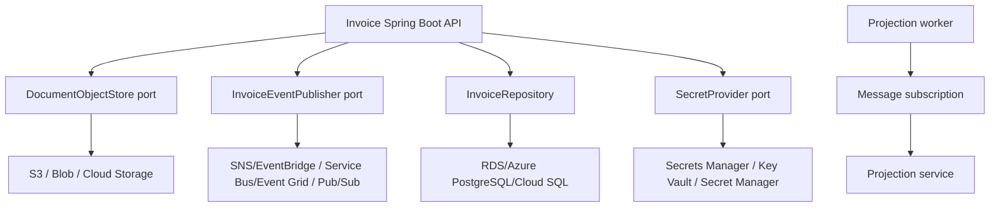

# So sánh mô hình lưu trữ đối tượng, thông điệp, bí mật và dữ liệu

> **Chương:** Đa đám mây  
> **Học phần:** SPRING_CLOUD_PROVIDER_INTEGRATION — thực hành tích hợp Spring Boot với dịch vụ managed của AWS, Azure và Google Cloud qua các thư viện Spring Cloud tương ứng. Bài này so sánh các nhóm dịch vụ nền tảng và cách chọn abstraction phù hợp khi ứng dụng có thể chạy trên nhiều cloud.

AWS, Azure và Google Cloud đều cung cấp object storage, messaging, secret management và database managed. Tên gọi có thể giống nhau, nhưng API, mô hình dữ liệu, consistency, delivery guarantee, IAM, giới hạn và cách tính phí không hoàn toàn tương đương.

Ví dụ, Amazon S3, Azure Blob Storage và Google Cloud Storage đều lưu object, nhưng version, retention, lifecycle và upload behavior có khác biệt. SQS, Service Bus và Pub/Sub đều chuyển message, nhưng queue semantics, ordering, acknowledgement, dead-letter và replay không giống nhau. Secrets Manager, Key Vault và Secret Manager đều giữ secret, nhưng rotation, key management và identity integration có mô hình riêng.

Khi tích hợp với Spring Boot, hãy bắt đầu từ use case và guarantee mà ứng dụng cần. Sau đó mới chọn dịch vụ, thư viện và ranh giới adapter. Một interface chung chỉ hữu ích khi các provider thực sự đáp ứng cùng contract; nó không thể biến các semantics khác nhau thành giống nhau.

## 1. Mục tiêu học tập

Sau bài này, bạn có thể:

1. So sánh object storage của AWS, Azure và Google Cloud theo data model, versioning, retention, consistency và upload.
2. Phân biệt queue, pub/sub, event routing và event streaming.
3. So sánh SQS/SNS/EventBridge, Azure Service Bus/Event Grid/Event Hubs và Google Pub/Sub.
4. Hiểu mô hình lưu trữ, rotation, encryption và access control của các secret manager.
5. So sánh relational database và NoSQL managed service theo data model, query, consistency, transaction và partitioning.
6. Chọn Spring Cloud/provider SDK hoặc Spring abstraction phù hợp với từng use case.
7. Thiết kế port/adapter và contract test mà không làm mất guarantee nghiệp vụ.
8. Lập checklist về identity, network, backup, migration, observability và chi phí.

## 2. Bản đồ dịch vụ tương đương ở mức năng lực

| Năng lực | AWS | Microsoft Azure | Google Cloud |
|---|---|---|---|
| Object storage | Amazon S3 | Azure Blob Storage | Cloud Storage |
| Queue point-to-point | Amazon SQS | Service Bus Queue | Pub/Sub với subscription kiểu queue |
| Pub/sub fan-out | SNS, EventBridge | Service Bus Topic, Event Grid | Pub/Sub Topic |
| Event routing | EventBridge | Event Grid | Eventarc, Pub/Sub |
| Event streaming | Kinesis Data Streams, MSK | Event Hubs | Pub/Sub, Dataflow kết hợp |
| Secret storage | Secrets Manager, SSM Parameter Store | Key Vault Secrets | Secret Manager |
| Key management | AWS KMS | Key Vault Keys, Managed HSM | Cloud KMS |
| Relational database | RDS, Aurora | Azure SQL, Azure Database for PostgreSQL | Cloud SQL, AlloyDB |
| NoSQL | DynamoDB | Cosmos DB | Firestore/Bigtable |

Bảng này chỉ ghép các dịch vụ theo **nhóm năng lực**, không khẳng định chúng là bản thay thế trực tiếp. Ví dụ, EventBridge là event bus có routing rules; SQS là queue. Tương tự, Bigtable là wide-column database, không phải bản sao của Firestore.

Trước khi chọn dịch vụ, xác định ứng dụng đang cần:

- Lưu và tải object theo key?
- Gửi một command tới một consumer?
- Phát event tới nhiều subscriber?
- Route event theo nội dung?
- Lưu stream có partition và replay?
- Lưu secret, key mã hóa hay certificate?
- Query quan hệ, document hay key-value theo partition?

## 3. So sánh object storage

Object storage phù hợp với file, ảnh, video, backup, log archive, tài liệu và dữ liệu phi cấu trúc. Ứng dụng thường thao tác theo bucket/container và object key thay vì mount filesystem truyền thống.

### 3.1. Data model

| Thuộc tính | Amazon S3 | Azure Blob Storage | Google Cloud Storage |
|---|---|---|---|
| Namespace | Bucket + object key | Storage account + container + blob name | Bucket + object name |
| Object identity | Bucket/key; version ID nếu bật versioning | Container/blob; version ID hoặc snapshot tùy feature | Bucket/name; generation và metageneration |
| Metadata | User/system metadata, tags | System/user metadata, blob index tags | Metadata và custom metadata |
| Upload lớn | Multipart upload | Block blob upload theo block | Resumable/multipart upload tùy client/API |
| Version | Bucket versioning | Blob versioning/snapshot | Object versioning/generation |
| Lifecycle | Lifecycle configuration | Lifecycle management policy | Object Lifecycle Management |
| Retention | Object Lock, legal hold, retention mode | Immutable storage, time-based retention, legal hold | Retention policy, bucket lock, object holds |
| Storage tier | Standard, Intelligent-Tiering, Standard-IA, Glacier classes | Hot, Cool, Cold, Archive tùy loại account/region | Standard, Nearline, Coldline, Archive |

Tên tính năng tương tự nhưng chi tiết khác nhau. Ví dụ:

- S3 versioning gắn version ID cho các phiên bản object; Azure có blob versioning và snapshot; GCS dùng generation để định danh phiên bản object.
- ETag không phải lúc nào cũng là MD5 checksum. Với multipart upload, encryption hoặc một số API, không nên suy ra checksum chỉ từ ETag.
- Retention/immutability có mode, thời hạn, quyền bypass và hành vi delete khác nhau. Phải kiểm tra đúng compliance requirement.
- Storage class/tier có minimum storage duration, retrieval fee hoặc thời gian phục hồi khác nhau.

### 3.2. Consistency và concurrency

Các dịch vụ object storage hiện đại đều cung cấp consistency mạnh cho những thao tác object phổ biến, nhưng API precondition, version và concurrency control khác nhau.

| Chủ đề | Điều cần xác minh |
|---|---|
| Read-after-write | Sau khi upload thành công, khi nào GET/LIST thấy object? |
| Conditional write | Có thể ghi chỉ khi object chưa tồn tại hoặc ETag/generation chưa đổi không? |
| Concurrent update | Hai writer cập nhật cùng key thì xử lý conflict ra sao? |
| Delete | Delete tạo delete marker, xóa version hay xóa object vĩnh viễn? |
| Listing | Có phân trang, continuation token và giới hạn page size nào? |
| Checksum | Dùng checksum nào, ai tính và SDK xác minh ở bước nào? |
| Multipart/resumable | Cách resume, abort upload và dọn upload dang dở? |

Đừng dựa vào thời điểm upload hoàn tất ở một SDK để suy luận semantics của provider khác. Hãy viết contract theo yêu cầu thực tế, ví dụ “không ghi đè nếu object đã tồn tại” hoặc “chỉ cập nhật nếu version vẫn là X”.

### 3.3. Spring Boot tích hợp object storage

Có ba hướng phổ biến:

1. Dùng SDK/provider starter trực tiếp khi cần đầy đủ tính năng native.
2. Đặt một port nghiệp vụ nhỏ trước SDK để application service không phụ thuộc class của provider.
3. Dùng abstraction cấp cao hơn nếu nó đáp ứng chính xác semantics cần thiết.

Ví dụ port:

```java
package com.example.invoice.document;

import java.io.InputStream;

public interface DocumentObjectStore {

    StoredObject put(
            String tenantId,
            String documentId,
            InputStream input,
            long contentLength,
            String contentType);

    DownloadedObject get(String tenantId, String documentId);

    void delete(String tenantId, String documentId);

    record StoredObject(
            String objectKey,
            String version,
            String checksum) {
    }

    record DownloadedObject(
            InputStream input,
            long contentLength,
            String contentType,
            String version,
            String checksum) {
    }
}
```

Port biểu diễn nhu cầu lưu chứng từ. Adapter AWS, Azure và GCP chịu trách nhiệm:

- Tạo key có namespace theo tenant.
- Gọi SDK tương ứng.
- Ánh xạ version/ETag/generation vào metadata contract.
- Xử lý lỗi provider thành lỗi ứng dụng có ý nghĩa.
- Đóng stream đúng cách và quản lý multipart/resumable upload.
- Thi hành encryption, retention và access policy theo cấu hình.

Không đưa `S3Object`, `BlobClient`, `BlobId` hoặc SDK exception vào domain/application service.

### 3.4. Cấu hình và identity

| Provider | SDK/client thường dùng | Workload identity |
|---|---|---|
| AWS | AWS SDK for Java v2, Spring Cloud AWS | IAM role, task role, EKS Pod Identity/IRSA |
| Azure | Azure Storage Blob SDK, Spring Cloud Azure | Managed Identity, Workload Identity |
| Google Cloud | Cloud Storage Java client, Spring Cloud GCP | Service Account, Workload Identity Federation |

Production nên dùng credential ngắn hạn từ workload identity. Tránh tạo access key/service account key rồi lưu trong source hoặc image chỉ để dùng chung một cấu hình.

### 3.5. Khi nào chọn object storage?

- Chọn S3 khi workload cần hệ sinh thái S3, các integration AWS hoặc tính năng S3 cụ thể.
- Chọn Azure Blob khi workload tích hợp Azure, cần access tier/immutability hoặc Data Lake Storage Gen2 trong kiến trúc tương ứng.
- Chọn Cloud Storage khi workload chạy trên Google Cloud hoặc cần tích hợp GCS/BigQuery/Dataflow.
- Nếu cần portability, định nghĩa object contract nhỏ và kiểm thử version, retention, checksum, conditional write, delete và tenant isolation trên từng adapter.

## 4. So sánh messaging và event services

Messaging là nhóm dịch vụ dễ bị nhầm vì cùng có khái niệm topic, queue và subscription. Hãy phân biệt bốn mô hình:

- **Queue:** một message được xử lý bởi một consumer trong nhóm cạnh tranh; phù hợp command/work item.
- **Pub/sub:** publisher gửi lên topic; nhiều subscription có thể nhận bản sao để xử lý độc lập.
- **Event routing:** broker lọc và route event tới target theo rule.
- **Event streaming:** lưu chuỗi event theo partition, hỗ trợ consumer đọc theo offset/sequence và replay trong thời hạn retention.

Một hệ thống có thể kết hợp nhiều mô hình: EventBridge route event tới SQS; Event Grid đẩy event tới Service Bus; Pub/Sub phát event tới nhiều subscription.

### 4.1. AWS messaging

| Dịch vụ | Mô hình | Điểm cần biết |
|---|---|---|
| SQS Standard | Queue | At-least-once delivery; có thể duplicate và không đảm bảo thứ tự tuyệt đối |
| SQS FIFO | Queue FIFO | Ordering theo message group; deduplication theo cấu hình và phạm vi FIFO |
| SNS | Pub/sub | Fan-out tới nhiều subscriber như SQS, Lambda, HTTPS |
| EventBridge | Event bus/routing | Lọc event theo rule, route tới target; hỗ trợ archive/replay theo cấu hình |
| Kinesis Data Streams | Stream | Shard/partition, sequence, retention và consumer checkpoint |
| Amazon MSK | Kafka managed | Kafka protocol/ecosystem và vận hành cluster managed |

SQS consumer thường dùng visibility timeout để ẩn message trong lúc xử lý. Nếu consumer không delete trước khi timeout, message có thể được giao lại. Dead-letter queue và redrive policy giúp cách ly message lỗi, nhưng cần thiết kế idempotency để xử lý duplicate.

### 4.2. Azure messaging

| Dịch vụ | Mô hình | Điểm cần biết |
|---|---|---|
| Service Bus Queue | Queue | Peek-lock/complete/abandon, DLQ, sessions và transaction tùy tier |
| Service Bus Topic | Pub/sub | Topic và subscription; filter rule, DLQ |
| Event Grid | Event routing | Push event tới handler/endpoint, retry và dead-letter theo cấu hình |
| Event Hubs | Event streaming | Partition, consumer group, retention, checkpoint và Capture |

Service Bus phù hợp cho enterprise messaging cần queue/topic, lock, session và transaction theo khả năng/tier. Event Grid tập trung event routing. Event Hubs phục vụ ingest/streaming khối lượng lớn; không nên thay thế chúng cho nhau chỉ vì đều nhận event.

### 4.3. Google Cloud messaging

| Dịch vụ | Mô hình | Điểm cần biết |
|---|---|---|
| Pub/Sub Topic | Pub/sub | Publisher gửi message tới topic |
| Pub/Sub Subscription | Consumer endpoint | Push hoặc pull, ack deadline, retry, dead-letter và retention |
| Pub/Sub ordering | Ordering key | Có thể bật ordering theo key và region/configuration tương ứng |
| Pub/Sub replay | Seek/retention | Có thể replay trong phạm vi message còn được giữ và cấu hình subscription |
| Eventarc | Event routing | Route event từ nguồn hỗ trợ tới Cloud Run, GKE hoặc target tương ứng |

Pub/Sub có các tùy chọn delivery và ordering; không được suy ra exactly-once end-to-end cho toàn bộ business workflow. Exactly-once delivery, khi dùng, có điều kiện về subscription/API và không loại bỏ nhu cầu idempotency ở tầng nghiệp vụ.

### 4.4. Bảng so sánh semantics

| Tiêu chí | AWS | Azure | Google Cloud |
|---|---|---|---|
| Queue cơ bản | SQS Standard | Service Bus Queue | Pub/Sub subscription dùng như queue |
| FIFO/ordering | SQS FIFO theo message group | Service Bus Sessions | Pub/Sub ordering key |
| Pub/sub | SNS, EventBridge | Service Bus Topic, Event Grid | Pub/Sub Topic |
| Routing theo nội dung | EventBridge rules | Event Grid filters, Service Bus rules | Eventarc filters, Pub/Sub attributes |
| Streaming | Kinesis, MSK | Event Hubs | Pub/Sub, Dataflow |
| Ack/complete | Delete sau khi xử lý; visibility timeout | Complete/abandon/renew lock | Ack/nack và ack deadline |
| Dead-letter | SQS DLQ/redrive | Service Bus DLQ, Event Grid dead-letter | Pub/Sub dead-letter topic |
| Replay | EventBridge archive, Kinesis retention/sequence, Kafka offset | Event Hubs retention/offset | Pub/Sub seek trong retention |

### 4.5. Spring Cloud Stream có thể giúp gì?

Spring Cloud Stream cung cấp programming model function và binding để ứng dụng nhận/gửi message. Ví dụ:

```java
package com.example.invoice.messaging;

import java.util.function.Consumer;
import org.springframework.context.annotation.Bean;
import org.springframework.context.annotation.Configuration;

@Configuration
public class InvoiceEventHandler {

    @Bean
    Consumer<InvoiceIssued> invoiceIssued(
            InvoiceProjectionService projectionService) {
        return event -> projectionService.apply(event);
    }

    public record InvoiceIssued(
            String eventId,
            String tenantId,
            String invoiceId,
            int schemaVersion) {
    }
}
```

Binding có thể cấu hình theo tên function:

```yaml
spring:
  cloud:
    function:
      definition: invoiceIssued
    stream:
      bindings:
        invoiceIssued-in-0:
          destination: invoices.issued
          group: invoice-projection
```

Đoạn này thể hiện application programming model. Cần dependency binder cụ thể, cấu hình broker, credential và consumer behavior cho môi trường thực tế. Không phải mọi managed service đều có binder cùng mức hỗ trợ, cùng release train hoặc cùng semantics. Trước khi chọn, xác minh binder đang được duy trì, tương thích Spring Boot/Spring Cloud version và hỗ trợ đúng broker feature cần dùng.

Nếu cần session, transaction, partition ordering, dead-letter management hoặc broker-specific feature, có thể dùng provider SDK trực tiếp trong adapter. Spring Cloud Stream không tự chuẩn hóa các guarantee đó.

### 4.6. Event contract và idempotency

Một event contract portable nên có:

- `eventId`: định danh duy nhất để deduplicate.
- `eventType` và `schemaVersion`: quản lý evolution.
- `occurredAt`: thời điểm nghiệp vụ.
- `aggregateId`: định danh entity tạo event.
- `tenantId`: tenant sở hữu event.
- Payload nghiệp vụ, không chứa ARN, queue URL, topic resource ID hoặc tên project cụ thể.

Consumer nên lưu `eventId` đã xử lý trong transaction phù hợp hoặc dùng idempotency key. Nếu xử lý DB rồi ack broker thất bại, message có thể được giao lại. Nếu ack trước rồi DB commit thất bại, message có thể mất khỏi queue mà nghiệp vụ chưa hoàn tất.

Outbox pattern giúp đồng bộ thay đổi database và event publication. Inbox/deduplication giúp consumer xử lý lặp an toàn. Hai pattern này hữu ích trên cả ba cloud, nhưng transaction với broker vẫn có giới hạn riêng.

## 5. So sánh secret management và key management

Secret và key thường được đặt cạnh nhau nhưng không giống nhau:

- **Secret:** password, API key, connection string, token hoặc credential.
- **Cryptographic key:** key dùng encrypt/decrypt/sign/verify; thường cần HSM, policy và audit riêng.
- **Certificate:** vật liệu định danh gồm public certificate và private key.
- **Configuration parameter:** cấu hình không nhất thiết bí mật, có thể lưu trong parameter/configuration service.

Không nên lưu mọi loại dữ liệu vào một secret store chỉ vì tiện.

### 5.1. AWS

| Dịch vụ | Mục đích |
|---|---|
| AWS Secrets Manager | Lưu và quản lý secret; hỗ trợ version và rotation workflow tích hợp với một số loại credential |
| Systems Manager Parameter Store | Lưu cấu hình/parameter; SecureString mã hóa bằng KMS |
| AWS KMS | Quản lý key và thao tác cryptographic; tích hợp với nhiều dịch vụ AWS |

Secrets Manager phù hợp cho credential cần rotation và retrieval có kiểm soát. Parameter Store phù hợp cho parameter cấu hình và secret đơn giản hơn tùy nhu cầu. KMS quản lý key mã hóa, không phải nơi thay thế database secret.

### 5.2. Azure

| Dịch vụ | Mục đích |
|---|---|
| Key Vault Secrets | Lưu secret và các version |
| Key Vault Keys | Quản lý key cho encrypt/decrypt/sign/verify |
| Key Vault Certificates | Quản lý certificate lifecycle và private key policy theo cấu hình |
| Managed HSM | HSM quản lý riêng cho nhu cầu key custody phù hợp |

Ứng dụng thường truy cập Key Vault bằng Managed Identity và quyền RBAC hoặc access policy theo mô hình vault đang sử dụng. Soft delete và purge protection là các cài đặt quan trọng để chống xóa nhầm/xóa độc hại.

### 5.3. Google Cloud

| Dịch vụ | Mục đích |
|---|---|
| Secret Manager | Lưu secret theo version, IAM access và replication policy |
| Cloud KMS | Quản lý cryptographic key và key ring |
| Certificate Authority Service | Dịch vụ CA cho certificate lifecycle/use case phù hợp |

Secret Manager có replication policy tự động hoặc do người dùng quản lý tùy cấu hình. Có thể tích hợp CMEK theo nhu cầu. Rotation cần quy trình phối hợp với hệ thống sử dụng secret; việc tạo version mới không tự động thay password ở database hoặc hệ thống bên ngoài.

### 5.4. So sánh lifecycle và bảo vệ

| Tiêu chí | AWS Secrets Manager | Azure Key Vault | Google Secret Manager |
|---|---|---|---|
| Secret version | Có version/staging label | Có version | Có version |
| Rotation | Có rotation workflow tích hợp với một số dịch vụ; có thể tự xây Lambda workflow | Có thể dùng automation/event và workload để rotate | Tích hợp event/automation; ứng dụng xây rotation workflow |
| Access | IAM policy, resource policy, VPC endpoint policy | Azure RBAC/access policy theo cấu hình | IAM role và policy |
| Encryption key | KMS key | Key Vault/Managed HSM key | Cloud KMS/CMEK theo cấu hình |
| Audit | CloudTrail và service logging | Azure Monitor/diagnostic logs | Cloud Audit Logs |
| Recovery | Recovery window/restore theo cấu hình | Soft delete, purge protection | Version disable/destroy và retention/recovery theo feature |

Các tính năng và giới hạn có thể phụ thuộc region, tier, SKU và cấu hình. Hãy kiểm tra tài liệu provider trước khi đưa retention, purge protection hoặc rotation vào yêu cầu compliance.

### 5.5. Nguyên tắc sử dụng secret trong Spring Boot

- Không commit secret vào Git hoặc đóng gói vào container image.
- Dùng workload identity để đọc secret.
- Cấp quyền theo secret cụ thể hoặc path/resource cần thiết.
- Ưu tiên short-lived credential và rotation.
- Không log secret, token, connection string hoặc private key.
- Có timeout, cache hợp lý và behavior khi secret manager unavailable.
- Không refresh secret vô hạn hoặc gây stampede khi nhiều instance cùng hết cache.
- Tách secret theo môi trường và workload; không dùng một credential chung cho mọi cloud.

Một boundary ứng dụng có thể trông như sau:

```java
public interface SecretProvider {

    SecretValue get(String secretName);

    record SecretValue(String value, String version) {
        @Override
        public String toString() {
            return "SecretValue[version=" + version + ", value=REDACTED]";
        }
    }
}
```

Adapter tương ứng dùng AWS Secrets Manager client, Azure Key Vault client hoặc Google Secret Manager client. Record mặc định sinh `toString()` có thể làm lộ mọi field; ví dụ trên override để che giá trị. Trong ứng dụng thực tế, chỉ truyền `value()` tới component thật sự cần credential và không log object này.

Không biến `SecretProvider` thành một hệ thống cache/rotation tự viết quá phức tạp nếu provider SDK hoặc Spring integration đã đáp ứng. Xác định rõ cache TTL, refresh, version pinning và fallback.

## 6. So sánh relational database và NoSQL

Chọn database theo data model, query pattern, consistency, transaction và operational requirement. Không chọn chỉ vì tên dịch vụ được xem là tương đương.

### 6.1. Relational managed database

| Provider | Dịch vụ | Engine/mô hình |
|---|---|---|
| AWS | RDS | PostgreSQL, MySQL, MariaDB, SQL Server, Oracle và engine được hỗ trợ theo phiên bản |
| AWS | Aurora | Engine tương thích PostgreSQL/MySQL với kiến trúc storage/replication riêng |
| Azure | Azure SQL Database | SQL Server managed platform |
| Azure | Azure Database for PostgreSQL | PostgreSQL managed service |
| Google Cloud | Cloud SQL | MySQL, PostgreSQL, SQL Server theo hỗ trợ hiện hành |
| Google Cloud | AlloyDB | PostgreSQL-compatible managed database |

Nếu ứng dụng dùng PostgreSQL chuẩn, chuyển giữa các dịch vụ PostgreSQL managed có thể ít thay đổi data model hơn so với chuyển giữa hai engine khác nhau. Tuy vậy vẫn phải kiểm tra:

- PostgreSQL major version và extension.
- Parameter group/server flags.
- Collation, timezone, encoding và locale.
- IAM database authentication hoặc password/TLS.
- Connection limit, pool size và connection proxy.
- Replication, failover và read replica behavior.
- Backup retention, point-in-time recovery và restore time.
- Query plan, index và performance dưới tải thực.

Aurora PostgreSQL tương thích PostgreSQL ở mức giao thức/engine nhưng vẫn có khác biệt về storage, failover, extension và operation. Tương tự, Azure SQL Database không phải PostgreSQL; SQL dialect và feature khác nhau.

### 6.2. NoSQL và data model

| Dịch vụ | Data model | Query/access pattern |
|---|---|---|
| DynamoDB | Key-value/document | Partition key, sort key, secondary index; thiết kế theo access pattern |
| Cosmos DB for NoSQL | JSON document | Partition key, SQL-like query, RU/s và consistency levels |
| Cosmos DB APIs khác | API tương thích theo lựa chọn | MongoDB/Cassandra/Gremlin/Table API có feature/compatibility riêng |
| Firestore | Document database | Collection/document, indexed query, transaction và realtime listener |
| Bigtable | Wide-column | Row key, column family, timestamp; phù hợp throughput lớn và access pattern theo key |

Không coi Cosmos DB là một database duy nhất có semantics giống nhau ở mọi API. Chọn API sẽ quyết định data model, driver và compatibility. Firestore và Bigtable cũng phục vụ các pattern khác nhau.

### Consistency và transaction của NoSQL

| Dịch vụ | Consistency cần chú ý | Transaction/concurrency |
|---|---|---|
| DynamoDB | Eventually consistent read là mặc định ở nhiều đường đọc; strong read có hỗ trợ trong phạm vi nhất định, không áp dụng đồng đều cho mọi index | Conditional write và transaction API; thiết kế partition key/access pattern từ đầu |
| Cosmos DB for NoSQL | Chọn consistency level như Strong, Bounded Staleness, Session, Consistent Prefix hoặc Eventual | Transaction ACID trong phạm vi logical partition; partition key ảnh hưởng thiết kế transaction |
| Firestore | Strong consistency cho các thao tác đọc/query được hỗ trợ | Transaction/batch write trên document; cần xử lý retry transaction và contention |
| Bigtable | Single-cluster routing cho consistency mạnh; multi-cluster routing có thể có eventual consistency do replication | Atomicity ở mức một row; không có transaction nhiều row như relational DB |

Đây là khác biệt kiến trúc quan trọng. Nếu nghiệp vụ cần cập nhật nhiều entity nguyên tử, không thể giả định NoSQL provider nào cũng có transaction scope giống nhau. Nếu ứng dụng cần read-your-writes, hãy kiểm tra consistency mode, routing profile và cách SDK thực hiện retry.

### 6.3. Các tiêu chí cần so sánh

| Tiêu chí | Câu hỏi thiết kế |
|---|---|
| Data model | Relational, document, key-value hay wide-column? |
| Partition/shard | Partition key nào phân bố tải và tránh hot partition? |
| Query | Query ad hoc, secondary index, join hoặc transaction cần gì? |
| Consistency | Strong, eventual, session hay consistency theo cấu hình? |
| Transaction | Phạm vi transaction là một row, partition, document hay nhiều entity? |
| Availability | Multi-zone, multi-region và failover có hành vi gì? |
| Throughput | Provisioned capacity, autoscale, request unit hay connection limit? |
| Backup/restore | PITR, snapshot, export và thời gian restore? |
| Replication | Active-passive, multi-region read/write và conflict resolution? |
| Cost | Storage, IOPS, request unit, throughput, backup và egress? |

### 6.4. Data portability

Relational data thường có đường export/import qua SQL dump, logical replication hoặc managed migration service. NoSQL migration phức tạp hơn khi schema, partition key, index và query model khác nhau.

Một kế hoạch migration cần:

1. Export schema và data.
2. Map type, timestamp, decimal, binary, null và collation.
3. Map index, partition key, TTL và constraint.
4. Xử lý CDC/replication nếu cần giảm downtime.
5. Reconcile record count, checksum và business invariant.
6. Test query latency và transaction behavior.
7. Xác nhận backup/restore trước khi cutover.

Không kết luận dữ liệu portable chỉ vì có thể xuất JSON/CSV. Cần chứng minh dữ liệu nhập vào vẫn giữ được semantics nghiệp vụ.

## 7. So sánh theo use case

| Use case | AWS | Azure | Google Cloud | Câu hỏi quyết định |
|---|---|---|---|---|
| Lưu file chứng từ | S3 | Blob Storage | Cloud Storage | Version, retention, checksum, lifecycle, access |
| Queue xử lý đơn | SQS | Service Bus Queue | Pub/Sub subscription | Ordering, lock/ack, duplicate, DLQ |
| Fan-out event | SNS/EventBridge | Service Bus Topic/Event Grid | Pub/Sub | Filtering, routing, subscriber isolation |
| Ingest telemetry lớn | Kinesis/MSK | Event Hubs | Pub/Sub/Dataflow | Partition, throughput, retention, replay |
| Lưu DB quan hệ | RDS/Aurora | Azure SQL/PostgreSQL | Cloud SQL/AlloyDB | Engine, extension, failover, backup |
| Lưu document | DynamoDB | Cosmos DB | Firestore | Partition, query, consistency, transaction |
| Lưu dữ liệu wide-column | DynamoDB theo access pattern | Cosmos Cassandra API | Bigtable | Model, throughput, row key, query |
| Lưu API credential | Secrets Manager | Key Vault Secrets | Secret Manager | Rotation, IAM, version, audit |
| Mã hóa envelope | KMS | Key Vault Keys | Cloud KMS | Key custody, HSM, policy, audit |

Hãy chọn theo yêu cầu bắt buộc trước, rồi mới so sánh giá và mức tích hợp Spring. Ví dụ:

- Nếu cần queue có session ordering và transaction trong Azure, Service Bus có thể phù hợp hơn Event Grid.
- Nếu cần route event theo rule tới nhiều target trong AWS, EventBridge có thể phù hợp hơn SQS thuần.
- Nếu cần streaming với consumer group và retention, so sánh Kinesis, Event Hubs và Pub/Sub theo partition/ack/replay.
- Nếu cần document database, so sánh query/index/partition của DynamoDB, Cosmos DB và Firestore bằng workload thật.

## 8. Tổ chức tích hợp trong Spring Boot

Không nên tạo một interface tổng quát `CloudService` có hàng chục method cho storage, queue, database và secret. Mỗi capability có semantics riêng và cần contract riêng.

Một cấu trúc package có thể là:

```text
com.example.invoice
  application
    InvoiceService.java
    IssueInvoiceUseCase.java
  ports
    DocumentObjectStore.java
    InvoiceEventPublisher.java
    SecretProvider.java
  infrastructure
    aws
      S3DocumentObjectStore.java
      SqsInvoiceEventPublisher.java
      AwsSecretProvider.java
    azure
      BlobDocumentObjectStore.java
      ServiceBusInvoiceEventPublisher.java
      KeyVaultSecretProvider.java
    gcp
      GcsDocumentObjectStore.java
      PubSubInvoiceEventPublisher.java
      GcpSecretProvider.java
```

Application service chỉ phụ thuộc port. Adapter ánh xạ lỗi, metadata và behavior của SDK vào contract. Nếu một tính năng không thể biểu diễn chung, giữ nó ở capability interface riêng hoặc provider-specific service.

### 8.1. Chọn adapter qua configuration

Ví dụ chọn provider cho storage ở thời điểm khởi động:

```yaml
app:
  cloud:
    provider: aws
```

```java
@Configuration
public class StorageAdapterConfiguration {

    @Bean
    @ConditionalOnProperty(
            name = "app.cloud.provider",
            havingValue = "aws")
    DocumentObjectStore s3Store(S3Client client) {
        return new S3DocumentObjectStore(client);
    }

    @Bean
    @ConditionalOnProperty(
            name = "app.cloud.provider",
            havingValue = "azure")
    DocumentObjectStore blobStore(BlobServiceClient client) {
        return new AzureBlobDocumentObjectStore(client);
    }

    @Bean
    @ConditionalOnProperty(
            name = "app.cloud.provider",
            havingValue = "gcp")
    DocumentObjectStore gcsStore(Storage storage) {
        return new GcsDocumentObjectStore(storage);
    }
}
```

Đây là skeleton kiến trúc, cần dependency và client bean tương ứng. Với cấu hình provider không hợp lệ hoặc không có adapter, ứng dụng nên fail fast thay vì âm thầm dùng một provider mặc định.

Không cho request bên ngoài tự chọn provider bằng query parameter. Nếu routing theo tenant là yêu cầu sản phẩm, map tenant sang provider bằng registry có kiểm soát và xác minh quyền trước khi truy cập.

### 8.2. Cấu hình Spring Cloud Stream

Spring Cloud Stream có thể giữ function code ổn định khi đổi binder, nhưng binding và binder configuration vẫn riêng:

```yaml
spring:
  cloud:
    function:
      definition: invoiceIssued
    stream:
      bindings:
        invoiceIssued-in-0:
          destination: invoices.issued
          group: invoice-projection
      # Binder-specific settings được cấu hình theo provider
```

Không copy cùng một YAML broker configuration sang ba môi trường rồi kỳ vọng hoạt động. Endpoint, identity, subscription, ack, retry, DLQ, partition và retention phải được cấu hình/kiểm thử theo binder.

### 8.3. Quản lý database connection

Spring Data/JDBC/JPA giúp chuẩn hóa truy cập relational database ở mức repository, nhưng không xóa khác biệt engine:

- Dùng migration tool như Flyway/Liquibase và kiểm tra SQL trên từng engine.
- Không để native query/extension đặc thù rò rỉ vào domain mà không ghi nhận.
- Cấu hình TLS và credential theo provider.
- Dùng connection pool có giới hạn và theo dõi pool saturation.
- Kiểm thử transaction isolation, lock timeout và failover.
- Quản lý migration version đồng bộ với application release.

Với NoSQL, dùng Spring Data module phù hợp hoặc SDK native; repository interface không đảm bảo query có thể chuyển giữa DynamoDB, Cosmos DB và Firestore.

## 9. Contract test: kiểm chứng adapter có cùng hành vi

Một interface giống nhau không chứng minh adapter có semantics giống nhau. Tạo contract test dùng chung cho mỗi port.

### 9.1. Object storage contract

- Upload rồi download trả đúng bytes.
- Content type và metadata được giữ theo contract.
- Conditional create không ghi đè object đã tồn tại.
- Version/checksum có mapping được định nghĩa.
- Delete lặp lại có behavior nhất quán.
- Tenant A không thể đọc/xóa object của tenant B.
- Stream lớn không buộc load toàn bộ file vào heap.
- Retention/immutability được test riêng nếu là yêu cầu bắt buộc.

### 9.2. Messaging contract

- Message có event ID và schema version.
- Consumer nhận payload đã validate.
- Duplicate event không gây duplicate business effect.
- Retry không tạo vòng lặp vô hạn.
- Poison message được đưa vào DLQ theo policy.
- Ordering được test theo aggregate key nếu nghiệp vụ yêu cầu.
- Replay không làm sai trạng thái đã xử lý.
- Tenant context không bị mất khi message đi qua broker.

### 9.3. Secret provider contract

- Chỉ workload identity được cấp quyền đọc secret.
- Secret version được chọn đúng.
- Cache TTL và refresh behavior được xác minh.
- Rotation không làm ứng dụng tiếp tục dùng credential cũ vô hạn.
- Secret manager timeout/unavailable có failure behavior rõ.
- Log/exception không chứa secret value.

### 9.4. Database contract

- Unique constraint và transaction invariant được giữ.
- Query trả cùng kết quả nghiệp vụ.
- Pagination/order ổn định theo contract.
- Concurrent update được xử lý đúng.
- Tenant filter được áp dụng ở mọi repository method.
- Backup/restore và migration được thử trong môi trường gần production.

### 9.5. Test thật và emulator

Emulator hữu ích để chạy test nhanh, nhưng không thay thế hoàn toàn provider:

- LocalStack mô phỏng một số AWS API; không đảm bảo mọi behavior/permission của managed service.
- Azurite mô phỏng một phần Azure Storage; không thay thế Key Vault, Managed Identity hoặc mọi Blob feature.
- Fake GCS server mô phỏng một phần Cloud Storage API; không chứng minh IAM, KMS, lifecycle và production quota.
- Broker emulator có thể thiếu network failure, throttling và delivery behavior thực.

Giữ integration test trên sandbox/project/subscription thật cho IAM, encryption, retention, quota, failover và những guarantee quan trọng.

## 10. Security và tenant isolation

### Identity

- AWS: IAM role, task role, EKS Pod Identity/IRSA.
- Azure: Managed Identity và Workload Identity.
- Google Cloud: Service Account và Workload Identity Federation.

Mỗi workload chỉ nhận quyền cần thiết. Không dùng chung credential giữa dev/staging/production hoặc giữa nhiều tenant nếu không có lý do được kiểm soát.

### Network

- Dùng private endpoint/private service access khi kiến trúc yêu cầu.
- Giới hạn egress và destination.
- Bật TLS cho service-to-service.
- Không mở bucket, queue, database hoặc secret manager ra public chỉ để dễ test.
- Xác minh DNS, route, firewall và endpoint policy khi chuyển region/provider.

### Tenant isolation

- Prefix object key bằng tenant namespace có kiểm soát.
- Không chỉ dựa vào object key để authorization; kiểm tra tenant và ACL ở application/service boundary.
- Gắn tenant ID vào event và kiểm tra ở consumer.
- Dùng database row-level/partition strategy phù hợp.
- Tách secret theo workload/tenant khi threat model yêu cầu.
- Tránh cache key thiếu tenant ID.
- Ghi audit cho thao tác đọc/xóa/tải dữ liệu nhạy cảm.

### Encryption

Kiểm tra encryption at rest, in transit, key ownership, rotation và audit. CMEK/customer-managed key có thể tăng quyền kiểm soát nhưng làm tăng trách nhiệm availability và key lifecycle. Nếu key bị disable hoặc policy sai, dữ liệu có thể không đọc được dù storage vẫn hoạt động.

## 11. Backup, restore và data lifecycle

Object storage, messaging, secret và database có retention/backup semantics khác nhau:

| Dữ liệu | Cần bảo vệ gì? | Bài test phục hồi |
|---|---|---|
| Object | File, version, metadata, retention, encryption key | Restore object/version và xác minh checksum |
| Message | Pending message, DLQ, event retention, offset/checkpoint | Replay message và bảo đảm idempotency |
| Secret | Secret version, key/certificate dependency, audit | Restore/redeploy credential và xác minh workload truy cập |
| Relational DB | Snapshot, PITR, transaction log, schema | Restore vào instance mới, chạy migration và kiểm tra invariant |
| NoSQL | Snapshot/export, index, partition, TTL và consistency | Import/restore rồi chạy query contract |

Backup không phải bản sao hợp lệ nếu không có encryption key, IAM policy, schema, network route và runbook để khôi phục. Đặt RTO/RPO theo nghiệp vụ rồi kiểm thử thực tế.

## 12. Chi phí và giới hạn cần so sánh

Không chỉ so giá mỗi GB hoặc mỗi message. Chi phí có thể gồm:

| Nhóm | Object storage | Messaging | Secret/key | Database |
|---|---|---|---|---|
| Dung lượng | GB-month, storage tier | Retention/backlog | Secret/version/key usage | Storage/backup |
| Operation | PUT/GET/LIST, retrieval | Publish/deliver/ack/egress | API calls, crypto operations | IOPS/query/request unit |
| Network | Egress, cross-region | Cross-region delivery | Private endpoint/egress | Replication, connection |
| Reliability | Replication/version | DLQ, retention, replay | HSM, rotation, availability | HA, replica, PITR |
| Engineering | Adapter, lifecycle policy | Consumer, retry, schema | Rotation workflow | Migration, tuning |

Kiểm tra quota và giới hạn như object size, request rate, message size, throughput, partition, subscription, connection count, secret version, key operation và database IOPS. Quota có thể khác theo region/tier và cần quota increase trước production.

## 13. Quy trình chọn dịch vụ cho một use case

Với mỗi capability, đi theo thứ tự:

1. **Mô tả use case:** lưu chứng từ, xử lý command, fan-out event, lưu credential hay query dữ liệu.
2. **Ghi guarantee bắt buộc:** ordering, consistency, retention, transaction, RTO/RPO và security.
3. **Loại dịch vụ không đáp ứng:** không chọn pub/sub thay queue nếu cần exclusive work processing mà không có subscription/competing consumer phù hợp.
4. **Đối chiếu provider:** feature, quota, region, IAM, network và chi phí.
5. **Kiểm tra Spring integration:** starter/SDK, version compatibility, maintenance và binder support.
6. **Thiết kế contract:** chỉ trừu tượng hóa semantics thực sự cần chung.
7. **Viết contract/integration test:** chạy trên adapter và môi trường provider.
8. **Lập kế hoạch backup/migration:** export, replication, restore, cutover và rollback.

### Ma trận quyết định nhanh

| Nhu cầu | Ưu tiên đánh giá |
|---|---|
| Lưu file, version và lifecycle | S3, Blob Storage, Cloud Storage theo retention, checksum và access |
| Queue command có retry/DLQ | SQS, Service Bus Queue, Pub/Sub subscription theo lock/ack/order |
| Fan-out event | SNS, Service Bus Topic, Pub/Sub |
| Route event theo rule | EventBridge, Event Grid, Eventarc |
| Streaming telemetry | Kinesis, Event Hubs, Pub/Sub/Dataflow |
| Secret có rotation | Secrets Manager, Key Vault, Secret Manager theo rotation workflow |
| Key custody/HSM | KMS, Key Vault/Managed HSM, Cloud KMS theo compliance |
| SQL transaction | Chọn cùng database engine nếu portability là mục tiêu |
| NoSQL theo key/document | Chọn theo partition/query/consistency, không theo tên sản phẩm |

## 14. Ví dụ tổng hợp: Invoice Service

Invoice Service có các yêu cầu:

- Lưu PDF hóa đơn và tải theo tenant.
- Phát event `InvoiceIssued` cho nhiều consumer.
- Worker đọc credential của downstream API.
- Lưu metadata hóa đơn và trạng thái xử lý.

### Kiến trúc logic



### Chọn dịch vụ

| Capability | AWS deployment | Azure deployment | Google Cloud deployment |
|---|---|---|---|
| Document store | S3 | Blob Storage | Cloud Storage |
| Event fan-out | SNS hoặc EventBridge | Service Bus Topic hoặc Event Grid | Pub/Sub |
| Worker queue/subscription | SQS | Service Bus Queue/Subscription | Pub/Sub Subscription |
| Secret | Secrets Manager | Key Vault Secrets | Secret Manager |
| Metadata DB | RDS/Aurora PostgreSQL | Azure Database for PostgreSQL | Cloud SQL/AlloyDB |
| Workload identity | IAM role | Managed Identity | Service Account |

Đây là các phương án triển khai theo từng provider, không phải một topology duy nhất chạy đồng thời. Nếu muốn active-active, cần thêm routing, data replication, conflict resolution và DR design.

### Các quyết định cần ghi trong ADR

1. Event cần fan-out hay một consumer duy nhất?
2. Consumer có yêu cầu ordering theo invoice ID không?
3. Event được giữ bao lâu và có cần replay không?
4. Chứng từ có cần immutable retention không?
5. Secret rotation có thể đổi credential ở downstream API theo cách nào?
6. Database có dùng extension hoặc SQL riêng không?
7. Tenant isolation được thực thi ở storage, broker và database ra sao?
8. Nếu provider mất kết nối, request fail, queue backlog hay chuyển sang provider khác?

Không tự động failover write sang provider thứ hai nếu dữ liệu chưa được đồng bộ và semantics không tương thích. Có thể phát sinh duplicate, split-brain hoặc mất cập nhật.

## 15. Bài tập thực hành

**Bối cảnh:** Nhóm phát triển Invoice Service đang đánh giá ba cloud. Hệ thống lưu PDF, phát event cho billing/reporting, dùng secret để gọi API đối tác và lưu metadata hóa đơn.

### Phần A — So sánh object storage

1. So sánh S3, Azure Blob và Cloud Storage theo namespace, version, checksum, lifecycle và retention.
2. Xác định cách tạo key có tenant namespace.
3. Định nghĩa contract upload/download/delete.
4. Nêu cách xử lý concurrent update và object không tồn tại.
5. Chọn loại storage tier dựa trên tần suất truy cập và retrieval cost.

### Phần B — So sánh messaging

1. Phân biệt command queue, pub/sub fan-out, event routing và stream.
2. Chọn dịch vụ tương ứng cho AWS, Azure và GCP.
3. Định nghĩa event ID, schema version, tenant ID và aggregate ID.
4. Thiết kế retry, DLQ, ordering và replay.
5. Chứng minh consumer idempotent khi nhận duplicate.

### Phần C — Secret và database

1. Chọn secret manager và workload identity cho từng cloud.
2. Định nghĩa quy trình rotate credential và xử lý version.
3. Chọn relational database engine chung nếu cần portability.
4. Nếu dùng NoSQL, mô tả partition key, query pattern và transaction boundary.
5. Lập backup/restore và migration test.

### Phần D — Kiểm thử

1. Chạy storage contract suite trên ba adapter.
2. Kiểm thử message duplicate, retry và dead-letter.
3. Kiểm thử secret access bị từ chối và rotation.
4. Kiểm thử tenant isolation ở object key, consumer và repository.
5. Thực hiện restore một object, replay event và restore database ở sandbox.
6. So sánh quota, latency, throughput và TCO.

**Mẫu kết quả:**

| Capability | Guarantee bắt buộc | AWS | Azure | Google Cloud | Khác biệt/rủi ro |
|---|---|---|---|---|---|
| Object storage | Version + retention | S3 | Blob | Cloud Storage | Version/delete semantics |
| Messaging | Fan-out + retry | SNS/SQS | Service Bus | Pub/Sub | Ordering/ack/DLQ |
| Secret | Version + rotation | Secrets Manager | Key Vault | Secret Manager | Rotation workflow |
| Database | SQL transaction | PostgreSQL managed | PostgreSQL managed | PostgreSQL managed | Extension/failover |

**Tiêu chí đạt:** So sánh đúng mô hình dữ liệu và semantics; phân biệt queue, pub/sub, event routing và streaming; chọn dịch vụ theo guarantee; thiết kế Spring adapter và test chứng minh hành vi; có kế hoạch identity, secret rotation, backup và migration.

## Tài liệu tham khảo chính thức

1. [Amazon S3 User Guide](https://docs.aws.amazon.com/AmazonS3/latest/userguide/Welcome.html): object storage, versioning, lifecycle và access.
2. [Azure Blob Storage documentation](https://learn.microsoft.com/azure/storage/blobs/): blob model, lifecycle, versioning và immutability.
3. [Cloud Storage documentation](https://cloud.google.com/storage/docs): object generation, retention, lifecycle và consistency.
4. [Amazon SQS documentation](https://docs.aws.amazon.com/AWSSimpleQueueService/latest/SQSDeveloperGuide/welcome.html): queue, visibility timeout, FIFO và DLQ.
5. [Azure Service Bus documentation](https://learn.microsoft.com/azure/service-bus-messaging/): queue, topic, session, lock và dead-letter.
6. [Google Cloud Pub/Sub documentation](https://cloud.google.com/pubsub/docs): topic, subscription, ack, ordering và replay.
7. [AWS Secrets Manager documentation](https://docs.aws.amazon.com/secretsmanager/latest/userguide/intro.html): secret version và rotation.
8. [Azure Key Vault documentation](https://learn.microsoft.com/azure/key-vault/general/overview): secrets, keys, certificates và access.
9. [Google Secret Manager documentation](https://cloud.google.com/secret-manager/docs): secret version, IAM và replication.
10. [Spring Cloud Stream](https://spring.io/projects/spring-cloud-stream): functional programming model và binder abstraction.
11. [Spring Cloud AWS](https://awspring.io/): Spring integration cho AWS.
12. [Spring Cloud Azure](https://spring.io/projects/spring-cloud-azure): Spring integration cho Azure.
13. [Spring Cloud GCP](https://spring.io/projects/spring-cloud-gcp): Spring integration cho Google Cloud.

> **Ghi nhớ:** S3, Blob Storage và Cloud Storage cùng là object storage nhưng khác version, retention và API. SQS, Service Bus, Event Grid, EventBridge và Pub/Sub không cùng một mô hình messaging. Secrets Manager, Key Vault và Secret Manager có lifecycle và IAM riêng. Database phải được chọn theo data model, query và consistency. Trong Spring Boot, dùng port/adapter cho nhu cầu nghiệp vụ ổn định, giữ provider-specific capability ở boundary và chứng minh portability bằng contract/integration test.
