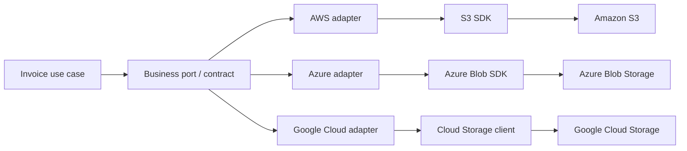

# Định nghĩa hợp đồng theo nhu cầu nghiệp vụ thay vì tên SDK

> **Chương:** Đa đám mây  
> **Học phần:** SPRING_CLOUD_PROVIDER_INTEGRATION — thực hành tích hợp Spring Boot với dịch vụ managed của AWS, Azure và Google Cloud qua các thư viện Spring Cloud tương ứng. Bài này tập trung thiết kế contract để nghiệp vụ có thể dùng dịch vụ cloud mà không phụ thuộc trực tiếp vào tên class hoặc API của SDK.

Một dịch vụ lưu chứng từ có thể được triển khai bằng Amazon S3, Azure Blob Storage hoặc Google Cloud Storage. Nếu interface của ứng dụng là `S3StorageService`, chuyển sang Azure sẽ buộc tầng nghiệp vụ đổi theo. Nếu interface chỉ là `StorageClient` với các hàm `put`, `get`, `delete` chung chung, nó vẫn có thể che giấu những khác biệt quan trọng như versioning, retention, idempotency và quyền truy cập.

Một hợp đồng tốt bắt đầu từ điều hệ thống cần bảo đảm cho người dùng và quy trình kinh doanh. Nó mô tả hành động, dữ liệu, điều kiện trước/sau, lỗi, bảo mật, hiệu năng và semantics. SDK chỉ là cách một adapter thực hiện hợp đồng đó trên một provider.

Trong bài này, ta sẽ thiết kế hợp đồng cho hai capability thường gặp trong hệ thống hóa đơn: lưu trữ chứng từ và phát sự kiện nghiệp vụ. Sau đó, ta ánh xạ hợp đồng sang adapter cloud, cấu hình Spring Boot, kiểm thử cùng một contract trên nhiều provider và quản lý thay đổi theo thời gian.

## 1. Mục tiêu học tập

Sau bài này, bạn có thể:

1. Phân biệt business contract, application port, provider adapter và SDK API.
2. Chuyển yêu cầu nghiệp vụ thành operation, input/output, invariant và failure contract.
3. Định nghĩa idempotency, consistency, ordering, retention và tenant boundary rõ ràng.
4. Thiết kế interface Java không để kiểu dữ liệu SDK rò vào domain/application layer.
5. Ánh xạ cùng một contract sang AWS, Azure và Google Cloud.
6. Dùng Spring Boot configuration để chọn adapter theo deployment.
7. Chuẩn hóa lỗi provider mà vẫn giữ đủ thông tin chẩn đoán.
8. Viết contract test dùng chung cho nhiều adapter và bổ sung integration test trên cloud thật.
9. Quản lý version và mở rộng contract mà không làm hỏng consumer hiện có.
10. Nhận biết khi nào cần capability riêng hoặc provider-specific extension thay vì ép mọi dịch vụ vào một interface quá chung.

## 2. Contract là gì và không phải là gì?

### 2.1. Business contract

Business contract là thỏa thuận giữa caller và capability được cung cấp. Nó trả lời:

- Caller muốn hoàn thành việc gì?
- Dữ liệu nào cần cung cấp và nhận lại?
- Điều kiện nào phải đúng trước khi gọi?
- Khi operation thành công, hệ thống bảo đảm điều gì?
- Khi lỗi, caller có thể làm gì tiếp theo?
- Quyền nào cần có và dữ liệu thuộc tenant nào?
- Giới hạn về kích thước, thời gian, throughput và retention là gì?

Ví dụ: “Lưu chứng từ hóa đơn” có thể yêu cầu nội dung được lưu bền vững, checksum được xác minh, request retry không tạo bản sao nghiệp vụ, tenant khác không đọc được chứng từ và lần đọc sau khi lưu trả đúng revision vừa lưu.

### 2.2. Application port

Port là interface ở ranh giới application/domain, diễn đạt capability mà use case cần. Port không mô tả SDK nào sẽ thực hiện công việc.

Ví dụ:

- `InvoiceDocumentArchive`: lưu và đọc chứng từ hóa đơn.
- `InvoiceEventPublisher`: phát sự kiện hóa đơn đã phát hành.
- `CustomerDirectory`: tìm thông tin khách hàng theo quy tắc nghiệp vụ.

Tên port nên phản ánh ngôn ngữ của domain hoặc use case. Tránh đặt tên theo provider như `S3Service`, `AzureQueueHelper` hoặc `GcpSecretManager`.

### 2.3. Provider adapter

Adapter nằm ở infrastructure layer. Nó chuyển lời gọi port thành API của provider:

- `S3InvoiceDocumentArchive` dùng AWS SDK.
- `AzureBlobInvoiceDocumentArchive` dùng Azure Storage SDK.
- `GcsInvoiceDocumentArchive` dùng Google Cloud Storage client.

Adapter chịu trách nhiệm credential, endpoint, metadata mapping, retry phù hợp, chuyển đổi lỗi và khác biệt semantics.

### 2.4. SDK API

SDK API là bề mặt kỹ thuật của thư viện. Ví dụ `S3Client`, `BlobServiceClient`, `Storage`, `SendMessageRequest` hoặc `BlobId` hữu ích trong adapter, nhưng không nên trở thành kiểu dữ liệu mà application service phải biết.

### Sơ đồ ranh giới



Application layer phụ thuộc vào contract. Adapter phụ thuộc vào SDK. Dependency direction này giúp thay implementation mà không buộc use case đổi theo.

## 3. Bắt đầu từ nhu cầu nghiệp vụ

Không bắt đầu bằng câu hỏi “SDK của ba cloud có method nào giống nhau?”. Hãy bắt đầu từ tình huống người dùng và quy trình.

### 3.1. Mô tả use case

Ví dụ Invoice Service có yêu cầu:

1. Nhân viên gửi PDF hóa đơn để lưu vào hồ sơ.
2. Hệ thống phải xác minh kích thước và checksum.
3. Chứng từ thuộc một tenant và một invoice.
4. Retry do timeout không được tạo ra nhiều chứng từ logic.
5. Sau khi lưu thành công, người dùng có thể tải đúng nội dung vừa gửi.
6. Chứng từ được giữ theo retention policy của tổ chức.
7. Việc xóa phải tuân theo legal hold và audit policy.

Từ đó, ta thấy use case không thực sự cần “một object storage client tổng quát”. Nó cần capability lưu trữ chứng từ có kiểm soát.

### 3.2. Tách requirement khỏi implementation

| Yêu cầu nghiệp vụ | Câu hỏi contract cần trả lời | Chi tiết implementation để adapter xử lý |
|---|---|---|
| Lưu chứng từ | Khi nào operation được coi là thành công? | Upload API, multipart upload, retry SDK |
| Retry request | Cùng idempotency key có tạo bản ghi thứ hai không? | Conditional write, metadata/index, deduplication |
| Xác minh nội dung | Checksum nào được xác minh và trả về? | Checksum API, metadata, streaming hash |
| Tải chứng từ | Có bảo đảm đọc lại revision vừa lưu không? | Version/generation ID và read API |
| Retention | Có thể ngăn xóa trước hạn không? | Object lock, immutability policy, retention configuration |
| Tenant isolation | Tenant nào được đọc object? | IAM, RBAC, bucket/container namespace |
| Audit | Có thể truy vết ai lưu/đọc/xóa không? | Cloud audit log và application audit event |

Một requirement có thể dẫn tới nhiều lời gọi SDK. Ngược lại, một method SDK không nhất thiết tương ứng với một operation nghiệp vụ.

### 3.3. Viết acceptance criteria trước interface

Ví dụ acceptance criteria cho `archive`:

- Tenant và invoice ID phải hợp lệ.
- Content type nằm trong allowlist của nghiệp vụ.
- Kích thước không vượt giới hạn đã công bố.
- Checksum tính từ nội dung phải khớp checksum caller cung cấp.
- Cùng tenant, invoice, document và idempotency key với cùng nội dung phải trả lại cùng kết quả logic.
- Cùng idempotency key nhưng nội dung khác phải trả conflict.
- Khi trả receipt thành công, nội dung đã được lưu bền vững và có thể mở lại theo revision.
- Caller không thể truy cập chứng từ thuộc tenant khác.

Các tiêu chí này mới là contract. Việc dùng `PutObject`, `upload` hay `createFrom` thuộc adapter.

## 4. Các thành phần cần có trong một contract

Một interface Java chỉ mô tả tên method và kiểu tham số. Contract đầy đủ cần ghi rõ semantics.

| Thành phần | Câu hỏi cần chốt |
|---|---|
| Purpose | Capability phục vụ use case nào? |
| Caller | Thành phần/role nào được phép gọi? |
| Operation | Các hành động được hỗ trợ là gì? |
| Input | Trường bắt buộc, format, giới hạn, validation? |
| Output | Kết quả có ý nghĩa nghiệp vụ nào? |
| Preconditions | Điều kiện trước khi gọi? |
| Postconditions | Điều gì đúng sau khi thành công? |
| Idempotency | Retry có tạo hiệu ứng lặp không? |
| Consistency | Khi nào dữ liệu mới có thể được đọc? |
| Concurrency | Hai request đồng thời được xử lý thế nào? |
| Failure model | Lỗi nào có thể retry, lỗi nào cần sửa request? |
| Security | Tenant, principal, permission và audit? |
| Non-functional | Latency, throughput, payload size, availability? |
| Lifecycle | Versioning, retention, deletion, migration? |
| Observability | Correlation ID, metric, trace và audit event? |

Không nhất thiết mọi contract đều cần tài liệu dài. Nhưng các semantics có ảnh hưởng đến correctness, security hoặc khả năng thay provider phải được ghi rõ.

## 5. Thiết kế contract lưu trữ chứng từ

### 5.1. Chọn tên theo capability

Tên `InvoiceDocumentArchive` nói rõ đây là nơi lưu trữ chứng từ hóa đơn. Nó không cam kết backend là object storage, filesystem hay một dịch vụ managed cụ thể.

```java
package com.example.invoice.document;

import java.io.InputStream;

public interface InvoiceDocumentArchive {

    ArchiveReceipt archive(ArchiveCommand command);

    DocumentDownload open(
            String tenantId,
            String invoiceId,
            String documentId,
            String revision);
}
```

Interface trên cố ý không trả `S3Object`, `BlobClient`, `BlobId` hay `StorageObject`. Các kiểu dữ liệu đó thuộc adapter.

### 5.2. Định nghĩa command và receipt

```java
package com.example.invoice.document;

import java.io.InputStream;

public record ArchiveCommand(
        String tenantId,
        String invoiceId,
        String documentId,
        String idempotencyKey,
        String contentType,
        long contentLength,
        String sha256,
        InputStream content) {
}
```

```java
package com.example.invoice.document;

import java.time.Instant;

public record ArchiveReceipt(
        String documentId,
        String revision,
        String sha256,
        long contentLength,
        Instant archivedAt,
        boolean replayedRequest) {
}
```

`revision` là mã opaque do contract định nghĩa. Adapter có thể ánh xạ nó sang S3 version ID, Azure Blob version ID hoặc Cloud Storage generation. Caller chỉ được lưu và gửi lại revision; không được phân tích nó như một ID provider.

`replayedRequest` cho biết kết quả đến từ một lần gọi lặp cùng idempotency key. Nếu ứng dụng không cần thông tin này, có thể bỏ khỏi public result; chỉ giữ khi use case thực sự cần quan sát replay.

### 5.3. Định nghĩa download resource

```java
package com.example.invoice.document;

import java.io.IOException;
import java.io.InputStream;

public record DocumentDownload(
        InputStream content,
        String contentType,
        long contentLength,
        String sha256,
        String revision) implements AutoCloseable {

    @Override
    public void close() throws IOException {
        content.close();
    }
}
```

Caller phải đóng stream sau khi sử dụng bằng try-with-resources. Contract cần quy định rõ adapter có tiêu thụ/đóng input stream của `ArchiveCommand` hay không. Một quy ước dễ dùng là: adapter đọc stream đến EOF trong lời gọi `archive`, còn caller sở hữu và đóng stream đầu vào; với stream trả về từ `open`, caller đóng `DocumentDownload`.

### 5.4. Contract specification cho archive

| Thuộc tính | Quy định ví dụ |
|---|---|
| Operation | `archive(ArchiveCommand)` |
| Tenant | `tenantId` bắt buộc và đã được xác thực ở application boundary |
| Document identity | Bộ khóa logic gồm tenant, invoice và document ID |
| Input size | Ví dụ tối đa 100 MiB; giá trị thật lấy từ yêu cầu sản phẩm |
| Content type | Chỉ nhận loại MIME trong allowlist |
| Checksum | SHA-256 tính từ byte stream phải khớp `sha256` |
| Idempotency | Cùng key và cùng fingerprint trả cùng receipt; cùng key nhưng fingerprint khác trả conflict |
| Durability | Chỉ trả thành công sau khi backend xác nhận lưu bền vững |
| Read-after-write | Revision trả về phải mở được ngay sau khi archive thành công |
| Isolation | Không truy cập chéo tenant |
| Revision | Opaque, ổn định trong thời gian retention của object |
| Audit | Application phát audit event cho hành động lưu chứng từ |

Các giới hạn như 100 MiB là ví dụ để minh họa. Hợp đồng production phải lấy từ SLA, chi phí, loại tài liệu và khả năng của tất cả provider dự kiến hỗ trợ.

### 5.5. Idempotency và fingerprint

Idempotency key ngăn retry do timeout tạo ra nhiều kết quả logic. Key cần có phạm vi và thời gian lưu rõ ràng:

- Phạm vi: tenant + operation + key.
- Fingerprint: document ID, invoice ID, checksum, content length và metadata có ảnh hưởng đến nội dung.
- Cùng key, cùng fingerprint: trả lại receipt đã tạo.
- Cùng key, fingerprint khác: báo `IdempotencyConflict`.
- Key hết hạn: hành vi phải được mô tả; không âm thầm giả định deduplication tồn tại vĩnh viễn.

Không chỉ dùng object name làm idempotency key nếu nghiệp vụ cho phép cập nhật nhiều revision. Không dựa vào tên file để phân biệt request.

### 5.6. Consistency và revision

Nếu contract hứa `archive` thành công thì `open` ngay lập tức đọc được revision đó, mọi adapter phải thực hiện guarantee này. Nếu provider hoặc cấu hình đích không đáp ứng, không được âm thầm hạ guarantee.

Với nội dung lớn hoặc xử lý bất đồng bộ, nên thiết kế operation riêng:

1. `beginArchive` tạo upload session và trả `operationId`.
2. Caller upload nội dung theo session.
3. `completeArchive` xác minh checksum và chuyển trạng thái sang archived.
4. `getArchiveStatus` trả trạng thái processing/completed/failed.

Không ép một upload bất đồng bộ vào method `archive` đồng bộ nếu thời gian hoàn thành không thể bảo đảm.

## 6. Chuẩn hóa lỗi theo hành động caller cần thực hiện

Không để exception của SDK lan lên application service. Tuy vậy, không gom mọi lỗi thành `StorageException` hoặc `RuntimeException`; caller cần biết cách xử lý.

### 6.1. Error taxonomy

| Lỗi contract | Ý nghĩa | Caller nên làm gì |
|---|---|---|
| `InvalidArchiveCommand` | Input không hợp lệ | Sửa request; không retry |
| `DocumentNotFound` | Không có revision/tài liệu yêu cầu | Kiểm tra ID hoặc trạng thái |
| `DocumentAccessDenied` | Caller không có quyền | Dừng và xử lý authorization |
| `IdempotencyConflict` | Cùng key nhưng payload khác | Tạo key mới sau khi xác minh nghiệp vụ |
| `ArchiveConflict` | Revision/precondition không còn đúng | Đọc trạng thái mới và xử lý conflict |
| `ArchiveTemporarilyUnavailable` | Lỗi tạm thời/quota/network | Retry có backoff nếu request an toàn |
| `ArchiveCapacityExceeded` | Vượt quota/giới hạn được công bố | Giảm payload hoặc xử lý quota |

Adapter có thể nhận HTTP 429, timeout, access denied hoặc lỗi SDK. Nó chuyển thành lỗi contract phù hợp, đồng thời giữ provider error code/correlation ID trong log nội bộ đã làm sạch.

### 6.2. Không làm mất thông tin khi chuyển lỗi

Một timeout sau khi gửi upload có thể tạo kết quả không chắc chắn: backend đã lưu object nhưng response bị mất. Adapter không nên tự động kết luận thất bại và tạo object khác. Caller phải retry cùng idempotency key; adapter kiểm tra trạng thái để trả kết quả cũ hoặc tiếp tục operation an toàn.

Không retry tự động với:

- Permission denied.
- Invalid input.
- Idempotency conflict.
- Legal hold/retention conflict.
- Precondition failed do revision đã thay đổi.

Retry chỉ có ích với lỗi tạm thời và phải có giới hạn, backoff, jitter, timeout tổng và idempotency.

## 7. Thiết kế contract phát sự kiện nghiệp vụ

Một event publisher không nên buộc application service biết `SendMessageRequest`, `ServiceBusMessage` hoặc `PubsubMessage`. Nó cần một capability phát event theo business contract.

### 7.1. Định nghĩa event

```java
package com.example.invoice.events;

import java.time.Instant;

public record InvoiceIssued(
        String eventId,
        String tenantId,
        String invoiceId,
        int schemaVersion,
        Instant occurredAt) {
}
```

Event có ID ổn định để consumer deduplicate. Tenant ID là business context đã được xác minh, không phải header tùy ý từ client.

### 7.2. Định nghĩa publisher port

```java
package com.example.invoice.events;

public interface InvoiceEventPublisher {

    PublishReceipt publish(InvoiceIssued event);
}
```

```java
package com.example.invoice.events;

import java.time.Instant;

public record PublishReceipt(
        String eventId,
        Instant acceptedAt,
        String deliveryReference) {
}
```

`deliveryReference` là mã opaque tùy chọn để trace việc publish. Không trả message ID có format phụ thuộc một SDK nếu application không cần nó.

### 7.3. Ghi rõ delivery semantics

Contract cần quy định:

- `publish` trả thành công khi broker đã xác nhận nhận message.
- Delivery có thể lặp; consumer phải idempotent theo `eventId`.
- Ordering chỉ được bảo đảm trong phạm vi khóa đã chọn, ví dụ từng invoice, nếu provider/binder được cấu hình hỗ trợ.
- Không hứa exactly-once end-to-end chỉ vì broker có một chế độ giao nhận cụ thể.
- Nếu kết quả publish không rõ do timeout, retry cùng event ID.
- Dead-letter, retention, replay và poison message có owner/runbook.

Nếu event phải được phát cùng transaction ghi invoice, dùng Transactional Outbox hoặc cơ chế tương đương. Gọi broker trực tiếp giữa transaction database không tạo ra atomic transaction xuyên hai hệ thống.

### 7.4. Contract không che giấu ordering

Nếu nghiệp vụ cần thứ tự `InvoiceCreated` trước `InvoiceIssued` cho cùng invoice, contract phải nêu rõ ordering key là `invoiceId` và cách consumer xử lý message đến muộn/duplicate. Không chỉ ghi “message được xử lý đúng thứ tự” mà không xác định phạm vi.

## 8. Mapping contract sang AWS, Azure và Google Cloud

Contract giống nhau không có nghĩa implementation giống nhau. Adapter phải chuyển đổi các guarantee nghiệp vụ sang khả năng thực tế của dịch vụ.

### 8.1. Storage mapping

| Contract concept | AWS S3 | Azure Blob Storage | Google Cloud Storage |
|---|---|---|---|
| Object identity | Bucket + key | Account/container + blob name | Bucket + object name |
| Revision | Version ID | Blob version ID/snapshot theo cấu hình | Generation |
| Conditional write | Request precondition/conditional headers | Access conditions/ETag | Generation precondition |
| Retention | Object Lock/retention configuration | Immutable storage policy/legal hold | Retention policy/Bucket Lock |
| Identity | IAM role/policy | Managed Identity/RBAC | Service Account/IAM |
| Native SDK types | SDK model/client | Blob client/model | Blob/Storage client |

Adapter ánh xạ revision sang chuỗi opaque của contract. Nếu provider không bật versioning, adapter không thể tự tạo guarantee về revision lịch sử chỉ bằng cách đổi tên object.

### 8.2. Messaging mapping

| Contract concept | AWS | Azure | Google Cloud |
|---|---|---|---|
| Queue/work queue | SQS | Service Bus Queue | Pub/Sub subscription |
| Topic/fan-out | SNS/EventBridge tùy use case | Service Bus Topic/Event Grid | Pub/Sub Topic |
| Ordering | FIFO/group hoặc partition tùy dịch vụ | Session/order configuration | Ordering key theo cấu hình |
| Dead-letter | DLQ/redrive policy | Dead-letter subqueue | Dead-letter topic policy |
| Replay | Phụ thuộc dịch vụ/event archive | Phụ thuộc dịch vụ/retention | Retention/seek hoặc cơ chế lưu trữ |

Không ánh xạ queue, topic và event router chỉ dựa trên tên gọi. Hãy chọn dịch vụ dựa trên topology, delivery guarantee, ordering, filtering và replay mà contract yêu cầu.

### 8.3. Các khác biệt cần để lộ có chủ đích

Nếu một provider có tính năng không provider khác hỗ trợ, có ba lựa chọn:

1. Không đưa tính năng đó vào contract chung nếu use case không cần.
2. Định nghĩa capability interface riêng và kiểm tra adapter hỗ trợ trước khi gọi.
3. Cho phép provider-specific extension tại infrastructure boundary.

Không giả vờ mọi provider hỗ trợ cùng guarantee. Nếu tính năng là bắt buộc cho nghiệp vụ, chỉ chọn adapter đáp ứng được contract.

## 9. Cấu trúc package và dependency direction trong Spring Boot

Một cách tổ chức đơn giản:

```text
com.example.invoice
  application
    issue
      ArchiveInvoiceService.java
  domain
    document
      InvoiceDocumentArchive.java
      ArchiveCommand.java
      ArchiveReceipt.java
      DocumentDownload.java
    events
      InvoiceEventPublisher.java
      InvoiceIssued.java
  infrastructure
    aws
      S3InvoiceDocumentArchive.java
      SqsInvoiceEventPublisher.java
    azure
      AzureBlobInvoiceDocumentArchive.java
      ServiceBusInvoiceEventPublisher.java
    gcp
      GcsInvoiceDocumentArchive.java
      PubSubInvoiceEventPublisher.java
    configuration
      CloudAdapterConfiguration.java
```

Application service chỉ phụ thuộc port:

```java
package com.example.invoice.application.issue;

import com.example.invoice.domain.document.ArchiveCommand;
import com.example.invoice.domain.document.ArchiveReceipt;
import com.example.invoice.domain.document.InvoiceDocumentArchive;
import org.springframework.stereotype.Service;

@Service
public class ArchiveInvoiceService {

    private final InvoiceDocumentArchive documentArchive;

    public ArchiveInvoiceService(InvoiceDocumentArchive documentArchive) {
        this.documentArchive = documentArchive;
    }

    public ArchiveReceipt archive(ArchiveCommand command) {
        // Authorization và business validation được thực hiện
        // trước khi gọi port theo use case.
        return documentArchive.archive(command);
    }
}
```

Đừng đưa `S3Client`, `BlobServiceClient`, `Storage`, `SqsTemplate` hoặc `PubSubTemplate` vào constructor của application service. Những dependency đó thuộc adapter/configuration.

## 10. Chọn adapter bằng cấu hình Spring

Trong một deployment, provider thường được chọn ở thời điểm khởi động. Cấu hình đó do platform/operations quản lý, không do request của end user quyết định.

### 10.1. Cấu hình

```yaml
app:
  cloud:
    provider: aws
```

Giá trị có thể là `aws`, `azure` hoặc `gcp`. Mỗi môi trường cung cấp credential và resource identifier tương ứng bằng workload identity/secret configuration.

### 10.2. Conditional bean

```java
package com.example.invoice.infrastructure.configuration;

import com.example.invoice.domain.document.InvoiceDocumentArchive;
import com.example.invoice.infrastructure.aws.S3InvoiceDocumentArchive;
import com.example.invoice.infrastructure.azure.AzureBlobInvoiceDocumentArchive;
import com.example.invoice.infrastructure.gcp.GcsInvoiceDocumentArchive;
import org.springframework.boot.autoconfigure.condition.ConditionalOnProperty;
import org.springframework.context.annotation.Bean;
import org.springframework.context.annotation.Configuration;

@Configuration
public class CloudAdapterConfiguration {

    @Bean
    @ConditionalOnProperty(
            prefix = "app.cloud", name = "provider", havingValue = "aws")
    InvoiceDocumentArchive awsArchive(S3InvoiceDocumentArchive adapter) {
        return adapter;
    }

    @Bean
    @ConditionalOnProperty(
            prefix = "app.cloud", name = "provider", havingValue = "azure")
    InvoiceDocumentArchive azureArchive(
            AzureBlobInvoiceDocumentArchive adapter) {
        return adapter;
    }

    @Bean
    @ConditionalOnProperty(
            prefix = "app.cloud", name = "provider", havingValue = "gcp")
    InvoiceDocumentArchive gcpArchive(GcsInvoiceDocumentArchive adapter) {
        return adapter;
    }
}
```

Đây là cấu hình minh họa; các adapter cần được khai báo bean và có implementation tương ứng. Nên validate `app.cloud.provider` khi khởi động để giá trị thiếu/sai làm ứng dụng fail fast. Nếu có nhiều bean cùng implement một port, dùng điều kiện loại trừ rõ ràng hoặc `@Primary`/qualifier phù hợp.

Không để request truyền `provider=aws` để đổi backend tùy ý. Việc route theo tenant chỉ phù hợp khi sản phẩm có yêu cầu multi-provider rõ ràng, có registry tin cậy, policy dữ liệu và kiểm thử riêng.

## 11. Contract cho identity và secret: đặt boundary đúng chỗ

Identity và secret thường không nên bị biến thành một interface chung kiểu `CloudSdkFactory`.

### 11.1. Workload identity

Application nên yêu cầu client có credential phù hợp cho resource cần truy cập. Adapter/configuration để SDK dùng cơ chế native:

- AWS: IAM role, task role hoặc workload identity trên EKS.
- Azure: Managed Identity hoặc Workload Identity.
- Google Cloud: service account gắn với workload hoặc Workload Identity Federation.

Không chuyển access key/service account key dài hạn giữa provider để giả lập portability. Credential phải ngắn hạn và được cấp theo trust relationship của runtime.

Nếu application thực sự cần danh tính người dùng cuối, hãy định nghĩa use case identity rõ ràng (ví dụ xác minh caller hoặc lấy token cho downstream API). Không trộn user delegated token với workload credential.

### 11.2. Secret access

Đừng để domain yêu cầu “đọc secret tên `arn:aws:...`”. Hãy yêu cầu capability theo mục đích:

- `PaymentCredentialResolver` lấy credential của merchant đã được tenant cho phép.
- `SigningKeyProvider` cung cấp key handle cho thao tác ký.
- `DatabaseCredentialProvider` cung cấp credential/connection configuration cho infrastructure.

Tên logical secret, version, rotation và access policy thuộc configuration/secret adapter. Contract phải nêu caller, mục đích, quyền, thời hạn cache và cách xử lý khi secret bị rotate/revoke.

Không trả private key hoặc secret value vào log/metric; ưu tiên key handle/cryptographic operation nếu nghiệp vụ chỉ cần ký hoặc giải mã.

## 12. Versioning và tiến hóa contract

Contract thường tồn tại lâu hơn một SDK version. Không để version của dependency quyết định version nghiệp vụ.

### 12.1. Quy tắc thay đổi

| Thay đổi | Tính tương thích thường gặp | Cách xử lý |
|---|---|---|
| Thêm field optional | Có thể backward-compatible | Có default/behavior rõ |
| Thêm operation mới | Thường compatible với caller cũ | Triển khai adapter và test |
| Đổi tên field hoặc đổi ý nghĩa | Breaking | Version mới hoặc migration |
| Thay đổi idempotency semantics | Breaking về hành vi | Công bố version và migration |
| Tăng guarantee consistency | Có thể ảnh hưởng chi phí/latency | Review SLA và adapter |
| Giảm guarantee hoặc retention | Breaking | Không âm thầm thay đổi |
| Đổi format revision opaque | Có thể breaking nếu caller lưu lâu | Giữ khả năng đọc revision cũ hoặc version contract |

### 12.2. Schema event

Event nên có `schemaVersion`. Khi thêm field:

- Consumer cũ phải bỏ qua field chưa biết hoặc parser phải tương thích.
- Producer không thay đổi ý nghĩa field đã phát hành.
- Consumer có thể nhận message cũ trong thời gian retention/replay.
- Schema migration cần có giai đoạn expand/contract.

### 12.3. Expand/contract

1. Mở rộng consumer để hiểu cả schema cũ và mới.
2. Triển khai producer phát schema mới khi consumer đã sẵn sàng.
3. Theo dõi tỷ lệ event cũ/mới.
4. Ngừng phát schema cũ sau thời gian tương thích.
5. Chỉ xóa code cũ khi hết thời hạn replay/retention đã cam kết.

Không thay schema trong broker mà không kiểm tra message đang nằm trong queue hoặc event archive.

## 13. Kiểm thử contract trên nhiều adapter

Mục tiêu của contract test là chứng minh mọi adapter đáp ứng cùng semantics, không chỉ compile cùng interface.

### 13.1. Test suite dùng chung

Tạo abstract test cho `InvoiceDocumentArchive`. Mỗi provider cung cấp fixture tạo adapter và môi trường test:

```java
package com.example.invoice.contract;

import static org.assertj.core.api.Assertions.assertThat;

import java.io.ByteArrayInputStream;
import java.nio.charset.StandardCharsets;
import org.junit.jupiter.api.AfterEach;
import org.junit.jupiter.api.Test;

import com.example.invoice.domain.document.ArchiveCommand;
import com.example.invoice.domain.document.ArchiveReceipt;
import com.example.invoice.domain.document.DocumentDownload;
import com.example.invoice.domain.document.InvoiceDocumentArchive;

abstract class InvoiceDocumentArchiveContractTest {

    protected abstract InvoiceDocumentArchive archive();

    protected abstract void cleanUp();

    @AfterEach
    void tearDown() {
        cleanUp();
    }

    @Test
    void archivedContentCanBeReadBack() throws Exception {
        byte[] bytes = "invoice-content".getBytes(StandardCharsets.UTF_8);
        String checksum = sha256Hex(bytes);

        ArchiveCommand command = new ArchiveCommand(
                "tenant-test",
                "invoice-42",
                "document-42",
                "archive-request-42",
                "application/pdf",
                bytes.length,
                checksum,
                new ByteArrayInputStream(bytes));

        ArchiveReceipt receipt = archive().archive(command);

        try (DocumentDownload download = archive().open(
                "tenant-test",
                "invoice-42",
                "document-42",
                receipt.revision())) {
            assertThat(download.contentLength()).isEqualTo(bytes.length);
            assertThat(download.sha256()).isEqualTo(checksum);
            assertThat(download.content().readAllBytes()).containsExactly(bytes);
        }
    }

    private static String sha256Hex(byte[] content) {
        try {
            byte[] digest = java.security.MessageDigest
                    .getInstance("SHA-256").digest(content);
            return java.util.HexFormat.of().formatHex(digest);
        } catch (java.security.NoSuchAlgorithmException exception) {
            throw new IllegalStateException(exception);
        }
    }
}
```

Đây là contract test minh họa dựa trên các kiểu dữ liệu đã định nghĩa ở phần trước. Trong project thật, bổ sung fixture cô lập bucket/container, cleanup an toàn, tenant namespace riêng và test idempotency, checksum mismatch, not-found, revision, retention, access denied.

### 13.2. Các test bắt buộc theo semantics

| Nhóm | Test |
|---|---|
| Data integrity | Checksum và content length sau upload/download |
| Idempotency | Cùng key/cùng payload trả cùng receipt |
| Conflict | Cùng key/khác payload bị từ chối |
| Revision | Mở lại revision cũ trả đúng nội dung |
| Tenant isolation | Tenant A không đọc được document của B |
| Retention | Không xóa trước hạn khi policy cấm |
| Failure | Timeout/throttling chuyển thành lỗi contract phù hợp |
| Resource lifecycle | Stream được đóng đúng theo ownership contract |
| Concurrency | Hai request đồng thời cùng document tuân thủ conflict policy |

### 13.3. Chạy contract suite với từng provider

| Adapter | Môi trường kiểm thử | Giới hạn cần nhớ |
|---|---|---|
| AWS | LocalStack và AWS sandbox | Emulator không chứng minh đầy đủ IAM, quota, Object Lock và behavior production |
| Azure | Azurite và Azure test storage account | Không thay thế mọi feature, Managed Identity hoặc policy thực tế |
| Google Cloud | Fake GCS server và GCP test project | Không đại diện đầy đủ IAM, retention, lifecycle hoặc production quota |

Contract test chung phát hiện khác biệt về hành vi. Integration test trên cloud thật xác nhận identity, network, IAM/RBAC, quota và cấu hình managed service.

## 14. Chọn abstraction vừa đủ

Abstraction quá hẹp làm lộ SDK; abstraction quá rộng ép mọi provider về lowest common denominator. Cần chọn đúng phạm vi.

### Dấu hiệu abstraction tốt

- Được đặt tên theo capability/use case.
- Có input/output theo ngôn ngữ nghiệp vụ.
- Ghi rõ idempotency, consistency, ordering, retention và failure semantics.
- Không đưa class SDK vào domain/application layer.
- Có thể kiểm thử độc lập với cloud.
- Mỗi adapter có thể chứng minh contract bằng cùng một test suite.
- Provider-specific feature được thể hiện bằng capability hoặc extension riêng.

### Dấu hiệu abstraction xấu

- Interface phản chiếu gần như nguyên vẹn method của SDK.
- Một method `send(Map<String,Object>)` phải hiểu nhiều format tùy provider.
- Trả `Object`, `Map` hoặc SDK response để caller tự diễn giải.
- Bỏ qua lỗi và guarantee khác nhau.
- Có nhiều boolean flags như `isAws`, `useAzureMode`, `enableGcpVersion`.
- Business service tự chọn bucket, queue, region hoặc cloud SDK.
- Interface hứa feature mà một adapter không thể thực hiện.

### Khi nào không cần abstraction?

Nếu một workload chắc chắn chỉ dùng một provider, tận dụng feature native là quyết định hợp lý khi lợi ích vượt chi phí lock-in. Không cần tạo ba adapter giả định cho một use case chưa có yêu cầu chuyển đổi.

Hãy tạo port khi nó bảo vệ một ranh giới có giá trị: nghiệp vụ cần ổn định, có hơn một implementation, cần test độc lập, hoặc có yêu cầu migration/DR cụ thể.

## 15. Quy trình thiết kế contract từ đầu đến cuối

1. **Mô tả use case:** viết bằng ngôn ngữ người dùng/nghiệp vụ, tránh tên SDK.
2. **Xác định owner và caller:** ai sở hữu capability, ai được gọi?
3. **Liệt kê invariant:** dữ liệu nào phải luôn đúng?
4. **Định nghĩa operation:** command/query và kết quả có ý nghĩa gì?
5. **Chốt semantics:** idempotency, consistency, ordering, retention, transaction.
6. **Chốt security:** principal, tenant, permission, encryption, audit.
7. **Chốt failure model:** lỗi nào retry, lỗi nào fail fast, lỗi nào có kết quả không chắc chắn?
8. **Chốt non-functional requirement:** size, latency, throughput, quota, availability, cost.
9. **So sánh provider:** adapter nào đáp ứng được contract, cần feature native nào?
10. **Viết contract test:** test hành vi trước khi triển khai đủ adapter.
11. **Triển khai adapter:** ánh xạ API, credential, error và telemetry.
12. **Đo và version:** theo dõi contract behavior, migration và compatibility.

### Mẫu contract ngắn để dùng trong review

| Trường | Nội dung |
|---|---|
| Contract name/version | Tên capability và version |
| Business purpose | Use case được hỗ trợ |
| Owner/callers | Team sở hữu và caller hợp lệ |
| Operations | Command/query |
| Input/output | Schema, required/optional, giới hạn |
| Invariants | Điều kiện trước/sau |
| Idempotency | Key, scope, retention, conflict |
| Consistency | Read-after-write, ordering, visibility |
| Failure | Error taxonomy, retryability, unknown outcome |
| Security | Tenant, identity, permission, encryption, audit |
| SLO/limits | Latency, throughput, size, availability |
| Provider mapping | Dịch vụ/adapter đáp ứng contract |
| Tests | Contract, integration, chaos/failover |
| Evolution | Compatibility và deprecation policy |

## 16. Bài tập thực hành

**Bối cảnh:** Invoice Service hiện dùng AWS S3 và SQS. Sản phẩm có thể triển khai trên Azure hoặc Google Cloud trong tương lai. Nhóm phát triển muốn giảm phụ thuộc vào SDK nhưng vẫn giữ các guarantee nghiệp vụ về chứng từ và event.

### Phần A — Viết business contract

1. Mô tả use case lưu, đọc và giữ chứng từ hóa đơn.
2. Định nghĩa `InvoiceDocumentArchive` port với command, receipt và download resource.
3. Ghi rõ tenant boundary, checksum, revision, idempotency và read-after-write.
4. Định nghĩa error taxonomy để caller biết khi nào retry.
5. Mô tả chính sách retention/legal hold nếu nghiệp vụ yêu cầu.

### Phần B — Contract cho event

1. Định nghĩa event `InvoiceIssued` với event ID và schema version.
2. Viết `InvoiceEventPublisher` port.
3. Chốt delivery, duplicate, ordering, DLQ, replay và idempotent consumer.
4. Giải thích khi nào cần Transactional Outbox.

### Phần C — Mapping provider và Spring Boot

1. Lập bảng mapping contract sang S3, Azure Blob và Cloud Storage.
2. Tạo package adapter tách biệt khỏi application/domain.
3. Dùng `@ConditionalOnProperty` chọn một adapter theo deployment.
4. Cấu hình workload identity native cho mỗi provider.
5. Chỉ ra feature nào cần capability interface riêng.

### Phần D — Kiểm thử và review

1. Viết shared contract test cho archive/open.
2. Thêm test idempotency, checksum mismatch và tenant isolation.
3. Chạy test trên emulator rồi xác nhận các behavior quan trọng trên sandbox cloud thật.
4. Viết review note giải thích vì sao interface không chứa SDK type.
5. Đề xuất versioning policy khi thêm retention hoặc thay đổi revision semantics.

**Mẫu kết quả review:**

| Câu hỏi | Quyết định của nhóm |
|---|---|
| Capability là gì? | Lưu và truy xuất chứng từ hóa đơn |
| Port có tên gì? | `InvoiceDocumentArchive` |
| Caller cần bảo đảm gì? | Bền vững, checksum đúng, đọc được revision, tenant isolation |
| Retry an toàn thế nào? | Idempotency key + fingerprint |
| Provider adapter nào? | S3, Azure Blob, GCS |
| Khác biệt nào phải lộ ra? | Retention, version, conditional write nếu không tương đương |
| Test chung nào? | Data integrity, idempotency, revision, isolation, failure |

**Tiêu chí đạt:** Contract được viết từ use case và invariant; không rò SDK type; semantics đủ rõ để triển khai nhiều adapter; lỗi và retry có quy tắc; test chứng minh cùng hành vi trên từng adapter.

## Tài liệu tham khảo chính thức

1. [Spring Framework — Core Technologies and Dependency Injection](https://docs.spring.io/spring-framework/reference/core/beans.html): cấu hình bean và dependency injection.
2. [Spring Boot — Auto-configuration](https://docs.spring.io/spring-boot/reference/using/auto-configuration.html): điều kiện tạo bean và cấu hình theo môi trường.
3. [Spring Cloud Stream](https://docs.spring.io/spring-cloud-stream/reference/index.html): programming model, bindings và binder abstraction.
4. [AWS SDK for Java 2.x — S3](https://docs.aws.amazon.com/sdk-for-java/latest/developer-guide/examples-s3.html): API object storage của AWS.
5. [Azure Blob Storage — Java](https://learn.microsoft.com/azure/storage/blobs/storage-quickstart-blobs-java): API và semantics Blob Storage.
6. [Google Cloud Storage — Java](https://cloud.google.com/storage/docs/reference/libraries#client-libraries-install-java): client library và object operations.
7. [AWS SQS Developer Guide](https://docs.aws.amazon.com/AWSSimpleQueueService/latest/SQSDeveloperGuide/welcome.html): queue, delivery và dead-letter.
8. [Azure Service Bus documentation](https://learn.microsoft.com/azure/service-bus-messaging/): queue, topic, subscription và delivery behavior.
9. [Google Cloud Pub/Sub documentation](https://cloud.google.com/pubsub/docs/overview): topic, subscription, acknowledgement và delivery.
10. [CloudEvents specification](https://cloudevents.io/): định dạng event envelope có thể dùng khi cần interoperable event metadata.

> **Ghi nhớ:** Contract mô tả điều nghiệp vụ cần được bảo đảm; port biểu diễn contract trong application code; adapter ánh xạ contract sang SDK/provider. Hãy định nghĩa semantics như idempotency, consistency, security, error và retention trước khi viết interface. Một abstraction chỉ có giá trị khi mọi adapter có thể chứng minh cùng hành vi bằng contract test.
