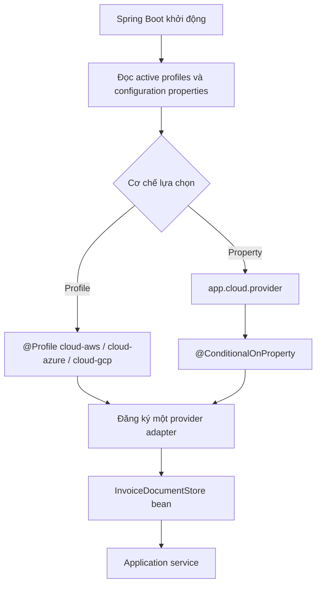

# Lựa chọn cấu hình và adapter bằng profile hoặc điều kiện bean

> **Chương:** Đa đám mây  
> **Học phần:** SPRING_CLOUD_PROVIDER_INTEGRATION — thực hành tích hợp Spring Boot với dịch vụ managed của AWS, Azure và Google Cloud qua các thư viện Spring Cloud tương ứng. Bài này tập trung chọn cấu hình và provider adapter bằng Spring Profiles hoặc điều kiện tạo bean.

Một ứng dụng Invoice Service có thể chạy trên AWS ở production, Azure ở môi trường DR và Google Cloud trong một sandbox đánh giá. Tầng nghiệp vụ vẫn gọi cùng một port lưu chứng từ, nhưng mỗi môi trường cần SDK client, credential, endpoint và resource identifier khác nhau. Nếu tạo tất cả client rồi chọn thủ công trong từng service, code nghiệp vụ sẽ biết quá nhiều chi tiết cloud. Nếu cấu hình profile lẫn lộn, ứng dụng có thể tạo hai adapter cùng lúc hoặc không tạo adapter nào.

Spring Boot cung cấp hai cơ chế thường dùng để chọn implementation:

- **Spring Profiles và @Profile:** bật một nhóm cấu hình/bean theo môi trường hoặc mục đích triển khai.
- **Condition annotations như @ConditionalOnProperty:** tạo bean khi một property có giá trị phù hợp.

Hai cơ chế có thể hỗ trợ cùng một ứng dụng, nhưng nên giao cho chúng những trách nhiệm rõ ràng. Profile phù hợp để gom cấu hình môi trường; điều kiện property phù hợp khi lựa chọn provider là một giá trị cấu hình tường minh. Cả hai cần fail fast nếu lựa chọn thiếu, sai hoặc tạo ra nhiều implementation.

## 1. Mục tiêu học tập

Sau bài này, bạn có thể:

1. Phân biệt profile theo môi trường với property chọn cloud provider.
2. Hiểu cách Spring Boot nạp application.yml và file cấu hình theo profile.
3. Dùng @Profile để đăng ký adapter cho AWS, Azure hoặc Google Cloud.
4. Dùng @ConditionalOnProperty để chọn đúng một implementation theo property.
5. Bind cấu hình bằng @ConfigurationProperties và kiểm tra giá trị đầu vào.
6. Tổ chức SDK dependency và cấu hình client theo provider.
7. Tránh tạo nhiều bean cùng implement một port hoặc để ứng dụng khởi động thiếu adapter.
8. Kiểm thử việc lựa chọn bean bằng Spring test context.
9. Quản lý cấu hình theo môi trường mà không đưa secret vào source code.
10. Chọn cơ chế phù hợp cho deployment đơn provider, multi-provider hoặc test.

## 2. Bài toán cần giải quyết

Giả sử Invoice Service có port nghiệp vụ:

- Lưu chứng từ hóa đơn.
- Đọc lại chứng từ theo tenant và document ID.
- Xóa chứng từ theo chính sách.

Các triển khai có thể là:

| Provider | Adapter | SDK/client |
|---|---|---|
| AWS | S3InvoiceDocumentStore | AWS SDK S3Client |
| Azure | AzureBlobInvoiceDocumentStore | Azure Storage BlobServiceClient |
| Google Cloud | GcsInvoiceDocumentStore | Google Cloud Storage |

Tầng application chỉ nên phụ thuộc vào interface nghiệp vụ, ví dụ InvoiceDocumentStore. Khi deployment chạy trên AWS, Spring tạo adapter S3. Khi chạy trên Azure, Spring tạo adapter Blob. Mỗi adapter dùng client và credential của môi trường đó.

### Sơ đồ lựa chọn adapter



Lựa chọn được thực hiện khi Spring tạo ApplicationContext. Một request HTTP thông thường không nên quyết định ứng dụng sẽ dùng SDK cloud nào.

## 3. Phân biệt profile và provider property

### 3.1. Profile mô tả nhóm cấu hình đang hoạt động

Spring Profile là tên một nhóm cấu hình. Profile thường mô tả môi trường hoặc vai trò triển khai:

- local: chạy trên máy lập trình.
- test: chạy trong test context.
- staging: môi trường staging.
- prod: production.
- cloud-aws: adapter/configuration dùng AWS.
- cloud-azure: adapter/configuration dùng Azure.
- cloud-gcp: adapter/configuration dùng Google Cloud.

Một ứng dụng có thể bật nhiều profile cùng lúc, ví dụ prod,cloud-aws. Profile prod có thể bật logging, timeout và observability production; profile cloud-aws chọn adapter và resource AWS.

Điều quan trọng là profile không phải lúc nào cũng đại diện cho một môi trường duy nhất. Spring cho phép nhiều profile đồng thời hoạt động. Vì vậy, nếu dùng profile để chọn provider, phải bảo đảm chỉ một provider profile được bật.

### 3.2. Property mô tả lựa chọn cụ thể

Một property như app.cloud.provider diễn đạt lựa chọn backend:

```yaml
app:
  cloud:
    provider: aws
```

Các giá trị hợp lệ có thể là aws, azure hoặc gcp. Giá trị này có thể được cung cấp qua file cấu hình, biến môi trường, command-line argument hoặc config service.

Property phù hợp khi:

- Một deployment chỉ chọn một provider.
- Muốn cấu hình lựa chọn provider tách khỏi profile môi trường.
- Cần validate giá trị đầu vào rõ ràng.
- Muốn kiểm thử các giá trị lựa chọn bằng test context.

### 3.3. Bảng so sánh

| Tiêu chí | @Profile | @ConditionalOnProperty |
|---|---|---|
| Điều kiện | Profile đang active | Property có giá trị phù hợp |
| Cách kích hoạt | spring.profiles.active hoặc profile group | app.cloud.provider |
| Phù hợp | Nhóm bean/config theo môi trường hoặc vai trò | Lựa chọn implementation theo giá trị |
| Nhiều lựa chọn cùng lúc | Có thể, vì nhiều profile được active | Thường chỉ một giá trị property |
| Cấu hình riêng theo môi trường | Tốt với application-{profile}.yml | Tốt với externalized properties |
| Validation | Cần kiểm tra profile combination | Có thể validate property qua @ConfigurationProperties |
| Dùng khi | Muốn gom cấu hình thành một profile rõ nghĩa | Muốn lựa chọn backend bằng một setting tường minh |

Không có cơ chế nào tự động tốt hơn trong mọi tình huống. Hãy chọn một cơ chế làm nguồn quyết định chính cho provider trong mỗi deployment.

## 4. Cấu trúc cấu hình Spring Boot

### 4.1. File cấu hình chung

application.yml chứa cấu hình mặc định không gắn với một provider:

```yaml
spring:
  application:
    name: invoice-service

server:
  port: 8080

app:
  document:
    max-size-bytes: 104857600
    allowed-content-types:
      - application/pdf
      - image/png
      - image/jpeg

management:
  endpoints:
    web:
      exposure:
        include: health,info,metrics
```

Không đặt secret trực tiếp trong file này. Cấu hình chung nên chứa quy tắc nghiệp vụ, giới hạn ứng dụng và các giá trị không nhạy cảm.

### 4.2. File cấu hình theo profile

Spring Boot có thể nạp file application-{profile}.yml khi profile tương ứng được active. Ví dụ:

```text
src/main/resources/
  application.yml
  application-local.yml
  application-prod.yml
  application-cloud-aws.yml
  application-cloud-azure.yml
  application-cloud-gcp.yml
```

Nếu active prod,cloud-aws, Spring nạp cấu hình chung và các file profile tương ứng; giá trị từ nguồn cấu hình có độ ưu tiên cao hơn có thể ghi đè giá trị file.

Ví dụ application-cloud-aws.yml:

```yaml
app:
  cloud:
    provider: aws
  storage:
    bucket: ${AWS_DOCUMENT_BUCKET}
    region: ${AWS_REGION:ap-southeast-1}
```

Ví dụ application-cloud-azure.yml:

```yaml
app:
  cloud:
    provider: azure
  storage:
    account-url: ${AZURE_STORAGE_ACCOUNT_URL}
    container: ${AZURE_DOCUMENT_CONTAINER}
```

Ví dụ application-cloud-gcp.yml:

```yaml
app:
  cloud:
    provider: gcp
  storage:
    project-id: ${GOOGLE_CLOUD_PROJECT}
    bucket: ${GCP_DOCUMENT_BUCKET}
```

Các biến môi trường ở trên là resource identifier hoặc cấu hình không nhạy cảm. Credential nên lấy từ workload identity hoặc secret manager theo nền tảng.

### 4.3. Kích hoạt profile từ bên ngoài

Ví dụ chạy production trên AWS:

```bash
SPRING_PROFILES_ACTIVE=prod,cloud-aws
```

Trên Windows PowerShell:

```powershell
$env:SPRING_PROFILES_ACTIVE = "prod,cloud-aws"
```

Không đặt spring.profiles.active bên trong một file application-{profile}.yml đang được kích hoạt. Hãy chọn active profile từ biến môi trường, command line hoặc nguồn cấu hình bên ngoài.

### 4.4. Profile group

Profile group cho phép tạo một tên đại diện kích hoạt nhiều profile:

```yaml
spring:
  profiles:
    group:
      production-aws:
        - prod
        - cloud-aws
      production-azure:
        - prod
        - cloud-azure
      production-gcp:
        - prod
        - cloud-gcp
```

Khi chạy SPRING_PROFILES_ACTIVE=production-aws, Spring kích hoạt nhóm prod và cloud-aws. Profile group nên được khai báo trong document cấu hình không phụ thuộc profile, chẳng hạn application.yml.

Profile group giúp pipeline deployment chọn một cấu hình đã được định nghĩa trước. Nó không thay thế validation cho các giá trị resource, region hoặc credential.

## 5. Chọn adapter bằng @Profile

### 5.1. Định nghĩa port nghiệp vụ

Ví dụ contract tối giản cho lưu chứng từ:

```java
package com.example.invoice.document;

public interface InvoiceDocumentStore {

    DocumentReceipt store(StoreDocument command);

    DocumentContent load(String tenantId, String documentId);

    void delete(String tenantId, String documentId);

    record StoreDocument(
            String tenantId,
            String documentId,
            String contentType,
            byte[] content) {
    }

    record DocumentReceipt(
            String documentId,
            String revision,
            String checksum) {
    }

    record DocumentContent(
            String contentType,
            byte[] content,
            String revision) {
    }
}
```

Interface chỉ chứa dữ liệu nghiệp vụ. Trong ứng dụng xử lý file lớn, nên dùng streaming thay vì byte[]; ví dụ này giữ kiểu đơn giản để tập trung vào wiring.

### 5.2. Adapter AWS

Adapter AWS nhận S3Client đã được cấu hình ở infrastructure layer:

```java
package com.example.invoice.infrastructure.aws;

import com.example.invoice.document.InvoiceDocumentStore;
import software.amazon.awssdk.services.s3.S3Client;

public final class S3InvoiceDocumentStore
        implements InvoiceDocumentStore {

    private final S3Client s3Client;
    private final String bucket;

    public S3InvoiceDocumentStore(S3Client s3Client, String bucket) {
        this.s3Client = s3Client;
        this.bucket = bucket;
    }

    @Override
    public DocumentReceipt store(StoreDocument command) {
        throw new UnsupportedOperationException(
                "Map this operation to the S3 PutObject API");
    }

    @Override
    public DocumentContent load(String tenantId, String documentId) {
        throw new UnsupportedOperationException(
                "Map this operation to the S3 GetObject API");
    }

    @Override
    public void delete(String tenantId, String documentId) {
        throw new UnsupportedOperationException(
                "Map this operation to the S3 DeleteObject API");
    }
}
```

### 5.3. Adapter Azure

```java
package com.example.invoice.infrastructure.azure;

import com.azure.storage.blob.BlobServiceClient;
import com.example.invoice.document.InvoiceDocumentStore;

public final class AzureBlobInvoiceDocumentStore
        implements InvoiceDocumentStore {

    private final BlobServiceClient blobServiceClient;
    private final String container;

    public AzureBlobInvoiceDocumentStore(
            BlobServiceClient blobServiceClient,
            String container) {
        this.blobServiceClient = blobServiceClient;
        this.container = container;
    }

    @Override
    public DocumentReceipt store(StoreDocument command) {
        throw new UnsupportedOperationException(
                "Map this operation to the Azure Blob upload API");
    }

    @Override
    public DocumentContent load(String tenantId, String documentId) {
        throw new UnsupportedOperationException(
                "Map this operation to the Azure Blob download API");
    }

    @Override
    public void delete(String tenantId, String documentId) {
        throw new UnsupportedOperationException(
                "Map this operation to the Azure Blob delete API");
    }
}
```

### 5.4. Adapter Google Cloud

```java
package com.example.invoice.infrastructure.gcp;

import com.example.invoice.document.InvoiceDocumentStore;
import com.google.cloud.storage.Storage;

public final class GcsInvoiceDocumentStore
        implements InvoiceDocumentStore {

    private final Storage storage;
    private final String bucket;

    public GcsInvoiceDocumentStore(Storage storage, String bucket) {
        this.storage = storage;
        this.bucket = bucket;
    }

    @Override
    public DocumentReceipt store(StoreDocument command) {
        throw new UnsupportedOperationException(
                "Map this operation to the Cloud Storage create API");
    }

    @Override
    public DocumentContent load(String tenantId, String documentId) {
        throw new UnsupportedOperationException(
                "Map this operation to the Cloud Storage read API");
    }

    @Override
    public void delete(String tenantId, String documentId) {
        throw new UnsupportedOperationException(
                "Map this operation to the Cloud Storage delete API");
    }
}
```

Các class trên là skeleton biên dịch được để minh họa ranh giới adapter; các method ném UnsupportedOperationException phải được thay bằng lời gọi SDK thật trước khi triển khai. Implementation cần xử lý checksum, tenant namespace, revision, retry và lỗi theo contract của ứng dụng.

### 5.5. Đăng ký bean theo profile

Tạo configuration riêng cho mỗi provider:

```java
package com.example.invoice.infrastructure.aws;

import com.example.invoice.document.InvoiceDocumentStore;
import org.springframework.beans.factory.annotation.Value;
import org.springframework.context.annotation.Bean;
import org.springframework.context.annotation.Configuration;
import org.springframework.context.annotation.Profile;
import software.amazon.awssdk.services.s3.S3Client;

@Configuration(proxyBeanMethods = false)
@Profile("cloud-aws")
public class AwsProfileDocumentStoreConfiguration {

    @Bean
    InvoiceDocumentStore invoiceDocumentStore(
            S3Client s3Client,
            @Value("${app.storage.bucket}") String bucket) {
        return new S3InvoiceDocumentStore(s3Client, bucket);
    }
}
```

Configuration Azure:

```java
package com.example.invoice.infrastructure.azure;

import com.azure.storage.blob.BlobServiceClient;
import com.example.invoice.document.InvoiceDocumentStore;
import org.springframework.beans.factory.annotation.Value;
import org.springframework.context.annotation.Bean;
import org.springframework.context.annotation.Configuration;
import org.springframework.context.annotation.Profile;

@Configuration(proxyBeanMethods = false)
@Profile("cloud-azure")
public class AzureProfileDocumentStoreConfiguration {

    @Bean
    InvoiceDocumentStore invoiceDocumentStore(
            BlobServiceClient blobServiceClient,
            @Value("${app.storage.container}") String container) {
        return new AzureBlobInvoiceDocumentStore(
                blobServiceClient, container);
    }
}
```

Configuration Google Cloud:

```java
package com.example.invoice.infrastructure.gcp;

import com.example.invoice.document.InvoiceDocumentStore;
import com.google.cloud.storage.Storage;
import org.springframework.beans.factory.annotation.Value;
import org.springframework.context.annotation.Bean;
import org.springframework.context.annotation.Configuration;
import org.springframework.context.annotation.Profile;

@Configuration(proxyBeanMethods = false)
@Profile("cloud-gcp")
public class GcpProfileDocumentStoreConfiguration {

    @Bean
    InvoiceDocumentStore invoiceDocumentStore(
            Storage storage,
            @Value("${app.storage.bucket}") String bucket) {
        return new GcsInvoiceDocumentStore(storage, bucket);
    }
}
```

Spring chỉ nạp configuration class có profile tương ứng. Nếu active cloud-aws, bean InvoiceDocumentStore được tạo bằng S3Client; nếu active cloud-azure, bean được tạo bằng BlobServiceClient.

### 5.6. Profile combination cần được kiểm soát

Nếu vô tình active cả cloud-aws và cloud-azure, cả hai configuration đều có thể đăng ký một bean cùng kiểu. Khi application service inject InvoiceDocumentStore, Spring thường báo NoUniqueBeanDefinitionException.

Nếu không active profile provider nào, Spring không có bean để inject và context sẽ thất bại khi khởi động. Đây là tín hiệu tốt hơn việc âm thầm dùng một backend mặc định không mong muốn, nhưng thông báo lỗi có thể cần được làm rõ bằng validation cấu hình.

Không giải quyết vấn đề bằng cách gắn @Primary tùy tiện cho một adapter. Làm vậy có thể che giấu việc hai provider profile đang cùng active.

## 6. Chọn adapter bằng @ConditionalOnProperty

Nếu provider là một lựa chọn cấu hình duy nhất, @ConditionalOnProperty thường thể hiện ý định trực tiếp hơn.

### 6.1. Cấu hình lựa chọn provider

Trong application.yml hoặc profile-specific config:

```yaml
app:
  cloud:
    provider: aws
```

Có thể ghi đè qua environment variable:

```bash
APP_CLOUD_PROVIDER=azure
```

Spring Boot relaxed binding ánh xạ APP_CLOUD_PROVIDER sang app.cloud.provider.

### 6.2. Bind và validate property

Dùng @ConfigurationProperties để gom cấu hình lựa chọn:

```java
package com.example.invoice.infrastructure.configuration;

import java.util.Set;

import org.springframework.boot.context.properties.ConfigurationProperties;

@ConfigurationProperties(prefix = "app.cloud")
public record CloudSelectionProperties(String provider) {

    private static final Set<String> SUPPORTED =
            Set.of("aws", "azure", "gcp");

    public CloudSelectionProperties {
        if (provider == null) {
            throw new IllegalArgumentException(
                    "app.cloud.provider is required");
        }

        if (!SUPPORTED.contains(provider)) {
            throw new IllegalArgumentException(
                    "app.cloud.provider must be lowercase: aws, azure or gcp");
        }
    }
}
```

Đăng ký properties:

```java
package com.example.invoice.infrastructure.configuration;

import org.springframework.boot.context.properties.EnableConfigurationProperties;
import org.springframework.context.annotation.Configuration;

@Configuration(proxyBeanMethods = false)
@EnableConfigurationProperties(CloudSelectionProperties.class)
public class CloudSelectionConfiguration {
}
```

Record kiểm tra property ngay khi Spring bind cấu hình. Giá trị thiếu hoặc provider không được hỗ trợ làm context khởi động thất bại với thông báo cụ thể.

Nếu dùng @ConfigurationPropertiesScan, có thể scan package chứa record thay cho @EnableConfigurationProperties. Chọn một cách đăng ký nhất quán để tránh cấu hình trùng lặp.

### 6.3. Tạo bean bằng điều kiện property

AWS:

```java
@Configuration(proxyBeanMethods = false)
@ConditionalOnProperty(
        prefix = "app.cloud",
        name = "provider",
        havingValue = "aws")
class AwsConditionalDocumentStoreConfiguration {

    @Bean
    InvoiceDocumentStore invoiceDocumentStore(
            S3Client s3Client,
            StorageProperties storageProperties) {
        return new S3InvoiceDocumentStore(
                s3Client, storageProperties.bucket());
    }
}
```

Azure:

```java
@Configuration(proxyBeanMethods = false)
@ConditionalOnProperty(
        prefix = "app.cloud",
        name = "provider",
        havingValue = "azure")
class AzureConditionalDocumentStoreConfiguration {

    @Bean
    InvoiceDocumentStore invoiceDocumentStore(
            BlobServiceClient blobServiceClient,
            StorageProperties storageProperties) {
        return new AzureBlobInvoiceDocumentStore(
                blobServiceClient, storageProperties.container());
    }
}
```

Google Cloud:

```java
@Configuration(proxyBeanMethods = false)
@ConditionalOnProperty(
        prefix = "app.cloud",
        name = "provider",
        havingValue = "gcp")
class GcpConditionalDocumentStoreConfiguration {

    @Bean
    InvoiceDocumentStore invoiceDocumentStore(
            Storage storage,
            StorageProperties storageProperties) {
        return new GcsInvoiceDocumentStore(
                storage, storageProperties.bucket());
    }
}
```

Mỗi configuration class nên nằm trong package/module infrastructure của provider. Chỉ configuration có havingValue trùng với property mới đăng ký bean.

matchIfMissing mặc định là false. Vì vậy nếu property bị thiếu, các configuration không tự bật. Kết hợp với CloudSelectionProperties, ứng dụng fail fast thay vì tự chọn backend ngầm.

### 6.4. Vì sao tách configuration theo provider?

Nếu một configuration class tham chiếu trực tiếp S3Client, BlobServiceClient và Storage, tất cả SDK class có thể phải hiện diện trên classpath của artifact đó. Khi muốn đóng gói từng provider thành optional dependency hoặc module riêng, việc tham chiếu tất cả SDK trong cùng class gây coupling build không cần thiết.

Tách file/class theo provider giúp:

- Giữ dependency SDK trong module tương ứng.
- Dễ bật/tắt adapter theo build hoặc runtime.
- Giới hạn cấu hình credential và client.
- Đơn giản hóa test theo provider.

Nếu một artifact hỗ trợ cả ba provider, có thể đưa đủ dependency vào classpath và dùng condition. Nếu muốn artifact gọn theo từng cloud, tách adapter thành module Maven/Gradle hoặc starter nội bộ riêng.

## 7. Cấu hình SDK client và credential theo provider

Lựa chọn adapter chỉ giải quyết bean nghiệp vụ. Adapter vẫn cần SDK client đã cấu hình endpoint, region/project, credential và timeout phù hợp.

### 7.1. AWS SDK

AWS SDK for Java 2.x có thể dùng default credential provider chain để lấy credential từ role/environment/profile theo thứ tự được SDK hỗ trợ:

```java
S3Client s3Client = S3Client.builder()
        .region(Region.of(region))
        .credentialsProvider(DefaultCredentialsProvider.create())
        .build();
```

Trong môi trường AWS, ưu tiên IAM role gắn với compute/task/pod thay cho access key dài hạn. Không đưa access key vào application-cloud-aws.yml.

### 7.2. Azure SDK

Azure Identity có thể dùng DefaultAzureCredential để chọn cơ chế xác thực phù hợp môi trường:

```java
BlobServiceClient blobServiceClient =
        new BlobServiceClientBuilder()
                .endpoint(accountUrl)
                .credential(new DefaultAzureCredentialBuilder().build())
                .buildClient();
```

Production nên dùng Managed Identity hoặc Workload Identity khi nền tảng hỗ trợ. Local development có thể dùng developer credential theo policy. Cấp Azure RBAC đúng phạm vi storage account/container.

### 7.3. Google Cloud client

Google Cloud Java client có thể dùng Application Default Credentials:

```java
Storage storage = StorageOptions.newBuilder()
        .setProjectId(projectId)
        .build()
        .getService();
```

Trên workload Google Cloud, gắn service account phù hợp với runtime hoặc dùng Workload Identity Federation. Tránh tải service account key JSON lên container image.

### 7.4. Không trộn credential của provider

| Adapter | Credential phù hợp | Không nên |
|---|---|---|
| AWS | IAM role/credential chain | Copy access key vào Azure/GCP |
| Azure | Managed Identity/Workload Identity | Lưu client secret trong profile file |
| GCP | Attached service account/Workload Identity | Bake service account JSON vào image |

Credential là trách nhiệm của adapter/configuration và platform identity. Application service chỉ gọi port nghiệp vụ.

## 8. Bind cấu hình có kiểu bằng @ConfigurationProperties

Không nên rải @Value cho hàng chục property liên quan đến một dịch vụ. Gom cấu hình thành record/class có kiểu rõ ràng.

Ví dụ cấu hình storage:

```yaml
app:
  storage:
    bucket: ${DOCUMENT_BUCKET:}
    container: ${DOCUMENT_CONTAINER:}
    region: ${AWS_REGION:ap-southeast-1}
    account-url: ${AZURE_STORAGE_ACCOUNT_URL:}
    project-id: ${GOOGLE_CLOUD_PROJECT:}
```

Properties:

```java
package com.example.invoice.infrastructure.configuration;

import org.springframework.boot.context.properties.ConfigurationProperties;

@ConfigurationProperties(prefix = "app.storage")
public record StorageProperties(
        String bucket,
        String container,
        String region,
        String accountUrl,
        String projectId) {
}
```

Đăng ký cùng properties:

```java
@Configuration(proxyBeanMethods = false)
@EnableConfigurationProperties({
        CloudSelectionProperties.class,
        StorageProperties.class
})
public class InfrastructurePropertiesConfiguration {
}
```

Một ứng dụng production nên validate các field bắt buộc theo provider đã chọn. Ví dụ AWS cần bucket và region; Azure cần container và account URL; GCP cần bucket và project ID. Không bắt buộc mọi property của mọi provider cùng lúc nếu chỉ triển khai một provider.

Có thể viết validator riêng hoặc dùng @Validated cùng Bean Validation. Nếu dùng @NotBlank, @Pattern và các annotation validation, thêm dependency spring-boot-starter-validation.

### 8.1. Fail fast theo provider

Ví dụ validation khi tạo AWS adapter:

```java
@Bean
InvoiceDocumentStore awsDocumentStore(
        S3Client s3Client,
        StorageProperties properties) {

    if (properties.bucket() == null
            || properties.bucket().isBlank()) {
        throw new IllegalStateException(
                "app.storage.bucket is required for AWS");
    }

    return new S3InvoiceDocumentStore(
            s3Client, properties.bucket());
}
```

Trong code production, có thể chuyển kiểm tra sang @ConfigurationProperties validator hoặc một startup validation component để lỗi cấu hình được báo tập trung. Không đợi tới request đầu tiên mới phát hiện bucket/container chưa được khai báo.

## 9. Kết hợp profile môi trường với provider condition

Một cách tổ chức phổ biến là dùng profile cho môi trường và property condition cho provider:

- Profile prod bật cấu hình production.
- Property app.cloud.provider=aws chọn AWS adapter.

Nếu đã dùng property để chọn adapter, không cần thêm profile provider chỉ để chọn cùng một bean. Profile provider có thể vẫn hữu ích để nạp file cấu hình riêng, nhưng cần một nguồn quyết định nhất quán.

### Ví dụ dùng profile cho môi trường, property cho adapter

application-prod.yml:

```yaml
app:
  document:
    max-size-bytes: 104857600

logging:
  level:
    root: INFO
```

application-prod-aws.yml có thể chứa resource identifier AWS:

```yaml
app:
  cloud:
    provider: aws
  storage:
    bucket: ${AWS_DOCUMENT_BUCKET}
    region: ${AWS_REGION:ap-southeast-1}
```

Pipeline kích hoạt:

```bash
SPRING_PROFILES_ACTIVE=prod,prod-aws
```

Trong trường hợp này, configuration class vẫn chọn adapter bằng @ConditionalOnProperty; profile chỉ cung cấp giá trị property theo deployment.

### Tránh hai nguồn lựa chọn mâu thuẫn

Ví dụ nguy hiểm:

- Active profile cloud-aws.
- Property app.cloud.provider=azure.
- @Profile tạo AWS adapter.
- @ConditionalOnProperty tạo Azure adapter.

Kết quả có thể là hai bean cùng type. Chỉ dùng một cơ chế quyết định adapter, hoặc viết một validation component xác minh profile và property luôn khớp nếu tổ chức bắt buộc duy trì cả hai.

## 10. Chọn @Profile hay @ConditionalOnProperty trong thực tế

### Dùng @Profile khi

- Cấu hình provider là một phần của deployment profile đã được pipeline quản lý.
- Mỗi profile gom nhiều bean liên quan như storage, messaging, secret và observability.
- Tên profile diễn đạt một deployment variant rõ nghĩa.
- Profile combination được kiểm soát và kiểm thử.

### Dùng @ConditionalOnProperty khi

- Provider là một lựa chọn đơn giản, tường minh.
- Muốn đổi provider bằng một cấu hình mà không phải tạo thêm profile.
- Cần validate giá trị provider hợp lệ.
- Cần dùng cùng profile môi trường cho nhiều provider khác nhau.

### Dùng thêm condition khác khi

- @ConditionalOnClass: adapter chỉ nên được đăng ký khi SDK class có trên classpath.
- @ConditionalOnBean: adapter cần một client bean đã tồn tại.
- @ConditionalOnMissingBean: cung cấp default bean có thể được ứng dụng override có chủ đích.

Không dùng @ConditionalOnExpression để thay một property đơn giản. Expression phức tạp khó đọc, khó test và thường che giấu cấu hình sai.

## 11. Kiểm thử việc lựa chọn adapter

Không chỉ kiểm thử method của adapter. Cần xác minh Spring tạo đúng bean theo profile/property.

### 11.1. Test condition với ApplicationContextRunner

ApplicationContextRunner giúp tạo context nhỏ và kiểm tra auto-configuration/conditional configuration:

```java
package com.example.invoice.infrastructure.configuration;

import static org.assertj.core.api.Assertions.assertThat;
import static org.mockito.Mockito.mock;

import com.example.invoice.document.InvoiceDocumentStore;
import org.junit.jupiter.api.Test;
import org.springframework.boot.test.context.runner.ApplicationContextRunner;
import software.amazon.awssdk.services.s3.S3Client;

class AwsDocumentStoreConfigurationTest {

    private final ApplicationContextRunner contextRunner =
            new ApplicationContextRunner()
                    .withUserConfiguration(
                            CloudSelectionConfiguration.class,
                            AwsConditionalDocumentStoreConfiguration.class)
                    .withBean(S3Client.class, () -> mock(S3Client.class))
                    .withBean(StorageProperties.class,
                            () -> new StorageProperties(
                                    "test-bucket", "", "ap-southeast-1",
                                    "", ""));

    @Test
    void createsAwsAdapterWhenAwsIsSelected() {
        contextRunner
                .withPropertyValues("app.cloud.provider=aws")
                .run(context -> {
                    assertThat(context).hasSingleBean(
                            InvoiceDocumentStore.class);
                    assertThat(context).hasBean("invoiceDocumentStore");
                });
    }

    @Test
    void doesNotCreateAwsAdapterForAzure() {
        contextRunner
                .withPropertyValues("app.cloud.provider=azure")
                .run(context -> {
                    assertThat(context).doesNotHaveBean(
                            InvoiceDocumentStore.class);
                });
    }
}
```

Test này tập trung vào điều kiện đăng ký AWS bean. Test Azure/GCP có thể dùng cùng mẫu với SDK client mock tương ứng và configuration class của provider đó.

### 11.2. Kiểm thử property sai hoặc thiếu

Với CloudSelectionProperties, cần test:

| Property | Kết quả mong đợi |
|---|---|
| aws | Bind thành công |
| azure | Bind thành công |
| gcp | Bind thành công |
| AWS | Context fail fast vì giá trị phải viết thường |
| Không khai báo | Context fail fast |
| oracle | Context fail fast |
| Chuỗi rỗng | Context fail fast |

Không kiểm thử trường hợp thiếu property bằng cách cho ứng dụng chọn AWS mặc định nếu đó không phải quyết định kiến trúc đã được phê duyệt.

### 11.3. Kiểm thử profile

Với cấu hình @Profile, tạo context riêng cho từng profile:

- Chỉ cloud-aws: có một InvoiceDocumentStore từ AWS.
- Chỉ cloud-azure: có một adapter Azure.
- Chỉ cloud-gcp: có một adapter GCP.
- Không có profile provider: context không có adapter và startup phải thất bại khi application service cần port.
- Hai profile provider cùng active: test phải phát hiện bean ambiguity.

Test profile giúp ngăn lỗi pipeline kích hoạt nhầm hai provider cùng lúc.

## 12. Quản lý dependency theo module

Nếu ứng dụng chỉ triển khai trên một cloud, không nhất thiết phải đóng gói cả ba SDK.

### 12.1. Một artifact hỗ trợ nhiều provider

Phù hợp khi:

- Cùng một artifact cần triển khai ở nhiều cloud.
- Pipeline chọn provider bằng property/profile.
- Các dependency SDK được chấp nhận trong artifact.
- Team có contract/integration test cho mọi adapter.

Ưu điểm là một artifact và một pipeline. Đổi lại, artifact lớn hơn và cần quản lý version tương thích giữa các SDK.

### 12.2. Tách adapter thành module

Ví dụ Maven multi-module:

```text
invoice-service/
  invoice-domain/
  invoice-application/
  invoice-adapter-aws/
  invoice-adapter-azure/
  invoice-adapter-gcp/
  invoice-boot/
```

Module invoice-application chỉ phụ thuộc contract. Module adapter phụ thuộc SDK riêng. Module boot đưa đúng adapter vào runtime hoặc gom các adapter theo deployment.

Ưu điểm:

- SDK không cần thiết không xuất hiện trên classpath.
- Adapter được build/test độc lập.
- Giảm nguy cơ xung đột dependency.

Đổi lại, cần quản lý module, version và artifact assembly chặt chẽ hơn.

### 12.3. Tránh component scan tạo adapter ngoài ý muốn

Nếu mọi adapter đều gắn @Component và nằm trong package được scan, chúng có thể được đăng ký bất kể provider nào được chọn. Khi adapter cần điều kiện, có thể:

- Bỏ @Component và tạo bean trong configuration có condition.
- Đặt @Profile trực tiếp trên adapter component.
- Dùng @ConditionalOnProperty trên configuration/bean.

Không đăng ký adapter ở cả component scan lẫn @Bean method nếu không có chủ ý; điều đó có thể tạo bean trùng.

## 13. Cấu hình an toàn cho từng môi trường

### 13.1. Không đưa secret vào profile file

Các file application-prod.yml hoặc application-cloud-aws.yml có thể nằm trong Git nếu chỉ chứa cấu hình không nhạy cảm. Không commit:

- AWS access key/secret access key.
- Azure client secret hoặc private key.
- Google service account private key.
- Database password.
- API key hoặc signing key.

Thay vào đó, dùng workload identity, secret manager hoặc secret injection có kiểm soát.

### 13.2. Phân biệt resource identifier và secret

| Giá trị | Ví dụ | Cách quản lý |
|---|---|---|
| Region | ap-southeast-1 | Configuration |
| Bucket/container | invoice-documents | Configuration, giới hạn quyền |
| Azure account URL | Endpoint storage | Configuration |
| GCP project ID | Project identifier | Configuration |
| Access key/secret | Credential | Workload identity/secret manager |
| Private key | Signing material | Key management/secret manager |

Resource identifier không nhất thiết là secret, nhưng vẫn cần quản lý thay đổi và quyền truy cập hợp lý.

### 13.3. Configuration precedence

Spring Boot hỗ trợ nhiều nguồn cấu hình. Khi cùng một key xuất hiện ở nhiều nguồn, nguồn có độ ưu tiên cao hơn sẽ quyết định giá trị cuối cùng. Các nguồn thường gặp gồm:

- File cấu hình.
- File cấu hình theo profile.
- Environment variables.
- Java system properties.
- Command-line arguments.
- External configuration source.

Pipeline nên hiển thị profile/provider đã chọn ở log startup hoặc health/info metadata ở mức an toàn. Không in toàn bộ environment hoặc secret để debug.

### 13.4. Không để default production ngoài ý muốn

Một default như provider: aws có thể khiến deployment mới vô tình gọi production AWS account. Nếu provider phải được chọn rõ, không đặt default. Nếu local development cần default, đặt ở application-local.yml và bảo đảm production không active profile local.

## 14. Nhiều provider trong cùng một process

Các bài trước thường giả định một deployment dùng một provider. Một số hệ thống có use case thật sự cần gọi nhiều provider trong cùng process, ví dụ:

- Đọc dữ liệu từ provider cũ và ghi sang provider mới trong giai đoạn migration.
- Sao lưu object sang provider DR.
- Chuyển tenant sang provider khác theo lịch migration.

Khi đó, không nên dùng @Primary hoặc đổi profile theo từng request. Đăng ký các adapter với qualifier rõ ràng hoặc dùng registry có policy.

Ví dụ:

```java
@Configuration(proxyBeanMethods = false)
class MultiProviderStorageConfiguration {

    @Bean("sourceDocumentStore")
    InvoiceDocumentStore sourceDocumentStore(
            S3Client s3Client,
            StorageProperties properties) {
        return new S3InvoiceDocumentStore(
                s3Client, properties.bucket());
    }

    @Bean("targetDocumentStore")
    InvoiceDocumentStore targetDocumentStore(
            BlobServiceClient blobServiceClient,
            StorageProperties properties) {
        return new AzureBlobInvoiceDocumentStore(
                blobServiceClient, properties.container());
    }
}
```

Caller chỉ rõ dependency:

```java
@Service
public class DocumentMigrationService {

    private final InvoiceDocumentStore source;
    private final InvoiceDocumentStore target;

    public DocumentMigrationService(
            @Qualifier("sourceDocumentStore")
            InvoiceDocumentStore source,
            @Qualifier("targetDocumentStore")
            InvoiceDocumentStore target) {
        this.source = source;
        this.target = target;
    }
}
```

Đây là một use case migration có chủ đích. Nếu routing theo tenant, cần registry ánh xạ tenant sang provider, authorization, data residency, audit và rollback. Không cho client tự gửi provider name để truy cập backend.

## 15. Lỗi thường gặp và cách xử lý

| Triệu chứng | Nguyên nhân | Cách xử lý |
|---|---|---|
| NoSuchBeanDefinitionException cho port | Không active provider profile hoặc property không khớp | Kiểm tra active profiles và provider property |
| NoUniqueBeanDefinitionException | Nhiều provider config cùng tạo bean | Chỉ chọn một provider hoặc dùng qualifier cho multi-provider use case |
| SDK client không tồn tại | Thiếu starter/bean hoặc dependency chưa có | Kiểm tra dependency và client configuration |
| Bucket/container rỗng | Property không được nạp hoặc env var thiếu | Validate cấu hình lúc khởi động |
| Local chạy được, production lỗi credential | Dùng credential local thay vì workload identity | Cấp role/identity đúng cho runtime |
| Profile production vô tình dùng local | Pipeline active nhầm profile hoặc profile group sai | Kiểm tra SPRING_PROFILES_ACTIVE |
| Azure property nhưng AWS adapter được tạo | Profile và provider property mâu thuẫn | Dùng một nguồn lựa chọn và test combination |
| Test context tạo bean không mong muốn | Component scan quét tất cả adapter | Tách configuration hoặc đặt condition trên component |
| Thay đổi environment làm adapter khác hoạt động | Nguồn cấu hình có precedence cao ghi đè | Kiểm tra property source và startup diagnostics |

### Checklist khi debug

1. Active profiles thực tế là gì?
2. Giá trị cuối cùng của app.cloud.provider là gì?
3. Configuration class nào được match?
4. SDK client bean có được tạo không?
5. Resource identifier có đúng account/project/region không?
6. Workload identity có được gắn vào runtime không?
7. Adapter có được tạo đúng một lần không?
8. Startup log có vô tình tiết lộ secret không?

Chỉ log tên profile, provider, region và resource identifier không nhạy cảm. Không log access token, secret, private key hoặc toàn bộ environment.

## 16. Bài tập thực hành

**Bối cảnh:** Invoice Service có thể chạy trên AWS, Azure hoặc Google Cloud. Ứng dụng cần một InvoiceDocumentStore duy nhất trong deployment thông thường. Team muốn dùng Spring Profiles hoặc @ConditionalOnProperty để chọn adapter.

### Phần A — Dùng profile

1. Tạo AwsDocumentStoreConfiguration, AzureDocumentStoreConfiguration và GcpDocumentStoreConfiguration.
2. Đăng ký mỗi configuration với @Profile tương ứng.
3. Tạo application-cloud-aws.yml, application-cloud-azure.yml và application-cloud-gcp.yml.
4. Kích hoạt profile bằng SPRING_PROFILES_ACTIVE.
5. Kiểm tra trường hợp không có provider profile và trường hợp hai provider profile cùng active.

### Phần B — Dùng conditional bean

1. Tạo property app.cloud.provider.
2. Bind property bằng @ConfigurationProperties.
3. Validate chỉ nhận aws, azure hoặc gcp.
4. Tạo ba configuration class dùng @ConditionalOnProperty.
5. Xác nhận chỉ một InvoiceDocumentStore được đăng ký.
6. Kiểm tra property thiếu, rỗng và không hợp lệ.

### Phần C — Cấu hình client và credential

1. Cấu hình S3 client bằng AWS credential provider chain.
2. Cấu hình Blob client bằng Azure Identity.
3. Cấu hình GCS client bằng Application Default Credentials.
4. Đặt bucket/container/project/region ở external configuration.
5. Xác nhận không có credential trong Git hoặc container image.

### Phần D — Kiểm thử

1. Viết ApplicationContextRunner test cho mỗi provider condition.
2. Viết test phát hiện hai bean cùng implement port.
3. Test profile group production-aws.
4. Test fail fast khi resource identifier bắt buộc bị thiếu.
5. Chạy integration test với sandbox của provider được chọn.

**Mẫu báo cáo:**

| Deployment | Cấu hình chọn | Adapter mong đợi | Client |
|---|---|---|---|
| AWS production | prod,cloud-aws hoặc provider=aws | S3InvoiceDocumentStore | S3Client |
| Azure production | prod,cloud-azure hoặc provider=azure | AzureBlobInvoiceDocumentStore | BlobServiceClient |
| GCP production | prod,cloud-gcp hoặc provider=gcp | GcsInvoiceDocumentStore | Storage |

**Tiêu chí đạt:** Mỗi deployment tạo đúng một adapter; cấu hình thiếu/sai làm ứng dụng thất bại rõ ràng; credential được lấy từ identity phù hợp; application service chỉ phụ thuộc port; test chứng minh điều kiện profile/property hoạt động.

## Tài liệu tham khảo chính thức

1. [Spring Boot — Profiles](https://docs.spring.io/spring-boot/reference/features/profiles.html): active profiles, profile-specific configuration và profile groups.
2. [Spring Boot — Externalized Configuration](https://docs.spring.io/spring-boot/reference/features/external-config.html): thứ tự ưu tiên và bind cấu hình.
3. [Spring Boot — Configuration Properties](https://docs.spring.io/spring-boot/reference/features/external-config.html#features.external-config.typesafe-configuration-properties): @ConfigurationProperties.
4. [Spring Framework — @Profile](https://docs.spring.io/spring-framework/reference/core/beans/environment.html#beans-definition-profiles): điều kiện đăng ký bean theo profile.
5. [Spring Boot — Conditional Annotations](https://docs.spring.io/spring-boot/reference/features/developing-auto-configuration.html): điều kiện auto-configuration và bean.
6. [Spring Boot — Testing Auto-configuration](https://docs.spring.io/spring-boot/reference/testing/test-scope.html): công cụ kiểm thử context và auto-configuration.
7. [AWS SDK for Java 2.x — Credentials](https://docs.aws.amazon.com/sdk-for-java/latest/developer-guide/credentials.html): credential provider chain.
8. [Azure Identity — Java](https://learn.microsoft.com/java/api/overview/azure/identity-readme): DefaultAzureCredential và workload identity.
9. [Google Cloud — Application Default Credentials](https://cloud.google.com/docs/authentication/application-default-credentials): credential discovery cho ứng dụng.

> **Ghi nhớ:** Profile gom cấu hình theo môi trường hoặc deployment variant; @Profile bật bean khi profile active. @ConditionalOnProperty chọn bean theo một giá trị cấu hình tường minh. Hãy chọn một nguồn quyết định provider, validate giá trị lúc khởi động, chỉ tạo đúng adapter cần thiết và để SDK dùng workload identity native của cloud tương ứng.
