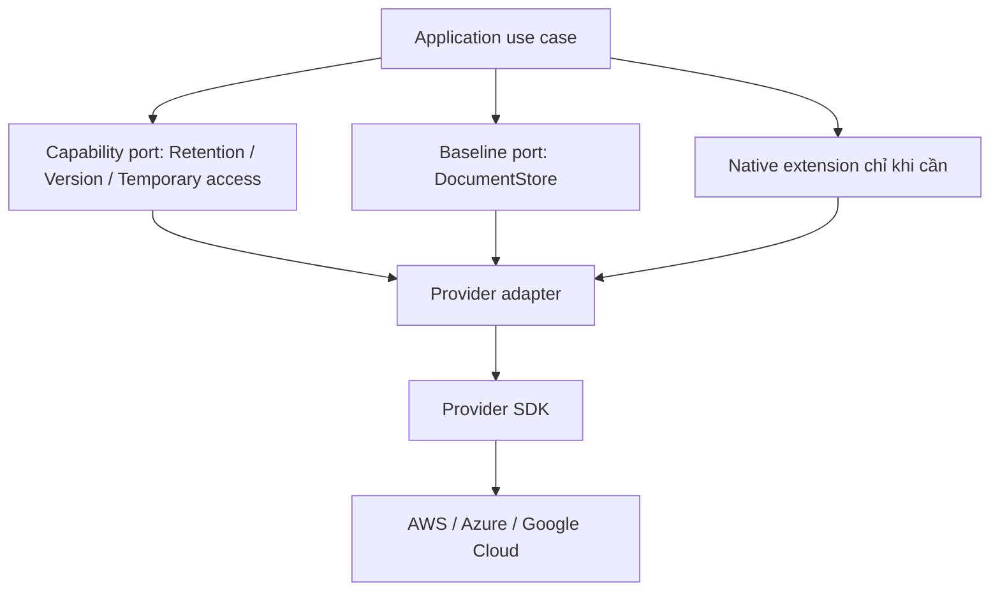

# Bảo toàn tính năng riêng khi một abstraction chung không đủ

> **Chương:** Đa đám mây  
> **Học phần:** SPRING_CLOUD_PROVIDER_INTEGRATION — thực hành tích hợp Spring Boot với dịch vụ managed của AWS, Azure và Google Cloud qua các thư viện Spring Cloud tương ứng. Bài này hướng dẫn giữ lại tính năng đặc thù của provider mà vẫn bảo vệ ranh giới nghiệp vụ và khả năng thay thế ở những phần thực sự tương đương.

Một ứng dụng lưu chứng từ có thể dùng cùng một interface `DocumentStore` để upload, download và delete trên Amazon S3, Azure Blob Storage hoặc Google Cloud Storage. Nhưng khi nghiệp vụ yêu cầu khóa chứng từ theo quy định, giữ nhiều revision, tạo đường dẫn tải tạm thời hoặc dùng khóa mã hóa do khách hàng quản lý, ba dịch vụ không còn tương đương hoàn toàn.

Nếu ép mọi khác biệt vào một interface chung quá đơn giản, ứng dụng sẽ mất tính năng cần thiết. Nếu đưa toàn bộ SDK type vào tầng nghiệp vụ, code lại phụ thuộc trực tiếp vào provider. Cách thiết kế phù hợp là giữ một contract chung cho capability cơ bản, tách các capability mở rộng thành contract riêng và chỉ dùng provider-native extension ở ranh giới infrastructure khi nghiệp vụ thực sự cần.

Mục tiêu không phải che giấu mọi khác biệt. Mục tiêu là làm rõ khác biệt nào có thể chuẩn hóa, khác biệt nào cần được biểu diễn thành capability, và khác biệt nào phải trở thành quyết định kiến trúc có chủ đích.

## 1. Mục tiêu học tập

Sau bài này, bạn có thể:

1. Nhận biết khi nào abstraction chung không biểu diễn đủ semantics của dịch vụ cloud.
2. Phân biệt baseline contract, optional capability contract và provider-native extension.
3. Thiết kế interface nhỏ theo Interface Segregation Principle.
4. Biểu diễn yêu cầu retention, legal hold, versioning và signed URL theo ngôn ngữ nghiệp vụ.
5. Hiểu các khác biệt quan trọng giữa S3 Object Lock, Azure immutable storage và Cloud Storage retention/holds.
6. Chọn cách xử lý khi một provider không hỗ trợ guarantee bắt buộc.
7. Kiểm tra capability của adapter và cấu hình resource trước khi cho phép use case chạy.
8. Giữ SDK type ở infrastructure layer và không để native identifier rò vào domain model.
9. Viết contract test riêng cho từng capability và integration test trên dịch vụ thật.
10. Đánh giá ảnh hưởng của provider-specific feature đến portability, migration và vận hành.

## 2. Vì sao abstraction chung đôi khi không đủ?

Giả sử ứng dụng có port:

```java
public interface DocumentStore {
    void put(String key, byte[] content);
    byte[] get(String key);
    void delete(String key);
}
```

Port này phù hợp nếu nghiệp vụ chỉ cần lưu, đọc và xóa nội dung. Nhưng các yêu cầu sau không thể được diễn tả chính xác bằng ba method đó:

- Chứng từ phải không thể bị xóa trước một ngày cụ thể.
- Legal hold phải ngăn xóa cho đến khi có quyết định gỡ hold.
- Người dùng phải tải đúng revision đã được phê duyệt.
- Đường dẫn tải chỉ có hiệu lực trong một khoảng thời gian và chỉ cho một hành động.
- Object phải được mã hóa bằng customer-managed key.
- Bản sao phải được giữ ở một region hoặc provider khác.

Thêm tất cả tính năng thành các method tùy chọn trên `DocumentStore` sẽ tạo interface lớn, nhiều implementation phải ném `UnsupportedOperationException` và caller phải đoán provider có hỗ trợ hay không.

### Ba lớp contract



| Lớp | Mục đích | Ví dụ |
|---|---|---|
| Baseline contract | Hành vi phổ biến cần có ở mọi backend | Lưu và đọc chứng từ |
| Capability contract | Tính năng mở rộng có semantics rõ | Retention, legal hold, version-pinned read |
| Provider-native extension | Tính năng chỉ có ý nghĩa hoặc chỉ tồn tại ở một provider | S3 Object Lock governance bypass, Azure lease operation |

Một adapter có thể triển khai nhiều capability port. Adapter khác có thể chỉ triển khai baseline. Use case nào bắt buộc capability thì phải xác minh adapter và resource đang dùng đáp ứng capability đó.

## 3. Bắt đầu từ guarantee nghiệp vụ, không bắt đầu từ tên tính năng

Tên tính năng của các cloud có thể khác nhau, và một tên giống nhau không đảm bảo cùng semantics. Trước khi thiết kế interface, hãy diễn đạt điều doanh nghiệp muốn bảo đảm.

| Câu hỏi nghiệp vụ | Guarantee cần xác định |
|---|---|
| Chứng từ cần được giữ đến khi nào? | Mốc thời gian, timezone và quy tắc tính hạn |
| Ai có thể yêu cầu xóa sớm? | Có ngoại lệ không, ai phê duyệt, cần audit gì |
| Có thể gỡ legal hold không? | Vai trò nào được gỡ, cần lý do/phê duyệt nào |
| Người dùng cần đọc revision nào? | Revision hiện tại hay revision đã phê duyệt |
| Link tải được chia sẻ bao lâu? | Hạn dùng, hành động được phép, khả năng thu hồi |
| Ai kiểm soát encryption key? | Provider-managed key hay customer-managed key |
| Dữ liệu phải ở đâu? | Region, replication scope và jurisdiction |

Ví dụ, “bật Object Lock” là một yêu cầu kỹ thuật. “Không ai được xóa chứng từ trước ngày 31/12/2032, kể cả administrator của storage account” là một yêu cầu nghiệp vụ và bảo mật cụ thể hơn. Hai câu này không tương đương trong mọi chế độ khóa.

### Phân loại yêu cầu

- **Bắt buộc:** thiếu capability thì không được chạy use case.
- **Tùy chọn:** có thể chạy ở provider không hỗ trợ, nhưng phải hiển thị trạng thái/giới hạn rõ.
- **Tăng cường:** provider hỗ trợ mức bảo vệ cao hơn; ứng dụng có thể tận dụng nhưng không được quảng bá guarantee đó ở mọi môi trường.
- **Native-only:** use case phụ thuộc một tính năng đặc thù và chấp nhận provider lock-in.

Việc phân loại này cần được ghi trong architecture decision record (ADR) hoặc contract specification.

## 4. Giữ baseline port nhỏ

Baseline port nên mô tả những thao tác thực sự tương đương giữa các implementation.

```java
package com.example.invoice.document;

public interface DocumentStore {

    StoredDocument put(StoreDocument command);

    DocumentContent get(
            String tenantId,
            String documentId,
            String revision);

    void delete(
            String tenantId,
            String documentId);

    record StoreDocument(
            String tenantId,
            String documentId,
            String contentType,
            byte[] content) {
    }

    record StoredDocument(
            String documentId,
            String revision,
            String checksum) {
    }

    record DocumentContent(
            String contentType,
            byte[] content,
            String revision) {
    }
}
```

Các kiểu dữ liệu `StoreDocument`, `StoredDocument` và `DocumentContent` nên thuộc application/domain contract. Trường `revision` là opaque token do ứng dụng quản lý; caller không phân tích nó thành S3 version ID, Azure version ID hoặc GCS generation.

Baseline port không nên có các method như:

- `enableS3ObjectLock(...)`
- `setAzureLegalHold(...)`
- `setGcsEventBasedHold(...)`
- `createSasToken(...)`

Những method này đưa tên provider vào contract chung và làm các adapter khác khó thực hiện đúng.

## 5. Tách capability thành interface riêng

Nếu một nhóm use case cần retention, hãy tạo contract retention. Nếu chỉ một nhóm cần tạo đường dẫn tải tạm thời, hãy tạo contract cấp quyền tải tạm thời. Không bắt mọi adapter phải implement mọi tính năng.

### 5.1. Contract cho retention và legal hold

Ví dụ:

```java
package com.example.invoice.document.protection;

import java.time.Instant;

public interface DocumentRetention {

    RetentionReceipt retain(RetentionRequest request);

    RetentionReceipt placeLegalHold(LegalHoldRequest request);

    RetentionReceipt releaseLegalHold(ReleaseLegalHoldRequest request);

    RetentionState getProtectionState(
            String tenantId,
            String documentId,
            String revision);

    record RetentionRequest(
            String tenantId,
            String documentId,
            String revision,
            Instant retainUntil,
            String businessReason) {
    }

    record LegalHoldRequest(
            String tenantId,
            String documentId,
            String revision,
            String caseReference,
            String requestedBy) {
    }

    record ReleaseLegalHoldRequest(
            String tenantId,
            String documentId,
            String revision,
            String caseReference,
            String approvedBy,
            String approvalReference) {
    }

    record RetentionReceipt(
            String documentId,
            String revision,
            Instant effectiveRetainUntil,
            boolean legalHoldActive,
            String policyReference) {
    }

    record RetentionState(
            String revision,
            Instant effectiveRetainUntil,
            boolean legalHoldActive,
            boolean deletionBlocked,
            String policyReference) {
    }
}
```

Contract này dùng thuật ngữ nghiệp vụ. Nó không đưa `ObjectLockMode`, `BlobImmutabilityPolicy` hoặc `BlobTargetConditions` vào application layer.

Tuy nhiên, interface chỉ là một phần của contract. Cần định nghĩa thêm:

- `retainUntil` là mốc UTC và không được rút ngắn hay không.
- Retention/legal hold áp dụng cho một revision hay toàn bộ logical document.
- Có cho phép gia hạn không.
- Legal hold có thể được gỡ bởi vai trò nào.
- Việc gỡ hold có cần hai người phê duyệt không.
- `deletionBlocked` phản ánh policy của storage hay cả policy của application.
- Provider trả receipt khi policy được áp dụng thành công hay chỉ khi request đã được chấp nhận.

Các trường `requestedBy`, `approvedBy` và `approvalReference` phải được lấy từ principal đã xác thực và workflow phê duyệt đáng tin cậy. Không nhận các giá trị này trực tiếp từ body request rồi coi chúng là bằng chứng phê duyệt.

### 5.2. Contract cho tải tạm thời

Nếu nghiệp vụ cần chia sẻ tài liệu trong thời gian ngắn:

```java
package com.example.invoice.document.access;

import java.time.Instant;
import java.util.Set;

public interface TemporaryDocumentAccess {

    TemporaryAccessGrant createGrant(AccessGrantRequest request);

    record AccessGrantRequest(
            String tenantId,
            String documentId,
            String revision,
            Set<AccessAction> actions,
            Instant expiresAt) {
    }

    record TemporaryAccessGrant(
            String uri,
            Instant expiresAt,
            Set<AccessAction> actions) {
    }

    enum AccessAction {
        READ
    }
}
```

Đường dẫn trả về là bearer credential: ai có URL đều có thể sử dụng trong phạm vi quyền và thời hạn được cấp. Không log URL đầy đủ, không gửi qua kênh không an toàn và không cấp thời hạn dài hơn nhu cầu.

Contract cần quy định liệu quyền có thể bị thu hồi trước `expiresAt` hay không. Presigned URL/SAS/signed URL thường có những giới hạn thu hồi khác nhau; nếu nghiệp vụ yêu cầu revoke tức thì, không được giả định mọi provider đều hỗ trợ cùng cách.

### 5.3. Tại sao không thêm method vào baseline?

Tách interface giúp:

- Adapter cơ bản không phải giả vờ hỗ trợ tính năng không có.
- Use case chỉ phụ thuộc capability mà nó cần.
- Test có thể tập trung vào semantics của từng capability.
- Có thể chọn provider theo requirement mà không làm phình baseline contract.
- Native extension có ranh giới rõ và không rò vào domain model.

## 6. So sánh retention và immutability giữa các provider

Ba cloud có tính năng bảo vệ object, nhưng phạm vi và cách cấu hình khác nhau. Không nên coi chúng là một API tương đương chỉ vì đều có thể ngăn xóa dữ liệu.

### 6.1. Amazon S3 Object Lock

S3 Object Lock cung cấp bảo vệ WORM (write once, read many) cho object version. Các điểm cần hiểu:

- Object Lock hoạt động cùng versioning của bucket.
- **Governance mode:** người dùng có quyền đặc biệt có thể bypass retention trong những điều kiện được cấp quyền.
- **Compliance mode:** object version không thể bị ghi đè/xóa trước khi hết retention; ngay cả account root cũng không thể bypass theo semantics của chế độ này.
- Bucket có thể có default retention; object cũng có thể được gán retention cụ thể.
- Legal hold là trạng thái riêng, có thể giữ object version vô thời hạn cho đến khi được gỡ bởi principal có quyền.

Vì governance và compliance có mức bảo vệ khác nhau, một contract chỉ có boolean `locked=true` là chưa đủ nếu nghiệp vụ cần guarantee chống cả administrator.

### 6.2. Azure Blob immutable storage

Azure Blob Storage hỗ trợ immutable storage với các cơ chế như:

- Time-based retention policy: dữ liệu được giữ trong thời hạn đã cấu hình.
- Legal hold: gắn một hoặc nhiều tag hold để ngăn sửa/xóa cho đến khi được gỡ.
- Policy có thể ở trạng thái unlocked hoặc locked; policy đã lock có giới hạn nghiêm ngặt khi thay đổi hoặc rút ngắn thời hạn.
- Phạm vi policy và khả năng áp dụng theo container/blob version phụ thuộc cấu hình dịch vụ và loại tài khoản/feature đang dùng.

Không nên ánh xạ Azure legal hold thành S3 governance mode hoặc ngược lại chỉ vì cả hai đều có nút “hold”. Cần so sánh ai được phép gỡ, audit, phạm vi object/version và khả năng sửa policy.

### 6.3. Google Cloud Storage retention và holds

Cloud Storage cung cấp:

- Bucket retention policy quy định thời gian tối thiểu object phải được giữ.
- Bucket Lock có thể khóa retention policy; sau khi khóa, policy không thể bị rút ngắn hoặc gỡ theo cách thông thường.
- Temporary hold và event-based hold là các cơ chế giữ object riêng.
- Object version/generation và lifecycle policy có ảnh hưởng đến cách object được quản lý.

Bucket retention policy và object hold có phạm vi khác nhau. Không gộp chúng thành một trạng thái duy nhất nếu ứng dụng cần biết lý do và cơ chế bảo vệ đang có hiệu lực.

Một điểm cần kiểm tra kỹ: bucket retention policy đặt thời gian lưu tối thiểu cho object trong bucket, không tự tạo một ngày hết hạn tùy ý riêng cho từng chứng từ. Nếu nghiệp vụ yêu cầu mỗi document có một `retainUntil` khác nhau, adapter phải chứng minh cách kết hợp retention policy, object hold và quy trình gỡ hold đáp ứng đúng guarantee. Nếu chỉ có application job định kỳ ngăn lệnh xóa, đó không phải regulatory immutability ở tầng storage.

### 6.4. Bảng so sánh khái quát

| Yêu cầu | AWS S3 | Azure Blob | Google Cloud Storage |
|---|---|---|---|
| Giữ object trong thời hạn | Object Lock retention | Time-based immutability policy | Bucket retention policy |
| Chế độ bảo vệ mạnh/khó bypass | Compliance mode | Locked immutability policy | Locked bucket retention policy |
| Giữ do vụ việc pháp lý | Legal hold trên object version | Legal hold tag | Temporary/event-based hold tùy use case |
| Revision | Version ID | Blob version/snapshot | Generation |
| Phạm vi policy | Bucket/object version | Container/blob hoặc version tùy feature | Bucket/object hold |

Đây là bản đồ khái niệm để thiết kế contract, không phải bảng thay thế tài liệu cấu hình chính thức. Trước khi triển khai, phải xác minh feature, region, account type, versioning, permission và trạng thái lock của resource thực tế.

## 7. Biểu diễn guarantee mà không giả vờ các provider giống nhau

Một contract có thể diễn đạt requirement chung, nhưng adapter phải chứng minh nó đáp ứng requirement đó.

### 7.1. Phân biệt yêu cầu với chế độ native

Ví dụ requirement:

```text
REGULATORY_IMMUTABILITY:
  - Object không thể bị xóa trước retainUntil.
  - Administrator không thể bypass retention.
  - Thay đổi policy có audit trail.
  - Legal hold có thể được áp dụng riêng.
```

Adapter AWS có thể ánh xạ sang S3 Object Lock Compliance mode nếu bucket đã được cấu hình phù hợp. Adapter Azure cần policy immutable đã lock và kiểm tra các điều kiện tương ứng. Adapter GCP cần bucket retention policy được lock và các cấu hình bổ sung phù hợp với yêu cầu.

Nếu một adapter chỉ có thể đáp ứng mức thấp hơn, nó không được khai báo hỗ trợ `REGULATORY_IMMUTABILITY`.

### 7.2. Khai báo capability có semantics

Có thể mô tả capability mà deployment hỗ trợ:

```java
package com.example.invoice.infrastructure.capability;

public enum DocumentCapability {
    VERSION_PINNED_READ,
    RETENTION_UNTIL_DATE,
    REGULATORY_IMMUTABILITY,
    LEGAL_HOLD,
    TEMPORARY_READ_GRANT
}
```

```java
package com.example.invoice.infrastructure.capability;

import java.util.Set;

public interface DocumentCapabilityDescriptor {

    Set<DocumentCapability> supportedCapabilities();
}
```

Descriptor là mô tả capability của adapter với cấu hình resource hiện tại. Nó không nên chỉ trả về khả năng lý thuyết của provider. Ví dụ S3 hỗ trợ Object Lock không có nghĩa bucket cụ thể đã bật Object Lock hoặc role của workload có quyền dùng tính năng đó.

### 7.3. Kiểm tra capability bắt buộc khi khởi động

Ứng dụng có thể khai báo requirement cho deployment:

```yaml
app:
  document:
    required-capabilities:
      - VERSION_PINNED_READ
      - REGULATORY_IMMUTABILITY
      - LEGAL_HOLD
```

Validator so sánh requirement với descriptor:

```java
package com.example.invoice.infrastructure.capability;

import java.util.Set;

import org.springframework.boot.ApplicationRunner;
import org.springframework.context.annotation.Bean;
import org.springframework.context.annotation.Configuration;

@Configuration(proxyBeanMethods = false)
class DocumentCapabilityValidationConfiguration {

    @Bean
    ApplicationRunner validateDocumentCapabilities(
            DocumentCapabilityDescriptor descriptor,
            RequiredDocumentCapabilities required) {

        return args -> {
            Set<DocumentCapability> missing =
                    new java.util.HashSet<>(required.requiredCapabilities());
            missing.removeAll(descriptor.supportedCapabilities());

            if (!missing.isEmpty()) {
                throw new IllegalStateException(
                        "Selected document adapter does not satisfy: "
                                + missing);
            }
        };
    }
}
```

Properties class có thể bind danh sách capability bắt buộc như sau:

```java
package com.example.invoice.infrastructure.capability;

import java.util.Set;

import org.springframework.boot.context.properties.ConfigurationProperties;

@ConfigurationProperties(prefix = "app.document")
public record RequiredDocumentCapabilities(
        Set<DocumentCapability> requiredCapabilities) {

    public RequiredDocumentCapabilities {
        requiredCapabilities = requiredCapabilities == null
                ? Set.of()
                : Set.copyOf(requiredCapabilities);
    }
}
```

Đăng ký class này bằng `@EnableConfigurationProperties` hoặc `@ConfigurationPropertiesScan`. Trong validator, dùng `required.requiredCapabilities()` để lấy danh sách. Ví dụ trên minh họa startup validation; production có thể dùng Bean Validation và một health/readiness check bổ sung.

Capability validation cần kết hợp:

1. Adapter implementation có hỗ trợ semantics đó không?
2. Resource đã bật feature tương ứng chưa?
3. Workload identity có quyền cần thiết không?
4. Region/account/service tier có hỗ trợ feature không?
5. Integration test hoặc deployment preflight có xác nhận policy thực tế không?

Không dùng descriptor tĩnh để thay thế kiểm tra drift của cấu hình storage. Policy có thể bị thay đổi sau khi ứng dụng khởi động.

## 8. Khi nào dùng capability port, khi nào dùng native extension?

### 8.1. Capability port dùng khi nghiệp vụ hiểu được hành vi chung

Ví dụ:

- Đặt thời hạn lưu tối thiểu.
- Áp dụng hoặc gỡ legal hold theo quy trình phê duyệt.
- Đọc một revision đã xác định.
- Cấp quyền đọc tạm thời.

Nếu các provider có thể đáp ứng cùng guarantee, capability port giúp application service độc lập với SDK.

### 8.2. Native extension dùng khi tính năng gắn chặt với provider

Ví dụ:

- S3 governance bypass với quyền IAM cụ thể.
- Azure Blob lease ID và lease renewal.
- GCS event-based hold hoặc generation-match precondition ở mức native.
- Tính năng replication, inventory, tiering hoặc event routing có semantics riêng.

Native extension nên nằm trong package/module infrastructure tương ứng:

```java
package com.example.invoice.infrastructure.aws;

public interface S3ObjectLockOperations {

    void bypassGovernanceRetention(
            String bucket,
            String objectKey,
            String versionId,
            String approvalReference);
}
```

Application/domain layer không phụ thuộc interface này. Một workflow quản trị riêng trong infrastructure/application boundary có thể gọi extension sau khi authorization, approval và audit được kiểm tra.

### 8.3. Không tạo generic escape hatch quá rộng

Tránh interface như:

```java
public interface CloudStorageAdmin {
    Object invoke(String operation, Map<String, Object> parameters);
}
```

Kiểu API này biến adapter thành một SDK proxy, mất type safety và làm caller phải hiểu tên operation/provider. Nếu cần native extension, tạo interface nhỏ có tên rõ ràng, input/output có kiểu và chỉ cấp cho use case được phép.

### 8.4. Không đưa native identifier vào domain

Không lưu trực tiếp S3 version ID, Azure version ID hoặc GCS generation như thể chúng có thể dùng thay thế lẫn nhau. Có thể dùng một `DocumentRevision` opaque:

```java
public record DocumentRevision(
        String documentId,
        String revisionToken) {
}
```

Adapter hoặc repository metadata giữ mapping từ revision token của ứng dụng sang native identifier. Khi migration provider, hệ thống có thể tạo mapping mới mà không thay đổi business record.

## 9. Ví dụ use case: áp dụng retention cho chứng từ

Giả sử chứng từ đã phát hành phải được giữ ít nhất bảy năm. Một legal hold có thể kéo dài thời gian lưu cho đến khi bộ phận pháp chế gỡ hold.

### 9.1. Application service

```java
package com.example.invoice.application.protection;

import com.example.invoice.document.protection.DocumentRetention;
import com.example.invoice.document.protection.DocumentRetention.RetentionReceipt;
import com.example.invoice.document.protection.DocumentRetention.RetentionRequest;
import org.springframework.stereotype.Service;

@Service
public class RetainInvoiceDocumentService {

    private final DocumentRetention retention;

    public RetainInvoiceDocumentService(DocumentRetention retention) {
        this.retention = retention;
    }

    public RetentionReceipt retain(
            String tenantId,
            String documentId,
            String revision,
            java.time.Instant retainUntil) {

        RetentionRequest request = new RetentionRequest(
                tenantId,
                documentId,
                revision,
                retainUntil,
                "Invoice statutory retention");

        return retention.retain(request);
    }
}
```

Service biết business rule và capability port. Nó không biết đang dùng S3, Azure Blob hay Cloud Storage.

### 9.2. Adapter AWS

Adapter AWS dùng SDK S3 để gán retention cho object version. Nó cần kiểm tra bucket đã bật Object Lock, version ID hợp lệ, mode được chọn theo policy và role có quyền cần thiết.

Pseudo-flow:

1. Resolve object key từ tenant/document mapping.
2. Resolve native version ID từ revision mapping.
3. Kiểm tra bucket Object Lock configuration.
4. Chọn governance/compliance mode theo policy đã phê duyệt.
5. Gọi API đặt retention cho object version.
6. Đọc lại trạng thái và tạo receipt.
7. Ghi audit event không chứa secret.

Không mặc định dùng governance mode khi requirement cần administrator cũng không thể bypass.

### 9.3. Adapter Azure

Adapter Azure dùng Blob immutability policy và legal hold API tương ứng. Nó cần biết policy được cấu hình ở phạm vi nào, đã lock chưa và blob/version đang ở trạng thái nào.

Nếu policy đã lock và không thể rút ngắn, adapter phải chuyển lỗi policy conflict thành lỗi domain phù hợp. Không retry vô hạn một thao tác bị policy từ chối.

### 9.4. Adapter Google Cloud

Adapter GCP dùng bucket retention policy và object hold phù hợp với requirement. Bucket Lock là thao tác có ảnh hưởng dài hạn; cần quy trình provisioning và approval riêng, không nên để request nghiệp vụ tùy ý khóa bucket.

Nếu use case yêu cầu hold cho từng vụ việc, adapter cần phân biệt temporary hold và event-based hold thay vì chỉ trả một boolean `locked`.

## 10. Temporary access và signed URL

S3 presigned URL, Azure SAS và Cloud Storage signed URL đều có thể cấp quyền truy cập tạm thời, nhưng cách ký, scope, expiry, credential và thu hồi khác nhau.

| Tiêu chí | S3 presigned URL | Azure SAS | Cloud Storage signed URL |
|---|---|---|---|
| Quyền | Method/operation được ký | Service/resource/permission được cấp trong SAS | HTTP method và resource được ký |
| Thời hạn | Gắn với thời hạn URL và credential ký | Có start/expiry; loại SAS và policy ảnh hưởng thu hồi | Gắn với thời hạn ký và credential |
| Thu hồi | Thường cần thay đổi quyền/credential hoặc resource; không có cơ chế revoke từng URL phổ quát | Stored access policy có thể hỗ trợ thu hồi với loại SAS phù hợp; user delegation SAS có semantics riêng | Thường dựa vào credential/key hoặc resource permission; không nên giả định revoke từng URL |
| Rủi ro | URL là bearer credential | SAS là bearer token | URL là bearer credential |

Contract `TemporaryDocumentAccess` nên công bố rõ guarantee có thể đáp ứng. Nếu sản phẩm yêu cầu thu hồi tức thì từng grant, hãy xác minh provider có cơ chế đáp ứng; nếu không, dùng proxy/download gateway do ứng dụng kiểm soát thay vì cấp URL trực tiếp.

Không ghi URL đầy đủ vào log, analytics, exception hoặc audit record. Có thể ghi grant ID, document ID, tenant ID, expiry và action; URI chỉ trả cho caller được phép.

## 11. Versioning và native revision

Các provider có cách định danh revision khác nhau:

- S3 dùng version ID cho object version khi bucket versioning được bật.
- Azure Blob có version ID và snapshot theo feature/configuration.
- Cloud Storage dùng generation và metageneration để biểu diễn generation của object và metadata.

Không so sánh các ID này như số phiên bản toàn cục. Chúng có format, lifecycle và precondition riêng.

### Contract revision

Một contract có thể định nghĩa:

- Revision token là opaque.
- Revision được tạo sau khi upload thành công.
- `get(documentId, revision)` trả đúng nội dung revision đó.
- Revision không bị tái sử dụng cho nội dung khác.
- Thời gian tồn tại của revision tuân theo retention/versioning policy.
- Khi revision không còn tồn tại, trả lỗi `DocumentRevisionNotFound`.

Adapter lưu mapping:

| Provider | Application revision token | Native reference |
|---|---|---|
| AWS | `docrev_...` | Bucket/key/version ID |
| Azure | `docrev_...` | Account/container/blob/version ID |
| GCP | `docrev_...` | Bucket/object/generation |

Application revision token nên được tạo ngẫu nhiên hoặc bằng cơ chế ID nội bộ không tiết lộ resource name. Mapping được lưu trong metadata database có backup và tenant isolation.

## 12. Encryption và customer-managed keys

Một yêu cầu “dữ liệu phải được mã hóa” có thể được đáp ứng bằng encryption at rest mặc định. Nhưng “khách hàng phải kiểm soát vòng đời encryption key và có thể audit việc sử dụng key” là requirement khác.

Các provider có mô hình riêng:

- AWS: SSE-S3 hoặc SSE-KMS, với key policy và KMS grants.
- Azure: storage encryption, customer-managed keys và encryption scope tùy cấu hình.
- Google Cloud: Google-managed encryption hoặc customer-managed encryption keys (CMEK).

Nếu application chỉ cần bảo đảm encryption at rest, có thể giữ contract ở mức policy và kiểm tra cấu hình resource. Nếu use case cần thao tác ký/mã hóa bằng key, tạo port theo mục đích như `DocumentSigningKey` hoặc `EnvelopeEncryption`, không tạo `CloudKmsClient` chung trả về SDK object.

Không giả định key ARN, Key Vault URI và CryptoKey resource name có thể chuyển đổi. Lưu logical key reference trong domain; mapping tới native key ID thuộc adapter/configuration.

## 13. Kiểm tra capability theo deployment

Capability phụ thuộc cả provider lẫn cấu hình resource. Cùng một provider có thể có hai bucket/container/project với feature khác nhau.

### 13.1. Ma trận requirement

Ví dụ deployment production yêu cầu:

| Capability | AWS deployment | Azure deployment | GCP deployment |
|---|---|---|---|
| Version-pinned read | Bắt buộc | Bắt buộc | Bắt buộc |
| Retention đến ngày xác định | Bắt buộc | Bắt buộc | Bắt buộc |
| Regulatory immutability | Compliance mode | Locked immutable policy | Locked bucket retention |
| Legal hold | Bắt buộc | Bắt buộc | Cần xác định hold semantics phù hợp |
| Temporary read grant | Tùy chọn | Tùy chọn | Tùy chọn |

Ma trận này là requirement của ứng dụng. Mỗi adapter phải chứng minh mapping bằng tài liệu, integration test và cấu hình resource. Nếu GCP deployment chưa đáp ứng legal hold semantics mà compliance yêu cầu, không bật use case đó chỉ vì provider có một feature tên “hold”.

### 13.2. Startup validation và readiness

Khi capability bắt buộc bị thiếu, ứng dụng nên fail fast trước khi nhận traffic. Nếu capability có thể bị thay đổi sau startup, readiness/periodic verification có thể phát hiện drift:

- Object Lock/immutability policy bị thay đổi hoặc không còn đúng.
- IAM/RBAC bị thu hồi.
- Key bị disable hoặc rotation thất bại.
- Versioning bị tắt.
- Bucket retention hoặc legal hold state khác với policy mong muốn.

Không biến mọi lỗi kiểm tra định kỳ thành restart loop. Phân biệt lỗi cấu hình nghiêm trọng, lỗi tạm thời và trạng thái cần alert/disable một use case cụ thể.

## 14. Kiểm thử capability riêng

Shared baseline contract test chưa đủ để chứng minh retention hoặc signed URL. Mỗi capability cần bộ test riêng.

### 14.1. Retention test

- Áp dụng retention đến ngày đã yêu cầu.
- Đọc lại trạng thái và xác nhận ngày hiệu lực.
- Thử xóa trước hạn bằng identity thông thường và xác nhận bị từ chối.
- Với guarantee regulatory, thử xóa bằng principal quản trị phù hợp trong môi trường test để xác minh không thể bypass theo mode đã chọn.
- Gắn legal hold và xác nhận trạng thái.
- Gỡ hold bằng approval hợp lệ; thử gỡ khi thiếu quyền phải bị từ chối.
- Kiểm tra audit log có actor, reason, timestamp và reference.

Không chạy test phá hủy trên bucket/container production hoặc policy đã lock không thể khôi phục. Dùng resource thử nghiệm riêng, có lifecycle và phê duyệt.

### 14.2. Version test

- Ghi hai revision khác nhau cho cùng document.
- Đọc revision cũ và revision mới, xác nhận nội dung riêng biệt.
- Thử precondition để không ghi đè revision ngoài ý muốn.
- Xác nhận xóa current object không vô tình xóa lịch sử cần retention.
- Kiểm tra mapping token ứng dụng còn tồn tại sau restart và restore metadata database.

### 14.3. Temporary access test

- Grant chỉ có READ.
- Grant hết hạn không còn sử dụng được.
- Không thể truy cập document khác bằng cách sửa URL/path.
- Không thể dùng grant để ghi hoặc xóa.
- Kiểm tra hành vi thu hồi theo guarantee đã công bố.
- Log không chứa URI hoặc signature đầy đủ.

### 14.4. Test native extension

Native extension cần test ở module adapter riêng. Test xác minh permission, request parameters, provider error mapping và audit. Không để test native extension trở thành test nghiệp vụ duy nhất; baseline/capability contract vẫn phải được chạy độc lập.

## 15. Quy trình quyết định khi abstraction chung không đủ

1. **Nêu business requirement:** viết guarantee theo ngôn ngữ nghiệp vụ.
2. **Xác định phạm vi:** áp dụng cho mọi object, một nhóm tenant hay một workflow riêng?
3. **Phân loại:** baseline, optional capability, required capability hay native-only.
4. **So sánh semantics:** kiểm tra phạm vi, quyền, retention, revocation và failure behavior ở từng provider.
5. **Chọn contract:** mở rộng port hiện có chỉ khi semantics thực sự chung; nếu không, tạo capability port riêng.
6. **Chọn native extension:** chỉ khi use case cần feature không thể biểu diễn hợp lý bằng contract chung.
7. **Validate deployment:** xác minh provider, resource, identity, region và policy.
8. **Viết test:** shared contract test, capability test và integration test.
9. **Ghi ADR:** nêu provider-specific dependency, lý do và phương án thay thế.
10. **Đánh giá migration:** dữ liệu, metadata, revision mapping và guarantee có thể chuyển hay không.

### Bảng chọn hướng thiết kế

| Tình huống | Hướng phù hợp |
|---|---|
| Mọi provider hỗ trợ cùng guarantee | Mở rộng business contract chung |
| Chỉ một số provider hỗ trợ capability tùy chọn | Tách capability interface |
| Feature bắt buộc nhưng chỉ một provider đáp ứng | Chọn provider đó và ghi nhận lock-in |
| Feature chỉ có ý nghĩa trong vận hành native | Provider extension ở infrastructure boundary |
| Feature có tên giống nhau nhưng semantics khác | Không ép vào một boolean/method; mô tả guarantee cụ thể |
| Provider không đáp ứng yêu cầu compliance | Không bật workflow; chọn dịch vụ/kiến trúc khác |

## 16. Anti-pattern cần tránh

| Anti-pattern | Hệ quả | Cách xử lý |
|---|---|---|
| Thêm mọi method vào `DocumentStore` | Interface phình to, adapter giả vờ hỗ trợ | Tách capability port |
| Dùng boolean `locked` cho mọi retention mode | Mất phân biệt governance/compliance/legal hold | Biểu diễn guarantee và trạng thái cụ thể |
| Ném `UnsupportedOperationException` khi production gọi capability bắt buộc | Lỗi chỉ xuất hiện ở runtime | Validate capability khi startup/deployment |
| Dùng provider name trong domain model | Tăng coupling và làm migration khó | Lưu logical capability/revision |
| Trả native SDK object cho application | Rò dependency và semantics provider | Map sang application DTO |
| Dùng generic `Map<String,Object>` escape hatch | Mất type safety, khó kiểm thử | Native extension interface có kiểu |
| Khai báo feature theo khả năng lý thuyết của provider | Resource thực tế có thể chưa bật feature | Kiểm tra resource config và permission |
| Dùng URL ký như credential lâu dài | Link bị lộ có thể bị dùng trái phép | TTL ngắn, scope hẹp, tránh log |
| Giả định mọi revision ID tương đương | Đọc sai object khi migration | Opaque application revision mapping |
| Bỏ qua khác biệt khi chuyển provider | Mất guarantee compliance/data | Capability test và migration plan |

## 17. Bài tập thực hành

**Bối cảnh:** Invoice Service lưu chứng từ hóa đơn trên AWS S3. Một khách hàng doanh nghiệp yêu cầu giữ chứng từ bảy năm, hỗ trợ legal hold, đọc revision đã phê duyệt và cấp link tải chỉ đọc trong 10 phút. Đội kiến trúc muốn đánh giá khả năng triển khai trên Azure Blob hoặc Google Cloud Storage.

### Phần A — Phân tích requirement

1. Tách yêu cầu thành baseline storage, retention, legal hold, versioned read và temporary access.
2. Đánh dấu capability nào bắt buộc, tùy chọn hoặc native-only.
3. Xác định ai được áp dụng/gỡ legal hold và quy trình phê duyệt.
4. Xác định mức guarantee cần có khi administrator cố xóa object.

### Phần B — Thiết kế contract

1. Giữ `DocumentStore` cho upload/download/delete cơ bản.
2. Tạo `DocumentRetention` cho retention và legal hold.
3. Tạo `TemporaryDocumentAccess` cho link tải tạm thời.
4. Định nghĩa opaque revision token.
5. Định nghĩa error taxonomy cho policy conflict, permission denied và capability unavailable.

### Phần C — Mapping provider

1. Lập mapping S3 Object Lock, Azure immutable storage và Cloud Storage retention/holds.
2. Xác định resource configuration bắt buộc ở mỗi provider.
3. Chỉ ra nơi semantics không tương đương.
4. Chọn provider hoặc giới hạn workflow nếu một provider không đáp ứng regulatory guarantee.
5. Ghi lại native extension cần thiết và lý do.

### Phần D — Kiểm thử

1. Viết baseline contract test cho lưu/đọc chứng từ.
2. Viết retention test cho ngày hiệu lực và hành vi xóa.
3. Viết legal hold test với role được phép và role bị từ chối.
4. Viết revision test và temporary access test.
5. Chạy integration test trong resource sandbox của từng provider.
6. Ghi ADR về lock-in và migration implications.

**Mẫu capability matrix:**

| Capability | Business guarantee | AWS | Azure | GCP | Quyết định |
|---|---|---|---|---|---|
| Retention | Không xóa trước ngày hạn | Object Lock | Immutable policy | Bucket retention | Bắt buộc |
| Regulatory immutability | Admin không bypass | Compliance mode | Locked policy | Locked Bucket Lock | Chỉ bật sau kiểm chứng |
| Legal hold | Giữ đến khi được phê duyệt gỡ | Object legal hold | Legal hold tag | Hold phù hợp semantics | Cần test riêng |
| Versioned read | Đọc đúng revision | Version ID | Blob version | Generation | Dùng opaque token |
| Temporary read | READ trong 10 phút | Presigned URL | SAS | Signed URL | Chấp nhận bearer-link risk |

**Tiêu chí đạt:** Không gộp mọi feature thành một abstraction mơ hồ; contract phản ánh guarantee nghiệp vụ; capability bắt buộc được kiểm tra trước khi chạy; native extension nằm ở infrastructure boundary; có test chứng minh semantics trên từng provider.

## Tài liệu tham khảo chính thức

1. [Amazon S3 Object Lock](https://docs.aws.amazon.com/AmazonS3/latest/userguide/object-lock.html): retention mode, legal hold và yêu cầu versioning.
2. [Amazon S3 — Presigned URLs](https://docs.aws.amazon.com/AmazonS3/latest/userguide/ShareObjectPreSignedURL.html): cấp quyền truy cập tạm thời.
3. [Azure Blob immutable storage](https://learn.microsoft.com/azure/storage/blobs/immutable-storage-overview): time-based retention và legal hold.
4. [Azure Blob versioning](https://learn.microsoft.com/azure/storage/blobs/versioning-overview): quản lý version của blob.
5. [Azure Blob SAS](https://learn.microsoft.com/azure/storage/common/storage-sas-overview): phạm vi, quyền và thời hạn Shared Access Signature.
6. [Cloud Storage Bucket Lock](https://cloud.google.com/storage/docs/bucket-lock): retention policy và khóa bucket.
7. [Cloud Storage Object Holds](https://cloud.google.com/storage/docs/object-holds): temporary hold và event-based hold.
8. [Cloud Storage Object Versioning](https://cloud.google.com/storage/docs/object-versioning): generation và noncurrent object versions.
9. [Cloud Storage Signed URLs](https://cloud.google.com/storage/docs/access-control/signed-urls): cấp quyền truy cập tạm thời bằng signed URL.
10. [Spring Framework — Dependency Injection](https://docs.spring.io/spring-framework/reference/core/beans/dependencies/factory-collaborators.html): tổ chức dependency giữa application service và adapter.

> **Ghi nhớ:** Giữ baseline contract nhỏ cho hành vi phổ biến. Tách retention, legal hold, versioned read và temporary access thành capability riêng khi nghiệp vụ cần. Chỉ dùng provider-native extension ở ranh giới infrastructure. Capability phải được xác minh theo resource configuration và permission thực tế; không suy ra chỉ từ việc provider có tên tính năng tương tự.
