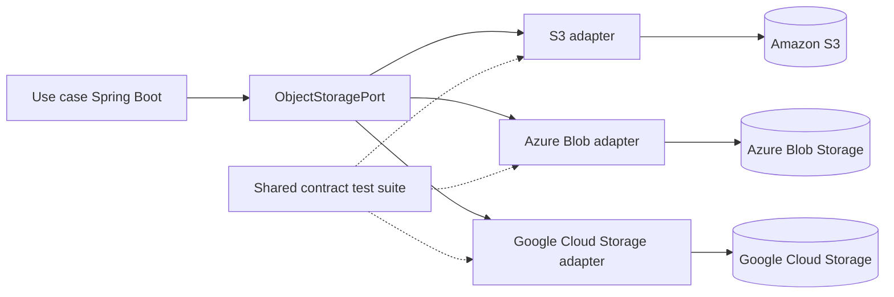
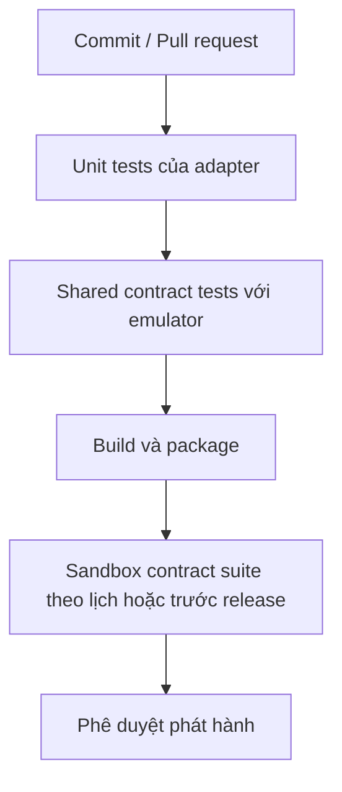

# Kiểm thử cùng hợp đồng trên nhiều adapter

Khi một ứng dụng Spring Boot cần chạy trên AWS, Microsoft Azure hoặc Google Cloud, nhóm thường xây dựng nhiều adapter để kết nối tới các dịch vụ managed tương ứng. Ví dụ, cùng một nghiệp vụ lưu tài liệu có thể dùng Amazon S3, Azure Blob Storage hoặc Google Cloud Storage. Mỗi SDK có kiểu dữ liệu, exception, cơ chế phân trang và cấu hình riêng. Nếu chỉ kiểm thử từng adapter bằng những bộ test khác nhau, một adapter có thể vô tình xử lý khác với các adapter còn lại dù ứng dụng kỳ vọng cùng một hành vi.

Contract testing giải quyết vấn đề này bằng cách mô tả hành vi mà ứng dụng yêu cầu từ một cổng dịch vụ (port), sau đó chạy cùng một bộ kiểm thử trên từng adapter. Bộ test xác nhận các adapter tuân thủ cùng hợp đồng ở ranh giới ứng dụng. Các khác biệt riêng của nhà cung cấp vẫn được kiểm thử bổ sung bằng test chuyên biệt.

Bài học này xây dựng một contract suite cho object storage trong Spring Boot, mở rộng cách tiếp cận sang messaging và database, và trình bày cách chạy test với emulator cùng môi trường cloud sandbox. Mục tiêu là giúp nhóm thay đổi hoặc bổ sung cloud provider mà không làm thay đổi hành vi nghiệp vụ ngoài dự kiến.

## Mục tiêu

Sau bài học, bạn có thể:

- Phân biệt hợp đồng nghiệp vụ, API của SDK và hành vi riêng của nhà cung cấp.
- Thiết kế port có ngữ nghĩa rõ ràng để nhiều adapter cùng triển khai.
- Viết một bộ contract test có thể chạy trên adapter AWS, Azure và Google Cloud.
- Kiểm tra kết quả, lỗi, metadata, phân trang, idempotency và nhất quán theo yêu cầu.
- Kết hợp unit test, emulator test và kiểm thử tích hợp trên cloud sandbox.
- Tách các capability không đồng nhất khỏi hợp đồng chung.
- Tích hợp contract suite vào pipeline CI để phát hiện sai lệch khi nâng SDK hoặc thay adapter.

## 1. Hợp đồng nằm ở ranh giới nào?

Trong kiến trúc ports and adapters, phần nghiệp vụ gọi một interface do ứng dụng sở hữu. Adapter chuyển lời gọi đó thành API cụ thể của nhà cung cấp.



Hợp đồng nên mô tả điều mà use case cần, chẳng hạn:

- Khi lưu một object, nội dung và content type phải được giữ đúng.
- Khi đọc một key không tồn tại, port trả về kết quả “không tìm thấy” theo quy ước.
- Khi liệt kê theo prefix, chỉ trả về key phù hợp và hỗ trợ tiếp tục qua nhiều trang.
- Xóa một key đã xóa trước đó vẫn cho kết quả thành công nếu nghiệp vụ yêu cầu delete idempotent.
- Lỗi quyền truy cập và lỗi dịch vụ không được giả thành “object không tồn tại”.

Hợp đồng không nên sao chép nguyên xi tên method hoặc exception của SDK. Nếu interface trả `S3Exception`, `BlobStorageException` hay một kiểu exception riêng của Google Cloud, use case sẽ bị phụ thuộc vào nhà cung cấp và việc thay adapter không còn minh bạch.

### 1.1. Phân biệt ba lớp kiểm thử

| Lớp | Điều được xác nhận | Ví dụ |
|---|---|---|
| Unit test của adapter | Chuyển đổi tham số, metadata, response và exception giữa port với SDK. | HTTP 403 từ SDK được ánh xạ thành `StorageAccessDeniedException`. |
| Shared contract test | Mọi adapter thực hiện cùng hành vi mà ứng dụng đã cam kết. | Ghi rồi đọc lại phải trả đúng byte và content type. |
| Provider-specific integration test | Khả năng hoặc giới hạn riêng của dịch vụ được cấu hình đúng. | S3 lifecycle, Azure lease hoặc GCS generation precondition. |

Contract suite không thay thế unit test hay provider-specific test. Nó là bộ kiểm tra chung tại ranh giới mà các adapter phải cùng tuân thủ.

## 2. Thiết kế một port có hợp đồng rõ ràng

Ví dụ dưới đây dùng object storage vì cùng một nhóm nghiệp vụ có thể được triển khai trên cả ba nhà cung cấp. Interface chỉ đưa ra các thao tác ứng dụng cần dùng.

```java
import java.util.List;
import java.util.Optional;

public interface ObjectStoragePort {
    void put(String key, byte[] content, String contentType);

    Optional<StoredObject> find(String key);

    ListPage list(
            String prefix,
            Optional<String> continuationToken,
            int pageSize);

    void delete(String key);
}

public record StoredObject(byte[] content, String contentType) {
}

public record ListPage(
        List<String> keys,
        Optional<String> nextToken) {
    public ListPage {
        keys = List.copyOf(keys);
        nextToken = nextToken == null ? Optional.empty() : nextToken;
    }
}
```

Đây là hợp đồng mẫu, không phải API chung bắt buộc cho mọi ứng dụng. Một hệ thống có thể dùng stream thay cho `byte[]` để xử lý file lớn; khi đó hợp đồng cần quy định rõ ai đóng stream, cách xử lý lỗi giữa luồng và giới hạn bộ nhớ. Một hệ thống khác có thể không cần `list` vì chỉ truy cập object qua key đã biết.

### 2.1. Viết rõ ngữ nghĩa trước khi viết test

| Hành vi | Quy ước trong ví dụ | Điều cần kiểm tra |
|---|---|---|
| Key | Chuỗi UTF-8 không rỗng, theo quy tắc ký tự của ứng dụng. | Key được lưu và đọc lại chính xác. |
| Ghi trùng key | Lần ghi sau thay thế nội dung trước theo semantics của port. | Ghi hai lần rồi đọc phải nhận nội dung lần hai. |
| Content type | Metadata do ứng dụng cung cấp được lưu và trả lại. | Giá trị đọc lại khớp giá trị đã ghi. |
| Không tìm thấy | `find` trả `Optional.empty()`. | Không ném lỗi “dịch vụ không khả dụng” cho trường hợp 404/Not Found. |
| Không đủ quyền | Ném exception nghiệp vụ đã chuẩn hóa. | Không trả `Optional.empty()` hoặc thành công giả. |
| Liệt kê | Prefix là điều kiện lọc; token phân trang là opaque. | Không bỏ sót, lặp key hoặc trả key ngoài prefix khi duyệt hết trang. |
| Xóa | Idempotent nếu đó là yêu cầu của port. | Xóa hai lần không làm use case thất bại. |

Các quy ước phải phản ánh yêu cầu thật của sản phẩm. Ví dụ, không nên cam kết ghi trùng key luôn thay thế nếu use case cần versioning hoặc compare-and-set. Hãy đưa semantics cần thiết vào interface và test tương ứng.

### 2.2. Định nghĩa lỗi ở mức ứng dụng

Adapter nên ánh xạ lỗi SDK thành một nhóm lỗi ổn định. Có thể dùng các kiểu sau:

```java
public class StorageAccessDeniedException extends RuntimeException {
    public StorageAccessDeniedException(String message, Throwable cause) {
        super(message, cause);
    }
}

public class StorageUnavailableException extends RuntimeException {
    public StorageUnavailableException(String message, Throwable cause) {
        super(message, cause);
    }
}

public class StorageOperationException extends RuntimeException {
    public StorageOperationException(String message, Throwable cause) {
        super(message, cause);
    }
}
```

Adapter có thể nhận 404/Not Found và trả `Optional.empty()`, ánh xạ 403/AccessDenied thành `StorageAccessDeniedException`, còn timeout hoặc lỗi dịch vụ tạm thời thành `StorageUnavailableException`. Mã lỗi và exception cụ thể phụ thuộc SDK; không bắt mọi exception rồi trả về kết quả rỗng vì như vậy sẽ che giấu sự cố quyền hoặc mạng.

## 3. Xây dựng shared contract test suite

JUnit 5 cho phép đặt các test dùng chung trong một abstract base class. Mỗi test class cụ thể chỉ cần cấu hình Spring context để cung cấp adapter tương ứng. Các method test được kế thừa và chạy cho từng provider.

### 3.1. Base class cho contract test

```java
import static org.assertj.core.api.Assertions.assertThat;

import java.util.ArrayList;
import java.util.List;
import java.util.Optional;
import java.util.UUID;

import org.junit.jupiter.api.AfterEach;
import org.junit.jupiter.api.BeforeEach;
import org.junit.jupiter.api.Test;
import org.springframework.beans.factory.annotation.Autowired;

abstract class ObjectStorageContractTest {
    @Autowired
    protected ObjectStoragePort storage;

    private String root;
    private String prefix;

    @BeforeEach
    void createTestPrefix() {
        root = "contract-tests/" + UUID.randomUUID() + "/";
        prefix = root + "matching/";
    }

    @AfterEach
    void removeTestObjects() {
        List<String> keysToDelete = new ArrayList<>();
        Optional<String> token = Optional.empty();

        do {
            ListPage page = storage.list(root, token, 100);
            keysToDelete.addAll(page.keys());
            token = page.nextToken();
        } while (token.isPresent());

        keysToDelete.forEach(storage::delete);
    }

    @Test
    void storesAndReadsExactContentAndMetadata() {
        String key = prefix + "invoice.txt";
        byte[] expected = "invoice-2026".getBytes(java.nio.charset.StandardCharsets.UTF_8);

        storage.put(key, expected, "text/plain");

        StoredObject actual = storage.find(key).orElseThrow();
        assertThat(actual.content()).containsExactly(expected);
        assertThat(actual.contentType()).isEqualTo("text/plain");
    }

    @Test
    void returnsEmptyWhenObjectDoesNotExist() {
        assertThat(storage.find(prefix + "missing.txt")).isEmpty();
    }

    @Test
    void laterWriteReplacesEarlierContent() {
        String key = prefix + "replace.txt";
        storage.put(key, new byte[] {1, 2}, "application/octet-stream");
        storage.put(key, new byte[] {7, 8, 9}, "application/octet-stream");

        assertThat(storage.find(key).orElseThrow().content())
                .containsExactly(7, 8, 9);
    }

    @Test
    void deleteIsIdempotent() {
        String key = prefix + "delete.txt";
        storage.put(key, new byte[] {1}, "application/octet-stream");

        storage.delete(key);
        storage.delete(key);

        assertThat(storage.find(key)).isEmpty();
    }

    @Test
    void listsOnlyMatchingKeysAcrossPages() {
        String first = prefix + "a.txt";
        String second = prefix + "b.txt";
        String third = prefix + "c.txt";
        storage.put(first, new byte[] {1}, "application/octet-stream");
        storage.put(second, new byte[] {2}, "application/octet-stream");
        storage.put(third, new byte[] {3}, "application/octet-stream");
        storage.put(root + "outside/other.txt", new byte[] {4},
                "application/octet-stream");

        List<String> actual = new ArrayList<>();
        Optional<String> token = Optional.empty();

        for (int pageNumber = 0; pageNumber < 10; pageNumber++) {
            ListPage page = storage.list(prefix, token, 2);
            assertThat(page.keys()).hasSizeLessThanOrEqualTo(2);
            actual.addAll(page.keys());
            token = page.nextToken();
            if (token.isEmpty()) {
                break;
            }
        }

        assertThat(token).isEmpty();
        assertThat(actual).containsExactlyInAnyOrder(first, second, third);
        assertThat(actual).doesNotHaveDuplicates();
    }
}
```

Bộ test trên xác nhận một số invariant quan trọng: round-trip byte, metadata, missing object, overwrite, delete idempotency và pagination. Prefix UUID giúp mỗi lần chạy có vùng dữ liệu riêng. Phần cleanup thu thập key trước rồi mới xóa để tránh thay đổi tập kết quả trong lúc đang duyệt trang.

Trong hệ thống thật, cần bổ sung timeout cho test, giới hạn số trang cleanup, và một cơ chế dọn rác theo tuổi cho dữ liệu test còn sót lại nếu pipeline bị hủy đột ngột. Không dùng bucket/container production cho contract test.

### 3.2. Chạy cùng suite cho từng adapter

Mỗi provider test class chỉ chọn cấu hình và adapter cần kiểm tra:

```java
import org.springframework.boot.test.context.SpringBootTest;
import org.springframework.test.context.ActiveProfiles;

@SpringBootTest(properties = "app.storage.provider=s3")
@ActiveProfiles("contract-aws")
class S3ObjectStorageContractTest extends ObjectStorageContractTest {
}

@SpringBootTest(properties = "app.storage.provider=azure-blob")
@ActiveProfiles("contract-azure")
class AzureBlobStorageContractTest extends ObjectStorageContractTest {
}

@SpringBootTest(properties = "app.storage.provider=gcs")
@ActiveProfiles("contract-gcp")
class GcsObjectStorageContractTest extends ObjectStorageContractTest {
}
```

Các profile cung cấp endpoint, bucket/container, credential và cấu hình test riêng. Test class không cần viết lại các assertion. Nếu adapter không thể được tạo vì thiếu credential hoặc endpoint, test phải thất bại rõ ràng thay vì bỏ qua một cách âm thầm.

### 3.3. Chọn adapter bằng cấu hình Spring

Ứng dụng có thể đăng ký adapter theo property. Ví dụ rút gọn cho S3:

```java
import org.springframework.boot.autoconfigure.condition.ConditionalOnProperty;
import org.springframework.context.annotation.Bean;
import org.springframework.context.annotation.Configuration;

@Configuration(proxyBeanMethods = false)
class ObjectStorageAdapterConfiguration {
    @Bean
    @ConditionalOnProperty(
            prefix = "app.storage",
            name = "provider",
            havingValue = "s3")
    ObjectStoragePort s3StoragePort(S3Client client, StorageProperties properties) {
        return new S3ObjectStorageAdapter(client, properties.bucket());
    }

    // Đăng ký AzureBlobStorageAdapter và GcsStorageAdapter theo cùng quy tắc.
}
```

Trong code production, có thể dùng configuration class riêng cho từng provider, tách dependency theo module và kiểm tra chỉ có đúng một bean `ObjectStoragePort` được đăng ký. Không nên để nhiều adapter cùng implement interface rồi phụ thuộc vào thứ tự component scan để Spring tự chọn.

## 4. Chạy contract test với emulator và cloud sandbox

Contract suite cần chạy trên từng adapter thật. Emulator giúp chạy nhanh và không phụ thuộc tài khoản cloud trong vòng phát triển thường ngày; sandbox xác nhận hành vi của dịch vụ managed thật.

### 4.1. Test local bằng emulator

| Provider | Dịch vụ ví dụ | Công cụ local thường dùng | Điều cần lưu ý |
|---|---|---|---|
| AWS | S3, SQS, SNS và một số API khác | LocalStack hoặc mock server phù hợp với SDK | Mức hỗ trợ API phụ thuộc phiên bản và cấu hình; IAM, network và quota thật có thể khác. |
| Azure | Blob Storage, Queue Storage | Azurite | Không phải mọi tính năng Azure Storage hoặc hành vi control plane đều được mô phỏng đầy đủ. |
| Google Cloud | Cloud Storage, Pub/Sub | Emulator chính thức khi dịch vụ cung cấp hoặc emulator tương thích như fake-gcs-server | Phạm vi tính năng, IAM và semantics có thể khác dịch vụ production. |

Emulator là môi trường kiểm thử adapter và luồng cơ bản. Nó không chứng minh quyền IAM/Entra ID/IAM của cloud thật, billing, throttling, độ trễ mạng, replication hoặc mọi edge case của dịch vụ. Ghi lại phiên bản emulator và SDK trong pipeline để kết quả có thể lặp lại.

### 4.2. Test tích hợp trên sandbox thật

Chạy shared contract suite định kỳ hoặc trước khi phát hành adapter trên tài khoản cloud thử nghiệm riêng. Mỗi provider cần:

- Bucket/container riêng cho test, với prefix duy nhất cho từng run.
- Credential ngắn hạn hoặc workload identity với quyền tối thiểu để tạo, đọc, liệt kê và xóa object test.
- Region và endpoint được khai báo rõ ràng.
- Timeout, retry và giới hạn số object để tránh tạo tải hoặc chi phí ngoài dự kiến.
- Lifecycle hoặc job cleanup để xóa dữ liệu còn sót lại.
- Log/trace có run ID để liên hệ test với tài nguyên được tạo.

Không đưa access key, client secret hoặc service account key vào source code hay file cấu hình commit. CI nên lấy credential từ secret store hoặc cơ chế identity federation của nền tảng chạy pipeline.

### 4.3. Cấu hình endpoint cho test

Có thể dùng property riêng cho endpoint và resource name:

```yaml
app:
  storage:
    provider: ${STORAGE_PROVIDER:s3}
    bucket: ${STORAGE_BUCKET:contract-test-bucket}
    endpoint: ${STORAGE_ENDPOINT:}
    path-style-access: ${STORAGE_PATH_STYLE:false}
```

Property `endpoint` và `path-style-access` chỉ áp dụng cho adapter/SDK hỗ trợ các tùy chọn đó. Không chuyển nguyên cấu hình S3 sang Azure hoặc GCS. Mỗi provider cần cấu hình riêng cho endpoint, project/account, container/bucket, credential và TLS. Với emulator, chỉ bật endpoint override trong profile test để không thể vô tình gửi dữ liệu production tới local service.

## 5. Kiểm tra capability khác nhau giữa các provider

Không phải mọi dịch vụ đều có cùng tính năng hoặc semantics. Nếu đưa tất cả tính năng riêng vào interface chung, port sẽ phình to và buộc adapter giả lập hành vi mà dịch vụ không hỗ trợ.

### 5.1. Tách hợp đồng cốt lõi và capability mở rộng

Ví dụ, hợp đồng cốt lõi có thể chỉ gồm put/find/list/delete. Các tính năng như retention lock, object versioning, lease, generation precondition, customer-managed encryption key hoặc event notification có thể được mô hình hóa thành capability riêng.

```java
import java.util.Set;

public enum StorageCapability {
    VERSIONING,
    CONDITIONAL_WRITE,
    RETENTION_POLICY,
    CUSTOMER_MANAGED_KEY,
    OBJECT_EVENTS
}

public interface StorageCapabilities {
    Set<StorageCapability> supportedCapabilities();
}
```

Use case cần tính năng nào phải kiểm tra capability trước khi chọn adapter hoặc khi khởi động ứng dụng. Có thể dùng một interface mở rộng riêng, chẳng hạn `VersionedObjectStoragePort`, để API của capability có kiểu dữ liệu và semantics cụ thể. Không trả `true` cho capability chỉ vì SDK có một method tương ứng; cần xác nhận dịch vụ, tier và cấu hình tài khoản thực sự hỗ trợ.

### 5.2. Ma trận capability

| Hành vi | Hợp đồng chung? | Cách kiểm thử |
|---|---|---|
| Ghi và đọc object | Có, nếu là yêu cầu của ứng dụng | Shared contract suite trên mọi adapter. |
| Liệt kê theo prefix và phân trang | Có, nếu use case cần | Kiểm tra token opaque, không trùng và không bỏ sót. |
| Xóa idempotent | Có thể cam kết ở port | Shared contract test và test lỗi provider. |
| Versioning | Tùy nhu cầu và dịch vụ | Capability test và provider-specific test. |
| Conditional write / compare-and-set | Tùy semantics | Kiểm tra precondition, race condition và mã conflict. |
| Retention lock / immutability | Tùy dịch vụ và policy | Test bảo vệ dữ liệu trên sandbox riêng, theo policy đã cấu hình. |
| Customer-managed key | Tùy cấu hình và quyền | Test encryption/decryption, key access và lỗi key bị thu hồi. |
| Event notification | Tùy dịch vụ | Test cấu hình event, delivery, retry và duplicate. |

Shared contract suite chỉ chứa hành vi mà mọi adapter bắt buộc phải đáp ứng. Test riêng cho capability được bật theo ma trận cấu hình và chỉ chạy ở provider có hỗ trợ.

### 5.3. Tránh ép các semantics khác nhau thành một kết quả giả

Ví dụ, thời gian nhất quán của object, thứ tự kết quả list, cách xử lý tên key, giới hạn object, mã lỗi và cách phân trang có thể khác nhau theo dịch vụ. Hợp đồng cần chọn mức bảo đảm ứng dụng thực sự cần:

- Nếu thứ tự list không quan trọng, assertion nên so sánh tập key thay vì thứ tự.
- Nếu cần read-after-write, ghi rõ thời điểm ứng dụng có thể đọc được và kiểm thử yêu cầu đó trên dịch vụ thật.
- Nếu cần ordering của message, chỉ cam kết theo phạm vi mà port có thể bảo đảm, chẳng hạn partition hoặc session key.
- Nếu cần exactly-once business effect, thiết kế idempotency và deduplication ở ứng dụng; không suy ra bảo đảm này chỉ từ một lần giao message.
- Nếu cần transaction đa tài nguyên, không giả định transaction của một database bao trùm object storage hoặc broker.

Contract test giúp phát hiện adapter vi phạm hợp đồng đã chọn. Nó không thể biến một dịch vụ eventual-consistent thành strongly-consistent hoặc tạo ra tính năng mà provider không cung cấp.

## 6. Mở rộng contract testing cho messaging

Với messaging, port có thể mô tả publish và receive/ack theo semantics mà ứng dụng yêu cầu. Một contract suite dùng chung có thể kiểm tra:

- Message gửi đi được consumer nhận với payload và header nghiệp vụ cần thiết.
- Message có correlation ID hoặc idempotency key được giữ nguyên.
- Ack thành công làm message không còn được giao lại theo semantics của broker.
- Message không ack có thể được giao lại sau visibility timeout hoặc lock expiry nếu port cam kết at-least-once.
- Lỗi xử lý có thể được đưa vào dead-letter theo policy đã cấu hình.

Không nên kiểm tra rằng message chỉ được giao đúng một lần nếu hệ thống dùng at-least-once delivery. Hãy viết consumer idempotent và kiểm tra hiệu quả nghiệp vụ khi cùng message được giao lại. Thời gian visibility, lock duration, ordering, dead-letter và batch size có thể khác giữa SQS, Azure Service Bus và Pub/Sub; các giá trị đó cần cấu hình và test theo capability hoặc provider-specific suite.

Ví dụ contract cho consumer có thể kiểm tra rằng khi message được xử lý lần đầu, handler ghi một business event; khi cùng message được giao lại, idempotency key ngăn tạo bản ghi trùng. Assertion tập trung vào kết quả nghiệp vụ, không phụ thuộc tên API acknowledge của SDK.

## 7. Mở rộng contract testing cho database

Với database, hợp đồng nên mô tả các thao tác nghiệp vụ và ràng buộc dữ liệu mà use case phụ thuộc. Ví dụ:

- Tạo và đọc lại entity theo khóa.
- Unique constraint hoặc quy tắc chống tạo trùng.
- Cập nhật có điều kiện theo version nếu ứng dụng dùng optimistic locking.
- Phân trang không bỏ sót bản ghi khi dữ liệu không thay đổi trong lúc đọc.
- Quy tắc thời gian, timezone, decimal precision, null và case sensitivity.
- Transaction atomicity trong phạm vi database hỗ trợ.

Không dùng một bộ test SQL chung để giả định mọi NoSQL provider có cùng transaction hoặc query semantics. Chọn hợp đồng nhỏ theo nghiệp vụ và tạo capability cho transaction, conditional write, change feed hoặc consistency level nếu cần. Khi một adapter không đáp ứng yêu cầu bắt buộc, ứng dụng cần từ chối cấu hình đó hoặc dùng một thiết kế khác.

## 8. Kiểm thử lỗi và khả năng phục hồi

Contract test cơ bản thường kiểm tra luồng thành công. Một suite đủ dùng trong production còn cần kiểm tra cách adapter phản ứng với lỗi.

| Tình huống | Kỳ vọng ở port | Cách tạo lỗi |
|---|---|---|
| Không tìm thấy object | Kết quả rỗng theo hợp đồng | Gọi key chưa tồn tại. |
| Không đủ quyền | Exception quyền truy cập chuẩn hóa | Credential thiếu quyền trên sandbox hoặc mock SDK response. |
| Timeout | Exception dịch vụ tạm thời hoặc lỗi timeout đã quy định | Mock transport hoặc fault injection. |
| Throttling | Lỗi/metadata có thể nhận diện để retry policy xử lý | Mock response throttling; test riêng trên sandbox nếu an toàn. |
| Payload không hợp lệ | Lỗi validation ổn định | Truyền key hoặc content type ngoài miền hợp đồng. |
| Lỗi khi upload stream | Tài nguyên được đóng và trạng thái lỗi được báo | InputStream giả lập ném IOException giữa chừng. |
| Conflict khi ghi có điều kiện | Kết quả conflict theo hợp đồng | Hai thao tác đồng thời hoặc precondition sai. |

Các test fault injection thường phù hợp với unit test của adapter vì dễ tái tạo lỗi. Sandbox integration test chỉ nên gây lỗi có kiểm soát, không tạo tải lớn hoặc làm hỏng dữ liệu dùng chung.

### 8.1. Chuẩn hóa retry ở đúng tầng

Không đặt retry độc lập ở nhiều lớp nếu chúng có thể nhân số attempt lên nhau. Ví dụ SDK đã retry ba lần, service wrapper lại retry ba lần và job queue tiếp tục giao lại nhiều lần; một thao tác nghiệp vụ có thể tạo số request lớn hơn dự tính.

Quy định rõ retry policy ở từng tầng, tổng timeout, loại lỗi retryable, backoff, jitter và idempotency. Contract suite xác nhận kết quả và exception ở port; unit test kiểm tra số lần thử và backoff; integration test xác nhận SDK/config thực tế không ghi đè policy ngoài dự kiến.

## 9. Tích hợp vào CI/CD

Một pipeline thực tế có thể chia thành nhiều tầng để cân bằng tốc độ và độ tin cậy:



Gợi ý cách tổ chức:

1. Chạy unit test của adapter trên mọi pull request.
2. Chạy shared contract suite trên emulator phù hợp cho từng provider trong CI.
3. Chạy provider-specific test cho capability được bật.
4. Chạy sandbox contract suite theo lịch, trước khi phát hành adapter mới hoặc sau khi nâng SDK quan trọng.
5. Lưu báo cáo test theo provider, adapter version, SDK version, region và emulator version.
6. Chặn phát hành nếu một adapter không đáp ứng hợp đồng bắt buộc hoặc sandbox test phát hiện sai lệch chưa được chấp nhận.

Có thể chia module theo provider để chỉ khởi động dependency cần thiết. Tuy nhiên, shared contract source nên được đặt ở một module test dùng chung hoặc test fixture artifact để tránh sao chép code test và làm các bộ test dần khác nhau.

### 9.1. Quản lý dữ liệu và tài nguyên test

- Dùng tên resource có run ID hoặc UUID để các job chạy song song không ghi đè dữ liệu của nhau.
- Chỉ cấp quyền trên bucket/container hoặc prefix dành riêng cho test.
- Thu thập danh sách resource được tạo và cleanup trong `finally` hoặc lifecycle hook.
- Có TTL/lifecycle để dọn dữ liệu còn sót khi runner bị hủy.
- Giới hạn kích thước payload, số object, số message và thời gian test.
- Đặt budget hoặc alert riêng cho tài khoản sandbox.
- Không chạy test xóa hàng loạt trên tài nguyên dùng chung.

### 9.2. Khi contract test thất bại

Khi một provider thất bại, điều tra theo thứ tự:

1. Xác nhận phiên bản adapter, SDK, emulator và cấu hình endpoint.
2. Kiểm tra input, output và exception đã chuẩn hóa tại port.
3. Đối chiếu raw request/response hoặc SDK diagnostic log đã được loại bỏ secret.
4. Xác định lỗi do mapping của adapter, cấu hình dịch vụ, quyền, capability hay thay đổi provider.
5. Nếu hành vi mới là chủ đích, cập nhật hợp đồng sau khi có quyết định kiến trúc và cập nhật test cho tất cả adapter.
6. Ghi lại provider/version có khác biệt và điều kiện triển khai tương ứng.

Không bỏ qua test chỉ vì một provider có hành vi khác. Trước hết xác định đó là khác biệt hợp lệ cần mô hình hóa thành capability hay là adapter đang vi phạm yêu cầu nghiệp vụ.

## 10. Những sai lầm thường gặp

| Sai lầm | Hệ quả | Cách khắc phục |
|---|---|---|
| Viết test riêng biệt cho từng adapter | Assertion dần khác nhau và không còn kiểm tra cùng hợp đồng | Dùng một shared contract suite. |
| Đưa type của SDK vào port | Nghiệp vụ phụ thuộc provider và khó thay adapter | Dùng domain type và exception do ứng dụng sở hữu. |
| Chỉ test happy path | Lỗi quyền, timeout và throttling bị ánh xạ sai | Bổ sung unit test lỗi và fault injection. |
| Giả định emulator tương đương cloud thật | Có thể bỏ sót IAM, network, quota và billing | Chạy sandbox integration test theo lịch hoặc trước release. |
| Ép mọi provider hỗ trợ mọi capability | Adapter giả lập hoặc báo thành công sai | Dùng capability riêng và kiểm tra trước khi sử dụng. |
| So sánh thứ tự list không được cam kết | Test flaky hoặc thất bại không có ý nghĩa nghiệp vụ | So sánh tập kết quả nếu ordering không thuộc hợp đồng. |
| Dùng resource test chung | Test song song ghi/xóa dữ liệu của nhau | Prefix duy nhất và scope quyền riêng. |
| Retry ở nhiều tầng | Số request tăng theo cấp số nhân khi lỗi | Chọn một chính sách retry có tổng timeout rõ ràng. |
| Không dọn dữ liệu test | Chi phí storage và rác test tăng dần | Cleanup, TTL và ngân sách sandbox. |

## 11. Checklist trước khi thêm hoặc thay adapter

- [ ] Port mô tả hành vi nghiệp vụ, kiểu dữ liệu và semantics rõ ràng.
- [ ] Exception SDK được ánh xạ sang lỗi do ứng dụng sở hữu.
- [ ] Shared contract suite chạy được với adapter hiện tại.
- [ ] Adapter mới chạy cùng suite và đạt toàn bộ assertion bắt buộc.
- [ ] Capability riêng được mô tả và kiểm thử riêng.
- [ ] Pagination, metadata, idempotency và lỗi quyền đã được xác nhận.
- [ ] Emulator và sandbox test có cấu hình tách biệt.
- [ ] Credential CI dùng identity phù hợp và quyền tối thiểu.
- [ ] Test resource có prefix riêng, cleanup và TTL.
- [ ] Pipeline lưu báo cáo theo provider, SDK và region.
- [ ] Thay đổi hợp đồng được review cùng các use case bị ảnh hưởng.

## Kết luận

Kiểm thử cùng hợp đồng giúp bảo đảm các adapter cloud thực hiện nhất quán hành vi mà ứng dụng Spring Boot cần. Hãy đặt hợp đồng ở port do ứng dụng sở hữu, viết một shared contract suite và chạy suite đó trên từng adapter AWS, Azure và Google Cloud. Dùng emulator để kiểm tra nhanh, sandbox thật để xác nhận tích hợp, và provider-specific test cho capability riêng. Khi hợp đồng, capability, lỗi và dữ liệu test được quản lý rõ ràng, nhóm có thể thay đổi cloud provider mà vẫn kiểm soát được hành vi và rủi ro của hệ thống.
