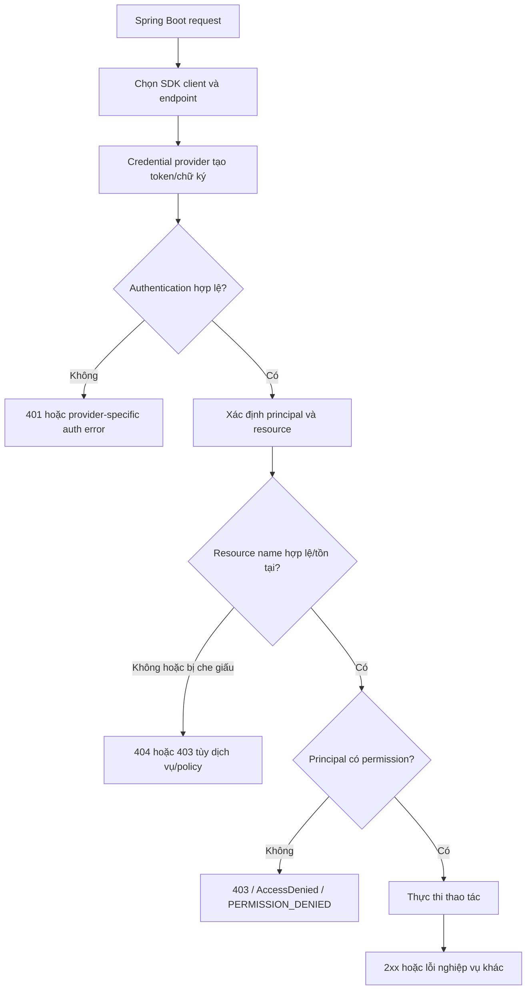

# Phân biệt lỗi xác thực, thiếu quyền và tài nguyên không tồn tại

Khi Spring Boot gọi AWS, Azure hoặc Google Cloud, ba lỗi dễ bị nhầm nhất là **authentication failure**, **authorization denial** và **resource not found**. Cả ba đều làm request thất bại, nhưng nguyên nhân và cách khắc phục khác nhau:

- **Authentication (xác thực):** dịch vụ không chấp nhận danh tính hoặc bằng chứng xác thực của request. Ví dụ token hết hạn, chữ ký sai, credential không hợp lệ hoặc thiếu Authorization header.
- **Authorization (phân quyền):** dịch vụ đã nhận diện caller nhưng principal không có permission cần thiết, hoặc một policy/network rule từ chối thao tác.
- **Resource not found (không tìm thấy tài nguyên):** request đã tới đúng dịch vụ nhưng tên, đường dẫn, namespace, bucket, topic, container hoặc object không tồn tại trong phạm vi đang truy vấn.

Không thể phân loại chính xác chỉ bằng HTTP status. AWS S3 có thể trả 403 thay cho 404 nếu caller không có quyền liệt kê bucket; Azure Blob có mã AuthenticationFailed ở HTTP 403; Google Cloud Storage có thể trả 403 cho project không tồn tại hoặc caller không được phép liệt kê bucket. Phải đọc cả error code, message, resource identifier, request ID và danh tính thực tế.

Bài này hướng dẫn phân loại lỗi theo từng provider, kiểm tra IAM/RBAC ở đúng scope, xử lý trường hợp dịch vụ cố ý che giấu sự tồn tại của resource và thiết kế exception handling trong Spring Boot để không cấp quyền quá rộng hoặc retry vô ích.

## 1. Ba nhóm lỗi và cách nhận diện

| Nhóm lỗi | Câu hỏi cốt lõi | Dấu hiệu thường gặp | Hướng xử lý |
| --- | --- | --- | --- |
| Authentication | Request có chứng minh được danh tính hợp lệ không? | Token thiếu/hết hạn, signature sai, invalid key, credential chain không tìm thấy identity | Kiểm tra credential source, token audience/expiry, chữ ký, clock và endpoint |
| Authorization | Principal đã xác thực có quyền thực hiện action trên resource không? | AccessDenied, Forbidden, PERMISSION_DENIED, AuthorizationPermissionMismatch | Xác minh principal, permission, policy và scope resource |
| Resource not found | Resource có tồn tại tại đúng endpoint và tên đầy đủ không? | NoSuchBucket, NoSuchKey, BlobNotFound, ContainerNotFound, MessagingEntityNotFound, NOT_FOUND | Kiểm tra resource ID, account/project/region/namespace và trạng thái resource |

HTTP status là tín hiệu ban đầu, không phải kết luận cuối cùng:

| HTTP/gRPC status | Ý nghĩa phổ biến | Lưu ý |
| --- | --- | --- |
| HTTP 401 / gRPC UNAUTHENTICATED | Request thiếu hoặc có credential không hợp lệ | Một số dịch vụ cloud dùng mã 403 cho lỗi chữ ký/token |
| HTTP 403 / gRPC PERMISSION_DENIED | Caller không được phép thực hiện thao tác | Có thể là IAM, resource policy, deny policy, SAS scope, firewall hoặc project không truy cập được |
| HTTP 404 / gRPC NOT_FOUND | Endpoint, method hoặc resource không tồn tại | Một số dịch vụ che giấu resource để tránh tiết lộ dữ liệu |
| HTTP 400 | Request, header, chữ ký hoặc resource name sai định dạng | Không nên mặc định đây là lỗi nghiệp vụ |
| HTTP 409 | Trạng thái resource xung đột hoặc resource đã tồn tại | Đọc error code chi tiết |
| HTTP 429 | Quota/rate limit | Có thể retry theo backoff và retry-after |
| HTTP 5xx | Lỗi phía dịch vụ hoặc gateway | Retry có giới hạn nếu thao tác an toàn |

### 1.1. Một request có nhiều lớp kiểm tra

Một thao tác upload object có thể đi qua các lớp sau:



Ví dụ, một service account có thể xác thực thành công nhưng không có storage.objects.create trên bucket. Đây là lỗi authorization. Nếu bucket name sai, request có thể trả not found hoặc permission denied tùy API và quyền mà caller đang có.

### 1.2. Phân biệt control plane và data plane

Một số cloud có hai mặt API với quyền khác nhau:

- **Control plane:** tạo, sửa, xóa hoặc cấu hình resource như storage account, namespace, bucket, subscription resource hoặc database instance.
- **Data plane:** đọc/ghi nội dung thực tế như blob, message, object, row hoặc secret value.

Có quyền quản lý resource không đồng nghĩa có quyền đọc/ghi dữ liệu. Ví dụ Azure subscription Contributor có thể quản lý cấu hình Storage Account nhưng không tự cấp Blob Data Reader; Google Cloud project Editor không nên được dùng làm cách sửa lỗi thiếu quyền object; AWS IAM permission trên bucket cũng có thể cần KMS key policy riêng.

Khi một thao tác quản trị thành công nhưng upload/download thất bại, xác định API đang gọi thuộc control plane hay data plane trước khi sửa role.

## 2. Thu thập bằng chứng trước khi thay IAM policy

Khi request lỗi, ghi lại các thông tin sau ở phía server:

1. Provider và dịch vụ: S3, SQS, Azure Blob, Service Bus, Cloud Storage, Pub/Sub...
2. Operation: GetObject, PutObject, GetBlob, SendMessage, storage.objects.get...
3. HTTP status hoặc gRPC status.
4. Error code cụ thể trong response body/header.
5. Resource identifier đầy đủ: account, region, bucket, object, subscription, namespace, project, topic hoặc secret.
6. Principal đã ký request, nếu có thể xác minh an toàn.
7. Request/correlation ID do cloud provider trả về.
8. Thời điểm request và deployment/revision đang chạy.
9. Endpoint, region và tenant/project context.
10. Policy hoặc role assignment liên quan tới operation.

Không ghi access token, secret key, SAS token đầy đủ, connection string hoặc private key. Nếu cần điều tra credential, log nguồn credential hoặc principal đã xác minh, không log nội dung bí mật.

Một message chung như Forbidden thường không đủ để sửa lỗi. AWS S3 trả Code, Message, RequestId; Azure Storage trả error code cùng x-ms-request-id; Google Cloud trả status, message, details và có thể có ErrorInfo. Giữ lại các trường này trong log nội bộ để đối chiếu audit log của provider.

## 3. AWS: phân biệt authentication, AccessDenied và NoSuchResource

### 3.1. Authentication failure trong AWS

AWS SDK ký request bằng credentials và signing process. Những lỗi thường gặp:

| Error code/message | Nguyên nhân có thể | Kiểm tra |
| --- | --- | --- |
| InvalidAccessKeyId | Access key ID không tồn tại, sai account hoặc đã bị vô hiệu hóa | Kiểm tra credential source đang được SDK chọn |
| SignatureDoesNotMatch | Secret key sai, canonical request khác, region/service signing scope sai hoặc request bị sửa | Kiểm tra system time, region, endpoint, proxy và key source |
| ExpiredToken | Session token hết hạn | Dùng provider hỗ trợ refresh hoặc cấp lại session credentials |
| InvalidToken | Session/web identity token không hợp lệ | Kiểm tra token file, trust relationship và thời hạn |
| UnrecognizedClientException | Credential/signature không được dịch vụ chấp nhận | Kiểm tra account, key, signing region và SDK configuration |
| AuthorizationHeaderMalformed | Authorization header hoặc credential scope không đúng | Kiểm tra region/endpoint và signing configuration |
| Không tìm thấy credentials | SDK provider chain không lấy được identity | Kiểm tra system properties, environment, profile, web identity, ECS/EC2 role |

AWS thường trả 403 cho AccessDenied; không nên mong đợi mọi lỗi xác thực sẽ luôn là HTTP 401. Hãy dựa vào mã lỗi và nội dung của SDK exception.

Xác minh principal bằng STS:

```bash
aws sts get-caller-identity
```

Lệnh này cho biết account, ARN và user ID của caller trong AWS CLI session. Để chắc chắn Java client dùng cùng credentials, tạo STS client bằng chính AwsCredentialsProvider được inject vào S3/SQS client và gọi GetCallerIdentity.

### 3.2. Authorization failure: AccessDenied

AWS S3 trả AccessDenied với HTTP 403 khi principal không được phép thực hiện operation. Kiểm tra theo thứ tự:

- Identity policy của IAM user/role.
- Bucket policy hoặc access point policy.
- Explicit deny trong policy.
- Service Control Policy (SCP) ở AWS Organizations.
- Permissions boundary và session policy.
- VPC endpoint policy nếu request đi qua VPC endpoint.
- Object Ownership/ACL nếu bucket còn sử dụng ACL.
- KMS key policy và kms:Decrypt/kms:GenerateDataKey khi object dùng SSE-KMS.
- Condition theo prefix, tag, encryption header, source VPC/IP hoặc TLS.

Ví dụ các action thường gặp:

| Operation | Permission điển hình |
| --- | --- |
| Đọc object | s3:GetObject |
| Ghi object | s3:PutObject |
| Xóa object | s3:DeleteObject |
| Liệt kê object trong bucket | s3:ListBucket |
| Đọc metadata object bằng HeadObject | s3:GetObject |
| Đọc checksum của object SSE-KMS trong một số trường hợp | Có thể cần thêm quyền KMS như kms:GenerateDataKey và kms:Decrypt |

Không cấp s3:* hoặc AdministratorAccess chỉ để làm cho một request chạy được. Cấp đúng action trên đúng bucket/prefix và kiểm tra KMS key riêng nếu có.

### 3.3. NoSuchBucket, NoSuchKey và trường hợp 403 giả dạng 404

S3 thường dùng các mã:

- NoSuchBucket: bucket không tồn tại hoặc tên/endpoint/account không đúng.
- NoSuchKey: object key không tồn tại trong bucket.
- NoSuchUpload: multipart upload ID không còn hợp lệ.
- NoSuchVersion: version ID không tồn tại hoặc không thuộc object đó.

Điểm đặc biệt quan trọng: với HeadObject, nếu object không tồn tại:

- Caller có s3:ListBucket trên bucket: S3 trả 404 Not Found.
- Caller không có s3:ListBucket: S3 trả 403 Forbidden.

Vì vậy, 403 từ HeadObject không chứng minh object đang tồn tại và cũng không chứng minh credentials sai. Nó có thể là cách S3 không tiết lộ việc object có tồn tại hay không cho caller không được phép list bucket.

Với HeadBucket, S3 có thể trả 400, 403 hoặc 404 mà không có response body chi tiết nếu bucket không tồn tại hoặc caller không có quyền. Không thể suy ra nguyên nhân chính xác chỉ từ status.

### 3.4. Quy trình kiểm tra S3

Kiểm tra principal:

```bash
aws sts get-caller-identity
```

Kiểm tra bucket:

```bash
aws s3api head-bucket --bucket orders-archive
```

Kiểm tra object metadata:

```bash
aws s3api head-object --bucket orders-archive --key invoices/2026/INV-001.pdf
```

Liệt kê object chỉ khi caller được cấp s3:ListBucket:

```bash
aws s3api list-objects-v2 --bucket orders-archive --prefix invoices/2026/
```

Các lệnh phải chạy bằng đúng profile/role và region mà ứng dụng sử dụng. Nếu AWS CLI thành công nhưng Java SDK thất bại, kiểm tra provider chain và region của Java process.

Khi cần phân biệt NoSuchKey với AccessDenied, đừng cấp s3:ListBucket rộng cho mọi caller. Nếu ứng dụng cần hiển thị trạng thái tồn tại, thiết kế một service/backend có quyền tra cứu giới hạn và trả kết quả theo chính sách bảo mật.

### 3.5. Đọc request ID từ AWS SDK for Java 2.x

AWS SDK exception có thể cung cấp status code, error code và request ID:

```java
try {
    s3Client.headObject(request -> request
            .bucket("orders-archive")
            .key("invoices/2026/INV-001.pdf"));
} catch (S3Exception ex) {
    String errorCode = ex.awsErrorDetails() == null
            ? "Unknown"
            : ex.awsErrorDetails().errorCode();

    log.warn("S3 request failed: status={}, code={}, requestId={}",
            ex.statusCode(), errorCode, ex.requestId());
    throw ex;
}
```

Không dùng message để phân loại bằng cách so sánh chuỗi tiếng Anh nếu SDK đã cung cấp error code. Message có thể thay đổi hoặc chứa thông tin resource nhạy cảm.

## 4. Azure: AuthenticationFailed, AuthorizationPermissionMismatch và ResourceNotFound

### 4.1. Azure Storage có thể trả 403 cho lỗi xác thực

Azure Blob Storage không phải lúc nào cũng dùng 401 cho lỗi xác thực. Một số trường hợp:

| Error code | HTTP status thường gặp | Ý nghĩa |
| --- | --- | --- |
| NoAuthenticationInformation | 401 | Request thiếu thông tin xác thực |
| InvalidAuthenticationInfo | 401 hoặc 400 tùy dạng request | Authorization header hoặc thông tin xác thực sai định dạng |
| AuthenticationFailed | 403 | Chữ ký, account key, SAS hoặc authentication information không được chấp nhận |
| KeyBasedAuthenticationNotPermitted | 403 | Storage Account chặn shared key authentication |
| AuthorizationPermissionMismatch | 403 | SAS hoặc principal thiếu permission cần cho operation |
| AuthorizationFailure | 403 | Có thể do network/firewall/public access restrictions hoặc policy |
| ResourceNotFound | 404 | Resource không tồn tại |
| BlobNotFound | 404 | Blob không tồn tại |
| ContainerNotFound | 404 | Container không tồn tại |

Nếu Azure trả 403 AuthenticationFailed, đừng vội cấp thêm RBAC role. Trước tiên kiểm tra token/SAS/account key, signature, start/expiry time, clock skew và authentication mode.

### 4.2. Authorization trong Azure: role và scope

Với Microsoft Entra ID, principal có thể đã lấy token hợp lệ nhưng thiếu data-plane role.

Ví dụ Blob Storage:

- Đọc blob: Storage Blob Data Reader hoặc role hẹp hơn có permission tương ứng.
- Ghi/xóa blob: Storage Blob Data Contributor hoặc role phù hợp.
- Quản lý quyền sở hữu dữ liệu: Storage Blob Data Owner khi thực sự cần.

Với Azure Service Bus:

- Gửi message: Azure Service Bus Data Sender.
- Nhận message: Azure Service Bus Data Receiver.
- Quản lý data-plane rộng hơn: Azure Service Bus Data Owner.

Role assignment có thể được cấp ở management group, subscription, resource group, namespace/storage account hoặc scope hẹp hơn nếu dịch vụ hỗ trợ. Kiểm tra principal object ID, tenant, role và scope. Đừng nhầm Azure subscription Contributor với data-plane role.

Azure Storage còn có thể từ chối request vì:

- Storage Account firewall hoặc network rule.
- Public network access bị tắt.
- Private endpoint/DNS không đúng.
- IP không nằm trong allowlist.
- SAS thiếu quyền, sai service/resource type, sai protocol hoặc sai IP range.
- Shared Key authentication bị tắt ở Storage Account.
- Encryption scope, customer-managed key hoặc Key Vault policy không cho phép.

Đặc biệt, AuthorizationFailure không nhất thiết là thiếu RBAC; kiểm tra network và account policy trước khi sửa role.

### 4.3. BlobNotFound và ContainerNotFound

Nếu nhận 404, kiểm tra:

1. Storage account endpoint đúng subscription/tenant/cloud chưa.
2. Container name có đúng chữ thường/đúng quy tắc naming không.
3. Blob name có đúng dấu /, URL encoding và prefix không.
4. Ứng dụng có đang dùng account khác do endpoint hoặc credential source không.
5. Resource đã bị xóa, đổi tên hoặc lifecycle policy di chuyển/xóa chưa.
6. Đang gọi Blob service hay DFS endpoint cho Data Lake Gen2.

Blob name là chuỗi key; một dấu / hoặc URL encoding khác nhau có thể tạo ra một object khác. Kiểm tra tên resource chính xác trước khi kết luận dữ liệu bị mất.

### 4.4. Kiểm tra Azure CLI và role assignment

Xem tenant/subscription hiện tại:

```bash
az account show --query "{tenantId:tenantId, subscriptionId:id, name:name}" --output json
```

Liệt kê role assignment ở scope cụ thể:

```bash
az role assignment list \
  --assignee PRINCIPAL_OBJECT_ID \
  --scope "/subscriptions/SUBSCRIPTION_ID/resourceGroups/rg-orders/providers/Microsoft.Storage/storageAccounts/ordersarchive" \
  --include-inherited \
  --all \
  --output table
```

Lệnh này giúp kiểm tra role assignment được cấp ở scope và cấp cha. Đối chiếu đúng principal object ID, không chỉ display name.

Thử đọc metadata blob bằng Microsoft Entra login nếu Azure CLI và quyền data-plane đã được cấu hình:

```bash
az storage blob show \
  --account-name ordersarchive \
  --container-name invoices \
  --name "2026/INV-001.pdf" \
  --auth-mode login
```

Nếu CLI trả lỗi tương tự, vấn đề nhiều khả năng ở identity, RBAC, SAS/network hoặc resource. Nếu CLI thành công nhưng Java SDK lỗi, kiểm tra TokenCredential, tenant/client ID, endpoint và credential chain của Java process.

### 4.5. Đọc error code và request ID trong Java SDK

Azure Blob SDK cung cấp BlobStorageException với status và error code:

```java
try {
    blobClient.getProperties();
} catch (BlobStorageException ex) {
    String errorCode = ex.getErrorCode();
    int status = ex.getStatusCode();

    String requestId = ex.getResponse() == null
            ? null
            : ex.getResponse().getHeaders().getValue("x-ms-request-id");

    log.warn("Azure Blob request failed: status={}, code={}, requestId={}",
            status, errorCode, requestId);
    throw ex;
}
```

Request ID có thể dùng để tìm chi tiết trong Azure resource logs hoặc trao đổi với Azure Support. Không log SAS query string, account key hoặc Authorization header.

### 4.6. Azure Service Bus: Unauthorized và MessagingEntityNotFound

Service Bus có nhóm lỗi riêng:

- Unauthorized hoặc authorization-related ServiceBusException: kiểm tra token, namespace, managed identity và role Sender/Receiver.
- MessagingEntityNotFound: queue/topic/subscription không tồn tại, sai tên hoặc đang trỏ nhầm namespace.
- MessagingEntityDisabled: entity tồn tại nhưng bị disable.
- ServiceTimeout hoặc communication exception: kiểm tra network, DNS, private endpoint, firewall và cổng AMQP.
- ServiceBusy: dịch vụ đang throttling/bận; SDK có retry theo policy.

Một lỗi Unauthorized trong Managed Identity flow không nhất thiết do queue không tồn tại. Kiểm tra role assignment trên namespace hoặc entity trước khi thay resource name.

## 5. Google Cloud: UNAUTHENTICATED, PERMISSION_DENIED và NOT_FOUND

### 5.1. UNAUTHENTICATED

Google Cloud API thường dùng gRPC canonical status UNAUTHENTICATED hoặc HTTP 401 khi request thiếu/không có credentials hợp lệ.

Nguyên nhân thường gặp:

- Không có Authorization Bearer token.
- OAuth access token hết hạn hoặc không refresh được.
- ADC chọn nhầm file credentials hoặc nguồn identity.
- External account/WIF configuration sai issuer, audience, subject token hoặc STS exchange.
- Token có audience/scope không phù hợp với API.
- Service account key đã bị vô hiệu hóa hoặc token không được chấp nhận.

Kiểm tra ADC source, không in access token. Với local, phân biệt gcloud auth list với gcloud auth application-default login; Java Cloud Client Libraries sử dụng ADC. Với production, kiểm tra service account gắn với Cloud Run/GCE/GKE hoặc external account credential configuration.

### 5.2. PERMISSION_DENIED

PERMISSION_DENIED (HTTP 403) nghĩa là principal không được phép thực hiện operation theo policy hiện hành. Tuy nhiên, nguyên nhân có thể là:

- Thiếu IAM permission trên bucket, object, topic, subscription, secret hoặc database.
- IAM Deny Policy chặn permission.
- IAM Condition không thỏa resource, thời gian, IP hoặc thuộc tính request.
- Organization Policy hoặc VPC Service Controls giới hạn truy cập.
- API chưa được enable hoặc quota project không được phép dùng.
- Request nhắm tới project khác với project mà caller có quyền.
- Resource không tồn tại nhưng API che giấu trạng thái đó khỏi caller thiếu quyền.

Một lỗi PERMISSION_DENIED cần được phân tích theo principal, permission, resource và policy. Không cấp roles/owner hoặc roles/editor để thử.

Ví dụ Cloud Storage:

| Operation | Permission thường cần |
| --- | --- |
| Đọc object | storage.objects.get |
| Tạo object | storage.objects.create |
| Ghi đè object | Có thể cần storage.objects.create và storage.objects.delete tùy operation |
| Xóa object | storage.objects.delete |
| Liệt kê object | storage.objects.list |
| Liệt kê bucket trong project | storage.buckets.list |

### 5.3. NOT_FOUND và project không tồn tại

Google Cloud thường trả NOT_FOUND/404 khi method hoặc resource không tồn tại. Nhưng Cloud Storage JSON API có hành vi cần lưu ý:

- 401 khi request cần xác thực nhưng thiếu authorization header.
- 403 khi caller không có permission; ví dụ list bucket trong project không tồn tại hoặc project mà caller không được phép list.
- 404 khi object được truy vấn không tồn tại.

Do đó, nếu bucket/project/object không được tìm thấy, không chỉ kiểm tra spelling. Hãy xác minh project ID, project number, bucket name, full resource name, API endpoint và principal. Một 403 có thể che giấu project không tồn tại hoặc caller không có quyền truy vấn.

### 5.4. Kiểm tra permission và Audit Logs

Khi gặp PERMISSION_DENIED, đọc error details nếu API trả về google.rpc.ErrorInfo, ví dụ:

- reason: loại lỗi.
- domain: dịch vụ phát sinh lỗi.
- metadata.permission: permission bị thiếu.
- metadata.resource: resource liên quan, nếu được cung cấp.

Cloud Audit Logs có thể cho biết principal thực hiện request, method, resource và trạng thái từ chối. Trường principal có thể là principalEmail hoặc principalSubject. Dùng IAM Policy Troubleshooter để kiểm tra một principal có permission trên resource cụ thể hay không.

Các lệnh xác minh project context:

```bash
gcloud config get-value project
gcloud projects describe PROJECT_ID
```

Kiểm tra identity CLI:

```bash
gcloud auth list
```

Nhớ rằng Java ADC có thể khác gcloud CLI identity. Nếu request Java lỗi nhưng CLI chạy được, hãy kiểm tra ADC/runtime identity trong chính môi trường ứng dụng.

### 5.5. Ví dụ xử lý StorageException trong Java

```java
try {
    Blob blob = storage.get("orders-archive", "invoices/2026/INV-001.pdf");

    if (blob == null) {
        throw new OrderDocumentNotFoundException();
    }
} catch (StorageException ex) {
    int status = ex.getCode();

    log.warn("Cloud Storage request failed: status={}, reason={}",
            status, ex.getReason());

    throw ex;
}
```

Với Google Cloud Storage Java Client, Storage.get(bucket, object) có thể trả null khi object không tồn tại trong trường hợp API xác định được not found. Nếu request bị từ chối, SDK có thể ném StorageException. Không biến mọi StorageException thành lỗi not found; phải kiểm tra status/reason và ngữ cảnh permission.

## 6. Ma trận so sánh lỗi giữa AWS, Azure và Google Cloud

| Tình huống | AWS | Azure | Google Cloud |
| --- | --- | --- | --- |
| Không có/credential không hợp lệ | InvalidAccessKeyId, SignatureDoesNotMatch, ExpiredToken; status tùy API | NoAuthenticationInformation, InvalidAuthenticationInfo, AuthenticationFailed | UNAUTHENTICATED / 401 |
| Đã xác thực nhưng thiếu quyền | AccessDenied / 403 | AuthorizationPermissionMismatch, AuthorizationFailure, Unauthorized / 403 | PERMISSION_DENIED / 403 |
| Resource không tồn tại | NoSuchBucket, NoSuchKey; có thể bị che thành 403 | BlobNotFound, ContainerNotFound, MessagingEntityNotFound | NOT_FOUND / 404 |
| Resource không tồn tại nhưng caller không được phép biết | S3 HeadObject có thể trả 403 nếu thiếu s3:ListBucket | Có thể bị policy/authorization trả 403; đọc error code cụ thể | Cloud Storage có thể trả 403 nếu caller thiếu permission, kể cả resource không tồn tại |
| Sai region/endpoint | AuthorizationHeaderMalformed, redirect hoặc endpoint mismatch | DNS/endpoint/cloud mismatch | Wrong endpoint, API path, project/resource mismatch |
| Network/firewall | VPC endpoint policy, endpoint/DNS/TLS | AuthorizationFailure, firewall, private endpoint, DNS | VPC Service Controls, firewall, Private Google Access, DNS/TLS |

Không ánh xạ lỗi theo một bảng HTTP cứng. Ví dụ 403 trong Azure Blob có thể là authentication failure, authorization failure hoặc network restriction. 403 trong AWS S3 có thể là AccessDenied hoặc cách dịch vụ che giấu object không tồn tại. Hãy dùng provider-specific error code làm nguồn phân loại chính.

## 7. Xử lý lỗi đúng trong Spring Boot

### 7.1. Giữ nguyên thông tin provider ở lớp tích hợp

Lớp adapter/repository nên chuyển exception SDK thành exception miền nghiệp vụ có ý nghĩa, đồng thời giữ lại cause và metadata phục vụ log:

- CloudAuthenticationException
- CloudPermissionDeniedException
- CloudResourceNotFoundException
- CloudRequestRejectedException
- CloudTransientException

Không để controller phải hiểu S3Exception, BlobStorageException hay StorageException. Cũng không được bỏ mất request ID và provider error code khi chuyển đổi exception.

### 7.2. Phân loại theo error code, không theo message tự do

Ví dụ AWS:

```java
GetObjectRequest request = GetObjectRequest.builder()
        .bucket(bucketName)
        .key(objectName)
        .build();

try {
    try (ResponseInputStream<GetObjectResponse> response =
            s3Client.getObject(request)) {
        // Đọc hoặc chuyển tiếp nội dung object.
    }
} catch (S3Exception ex) {
    String code = ex.awsErrorDetails() == null
            ? "Unknown"
            : ex.awsErrorDetails().errorCode();

    if ("NoSuchKey".equals(code) || "NoSuchBucket".equals(code)) {
        throw new CloudResourceNotFoundException("S3 resource not found", ex);
    }

    if ("AccessDenied".equals(code)) {
        throw new CloudPermissionDeniedException("S3 access denied", ex);
    }

    throw ex;
}
```

Lưu ý: AccessDenied ở thao tác HeadObject không chứng minh object tồn tại; có thể do caller thiếu s3:ListBucket. Chỉ chuyển thành lỗi permission sau khi đã hiểu semantics của operation và resource enumeration policy.

Ví dụ Azure Blob:

```java
import com.azure.storage.blob.models.BlobErrorCode;

try {
    blobClient.getProperties();
} catch (BlobStorageException ex) {
    BlobErrorCode code = ex.getErrorCode();

    if (BlobErrorCode.BLOB_NOT_FOUND.equals(code)
            || BlobErrorCode.CONTAINER_NOT_FOUND.equals(code)) {
        throw new CloudResourceNotFoundException("Azure resource not found", ex);
    }

    if (BlobErrorCode.AUTHORIZATION_PERMISSION_MISMATCH.equals(code)) {
        throw new CloudPermissionDeniedException("Azure permission denied", ex);
    }

    if (BlobErrorCode.AUTHENTICATION_FAILED.equals(code)) {
        throw new CloudAuthenticationException("Azure authentication failed", ex);
    }

    throw ex;
}
```

AuthorizationFailure có thể liên quan firewall/network. Không tự động đổi nó thành CloudPermissionDeniedException nếu chưa kiểm tra response detail và resource logs.

Ví dụ Google Cloud Storage:

```java
try {
    Blob blob = storage.get(bucketName, objectName);
    if (blob == null) {
        throw new CloudResourceNotFoundException("Object not found");
    }
} catch (StorageException ex) {
    if (ex.getCode() == 401) {
        throw new CloudAuthenticationException("Google Cloud authentication failed", ex);
    }
    if (ex.getCode() == 403) {
        throw new CloudPermissionDeniedException("Google Cloud permission denied", ex);
    }
    throw ex;
}
```

Ở Google Cloud Storage, 403 có thể che giấu resource không tồn tại nếu caller thiếu permission. Nếu ứng dụng cần xác định chính xác resource, hãy thực hiện bằng một principal có quyền truy vấn phù hợp và tuân theo chính sách bảo mật; không dùng 403 như bằng chứng resource tồn tại.

### 7.3. Ánh xạ exception sang HTTP response

Một API nội bộ có thể ánh xạ exception miền như sau:

| Exception miền | HTTP API nội bộ | Hành vi |
| --- | --- | --- |
| CloudAuthenticationException | 502/503 nội bộ hoặc 500 theo vai trò hệ thống | Backend không lấy được identity hợp lệ; không yêu cầu end-user đăng nhập lại nếu credentials là workload identity |
| CloudPermissionDeniedException | 403 hoặc 500 nội bộ tùy principal | Không retry; log principal/resource/permission |
| CloudResourceNotFoundException | 404 | Trả resource không tồn tại theo hợp đồng API |
| CloudTransientException | 503 | Retry có giới hạn hoặc trả retryable response |
| Request đầu vào sai | 400 | Sửa request từ caller |

Không phải mọi 401 từ cloud provider đều nên chuyển thành 401 cho client API của bạn. Nếu backend service account bị hết hạn hoặc misconfigured, đó là lỗi vận hành phía server; end-user không thể sửa bằng cách đăng nhập lại.

### 7.4. Ví dụ ControllerAdvice

```java
@RestControllerAdvice
public class CloudExceptionHandler {

    @ExceptionHandler(CloudResourceNotFoundException.class)
    ResponseEntity<ApiError> notFound(CloudResourceNotFoundException ex) {
        return ResponseEntity.status(HttpStatus.NOT_FOUND)
                .body(new ApiError("RESOURCE_NOT_FOUND"));
    }

    @ExceptionHandler(CloudPermissionDeniedException.class)
    ResponseEntity<ApiError> forbidden(CloudPermissionDeniedException ex) {
        return ResponseEntity.status(HttpStatus.FORBIDDEN)
                .body(new ApiError("OPERATION_NOT_ALLOWED"));
    }

    @ExceptionHandler(CloudAuthenticationException.class)
    ResponseEntity<ApiError> authenticationFailure(
            CloudAuthenticationException ex) {
        return ResponseEntity.status(HttpStatus.SERVICE_UNAVAILABLE)
                .body(new ApiError("CLOUD_IDENTITY_UNAVAILABLE"));
    }
}
```

ApiError là DTO của ứng dụng, không trả nguyên văn message SDK, bucket name nhạy cảm, IAM principal hoặc request body từ provider ra public API.

Trong hệ thống multi-tenant, có thể chủ động trả 404 cho cả resource không tồn tại và resource mà caller không được phép biết. Đây là quyết định chống enumeration; phải áp dụng nhất quán ở lớp authorization của ứng dụng, không phải đổi tất cả lỗi provider 403 thành 404 một cách tùy tiện.

## 8. Retry, refresh token và idempotency

Không phải lỗi nào cũng nên retry:

| Lỗi | Retry? | Hành động |
| --- | --- | --- |
| Token hết hạn, credential refresh lỗi | Thử refresh/credential acquisition theo SDK; chỉ retry request khi có credential mới hợp lệ | Kiểm tra ADC/managed identity/role session |
| Signature sai hoặc invalid key | Không retry mù | Sửa key source, region, clock hoặc signing config |
| 403 permission denied | Không retry | Sửa IAM/RBAC/policy hoặc network rule |
| 404 resource not found | Không retry mù | Kiểm tra tên resource và context |
| 409 conflict | Tùy operation và error code | Đọc trạng thái resource trước khi retry |
| 429 throttling | Có, theo retry-after/backoff | Giảm concurrency, exponential backoff và jitter |
| 5xx/timeout | Có giới hạn nếu operation idempotent hoặc có idempotency key | Exponential backoff, jitter, giới hạn tổng thời gian |

Không retry liên tục 401/403/404; việc này chỉ tăng tải và che khuất cấu hình sai. Với token hết hạn, nhiều SDK tự refresh credentials; nếu request vẫn thất bại, kiểm tra provider chain thay vì lặp lại cùng token.

Với thao tác ghi message hoặc tạo resource, cân nhắc idempotency và duplicate handling. Một timeout có thể xảy ra sau khi server đã xử lý request nhưng trước khi client nhận response. Retry không có idempotency key có thể tạo dữ liệu trùng.

## 9. Bảo mật khi kiểm tra resource tồn tại

Một endpoint exists nghe có vẻ vô hại nhưng có thể tiết lộ dữ liệu:

- Attacker có thể dò tên bucket, object, blob, queue hoặc secret.
- Khác biệt 403/404 có thể tiết lộ resource có tồn tại.
- ListBucket, ListBlobs hoặc ListObjects có thể cấp quyền rộng hơn yêu cầu chỉ để phân biệt lỗi.
- Log chi tiết có thể để lộ tenant, project, account, bucket hoặc object path.

Thiết kế an toàn:

1. Kiểm tra quyền ở lớp ứng dụng trước khi tra resource nếu resource thuộc tenant.
2. Chỉ cho phép truy vấn resource trong tenant/project/account đã được xác định.
3. Dùng operation hẹp nhất cần thiết; không cấp list permission chỉ để xử lý một màn hình.
4. Trả response nhất quán khi cần ngăn dò resource.
5. Giữ provider request ID và error code trong log nội bộ có kiểm soát.
6. Không ghi token, SAS, secret hoặc Authorization header.
7. Audit các thao tác có thể thay đổi quyền hoặc trạng thái resource.

Nếu backend cần kiểm tra resource thay mặt người dùng, hãy dùng service identity có quyền giới hạn đúng namespace/bucket/prefix và tự thực thi authorization theo tenant. Không cho người dùng truyền tùy ý project ID, subscription ID, account ID hoặc bucket name mà backend chưa xác thực.

## 10. Bài thực hành: phân loại lỗi khi tải hóa đơn từ ba cloud

Mục tiêu: Orders API tải hóa đơn từ S3, Azure Blob Storage hoặc Google Cloud Storage. Với mỗi lỗi, đội vận hành phải phân loại được authentication, authorization hay not found.

### Bước 1 — Ghi lại request context

Với mỗi request, log các trường không nhạy cảm:

- Provider và client bean name.
- Operation: download/get properties.
- Tenant/order ID nội bộ.
- Resource path đã được backend xác thực.
- Provider request ID.
- HTTP/gRPC status và provider error code.

Không log URL có SAS, signed URL đầy đủ hoặc access token.

### Bước 2 — Mô phỏng authentication failure

- AWS: chạy bằng credential source không hợp lệ trong môi trường sandbox hoặc dùng session token đã hết hạn.
- Azure: dùng SAS hết hạn hoặc cấu hình test credential sai trong môi trường riêng.
- Google Cloud: chạy test với ADC không có credential hợp lệ.

Kết quả mong đợi: lỗi được phân loại là authentication; hệ thống không tự cấp role hoặc biến thành not found.

### Bước 3 — Mô phỏng authorization denial

- AWS: dùng role có s3:GetObject bị thiếu trên prefix thử nghiệm.
- Azure: dùng principal có token hợp lệ nhưng không có Storage Blob Data Reader trên container.
- Google Cloud: dùng service account không có storage.objects.get trên bucket.

Kết quả mong đợi: identity được xác thực nhưng operation bị từ chối. Log ghi principal/resource/request ID; không retry liên tục.

### Bước 4 — Mô phỏng resource not found

- AWS: truy vấn object key không tồn tại bằng role có quyền cần thiết để nhận diện not found.
- Azure: truy vấn blob name không tồn tại trong container thử nghiệm.
- Google Cloud: truy vấn object không tồn tại bằng principal có quyền truy vấn phù hợp.

Kết quả mong đợi: lỗi miền CloudResourceNotFoundException được tạo khi API thực sự xác nhận not found. Không suy luận object không tồn tại từ một 403 mơ hồ.

### Bước 5 — Kiểm tra trường hợp 403 che giấu 404

- AWS: gọi HeadObject với role không có s3:ListBucket, kiểm tra object key không tồn tại.
- Google Cloud: truy vấn object không tồn tại với principal thiếu permission cần thiết.
- Azure: so sánh error code AuthenticationFailed, AuthorizationPermissionMismatch và AuthorizationFailure trong môi trường test có kiểm soát.

Kết quả mong đợi: đội ngũ không phân loại status code một cách máy móc. Mọi kết luận dựa trên operation semantics, error code và quyền của principal.

### Bước 6 — Xác minh mapping API

Gọi endpoint Orders API và xác nhận:

- Resource không tồn tại trả 404 theo hợp đồng ứng dụng.
- Caller không có quyền trả 403 hoặc 404 theo chính sách chống enumeration đã định.
- Identity backend lỗi trả lỗi server phù hợp, không yêu cầu end-user đăng nhập lại.
- Lỗi transient có retry giới hạn.
- Không có response nào chứa provider secret hoặc credential.

## 11. Checklist điều tra sự cố production

Khi nhận ticket “cloud trả 403/404”, dùng checklist sau:

- [ ] Xác định provider, service và operation cụ thể.
- [ ] Thu thập status, provider error code, message an toàn và request ID.
- [ ] Xác minh principal thực tế của process đang chạy.
- [ ] Xác minh account/tenant/project/subscription/region/namespace.
- [ ] Xác minh resource name đầy đủ, encoding và endpoint.
- [ ] Phân biệt authentication với authorization.
- [ ] Kiểm tra IAM/RBAC/resource policy/deny policy ở đúng scope.
- [ ] Kiểm tra data-plane role riêng với control-plane role.
- [ ] Kiểm tra KMS/Key Vault/encryption permission nếu resource được mã hóa.
- [ ] Kiểm tra firewall, VPC endpoint, private endpoint, DNS và VPC Service Controls.
- [ ] Xem Audit Logs/resource logs bằng request ID và timestamp.
- [ ] Chỉ cấp permission tối thiểu sau khi xác định action/resource thiếu.
- [ ] Không retry vô hạn với 401/403/404.
- [ ] Không log token, key, SAS hoặc connection string.
- [ ] Kiểm tra response mapping có làm lộ sự tồn tại của resource hay không.

## 12. Ghi nhớ

- Authentication xác minh caller; authorization kiểm tra caller có quyền; not found cho biết endpoint/resource không tồn tại theo ngữ nghĩa API.
- HTTP 401/403/404 không có cùng ý nghĩa tuyệt đối trên mọi provider. Đọc provider-specific error code và response details.
- AWS S3 AccessDenied thường là 403. Với HeadObject, object không tồn tại có thể trả 403 nếu caller thiếu s3:ListBucket; HeadBucket có thể trả 400/403/404 chung.
- Azure Blob AuthenticationFailed có thể là 403; AuthorizationPermissionMismatch là thiếu permission/SAS scope; AuthorizationFailure có thể do firewall/network; BlobNotFound là 404.
- Azure Service Bus MessagingEntityNotFound là entity không tồn tại; Unauthorized/authorization exception cần kiểm tra token và role Sender/Receiver.
- Google Cloud dùng UNAUTHENTICATED/401, PERMISSION_DENIED/403 và NOT_FOUND/404. Cloud Storage có thể trả 403 khi project/resource không tồn tại hoặc caller không có permission.
- Control-plane role không tự cấp data-plane permission. Kiểm tra action, principal, resource scope và policy.
- Giữ provider request ID và error code trong log nội bộ; không log credentials.
- Không retry mù 401/403/404. Retry 429/5xx/timeout theo backoff, jitter và idempotency.
- Ánh xạ lỗi provider sang exception miền ở adapter; controller chỉ trả mã lỗi ổn định, không tiết lộ thông tin nhạy cảm.
- Có thể trả 404 thay cho 403 để chống enumeration, nhưng đó phải là chính sách nhất quán của ứng dụng.

## Tài liệu tham khảo chính thức

1. [Amazon S3 — HeadObject permissions and error behavior](https://docs.aws.amazon.com/AmazonS3/latest/API/API_HeadObject.html)
2. [Amazon S3 — Error responses and request identifiers](https://docs.aws.amazon.com/AmazonS3/latest/developerguide/ErrorResponses.html)
3. [Amazon S3 — API Error codes](https://docs.aws.amazon.com/AmazonS3/latest/API/API_Error.html)
4. [Azure Storage — Troubleshoot 403 errors in Blob Storage](https://learn.microsoft.com/en-us/troubleshoot/azure/azure-storage/blobs/authentication/storage-troubleshoot-403-errors)
5. [Azure Storage — Common REST API error codes](https://learn.microsoft.com/en-us/rest/api/storageservices/common-rest-api-error-codes)
6. [Azure Blob Storage — Blob service error codes](https://learn.microsoft.com/en-us/rest/api/storageservices/blob-service-error-codes)
7. [Azure Blob Storage Java — BlobErrorCode API](https://learn.microsoft.com/en-us/java/api/com.azure.storage.blob.models.bloberrorcode?view=azure-java-stable)
8. [Azure Service Bus — Troubleshooting guide](https://learn.microsoft.com/en-us/azure/service-bus-messaging/service-bus-troubleshooting-guide)
9. [Google Cloud Storage — HTTP status and error codes for JSON API](https://docs.cloud.google.com/storage/docs/json_api/v1/status-codes)
10. [Google Cloud Storage — StorageException API](https://docs.cloud.google.com/java/docs/reference/google-cloud-storage/latest/com.google.cloud.storage.StorageException)
11. [Google Cloud Storage — Troubleshooting](https://docs.cloud.google.com/storage/docs/troubleshooting)
12. [Google Cloud IAM — Permission error messages](https://docs.cloud.google.com/iam/docs/permission-error-messages)
13. [AWS SDK for Java 2.x — Handling exceptions](https://docs.aws.amazon.com/sdk-for-java/latest/developer-guide/handling-exceptions.html)

Mã lỗi, exception class và permission cụ thể có thể khác theo API, SDK version và loại resource. Khi điều tra một integration thực tế, hãy đối chiếu error code với tài liệu API của đúng dịch vụ và phiên bản SDK đang chạy.
