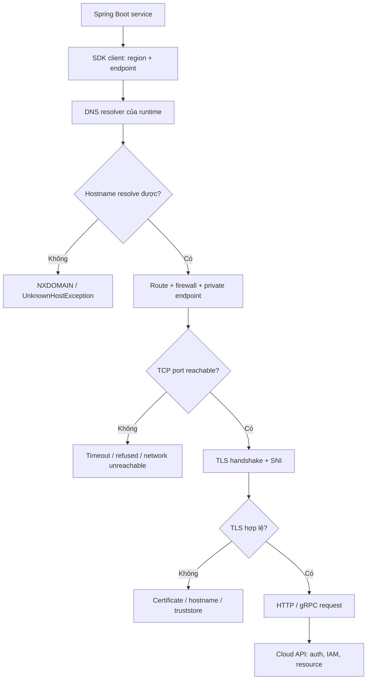

# Sai region, endpoint, DNS hoặc kết nối private network

Một ứng dụng Spring Boot có thể tạo được client AWS, Azure hoặc Google Cloud nhưng request vẫn timeout, resolve sai địa chỉ, kết nối nhầm public endpoint hoặc bị từ chối khi dịch vụ chỉ cho phép private network. Các lỗi này thường bị nhầm với credentials hoặc IAM vì cùng xuất hiện trong lúc gọi API.

Hãy tách bốn lớp cấu hình:

- **Region/location:** dịch vụ hoặc resource nằm ở vùng nào; SDK dùng thông tin này để chọn endpoint mặc định, ký request hoặc định tuyến.
- **Endpoint:** hostname và protocol mà client thực sự gọi, ví dụ S3 regional endpoint, Azure Blob FQDN hoặc Google API endpoint.
- **DNS:** hostname được phân giải thành địa chỉ IP nào trong chính mạng nơi ứng dụng chạy.
- **Network path:** route, firewall, security group, subnet, private endpoint, proxy và TLS có cho phép kết nối tới đích đó không.

Chọn đúng region không đảm bảo DNS đúng. DNS trả về private IP cũng không chứng minh route và firewall cho phép đi tới IP đó. Ngược lại, TCP/TLS có thể kết nối được tới public endpoint nhưng dịch vụ vẫn từ chối vì workload được yêu cầu đi qua private endpoint.

Bài này hướng dẫn chẩn đoán theo thứ tự từ client configuration tới DNS, TCP, TLS và provider network. Các ví dụ tập trung vào AWS SDK for Java 2.x, Spring Cloud AWS, Azure SDK for Java, Spring Cloud Azure, Google Cloud Java Client Libraries và Spring Framework on Google Cloud.

## 1. Phân biệt region, endpoint, DNS và network

| Thành phần | Câu hỏi cần trả lời | Ví dụ cấu hình sai | Triệu chứng |
| --- | --- | --- | --- |
| Region/location | Client đang chọn vùng nào? | S3 client ở us-east-1 nhưng bucket thuộc ap-southeast-1 | Redirect, signing error, resource not found hoặc latency bất thường |
| Endpoint | Client gọi hostname nào? | Ghi đè endpoint production bằng LocalStack hoặc hostname test | Kết nối nhầm dịch vụ, 404, TLS hostname mismatch |
| DNS | Hostname phân giải thành IP nào từ runtime? | Private endpoint FQDN trả public IP | Firewall 403, timeout hoặc đi sai đường mạng |
| Route | Subnet có đường tới IP đích không? | Thiếu route tới VPC endpoint, peering, VPN hoặc NAT | Timeout |
| Firewall/security group | TCP port có được phép không? | Egress 443 bị chặn hoặc endpoint SG không nhận traffic | Timeout hoặc connection refused |
| TLS | Client có bắt tay TLS với đúng hostname không? | Dùng IP trực tiếp, certificate không trusted, SNI sai | SSLHandshakeException, certificate verify failed |
| Proxy | Request có đi qua proxy ngoài dự kiến không? | JVM proxy hoặc HTTP proxy chuyển request ra public network | DNS/route khác dự kiến, 407, TLS interception |

Không kết luận nguyên nhân chỉ từ HTTP status:

- `UnknownHostException` hoặc `NXDOMAIN`: ưu tiên kiểm tra hostname, DNS resolver, private DNS zone và forwarding.
- `ConnectException: Connection refused`: hostname đã phân giải và đích phản hồi từ chối TCP, thường do port/service/listener hoặc firewall reject.
- `SocketTimeoutException` hoặc gRPC `UNAVAILABLE`: có thể do route, firewall drop, proxy, endpoint không reachable hoặc dịch vụ quá tải.
- `SSLHandshakeException`: kiểm tra certificate chain, SNI/hostname, TLS inspection, truststore và đồng hồ hệ thống.
- HTTP 401/403/404: thường chứng minh request đã tới một HTTP endpoint và nhận response; tiếp tục kiểm tra endpoint có đúng không, sau đó mới phân loại auth/resource.
- AWS `AuthorizationHeaderMalformed`: thường cần kiểm tra signing region và endpoint.
- Azure Storage `AuthorizationFailure`: có thể liên quan network/firewall hoặc policy, không mặc định là thiếu RBAC.

## 2. Luồng request và thứ tự chẩn đoán

Một request tới managed service đi qua nhiều lớp. Xác định lớp đầu tiên thất bại để khoanh vùng nguyên nhân.



Quy trình khuyến nghị:

1. Lấy hostname, port, region và endpoint từ cấu hình thực tế của client.
2. Chạy DNS lookup ngay trong container, pod, VM hoặc máy chạy Java process.
3. So sánh IP trả về với IP public/private mong đợi theo kiến trúc.
4. Kiểm tra route, security group/NSG, network ACL, firewall và proxy.
5. Kiểm tra TCP port.
6. Kiểm tra TLS bằng đúng hostname và SNI.
7. Gửi request HTTP/gRPC đơn giản để xác nhận endpoint.
8. Đọc error code của cloud service và đối chiếu IAM/RBAC sau khi network path đã được xác nhận.

**Luôn kiểm tra từ môi trường chạy ứng dụng.** DNS trên laptop có thể khác DNS trong Kubernetes, Docker, EC2, Azure VNet hoặc Google Cloud VPC. Một lệnh chạy từ máy quản trị không chứng minh pod có cùng route hay quyền truy cập.

## 3. Xác định endpoint thực tế mà Java client sử dụng

Trước khi kiểm tra DNS, hãy biết chính xác hostname. Đừng đoán endpoint từ tên resource.

### 3.1. AWS

AWS SDK for Java 2.x tự chọn endpoint theo service và Region. Ví dụ:

| Dịch vụ | Ví dụ regional endpoint |
| --- | --- |
| Amazon S3 | `s3.ap-southeast-1.amazonaws.com` |
| Amazon SQS | `sqs.ap-southeast-1.amazonaws.com` |
| Amazon SNS | `sns.ap-southeast-1.amazonaws.com` |
| Amazon DynamoDB | `dynamodb.ap-southeast-1.amazonaws.com` |
| AWS STS regional endpoint | `sts.ap-southeast-1.amazonaws.com` |

Không tự ghép hostname nếu SDK đã hỗ trợ endpoint mặc định. S3 còn có virtual-hosted-style, access point, dual-stack, accelerate và endpoint riêng; hostname thực tế phụ thuộc request và cấu hình service client.

AWS SDK region provider chain của Java 2.x xét:

1. Region đặt trực tiếp bằng builder `.region(...)`.
2. JVM system property `aws.region`.
3. Environment variable `AWS_REGION`.
4. Region trong active profile của AWS shared config.
5. EC2 instance metadata nếu chạy trên EC2.
6. Nếu vẫn không tìm thấy, client creation thất bại.

Region của client được cố định sau khi build. Nếu một ứng dụng gọi cùng dịch vụ ở nhiều region, tạo client riêng cho từng region.

### 3.2. Azure

Azure SDK thường nhận endpoint FQDN của resource:

| Dịch vụ | Endpoint chuẩn |
| --- | --- |
| Blob Storage | `https://ACCOUNT.blob.core.windows.net` |
| Data Lake Storage Gen2 | `https://ACCOUNT.dfs.core.windows.net` |
| Azure Queue Storage | `https://ACCOUNT.queue.core.windows.net` |
| Azure Service Bus | `NAMESPACE.servicebus.windows.net` |
| Azure Key Vault | `https://VAULT.vault.azure.net` |

Endpoint chuẩn phải khớp resource, cloud partition và dịch vụ. Khi sử dụng Private Endpoint, ứng dụng vẫn dùng FQDN chuẩn. DNS sẽ điều hướng hostname đó tới private IP; không đổi code sang hostname `privatelink` chỉ vì thấy tên này trong DNS CNAME.

Với Azure Service Bus, `fullyQualifiedNamespace` thường là `namespace.servicebus.windows.net`. Java SDK có thể dùng AMQP TLS trên TCP 5671/5672 hoặc AMQP over WebSockets trên TCP 443 tùy transport configuration.

### 3.3. Google Cloud

Google Cloud APIs thường dùng hostname chuẩn:

| Dịch vụ | Endpoint mặc định thường gặp |
| --- | --- |
| Cloud Storage JSON/XML API | `storage.googleapis.com` |
| Pub/Sub | `pubsub.googleapis.com:443` |
| Secret Manager | `secretmanager.googleapis.com:443` |
| Spanner | `spanner.googleapis.com:443` |
| Cloud KMS | `cloudkms.googleapis.com:443` |

Một số API có regional hoặc multi-regional endpoint riêng. Nếu dùng Private Service Connect (PSC) cho Google APIs, hostname có thể là DNS name riêng của endpoint, chẳng hạn tên trong miền `p.googleapis.com`. Hãy dùng đúng endpoint và DNS mapping do cấu hình PSC cung cấp.

Đối với database managed có private IP, hostname/IP và đường mạng có thể khác Google API endpoint. Ví dụ Cloud SQL private IP cần workload có đường tới VPC chứa private address; việc bật Private Google Access không tự tạo route tới mọi private database.

## 4. Chẩn đoán DNS trong đúng runtime

### 4.1. Linux container, VM hoặc Kubernetes pod

Dùng hostname lấy từ cấu hình client:

```bash
getent hosts s3.ap-southeast-1.amazonaws.com
nslookup s3.ap-southeast-1.amazonaws.com
dig +short s3.ap-southeast-1.amazonaws.com
```

Xem DNS resolver mà runtime đang sử dụng:

```bash
cat /etc/resolv.conf
```

Nếu image không có `dig`, `nslookup` hoặc `getent`, chạy một ephemeral debug container/pod trong cùng network namespace hoặc dùng công cụ có sẵn trong image. Không cài package tùy tiện vào production image chỉ để chẩn đoán một lần.

### 4.2. Windows host hoặc Windows container

```powershell
Resolve-DnsName s3.ap-southeast-1.amazonaws.com
nslookup s3.ap-southeast-1.amazonaws.com
Get-DnsClientServerAddress
```

### 4.3. Đọc kết quả DNS

| Kết quả | Ý nghĩa có thể | Việc cần làm |
| --- | --- | --- |
| `NXDOMAIN` / name does not exist | Sai hostname, private zone thiếu record hoặc forwarding sai | Kiểm tra FQDN, private DNS zone, A/CNAME record và conditional forwarder |
| Trả public IP trong khi yêu cầu private endpoint | Private DNS chưa được áp dụng trong network của client | Kiểm tra DNS zone link, VPC/VNet association, resolver và split-horizon DNS |
| Trả private IP đúng nhưng timeout | DNS đã đúng; route/firewall/endpoint approval có thể sai | Kiểm tra route, SG/NSG, NACL, firewall, VPN/peering |
| Trả nhiều IP | Dịch vụ có thể dùng nhiều AZ/replica hoặc endpoint có nhiều NIC | Kiểm tra tất cả IP, route và firewall; không chỉ thử IP đầu tiên |
| Laptop trả private IP nhưng pod trả public IP | Hai môi trường dùng resolver hoặc network khác nhau | Kiểm tra CoreDNS, node DNS, VPC/VNet DNS và custom forwarding |
| Một số replica resolve được, một số không | DNS cache, node khác subnet hoặc record stale | So sánh resolver, TTL, node/subnet và private DNS records |

Với private endpoint, kiểm tra hostname chuẩn có phân giải tới private IP đúng trong network được phép. Không hard-code private IP vào ứng dụng vì endpoint có thể thay đổi khi tái tạo, failover hoặc mở rộng subnet.

## 5. Kiểm tra TCP, TLS và HTTP

DNS chỉ trả lời hostname ánh xạ tới IP nào. Nó không chứng minh port hoặc giao thức đã sẵn sàng.

### 5.1. Kiểm tra TCP

Linux:

```bash
nc -vz s3.ap-southeast-1.amazonaws.com 443
nc -vz orders.servicebus.windows.net 5671
nc -vz orders.servicebus.windows.net 443
```

Windows PowerShell:

```powershell
Test-NetConnection s3.ap-southeast-1.amazonaws.com -Port 443
Test-NetConnection orders.servicebus.windows.net -Port 5671
Test-NetConnection orders.servicebus.windows.net -Port 443
```

Kết quả TCP thành công chỉ xác nhận có thể mở kết nối tới IP/port tại thời điểm kiểm tra. Nó không chứng minh IAM, token hoặc resource policy đúng.

### 5.2. Kiểm tra TLS và SNI

```bash
openssl s_client \
  -connect s3.ap-southeast-1.amazonaws.com:443 \
  -servername s3.ap-southeast-1.amazonaws.com \
  -brief
```

Dùng hostname làm SNI. Nếu kết nối trực tiếp tới IP, TLS certificate có thể không khớp hostname hoặc server không chọn đúng virtual host. Không bỏ kiểm tra certificate trong production để làm cho kết nối chạy được.

Các lỗi TLS thường gặp:

- `PKIX path building failed`: Java truststore không tin certificate chain.
- `No subject alternative DNS name matching`: hostname không nằm trong certificate SAN.
- `certificate expired` hoặc `not yet valid`: kiểm tra certificate và system clock.
- TLS handshake failure sau khi qua proxy: có thể proxy inspection thay certificate hoặc không hỗ trợ TLS version/cipher cần thiết.

### 5.3. Kiểm tra HTTP

```bash
curl -v --connect-timeout 5 https://s3.ap-southeast-1.amazonaws.com/
```

Một response 403/400/404 từ endpoint chuẩn có thể vẫn chứng minh DNS, TCP và TLS đã hoạt động. Đừng coi mọi HTTP error là network failure. Nếu hostname hoặc endpoint không đúng, response có thể đến từ dịch vụ khác hoặc proxy.

Không dùng `curl -k` làm cách khắc phục TLS trong production. Tùy chọn bỏ xác minh certificate chỉ có thể hữu ích trong một phép thử cô lập để xác định lỗi thuộc TLS trust hay kết nối; không giữ nó trong cấu hình ứng dụng.

## 6. AWS: region, endpoint và VPC endpoints

### 6.1. Cấu hình region trong SDK

Ví dụ tạo S3 client theo region:

```java
import software.amazon.awssdk.regions.Region;
import software.amazon.awssdk.services.s3.S3Client;

S3Client s3Client = S3Client.builder()
        .region(Region.AP_SOUTHEAST_1)
        .build();
```

Hoặc để SDK lấy region từ default provider chain:

```java
S3Client s3Client = S3Client.create();
```

Trong Spring Cloud AWS, có thể đặt region tĩnh theo cấu hình ứng dụng:

```yaml
spring:
  cloud:
    aws:
      region:
        static: ap-southeast-1
```

Chỉ dùng region cố định khi kiến trúc yêu cầu. Nếu workload chạy trên AWS và region client phải theo region triển khai, default region provider chain giúp giảm cấu hình môi trường.

### 6.2. Endpoint override chỉ dùng khi có lý do cụ thể

AWS SDK hỗ trợ `endpointOverride` cho LocalStack, endpoint thử nghiệm, proxy hoặc một số cấu hình VPC/private endpoint. Khi override endpoint, vẫn phải đặt region vì SDK dùng region để ký request SigV4.

```java
import java.net.URI;
import software.amazon.awssdk.regions.Region;
import software.amazon.awssdk.services.s3.S3Client;

S3Client localS3 = S3Client.builder()
        .region(Region.AP_SOUTHEAST_1)
        .endpointOverride(URI.create("http://localhost:4566"))
        .build();
```

Không đưa endpoint LocalStack vào profile production. Với VPC interface endpoint có Private DNS bật, ứng dụng thường tiếp tục dùng endpoint chuẩn của AWS; DNS trong VPC tự phân giải hostname dịch vụ tới private IP của endpoint. Không cần ghi đè endpoint bằng IP ENI.

AWS SDK hỗ trợ endpoint từ client builder, environment, JVM system property và shared config. Endpoint cấu hình ở request/client có độ ưu tiên cao hơn cấu hình bên ngoài. Kiểm tra các biến sau khi gặp hiện tượng client gọi nhầm host:

```bash
env | cut -d= -f1 | grep -E '^(AWS_ENDPOINT_URL|AWS_ENDPOINT_URL_S3|AWS_REGION|AWS_PROFILE)$'
```

### 6.3. S3 gateway endpoint và interface endpoint khác nhau

| Loại endpoint | Cách định tuyến | Trường hợp phù hợp |
| --- | --- | --- |
| Gateway VPC endpoint | Route table dùng prefix list của S3/DynamoDB; không có ENI private endpoint | Workload trong VPC cần S3/DynamoDB cùng region |
| Interface VPC endpoint (PrivateLink) | ENI private IP trong subnet; có security group; có thể dùng private DNS | Kết nối qua private IP, on-premises qua VPN/Direct Connect, peered VPC hoặc Transit Gateway tùy kiến trúc |

S3 hỗ trợ cả hai loại. Gateway endpoint không cung cấp truy cập từ on-premises hoặc VPC ở region khác qua peering/Transit Gateway. Interface endpoint phù hợp cho các trường hợp cần private IP endpoint và hybrid access, nhưng có chi phí.

### 6.4. Checklist AWS VPC endpoint

Với interface endpoint:

- VPC bật DNS resolution và DNS hostnames.
- Private DNS name của endpoint được bật nếu muốn SDK tiếp tục gọi hostname dịch vụ chuẩn.
- Endpoint có subnet/ENI ở Availability Zone cần thiết.
- Security group gắn với endpoint cho phép inbound TCP 443 từ workload.
- Security group của workload cho phép egress TCP 443.
- Network ACL cho phép cả chiều đi và chiều về.
- Route, VPC peering, Transit Gateway hoặc VPN cho phép đường tới subnet chứa endpoint.
- VPC endpoint policy không chặn action/resource.
- Endpoint connection ở trạng thái Available.

Với S3 gateway endpoint:

- Endpoint được tạo trong cùng region với bucket/service route mong muốn.
- Route table của subnet có endpoint route/prefix list.
- Security group và NACL cho phép HTTPS tới prefix list S3.
- Bucket policy không chặn request đi qua VPC endpoint.
- Không kỳ vọng gateway endpoint phục vụ traffic từ on-premises hoặc VPC khác.

### 6.5. Lỗi region và signing

Nếu nhận `AuthorizationHeaderMalformed`, redirect hoặc thông báo bucket nằm ở region khác:

1. Xác minh region bucket từ AWS Console/CLI.
2. Xác minh region được truyền vào SDK builder hoặc provider chain.
3. Kiểm tra endpoint override và service-specific endpoint.
4. Kiểm tra S3 access point ARN có region khác và tùy chọn use ARN region nếu dùng.
5. Tạo client riêng cho từng region khi ứng dụng truy cập nhiều region.

Không giải quyết region mismatch bằng cách chuyển sang endpoint global hoặc tự ghép URL. Để SDK chọn regional endpoint từ region đúng.

## 7. Azure: Private Endpoint, Private DNS và kết nối dịch vụ

### 7.1. Dùng FQDN chuẩn của resource

Ví dụ Blob Storage:

```java
import com.azure.core.credential.TokenCredential;
import com.azure.identity.DefaultAzureCredentialBuilder;
import com.azure.storage.blob.BlobServiceClient;
import com.azure.storage.blob.BlobServiceClientBuilder;

TokenCredential credential =
        new DefaultAzureCredentialBuilder().build();

BlobServiceClient blobClient =
        new BlobServiceClientBuilder()
                .endpoint("https://ordersarchive.blob.core.windows.net")
                .credential(credential)
                .buildClient();
```

Khi Storage Account dùng Private Endpoint, code vẫn dùng `ordersarchive.blob.core.windows.net`. DNS sẽ trả CNAME qua miền `privatelink` và A record private IP theo cấu hình DNS của VNet.

Không đổi endpoint trong Java thành `ordersarchive.privatelink.blob.core.windows.net` chỉ vì đó là tên xuất hiện trong CNAME. Dùng hostname dịch vụ chuẩn để giữ TLS hostname/SNI và để Azure DNS thực hiện phân giải đúng.

### 7.2. Các private DNS zone thường gặp

| Dịch vụ | Private DNS zone |
| --- | --- |
| Blob Storage | `privatelink.blob.core.windows.net` |
| Data Lake Storage Gen2 | `privatelink.dfs.core.windows.net` |
| Queue Storage | `privatelink.queue.core.windows.net` |
| Table Storage | `privatelink.table.core.windows.net` |
| Azure Files | `privatelink.file.core.windows.net` |
| Azure Service Bus | `privatelink.servicebus.windows.net` |
| Azure Key Vault | `privatelink.vaultcore.azure.net` |

Nếu ứng dụng dùng ADLS Gen2 và các thao tác có thể chuyển hướng giữa DFS và Blob, kiểm tra private endpoint/DNS cho cả `dfs` và `blob`. Tạo private endpoint cho một subresource không tự tạo kết nối cho tất cả các subresource còn lại.

### 7.3. Checklist Azure Private Endpoint

- Private endpoint connection đã được Approved; Pending/Rejected không hoạt động như mong đợi.
- Private DNS zone đúng tên tồn tại và có A record trỏ tới private IP của endpoint.
- Private DNS zone đã link tới VNet nơi workload thực sự chạy.
- Nếu dùng custom DNS, conditional forwarder/delegation đưa truy vấn tới Azure DNS hoặc Azure DNS Private Resolver phù hợp.
- Pod/VM/App Service có thể dùng DNS resolver đã được liên kết với zone.
- NSG, UDR, firewall và peering cho phép TCP tới private IP.
- Nếu Storage public network access bị disable, workload phải đi được qua private endpoint.
- Với copy giữa hai Storage Account, kiểm tra network path tới cả source và destination.
- Không hard-code private IP vào connection string hoặc code.

Đối với Azure App Service/Functions, kiểm tra VNet integration cho outbound traffic. Với AKS, kiểm tra VNet/subnet của node, pod network model, CoreDNS, custom DNS và đường từ pod tới private endpoint.

### 7.4. Kiểm tra Blob DNS

Chạy trong VM/pod cùng VNet:

```bash
nslookup ordersarchive.blob.core.windows.net
```

Kết quả mong đợi trong mạng private thường có alias tương tự `ordersarchive.privatelink.blob.core.windows.net` và A record là private IP của endpoint. Nếu trả public IP, kiểm tra private DNS zone link, A record, DNS forwarder và resolver mà pod sử dụng.

DNS và access control độc lập. DNS lookup thành công không chứng minh kết nối private đã được phê duyệt hoặc IAM/RBAC cho phép thao tác.

### 7.5. Azure Service Bus: port và transport

Service Bus Java SDK thường dùng AMQP TLS trên TCP 5671/5672. Nếu môi trường chỉ cho outbound HTTPS, có thể chọn AMQP over WebSockets trên TCP 443:

```java
import com.azure.core.credential.TokenCredential;
import com.azure.identity.DefaultAzureCredentialBuilder;
import com.azure.messaging.servicebus.AmqpTransportType;
import com.azure.messaging.servicebus.ServiceBusClientBuilder;

TokenCredential credential = new DefaultAzureCredentialBuilder().build();

ServiceBusClientBuilder builder = new ServiceBusClientBuilder()
        .fullyQualifiedNamespace("orders.servicebus.windows.net")
        .credential(credential)
        .transportType(AmqpTransportType.AMQP.AMQP_WEB_SOCKETS);
```

WebSockets chạy qua TCP 443, nhưng cần kiểm tra proxy có hỗ trợ WebSocket upgrade và TLS passthrough phù hợp. Không mặc định rằng đổi transport sang WebSockets sẽ sửa mọi lỗi DNS hoặc private endpoint.

Với Service Bus Private Link:

- DNS chuẩn `namespace.servicebus.windows.net` phải resolve tới private IP.
- Private DNS zone `privatelink.servicebus.windows.net` được link đúng VNet.
- Private endpoint connection đã Approved.
- NSG/UDR cho phép TCP 5671/5672 hoặc TCP 443 nếu dùng WebSockets.
- Workload như App Service/Functions đã VNet-integrated để truy cập private endpoint.

Azure có thể cho phép DNS/TCP handshake tới public endpoint nhưng từ chối ở application layer khi public access bị tắt. Vì vậy, TCP thành công chưa chứng minh request đã đi qua private endpoint.

## 8. Google Cloud: Private Google Access, Private Service Connect và private database

### 8.1. Phân biệt các kiểu private connectivity

| Cơ chế | Dùng để làm gì? | Điều cần kiểm tra |
| --- | --- | --- |
| Private Google Access (PGA) | VM chỉ có internal IP truy cập Google APIs/service qua external IP của Google APIs | PGA bật trên đúng subnet; DNS, route và firewall đúng |
| Private Service Connect (PSC) for Google APIs | Tạo private IP endpoint trong VPC để truy cập Google APIs | Endpoint, forwarding rule, DNS zone và route tới PSC IP |
| Private services access | Kết nối private tới dịch vụ managed được publish qua Service Networking, ví dụ một số private IP database | Service Networking connection, allocated range và route |
| PSC tới managed service | Kết nối private tới service producer qua PSC theo dịch vụ hỗ trợ | Endpoint/subnet, service attachment và DNS theo tài liệu dịch vụ |

PGA không tạo private IP cho Google API. Nó cho VM chỉ có internal IP gửi request tới địa chỉ IP public của Google APIs qua đường mạng Google. PGA được bật theo subnet.

PSC for Google APIs tạo internal IP endpoint trong VPC. Client có thể cần dùng DNS name riêng trỏ tới PSC endpoint. Một số regional/multi-regional Google API endpoint yêu cầu mô hình PSC phù hợp; PGA không hỗ trợ endpoint regional/multi-regional kết thúc bằng `rep.googleapis.com`.

Private services access/PSC cho database là một bài toán khác với truy cập Google API. Ví dụ Cloud SQL dùng private IP cần route từ workload tới VPC và dải IP database; bật PGA không tự cấp đường tới private IP đó.

### 8.2. Private Google Access

Nếu VM chỉ có internal IP và cần gọi Cloud Storage, Pub/Sub hoặc Google API khác:

- Bật Private Google Access trên subnet của VM.
- Kiểm tra route tới Google APIs và default internet gateway theo kiến trúc.
- Kiểm tra firewall egress cho phép HTTPS TCP 443.
- Kiểm tra DNS của hostname API.
- Kiểm tra workload không bị proxy hoặc route policy chuyển sang endpoint khác.

PGA không ảnh hưởng tới VM có external IP theo cách tương tự; VM có external IP có thể truy cập Google APIs theo internet access requirements của VPC.

### 8.3. Private Service Connect và DNS

Khi dùng PSC for Google APIs:

- Xác định PSC endpoint IP và DNS name được cấu hình.
- Tạo Cloud DNS private zone hoặc DNS record cần thiết để hostname API resolve tới endpoint.
- Đảm bảo private zone được áp dụng cho VPC và các mạng hybrid liên quan.
- Nếu client không hỗ trợ hostname `p.googleapis.com`, cấu hình DNS cho hostname API chuẩn trỏ tới PSC endpoint theo hướng dẫn của Google.
- Kiểm tra route, firewall egress và endpoint status.
- Nếu gọi regional API, xác minh endpoint hỗ trợ region/service đó.

Không tự tạo A record cho mọi `*.googleapis.com` trỏ cùng một IP nếu chưa theo đúng hướng dẫn PSC. Một DNS wildcard sai có thể làm các API không nằm trong endpoint bundle bị định tuyến nhầm.

### 8.4. Cấu hình endpoint trong Google Cloud Java client

Cloud Storage Java Client cho phép đặt host:

```java
import com.google.cloud.storage.Storage;
import com.google.cloud.storage.StorageOptions;

Storage storage = StorageOptions.newBuilder()
        .setProjectId("provider-integration-prod")
        .setHost("https://storage.googleapis.com")
        .build()
        .getService();
```

Nếu PSC cung cấp endpoint hostname riêng, đặt host theo endpoint đã được cấu hình và kiểm thử. Không thay host bằng IP thuần nếu TLS certificate không khớp hostname.

Pub/Sub Java Publisher cho phép override gRPC endpoint:

```java
import com.google.cloud.pubsub.v1.Publisher;
import com.google.pubsub.v1.TopicName;

Publisher publisher = Publisher.newBuilder(
        TopicName.of("messaging-prod", "orders-created"))
        .setEndpoint("pubsub.googleapis.com:443")
        .build();
```

Khi dùng endpoint PSC, truyền endpoint hostname/port do cấu hình PSC yêu cầu. Nếu Spring Framework on Google Cloud starter đã tạo PublisherFactory/Publisher beans, hãy dùng extension/customizer hoặc client bean riêng theo đúng release line thay vì giả định mọi property endpoint đều giống nhau giữa các phiên bản.

### 8.5. Cloud SQL và private IP

Nếu ứng dụng kết nối Cloud SQL qua private IP:

- Workload phải ở VPC có route tới private IP của Cloud SQL hoặc mạng được kết nối qua peering/VPN/Interconnect theo kiến trúc.
- Kiểm tra private services access hoặc PSC connection đúng loại instance.
- Kiểm tra DNS/hostname nếu connector hoặc JDBC URL dùng hostname.
- Kiểm tra firewall/egress và database port.
- Nếu dùng Cloud SQL Java Connector, nhớ connector không thay thế network connectivity cần thiết cho private IP. Nó giúp xác thực và thiết lập kết nối được bảo vệ, nhưng workload vẫn phải có đường mạng tới instance.

Tương tự, với AWS RDS private endpoint và Azure Database private endpoint, phải kiểm tra route, DNS và firewall từ workload tới private address; region của API control plane không chứng minh data connection có thể đi qua private subnet.

## 9. Kiểm tra proxy, truststore và TLS trong Java

Một lệnh `curl` có thể đi qua proxy khác với Java SDK. Kiểm tra:

- JVM system properties như `https.proxyHost`, `https.proxyPort`, `http.nonProxyHosts`.
- Environment variables `HTTPS_PROXY`, `HTTP_PROXY`, `NO_PROXY` nếu HTTP transport của SDK sử dụng chúng.
- Cấu hình proxy riêng của AWS Apache/Netty HTTP client, Azure HttpClient và Google GAX transport.
- Truststore của JVM (`javax.net.ssl.trustStore`) và certificate authority của proxy.
- TLS inspection/firewall có thay certificate hay không.
- SNI hostname và certificate SAN có khớp endpoint không.

Không giả định mọi Java SDK đọc cùng bộ proxy environment variables. Một SDK có thể dùng Netty, SDK khác dùng Apache HTTP Client hoặc gRPC Netty; proxy phải được cấu hình theo transport đang sử dụng.

Có thể xem system properties đã đặt mà không in secret:

```java
System.out.println("https.proxyHost=" +
        System.getProperty("https.proxyHost"));
System.out.println("https.proxyPort=" +
        System.getProperty("https.proxyPort"));
System.out.println("http.nonProxyHosts=" +
        System.getProperty("http.nonProxyHosts"));
```

Khi cần chẩn đoán TLS, có thể bật JSSE debug trong môi trường test:

```bash
java -Djavax.net.debug=ssl,handshake -jar orders-api.jar
```

Output TLS rất dài và có thể chứa hostname/certificate metadata. Chỉ bật trong thời gian ngắn, thu thập có kiểm soát và không đưa log thô lên ticket công khai.

## 10. Cấu hình Spring Boot theo môi trường

### 10.1. Tách region, endpoint và private network setting

Ví dụ cấu hình ứng dụng với custom namespace riêng:

```yaml
app:
  cloud:
    aws:
      region: ap-southeast-1
      s3-endpoint: ""
    azure:
      blob-endpoint: https://ordersarchive.blob.core.windows.net
      servicebus-namespace: orders.servicebus.windows.net
    gcp:
      project-id: provider-integration-prod
      storage-endpoint: https://storage.googleapis.com
```

Các giá trị endpoint là hostname/URL không chứa credentials. Profile local có thể đặt endpoint emulator; profile production thường để SDK dùng endpoint chuẩn và private DNS/route quyết định đường đi.

Ví dụ profile local:

```yaml
# application-local.yml
app:
  cloud:
    aws:
      region: ap-southeast-1
      s3-endpoint: http://localhost:4566
    gcp:
      storage-endpoint: http://localhost:9023
```

Không để endpoint emulator được kế thừa sang production. Dùng validation để từ chối hostname localhost hoặc endpoint không thuộc allowlist khi profile production khởi động.

### 10.2. Tạo AWS client với endpoint tùy chọn

```java
import java.net.URI;
import org.springframework.beans.factory.annotation.Value;
import org.springframework.context.annotation.Bean;
import org.springframework.context.annotation.Configuration;
import software.amazon.awssdk.regions.Region;
import software.amazon.awssdk.services.s3.S3Client;
import software.amazon.awssdk.services.s3.S3ClientBuilder;

@Configuration
public class AwsStorageConfiguration {

    @Bean
    S3Client s3Client(
            @Value("${app.cloud.aws.region}") String region,
            @Value("${app.cloud.aws.s3-endpoint:}") String endpoint) {

        S3ClientBuilder builder = S3Client.builder()
                .region(Region.of(region));

        if (endpoint != null && !endpoint.isBlank()) {
            builder.endpointOverride(URI.create(endpoint));
        }

        return builder.build();
    }
}
```

Trong ứng dụng thực tế, bind các giá trị từ prefix cấu hình riêng của bạn bằng `@ConfigurationProperties` hoặc `@Value` với property key tương ứng. Trong production, để endpoint rỗng nếu dùng endpoint mặc định AWS và VPC endpoint private DNS. Nếu endpoint được override, kiểm tra region ký request, TLS certificate, hostname và endpoint policy.

### 10.3. Azure client dùng endpoint chuẩn

```java
import com.azure.core.credential.TokenCredential;
import com.azure.storage.blob.BlobServiceClient;
import com.azure.storage.blob.BlobServiceClientBuilder;
import org.springframework.beans.factory.annotation.Value;
import org.springframework.context.annotation.Bean;

@Bean
BlobServiceClient blobServiceClient(
        @Value("${app.cloud.azure.blob-endpoint}") String endpoint,
        TokenCredential credential) {

    return new BlobServiceClientBuilder()
            .endpoint(endpoint)
            .credential(credential)
            .buildClient();
}
```

Private Endpoint không cần đổi hostname trong bean. Hãy sửa DNS zone/resolver và network path để endpoint chuẩn resolve tới private IP.

### 10.4. Google Cloud client dùng endpoint cấu hình

```java
import org.springframework.beans.factory.annotation.Value;
import org.springframework.context.annotation.Bean;
import com.google.cloud.storage.Storage;
import com.google.cloud.storage.StorageOptions;

@Bean
Storage storage(
        @Value("${app.cloud.gcp.project-id}") String projectId,
        @Value("${app.cloud.gcp.storage-endpoint}") String endpoint) {

    return StorageOptions.newBuilder()
            .setProjectId(projectId)
            .setHost(endpoint)
            .build()
            .getService();
}
```

Nếu dùng starter và auto-configured bean, không khai báo bean trùng kiểu vô tình. Khi cần endpoint riêng, dùng cấu hình được module hỗ trợ hoặc tạo bean riêng với qualifier; xác nhận property và customizer theo release line đang dùng.

Nếu dùng Spring Framework on Google Cloud Storage starter, module cũng cung cấp property `spring.cloud.gcp.storage.host` để đổi host cho Storage bean auto-configured. Reference hiện hành mô tả giá trị theo host format, ví dụ `storage.googleapis.com/`; hãy kiểm tra đúng định dạng của release đang dùng. Property này không thay thế cấu hình endpoint riêng của Pub/Sub, Spanner hoặc Cloud SQL.

## 11. Ma trận troubleshooting theo triệu chứng

| Triệu chứng | Nguyên nhân có thể | Cách xác minh |
| --- | --- | --- |
| AWS SDK báo region not found hoặc client creation fail | Không có region trong builder, JVM, env, profile hoặc IMDS | Kiểm tra `aws.region`, `AWS_REGION`, active profile và EC2 metadata |
| S3 trả `AuthorizationHeaderMalformed` | Region ký request khác region bucket hoặc endpoint override sai | Xác minh bucket region, client region và endpoint |
| AWS request vẫn đi public endpoint | Private DNS chưa bật hoặc app không dùng VPC resolver | Resolve regional hostname từ runtime; kiểm tra interface endpoint private DNS |
| AWS S3 timeout qua gateway endpoint | Route table không gắn endpoint, sai region hoặc SG/NACL chặn 443 | Kiểm tra endpoint route, prefix list, SG/NACL và bucket region |
| AWS PrivateLink timeout | Endpoint SG không cho inbound 443, endpoint subnet/route hoặc NACL sai | Kiểm tra ENI private IP, endpoint SG, subnet và route |
| Azure Storage trả 403 qua private endpoint | Standard FQDN resolve public IP, firewall từ chối public path | `nslookup` hostname chuẩn; kiểm tra private DNS zone và network logs |
| Azure private FQDN trả NXDOMAIN | Private zone chưa link VNet hoặc thiếu A record | Kiểm tra zone group, VNet link, custom DNS forwarder |
| Azure Blob hoạt động nhưng ADLS DFS lỗi | Chỉ có private endpoint/DNS cho blob, thiếu dfs | Kiểm tra cả `blob` và `dfs` subresource/zone |
| Service Bus timeout | Port 5671/5672 bị chặn hoặc private endpoint/DNS sai | Test TCP 5671/5672; thử WebSockets 443 nếu chính sách cho phép |
| Service Bus TCP thành công nhưng SDK vẫn lỗi | DNS đang trỏ public endpoint, connection bị chặn ở application layer hoặc TLS/AMQP sai | Kiểm tra private IP, endpoint approval, transport và request exception |
| Google VM không có external IP không gọi được APIs | PGA chưa bật trên subnet hoặc egress/DNS sai | Kiểm tra PGA subnet, route, firewall TCP 443 |
| Google API hostname resolve public IP khi muốn PSC | DNS zone chưa trỏ hostname tới PSC endpoint | Kiểm tra Cloud DNS private zone, record, VPC association |
| Google regional API không qua PGA | PGA không hỗ trợ regional/multi-regional endpoints | Dùng PSC endpoint phù hợp và endpoint hostname theo tài liệu |
| Cloud SQL private IP timeout | Workload không có route/peering tới VPC database | Kiểm tra private services access/PSC, VPC route và firewall |
| Java `UnknownHostException` nhưng curl trên laptop chạy | Runtime dùng resolver khác | Chạy DNS lookup trong pod/container/VM |
| Java `SSLHandshakeException` nhưng TCP thành công | Truststore, SNI, proxy TLS inspection hoặc certificate | Dùng openssl với SNI, kiểm tra JVM truststore và proxy |
| Java timeout nhưng curl thành công | SDK dùng proxy/HTTP transport khác hoặc timeout quá ngắn | Kiểm tra HTTP client, proxy, DNS cache và SDK transport |
| Chỉ một số pod lỗi | Node/subnet/zone khác, DNS cache hoặc policy không đồng nhất | So sánh node, subnet, resolver, route và network policy |
| Sau khi đổi private endpoint vẫn dùng IP cũ | DNS cache hoặc JVM/OS resolver cache | Kiểm tra TTL, restart/rollout có kiểm soát và cache DNS |
| API trả 401/403/404 | Request đã tới endpoint nhưng endpoint/resource/auth có thể sai | Xác minh endpoint, error code và request ID trước khi kết luận IAM |

## 12. Bài thực hành: chẩn đoán ba private endpoint từ một Spring Boot workload

Mục tiêu: một Orders API chạy trong Kubernetes cần truy cập S3, Azure Blob Storage và Google Cloud Storage theo đường private network. Hãy kiểm tra từng provider từ đúng pod.

### Bước 1 — Ghi lại hostname và port

| Provider | Hostname ứng dụng dùng | Port |
| --- | --- | --- |
| AWS S3 | `s3.ap-southeast-1.amazonaws.com` | 443 |
| Azure Blob | `ordersarchive.blob.core.windows.net` | 443 |
| Google Cloud Storage | `storage.googleapis.com` hoặc PSC hostname được cấp | 443 |

Ghi region/project và loại private connectivity đã triển khai cho từng dịch vụ. Không tự thay hostname chuẩn bằng IP private.

### Bước 2 — Kiểm tra DNS từ pod

```bash
kubectl exec deploy/orders-api -- nslookup s3.ap-southeast-1.amazonaws.com
kubectl exec deploy/orders-api -- nslookup ordersarchive.blob.core.windows.net
kubectl exec deploy/orders-api -- nslookup storage.googleapis.com
```

Nếu container không có nslookup, dùng debug container trong cùng pod/network namespace. Ghi lại CNAME chain và tất cả A/AAAA records.

Kết quả mong đợi:

- AWS: hostname phân giải theo loại endpoint (gateway endpoint dùng route tới S3 prefix list; interface endpoint với private DNS trả private IP).
- Azure: FQDN chuẩn resolve qua private link alias tới private endpoint IP.
- Google: nếu dùng PGA, hostname API có thể trả public IP nhưng traffic đi qua Google network; nếu dùng PSC, hostname đã cấu hình phải resolve tới PSC internal IP.

### Bước 3 — Kiểm tra TCP và TLS

```bash
kubectl exec deploy/orders-api -- nc -vz s3.ap-southeast-1.amazonaws.com 443
kubectl exec deploy/orders-api -- nc -vz ordersarchive.blob.core.windows.net 443
kubectl exec deploy/orders-api -- nc -vz storage.googleapis.com 443
```

Nếu image không có `nc`, dùng debug container hoặc công cụ kiểm tra TCP có sẵn. Sau đó chạy TLS handshake với SNI hostname chuẩn.

### Bước 4 — Kiểm tra network path theo provider

AWS:

- Xác nhận workload nằm trong VPC/subnet có route phù hợp.
- Kiểm tra S3 gateway endpoint hoặc interface endpoint theo kiến trúc.
- Kiểm tra endpoint policy, SG, NACL và bucket region.

Azure:

- Xác nhận private endpoint connection Approved.
- Kiểm tra zone `privatelink.blob.core.windows.net` và VNet link.
- Kiểm tra NSG, UDR, VNet integration và public network access policy.

Google Cloud:

- Nếu PGA: kiểm tra subnet có bật PGA.
- Nếu PSC: kiểm tra endpoint IP, forwarding rule và Cloud DNS.
- Nếu dùng private database: kiểm tra private services access/PSC và route tới database IP.

### Bước 5 — Gọi API bằng đúng SDK client

Dùng identity/runtime configuration hiện tại để thực hiện một thao tác an toàn như đọc metadata object thử nghiệm. Ghi lại provider error code, request ID và thời điểm request.

- DNS/TCP/TLS lỗi: tiếp tục xử lý network.
- HTTP 401 hoặc authentication exception: endpoint đã reachable; kiểm tra credentials.
- HTTP 403 hoặc permission denied: kiểm tra IAM/RBAC, endpoint policy, firewall/application layer.
- HTTP 404 hoặc resource not found: kiểm tra resource name, account/project/region và semantics của API.

### Bước 6 — So sánh các pod

Nếu chỉ một pod lỗi, so sánh node, subnet, zone, DNS resolver, CoreDNS response, NetworkPolicy và proxy variables. Đừng thay đổi IAM policy toàn project khi lỗi chỉ xảy ra trên một subnet hoặc một node pool.

Bài thực hành hoàn thành khi mỗi client dùng đúng hostname/region, DNS trả kết quả phù hợp với kiến trúc, TCP/TLS thành công và SDK nhận response từ đúng cloud service.

## 13. Nguyên tắc vận hành

- Cấu hình region/location rõ ràng theo resource topology; không dùng một region chung cho mọi provider.
- Ưu tiên endpoint mặc định của SDK khi có thể; chỉ override cho emulator, PSC hoặc kiến trúc endpoint cụ thể.
- Khi override AWS endpoint, vẫn đặt signing region chính xác.
- Dùng hostname FQDN chuẩn thay vì hard-code IP private.
- Với Azure Private Endpoint, cấu hình private DNS zone và link tới đúng VNet; giữ hostname chuẩn trong connection string.
- Với AWS interface endpoint, kiểm tra private DNS, endpoint SG và NACL; với S3 gateway endpoint, kiểm tra route table/prefix list.
- Với Google Cloud, phân biệt PGA, PSC for Google APIs và private services access tới managed database.
- Chạy DNS/TCP/TLS test từ đúng container/pod/VM và cùng network identity với Java process.
- Kiểm tra proxy và truststore theo HTTP transport thực tế của SDK.
- Không dùng `curl -k`, tắt TLS verification hoặc hard-code IP như giải pháp production.
- Khi có HTTP response, lưu status, provider error code và request ID; phân biệt network với IAM/RBAC.
- Dùng private DNS, route và firewall policy được quản lý bằng IaC; theo dõi thay đổi zone, endpoint và subnet.
- Sau khi đổi DNS/endpoint, xác nhận TTL/cache và kiểm tra tất cả replicas/Availability Zones.

## 14. Ghi nhớ

- Region chọn vùng dịch vụ và có thể ảnh hưởng endpoint/signing; endpoint là hostname client gọi; DNS ánh xạ hostname thành IP; network quyết định đường đi.
- AWS SDK for Java 2.x có default region provider chain. Client đã build là immutable; dùng nhiều region thì tạo nhiều client.
- AWS `endpointOverride` vẫn cần region cho SigV4. Với VPC interface endpoint private DNS, thường giữ hostname dịch vụ chuẩn để DNS điều hướng tới ENI private.
- S3 gateway endpoint dùng route table/prefix list; interface endpoint dùng ENI private IP và có thể phục vụ hybrid network theo kiến trúc.
- Azure Private Endpoint yêu cầu DNS chuẩn resolve tới private IP. Dùng `privatelink.*` zone cho DNS, không thay FQDN ứng dụng thành hostname `privatelink`.
- Azure Blob/DFS có thể cần private endpoint cho cả `blob` và `dfs`; Service Bus dùng `privatelink.servicebus.windows.net`.
- Service Bus thường cần TCP 5671/5672; AMQP over WebSockets dùng TCP 443 nếu client/proxy hỗ trợ.
- Google PGA cho VM internal-only truy cập Google APIs; PSC tạo private endpoint trong VPC; private services access là cơ chế khác cho dịch vụ managed có private IP.
- PGA không hỗ trợ regional/multi-regional Google API endpoints; xác minh PSC khi cần endpoint dạng đó.
- `UnknownHostException` thường hướng tới DNS; timeout hướng tới route/firewall/endpoint; `SSLHandshakeException` hướng tới TLS/truststore/SNI; HTTP 401/403/404 thường cần kiểm tra API-level sau khi xác nhận endpoint.
- Kiểm tra từ runtime thật, không chỉ từ laptop. DNS, proxy, route và firewall có thể khác giữa host, pod và node.

## Tài liệu tham khảo chính thức

1. [AWS SDK for Java 2.x — Setting the AWS Region](https://docs.aws.amazon.com/sdk-for-java/latest/developer-guide/region-selection.html)
2. [AWS SDK for Java 2.x — Configuring client endpoints](https://docs.aws.amazon.com/sdk-for-java/latest/developer-guide/endpoint-config.html)
3. [AWS PrivateLink — Create an interface VPC endpoint](https://docs.aws.amazon.com/vpc/latest/privatelink/create-interface-endpoint.html)
4. [AWS VPC — Gateway endpoints for Amazon S3](https://docs.aws.amazon.com/vpc/latest/privatelink/vpc-endpoints-s3.html)
5. [Amazon S3 — PrivateLink interface endpoints](https://docs.aws.amazon.com/AmazonS3/latest/userguide/privatelink-interface-endpoints.html)
6. [Azure Storage — Use private endpoints](https://learn.microsoft.com/en-us/azure/storage/common/storage-private-endpoints)
7. [Azure — Private Endpoint DNS zone values](https://learn.microsoft.com/en-us/azure/private-link/private-endpoint-dns)
8. [Azure — Private Endpoint DNS integration scenarios](https://learn.microsoft.com/en-us/azure/private-link/private-endpoint-dns-integration)
9. [Azure Service Bus — Private Link and troubleshooting](https://learn.microsoft.com/en-us/azure/service-bus-messaging/private-link-service)
10. [Azure Service Bus — Network ports and AMQP over WebSockets](https://learn.microsoft.com/en-us/azure/service-bus-messaging/service-bus-faq)
11. [Azure Service Bus Java — ServiceBusClientBuilder and transportType](https://learn.microsoft.com/en-us/java/api/com.azure.messaging.servicebus.servicebusclientbuilder?view=azure-java-stable)
12. [Google Cloud — Private Google Access](https://docs.cloud.google.com/vpc/docs/private-google-access)
13. [Google Cloud — Private access options for services](https://docs.cloud.google.com/vpc/docs/private-access-options)
14. [Google Cloud — Access regional and multi-regional APIs through private endpoints](https://docs.cloud.google.com/docs/security/compliance/access-regional-google-apis-endpoints)
15. [Google Cloud Storage — Request endpoints and Java client configuration](https://docs.cloud.google.com/storage/docs/request-endpoints)
16. [Google Cloud Storage Java — StorageOptions.Builder](https://docs.cloud.google.com/java/docs/reference/google-cloud-storage/latest/com.google.cloud.storage.StorageOptions.Builder)
17. [Google Cloud Pub/Sub Java — Publisher.Builder endpoint](https://docs.cloud.google.com/java/docs/reference/google-cloud-pubsub/latest/com.google.cloud.pubsub.v1.Publisher.Builder)
18. [Spring Cloud AWS 3.4 — Region configuration](https://docs.awspring.io/spring-cloud-aws/docs/3.4.2/reference/html/index.html)
19. [Spring Framework on Google Cloud — Cloud Storage configuration properties](https://googlecloudplatform.github.io/spring-cloud-gcp/reference/html/)

Tên property, endpoint và khả năng private connectivity phụ thuộc dịch vụ, region và phiên bản SDK. Khi áp dụng cho hệ thống thật, hãy xác nhận endpoint/port của đúng dịch vụ và kiểm tra DNS/route/firewall trong chính môi trường chạy workload trước khi sửa credentials hoặc IAM policy.
