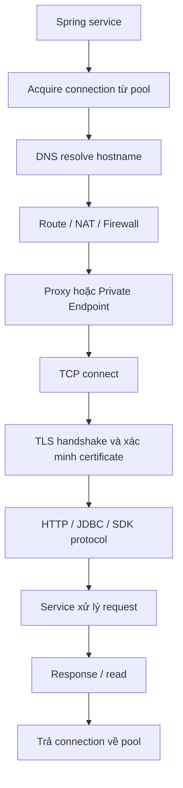

# Lỗi timeout, TLS, proxy và cạn connection pool

Khi Spring Boot gọi một dịch vụ managed trên AWS, Azure hoặc Google Cloud, lỗi kết nối thường xuất hiện dưới dạng timeout, lỗi bắt tay TLS, lỗi proxy hoặc hết connection trong pool. Các triệu chứng có thể giống nhau ở tầng API nhưng nguyên nhân nằm ở những lớp khác nhau: DNS, route mạng, firewall, proxy, TLS, client HTTP/JDBC, pool hoặc chính dịch vụ đích.

Chẩn đoán hiệu quả cần xác định **ứng dụng đang chờ ở bước nào** và **tài nguyên nào đang cạn**. `Connection timed out` khi mở TCP không giống `Read timed out` sau khi đã kết nối; `PKIX path building failed` không phải lỗi firewall; `Connection is not available, request timed out` của Hikari thường là chờ mượn connection từ pool, không nhất thiết là database không thể truy cập.

Bài học này xây dựng quy trình điều tra theo từng lớp, minh họa cấu hình timeout cho JDBC và HTTP client trong Spring Boot, giải thích cách xử lý TLS/proxy và cách phân tích cạn connection pool. Các nguyên tắc áp dụng cho kết nối tới database, object storage, message broker, API và dịch vụ managed của nhiều cloud provider.

Sau bài học, bạn có thể:

- Phân biệt DNS timeout, TCP connect timeout, TLS handshake timeout, response/read timeout và pool-acquire timeout.
- Đọc các exception phổ biến để khoanh vùng nguyên nhân.
- Kiểm tra DNS, route, port, proxy, certificate chain và hostname từ đúng môi trường chạy ứng dụng.
- Cấu hình timeout, TLS và proxy cho JDBC/WebClient theo giới hạn của từng client.
- Phân tích HikariCP và HTTP connection pool, nhận diện leak, tải quá mức và truy vấn chậm.
- Thiết kế retry, backoff, pool size và giám sát mà không khuếch đại sự cố.

## 1. Nhìn đường đi của một kết nối

Một request từ Spring Boot tới dịch vụ managed có thể đi qua các bước sau:



Không phải client nào cũng thực hiện các bước đúng thứ tự như sơ đồ: ví dụ proxy có thể được resolve/kết nối trước, TLS có thể được thiết lập với proxy rồi mới tạo tunnel tới đích, hoặc connection đã tồn tại trong pool nên request không phải handshake lại. Sơ đồ giúp xác định các điểm có thể phát sinh thời gian chờ.

| Lớp | Câu hỏi cần trả lời | Dấu hiệu lỗi thường gặp |
|---|---|---|
| Pool acquisition | Có connection rảnh để dùng không? | Hikari `Connection is not available`; Reactor Netty `Pending acquire queue has reached its maximum size` |
| DNS | Hostname có phân giải thành IP đúng không? | `UnknownHostException`, DNS resolution timeout |
| Network/TCP | Có route và được phép mở kết nối tới IP:port không? | `ConnectException`, `Connection timed out`, `No route to host` |
| Proxy | Request có đi qua proxy đúng cách không? | HTTP `407`, `502`, `504`, CONNECT tunnel failure |
| TLS | Certificate, hostname, protocol và client certificate có hợp lệ không? | `SSLHandshakeException`, `PKIX path building failed`, hostname mismatch |
| Protocol/response | Server có nhận request và trả lời trong deadline không? | `SocketTimeoutException: Read timed out`, HTTP 5xx, JDBC query timeout |
| Pool return | Connection có được trả lại sau khi dùng không? | Active connections luôn cao, pending borrowers tăng, leak detection cảnh báo |

## 2. Phân biệt các loại timeout

Từ “timeout” thường được dùng chung cho nhiều giới hạn khác nhau. Trước khi đổi cấu hình, hãy xác định timer nào hết hạn.

| Loại timeout | Bắt đầu tính khi nào? | Thường được cấu hình ở đâu? | Ý nghĩa khi hết hạn |
|---|---|---|---|
| DNS resolution timeout | Khi client cần phân giải hostname | Resolver/OS, DNS client hoặc runtime | Không tìm được IP trong thời gian cho phép |
| Pool acquisition timeout | Khi ứng dụng xin mượn connection từ pool | Hikari `connectionTimeout`, Reactor Netty `pendingAcquireTimeout` | Pool không cấp được connection kịp thời |
| TCP connect timeout | Khi client mở socket tới server/proxy | JDBC driver, HTTP client, socket | Không thiết lập được kết nối TCP |
| TLS handshake timeout | Khi hai bên thương lượng TLS | TLS engine/client, timeout bao quanh handshake | Không hoàn tất handshake; có thể do network, proxy hoặc TLS negotiation |
| Response/read timeout | Sau khi gửi request hoặc chờ dữ liệu | HTTP client, JDBC driver, SDK | Server không gửi dữ liệu tiếp trong giới hạn |
| Query/statement timeout | Khi database đang thực thi statement | JDBC `Statement`, JPA/provider, database | Query vượt thời gian nghiệp vụ cho phép |
| Overall request deadline | Từ lúc bắt đầu xử lý tới lúc phải trả kết quả | Gateway, application, resilience layer | Toàn bộ request đã hết ngân sách thời gian |

### 2.1. Đọc đúng exception

| Exception/thông báo | Hướng điều tra ban đầu |
|---|---|
| `java.net.UnknownHostException` | Hostname, DNS resolver, private DNS zone, search domain và cấu hình endpoint |
| `java.net.ConnectException: Connection refused` | IP có thể truy cập nhưng port không lắng nghe hoặc firewall chủ động reject; kiểm tra endpoint/port/service state |
| `java.net.SocketTimeoutException: connect timed out` | TCP handshake không hoàn tất; kiểm tra route, firewall, NAT, security group và proxy |
| `java.net.SocketTimeoutException: Read timed out` | Kết nối đã được thiết lập nhưng response/chặng đọc bị chậm; kiểm tra server, query, payload và read timeout |
| `javax.net.ssl.SSLHandshakeException` | Certificate chain, hostname, SNI, client certificate, TLS protocol/cipher và proxy interception |
| `sun.security.validator.ValidatorException: PKIX path building failed` | JVM không xây dựng được chain tới CA tin cậy; kiểm tra CA bundle/truststore và certificate chain |
| HTTP `407 Proxy Authentication Required` | Proxy yêu cầu xác thực hoặc credential proxy không đúng |
| HTTP `502` / `504` từ proxy/gateway | Proxy không kết nối được upstream hoặc upstream không phản hồi kịp; xác định response do proxy hay dịch vụ đích tạo ra |
| Hikari `Connection is not available, request timed out` | Không có connection được cấp trong thời gian `connectionTimeout`; kiểm tra pool, leak, query và DB capacity |
| Reactor Netty `PoolAcquireTimeoutException` | Không lấy được connection từ HTTP pool; kiểm tra max connections, pending queue và thời gian giữ connection |

Lưu ý: package exception TLS chuẩn của Java là `javax.net.ssl` ngay cả trong ứng dụng Spring Boot 3 dùng Jakarta cho API persistence/validation. Không suy ra package TLS chuyển sang `jakarta`.

### 2.2. Đặt timeout theo ngân sách end-to-end

Timeout ở các tầng phải phù hợp với deadline tổng. Ví dụ API có deadline 8 giây không nên cho phép một lần gọi downstream chờ 15 giây, sau đó retry thêm hai lần. Khi đó request đã quá hạn trước khi hoàn thành.

Một cách phân bổ minh họa cho API có deadline 8 giây:

| Thành phần | Ngân sách ví dụ |
|---|---:|
| Chờ pool | 0,5 giây |
| TCP/TLS connect (nếu cần kết nối mới) | 1,5 giây |
| Gọi dịch vụ và đọc response | 4 giây |
| Xử lý/serialize và dự phòng | 2 giây |

Đây chỉ là ví dụ. Hãy đo p95/p99, xác định SLA của dịch vụ và phân bổ thời gian theo đường đi thực tế. Timeout không thay thế giới hạn tài nguyên; nếu server luôn trả lời chậm, tăng timeout có thể chỉ làm nhiều request chiếm thread/connection lâu hơn.

## 3. Chẩn đoán theo thứ tự từ môi trường chạy

Thực hiện kiểm tra từ chính pod/container/VM chạy ứng dụng nếu có thể. Kết quả từ laptop hoặc máy quản trị không chứng minh workload có cùng DNS, route, firewall, proxy hay truststore.

### 3.1. Xác minh endpoint và DNS

Kiểm tra hostname lấy từ cấu hình runtime, đặc biệt với private endpoint. Một lỗi thường gặp là ứng dụng production vẫn trỏ tới public endpoint, hostname của môi trường staging hoặc endpoint thuộc region khác.

Trên Linux/container:

```bash
getent hosts <service-hostname>
nslookup <service-hostname>
```

Trên Windows PowerShell:

```powershell
Resolve-DnsName <service-hostname>
```

Kiểm tra kết quả có trả IP private/public đúng với thiết kế không. Với private endpoint, hostname có thể cần private DNS zone hoặc record liên kết đúng VPC/VNet/network. Không hardcode IP để né lỗi DNS: IP của managed service có thể thay đổi, có nhiều node hoặc phụ thuộc region/zone.

### 3.2. Kiểm tra TCP port và đường mạng

Linux:

```bash
nc -vz -w 3 <service-hostname> <port>
```

Windows PowerShell:

```powershell
Test-NetConnection -ComputerName <service-hostname> -Port <port>
```

Nếu TCP không mở được, kiểm tra:

- Hostname và port đúng theo endpoint của dịch vụ.
- Route từ subnet/pod/VM tới network đích.
- Security group, network ACL, NSG, VPC/VNet firewall hoặc firewall policy.
- NAT gateway, route table và outbound egress nếu kết nối đi qua Internet.
- Private endpoint/PrivateLink/Private Service Connect và DNS mapping.
- Whitelist IP nguồn tại dịch vụ managed, nếu dịch vụ có cơ chế allowlist.
- Proxy có phải là đường bắt buộc để ra ngoài hay không.

TCP thành công chỉ xác nhận có thể mở socket tới host:port. Nó chưa xác nhận TLS, xác thực, quyền service account hoặc request protocol hoạt động.

### 3.3. Kiểm tra TLS trực tiếp

Với endpoint TLS, có thể dùng OpenSSL từ cùng môi trường mạng:

```bash
openssl s_client -connect <service-hostname>:443 \
  -servername <service-hostname> -showcerts
```

Quan sát certificate chain, subject/SAN, issuer, validity và kết quả verify. `-servername` gửi SNI; thiếu SNI có thể khiến server/proxy trả certificate mặc định khác hostname. Nếu endpoint dùng port khác 443, thay port tương ứng.

Với HTTP, `curl` có thể giúp nhìn handshake và response:

```bash
curl -v --connect-timeout 3 --max-time 8 \
  https://<service-hostname>/<health-path>
```

Không dùng `curl -k` làm cách xác nhận TLS thành công trong production; tùy chọn này bỏ qua xác minh certificate. Nó có thể giúp phân biệt tạm thời lỗi trust với lỗi kết nối trong môi trường kiểm tra được kiểm soát, nhưng không phải cấu hình sửa lỗi.

## 4. Lỗi TLS và certificate

TLS bảo vệ dữ liệu trên đường truyền và xác minh danh tính server. Nếu client bỏ qua xác minh certificate để “cho chạy”, kết nối có thể bị giả mạo mà ứng dụng không phát hiện.

### 4.1. Các nguyên nhân thường gặp

| Triệu chứng | Nguyên nhân có thể | Cách kiểm tra |
|---|---|---|
| `PKIX path building failed` | Thiếu CA gốc/trung gian hoặc server không gửi đủ chain | Xem chain bằng OpenSSL; xác minh CA do provider/PKI nội bộ cấp |
| `No subject alternative DNS name matching ...` | Hostname cấu hình không nằm trong SAN certificate | Dùng đúng endpoint DNS được provider công bố; kiểm tra private DNS override |
| `certificate expired` / `NotAfter` | Certificate hết hạn hoặc đồng hồ hệ thống sai | Kiểm tra thời hạn certificate và NTP/clock của host/container |
| `unknown_ca` | Client không tin CA của server hoặc proxy TLS inspection | Kiểm tra issuer và truststore đúng môi trường |
| `handshake_failure` / `protocol_version` | TLS version, cipher suite hoặc policy không tương thích | Đối chiếu TLS policy của endpoint và JDK/client version |
| Server yêu cầu client certificate | mTLS chưa cấu hình hoặc certificate/key sai | Kiểm tra client keystore, certificate chain, private key và quyền file |
| Chỉ lỗi khi qua proxy | Proxy inspection thay certificate hoặc CONNECT tunnel bị chặn | So sánh issuer/chain trực tiếp và qua proxy; kiểm tra policy proxy |

### 4.2. Sửa truststore đúng cách

Trước hết xác định certificate nào đang được trình bày và CA nào cần được tin cậy. Dùng CA bundle/truststore được tổ chức hoặc nhà cung cấp dịch vụ công bố qua kênh tin cậy. Nếu doanh nghiệp dùng TLS inspection, truststore của workload cần có CA doanh nghiệp được phê duyệt; chỉ import CA khi biết rõ nguồn gốc và phạm vi áp dụng.

Java có thể dùng truststore riêng qua JVM properties:

```text
-Djavax.net.ssl.trustStore=/path/to/truststore.p12
-Djavax.net.ssl.trustStoreType=PKCS12
-Djavax.net.ssl.trustStorePassword=<injected-secret>
```

Không ghi password thật vào script hoặc command line dùng chung. Truyền secret qua cơ chế runtime phù hợp và giới hạn quyền đọc file. Một truststore riêng có thể thay thế truststore mặc định cho process, vì vậy phải chứa đầy đủ các CA cần thiết cho mọi kết nối của JVM; đừng tạo truststore chỉ có một CA rồi vô tình làm hỏng các kết nối khác.

Với Spring Boot có hỗ trợ SSL Bundles, có thể khai báo trust material tập trung và inject vào client tương thích. Cú pháp và mức tích hợp phụ thuộc phiên bản Boot và thư viện HTTP client; xác nhận client thực sự sử dụng SSL bundle. Không phải mọi SDK cloud đều tự động đọc cấu hình `spring.ssl.bundle`.

Không dùng `TrustAllStrategy`, `NoopHostnameVerifier`, custom `X509TrustManager` chấp nhận mọi certificate hoặc tắt hostname verification để sửa lỗi. Nếu cần debug, bật log TLS có thời hạn trong môi trường kiểm soát, rồi tắt sau khi thu thập đủ dữ liệu:

```text
-Djavax.net.debug=ssl,handshake
```

Log handshake có thể rất dài và chứa thông tin về certificate/metadata kết nối; chỉ bật có chủ đích và bảo vệ log.

### 4.3. mTLS và client certificate

Một số dịch vụ hoặc proxy yêu cầu mutual TLS: client cũng phải trình certificate. Khi đó cần phân biệt:

- **Truststore:** CA mà client tin cậy để xác minh certificate phía server.
- **Keystore:** certificate và private key mà client trình cho server.

Chỉ cấu hình truststore không đủ cho mTLS. Kiểm tra certificate còn hạn, SAN/EKU phù hợp, private key khớp certificate, chain đầy đủ và alias được chọn đúng. Private key phải được bảo vệ như secret và không đưa vào container image công khai.

## 5. Proxy và private network

Trong môi trường doanh nghiệp, workload có thể phải đi qua HTTP/HTTPS proxy để truy cập Internet hoặc API bên ngoài. Một số dịch vụ managed lại được truy cập qua private endpoint trong VPC/VNet. Hai đường đi cần được cấu hình rõ ràng.

### 5.1. Triệu chứng proxy thường gặp

| Triệu chứng | Nguyên nhân có thể |
|---|---|
| HTTP 407 | Thiếu/sai proxy credentials hoặc tài khoản không được phép |
| `CONNECT tunnel failed` | Proxy không cho phép tunnel tới host:port đích |
| HTTP 502/504 từ proxy | Proxy không resolve/kết nối được upstream hoặc upstream timeout |
| Chỉ một số hostname lỗi | Thiếu `NO_PROXY`/bypass hoặc proxy policy chặn domain |
| TLS lỗi sau khi bật proxy | Proxy thực hiện TLS inspection và trình CA khác với server gốc |
| SDK không đi qua proxy dù `curl` hoạt động | SDK dùng HTTP client riêng và không tự đọc biến môi trường proxy |

### 5.2. Kiểm tra proxy runtime

Trên Linux:

```bash
env | grep -i proxy
```

Trên PowerShell:

```powershell
Get-ChildItem Env:*proxy*
```

Kiểm tra `HTTP_PROXY`, `HTTPS_PROXY` và `NO_PROXY` (một số công cụ phân biệt chữ hoa/chữ thường). Không in credential proxy ra log hoặc chia sẻ output chứa user/password. `NO_PROXY` cần bao gồm các hostname/IP nội bộ thực sự phải bypass proxy, chẳng hạn endpoint private database, broker hoặc metadata service theo chính sách nền tảng. Cú pháp hỗ trợ CIDR/wildcard khác nhau giữa runtime và thư viện; xác nhận behavior của client đang dùng.

Không giả định mọi Java SDK tự động đọc `HTTP_PROXY`/`HTTPS_PROXY`. JDK networking, Apache HttpClient, Reactor Netty, JDBC driver và cloud SDK có cách cấu hình khác nhau. Cấu hình proxy trực tiếp trên client được sử dụng hoặc qua JVM system properties nếu client hỗ trợ. Tránh đặt proxy toàn JVM nếu chỉ một integration cần proxy và các private endpoint khác phải đi trực tiếp.

### 5.3. Cấu hình proxy cho WebClient dùng Reactor Netty

Ví dụ tạo `WebClient` với proxy HTTP, connect timeout, response timeout và pool riêng:

```java
import java.time.Duration;
import org.springframework.context.annotation.Bean;
import org.springframework.context.annotation.Configuration;
import org.springframework.http.client.reactive.ReactorClientHttpConnector;
import org.springframework.web.reactive.function.client.WebClient;
import reactor.netty.http.client.HttpClient;
import reactor.netty.resources.ConnectionProvider;
import reactor.netty.transport.ProxyProvider;
import io.netty.channel.ChannelOption;

@Configuration
class PartnerHttpClientConfiguration {

    @Bean
    WebClient partnerWebClient(ProxyProperties proxy) {
        ConnectionProvider pool = ConnectionProvider.builder("partner-api")
            .maxConnections(50)
            .pendingAcquireTimeout(Duration.ofSeconds(2))
            .pendingAcquireMaxCount(100)
            .maxIdleTime(Duration.ofSeconds(20))
            .maxLifeTime(Duration.ofMinutes(5))
            .build();

        HttpClient httpClient = HttpClient.create(pool)
            .option(ChannelOption.CONNECT_TIMEOUT_MILLIS, 3_000)
            .responseTimeout(Duration.ofSeconds(8))
            .proxy(spec -> spec
                .type(ProxyProvider.Proxy.HTTP)
                .host(proxy.host())
                .port(proxy.port())
                .connectTimeoutMillis(2_000));

        return WebClient.builder()
            .clientConnector(new ReactorClientHttpConnector(httpClient))
            .baseUrl("https://partner.example")
            .build();
    }
}
```

Đây là ví dụ cho một outbound client riêng. Nếu proxy yêu cầu authentication, cấu hình credential theo API Reactor Netty tương thích và lấy secret từ runtime; không ghi password vào source. Nếu endpoint nội bộ phải bypass proxy, có thể tạo client/pool riêng không proxy hoặc cấu hình bypass theo API của phiên bản Reactor Netty đang dùng. Không để một client có proxy policy toàn cục ảnh hưởng tới database/private service khác.

Lưu ý: `responseTimeout` của Reactor Netty giới hạn thời gian chờ response/read theo semantics của client; nó không thay thế deadline tổng của request hoặc pool-acquire timeout. `pendingAcquireTimeout` giới hạn thời gian chờ connection từ pool. Các giá trị trong ví dụ cần được điều chỉnh theo SLA và phiên bản Reactor Netty/Spring Boot.

### 5.4. Private endpoint và cloud network

Khi dịch vụ managed được truy cập qua private network, xác minh cả DNS lẫn route:

| Cloud | Thành phần mạng thường cần kiểm tra |
|---|---|
| AWS | VPC route table, security group, network ACL, NAT Gateway, VPC endpoint/PrivateLink, private DNS và policy của endpoint |
| Azure | VNet/subnet, NSG, route table/UDR, Private Endpoint, Private DNS Zone, DNS link và outbound path của workload |
| Google Cloud | VPC firewall rules, routes, Cloud NAT, Private Service Connect, Cloud DNS và subnet/egress configuration |

Tên sản phẩm và cấu hình cụ thể phụ thuộc dịch vụ, region và mô hình triển khai. Không phải mọi database, broker hoặc API đều hỗ trợ cùng kiểu private endpoint. Lấy hostname/port và network prerequisites từ tài liệu của đúng dịch vụ/region.

Nếu DNS private trả IP private nhưng workload không có route tới subnet đó, kết nối vẫn timeout. Nếu workload đi qua proxy nhưng `NO_PROXY` thiếu domain nội bộ, request có thể bị gửi tới proxy thay vì private endpoint. Nếu workload ở nhiều subnet/zone, kiểm tra đường đi của từng replica; một phần pod lỗi có thể do route hoặc DNS khác nhau.

## 6. Cạn connection pool với database và JDBC

HikariCP là pool phổ biến trong Spring Boot JDBC/JPA. Khi ứng dụng xin connection mà pool không cấp được trước `connectionTimeout`, Hikari báo lỗi tương tự:

```text
HikariPool-1 - Connection is not available, request timed out after 30000ms
```

Thông báo này nói rằng request đã chờ pool quá lâu. Nguyên nhân có thể là tất cả connection đang được sử dụng, connection bị giữ quá lâu, query chậm, leak, database không tạo thêm connection hoặc pool chưa khởi tạo kết nối thành công. Không mặc định đây là lỗi mạng.

### 6.1. Đọc các chỉ số pool

Theo dõi tối thiểu:

- **Active:** connection đang được ứng dụng mượn.
- **Idle:** connection rảnh trong pool.
- **Pending/ThreadsAwaitingConnection:** số thread đang chờ connection.
- **Max:** giới hạn connection của pool.
- **Acquire time:** thời gian từ lúc xin đến lúc nhận connection.
- **Usage time:** thời gian connection được giữ trước khi trả về.

Một số mẫu hình:

| Quan sát | Khả năng cần điều tra |
|---|---|
| Active = Max, Idle = 0, Pending tăng | Pool bão hòa; query dài, concurrency cao hoặc leak |
| Active thấp nhưng Pending cao | Pool chưa khởi tạo đủ, kết nối mới thất bại, thread scheduling hoặc metric không cùng thời điểm |
| Acquire time tăng cùng DB query latency | Query/transaction chậm khiến connection bị giữ lâu |
| Active tăng dần và không giảm sau khi tải kết thúc | Connection leak hoặc transaction/session bị giữ |
| DB báo too many connections dù pool từng instance nhỏ | Nhiều replica, nhiều datasource hoặc tác vụ nền tạo tổng connection vượt quota |
| Connection bị reset sau thời gian idle | Server/proxy/NAT đóng idle socket; pool giữ connection cũ hoặc keepalive/maxLifetime không phù hợp |

### 6.2. Cấu hình HikariCP

Ví dụ `application.yml`:

```yaml
spring:
  datasource:
    url: ${DB_JDBC_URL}
    username: ${DB_USERNAME}
    password: ${DB_PASSWORD}
    hikari:
      pool-name: orders-db
      maximum-pool-size: 20
      minimum-idle: 5
      connection-timeout: 3000
      validation-timeout: 1000
      idle-timeout: 300000
      max-lifetime: 1500000
      keepalive-time: 120000
      leak-detection-threshold: 20000
```

Các giá trị chỉ để minh họa. Chú ý:

- `connection-timeout` là thời gian chờ lấy connection từ Hikari pool; nó không phải JDBC TCP connect timeout.
- `validation-timeout` giới hạn thời gian kiểm tra connection hợp lệ và phải nhỏ hơn `connection-timeout`.
- `max-lifetime` giới hạn tuổi connection trong pool. Nên đặt thấp hơn giới hạn tuổi/idle timeout của database, proxy hoặc network middlebox một khoảng an toàn; connection đang được sử dụng không bị đóng giữa transaction chỉ vì hết `maxLifetime`.
- `keepalive-time` chỉ kiểm tra connection đang idle; phải nhỏ hơn `maxLifetime` và không có tác dụng với connection đang được mượn.
- `idle-timeout` chỉ có tác dụng loại bớt idle connection khi `minimum-idle` nhỏ hơn `maximum-pool-size`.
- `leak-detection-threshold` là công cụ chẩn đoán; cảnh báo có nghĩa connection được giữ quá ngưỡng, không tự chứng minh code chắc chắn làm leak. Không bật ngưỡng quá thấp trong production vì có thể tạo cảnh báo giả khi query/transaction hợp lệ lâu.

### 6.3. Phân biệt timeout của pool với timeout của driver/query

JDBC driver có property riêng, phụ thuộc engine và driver version. Ví dụ MySQL Connector/J có `connectTimeout` và `socketTimeout`; PostgreSQL JDBC có `connectTimeout` và `socketTimeout`. Đây không phải property Hikari và cú pháp không giống nhau giữa các driver.

Ví dụ URL MySQL minh họa:

```text
jdbc:mysql://<host>:3306/<database>?connectTimeout=5000&socketTimeout=30000
```

Ví dụ PostgreSQL minh họa:

```text
jdbc:postgresql://<host>:5432/<database>?connectTimeout=5&socketTimeout=30
```

Kiểm tra đơn vị và semantics trong tài liệu đúng phiên bản driver trước khi dùng. Ngoài ra có thể đặt query timeout ở JDBC `Statement` hoặc qua cấu hình JPA/provider; timeout query và socket read timeout giải quyết hai tầng khác nhau. Socket timeout có thể cắt kết nối khi query vẫn đang chạy ở server; kiểm tra trạng thái transaction và khả năng request đã được thực thi trước khi retry.

### 6.4. Tính pool size theo toàn hệ thống

Nếu có nhiều replica, tổng connection tiềm năng không phải chỉ `maximum-pool-size` của một pod:

```text
Tổng connection tối đa ≈ số replica × pool size mỗi replica
                      + migration/job/worker/admin connections
```

Ví dụ 8 replica với pool 20 có thể tạo tối đa 160 connection từ ứng dụng, chưa tính batch job và công cụ vận hành. Nếu database chỉ cho phép 120 connection cho workload, pool size 20 là không an toàn dù từng pod hoạt động tốt khi chạy riêng.

Không tăng pool size chỉ vì thấy Pending tăng. Tăng pool có thể đẩy tải sang database và làm query chậm hơn. Hãy đo thời gian giữ connection, query latency, CPU/IO database và concurrency thực tế. Giảm thời gian transaction, tối ưu index/query, tránh gọi API bên ngoài khi đang giữ transaction, giới hạn concurrency hoặc scale database khi có bằng chứng phù hợp.

## 7. Connection pool cho HTTP client

HTTP client cũng có pool connection. Nếu nhiều request cùng gọi một dịch vụ mà connection được giữ lâu, pending acquire tăng và client có thể timeout trước khi gửi request.

Với Reactor Netty, cần theo dõi:

- Số connection đang active/idle và giới hạn `maxConnections`.
- Pending acquire count và thời gian chờ connection.
- Response latency và connection reuse.
- Connection bị đóng/reset, số lần tạo kết nối mới và TLS handshake rate.
- Số request bị hủy do caller timeout hoặc downstream deadline.

Ví dụ cấu hình đã trình bày ở phần proxy đặt `maxConnections`, `pendingAcquireTimeout`, `pendingAcquireMaxCount`, `maxIdleTime` và `maxLifeTime`. Nếu pending acquire timeout xuất hiện, điều tra xem pool có quá nhỏ, downstream phản hồi chậm, response body chưa được consume/release hay concurrency vượt giới hạn. Đừng chỉ tăng `pendingAcquireMaxCount`: queue lớn hơn có thể làm latency và bộ nhớ tăng trong khi downstream vẫn không xử lý kịp.

### 7.1. Giải phóng response body

Với WebClient, luôn consume body hoặc giải phóng response. Các API như `retrieve().bodyToMono(...)` thường consume body theo pipeline; khi dùng `exchangeToMono` hoặc API low-level, đảm bảo body được đọc hoặc release trong mọi nhánh. Nếu bỏ response body, connection có thể không được trả lại pool.

Ví dụ:

```java
Mono<PartnerResult> result = webClient.get()
    .uri("/v1/status")
    .retrieve()
    .bodyToMono(PartnerResult.class);
```

Không gọi `.block()` tùy tiện trong event-loop của WebFlux. Nếu ứng dụng MVC dùng WebClient đồng bộ hóa, giới hạn concurrency và chọn scheduler/kiến trúc phù hợp; việc chặn thread không đúng chỗ có thể gây starvation dù connection pool còn chỗ.

### 7.2. Tránh tạo client/pool mới mỗi request

Tạo `WebClient`/`HttpClient` theo từng request có thể tạo nhiều pool, tăng TCP/TLS handshake, socket và memory. Đăng ký client như bean dùng chung theo từng upstream/policy. Nếu nhiều upstream có timeout, proxy hoặc TLS policy khác nhau, tạo một số client/pool được đặt tên rõ ràng thay vì một pool khổng lồ dùng chung hoặc vô số pool ngẫu nhiên.

## 8. Các nguyên nhân gốc thường gặp và cách xử lý

### 8.1. Connection leak hoặc transaction bị giữ quá lâu

Nguyên nhân có thể:

- JDBC connection không được đóng trong code tự quản lý; ưu tiên try-with-resources.
- Transaction bao quanh lời gọi HTTP/SDK chậm, khiến connection database bị giữ trong lúc chờ dịch vụ khác.
- Streaming hoặc cursor không được đóng.
- Thread bị treo trong code nghiệp vụ sau khi đã lấy connection.
- Exception path bỏ qua cleanup.

Với JDBC tự quản lý:

```java
try (Connection connection = dataSource.getConnection();
     PreparedStatement statement = connection.prepareStatement(
         "select status from orders where id = ?")) {
    statement.setLong(1, orderId);
    try (ResultSet resultSet = statement.executeQuery()) {
        if (resultSet.next()) {
            return resultSet.getString("status");
        }
    }
}
```

Khi dùng Spring Data/JdbcTemplate, framework quản lý connection theo transaction; tránh tự đóng connection được Spring quản lý hoặc giữ reference ra ngoài transaction. Giữ transaction ngắn và không gọi dịch vụ mạng không liên quan khi đang giữ DB lock/connection.

### 8.2. Database hoặc dịch vụ managed bị giới hạn

Database có thể chạm giới hạn connection, CPU, IOPS hoặc max client. Message broker/API có thể giới hạn concurrent request hoặc rate. Kiểm tra metrics phía dịch vụ, quota, throttling và slow query. Pool ở client không thể vượt quota server một cách an toàn.

### 8.3. Idle connection bị middlebox đóng

Proxy, NAT gateway, firewall hoặc dịch vụ đích có thể đóng socket idle sau một thời gian. Client giữ socket cũ trong pool rồi tái sử dụng sẽ nhận `Connection reset`, `Broken pipe` hoặc lỗi I/O. So sánh idle timeout ở server/proxy/network với `maxIdleTime`, `keepaliveTime` và `maxLifetime` của client. Đặt thời gian client ngắn hơn giới hạn middlebox một khoảng an toàn, bật validation/keepalive phù hợp và xử lý reconnect có giới hạn.

Không thể sửa mọi reset bằng cách bật TCP keepalive của OS; ứng dụng vẫn cần pool policy và retry semantics phù hợp. TCP keepalive cũng có thể bị firewall bỏ qua hoặc có timer dài hơn timeout của proxy.

## 9. Retry, circuit breaker và tránh khuếch đại sự cố

Retry có thể giúp vượt qua lỗi tạm thời, nhưng retry quá nhiều làm tăng tải lên dependency đang suy yếu. Một số nguyên tắc:

- Retry có giới hạn, exponential backoff và jitter.
- Chỉ retry lỗi tạm thời như một số network reset, timeout hoặc throttling; không retry lỗi credential, certificate, validation hoặc quyền truy cập.
- Chỉ retry thao tác idempotent hoặc có idempotency key/đối soát trạng thái.
- Tổng thời gian retry phải nằm trong deadline còn lại của request.
- Tránh retry đồng thời ở gateway, service, SDK và message consumer nếu không tính tổng số lần gọi.
- Dùng circuit breaker/bulkhead/rate limit khi cần cô lập dependency; cấu hình fallback có ý nghĩa nghiệp vụ.
- Với message consumer, dùng retry policy của broker/binder và DLQ thay vì vòng lặp retry nóng trong handler.

Ví dụ: một API có thể retry hai lần với backoff 100 ms và 300 ms nếu còn deadline và thao tác đọc idempotent. Nếu mỗi lần gọi có timeout 5 giây nhưng deadline API chỉ còn 2 giây, retry không còn ý nghĩa. Hãy hủy request downstream khi caller đã hết deadline nếu client hỗ trợ cancellation.

## 10. Quan sát và thu thập bằng chứng

Khi sự cố xảy ra, thu thập thông tin đủ để phân biệt các lớp:

| Nhóm | Bằng chứng nên có |
|---|---|
| Request | Timestamp, correlation/trace ID, route, upstream host/port, method và thời gian tổng |
| Runtime | Pod/VM/zone, image/JDK version, replica, CPU/memory, DNS resolver và proxy policy |
| Network | IP được resolve, TCP test, route, firewall/allowlist và NAT/egress metrics |
| TLS | Issuer, SAN, thời hạn certificate, TLS version, SNI và handshake error (không log private key/secret) |
| Client | Timeout config, pool name, active/idle/pending, connect/read/acquire latency và retry count |
| Database/service | Connection count, slow query, throttling, server error, quota và service health |
| Deployment | Thời điểm release/config/secret/certificate/network policy thay đổi |

Trong Spring Boot Actuator/Micrometer, bật metric cho Hikari và HTTP client tương thích với phiên bản thư viện. Đặt tag có cardinality thấp như pool name, service name và outcome; không dùng user ID, request ID hoặc object key làm tag metric.

Log nên ghi rõ phase của lỗi (`pool-acquire`, `dns`, `connect`, `tls`, `response-read`) nếu client cho phép. Giữ nguyên cause chain và request ID của provider. Không log URL có username/password, Authorization header, proxy credential, private key hoặc toàn bộ environment variables.

## 11. Quy trình xử lý sự cố thực tế

Khi có alert “dịch vụ managed không truy cập được”, đi theo trình tự sau:

1. **Xác định phạm vi:** tất cả replica hay chỉ một zone/pod? Một endpoint hay mọi upstream? Bắt đầu sau deploy, rotate certificate, đổi secret hoặc network policy?
2. **Đọc exception gốc:** pool acquire, DNS, connect, TLS, response read hay HTTP status? Không dừng ở message tổng quát của controller.
3. **Kiểm tra cấu hình runtime:** hostname, port, private/public endpoint, timeout, proxy/NO_PROXY, truststore và credential source.
4. **Kiểm tra từ đúng workload:** DNS resolve, TCP port, TLS chain và một request an toàn tới health endpoint.
5. **Kiểm tra pool/client:** active/idle/pending, acquire latency, usage duration, connection creation failure và response body lifecycle.
6. **Đối chiếu dịch vụ đích:** quota, connection limit, throttling, server-side latency, maintenance hoặc regional incident.
7. **Giảm tác động:** giới hạn concurrency, circuit breaker, tạm ngừng batch, scale có kiểm soát hoặc chuyển traffic theo runbook.
8. **Sửa nguyên nhân và xác minh:** chạy lại test từ workload, quan sát metric và kiểm tra không còn lỗi phụ.

Không restart tất cả replica ngay từ đầu nếu chưa biết nguyên nhân. Restart có thể tạm xóa connection lỗi nhưng cũng làm tăng đồng thời DNS lookup, TLS handshake, pool warm-up và connection storm lên dịch vụ đích.

## 12. Ma trận triệu chứng và hướng xử lý

| Triệu chứng | Kiểm tra đầu tiên | Hướng xử lý có thể phù hợp |
|---|---|---|
| `UnknownHostException` | Resolve hostname từ pod/VM, kiểm tra private DNS | Sửa DNS zone/link, hostname, resolver hoặc endpoint config |
| TCP connect timeout | Test port, route, SG/NSG/firewall, NAT và proxy | Sửa route/egress/allowlist hoặc dùng private endpoint đúng cách |
| Connection refused | IP/port, service endpoint và policy reject | Sửa port/endpoint hoặc trạng thái listener/service |
| `PKIX path building failed` | Certificate chain và truststore thực tế của JVM | Cài CA tin cậy đúng cách, sửa chain hoặc proxy inspection policy |
| Hostname mismatch | SAN và hostname cấu hình | Dùng DNS endpoint hợp lệ; sửa private DNS override |
| HTTP 407 | Proxy auth và policy | Cấu hình proxy credentials an toàn hoặc cấp quyền proxy |
| HTTP 502/504 | Xác định proxy/gateway nào trả response và upstream latency | Kiểm tra proxy route, upstream health, timeout và network path |
| Hikari pool timeout | Active/idle/pending, query/transaction duration và DB connections | Sửa leak/query/transaction, giới hạn concurrency, tính lại pool size |
| HTTP pool acquire timeout | Active/pending, response body, max connections và downstream latency | Giải phóng body, tái sử dụng client, điều chỉnh pool/concurrency theo đo đạc |
| Connection reset sau idle | Idle timeout server/proxy/NAT và client pool | Điều chỉnh maxIdle/maxLifetime/keepalive và reconnect policy |
| Lỗi chỉ ở một số replica | DNS, subnet, zone, image/JDK, secret/truststore và network policy từng replica | So sánh cấu hình/node path và sửa drift |

## 13. Checklist trước khi đưa vào production

- [ ] Endpoint, port, region và private/public DNS đúng môi trường.
- [ ] Workload có route và egress cần thiết; firewall, allowlist và proxy policy rõ ràng.
- [ ] Timeout được tách theo pool acquire, connect, TLS/handshake, response/read, query và overall deadline.
- [ ] TLS xác minh chain và hostname; mTLS có cả keystore/truststore khi cần.
- [ ] Không tắt certificate validation hoặc đưa secret vào source/log/command dùng chung.
- [ ] Proxy và `NO_PROXY` được cấu hình theo từng client; private endpoint không bị gửi nhầm qua proxy.
- [ ] JDBC/HTTP client được tái sử dụng; pool size tính theo tổng replica và quota server.
- [ ] Connection/response/stream được đóng hoặc consume đúng cách; transaction ngắn.
- [ ] Retry có giới hạn, backoff, jitter, deadline và idempotency phù hợp.
- [ ] Có metric active/idle/pending/acquire/usage, timeout, latency, retry và service-side quota.
- [ ] Có runbook kiểm tra từ đúng pod/VM và test failure mode trước release.

## 14. Kết luận

Timeout, TLS, proxy và cạn connection pool là các triệu chứng ở những lớp khác nhau. Hãy xác định request đang chờ ở pool, DNS, TCP, TLS hay response; sau đó kiểm tra từ đúng môi trường chạy ứng dụng. Cấu hình timeout theo deadline tổng, xác minh certificate, khai báo proxy theo từng client, tính pool size theo toàn hệ thống và đo thời gian giữ connection. Cách tiếp cận theo lớp giúp tìm nguyên nhân gốc, hạn chế thay đổi cấu hình mò mẫm và tránh biến một sự cố kết nối thành sự cố quá tải diện rộng.

## Tài liệu tham khảo

- [Spring Boot — Data Access](https://docs.spring.io/spring-boot/reference/data/sql.html): cấu hình JDBC, `DataSource` và HikariCP.
- [HikariCP — Configuration](https://github.com/brettwooldridge/HikariCP#configuration-knobs-baby): semantics của pool size, connection timeout, max lifetime, keepalive và leak detection.
- [Spring Framework — WebClient](https://docs.spring.io/spring-framework/reference/web/webflux-webclient.html): cấu hình và sử dụng reactive HTTP client.
- [Reactor Netty — HTTP Client](https://projectreactor.io/docs/netty/release/reference/http-client.html): connection pool, timeout, proxy và TLS cho Reactor Netty.
- [Java Secure Socket Extension (JSSE) Reference Guide](https://docs.oracle.com/en/java/javase/17/security/java-secure-socket-extension-jsse-reference-guide.html): truststore, keystore và TLS debugging.
- [AWS — VPC endpoints](https://docs.aws.amazon.com/vpc/latest/privatelink/vpc-endpoints.html): truy cập dịch vụ qua private endpoint/PrivateLink.
- [Azure — Private Endpoint overview](https://learn.microsoft.com/azure/private-link/private-endpoint-overview): private endpoint và DNS.
- [Google Cloud — Private Service Connect](https://cloud.google.com/vpc/docs/private-service-connect): kết nối private tới dịch vụ được publish.
