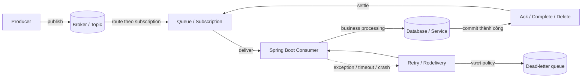
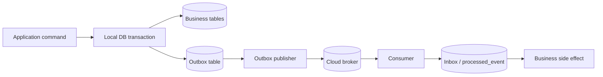

# Thông điệp không được nhận, không được xác nhận hoặc bị xử lý lặp

Trong hệ thống Spring Boot dùng message broker hoặc dịch vụ messaging managed, một thông điệp có thể bị thất lạc ở nhiều chặng: producer chưa gửi thành công, broker nhận nhưng không route tới subscription mong muốn, consumer không nhận được, consumer xử lý nhưng không xác nhận (ack), hoặc consumer đã xử lý xong nhưng broker giao lại thông điệp. Các triệu chứng “không thấy message” và “message bị xử lý hai lần” thường có nguyên nhân khác nhau.

Điều quan trọng là phân biệt ba giai đoạn: **publish và routing**, **receive và xử lý**, **acknowledgement/settlement**. Mỗi dịch vụ cloud có thuật ngữ và cơ chế khác nhau: Amazon SQS xóa message sau khi xử lý thành công; Azure Service Bus hoàn tất message trong chế độ Peek-Lock; Google Cloud Pub/Sub xác nhận message bằng ack ID. Các cơ chế này đều có thể dẫn tới giao lại khi consumer không hoàn tất đúng hạn hoặc kết quả xác nhận không rõ ràng.

Bài học này hướng dẫn điều tra theo từng giai đoạn, so sánh các dịch vụ messaging phổ biến trên AWS, Azure và Google Cloud, đồng thời trình bày cách thiết kế consumer idempotent, retry và dead-letter queue (DLQ) để hệ thống chịu được việc giao lại.

Sau bài học, bạn có thể:

- Xác định message dừng ở publish, routing, receive, processing hay acknowledgement.
- Phân biệt ack, delete, complete, abandon, nack và checkpoint theo dịch vụ.
- Chẩn đoán subscription/consumer group sai, filter, quyền IAM, visibility timeout và lock/ack deadline hết hạn.
- Giải thích nguyên nhân message được giao lại và xử lý lặp.
- Thiết kế idempotency, inbox/outbox, retry có giới hạn và DLQ.
- Theo dõi message age, backlog, delivery attempt, ack latency và tỷ lệ xử lý thành công.

## 1. Theo dấu vòng đời của một message

Một message-driven workflow thường có các chặng sau:



Đây là mô hình logic. Một số dịch vụ gộp topic và subscription, một số dịch vụ có queue riêng; push subscription có thể gửi message tới HTTP endpoint, còn pull consumer chủ động lấy message. Nhưng các câu hỏi điều tra vẫn tương tự:

1. Producer có gửi message và nhận kết quả publish thành công không?
2. Broker có nhận message và route tới đúng queue/subscription không?
3. Consumer có quyền và có đang lắng nghe đúng queue/subscription/group không?
4. Consumer có bắt đầu xử lý, hoàn tất nghiệp vụ và commit dữ liệu không?
5. Broker có nhận acknowledgement/settlement trước deadline không?
6. Message có bị retry, redelivery, chuyển DLQ hoặc bị lọc/xóa bởi policy không?

Không nên bắt đầu bằng cách tăng concurrency hoặc restart consumer khi chưa xác định message đang dừng ở đâu. Điều đó có thể làm tăng tải hoặc khiến message bị xử lý đồng thời nhiều lần.

## 2. Phân biệt các trạng thái và thuật ngữ

| Thuật ngữ | Ý nghĩa thực tế | Điều cần lưu ý |
|---|---|---|
| Publish/send | Producer gửi message tới broker | Producer timeout không chứng minh broker chưa nhận message |
| Route | Broker chuyển message tới queue/subscription phù hợp | Sai topic, subscription, filter hoặc policy có thể khiến consumer không thấy message |
| Receive/deliver | Broker giao message cho consumer | Message có thể đang ở trạng thái in-flight/locked/invisible |
| Ack/acknowledge | Consumer xác nhận đã xử lý message theo protocol | Ack thường không phải một transaction nguyên tử với database của ứng dụng |
| Delete | Xóa message khỏi queue sau xử lý thành công, như SQS DeleteMessage | Nếu delete thất bại hoặc visibility hết hạn, message có thể được giao lại |
| Complete | Hoàn tất message trong Azure Service Bus Peek-Lock | Lock có thể hết hạn trước Complete; khi đó message được mở lại để giao |
| Nack/negative acknowledgement | Consumer báo không xử lý được hoặc không nhận message | Broker có thể requeue, retry hoặc dead-letter tùy cấu hình |
| Visibility timeout | Khoảng thời gian SQS che message khỏi consumer khác sau khi receive | Nếu không delete trước khi hết hạn, message có thể xuất hiện lại |
| Lock duration | Thời gian Azure Service Bus giữ lock trên message trong Peek-Lock | Phải Complete/settle trước khi lock hết hạn hoặc gia hạn lock đúng cách |
| Ack deadline | Thời gian Pub/Sub chờ subscriber xác nhận message | Nếu hết hạn, message có thể được giao lại; client có thể tự gia hạn deadline |
| Checkpoint/offset | Ghi nhận vị trí đã xử lý trong một stream partition | Khác với ack từng message; checkpoint sai vị trí có thể bỏ qua hoặc phát lại dữ liệu |

**Ack không đồng nghĩa với “một lần và duy nhất”.** Với nhiều hệ thống at-least-once, broker có thể giao lại message khi không nhận được ack, dù consumer đã hoàn thành side effect. Vì vậy, consumer phải được thiết kế để xử lý lại an toàn.

## 3. Xác định message bị mất ở publish hay routing

### 3.1. Kiểm tra kết quả gửi từ producer

Producer cần quan sát kết quả gửi thay vì chỉ gọi API rồi bỏ qua kết quả. Với API đồng bộ, kiểm tra exception và response. Với API bất đồng bộ, quan sát callback/future hoàn tất, ghi nhận message ID hoặc broker receipt nếu có. Nếu publish thất bại, lưu lại thông tin đủ để điều tra và áp dụng retry theo policy.

Ví dụ Spring Cloud Stream dùng `StreamBridge`:

```java
import org.springframework.cloud.stream.function.StreamBridge;
import org.springframework.stereotype.Component;

@Component
public class OrderEventPublisher {
    private final StreamBridge streamBridge;

    public OrderEventPublisher(StreamBridge streamBridge) {
        this.streamBridge = streamBridge;
    }

    public void publish(OrderCreated event) {
        boolean accepted = streamBridge.send("orderCreated-out-0", event);
        if (!accepted) {
            throw new IllegalStateException("Broker binding did not accept the event");
        }
    }
}
```

`send()` trả về `true` cho biết binding chấp nhận việc gửi theo contract của binder; nó không nhất thiết là bằng chứng message đã được consumer xử lý. Với một số binder/client, việc gửi còn bất đồng bộ hoặc có callback riêng. Hãy kiểm tra semantics của đúng binder và broker, bật producer confirmation nếu được hỗ trợ, và ghi message ID/correlation ID vào log.

Không retry mù khi producer timeout. Có thể broker đã nhận message nhưng response bị mất trên đường về. Nếu gửi lại với event ID mới, consumer sẽ thấy hai event khác nhau; nếu gửi lại cùng event ID, consumer idempotent có thể loại trùng. Producer nên tạo event ID ổn định trước lần gửi đầu và dùng lại ID đó trong các lần retry.

### 3.2. Kiểm tra topic, queue và subscription

Các lỗi cấu hình phổ biến:

- Producer gửi vào topic A nhưng consumer subscribe topic B.
- Queue hoặc subscription chưa được tạo, bị xóa hoặc nằm ở region/project/namespace khác.
- Consumer dùng sai tên queue, subscription, consumer group hoặc binding destination.
- Message bị filter bởi subscription filter, routing key, tag hoặc rule.
- Topic có nhiều subscription nhưng consumer chỉ đọc một subscription; publish thành công không tự làm message xuất hiện ở mọi queue tùy ý.
- Message được gửi vào DLQ hoặc subscription DLQ do retry policy.
- Producer và consumer dùng nhầm môi trường dev/staging/production.

Với pub/sub, topic là nơi producer publish còn subscription xác định luồng message mà subscriber nhận. Với queue, producer thường gửi trực tiếp vào queue. Với SNS, topic phân phối tới các subscription (ví dụ SQS queue hoặc HTTP endpoint); phải kiểm tra trạng thái subscription và delivery policy. Không đồng nhất “topic có message” với “queue consumer chắc chắn nhận được message”.

### 3.3. Kiểm tra quyền truy cập

Một số lỗi permission có thể xảy ra ở một chiều nhưng không xảy ra ở chiều còn lại:

- Producer có quyền publish/send nhưng consumer thiếu quyền receive/consume.
- Consumer có quyền receive nhưng thiếu quyền ack/delete/complete/modify message.
- SNS không được phép gửi vào SQS queue do thiếu queue resource policy cho SNS topic.
- Service account có quyền subscribe nhưng thiếu quyền acknowledge hoặc quyền truy cập subscription.
- Credential trong workload đã hết hạn hoặc đang trỏ tới account/project/subscription khác.

Kiểm tra danh tính thực tế của workload (IAM role, managed identity, service account), resource policy, queue/topic policy và audit log. Không giải quyết bằng cách cấp quyền admin rộng; chỉ cấp action trên đúng topic, queue hoặc subscription cần thiết.

## 4. Consumer không nhận được message

### 4.1. Kiểm tra consumer có thực sự hoạt động

Xác minh:

- Spring application đã khởi động listener/binding thành công chưa?
- Consumer đang kết nối tới đúng broker endpoint, namespace, account và region chưa?
- Queue/subscription/group có đúng tên và có tồn tại không?
- Có consumer instance nào đang nhận message không, hay tất cả instance đều lỗi auth/network?
- Consumer có bị pause, scale về 0, thiếu thread hoặc hết connection không?
- Filter, selector, routing key, tag hoặc subscription rule có loại message này không?
- Message có đang in-flight/locked bởi consumer khác không?

Trong Spring Cloud Stream, kiểm tra `destination`, `group`, binding name và trạng thái binding. Nếu không cấu hình group, một số binder có thể tạo anonymous/ephemeral subscription; message có thể không được giữ theo cách mong đợi khi instance dừng hoặc khởi động lại. Hành vi cụ thể phụ thuộc binder.

### 4.2. Kiểm tra consumer group và subscription semantics

Không phải mọi hệ thống dùng thuật ngữ consumer group giống nhau:

- Với Kafka/Event Hubs, consumer group thường xác định một nhóm độc lập cùng đọc stream; checkpoint/offset và partition assignment quyết định vị trí đọc.
- Với SQS, mỗi queue là luồng message; nhiều worker cùng poll một queue sẽ chia sẻ message, không cần consumer group như Kafka.
- Với Pub/Sub, subscription là tài nguyên lưu delivery state; nhiều subscriber trên cùng subscription cùng chia tải message.
- Với Azure Service Bus, queue hoặc topic subscription là nơi nhận message; nhiều processor có thể cùng xử lý theo lock/settlement.

Đừng sao chép cấu hình `group` của một binder sang binder khác mà không kiểm tra ý nghĩa. Ví dụ tạo hai Pub/Sub subscription độc lập cho hai consumer khác nhau thường làm mỗi subscription nhận bản sao của message; chạy hai instance trên cùng subscription mới là chia tải một subscription.

### 4.3. Push và pull có đường chẩn đoán khác nhau

**Pull consumer** chủ động poll/stream message. Kiểm tra credentials, endpoint, permission, poll timeout, flow control và client lifecycle.

**Push subscription** gửi message tới HTTP endpoint. Kiểm tra URL, DNS/certificate, firewall/ingress, authentication token, HTTP response code và thời gian phản hồi. Nếu endpoint trả mã không thành công hoặc quá chậm theo policy, broker có thể retry delivery. Tránh trả HTTP 2xx trước khi nghiệp vụ được commit; nếu trả thành công quá sớm, broker coi message đã được xử lý dù database có thể chưa ghi xong.

Với SNS HTTP/S subscription, cần kiểm tra subscription confirmation và delivery policy. Nếu SNS đẩy vào SQS, điều tra thêm SQS queue policy, subscription redrive policy và message trong queue/DLQ.

## 5. Consumer nhận message nhưng không ack

### 5.1. Xử lý nghiệp vụ thất bại

Một consumer có thể nhận message nhưng không ack vì:

- Handler ném exception hoặc timeout.
- Database/API downstream không truy cập được.
- Validation/schema lỗi hoặc message không tương thích phiên bản.
- Process bị kill/restart trước khi hoàn tất.
- Consumer xử lý lâu hơn visibility timeout, lock duration hoặc ack deadline.
- Ack API thất bại do network, auth hoặc broker unavailable.
- Code chỉ bắt exception rồi tiếp tục như thành công, trong khi side effect chưa hoàn tất.

Xem log của listener theo message ID/correlation ID, exception gốc, thời gian bắt đầu/kết thúc, trạng thái transaction và ack result. Phân biệt “handler đã return” với “broker đã nhận ack”: hai sự kiện có thể cách nhau và có thể thất bại độc lập.

### 5.2. Ack sau khi xử lý thành công

Với auto-ack integration, framework thường xác nhận message khi listener hoàn tất bình thường và áp dụng policy riêng khi listener ném exception. Cần kiểm tra ack mode, error handler, retry interceptor và binder/client version đang dùng. Không giả định mọi framework đều mặc định requeue khi exception.

Ví dụ consumer Spring Cloud Stream:

```java
import java.util.function.Consumer;
import org.springframework.context.annotation.Bean;
import org.springframework.context.annotation.Configuration;
import org.springframework.messaging.Message;

@Configuration
public class OrderConsumerConfiguration {

    @Bean
    Consumer<Message<OrderCreated>> orderCreated(OrderProcessor processor) {
        return message -> {
            OrderCreated event = message.getPayload();
            processor.process(event);
            // Return bình thường chỉ dẫn tới settlement thành công
            // theo semantics của binder đang sử dụng.
        };
    }
}
```

Nếu `processor.process()` ném exception, binder có thể retry, requeue, reject hoặc chuyển DLQ tùy cấu hình. Cần cấu hình rõ retry và DLQ, đồng thời kiểm thử behavior trên đúng broker. Đừng nuốt exception rồi return bình thường khi dữ liệu chưa được xử lý: điều đó có thể khiến message được ack và biến lỗi tạm thời thành mất dữ liệu.

### 5.3. Không ack trước khi database commit

Một lỗi nguy hiểm là xác nhận message trước khi side effect bền vững:

```text
Receive -> Ack -> ghi database -> process crash
```

Nếu process crash sau ack nhưng trước commit, broker không giao lại message và dữ liệu nghiệp vụ có thể bị mất. Với xử lý có ghi database, thứ tự an toàn hơn là:

```text
Receive -> xử lý -> commit database -> Ack
```

Tuy nhiên, nếu database commit thành công rồi ack bị mất hoặc timeout, broker có thể giao lại message. Vì vậy thứ tự này cần đi cùng idempotency/inbox để duplicate không gây side effect lần hai.

`@Transactional` của Spring chỉ quản lý transaction resource được enlist vào transaction đó (thường là database). Nó không tự tạo transaction nguyên tử giữa database và mọi broker. Một số broker có transaction integration riêng, nhưng semantics và giới hạn phụ thuộc công nghệ/cấu hình.

### 5.4. Ví dụ xử lý idempotent bằng inbox table

Mỗi event cần một ID ổn định do producer tạo. Consumer lưu event ID trong bảng inbox cùng transaction với thay đổi nghiệp vụ. Ràng buộc unique ngăn cùng event được áp dụng hai lần:

```sql
CREATE TABLE processed_message (
    event_id VARCHAR(100) PRIMARY KEY,
    processed_at TIMESTAMP NOT NULL
);
```

Ví dụ service:

```java
import org.springframework.stereotype.Service;
import org.springframework.transaction.annotation.Transactional;

@Service
public class OrderProcessor {
    private final ProcessedMessageRepository processed;
    private final OrderRepository orders;

    public OrderProcessor(
        ProcessedMessageRepository processed,
        OrderRepository orders
    ) {
        this.processed = processed;
        this.orders = orders;
    }

    @Transactional
    public void process(OrderCreated event) {
        // insertIfAbsent phải là thao tác nguyên tử dựa trên unique key.
        if (!processed.insertIfAbsent(event.eventId())) {
            return;
        }

        orders.markCreated(event.orderId());
    }
}
```

`insertIfAbsent()` phải dùng một thao tác atomic theo dialect database và trả `true` khi tạo inbox row, `false` khi `event_id` đã tồn tại. Ví dụ PostgreSQL có thể dùng `INSERT ... ON CONFLICT (event_id) DO NOTHING` rồi kiểm tra số dòng được insert. Với engine khác, dùng cú pháp tương đương đã được kiểm tra theo driver/database version. Tránh chỉ gọi `existsById()` rồi insert: hai consumer đồng thời có thể cùng thấy chưa tồn tại. Cũng không nên bắt `DuplicateKeyException` rồi tiếp tục trong cùng transaction một cách mù quáng; một số database đánh dấu transaction lỗi sau constraint violation.

Khi transaction commit, cả inbox record và thay đổi order cùng thành công. Nếu xử lý lỗi trước commit, cả hai rollback và broker có thể retry. Nếu commit thành công nhưng ack thất bại, lần giao lại thấy event ID đã có và return bình thường; listener sau đó có thể ack mà không lặp side effect.

Nếu consumer tạo side effect ngoài database (gửi email, gọi payment API), inbox transaction không thể tự hoàn tác side effect đó. Dùng idempotency key của downstream, outbox cho tác vụ tiếp theo hoặc state machine/reconciliation phù hợp.

## 6. Vì sao message bị xử lý lặp?

Duplicate delivery là đặc tính có thể xảy ra trong hệ thống at-least-once. Các nguyên nhân thường gặp:

1. Consumer xử lý xong nhưng ack/delete/complete không tới broker.
2. Consumer xử lý lâu hơn visibility timeout, lock duration hoặc ack deadline.
3. Process bị restart sau khi commit database nhưng trước khi ack.
4. Producer retry sau timeout và gửi lại cùng sự kiện.
5. Publisher phát sự kiện hai lần do ghi database và gửi broker không nằm trong một cơ chế nhất quán.
6. Nhiều subscription độc lập cùng nhận một event theo thiết kế fan-out; người vận hành tưởng đó là duplicate trong cùng consumer.
7. Retry policy hoặc redrive/replay chủ động gửi lại message.
8. Consumer không có idempotency và xử lý đồng thời cùng message khi lock hết hạn.

Hãy so sánh event ID, broker message ID, delivery count/attempt, receive timestamp, consumer instance, transaction ID và ack result. Nếu cùng event ID nhưng broker message ID khác, có thể producer đã publish lại. Nếu cùng broker message ID với delivery count tăng, thường là redelivery của cùng message. Các dịch vụ có cách tạo ID và đếm attempt khác nhau; dùng cả event ID nghiệp vụ lẫn metadata broker.

## 7. Visibility, lock và acknowledgement deadline

Consumer phải hoàn tất và xác nhận trong giới hạn mà broker áp dụng. Nếu xử lý có thể lâu hơn giới hạn, cần gia hạn visibility/lock/ack deadline hoặc chia nhỏ công việc.

| Dịch vụ | Cơ chế | Khi hết hạn hoặc không ack |
|---|---|---|
| Amazon SQS | Visibility timeout sau ReceiveMessage; message tạm ẩn với consumer khác | Message có thể hiển thị lại; receive count tăng; redrive policy có thể chuyển DLQ |
| Azure Service Bus | Peek-Lock; consumer nhận lock và Complete/Abandon/DeadLetter | Lock hết hạn làm message có thể được giao lại; lock lost khiến settlement thất bại |
| Google Cloud Pub/Sub | Ack deadline; subscriber ack hoặc gia hạn deadline | Message có thể được giao lại; delivery attempt có thể tăng và DLQ policy có thể áp dụng |

### 7.1. Amazon SQS

Với SQS, ReceiveMessage không xóa message. Broker đặt visibility timeout để các consumer khác tạm thời không nhận cùng message. Khi xử lý thành công, consumer phải xóa message bằng DeleteMessage (Spring Cloud AWS có thể thực hiện acknowledgement/delete theo ack mode). Nếu visibility timeout hết trước khi delete, message có thể xuất hiện lại.

Điều tra:

- Visibility timeout có đủ dài so với p95/p99 thời gian xử lý không?
- Listener có xử lý đồng bộ quá lâu hoặc chờ downstream không?
- Có bật visibility extension/heartbeat phù hợp với phiên bản Spring Cloud AWS không?
- `ApproximateReceiveCount` có tăng không và queue có redrive policy không?
- Có nhiều consumer nhận cùng message do visibility timeout quá ngắn?
- Consumer role có quyền `sqs:ReceiveMessage`, `sqs:DeleteMessage` và các action cần thiết không?

Đặt visibility timeout lớn hơn thời gian xử lý thông thường cộng margin. Với tác vụ dài, dùng cơ chế change visibility/heartbeat được client hỗ trợ. Không đặt timeout vô hạn để che consumer bị treo; cần deadline và cơ chế phục hồi.

Với SQS FIFO, `MessageGroupId` ảnh hưởng thứ tự trong group và khả năng xử lý song song; message chưa được delete có thể chặn các message tiếp theo cùng group. Deduplication window và producer deduplication giảm một số trường hợp publish trùng nhưng không thay idempotency cho side effect nghiệp vụ.

### 7.2. Azure Service Bus

Trong Peek-Lock mode, consumer nhận message cùng lock. Sau khi xử lý thành công, Complete message; khi xử lý tạm thời thất bại có thể Abandon để mở lại cho lần giao tiếp theo; lỗi không thể xử lý có thể DeadLetter. Nếu lock hết hạn hoặc bị mất, Complete/Abandon có thể thất bại và message có thể được giao lại.

Điều tra:

- `LockDuration` có phù hợp với thời gian xử lý không?
- Processor có auto-renew lock và thời gian gia hạn tối đa được cấu hình đúng không?
- Có `MessageLockLostException` hoặc settlement failure không?
- `DeliveryCount` tăng tới ngưỡng `MaxDeliveryCount` và chuyển DLQ không?
- Consumer có dùng Receive-and-Delete mode ở nơi cần bảo đảm xử lý bền vững không? Mode này xóa message khi nhận, vì vậy process crash sau receive có thể làm mất message.
- Session lock có hết hạn hoặc consumer session bị mất không?

Với message ordering theo session, dùng session ID nhất quán cho cùng aggregate và xử lý session concurrency có chủ đích. Duplicate detection của Service Bus giúp loại một số lần gửi trùng trong cửa sổ cấu hình theo `MessageId`; nó không thay thế inbox/idempotency vì redelivery sau receive vẫn có thể xảy ra.

### 7.3. Google Cloud Pub/Sub

Với Pub/Sub, subscriber xác nhận message bằng ack ID. Ack deadline xác định thời gian Pub/Sub chờ ack; client có thể gia hạn deadline trong khi xử lý. Nếu ack không được nhận trước deadline, message có thể được giao lại.

Điều tra:

- Subscriber có gọi ack sau khi xử lý thành công không?
- Ack deadline có ngắn hơn thời gian xử lý hoặc thời gian queueing trong client không?
- Client có gia hạn ack deadline đúng cách khi handler chạy lâu không?
- Subscription có đúng project, region/endpoint và filter không?
- Service account có quyền consume/ack subscription không?
- Có dead-letter topic policy và delivery attempt phù hợp không?

Pub/Sub hỗ trợ exactly-once delivery cho một số cấu hình pull subscription được hỗ trợ. Tính năng này có điều kiện về subscription, client/API và phạm vi triển khai; cần đối chiếu tài liệu hiện hành. Nó giúp tăng bảo đảm về delivery/ack của Pub/Sub nhưng không làm transaction giữa Pub/Sub và database của ứng dụng trở thành nguyên tử. Consumer vẫn cần idempotency cho side effect nghiệp vụ và xử lý trường hợp kết quả ack không rõ ràng.

## 8. Retry, poison message và dead-letter queue

Không phải mọi lỗi đều nên retry. Phân loại lỗi trước:

| Nhóm lỗi | Ví dụ | Hành động thường phù hợp |
|---|---|---|
| Tạm thời | Timeout DB, network reset, service 503, throttling | Retry có backoff/jitter, giới hạn attempt và tổng thời gian |
| Lỗi dữ liệu | JSON hỏng, schema version không hỗ trợ, thiếu field bắt buộc | Không retry vô hạn; đưa DLQ/quarantine để sửa dữ liệu hoặc code |
| Lỗi cấu hình/quyền | 401/403, sai endpoint, certificate không tin cậy | Dừng retry nóng, cảnh báo và sửa credential/policy/config |
| Lỗi nghiệp vụ vĩnh viễn | Đơn hàng đã hủy, trạng thái không cho phép chuyển tiếp | Ghi nhận kết quả nghiệp vụ; ack nếu đã xử lý theo quy tắc, hoặc route sang luồng xử lý riêng |
| Lỗi không xác định | Consumer crash, ack timeout, server không rõ đã commit hay chưa | Redelivery có thể xảy ra; idempotency và reconciliation là bắt buộc |

DLQ giữ message đã vượt retry policy hoặc bị dead-letter có chủ đích để điều tra. DLQ không tự sửa message và không tự bảo đảm dữ liệu được xử lý cuối cùng.

### 8.1. Cấu hình DLQ theo dịch vụ

| Dịch vụ | Cơ chế thường dùng | Điều cần xác minh |
|---|---|---|
| SQS | Redrive policy với `maxReceiveCount` và dead-letter queue | Queue cùng loại/region phù hợp, quyền redrive, retention và quy trình redrive |
| SNS | Subscription redrive policy cho delivery thất bại tới endpoint | DLQ gắn với subscription, khác với DLQ của queue SQS phía sau |
| Azure Service Bus | Dead-letter subqueue | `DeadLetterReason`, `DeadLetterDescription`, TTL/max delivery count và quyền đọc DLQ |
| Pub/Sub | Dead-letter topic gắn với subscription policy | IAM cho service agent, max delivery attempts và subscription của dead-letter topic |

Delivery attempt của broker có thể chỉ là xấp xỉ hoặc có semantics riêng; không dùng nó thay cho event ID hay business processing count. Giữ message payload, metadata, nguyên nhân dead-letter và correlation ID theo chính sách bảo vệ dữ liệu.

### 8.2. Redrive an toàn

Trước khi đưa message từ DLQ trở lại luồng chính:

1. Xác định nguyên nhân gốc đã được sửa chưa.
2. Kiểm tra message schema/version và dữ liệu nhạy cảm.
3. Xác định consumer có idempotent và event ID có được giữ nguyên không.
4. Chạy thử một số message trong môi trường test hoặc canary.
5. Giới hạn tốc độ redrive để không làm quá tải downstream.
6. Theo dõi success/failure và giữ lại bản ghi audit.

Không redrive toàn bộ DLQ vào production chỉ để “xóa backlog”. Nếu message poison chưa được sửa, nó sẽ quay lại DLQ và làm tăng chi phí/tải. Nếu consumer đã xử lý side effect nhưng ack thất bại, redrive có thể gây duplicate nếu không có inbox/idempotency.

## 9. Outbox ở producer và inbox ở consumer

### 9.1. Vấn đề dual write

Một producer thường vừa ghi database vừa publish event. Hai thao tác này không tự động nguyên tử:

```text
Ghi DB thành công -> publish thất bại  => dữ liệu có nhưng event không có
Publish thành công -> DB rollback      => consumer thấy event cho dữ liệu chưa commit
```

Transactional outbox giải quyết khoảng trống bằng cách ghi business data và event record trong cùng database transaction. Một publisher riêng đọc outbox, gửi broker và đánh dấu đã gửi. Nếu publisher crash sau khi broker nhận message nhưng trước khi đánh dấu sent, nó có thể gửi lại; consumer vẫn cần idempotency.



### 9.2. Outbox record cần gì?

Một outbox table thường lưu event ID, aggregate ID, event type, schema version, payload, occurred time, trạng thái publish, attempt count và thời gian retry tiếp theo. Publisher nên claim record theo cơ chế an toàn khi có nhiều instance, ví dụ lease/lock hoặc row claiming phù hợp với database. Không giữ transaction database mở trong lúc gọi broker lâu; claim record ngắn, gửi message ngoài transaction, sau đó cập nhật trạng thái. Cần thiết kế trường hợp publish thành công nhưng update sent thất bại.

### 9.3. Inbox ở consumer

Inbox lưu event ID đã xử lý trong cùng transaction với side effect database. Unique constraint bảo đảm hai delivery đồng thời không cùng áp dụng một event. Nếu consumer xử lý nhiều loại event, có thể thêm consumer name/handler ID vào khóa unique để cùng một event được nhiều logical consumer xử lý độc lập.

Inbox/outbox không tạo exactly-once delivery trên broker. Chúng tạo hành vi nghiệp vụ effectively-once trong phạm vi dữ liệu/transaction được kiểm soát, với điều kiện ID ổn định, unique constraint đúng, side effect nằm trong transaction hoặc downstream cũng hỗ trợ idempotency.

## 10. Ordering, concurrency và xử lý đồng thời

Nếu thứ tự sự kiện quan trọng, cần xác định phạm vi ordering mà broker hỗ trợ:

- SQS Standard không bảo đảm thứ tự tuyệt đối; SQS FIFO cung cấp ordering theo `MessageGroupId`.
- Azure Service Bus có sessions để nhóm và xử lý thứ tự theo session; lock/session ownership cần được quản lý.
- Pub/Sub có ordering key khi bật ordering theo cấu hình và điều kiện hỗ trợ; thứ tự áp dụng trong phạm vi key/region theo semantics dịch vụ.
- Event Hubs/Kafka là stream partition; ordering được bảo đảm trong một partition, không phải toàn bộ topic.

Consumer concurrency cao có thể xử lý song song nhiều message, nhưng có thể phá thứ tự nghiệp vụ nếu các event cùng aggregate chạy đồng thời. Dùng key theo aggregate, partition/session/group phù hợp và giới hạn concurrency theo yêu cầu. Nếu một message bị retry, cần xác định nó có chặn các message sau trong cùng group/partition hay không.

Đừng dùng một global lock trong database như giải pháp mặc định cho ordering; nó có thể làm giảm throughput và tạo contention. Tốt hơn là đặt partition key/session key theo thực thể nghiệp vụ và thiết kế state transition để từ chối event cũ hoặc sai version.

## 11. Cấu hình và kiểm tra Spring Boot consumer

### 11.1. Xác minh binding/listener

Với Spring Cloud Stream, kiểm tra:

- Function bean có được phát hiện và tên binding có khớp không?
- `destination` có trỏ đúng topic/queue không?
- `group` có ổn định và đúng semantics của binder không?
- Consumer concurrency/instance count có vượt khả năng xử lý của downstream không?
- Retry, DLQ, ack mode và error handler được cấu hình ở đúng prefix của binder không?
- Serialization/content type có tương thích producer không?

Ví dụ khai báo function và destination ở mức khái niệm:

```yaml
spring:
  cloud:
    function:
      definition: orderCreated
    stream:
      bindings:
        orderCreated-in-0:
          destination: order-created
          group: order-projection-v1
          content-type: application/json
```

Property retry/DLQ khác nhau giữa binder. Không copy cấu hình `maxAttempts` hoặc dead-letter property từ Kafka binder sang SQS, Pub/Sub hay Service Bus rồi giả định chúng có cùng semantics. Kiểm tra tài liệu binder và test behavior khi handler throw exception.

### 11.2. Với Amazon SQS và Spring Cloud AWS

Với Spring Cloud AWS, listener có thể khai báo bằng `@SqsListener`. Ví dụ:

```java
import io.awspring.cloud.sqs.annotation.SqsListener;
import org.springframework.stereotype.Component;

@Component
public class OrderQueueListener {
    private final OrderProcessor processor;

    public OrderQueueListener(OrderProcessor processor) {
        this.processor = processor;
    }

    @SqsListener("orders")
    public void receive(OrderCreated event) {
        processor.process(event);
    }
}
```

Spring Cloud AWS có các acknowledgement mode và cơ chế acknowledgement batching/visibility liên quan tùy phiên bản. Xác minh mode đang dùng, thời điểm DeleteMessage được gọi và behavior khi listener ném exception. Nếu bật manual acknowledgement, chỉ ack sau khi nghiệp vụ đã hoàn tất và transaction database commit. Nếu dùng auto acknowledgement, kiểm thử rằng framework chỉ delete khi listener thành công theo cấu hình mong muốn.

### 11.3. Với Azure Service Bus và Google Pub/Sub

Với Azure Service Bus, kiểm tra ReceiveMode (Peek-Lock hay Receive-and-Delete), auto-complete, lock renewal, max concurrent calls, max delivery count và DLQ. Khi cần kiểm soát settlement, sử dụng API processor/client phù hợp và đảm bảo Complete/Abandon/DeadLetter đúng thời điểm.

Với Google Pub/Sub, kiểm tra ack deadline, deadline extension, flow control, max outstanding messages, subscriber concurrency, subscription filter và dead-letter policy. Nếu dùng Spring Integration/Spring Cloud GCP abstraction, xác minh ack mode thực tế của inbound adapter và phiên bản thư viện; không suy ra rằng return bình thường của mọi handler đều có cùng behavior.

## 12. Bảng chẩn đoán theo triệu chứng

| Triệu chứng | Kiểm tra đầu tiên | Hành động tiếp theo |
|---|---|---|
| Producer báo gửi thành công nhưng consumer không thấy message | Topic/destination, queue/subscription, region/project/namespace, filter và consumer group | Kiểm tra broker metrics, subscription backlog, IAM và DLQ |
| Producer timeout, không rõ broker đã nhận chưa | Producer confirmation, message ID/event ID và broker metrics | Retry bằng cùng event ID hoặc dùng outbox; consumer phải idempotent |
| Consumer không khởi động listener | Spring binding/listener logs, endpoint, credential và bean discovery | Sửa config, permission hoặc dependency; xác minh đúng environment |
| Message nằm trong queue nhưng không được nhận | Consumer health, poll/flow control, in-flight count và quyền receive | Khôi phục listener, kiểm tra concurrency, connection và visibility/lock |
| Message được nhận nhưng xuất hiện lại | Handler exception, process restart, ack/delete/complete failure, deadline | Đo processing time, điều chỉnh deadline/renewal và sửa ack policy |
| Message bị xử lý hai lần sau khi DB commit | Ack thất bại hoặc kết quả ack không xác định | Inbox/idempotency key, unique constraint và ack sau commit |
| Delivery count tăng nhanh | Poison message, downstream lỗi, timeout quá ngắn hoặc retry nóng | Phân loại lỗi, backoff, giới hạn attempt và DLQ |
| Message chuyển DLQ dù handler có vẻ thành công | Ack/Complete không tới broker, lock hết hạn hoặc framework settlement lỗi | Kiểm tra broker audit/metrics, client logs và deadline |
| Thứ tự event sai | Partition/group/session/key và consumer concurrency | Chọn ordering key, giảm concurrency theo aggregate, kiểm tra retry blocking |
| Chỉ một subscription không nhận message | Filter, subscription policy, group, IAM và endpoint riêng | So sánh cấu hình subscription hoạt động với subscription lỗi |

## 13. Observability và runbook

Theo dõi cả producer, broker và consumer. Nếu chỉ có log ở consumer, bạn không biết message đã được publish hay bị route sai.

| Thành phần | Metrics/log nên có |
|---|---|
| Producer | Publish success/failure, send latency, retry count, event ID, broker message ID/receipt |
| Broker/queue | Queue depth, oldest message age, in-flight/unacked count, delivery attempt, DLQ depth, throttling |
| Consumer | Receive rate, processing success/failure, processing duration, ack latency, redelivery count, active concurrency |
| Database/downstream | Transaction latency, rollback, timeout, connection pool, idempotency conflict và downstream status |
| Trace | Correlation ID, event ID, aggregate ID, producer span, consumer span và retry attempt |

Tránh dùng event ID, order ID hoặc message ID làm metric label có cardinality cao. Ghi chúng trong structured logs/traces; metric chỉ dùng tag ổn định như topic, subscription, consumer group, outcome và error class.

Runbook tối thiểu nên trả lời:

1. Queue/subscription nào bị ảnh hưởng và bắt đầu từ thời điểm nào?
2. Message age/backlog có tăng không? Có message đang in-flight/locked không?
3. Producer có publish thành công? Có event ID/broker ID để tra cứu không?
4. Consumer có listener đang chạy và có quyền receive/ack không?
5. Exception phổ biến nhất là gì? Có lỗi downstream hoặc schema không?
6. Ack deadline/visibility/lock có đủ dài không?
7. DLQ có tăng không và redrive có an toàn không?
8. Có duplicate side effect không? Inbox/idempotency có hoạt động không?

## 14. Checklist trước khi đưa vào production

- [ ] Producer kiểm tra kết quả publish và tạo event ID ổn định.
- [ ] Topic, queue, subscription, group, filter và region/project/namespace được xác minh.
- [ ] IAM/RAM/managed identity/service account có quyền publish, receive và ack/settle đúng phạm vi.
- [ ] Consumer listener khởi động, health và concurrency được giám sát.
- [ ] Ack chỉ xảy ra sau khi xử lý nghiệp vụ thành công và dữ liệu bền vững đã commit.
- [ ] Visibility timeout, lock duration hoặc ack deadline phù hợp với thời gian xử lý; tác vụ dài có cơ chế gia hạn.
- [ ] Consumer idempotent bằng event ID/inbox/unique constraint hoặc downstream idempotency key.
- [ ] Retry có backoff, giới hạn attempt và phân loại lỗi tạm thời/vĩnh viễn.
- [ ] DLQ được cấu hình, giám sát, bảo vệ và có quy trình redrive.
- [ ] Ordering key/session/partition và consumer concurrency phù hợp với yêu cầu nghiệp vụ.
- [ ] Có outbox nếu producer cần ghi database và publish event nhất quán.
- [ ] Có metrics producer/broker/consumer, correlation ID và runbook điều tra.

## 15. Kết luận

Thông điệp không được nhận, không được xác nhận và bị xử lý lặp là ba vấn đề cần điều tra theo ba giai đoạn khác nhau. Kiểm tra publish/routing trước, sau đó xác minh consumer và cuối cùng là settlement/ack. SQS dùng visibility timeout và delete, Azure Service Bus dùng lock và settlement, Pub/Sub dùng ack deadline và ack ID; mỗi dịch vụ có cấu hình riêng nhưng đều cần consumer idempotent khi redelivery có thể xảy ra. Kết hợp ack sau commit, inbox/outbox, retry có giới hạn, DLQ và observability giúp bảo vệ dữ liệu nghiệp vụ trước lỗi mạng, restart và delivery không xác định.

## Tài liệu tham khảo

- [Amazon SQS — Visibility timeout](https://docs.aws.amazon.com/AWSSimpleQueueService/latest/SQSDeveloperGuide/sqs-visibility-timeout.html): cơ chế ẩn message sau receive và xử lý message chưa được xóa.
- [Amazon SQS — Dead-letter queues](https://docs.aws.amazon.com/AWSSimpleQueueService/latest/SQSDeveloperGuide/sqs-dead-letter-queues.html): redrive policy và DLQ.
- [Spring Cloud AWS — SQS integration](https://docs.awspring.io/spring-cloud-aws/docs/current/reference/html/index.html): `@SqsListener`, acknowledgement mode và listener container.
- [Azure Service Bus — Message transfers, locks, and settlement](https://learn.microsoft.com/azure/service-bus-messaging/message-transfers-locks-settlement): Peek-Lock, Complete, Abandon và lock expiration.
- [Azure Service Bus — Dead-letter queues](https://learn.microsoft.com/azure/service-bus-messaging/service-bus-dead-letter-queues): DLQ và nguyên nhân dead-letter.
- [Google Cloud Pub/Sub — Message states and delivery](https://cloud.google.com/pubsub/docs/pubsub-basics): topic, subscription và message delivery.
- [Google Cloud Pub/Sub — Acknowledging messages](https://cloud.google.com/pubsub/docs/subscribe-best-practices): ack deadline, acknowledgement và subscriber behavior.
- [Google Cloud Pub/Sub — Exactly-once delivery](https://cloud.google.com/pubsub/docs/exactly-once-delivery): điều kiện và giới hạn của exactly-once delivery.
- [Spring Cloud Stream — Consumer groups and error handling](https://docs.spring.io/spring-cloud-stream/reference/spring-cloud-stream/overview-error-handling.html): consumer behavior, error handling và retry theo binder.
