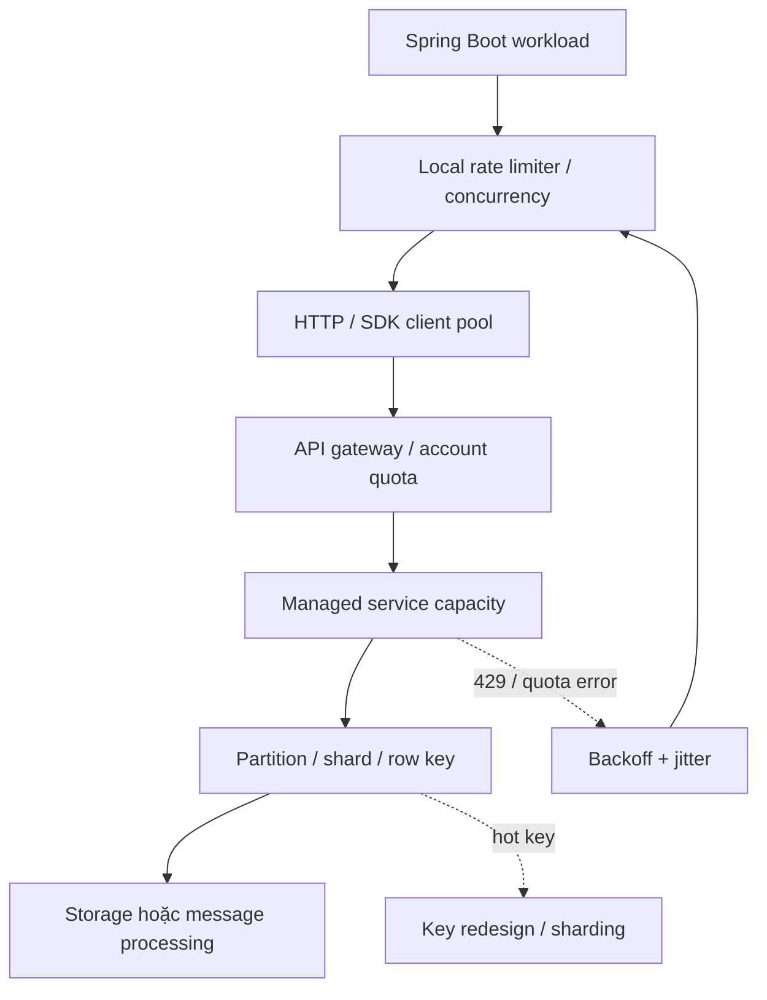

# Throttling, vượt hạn ngạch và điểm nóng trên partition

Khi một ứng dụng Spring Boot gửi request tới dịch vụ managed trên AWS, Azure hoặc Google Cloud, dịch vụ có thể từ chối tạm thời vì lưu lượng vượt khả năng xử lý hoặc giới hạn được cấp. Ứng dụng thường nhìn thấy HTTP `429`, `RESOURCE_EXHAUSTED`, `ThrottlingException`, `ProvisionedThroughputExceededException`, `RequestRateTooLarge` hoặc lỗi tương tự. Một trường hợp khó nhận ra hơn là chỉ một partition, shard, row key hoặc message group bị quá tải trong khi tổng lưu lượng toàn hệ thống vẫn thấp.

Ba khái niệm cần phân biệt:

- **Throttling:** dịch vụ chủ động giảm/từ chối request trong một khoảng thời gian vì tốc độ hoặc mức đồng thời vượt ngưỡng hiện tại. Thường có thể phục hồi bằng cách giảm tốc độ, chờ theo chỉ dẫn và thử lại có giới hạn.
- **Quota/limit exceeded:** workload đã chạm một giới hạn được áp dụng cho account, project, region, namespace, resource hoặc API. Một số quota có thể tăng qua cấu hình/yêu cầu hỗ trợ; một số là giới hạn cứng hoặc giới hạn theo thiết kế dịch vụ.
- **Hot partition:** lưu lượng phân bố không đều, tập trung vào một partition key, shard, tablet, queue group hoặc resource cụ thể. Tổng throughput có thể chưa cao nhưng một phân vùng đã đạt giới hạn.

Tăng retry hoặc nâng quota không phải lúc nào cũng giải quyết được nguyên nhân. Nếu mọi request đều nhắm vào cùng một key, retry có thể làm điểm nóng nặng hơn. Bài học này trình bày cách nhận diện loại giới hạn, điều tiết lưu lượng trong Spring Boot, thiết kế partition key và theo dõi các dịch vụ dữ liệu/messaging phổ biến.

Sau bài học, bạn có thể:

- Phân biệt throttling tạm thời, quota cứng và hot partition qua mã lỗi, header và metrics.
- Áp dụng retry có backoff, jitter, `Retry-After` và deadline tổng.
- Giới hạn concurrency/rate ở producer, consumer và application layer.
- Thiết kế partition key để phân bố tải và tránh một key/row/shard nhận phần lớn traffic.
- Điều tra các tình huống trên DynamoDB/Kinesis, Azure Cosmos DB/Service Bus và Google Pub/Sub/Bigtable.
- Xây dựng dashboard, cảnh báo và quy trình tăng quota hoặc giảm tải có kiểm soát.

## 1. Throttling, quota và hot partition khác nhau thế nào?

| Tình huống | Dấu hiệu thường thấy | Phạm vi giới hạn | Hướng xử lý chính |
|---|---|---|---|
| Throttling theo tốc độ | 429, throttled request, `Retry-After` | API, resource, account hoặc service | Giảm rate/concurrency, chờ đúng thời gian rồi retry |
| Quota cứng hoặc quota account | `QuotaExceeded`, `RESOURCE_EXHAUSTED`, lỗi tạo resource | Project/account/region/namespace | Kiểm tra quota, dừng request không thể thành công, xin tăng quota hoặc phân bổ tài nguyên |
| Capacity của resource | `ProvisionedThroughputExceeded`, RU/s vượt mức | Table/container/partition/shard | Tăng capacity phù hợp, tối ưu truy vấn hoặc giảm tải |
| Hot partition/key | Một partition key/shard có throttling cao, phân bố request lệch | Một phần dữ liệu hoặc một luồng message | Thiết kế lại key, shard/salt, giới hạn tải theo key |
| Client-side saturation | Pending queue, thread pool hoặc connection pool đầy; có thể chưa có 429 từ server | Process/instance của ứng dụng | Điều chỉnh concurrency, pool, batching và backpressure |
| Downstream overload | Latency tăng, 5xx/timeout cùng với throttling | Dịch vụ đích hoặc dependency phía sau | Giảm tải, circuit breaker, bulkhead và phối hợp capacity |

**Không phải mọi HTTP 429 đều có cùng nghĩa.** Mã lỗi cần được đọc cùng error code, response header, tên resource, metric dịch vụ và thời điểm phát sinh. Ví dụ 429 của Cosmos DB thường gắn với request units (RU) hoặc phân bố partition; 429 của API control plane có thể là rate limit ở một tầng khác. Tương tự `RESOURCE_EXHAUSTED` của Google Cloud có thể phản ánh quota project, giới hạn API hoặc capacity của tài nguyên.

## 2. Một request bị throttling ở đâu?

Giới hạn có thể tồn tại ở nhiều lớp. Một ứng dụng có thể đồng thời bị giới hạn bởi gateway, SDK, API service, partition, database hoặc message broker.



Khi xử lý sự cố, hãy xác định tầng trả lỗi. Nếu rate limiter trong ứng dụng từ chối request trước khi gửi, đó là local throttling. Nếu SDK nhận HTTP 429 từ endpoint, dịch vụ hoặc gateway phía trước đã từ chối. Nếu chỉ một partition bị throttling, tăng pool hoặc số replica có thể làm tình hình tệ hơn vì nhiều request hơn cùng đổ vào key nóng.

## 3. Đọc mã lỗi, header và metrics

### 3.1. Thông tin cần ghi nhận

Mỗi lỗi throttling nên được log có cấu trúc với các trường sau:

- Tên dịch vụ, operation/API và region.
- Resource identifier đã được che hoặc chuẩn hóa (table/container/topic/queue/shard).
- HTTP status và provider error code.
- `Retry-After` hoặc header retry tương ứng nếu có.
- Request ID/correlation ID từ provider.
- Partition key hash hoặc shard ID nếu dịch vụ cung cấp và việc ghi nhận không làm lộ dữ liệu nhạy cảm.
- Attempt number, thời gian chờ, latency và kết quả cuối cùng.
- Mức concurrency, queue depth và rate tại client.

Không log toàn bộ payload, access token, credential hoặc partition key có chứa dữ liệu cá nhân. Nếu cần phân tích key skew, dùng hash ổn định hoặc bucket phân loại thay vì ghi raw key.

### 3.2. Mã lỗi thường gặp

| Dịch vụ | Dấu hiệu có thể gặp | Cần kiểm tra |
|---|---|---|
| Amazon DynamoDB | `ProvisionedThroughputExceededException`, `ThrottlingException`, `RequestLimitExceeded` | Table/index capacity, key range/partition, consumed capacity, throttled requests và account quota |
| Amazon Kinesis Data Streams | `ProvisionedThroughputExceededException`, `LimitExceededException` | Shard write/read throughput, partition key distribution, shard count và consumer mode |
| Amazon SQS | `RequestThrottled`, API throttling hoặc lỗi quota | Request rate, batch size, account/queue quota, FIFO message group và API operation |
| Azure Cosmos DB | HTTP 429, substatus liên quan rate limit, header `x-ms-retry-after-ms` | RU consumption, normalized RU/s theo physical partition, partition key skew và hot logical partition |
| Azure Service Bus | `ServiceBusy`, `QuotaExceeded` hoặc transient server busy | Namespace/entity limits, concurrent links/operations, message size và SDK retry |
| Google Cloud Pub/Sub | `RESOURCE_EXHAUSTED`, quota exceeded | Project/region quota, publish/subscribe throughput, outstanding messages và flow control |
| Google Cloud Bigtable | Thường thể hiện qua latency cao/CPU cao thay vì một mã 429 duy nhất | Tablet hotspot, row-key distribution, node utilization và request latency |

Tên exception và header có thể khác theo API, SDK version hoặc transport. Dùng provider request ID để tra log/metric phía dịch vụ. Không chỉ tìm chuỗi `429` trong log vì SDK có thể đã retry và chỉ trả exception cuối cùng sau nhiều lần thử.

## 4. Retry đúng cách: backoff, jitter và Retry-After

Retry có ích khi lỗi mang tính tạm thời. Retry không tạo thêm capacity và không sửa quota cứng. Khi nhiều instance retry cùng thời điểm, exponential backoff không có jitter có thể khiến tất cả request quay lại cùng lúc (thundering herd).

### 4.1. Exponential backoff có jitter

Một chiến lược phổ biến là tăng dần thời gian chờ theo attempt và thêm random jitter:

\[
delay_n = random(0, \min(cap, base \times 2^n))
\]

Ví dụ với `base = 100 ms`, `cap = 5 s`, thời gian chờ có thể tăng theo dải 0–100 ms, 0–200 ms, 0–400 ms... cho tới tối đa 5 giây. Full jitter giúp các instance phân tán thời điểm retry. Một số policy dùng equal jitter hoặc decorrelated jitter; điều quan trọng là có cap và không retry vô hạn.

Nếu response có `Retry-After` hoặc header provider tương đương, ưu tiên tuân thủ chỉ dẫn đó trong giới hạn deadline của request. Với Cosmos DB, SDK có thể đọc `x-ms-retry-after-ms`; với HTTP API, `Retry-After` có thể biểu diễn số giây hoặc HTTP date. Không tự parse mọi header như một số nguyên nếu protocol cho phép nhiều định dạng.

### 4.2. Retry phải nằm trong deadline tổng

Giả sử API của ứng dụng có deadline 3 giây. Nếu một lần gọi downstream đã mất 2,5 giây và provider yêu cầu chờ thêm 2 giây, retry không còn nằm trong deadline. Khi đó cần trả lỗi có kiểm soát hoặc đưa công việc vào queue để xử lý bất đồng bộ, thay vì giữ request thread quá hạn.

Nguyên tắc:

- Chỉ retry lỗi tạm thời và có thể phục hồi.
- Giới hạn số lần retry và tổng thời gian chờ.
- Tôn trọng `Retry-After`/provider retry delay khi có.
- Thêm jitter để phân tán tải giữa các instance.
- Không retry validation, authentication, authorization hoặc quota hard limit như thể chúng là lỗi tạm thời.
- Đảm bảo thao tác ghi có idempotency key hoặc semantics an toàn khi request đầu có thể đã thành công.
- Tính cả retry nội bộ của SDK; tránh nhân retry ở SDK, Spring Retry, gateway và message consumer mà không kiểm soát.

### 4.3. Ví dụ helper backoff trong Java

Ví dụ dưới đây minh họa tính delay cho một lần thử tiếp theo. Nó không thay thế retry policy của SDK hoặc việc nhận diện lỗi provider:

```java
import java.time.Duration;
import java.util.concurrent.ThreadLocalRandom;

public final class BackoffPolicy {
    private BackoffPolicy() {}

    public static Duration fullJitter(
        int attempt,
        Duration base,
        Duration cap
    ) {
        long baseMillis = base.toMillis();
        long capMillis = cap.toMillis();
        if (baseMillis < 0 || capMillis <= 0 || capMillis == Long.MAX_VALUE) {
            throw new IllegalArgumentException("base must be non-negative and cap must be positive and bounded");
        }
        int exponent = Math.min(Math.max(attempt, 0), 20);
        long factor = 1L << exponent;
        long upper = baseMillis > capMillis / factor
            ? capMillis
            : Math.min(capMillis, baseMillis * factor);
        long delay = ThreadLocalRandom.current().nextLong(upper + 1);
        return Duration.ofMillis(delay);
    }
}
```

Trong code production, kiểm tra overflow khi nhân thời gian, xử lý `Duration.ZERO`, cap lớn và deadline còn lại. `attempt` nên bắt đầu từ 0 cho lần retry đầu tiên. Khi provider trả `Retry-After`, dùng parser riêng của protocol và kết hợp với deadline tổng; không cộng thêm một backoff ngẫu nhiên dài hơn chỉ dẫn của provider nếu tài liệu yêu cầu tuân thủ chính xác.

## 5. Điều tiết tải ở Spring Boot

Một ứng dụng nên có giới hạn chủ động trước khi request tới dịch vụ managed. Các cơ chế thường dùng:

- **Rate limiter:** giới hạn số request trong một đơn vị thời gian.
- **Concurrency limiter/bulkhead:** giới hạn số thao tác đồng thời.
- **Bounded queue:** giới hạn số công việc chờ; khi đầy thì backpressure hoặc từ chối sớm.
- **Batching:** gom nhiều item trong một request khi API hỗ trợ, giảm overhead nhưng không vượt kích thước/tần suất giới hạn.
- **Adaptive throttling:** giảm tốc độ khi nhận throttling/latency tăng và phục hồi dần khi hệ thống ổn định.
- **Per-key limiter:** giới hạn riêng theo tenant, customer, partition key hoặc resource nóng để một key không chiếm toàn bộ năng lực.

### 5.1. Rate limit khác concurrency limit

Rate limit kiểm soát tốc độ bắt đầu request, ví dụ tối đa 100 request/giây. Concurrency limit kiểm soát số request đang chạy cùng lúc. Nếu mỗi request mất 2 giây, 100 request/giây có thể tạo khoảng 200 request đồng thời theo định luật Little khi tải ổn định. Vì vậy chỉ đặt rate limit mà không quan sát latency/concurrency có thể vẫn làm pool cạn.

### 5.2. Ví dụ dùng Resilience4j RateLimiter

Resilience4j có thể giới hạn tốc độ gọi một dependency. Ví dụ cấu hình:

```yaml
resilience4j:
  ratelimiter:
    instances:
      inventory-api:
        limit-for-period: 80
        limit-refresh-period: 1s
        timeout-duration: 0
```

Có thể gắn limiter ở service method qua integration phù hợp với Spring Boot/Resilience4j version hoặc gọi trực tiếp qua API decorator. `timeout-duration: 0` có nghĩa không chờ permit; nếu không lấy được permit, ứng dụng từ chối sớm để tránh xếp hàng không giới hạn. Các giá trị trên chỉ minh họa, phải đặt theo quota/throughput thực tế và chia ngân sách giữa số replica.

Một limiter trong bộ nhớ chỉ điều tiết **mỗi instance**. Nếu có 10 replica, mỗi replica cho 80 request/giây thì tổng có thể đạt khoảng 800 request/giây. Để có giới hạn toàn cục, cần gateway/distributed limiter hoặc phân bổ ngân sách per-instance dựa trên replica count. Khi autoscaling, phải cập nhật ngân sách hoặc dùng cơ chế phân phối token tập trung.

### 5.3. Bounded concurrency và backpressure

Với consumer bất đồng bộ, không chỉ tăng số listener/thread để xử lý backlog. Hãy giới hạn outstanding message và số tác vụ gọi database/API cùng lúc. Nếu downstream bắt đầu trả 429, giảm concurrency; khi ổn định, tăng dần theo mức đã đo.

Với Reactor, tránh tạo queue không giới hạn hoặc `flatMap` concurrency quá cao. Có thể đặt concurrency cụ thể:

```java
Flux.fromIterable(events)
    .flatMap(this::callManagedService, 20)
    .onErrorContinue((error, event) -> recordFailure(event, error));
```

Ví dụ chỉ minh họa concurrency 20; `onErrorContinue` không phải cách xử lý lỗi mặc định phù hợp cho mọi pipeline vì có thể bỏ qua item. Trong xử lý nghiệp vụ, thường nên chuyển lỗi từng item thành kết quả có kiểu, retry có giới hạn hoặc đưa item thất bại vào luồng phục hồi rõ ràng.

## 6. AWS: DynamoDB, Kinesis và SQS

### 6.1. DynamoDB throttling và hot partition key

DynamoDB phân phối dữ liệu theo partition key. Một table có tổng capacity lớn vẫn có thể throttling nếu một partition key hoặc một nhóm key nhận tỷ lệ request quá cao. Adaptive capacity giúp phân bổ năng lực linh hoạt hơn trong một số trường hợp, nhưng không loại bỏ mọi giới hạn vật lý hoặc giới hạn theo partition/key.

Dấu hiệu cần kiểm tra:

- `ThrottledRequests`, `ReadThrottleEvents`, `WriteThrottleEvents`.
- `ConsumedReadCapacityUnits` và `ConsumedWriteCapacityUnits`.
- Throttling reason/resource trong exception khi SDK cung cấp.
- Key skew: một số partition key nhận phần lớn request.
- GSI có partition key nóng riêng dù table base phân bố tốt.
- Transactional write hoặc burst traffic làm tăng nhu cầu capacity trong thời gian ngắn.

Một thiết kế key như `customerId` có thể trở thành hot key nếu một tenant lớn chiếm đa số lưu lượng. Đừng chỉ thêm random suffix mà không nghĩ tới truy vấn: khi dữ liệu được chia thành nhiều shard, truy vấn theo customer có thể phải fan-out và tổng hợp kết quả.

### 6.2. Thiết kế partition key và write sharding

Một số hướng giảm hot key:

- Chọn partition key có cardinality cao và phân bố tương đối đều theo workload thực tế.
- Kết hợp thuộc tính để phân tán dữ liệu, ví dụ tenant + resource hoặc ngày + hash bucket, nếu truy vấn có thể hỗ trợ.
- Với một key nóng không thể đổi, dùng write sharding: thêm suffix shard để phân phối ghi, sau đó đọc/aggregate qua các shard.
- Dùng cache hoặc counter aggregation khi nghiệp vụ cho phép giảm số lần đọc/ghi cùng key.
- Tách workload nặng của một tenant/resource sang table hoặc resource riêng nếu cần isolation.
- Kiểm tra cả Global Secondary Index; index partition key có thể nóng dù table key không nóng.

Ví dụ write sharding:

```java
int shard = Math.floorMod(event.eventId().hashCode(), 16);
String partitionKey = event.customerId() + "#" + shard;
```

Đây chỉ là cách minh họa. Khi đọc theo `customerId`, ứng dụng có thể cần query 16 shard rồi merge kết quả. Chọn số shard theo throughput, chi phí fan-out và khả năng tăng/giảm shard; không thay số shard tùy tiện sau khi dữ liệu đã được ghi nếu không có versioning/migration strategy.

### 6.3. Kinesis Data Streams

Kinesis phân phối record vào shard dựa trên partition key. Nếu nhiều record dùng cùng một partition key, chúng có thể tập trung vào một shard và vượt giới hạn đọc/ghi của shard đó, dù tổng stream còn capacity. Kiểm tra metric `WriteProvisionedThroughputExceeded`, `ReadProvisionedThroughputExceeded`, iterator age và incoming bytes/records theo shard.

Hướng xử lý:

- Chọn partition key phân bố tốt, tránh một key cố định cho toàn bộ producer.
- Nếu cần ordering theo entity, dùng key theo entity nhưng đánh giá mức độ nóng của entity lớn.
- Tăng shard count hoặc dùng on-demand mode khi phù hợp với mô hình tải và quota; tăng tổng shard không tự sửa một partition key vẫn dồn vào một shard.
- Điều chỉnh consumer parallelism theo shard/partition và tránh một consumer xử lý chậm làm iterator age tăng.
- Batching record để giảm overhead nhưng vẫn tuân thủ giới hạn request/record và xử lý partial failure.

### 6.4. SQS và message group

Với SQS Standard, throughput và API request quota có thể là giới hạn account/queue/region; batch receive/send/delete giúp giảm request overhead. Với SQS FIFO, `MessageGroupId` quyết định nhóm ordering và khả năng xử lý song song. Một group duy nhất có thể trở thành điểm nóng và tuần tự hóa toàn bộ xử lý.

Nếu nghiệp vụ cần ordering theo order/customer, dùng group ID theo aggregate đó. Nếu không cần ordering toàn cục, tránh dùng một group chung. Kiểm tra `ApproximateNumberOfMessagesVisible`, `ApproximateNumberOfMessagesNotVisible`, oldest message age, API throttling và receive/delete batch size. DLQ/redrive không thay thế việc điều tiết producer và consumer concurrency.

## 7. Azure: Cosmos DB và Service Bus

### 7.1. Cosmos DB RU throttling

Azure Cosmos DB sử dụng Request Units (RU) để biểu diễn chi phí request. Khi request vượt throughput được cấp hoặc một physical partition bị quá tải, dịch vụ có thể trả HTTP 429. Response có thể chứa `x-ms-retry-after-ms` để chỉ thời gian chờ trước khi thử lại. SDK thường có retry/throttling handling tích hợp; cần quan sát số lần retry và tổng thời gian chờ để biết request bị chậm do SDK retry hay do server xử lý.

Metrics nên xem:

- Total requests và tỷ lệ HTTP 429.
- Normalized RU Consumption theo physical partition (nếu metric được bật và hỗ trợ).
- RU consumption theo operation/query và container.
- Request latency, retry count, diagnostics của SDK.
- Partition key distribution và logical partition có hoạt động vượt trội.

Một logical partition có thể trở thành hot partition nếu phần lớn request cùng dùng một partition key. Tăng RU/s tổng thể có thể không xử lý được key skew hoặc giới hạn logical partition. Xem xét partition key khác, hierarchical partition key khi phù hợp với API/feature đang dùng, hoặc chia dữ liệu theo tenant/time/hash có chủ đích.

### 7.2. Tối ưu request units

Giảm RU tiêu thụ có thể hiệu quả hơn tăng throughput:

- Dùng point read với partition key và item ID thay cho query rộng khi có thể.
- Chỉ lấy field cần thiết và giới hạn page size.
- Tạo index phù hợp với query; tránh scan/ORDER BY không cần thiết.
- Dùng batch/transactional batch trong cùng logical partition khi nghiệp vụ phù hợp.
- Cache dữ liệu đọc nhiều, ít thay đổi và có TTL/invalidations rõ ràng.
- Tránh query cross-partition thường xuyên nếu có thể thiết kế truy vấn theo partition key.

Không bỏ index một cách máy móc để giảm RU ghi; cần đo trade-off đọc/ghi. Kiểm tra diagnostics của SDK để xác định operation nào tiêu thụ RU cao.

### 7.3. Service Bus throttling

Azure Service Bus có giới hạn theo namespace, entity, tier và operation. Khi namespace bận, SDK có thể trả lỗi transient như ServiceBusy hoặc quota-related exception. Kiểm tra CPU/throughput/requests, message size, concurrent sends/receives, links và connection reuse.

Hướng xử lý:

- Dùng một `ServiceBusClient` dùng chung theo lifecycle ứng dụng thay vì tạo client mỗi message.
- Batching message nếu phù hợp và không vượt kích thước tối đa.
- Giới hạn số send/receive đồng thời, flow control ở processor và consumer.
- Dùng retry policy của Azure SDK nhưng tránh retry lồng với Spring Retry mà không tính tổng attempt.
- Kiểm tra tier/namespace quota và yêu cầu tăng quota nếu workload hợp lệ vượt giới hạn được cấp.
- Tách namespace/entity cho workload cần isolation nếu kiến trúc và chi phí cho phép.

## 8. Google Cloud: Pub/Sub và Bigtable

### 8.1. Pub/Sub `RESOURCE_EXHAUSTED`

Pub/Sub có quota và giới hạn theo project, region, publisher/subscriber và subscription. `RESOURCE_EXHAUSTED` có thể chỉ quota project, throughput, số outstanding messages hoặc flow-control limit của client. Kiểm tra Cloud Monitoring, quota page, request metrics và client logs để xác định lỗi do service hay client.

Publisher nên dùng batching và flow control. Flow control giới hạn số message/byte đang chờ xác nhận publish; nếu vượt ngưỡng, client có thể block hoặc báo lỗi tùy cấu hình. Subscriber cũng cần giới hạn outstanding messages/bytes và số callback đồng thời để tránh nhận nhanh hơn khả năng xử lý.

Không tạo quá nhiều publisher/subscriber client cho mỗi request. Tái sử dụng client, đóng đúng lifecycle và đặt batch/flow-control theo throughput đã đo. Khi tăng publish rate, kiểm tra quota theo region và project; nếu quota cứng đã chạm, backoff chỉ làm request chậm lại chứ không tăng hạn mức.

### 8.2. Bigtable hotspot

Bigtable phân phối dữ liệu theo row key range. Nếu row key được tạo theo timestamp tăng dần hoặc prefix có cardinality thấp, các lần ghi mới có thể dồn vào một tablet đang nhận key range cuối cùng. Kết quả là hotspot, latency tăng và throughput không tận dụng đều các node.

Ví dụ row key tuần tự:

```text
2026-11-24#customer-001
2026-11-24#customer-002
2026-11-24#customer-003
...
```

Các row mới có thể tập trung vào vùng key gần nhau. Có thể thêm prefix hash/salt để phân tán:

```text
07#2026-11-24#customer-001
13#2026-11-24#customer-002
02#2026-11-24#customer-003
...
```

Salt cần được tính ổn định từ entity ID để truy vấn biết cách tìm đúng row. Nếu query theo customer, có thể tính salt từ customer ID; nếu salt random theo từng event, truy vấn sẽ cần fan-out hoặc secondary index. Thiết kế row key phải cân bằng write distribution với pattern đọc và khả năng range scan.

Theo dõi node CPU, storage utilization, request latency, hot tablets/key ranges và distribution. Tăng node có thể giúp capacity tổng thể nhưng không luôn loại bỏ hotspot do row-key design.

## 9. Điều chỉnh producer và consumer trong messaging

Throttling thường xuất hiện khi producer phát nhanh hơn broker hoặc consumer xử lý nhanh hơn downstream có thể chịu. Điều tiết cần đặt ở cả hai đầu:

- Producer: batch, giới hạn send concurrency, flow control, quota-aware rate và retry.
- Broker: partition/shard/queue capacity, topic/namespace quota, retention và subscription policy.
- Consumer: max outstanding messages, concurrency, batch size và ack deadline/visibility/lock.
- Downstream: database pool, API rate limit, bulkhead và transaction duration.

Nếu consumer xử lý message rồi ghi database, tăng consumer concurrency từ 10 lên 100 có thể làm database cạn connection. Cần đo throughput end-to-end và xác định bottleneck trước khi scale một thành phần riêng lẻ.

### 9.1. Ví dụ điều tiết concurrency

Với Spring Cloud Stream, một số binder có property riêng để điều chỉnh concurrency, prefetch hoặc max outstanding messages. Không có một property chung bảo đảm cùng semantics cho mọi binder. Cần:

1. Xem tài liệu binder của broker đang dùng.
2. Đặt concurrency ban đầu thấp hơn giới hạn downstream.
3. Đo consumer lag, processing latency, database pool pending và throttling.
4. Tăng dần concurrency cho tới khi đạt throughput mục tiêu mà không làm p95/p99 hoặc lỗi tăng mạnh.
5. Giảm concurrency tự động hoặc theo runbook khi downstream throttling kéo dài.

Với consumer tự viết, có thể dùng bounded executor/queue. Khi queue đầy, áp dụng backpressure hoặc dừng nhận thêm message nếu protocol hỗ trợ; không tạo hàng đợi vô hạn trong heap.

### 9.2. Adaptive rate control

Một bộ điều tiết thích nghi có thể giảm rate khi:

- Tỷ lệ 429/throttling vượt ngưỡng trong cửa sổ quan sát.
- `Retry-After` trung bình tăng.
- Latency p95/p99 hoặc pending queue tăng liên tục.
- Partition-specific throttling tập trung vào một key.

Sau khi ổn định, tăng rate dần (additive increase) thay vì nhảy về mức cao ngay lập tức. Giới hạn rate theo resource/key có thể giúp một tenant nóng không chiếm toàn bộ ngân sách của các tenant khác. Khi dùng nhiều replica, phải phối hợp limiter hoặc phân bổ quota rõ ràng để tổng rate không vượt giới hạn.

## 10. Hot partition: nhận diện và thiết kế lại key

### 10.1. Dấu hiệu key skew

- Tổng throughput table/stream/container còn thấp nhưng throttling vẫn tăng.
- Một số partition/shard/tablet có latency hoặc utilization cao bất thường.
- Một tenant, customer, device hoặc product tạo phần lớn request.
- Tăng node/throughput tổng thể không cải thiện đáng kể.
- Query/scan theo một key hoặc range gây tải lặp lại.

### 10.2. Các mẫu thiết kế giảm điểm nóng

| Mẫu | Ý tưởng | Trade-off |
|---|---|---|
| High-cardinality key | Chọn key có nhiều giá trị và phân bố đều | Có thể khó truy vấn theo thuộc tính nghiệp vụ khác |
| Composite key | Kết hợp tenant, resource, time bucket hoặc loại dữ liệu | Cần thiết kế query theo đúng prefix/partition |
| Write sharding/salt | Chia một logical hot key thành nhiều physical key | Đọc phải fan-out/aggregate; cần versioning shard |
| Time bucketing | Chia dữ liệu theo giờ/ngày/tháng | Truy vấn khoảng thời gian phải đọc nhiều bucket |
| Per-tenant isolation | Tách tenant lớn sang resource riêng | Tăng chi phí vận hành và migration |
| Aggregation/cache | Gộp nhiều cập nhật hoặc cache kết quả đọc nóng | Có độ trễ nhất quán và cần invalidation |
| Queue partition/group | Phân tán message theo aggregate hoặc key | Ordering chỉ còn trong phạm vi partition/group |

Không có một key tốt cho mọi workload. Hãy lấy distribution thực tế, xác định truy vấn chủ đạo và mô phỏng cả read/write pattern trước khi thay key. Thay partition key thường là một migration dữ liệu, không phải đổi một dòng code rồi deploy.

### 10.3. Cẩn trọng với một key cần ordering

Một customer hoặc order có thể cần xử lý tuần tự để giữ invariant nghiệp vụ. Không nên chia shard tùy ý nếu các thao tác cùng aggregate phụ thuộc thứ tự. Có thể giữ ordering trong phạm vi aggregate nhưng phân tán giữa các aggregate bằng key riêng. Nếu một aggregate đơn lẻ có tải vượt khả năng một partition, cần xem lại mô hình nghiệp vụ: gộp counter, batch update, append event rồi aggregate, hoặc chia trách nhiệm theo sub-entity có semantics rõ.

## 11. Phân biệt tăng quota và sửa thiết kế

Khi quota bị vượt, hãy trả lời các câu hỏi trước khi gửi yêu cầu tăng quota:

1. Quota nào đang bị chạm: request rate, throughput, connection, message size, partition, resource count hay project-wide API limit?
2. Quota là hard limit, adjustable quota hay capacity có thể scale tự động?
3. Lưu lượng là burst ngắn hay tăng trưởng ổn định?
4. Có key skew, retry storm, duplicate request hoặc batch size kém hiệu quả không?
5. Client có đang tạo nhiều connection/client instance hoặc vượt concurrency không?
6. Có thể cache, batch, giảm payload, tối ưu query hoặc tách workload không?
7. Nếu tăng quota, chi phí, region availability và downstream capacity có đáp ứng không?

**Nên yêu cầu tăng quota** khi workload hợp lệ, phân bố tốt, đã tối ưu request và có dự báo tăng trưởng. **Nên sửa kiến trúc trước** khi chỉ một key/partition nóng, retry lặp, request dư thừa hoặc một consumer group tạo quá nhiều concurrency. Có thể cần cả hai: sửa key skew và tăng capacity tổng thể.

## 12. Runbook điều tra throttling

1. **Khoanh vùng:** service, region, resource, operation và thời điểm bắt đầu.
2. **Đọc lỗi:** status, provider error code, retry-after, request ID và attempt count.
3. **Kiểm tra client:** local rate limiter, concurrency, pending queue, pool, SDK retry và số client instance.
4. **Kiểm tra service metrics:** quota utilization, consumed capacity/RU, throttled request, shard/tablet utilization và server latency.
5. **Tìm key skew:** top partition key hash, shard, message group hoặc tenant theo tỷ lệ tải.
6. **Giảm tác động:** hạ producer rate/concurrency, pause batch, giới hạn tenant/key nóng hoặc bật circuit breaker.
7. **Chọn biện pháp:** backoff, batching, cache, tăng capacity/quota, shard key hoặc tách workload.
8. **Canary và xác minh:** triển khai một phần, so sánh 429, latency, backlog, cost và business success.
9. **Theo dõi sau phục hồi:** bảo đảm retry backlog không tạo đợt tải thứ hai; kiểm tra DLQ và request bị bỏ dở.

Không restart tất cả producer/consumer cùng lúc trong lúc dịch vụ đang throttling. Khi các instance khởi động lại đồng loạt, chúng có thể đồng thời warm connection, replay backlog và tạo một đợt burst mới.

## 13. Observability và cảnh báo

Dashboard nên kết hợp metric client, broker và data service:

| Lớp | Metrics cần theo dõi |
|---|---|
| Producer/application | Requests per second, accepted/rejected, retry count, backoff time, limiter denied, concurrency |
| SDK/client | Attempt count, request latency, connection pool pending, timeout và error code |
| Database/storage | Consumed capacity/RU, throttled request, partition utilization, hot key, query latency |
| Messaging | Publish/consume throughput, backlog, oldest message age, outstanding messages, redelivery/DLQ |
| Hạ tầng | CPU, memory, network, connection count, autoscaling events và quota utilization |
| Chi phí | RU/capacity provisioned, shard/node count, request volume và egress nếu liên quan |

Đặt cảnh báo theo xu hướng và tác động nghiệp vụ, không chỉ một 429 đơn lẻ. Ví dụ cảnh báo khi tỷ lệ throttling vượt ngưỡng liên tục trong 5 phút, oldest message age tăng, p99 vượt SLA hoặc một partition có utilization lệch đáng kể so với median. Ngưỡng cụ thể phải dựa trên baseline và quota thực tế của resource.

Không dùng partition key, customer ID hoặc request ID làm label metric có cardinality cao. Ghi top key hash trong log/trace hoặc dashboard chuyên biệt với sampling và bảo vệ dữ liệu.

## 14. Checklist trước production

- [ ] Biết quota và throughput limit của service, region, resource và account/project.
- [ ] Phân biệt 429 do service, gateway, client limiter hay partition-specific throttling.
- [ ] SDK retry được cấu hình rõ; tổng attempt ở mọi tầng không bị nhân lên ngoài dự kiến.
- [ ] Retry dùng exponential backoff, jitter, `Retry-After` và deadline tổng.
- [ ] Ghi provider request ID, error code, attempt và resource context mà không lộ secret.
- [ ] Rate limiter và concurrency limiter có ngân sách tính theo tổng replica.
- [ ] Queue/pending work có giới hạn; có backpressure khi đầy.
- [ ] Partition key/shard key/row key/message group được kiểm tra phân bố theo workload thật.
- [ ] Có kế hoạch xử lý hot key: sharding, bucketing, batching, cache hoặc tenant isolation.
- [ ] Consumer concurrency không vượt khả năng database/downstream.
- [ ] Metrics/cảnh báo bao gồm throttling, capacity, backlog, p95/p99 và key skew.
- [ ] Có runbook giảm tải, yêu cầu tăng quota và canary sau thay đổi.

## 15. Kết luận

Throttling là tín hiệu cần điều tiết lưu lượng; quota exceeded cho biết một giới hạn cụ thể đã bị chạm; hot partition cho thấy tải phân bố lệch. Retry có backoff, jitter và `Retry-After` giúp xử lý lỗi tạm thời, còn rate/concurrency limit và bounded queue bảo vệ downstream. Khi chỉ một partition key, shard, row key hoặc message group nóng, cần xem lại cách phân vùng dữ liệu và luồng xử lý. Kết hợp metric phía client với metric của dịch vụ managed giúp quyết định chính xác khi nào giảm tải, tối ưu key, tăng capacity hoặc yêu cầu tăng quota.

## Tài liệu tham khảo

- [Amazon DynamoDB — Handling throttling](https://docs.aws.amazon.com/amazondynamodb/latest/developerguide/Programming.Errors.html): lỗi throttling, retry và capacity.
- [Amazon DynamoDB — Partition key design](https://docs.aws.amazon.com/amazondynamodb/latest/developerguide/bp-partition-key-design.html): thiết kế partition key và write sharding.
- [Amazon Kinesis Data Streams — Resharding and partition keys](https://docs.aws.amazon.com/streams/latest/dev/kinesis-record-processor-using-shard.html): shard, partition key và xử lý throughput.
- [Amazon SQS — Quotas](https://docs.aws.amazon.com/AWSSimpleQueueService/latest/SQSDeveloperGuide/quotas-messages.html): quota và giới hạn theo queue/region.
- [Azure Cosmos DB — Request units](https://learn.microsoft.com/azure/cosmos-db/request-units): RU và throughput.
- [Azure Cosmos DB — Diagnose and troubleshoot 429](https://learn.microsoft.com/azure/cosmos-db/troubleshoot-request-rate-too-large): throttling, retry-after và partition utilization.
- [Azure Service Bus — Throttling operations](https://learn.microsoft.com/azure/service-bus-messaging/service-bus-throttling): giới hạn và throttling.
- [Google Cloud Pub/Sub — Quotas and limits](https://cloud.google.com/pubsub/quotas): quota theo project/region và giới hạn throughput.
- [Google Cloud Pub/Sub — Publisher flow control](https://cloud.google.com/pubsub/docs/flow-control): batching, outstanding messages và flow control.
- [Google Cloud Bigtable — Schema design](https://cloud.google.com/bigtable/docs/schema-design): row key design và tránh hotspot.
- [Resilience4j — RateLimiter](https://resilience4j.readme.io/docs/ratelimiter): giới hạn tốc độ trong ứng dụng Java.
