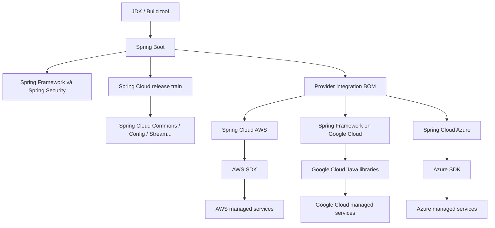
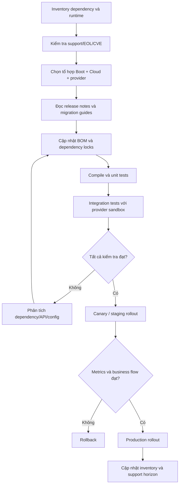

# Theo dõi vòng đời Spring Boot, Spring Cloud và thư viện nhà cung cấp

Một ứng dụng Spring Boot tích hợp AWS, Azure hoặc Google Cloud thường phụ thuộc vào nhiều nhóm thư viện có lịch phát hành và chính sách hỗ trợ riêng. Spring Boot quản lý nền tảng ứng dụng; Spring Cloud cung cấp các mô hình phân tán và release train; thư viện của từng nhà cung cấp kết nối tới dịch vụ managed và SDK tương ứng. Một phiên bản mới của Spring Boot hoặc Spring Cloud không có nghĩa mọi thư viện provider đã tương thích ngay.

Vì vậy, theo dõi vòng đời tích hợp cần trả lời bốn câu hỏi: **phiên bản nào còn được hỗ trợ, các phiên bản có nằm trong ma trận tương thích chính thức không, dependency thực tế có hội tụ không và quy trình nâng cấp đã kiểm chứng hành vi với cloud service chưa**. Chỉ nhìn số phiên bản mới nhất hoặc để Maven/Gradle tự chọn dependency có thể tạo ra một tổ hợp biên dịch được nhưng không được nhà cung cấp hỗ trợ.

Bài thuộc chương **Nâng cấp tích hợp** của module **SPRING_CLOUD_PROVIDER_INTEGRATION**. Module thực hành tích hợp Spring Boot với dịch vụ managed của AWS, Azure và Google Cloud qua thư viện Spring Cloud tương ứng, bao gồm identity, storage, messaging, dữ liệu, secret, kiểm thử và đánh giá khác biệt giữa các provider.

## 1. Mục tiêu học tập

Sau bài học, bạn có thể:

- Phân biệt Spring Boot, Spring Framework, Spring Cloud release train và thư viện provider.
- Đọc ma trận tương thích thay vì chọn phiên bản theo cảm tính.
- Hiểu vòng đời hỗ trợ của Spring Boot, Spring Cloud và từng thư viện AWS/Azure/Google Cloud.
- Chọn một tổ hợp JDK, Boot, Cloud và provider BOM có giao điểm hỗ trợ.
- Quản lý dependency bằng BOM và tránh ghi đè phiên bản transitive tùy tiện.
- Theo dõi release notes, migration guide, CVE và ngày EOL.
- Phát hiện dependency convergence, binary incompatibility và lỗi auto-configuration.
- Lập quy trình nâng cấp theo từng bước, có kiểm thử tích hợp cloud và rollback.
- Duy trì một bảng inventory giúp đội vận hành biết thành phần nào sắp hết hỗ trợ.

## 2. Bản đồ các lớp phiên bản

Một ứng dụng Spring Cloud provider integration thường có các lớp sau:



Các lớp này liên quan nhưng không phát hành cùng một nhịp:

| Lớp | Vai trò | Nơi kiểm tra vòng đời |
| --- | --- | --- |
| JDK | Runtime, compiler và API nền tảng | Chính sách hỗ trợ của JDK distribution và yêu cầu của Spring |
| Spring Boot | Auto-configuration, dependency management, Actuator và packaging | Spring Boot Supported Versions, release notes |
| Spring Framework | Container, web, data binding, transaction và core APIs | Spring Framework releases và support policy |
| Spring Cloud | Các thành phần phân tán và release train | Spring Cloud compatibility/support matrix |
| Spring Cloud AWS | Tích hợp S3, SQS, SNS, Secrets Manager và AWS SDK | README, release notes, compatibility table của AWSpring |
| Spring Framework on Google Cloud | Tích hợp GCS, Pub/Sub, Secret Manager và Google Cloud libraries | Compatibility table và release notes của Spring Cloud GCP |
| Spring Cloud Azure | Tích hợp Azure Storage, Service Bus, Key Vault và Azure SDK | Spring Versions Mapping, changelog |
| SDK của provider | HTTP/gRPC client, authentication, retry và model API | AWS SDK, Google Cloud Java libraries, Azure SDK release/support notes |

Một ứng dụng có thể dùng Spring Boot đang được hỗ trợ nhưng vẫn phụ thuộc vào provider library đã EOL. Ngược lại, provider library có bản mới không có nghĩa nó tương thích với Spring Boot hiện tại. Phải kiểm tra từng lớp và giao điểm của chúng.

## 3. Phân biệt phiên bản và release train

### 3.1. Spring Boot version

Spring Boot dùng phiên bản theo dạng major.minor.patch, ví dụ `4.0.2` hoặc `4.2.0`.

- **Major:** có thể thay đổi API và hành vi không tương thích.
- **Minor:** có thể bổ sung tính năng, thay đổi/deprecate API và nâng dependency.
- **Patch:** chủ yếu sửa lỗi và lỗ hổng bảo mật, ưu tiên tương thích ngược trong cùng nhánh.

Spring Boot phát hành major/minor khoảng sáu tháng một lần, thường vào tháng 5 và tháng 11; patch được phát hành khi cần. Chính sách OSS của Spring Boot quy định major được hỗ trợ ít nhất ba năm và minor ít nhất mười hai tháng, nhưng phải chạy trên minor còn được hỗ trợ. Kiểm tra trang Supported Versions để biết nhánh cụ thể còn nhận cập nhật hay không.

### 3.2. Spring Cloud release train

Spring Cloud gom nhiều project thành một release train. Phiên bản train không phải phiên bản Spring Boot. Ví dụ:

- Spring Boot `4.0.x` dùng Spring Cloud `2025.1.x`.
- Spring Boot `3.5.x` dùng Spring Cloud `2025.0.x`.
- Spring Boot `3.4.x` dùng Spring Cloud `2024.0.x`.

Mỗi train có BOM `spring-cloud-dependencies` để quản lý phiên bản các project Spring Cloud. Chọn train dựa trên Spring Boot đang dùng, sau đó chọn service release mới nhất còn được hỗ trợ trong train đó.

Spring Cloud có chính sách hỗ trợ riêng: major ít nhất ba năm, minor ít nhất mười hai tháng. Release train không có một ngày EOL độc lập duy nhất; thời gian hỗ trợ được tổng hợp từ các project nằm trong train. Khi xem trạng thái, hãy kiểm tra project cụ thể và trạng thái Spring Boot mà train hỗ trợ.

### 3.3. Provider library có lịch riêng

Các thư viện provider không tự động theo phiên bản Spring Cloud train:

- **Spring Cloud AWS** do nhóm AWSpring phát hành, có BOM và ma trận Boot/Cloud riêng.
- **Spring Framework on Google Cloud** do Google Cloud duy trì, có compatibility table riêng.
- **Spring Cloud Azure** do Azure SDK for Java duy trì, có mapping Boot/Cloud/provider version và JDK riêng.

Không suy luận rằng một thư viện provider tương thích chỉ vì Spring Cloud train đã hỗ trợ Boot đó. Cần có compatibility table, release note hoặc xác nhận chính thức của dự án provider.

## 4. Đọc ma trận tương thích

Ma trận tương thích là điều kiện đầu tiên trước khi sửa dependency. Nó cho biết một provider release line được kiểm thử với Spring Boot, Spring Cloud, Spring Framework và JDK nào.

<text color="secondary" size="xs">Ảnh chụp ma trận công khai được kiểm tra ngày 24-11-2026. Đây là mốc tham khảo để đọc cách chọn phiên bản; trước mỗi lần nâng cấp phải mở lại ma trận hiện hành.</text>

| Spring Boot | Spring Cloud train | Spring Cloud GCP | Spring Cloud AWS | Spring Cloud Azure |
| --- | --- | --- | --- | --- |
| `4.2.x` | `2026.0.x` | Chưa thấy matrix provider xác nhận | Chưa thấy matrix provider xác nhận | Chưa thấy matrix provider xác nhận |
| `4.0.x` | `2025.1.x` | `8.x` | `4.x` | `7.x` |
| `3.5.x` | `2025.0.x` | `7.x` | `3.4.x` | `6.x` hoặc `5.x` |
| `3.4.x` | `2024.0.x` | `6.x` | `3.3.x` | `5.x` |

Các điểm cần đọc cùng bảng:

1. Spring Boot `4.2.0` được phát hành ngày 19-11-2026; Spring Cloud `2026.0.0` (Paddington) được phát hành ngày 20-11-2026 và dựa trên Boot `4.2.0`.
2. Ma trận Spring Cloud core có thể đã công bố Boot `4.2`, trong khi ma trận provider chưa cập nhật hoặc chưa xác nhận adapter tương thích.
3. Với giao điểm được tài liệu provider xác nhận cho cả ba cloud trong snapshot này, tổ hợp Boot `4.0.x` + Spring Cloud `2025.1.x` là baseline thận trọng; provider line tương ứng là GCP `8.x`, AWS `4.x` và Azure `7.x`.
4. GCP `8.x` công bố hỗ trợ Boot `4.0.x` và `4.1.x`; bảng trên chọn `4.0.x` để thể hiện giao điểm chung với AWS và Azure.
5. Dòng “Chưa thấy matrix provider xác nhận” không có nghĩa chắc chắn không chạy được. Nó có nghĩa chưa có căn cứ công khai đủ để tuyên bố tổ hợp được hỗ trợ; cần chờ compatibility table hoặc xác nhận của provider.

Không dùng bảng tĩnh trong bài học làm thay thế kiểm tra release mới nhất. Ma trận có thể thay đổi sau một lần cập nhật README, changelog hoặc release train.

### 4.1. Ví dụ chọn tổ hợp

Giả sử một service cần tích hợp S3, Pub/Sub và Azure Key Vault trong cùng một ứng dụng. Quy trình chọn:

- Chọn JDK được tất cả framework/provider line hỗ trợ.
- Chọn Boot minor còn OSS support.
- Chọn Spring Cloud train tương ứng với Boot.
- Kiểm tra từng provider BOM có công bố hỗ trợ đúng Boot/Cloud line.
- Chỉ sau đó mới kiểm tra các SDK và starter cụ thể mà service thực sự dùng.

Nếu muốn chuyển sang Boot `4.2.x`, cần kiểm tra riêng Spring Cloud `2026.0.x`, Spring Cloud AWS, Spring Cloud GCP và Spring Cloud Azure. Không nâng cả ba adapter chỉ vì Spring Cloud core đã phát hành train mới.

## 5. Vòng đời hỗ trợ và EOL

`Latest` không đồng nghĩa `Supported`. Một bản mới có thể vừa phát hành nhưng chưa được provider adapter hỗ trợ; một nhánh cũ có thể vẫn nhận security patch trong một thời gian; một minor có thể EOL dù major vẫn còn vòng đời thương mại.

### 5.1. Các mốc cần theo dõi

| Mốc | Ý nghĩa | Việc đội phát triển cần làm |
| --- | --- | --- |
| GA (General Availability) | Bản phát hành ổn định | Đọc release notes và compatibility matrix |
| Maintenance | Nhánh chỉ nhận sửa lỗi/patch theo chính sách | Theo dõi patch và chuẩn bị nâng minor |
| End of OSS support | Không còn cập nhật OSS theo chính sách | Lập kế hoạch chuyển sang nhánh còn hỗ trợ |
| End of commercial support | Hết cả thời gian hỗ trợ thương mại tương ứng | Hoàn tất nâng cấp hoặc chấp nhận rủi ro có phê duyệt |
| Security advisory | Có CVE hoặc lỗ hổng được công bố | Xác định dependency bị ảnh hưởng và mức độ phơi nhiễm |
| Deprecation | API/property còn dùng được nhưng đã bị đánh dấu bỏ | Thay thế trước khi API bị xóa ở major/minor sau |

### 5.2. Đừng chỉ theo dõi Spring Boot

Một bảng inventory nên ghi ít nhất:

| Thành phần | Phiên bản hiện tại | Phiên bản mục tiêu | Support/EOL | Nguồn kiểm chứng |
| --- | --- | --- | --- | --- |
| JDK | `17` | Theo runtime policy | Theo distribution | Vendor JDK |
| Spring Boot | `4.0.x` | Nhánh còn hỗ trợ | Theo Boot support page | Spring Boot |
| Spring Cloud | `2025.1.x` | Train tương ứng | Theo project trong train | Spring Cloud |
| Spring Cloud GCP | `8.x` | Theo Boot/Cloud matrix | Theo project GCP | Google Cloud |
| Spring Cloud AWS | `4.x` | Theo Boot/Cloud matrix | Theo AWSpring | AWSpring |
| Spring Cloud Azure | `7.x` | Theo Boot/Cloud matrix | Theo Azure mapping | Azure SDK |
| AWS/Google/Azure SDK BOM | Theo provider BOM | Patch tương thích | Theo SDK lifecycle | Provider SDK |
| Maven/Gradle plugin | Phiên bản build | Phiên bản được hỗ trợ | Theo build tool | Apache/Gradle |

Điền ngày EOL và trạng thái từ nguồn chính thức tại thời điểm lập inventory. Không tự tính EOL chỉ bằng cách cộng số tháng vào ngày phát hành; có thể có ngoại lệ, commercial support hoặc điều chỉnh chính sách.

## 6. Quản lý BOM và dependency alignment

BOM (Bill of Materials) quản lý một tập hợp phiên bản dependency tương thích. Thay vì đặt version cho từng starter và SDK, dự án import BOM phù hợp rồi khai báo dependency không có version riêng.

### 6.1. Vai trò của từng BOM

| BOM | Tọa độ Maven | Quản lý |
| --- | --- | --- |
| Spring Boot | `org.springframework.boot:spring-boot-dependencies` | Spring Boot và nhiều dependency nền tảng |
| Spring Cloud | `org.springframework.cloud:spring-cloud-dependencies` | Các project trong Spring Cloud train |
| Spring Cloud GCP | `com.google.cloud:spring-cloud-gcp-dependencies` | Spring Framework on Google Cloud modules |
| Spring Cloud AWS | `io.awspring.cloud:spring-cloud-aws-dependencies` | Spring Cloud AWS modules |
| Spring Cloud Azure | `com.azure.spring:spring-cloud-azure-dependencies` | Spring Cloud Azure modules |
| AWS SDK BOM | `software.amazon.awssdk:bom` | AWS SDK v2 modules |
| Azure SDK BOM | `com.azure:azure-sdk-bom` | Azure Java SDK modules |
| Google Cloud libraries BOM | `com.google.cloud:libraries-bom` | Google Cloud Java client libraries |

Một ứng dụng chỉ tích hợp một provider thường chỉ cần provider BOM tương ứng. Ứng dụng multi-cloud có thể cần nhiều BOM, nhưng các BOM có thể quản lý một số dependency chung hoặc transitive dependency khác nhau. Khi import nhiều BOM, phải kiểm tra effective POM và dependency resolution thực tế; không giả định thứ tự import luôn cho kết quả mong muốn.

### 6.2. Ví dụ Maven cho một provider

Ví dụ minh họa cấu trúc dependency management cho Spring Boot `4.0.x`, Spring Cloud `2025.1.x` và Spring Cloud GCP `8.x` theo compatibility matrix đã nêu. Thay `x` bằng phiên bản GA cụ thể được xác nhận trong release page tại thời điểm triển khai.

```xml
<properties>
    <java.version>17</java.version>
    <spring-cloud.version>2025.1.x</spring-cloud.version>
    <spring-cloud-gcp.version>8.x</spring-cloud-gcp.version>
</properties>

<dependencyManagement>
    <dependencies>
        <dependency>
            <groupId>org.springframework.cloud</groupId>
            <artifactId>spring-cloud-dependencies</artifactId>
            <version>${spring-cloud.version}</version>
            <type>pom</type>
            <scope>import</scope>
        </dependency>

        <dependency>
            <groupId>com.google.cloud</groupId>
            <artifactId>spring-cloud-gcp-dependencies</artifactId>
            <version>${spring-cloud-gcp.version}</version>
            <type>pom</type>
            <scope>import</scope>
        </dependency>
    </dependencies>
</dependencyManagement>

<dependencies>
    <dependency>
        <groupId>com.google.cloud</groupId>
        <artifactId>spring-cloud-gcp-starter-storage</artifactId>
    </dependency>
</dependencies>
```

Nếu dùng AWS, thay provider BOM và starter bằng tọa độ `io.awspring.cloud` tương ứng. Nếu dùng Azure, dùng `com.azure.spring:spring-cloud-azure-dependencies` và starter theo dịch vụ. Không copy version GCP sang AWS/Azure hoặc ngược lại.

### 6.3. Ví dụ import provider BOM

AWS:

```xml
<dependency>
    <groupId>io.awspring.cloud</groupId>
    <artifactId>spring-cloud-aws-dependencies</artifactId>
    <version>4.x</version>
    <type>pom</type>
    <scope>import</scope>
</dependency>
```

Azure:

```xml
<dependency>
    <groupId>com.azure.spring</groupId>
    <artifactId>spring-cloud-azure-dependencies</artifactId>
    <version>7.x</version>
    <type>pom</type>
    <scope>import</scope>
</dependency>
```

Đây là fragment để minh họa tọa độ BOM, không phải ba BOM cần import cùng lúc. Khi một service thực sự dùng nhiều provider, import các BOM cần thiết, đọc hướng dẫn dependency management của từng dự án và kiểm tra dependency convergence.

### 6.4. Gradle dùng platform

```kotlin
dependencies {
    implementation(platform(
        "org.springframework.cloud:spring-cloud-dependencies:$springCloudVersion"
    ))
    implementation(platform(
        "com.google.cloud:spring-cloud-gcp-dependencies:$springCloudGcpVersion"
    ))

    implementation("com.google.cloud:spring-cloud-gcp-starter-storage")
}
```

Với AWS hoặc Azure, thêm platform của provider tương ứng. Không dùng `force` để ép một dependency transitive về phiên bản tùy ý nếu chưa kiểm tra tương thích.

## 7. Tránh dependency drift và xung đột transitive

Dependency drift xảy ra khi build nhận một phiên bản khác với phiên bản đội phát triển nghĩ rằng đang dùng. Nguyên nhân thường là BOM thiếu, khai báo version riêng, dependency bắc cầu hoặc plugin build thay đổi.

Các nhóm dependency thường gây xung đột:

- `spring-core`, `spring-context`, `spring-web`, `spring-security`.
- `spring-cloud-commons`, `spring-cloud-context`, `spring-cloud-stream`.
- Reactor, Netty và HTTP client.
- Jackson, Guava và protobuf.
- AWS SDK v2 modules.
- Google Cloud Java libraries và gRPC.
- Azure Core và các Azure SDK modules.

### 7.1. Kiểm tra Maven

Xem dependency tree:

```bash
./mvnw dependency:tree -Dverbose
```

Xem POM hiệu lực sau khi import BOM:

```bash
./mvnw help:effective-pom
```

Có thể bật Maven Enforcer `dependencyConvergence` để phát hiện nhiều version của cùng artifact trong graph. Nếu có exclusion hoặc override, ghi rõ lý do và test module phụ thuộc.

### 7.2. Kiểm tra Gradle

```bash
./gradlew dependencies --configuration runtimeClasspath
```

Xem lý do một dependency được chọn:

```bash
./gradlew dependencyInsight --dependency spring-core --configuration runtimeClasspath
```

Dùng Gradle dependency locking hoặc version catalog để build tái lập. Khi thay BOM, cập nhật lock state có kiểm soát và review thay đổi dependency tree.

### 7.3. Triệu chứng thường gặp

| Triệu chứng | Nguyên nhân có thể | Cách kiểm tra |
| --- | --- | --- |
| `NoSuchMethodError` | Runtime nạp phiên bản API khác với phiên bản lúc compile | Dependency tree, BOM và classpath runtime |
| `ClassNotFoundException` | Starter/module bị loại hoặc artifact đổi package | Dependency tree và migration guide |
| Auto-configuration không tạo bean | Condition/property/classpath thay đổi | Condition evaluation report, release notes |
| Nhiều bean cùng loại | Starter mới thêm auto-config hoặc bean override thay đổi | Application context report và cấu hình bean |
| Lỗi `NoClassDefFoundError` ở gRPC/Netty | Version transitive không hội tụ | Dependency insight và BOM của provider |
| Authentication thất bại sau upgrade | Credential chain, token provider hoặc SDK đổi hành vi | Provider migration guide và identity integration test |
| Retry/timeout thay đổi | HTTP client hoặc SDK defaults thay đổi | Release notes và cấu hình client |
| Native image/buildpack lỗi | Reflection metadata hoặc build plugin thay đổi | Native build report và compatibility notes |

Không chữa `NoSuchMethodError` bằng cách thêm một dependency version ngẫu nhiên. Xác định artifact nào bị chọn sai và BOM nào cần quản lý nó.

## 8. Theo dõi release notes, migration guide và CVE

Mỗi lần nâng cấp nên kiểm tra ít nhất bốn nguồn:

1. Release notes của Spring Boot và migration guide giữa các minor/major.
2. Spring Cloud release notes và compatibility matrix.
3. Release notes/changelog của provider library.
4. Advisory/security notes của SDK và các dependency transitive.

Các loại thay đổi cần chú ý:

- API/property bị deprecated hoặc removed.
- Starter đổi artifact name, package hoặc auto-configuration.
- Authentication chain và credential provider đổi mặc định.
- Retry, timeout, endpoint, region hoặc transport client đổi.
- Serialization, protobuf và gRPC version đổi.
- Java baseline tăng.
- Spring Framework hoặc Spring Security nâng major.
- Test support, emulator và Testcontainers đổi.

Ví dụ, Spring Boot `4.2.0` (19-11-2026) ghi nhận các thay đổi liên quan Spring Framework `7.1`; hỗ trợ `RestTemplate`/`TestRestTemplate` được deprecate theo hướng `RestClient` và `RestTestClient`. Một ứng dụng provider integration có HTTP client customizer hoặc test dùng `TestRestTemplate` cần đọc migration notes trước khi nâng, dù code nghiệp vụ không thay đổi.

### 8.1. Không chỉ nhìn CVE của starter

Một starter có thể không có CVE trực tiếp nhưng kéo theo SDK hoặc HTTP client bị ảnh hưởng. Cần quét toàn bộ runtime dependency graph và SBOM, sau đó xác định:

- Artifact và version bị ảnh hưởng.
- CVE có thực sự áp dụng cho module được sử dụng không.
- Service nào đang nạp artifact đó.
- Có patch tương thích trong cùng release line không.
- Nếu phải override version, provider có xác nhận tương thích không.
- Có cần nâng cả BOM hoặc provider library không.

Không trì hoãn security patch chỉ vì chưa đến kỳ nâng major. Ưu tiên patch trong nhánh tương thích; nếu không có patch, đánh giá mitigations và kế hoạch nâng cấp có thời hạn.

## 9. Lập lịch theo dõi vòng đời

Một quy trình vận hành thực tế có thể chia thành ba nhịp:

| Nhịp | Công việc | Kết quả cần lưu |
| --- | --- | --- |
| Hàng tuần | Theo dõi security advisory, release patch và lỗi tương thích nghiêm trọng | Danh sách advisory, owner và mức ưu tiên |
| Hàng tháng | Cập nhật dependency report/SBOM, kiểm tra version mới và trạng thái support | Dependency inventory và delta |
| Hàng quý | Kiểm tra EOL horizon, JDK/build tool, kế hoạch major/minor và năng lực test | Upgrade roadmap và maintenance window |
| Trước mỗi release | Kiểm tra matrix, release notes, lock file và integration test | Quyết định go/no-go |
| Khi có CVE nghiêm trọng | Đánh giá ngay phạm vi ảnh hưởng và patch/mitigation | Incident/change record |

Đặt cảnh báo trước EOL đủ sớm để có thời gian nâng cấp, ví dụ trước ba đến sáu tháng tùy mức độ phức tạp. Đây là quy tắc quản trị nội bộ, không phải mốc EOL do Spring quy định.

Một bảng theo dõi nên có: component, current version, target version, support status, EOL date/source, owner, CVE status, compatibility evidence, last checked date và issue link.

## 10. Quy trình nâng cấp có kiểm soát



### 10.1. Bước 1 — Lập baseline

Ghi lại:

- JDK vendor/version và build tool.
- Spring Boot, Spring Framework và Spring Security.
- Spring Cloud train và từng project Spring Cloud đang dùng.
- Provider BOM/starter và SDK BOM.
- Container base image, buildpack và deployment runtime.
- Danh sách cloud service thực sự được tích hợp.
- Test đang có: unit, emulator, Testcontainers, sandbox cloud.

Tạo dependency tree và SBOM để biết artifact nào được đưa vào runtime.

### 10.2. Bước 2 — Chọn target theo giao điểm hỗ trợ

Không chọn target chỉ theo release mới nhất. Kiểm tra:

- Boot minor còn support.
- Spring Cloud train tương ứng.
- Provider matrix xác nhận Boot/Cloud line.
- JDK được cả ba nhóm hỗ trợ.
- SDK BOM không nằm ngoài support policy.

Nếu provider chưa công bố compatibility cho Boot mới, giữ baseline đang được xác nhận hoặc nâng trong một nhánh thử nghiệm riêng cho tới khi có xác nhận chính thức.

### 10.3. Bước 3 — Đọc migration guide

Đọc thay đổi theo đúng đường nâng cấp. Nếu đi từ Boot 3.5 lên 4.0, đọc migration guide 3.5 → 4.0 và release notes của Spring Cloud/provider. Nếu đi từ Boot 4.0 lên 4.2, đọc migration notes cho từng minor liên quan, không chỉ release notes của 4.2.

Tìm các từ khóa: `removed`, `deprecated`, `breaking`, `auto-configuration`, `property`, `authentication`, `retry`, `timeout`, `JDK`, `HTTP client`.

### 10.4. Bước 4 — Nâng dependency theo nhóm

Một trình tự dễ kiểm soát:

1. Nâng JDK/build tool nếu target yêu cầu.
2. Nâng Spring Boot và các dependency do Boot quản lý.
3. Nâng Spring Cloud BOM tương ứng.
4. Nâng provider BOM/starter theo matrix.
5. Nâng SDK trực tiếp chỉ khi provider yêu cầu hoặc có security fix.
6. Chạy dependency convergence và review lock file.

Với major upgrade, không thay tất cả provider integration trong một commit lớn nếu không cần thiết. Chia theo nhóm để biết thay đổi nào gây lỗi.

### 10.5. Bước 5 — Kiểm thử hành vi tích hợp

Tối thiểu kiểm tra:

- ADC/workload identity hoặc credential chain của provider.
- IAM/RBAC và quyền đọc/ghi tài nguyên.
- Storage upload/download, metadata và retry.
- Messaging publish/consume, ack/nack, redelivery và ordering nếu dùng.
- Database connection, transaction, pooling và failover.
- Secret retrieval, rotation và refresh.
- Timeout, retry, backoff, circuit breaker và rate limit.
- Tracing, metrics, log correlation và health/readiness.
- Serialization, payload compatibility và schema.
- Startup/shutdown và graceful termination.

Unit test với mock không thay thế integration test trên sandbox hoặc emulator. Các thay đổi authentication, IAM và network cần được xác minh bằng principal/runtime tương ứng.

### 10.6. Bước 6 — Canary và rollback

Triển khai một nhóm nhỏ instance hoặc một revision trước. Theo dõi:

- Startup failure và readiness.
- Error rate theo từng provider API.
- Authentication/authorization failures.
- Latency, timeout và retry volume.
- Message backlog/redelivery.
- Connection pool saturation.
- CPU/memory và startup time.

Giữ artifact và cấu hình trước upgrade có thể triển khai lại. Rollback cần bao gồm cả image, BOM/dependency lock và cấu hình runtime nếu thay đổi contract. Không rollback ứng dụng về version cũ trong khi đã phá vỡ schema hoặc credential mà version cũ cần.

## 11. Kiểm thử compatibility cho từng provider

Mỗi provider có các rủi ro riêng ngoài compatibility của Spring.

| Provider | Thành phần cần kiểm tra | Ví dụ kiểm thử |
| --- | --- | --- |
| AWS | Spring Cloud AWS, AWS SDK v2, credential chain, region/provider endpoint | S3 read/write, SQS ack/redelivery, SNS publish, Secrets Manager retrieval |
| Google Cloud | Spring Framework on Google Cloud, Google Cloud Java libraries, ADC, gRPC | GCS upload/download, Pub/Sub publish/subscribe, Secret Manager access |
| Azure | Spring Cloud Azure, Azure SDK BOM, TokenCredential, managed identity | Blob upload/download, Service Bus send/receive, Key Vault secret retrieval |

Một test có thể chạy tốt bằng user credential trên laptop nhưng thất bại trên Cloud Run, GKE, ECS hoặc Azure managed identity. Integration test phải dùng loại identity và policy gần với production nhất có thể.

Nếu dùng nhiều provider trong cùng service, kiểm tra cả trường hợp một provider tạm thời không khả dụng. Không để auto-configuration hoặc dependency của provider A vô tình làm hỏng startup của provider B khi feature tương ứng bị tắt.

## 12. Các tín hiệu cần đưa vào dashboard

Một dashboard vòng đời không chỉ hiển thị version hiện tại. Nó cần cho thấy khoảng cách tới trạng thái được hỗ trợ.

| Chỉ số | Ý nghĩa | Cách hành động |
| --- | --- | --- |
| `days_until_eol` | Số ngày còn trước mốc EOL đã xác minh | Tạo upgrade issue khi vượt ngưỡng |
| `unsupported_dependency_count` | Số artifact không còn được hỗ trợ | Ưu tiên thay/nâng |
| `dependency_cve_count` | Số CVE theo mức độ | Triage và patch |
| `compatibility_matrix_verified` | Tổ hợp có bằng chứng tương thích chính thức | Chặn release nếu chưa xác minh |
| `dependency_convergence_failures` | Số xung đột dependency | Sửa BOM/override |
| `last_upgrade_test_at` | Lần cuối chạy integration suite với target | Lên lịch kiểm thử |
| `provider_smoke_test_status` | Kết quả smoke test theo AWS/GCP/Azure | Điều tra provider có lỗi |

Không cần biến mọi chỉ số thành metric runtime. Một số thông tin phù hợp hơn với CI report, SBOM dashboard hoặc dependency inventory.

## 13. Bài thực hành: đánh giá nâng cấp một service multi-cloud

**Bối cảnh:** `invoice-service` đang dùng Spring Boot `3.5.x`, Spring Cloud `2025.0.x`, Spring Cloud GCP `7.x`, Spring Cloud AWS `3.4.x` và Spring Cloud Azure `6.x`. Service dùng GCS, S3, Azure Blob, Pub/Sub và Azure Service Bus.

Mục tiêu là đánh giá nâng cấp lên Boot `4.0.x` và Spring Cloud `2025.1.x`.

### Bước 1 — Lập dependency baseline

Chạy:

```bash
./mvnw dependency:tree -Dverbose
./mvnw help:effective-pom
```

Ghi lại JDK, Boot, Cloud train, ba provider BOM và các SDK trực tiếp. Lưu SBOM của artifact hiện tại.

### Bước 2 — Kiểm tra compatibility matrix

Đối chiếu các dòng:

- Boot `4.0.x` với Cloud `2025.1.x`.
- GCP `8.x` với Boot `4.0.x` và Cloud `2025.1.x`.
- AWS `4.x` với Boot `4.0.x` và Cloud `2025.1.x`.
- Azure `7.x` với Boot `4.0.x` và Cloud `2025.1.x`.

Lưu link, ngày kiểm tra và phiên bản patch cụ thể được matrix xác nhận. Không chỉ ghi `latest`.

### Bước 3 — Đọc release notes

Kiểm tra thay đổi Boot 4, Cloud 2025.1 và changelog của từng provider. Tìm API bị xóa, property đổi tên, authentication changes, SDK transport và Java baseline.

### Bước 4 — Cập nhật BOM

Cập nhật Spring Boot parent, Spring Cloud BOM và provider BOM theo compatibility table. Không khai báo version thủ công cho `spring-core`, `spring-web`, Reactor, gRPC hoặc SDK nếu BOM quản lý chúng, trừ khi có lý do đã được kiểm chứng.

### Bước 5 — Kiểm tra dependency convergence

Chạy lại dependency tree và kiểm tra các nhóm Spring, Reactor, Netty, Jackson, gRPC, AWS SDK, Google Cloud libraries và Azure Core. Điều tra mọi version override hoặc exclusion.

### Bước 6 — Chạy integration tests

- GCS và S3: upload, download, metadata, retry.
- Azure Blob: upload/download bằng managed identity test.
- Pub/Sub và Service Bus: publish/consume, ack, redelivery.
- Identity: chạy bằng workload identity hoặc managed identity test.
- Observability: kiểm tra tracing, metrics và correlation ID.

### Bước 7 — Canary và ghi nhận kết quả

Triển khai staging/canary, so sánh error rate, latency, startup time và resource usage. Nếu đạt, hoàn tất rollout. Nếu lỗi, rollback artifact và cấu hình cùng nhau, ghi rõ dependency hoặc behavior gây lỗi.

### Bước 8 — Cập nhật inventory

Ghi version mới, link compatibility matrix, ngày kiểm tra, support status và ngày review tiếp theo. Tạo nhắc việc trước EOL của từng provider line.

## 14. Câu hỏi tự kiểm tra

1. Vì sao Spring Cloud release train version không phải Spring Boot version?
2. Tại sao Boot đang được hỗ trợ không bảo đảm provider starter cũng được hỗ trợ?
3. BOM giải quyết vấn đề dependency alignment như thế nào?
4. Vì sao không nên tự override `spring-core`, Reactor hoặc gRPC mà không kiểm tra provider matrix?
5. Spring Cloud release train có một ngày EOL chung cho mọi project không?
6. Cần kiểm tra những gì trước khi nâng từ Boot 3.5 lên Boot 4.0?
7. Vì sao Boot 4.2 và Spring Cloud 2026.0 có thể đã GA nhưng provider matrix vẫn chưa xác nhận tương thích?
8. Khác nhau giữa `dependency:tree`, `effective-pom` và Gradle `dependencyInsight` là gì?
9. Vì sao integration test phải dùng workload identity gần với production?
10. Những chỉ số nào giúp phát hiện nâng cấp làm tăng lỗi provider API?
11. Khi nào cần nâng provider SDK BOM riêng?
12. Rollback cần khôi phục những thành phần nào ngoài container image?

## 15. Ghi nhớ

Vòng đời tích hợp là giao điểm của nhiều dự án. Spring Boot, Spring Cloud, Spring Framework và thư viện AWS/Azure/Google Cloud có release cadence, compatibility matrix và chính sách hỗ trợ riêng. Chọn phiên bản dựa trên **giao điểm được công bố**, không dựa vào việc mọi thành phần đều có một bản mới nhất.

Dùng BOM để quản lý dependency, theo dõi release notes/support/EOL/CVE và kiểm tra dependency convergence trong CI. Khi nâng cấp, đọc migration guide, chạy test với identity và cloud service thật hoặc sandbox, canary rồi mới rollout. **Một tổ hợp chỉ nên được đưa vào production khi có bằng chứng tương thích, dependency graph rõ ràng và các luồng tích hợp quan trọng đã được kiểm thử.**

## Tài liệu tham khảo chính thức

- [Spring Boot — Supported Versions](https://github.com/spring-projects/spring-boot/wiki/Supported-Versions)
- [Spring Boot — Release Notes and Migration Guides](https://github.com/spring-projects/spring-boot/wiki)
- [Spring Boot 4.2.0 Release Notes](https://github.com/spring-projects/spring-boot/wiki/Spring-Boot-4.2-Release-Notes)
- [Spring Cloud — Project and Boot compatibility](https://spring.io/projects/spring-cloud/)
- [Spring Cloud — Supported Versions](https://github.com/spring-cloud/spring-cloud-release/wiki/Supported-Versions)
- [Spring Cloud 2026.0.0 release announcement](https://spring.io/blog/2026/11/20/spring-cloud-2026-0-0-has-been-released/)
- [Spring Framework on Google Cloud — Compatibility matrix](https://github.com/GoogleCloudPlatform/spring-cloud-gcp)
- [Spring Cloud AWS — Compatibility matrix and supported integrations](https://github.com/awspring/spring-cloud-aws)
- [Spring Cloud Azure — Spring Versions Mapping](https://github.com/Azure/azure-sdk-for-java/wiki/Spring-Versions-Mapping)
- [Spring Initializr](https://start.spring.io/)

