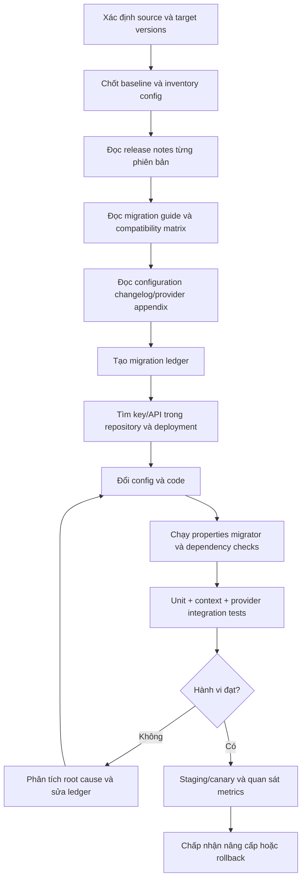

# Đọc release note, migration guide và thay đổi cấu hình trước nâng cấp

Một bản nâng cấp Spring Boot hoặc thư viện Spring Cloud có thể làm ứng dụng thay đổi ngay cả khi code nghiệp vụ không đổi. Property có thể được đổi tên, starter có thể tách module, SDK có thể đổi mặc định về credential hoặc HTTP client, còn message converter có thể serialize payload khác trước. Nếu chỉ cập nhật version trong pom.xml hoặc build.gradle, nhiều thay đổi chỉ xuất hiện khi ứng dụng khởi động hoặc khi gọi dịch vụ cloud thật.

Trước khi nâng cấp, hãy đọc ba nhóm tài liệu theo đúng thứ tự: **release notes để biết điều gì đã thay đổi, migration guide để biết cần sửa gì và configuration changelog để biết từng property cũ phải chuyển sang property nào**. Sau đó đối chiếu các thay đổi này với cấu hình thực tế, dependency và luồng tích hợp mà ứng dụng đang dùng. Kết quả nên là một danh sách thay đổi có thể review, kiểm thử và rollback.

Bài thuộc chương **Nâng cấp tích hợp** của module **SPRING_CLOUD_PROVIDER_INTEGRATION**. Module thực hành tích hợp Spring Boot với dịch vụ managed của AWS, Azure và Google Cloud qua các thư viện Spring Cloud tương ứng. Nội dung tập trung vào cách chuẩn bị nâng cấp, đặc biệt là cấu hình, auto-configuration, identity, HTTP client, serialization, storage, messaging và secret integration.

## 1. Mục tiêu học tập

Sau bài học, bạn có thể:

- Phân biệt vai trò của release notes, migration guide, configuration changelog và compatibility matrix.
- Xác định chính xác phiên bản nguồn, phiên bản đích và các release trung gian cần đọc.
- Tìm property đã deprecated, renamed, removed hoặc đổi default.
- Dùng spring-boot-properties-migrator để phát hiện cấu hình lỗi thời trong giai đoạn chuyển tiếp.
- Đối chiếu property trong YAML, biến môi trường, command-line, Helm values và cấu hình nền tảng.
- Đọc thay đổi của Spring Cloud AWS, Spring Framework on Google Cloud và Spring Cloud Azure.
- Nhận diện thay đổi có thể làm đổi credential chain, HTTP client, JSON payload, retry, timeout và refresh.
- Lập migration checklist và test case từ release notes thay vì chỉ kiểm tra ứng dụng có compile hay không.
- Ghi nhận quyết định nâng cấp, điều kiện tương thích, rủi ro và kế hoạch rollback.

## 2. Bốn loại tài liệu cần đọc

Các tài liệu nâng cấp có mục đích khác nhau. Đọc đúng loại giúp tìm nhanh thông tin cần thiết và tránh bỏ sót thay đổi cấu hình.

| Tài liệu | Trả lời câu hỏi | Nội dung cần tìm |
| --- | --- | --- |
| Release notes | Phiên bản mới có gì thay đổi? | New features, bug fixes, breaking changes, deprecations, dependency upgrades, security fixes |
| Migration guide | Từ phiên bản cũ sang phiên bản mới cần làm gì? | Prerequisites, removed APIs, package/class changes, code migration, dependency changes, upgrade sequence |
| Configuration changelog | Property cũ đổi thành gì? | Renamed, deprecated, removed, added properties, changed defaults |
| Compatibility matrix | Tổ hợp phiên bản nào được hỗ trợ? | Spring Boot, Spring Framework, Spring Cloud train, provider library, JDK |

Ngoài bốn loại trên, một số thay đổi cần đọc thêm tài liệu chuyên biệt:

- API reference/Javadoc khi class, method hoặc interface thay đổi.
- Starter reference documentation khi auto-configuration hoặc bean customization thay đổi.
- SDK migration guide khi nâng AWS SDK, Google Cloud Java libraries hoặc Azure SDK.
- Security advisory khi release có CVE hoặc bản vá bảo mật.
- Testcontainers/emulator documentation khi test module hoặc service connection thay đổi.

**Release notes không thay thế migration guide.** Release notes thường tóm tắt thay đổi theo module; migration guide mô tả đường chuyển từ một phiên bản cụ thể. Configuration changelog lại hữu ích khi cần tìm một key cũ trong hàng trăm dòng YAML.

## 3. Xác định đúng đường nâng cấp

Trước khi đọc tài liệu, ghi rõ phiên bản hiện tại và phiên bản mục tiêu của từng lớp. Ví dụ:

```text
JDK:                 17 -> 21
Spring Boot:         3.5.x -> 4.0.x
Spring Framework:    6.2.x -> 7.0.x
Spring Cloud train:  2025.0.x -> 2025.1.x
Spring Cloud AWS:    3.4.x -> 4.x
Spring Cloud GCP:    7.x -> 8.x
Spring Cloud Azure:  6.x -> 7.x
```

Đây là ví dụ lập kế hoạch, không phải chỉ thị nâng tất cả provider cùng lúc. Mỗi provider có ma trận riêng; chỉ ghi target sau khi đã xác nhận tương thích với Boot, Cloud train và JDK đang chọn.

### 3.1. Đọc mọi release bị đi qua

Nếu nâng từ 3.3 lên 4.0, hãy đọc release notes của các nhánh trung gian có liên quan, migration guide của major và tài liệu cấu hình giữa phiên bản hiện tại với phiên bản đích. Không chỉ đọc release notes của bản cuối. Một property có thể được deprecate trong 3.4, đổi tên ở 3.5 rồi bị xóa trong 4.0.

Spring Boot hướng dẫn nâng từ 3.x cần xem migration guide tương ứng và release notes của các phiên bản đã nhảy qua. Nếu còn cách nhiều release, đọc cả các release notes trung gian để tìm thay đổi tích lũy.

### 3.2. Nâng về patch mới nhất của nhánh nguồn trước

Với major upgrade, trước hết nâng ứng dụng lên patch mới nhất của minor hiện tại còn được hỗ trợ. Ví dụ, trước khi chuyển từ Boot 3.5 sang 4.0, nâng lên patch 3.5 mới nhất. Việc này giúp baseline có các bản vá và dependency cuối cùng của nhánh nguồn, giảm số lỗi chưa biết khi bắt đầu migration.

Sau đó ghi lại commit, artifact version, JDK, dependency tree và kết quả test của baseline. Đây là mốc để so sánh khi target có lỗi.

## 4. Lập danh sách nguồn cấu hình thực tế

Một property có thể được khai báo ở nhiều nơi. Chỉ sửa application.yml mà bỏ qua environment variable hoặc Helm values có thể khiến production vẫn dùng key cũ.

Kiểm kê các nguồn sau:

| Nguồn | Ví dụ | Cần kiểm tra |
| --- | --- | --- |
| application.yml / application.properties | spring.cloud.gcp.project-id | Property cũ, key mới, profile và giá trị mặc định |
| Profile files | application-prod.yml | Override theo môi trường, import và thứ tự nạp |
| Environment variables | SPRING_CLOUD_AZURE_KEYVAULT_SECRET_ENDPOINT | Relaxed binding, key trùng và giá trị do platform inject |
| Java system properties | -Dspring.cloud.aws.region.static=... | JVM flags và cấu hình container |
| Command-line arguments | --spring.profiles.active=prod | Tham số deploy và pipeline |
| Helm/Kubernetes | values.yaml, ConfigMap, Secret | Template, ConfigMap key, mounted file và envFrom |
| Cloud Run/App Service/ECS | Revision variables, task definition, app settings | Runtime configuration và secret reference |
| Infrastructure as Code | Terraform, Pulumi, Bicep, CDK | Tên field, resource attribute và deployment template |
| Java code | @ConfigurationProperties, @Value, Environment#getProperty | Prefix, getter/setter, default và bean customizer |

Với mỗi property quan trọng, ghi cả **nơi khai báo** và **nguồn có hiệu lực lúc chạy**. Một key mới trong YAML có thể bị một biến môi trường cũ ghi đè mà ứng dụng vẫn khởi động bình thường.

### 4.1. Tìm property trong repository

Dùng tìm kiếm theo prefix và key cũ, ví dụ:

```bash
rg -n "spring\\.http\\.(client|reactiveclient)" .
rg -n "cloud\\.aws|spring\\.cloud\\.aws" .
rg -n "spring\\.cloud\\.(gcp|azure)" .
rg -n "@ConfigurationProperties|@Value|Environment#getProperty" src
```

Không chỉ tìm trong src/main/resources. Kiểm tra src/test/resources, Helm chart, Docker Compose, workflow CI/CD, manifest và thư mục deploy nếu dự án có dùng. Không in giá trị secret ra terminal hoặc đưa nội dung cấu hình nhạy cảm vào ticket.

## 5. Đọc Spring Boot release notes và migration guide

Spring Boot release notes thường có phần hướng dẫn nâng cấp và mục New and Noteworthy. Migration guide giải thích các thay đổi lớn theo chủ đề: system requirements, dependency management, configuration properties, auto-configuration, web, data, messaging, observability và testing.

Khi đọc, đánh dấu từng thay đổi theo bốn nhóm:

1. **Bắt buộc sửa:** class/property bị xóa, package đổi, dependency không còn được quản lý hoặc runtime baseline không đạt.
2. **Cần kiểm tra hành vi:** default mới, retry/timeout mới, auto-configuration condition hoặc serialization thay đổi.
3. **Có thể trì hoãn:** API deprecated nhưng vẫn còn hoạt động trong nhánh đích.
4. **Chỉ liên quan khi dùng tính năng:** thay đổi trong module mà ứng dụng không đưa vào classpath.

### 5.1. Ví dụ major upgrade Boot 3.5 lên Boot 4.0

Migration guide Boot 4.0 nêu các điều kiện và thay đổi quan trọng:

- Java 17 trở lên.
- Jakarta EE 11 và Servlet 6.1 baseline.
- Spring Framework 7.x nếu ứng dụng quản lý dependency trực tiếp.
- Các API, method và property đã deprecated trong Boot 3 bị loại khỏi Boot 4.
- Boot 4 có cấu trúc module nhỏ hơn và nhiều starter chuyên biệt hơn.
- Jackson 3 trở thành JSON library ưu tiên.

Điều này ảnh hưởng trực tiếp tới ứng dụng provider integration. Ví dụ, một ứng dụng dùng SQS/Pub/Sub/Service Bus có thể bị ảnh hưởng bởi Jackson 3 và message converter; ứng dụng dùng custom servlet container cần kiểm tra Servlet 6.1; ứng dụng dùng client HTTP cần kiểm tra API và property mới.

### 5.2. Module và starter mới

Boot 4 tổ chức lại module và starter. Nếu trước đây dự án chỉ khai báo một thư viện bên thứ ba để có một tính năng mà Boot tự cấu hình gián tiếp, có thể cần thêm starter chính thức tương ứng. Migration guide cũng yêu cầu rà soát test dependencies: test support cho một số công nghệ đã được tách thành starter riêng.

Không chỉ tìm artifact bị xóa. Hãy so sánh danh sách starter theo công nghệ thực sự sử dụng, ví dụ Flyway, Liquibase, Security test, GraphQL test hoặc các module web. Nếu thiếu starter, code có thể compile nhưng auto-configuration hoặc test slice không hoạt động như trước.

### 5.3. Jackson 2 sang Jackson 3

Boot 4 ưu tiên Jackson 3. Một số thay đổi đáng chú ý:

- Package của Jackson 3 chuyển từ com.fasterxml.jackson sang tools.jackson, ngoại trừ jackson-annotations vẫn giữ package/group tương ứng.
- Một số lớp/customizer đổi tên để phản ánh Jackson 3.
- JSON-specific properties được chuyển vào nhánh spring.jackson.json.*.
- Boot 4 có module spring-boot-jackson2 dạng deprecated làm giải pháp chuyển tiếp cho ứng dụng chưa thể nâng ngay.

Đối với tích hợp cloud, đây là thay đổi cần kiểm thử ở biên hệ thống. JSON gửi qua SQS, SNS, Pub/Sub, Service Bus hoặc HTTP API có thể chứa timestamp, enum, polymorphic type, null field và type metadata. Kiểm tra payload thực tế và khả năng tương thích ngược với consumer đang chạy phiên bản cũ.

## 6. Đọc configuration changelog và sửa property

Configuration changelog liệt kê property được đổi tên, deprecated, removed hoặc thêm mới. Đây là nguồn chính để chuyển các key trong YAML và deployment configuration.

### 6.1. Ví dụ property HTTP client trong Boot 4.0

Configuration changelog giữa Boot 3.5.8 và 4.0.0 đánh dấu các property HTTP client cũ và chỉ ra key thay thế:

| Property cũ | Property mới |
| --- | --- |
| spring.http.client.connect-timeout | spring.http.clients.connect-timeout |
| spring.http.client.factory | spring.http.clients.imperative.factory |
| spring.http.client.read-timeout | spring.http.clients.read-timeout |
| spring.http.client.redirects | spring.http.clients.redirects |
| spring.http.client.ssl.bundle | spring.http.clients.ssl.bundle |
| spring.http.reactiveclient.connector | spring.http.clients.reactive.connector |
| spring.http.reactiveclient.read-timeout | spring.http.clients.read-timeout |

Ví dụ cấu hình trước nâng cấp:

```yaml
spring:
  http:
    client:
      connect-timeout: 2s
      read-timeout: 5s
    reactiveclient:
      connector: reactor
      read-timeout: 5s
```

Cấu hình sau khi đổi key:

```yaml
spring:
  http:
    clients:
      connect-timeout: 2s
      read-timeout: 5s
      reactive:
        connector: reactor
```

Sau khi đổi, vẫn cần kiểm tra timeout có được áp dụng vào HTTP client thực tế hay không. Một provider SDK có thể dùng HTTP transport riêng, không đọc các property HTTP client chung của Boot. Nếu ứng dụng dùng AWS SDK, Google API client hoặc Azure SDK, hãy kiểm tra client customization của provider và test timeout ở đúng client đó.

### 6.2. Phân biệt renamed, deprecated và removed

| Trạng thái | Ý nghĩa | Hành động |
| --- | --- | --- |
| Added | Property mới được hỗ trợ | Đọc default, điều kiện kích hoạt và có cần khai báo không |
| Renamed | Có key thay thế | Đổi tất cả nguồn cấu hình và kiểm tra precedence |
| Deprecated | Còn hoạt động nhưng có thể bị xóa sau | Chuyển sang key/API mới trước major kế tiếp |
| Removed | Không còn được đọc | Xóa key cũ, dùng giải pháp thay thế nếu được công bố |
| Default changed | Không cần đổi tên key nhưng hành vi mặc định đổi | Khai báo giá trị rõ ràng nếu muốn giữ hành vi cũ và test |

Một property có mặt trong file cấu hình không chứng minh framework vẫn sử dụng nó. Nếu key bị bỏ, Spring có thể khởi động bình thường nhưng property không còn tác dụng. Đây là lý do phải kiểm tra diagnostic và hành vi runtime, không chỉ xác nhận startup thành công.

## 7. Dùng Spring Boot Properties Migrator đúng cách

Spring Boot cung cấp spring-boot-properties-migrator để phân tích environment lúc khởi động, ghi diagnostic và tạm thời chuyển một số property đã đổi tên để ứng dụng có thể chạy trong giai đoạn migration.

Maven:

```xml
<dependency>
    <groupId>org.springframework.boot</groupId>
    <artifactId>spring-boot-properties-migrator</artifactId>
    <scope>runtime</scope>
</dependency>
```

Gradle:

```kotlin
dependencies {
    runtimeOnly("org.springframework.boot:spring-boot-properties-migrator")
}
```

Quy trình sử dụng:

1. Thêm migrator vào nhánh nâng cấp tạm thời.
2. Khởi động ứng dụng với từng profile và nguồn cấu hình giống production.
3. Thu thập warning/error về property cũ.
4. Chuyển property sang key mới trong file cấu hình và deployment template.
5. Chạy lại ứng dụng và xác nhận không còn diagnostic liên quan.
6. Xóa migrator khỏi dependency trước khi phát hành chính thức.

Ở các phiên bản hỗ trợ, spring.properties.migrator.fail có thể được dùng để chọn cách xử lý warning/error: never, on-error hoặc on-warning. Dùng chế độ fail trong pipeline migration để ngăn key đã bị loại lọt vào bản build; kiểm tra tài liệu đúng phiên bản Boot trước khi bật.

Migrator có giới hạn. Property được thêm muộn vào Environment, chẳng hạn qua @PropertySource, có thể không được phân tích. Nó cũng không thay thế việc đọc provider configuration changelog và không thể biết một key tùy chỉnh của thư viện bên thứ ba đã thay đổi nếu provider không tích hợp với công cụ.

Không giữ migrator trong production lâu dài. Nó là công cụ chuyển tiếp; cấu hình cuối phải dùng key mới và được kiểm tra bằng test.

## 8. Đọc thay đổi của Spring Cloud release train

Spring Cloud release notes có thể thay đổi hành vi của nhiều project trong cùng train. Khi ứng dụng dùng Config, Gateway, Stream, Bus, OpenFeign hoặc Kubernetes, đọc phần release notes của project tương ứng chứ không chỉ phần tổng quan train.

Ví dụ Spring Cloud 2026.0.0 dựa trên Spring Boot 4.2.0. Release train này đưa Spring Cloud Bus vào Spring Cloud Stream; tọa độ artifact Bus được giữ nguyên để việc chuyển đổi của ứng dụng đang dùng Bus diễn ra liền mạch. Spring Cloud Config bổ sung OAuth 2 để client xác thực với Config Server, hỗ trợ Azure DevOps workload identity và Google Cloud Storage làm backend cho Config Server.

Các thay đổi này có thể ảnh hưởng đến cấu hình dù tên property không đổi:

- Nếu dùng Bus, kiểm tra dependency graph, startup và messaging topology sau khi nâng train.
- Nếu dùng Config Server, kiểm tra OAuth client credentials, token endpoint, scope và trust configuration.
- Nếu dùng GCS làm backend, kiểm tra IAM role, bucket path, object version và behavior khi file không tồn tại.
- Nếu dùng Azure DevOps workload identity, kiểm tra federation subject/issuer và identity mapping.

Đọc release note của project đang dùng và kiểm tra CVE được vá trong train. Một số bản vá có thể thay đổi cách xác thực, kiểm tra origin, cache hoặc xử lý dữ liệu không hợp lệ; không bỏ qua phần security fixes chỉ vì nó không nằm trong mục migration.

## 9. Đọc release notes của từng provider

Provider library có cấu hình, client customization và SDK riêng. Khi nâng một provider, tìm theo các nhóm: configuration, credentials, region, endpoint, retry, timeout, message converter, serialization, health, auto-configuration, testcontainers và breaking changes.

### 9.1. Spring Cloud AWS

Spring Cloud AWS 4.0 là major line tương thích với Spring Boot 4 và Spring Framework 7. Release notes và reference documentation có một số điểm cần chú ý:

- Spring Integration AWS được tích hợp vào Spring Cloud AWS với các module cho SQS, SNS, S3, DynamoDB và Kinesis.
- Hỗ trợ Jackson 3; trong giai đoạn chuyển đổi có cơ chế tương thích Jackson 2.
- Hỗ trợ test được hiện đại hóa với ServiceConnection và Testcontainers 2.
- Các API customizer đã deprecated có thể bị xóa; ví dụ AwsClientCustomizer được loại khỏi core.

Ở nhánh 4.2, release notes tiếp tục bổ sung thay đổi hành vi SQS: SqsTemplate hỗ trợ gửi hơn 10 message trong một batch, bảo toàn generic payload type của listener và thêm QueueNotFoundStrategy. Bản 4.2.0 cũng sửa vấn đề refresh token của AppConfig. Những mục này cần chuyển thành test case cho producer, listener, queue lookup và configuration refresh.

Ví dụ cấu hình cũ từ Spring Cloud AWS 2.x có thể dùng prefix cloud.aws.* hoặc aws.paramstore.*; từ 3.x trở đi, nhiều property đã chuyển sang spring.cloud.aws.* hoặc Config Data import. Ví dụ:

```yaml
# Cấu hình cũ trong nhánh 2.x
cloud:
  aws:
    region:
      static: ap-southeast-1
```

```yaml
# Cấu hình hiện hành
spring:
  cloud:
    aws:
      region:
        static: ap-southeast-1
```

Với Parameter Store, cấu hình cũ dựa trên các property prefix/name có thể cần chuyển sang spring.config.import=aws-parameterstore:/path/. Đừng áp dụng ví dụ migration 2.x sang 3.x cho mọi ứng dụng 3.x sang 4.x; hãy xác định version nguồn trước khi chọn đúng hướng dẫn.

### 9.2. Spring Framework on Google Cloud

Spring Cloud GCP 8.0 đưa dự án lên baseline Spring Boot 4.0 và Spring Framework 7.0. Đây là thay đổi major của nền tảng, không phải chỉ nâng Google Cloud Java libraries. Khi nâng từ GCP 7.x lên 8.x, kiểm tra:

- Compatibility matrix giữa Spring Boot, Spring Cloud train và Spring Framework.
- Auto-configuration của GCS, Pub/Sub, Secret Manager, Cloud SQL và data modules.
- ADC/workload identity và các property spring.cloud.gcp.*.
- Google Cloud Java libraries BOM và gRPC/protobuf transitive dependencies.
- Pub/Sub serializer/deserializer, ack deadline, retry và error handler.
- Spring Data repositories, transaction manager và connection pool nếu dùng Spanner/Datastore/Firestore.

Không giả định mọi property của GCP đổi tên chỉ vì major version đổi. So sánh configuration metadata, reference appendix và release notes giữa đúng hai version đang nâng. Nếu không có key migration được công bố, giữ nguyên key và kiểm chứng bằng test binding/auto-configuration thay vì tự đặt tên thay thế.

### 9.3. Spring Cloud Azure

Spring Cloud Azure có bảng Spring Versions Mapping và changelog theo module. Cần kiểm tra cả mapping Boot/Cloud/JDK lẫn changelog của module cụ thể: App Configuration, Key Vault, Storage, Service Bus hoặc Event Hubs.

Ví dụ Spring Cloud Azure 7.5.0 phát hành ngày 24-11-2026 công bố tương thích đã kiểm thử với Boot 4.0.0–4.1.2 và Spring Cloud 2025.1.0–2025.1.3. Release này thêm hỗ trợ Snapshot References cho App Configuration; sửa refresh chạy đồng bộ làm chặn thread bằng cách chuyển refresh check sang xử lý bất đồng bộ; sửa startup retry có thể báo thành công dù không load được cấu hình; và bổ sung filter pattern cho certificate alias của Key Vault SSL bundle.

Điều đó tạo ra các test cụ thể:

- App Configuration snapshot reference được resolve thành property đúng.
- Refresh không chặn request thread và lỗi refresh vẫn được ghi nhận.
- Startup không báo healthy khi tất cả client vẫn backoff và chưa load config.
- Key Vault SSL bundle chỉ nạp alias certificate theo filter đã khai báo.

Lưu ý: release 7.5.0 chỉ nêu rõ phạm vi đã test tới Boot 4.1.2 và Cloud 2025.1.3; ghi chú “các patch mới hơn có thể tương thích nhưng chưa được test” không phải xác nhận chính thức. Khi target Boot 4.2 hoặc Cloud 2026.0, cần chờ matrix/release note provider xác nhận.

## 10. Kiểm tra thay đổi cấu hình provider theo từng nhóm

Không đọc changelog chỉ theo tên property. Hãy nhóm cấu hình theo hành vi để biết test nào phải chạy.

| Nhóm | AWS | Google Cloud | Azure | Kiểm tra sau nâng cấp |
| --- | --- | --- | --- | --- |
| Identity | DefaultCredentialsProvider, web identity, IAM role | ADC, service account, Workload Identity | TokenCredential, managed identity | Principal đúng, token lấy được, scope/role đúng |
| Region/endpoint | spring.cloud.aws.region.*, endpoint override | Project ID, location, endpoint | Azure endpoint, subscription, resource ID | Gọi đúng resource/environment |
| Storage | S3 client, transfer manager | GCS Storage/Resource | Blob client | Upload/download, metadata, checksum, retry |
| Messaging | SQS/SNS/Kinesis | Pub/Sub | Service Bus/Event Hubs | Payload, ordering, ack, redelivery, DLQ |
| Secret/config | Secrets Manager, Parameter Store, AppConfig | Secret Manager, Config | Key Vault, App Configuration | Load, prefix, optional/required, refresh |
| HTTP/transport | AWS SDK sync/async client | gRPC/HTTP client | Azure Core pipeline | Timeout, proxy, TLS, retry, connection pool |
| Serialization | Jackson converter, SQS headers | JSON/protobuf payload | Jackson/AMQP/Service Bus converter | Wire format tương thích consumer cũ |
| Observability | CloudWatch metrics/tracing | Cloud Logging/Monitoring/Trace | Azure Monitor | Metric names, health, trace context, log fields |

Với mỗi nhóm, tìm property và class đang dùng trong code/config, sau đó tìm đúng mục tương ứng trong release notes và reference documentation của provider. Nếu provider thay đổi default, viết cấu hình rõ ràng hoặc test để phát hiện behavior drift.

## 11. Tạo migration ledger từ tài liệu

Một bảng migration ledger giúp biến tài liệu thành công việc có owner và bằng chứng hoàn tất.

| Trường | Nội dung cần ghi |
| --- | --- |
| Source / target | Version hiện tại và version đích của framework/provider |
| Source document | URL release note, migration guide hoặc config changelog |
| Change type | Renamed, removed, deprecated, default changed, new behavior, CVE |
| Old key/API | Property/class/method hiện đang dùng |
| New key/API | Thay thế được nhà cung cấp công bố |
| Affected locations | YAML, profile, env, Helm, Terraform, code, test |
| Runtime effect | Behavior có thể thay đổi trong production |
| Required test | Test case cụ thể và kết quả mong đợi |
| Owner/status | Người phụ trách, trạng thái và link PR |
| Rollback note | Cần khôi phục config/image/secret/schema gì |

Không đánh dấu hoàn tất chỉ vì đã đổi key. Cần có bằng chứng ứng dụng đọc đúng property sau khi khởi động và hành vi thực tế đúng với kỳ vọng.

## 12. Quy trình đọc và áp dụng tài liệu nâng cấp



### 12.1. Bước 1 — Chụp baseline

Lưu kết quả build, test, dependency tree, effective POM/Gradle resolution, SBOM và cấu hình đang triển khai. Ghi rõ image digest và revision ID để có thể so sánh sau nâng cấp.

### 12.2. Bước 2 — Đọc nguồn theo thứ tự

Đọc release notes của Boot, Cloud train và provider. Sau đó đọc migration guide từ version nguồn tới target, configuration changelog và provider configuration appendix. Đánh dấu mọi thay đổi thuộc module ứng dụng đang dùng; không biến mọi thay đổi trong release thành công việc nếu module đó không nằm trên classpath.

### 12.3. Bước 3 — Tìm và sửa tất cả nguồn cấu hình

Tìm key cũ trong repository và deployment. Sửa YAML, profile, env var, Helm, Terraform, Cloud Run/ECS/App Service settings và test fixture. Xóa alias/fallback cũ sau khi test chứng minh key mới có hiệu lực.

### 12.4. Bước 4 — Chạy diagnostic và kiểm tra auto-configuration

Khởi động với từng profile. Dùng Properties Migrator khi phù hợp. Kiểm tra condition evaluation report, bean definitions và cấu hình client. Với provider starter, xác minh auto-configured credential provider, region, endpoint và HTTP transport.

### 12.5. Bước 5 — Kiểm thử contract và cloud behavior

Chạy test với emulator/sandbox và identity gần production. Test không chỉ success path mà cả lỗi quyền, timeout, resource không tồn tại, retry, duplicate message và refresh config. So sánh JSON/event payload giữa bản cũ và mới.

### 12.6. Bước 6 — Canary và quyết định

Triển khai một revision/canary, theo dõi startup, request error, provider API error, latency, retry, queue backlog, connection pool và health indicator. Chỉ rollout tiếp khi ledger đã đóng các mục bắt buộc và có kế hoạch rollback rõ ràng.

## 13. Bài thực hành: nâng invoice-service từ Boot 3.5 lên Boot 4.0

**Bối cảnh:** invoice-service dùng Spring Boot 3.5, Spring Cloud 2025.0, Spring Cloud AWS 3.4, Spring Cloud GCP 7.x và Spring Cloud Azure 6.x. Ứng dụng dùng S3, GCS, Azure Blob, SQS, Pub/Sub, Service Bus và các dịch vụ secret/config. Mục tiêu là chuẩn bị migration lên Boot 4.0 và các provider line tương ứng đã xác nhận.

### Bước 1 — Lập baseline

Chạy:

```bash
./mvnw dependency:tree -Dverbose
./mvnw help:effective-pom
```

Ghi JDK, Boot, Spring Cloud train, provider BOM, SDK BOM, starter và các dependency được override. Lưu test result hiện tại.

### Bước 2 — Đọc tài liệu

- Spring Boot 4.0 migration guide và release notes.
- Spring Boot 4.0 configuration changelog.
- Spring Cloud 2025.1 release notes.
- Spring Cloud AWS 4.0 release notes/reference.
- Spring Framework on Google Cloud 8.x compatibility/release notes.
- Spring Cloud Azure 7.x Spring Versions Mapping và changelog.

Ghi ngày kiểm tra, version URL và mọi mục có ảnh hưởng đến service.

### Bước 3 — Tạo migration ledger

Các mục ví dụ:

| Thay đổi | Hành động | Test |
| --- | --- | --- |
| spring.http.client.* đổi prefix | Sửa YAML, Helm và env mapping | Kiểm tra timeout HTTP outbound |
| Boot 4 dùng Jackson 3 | Rà soát ObjectMapper, module và message converter | Golden JSON tests cho SQS/Pub/Sub/Service Bus |
| Spring Cloud AWS 4 đổi hỗ trợ Jackson và SQS | Rà soát converter, listener generic type và acknowledgement | SQS round-trip, batch, redelivery |
| GCP 8 lên Boot 4/Framework 7 | Kiểm tra starters, ADC và Google libraries BOM | GCS, Pub/Sub, Secret Manager smoke tests |
| Azure 7 App Configuration refresh | Kiểm tra startup/reload behavior và snapshot refs | Refresh success/failure và thread behavior |

### Bước 4 — Chuyển property và dependency

Đổi các property đã có mapping chính thức. Cập nhật BOM theo compatibility matrix. Với property chưa có mapping, kiểm tra configuration metadata/reference docs và thử binding trong test; không tự đoán key mới.

### Bước 5 — Chạy test theo provider

- AWS: S3 upload/download, SQS listener generic payload, ack, batch và LocalStack ServiceConnection.
- Google Cloud: ADC/Workload Identity, GCS object metadata, Pub/Sub ack/redelivery và Secret Manager access.
- Azure: managed identity, Blob read/write, Service Bus message conversion và App Configuration refresh.
- Shared platform: HTTP timeout, TLS/SSL bundle, JSON payload và tracing context.

### Bước 6 — Kiểm tra cấu hình production

Render Helm/Terraform/Cloud Run settings. So sánh property key sau khi render, kiểm tra profile và env override. Đảm bảo không còn key cũ bị bỏ qua và không lộ secret khi bật debug diagnostic.

### Bước 7 — Canary

Deploy một revision mới, chạy smoke test, quan sát error rate, message backlog, retry và connection pool. Giữ bản image/config trước nâng cấp để rollback nếu provider behavior thay đổi ngoài dự kiến.

## 14. Checklist review trước khi merge migration PR

- [ ] Ghi rõ source version và target version của Boot, Cloud và từng provider.
- [ ] Đã đọc release notes của các release trung gian bị bỏ qua.
- [ ] Đã đọc migration guide cho major/minor tương ứng.
- [ ] Đã kiểm tra compatibility matrix/JDK baseline.
- [ ] Đã đọc configuration changelog và provider property appendix.
- [ ] Đã tìm key cũ trong YAML, profiles, env, Helm, Terraform và CI/CD.
- [ ] Đã thay key deprecated/removed bằng mapping chính thức.
- [ ] Đã kiểm tra property precedence và runtime value.
- [ ] Đã kiểm tra starter/module, auto-configuration và bean customizer.
- [ ] Đã kiểm tra credential chain, region, endpoint, timeout và retry.
- [ ] Đã kiểm tra JSON/message payload và backward compatibility.
- [ ] Đã chạy unit, context, emulator/sandbox và provider integration tests.
- [ ] Đã xóa spring-boot-properties-migrator sau migration.
- [ ] Đã cập nhật ledger, dependency inventory và rollback notes.

## 15. Câu hỏi tự kiểm tra

1. Release notes khác migration guide và configuration changelog ở điểm nào?
2. Vì sao phải đọc các release trung gian khi nâng qua nhiều minor?
3. Vì sao nên nâng lên patch mới nhất của nhánh nguồn trước khi nâng major?
4. Một property có thể nằm ở những nguồn cấu hình nào ngoài application.yml?
5. Boot 4 yêu cầu những thay đổi nền tảng nào liên quan JDK, Servlet và Spring Framework?
6. spring-boot-properties-migrator giúp ích gì và vì sao phải gỡ sau migration?
7. Property spring.http.client.connect-timeout được đổi thành key nào?
8. Jackson 3 có thể ảnh hưởng message payload giữa các provider ra sao?
9. Vì sao không thể giả định mọi provider property sẽ đổi tên theo cùng quy tắc?
10. Spring Cloud AWS 4 có những thay đổi nào cần kiểm thử với SQS và Testcontainers?
11. GCP 8.x yêu cầu kiểm tra baseline Spring nào trước khi nâng?
12. Azure 7.5.0 có những thay đổi nào về App Configuration refresh cần test?
13. Vì sao release mới của provider chưa chắc xác nhận tương thích với Boot/Cloud mới nhất?
14. Một migration ledger nên có những trường nào để reviewer xác minh thay đổi?
15. Những chỉ số nào cần theo dõi trong canary sau nâng cấp?

## 16. Ghi nhớ

Đọc release notes để hiểu thay đổi, migration guide để biết đường chuyển và configuration changelog để sửa từng property. Bắt đầu từ version nguồn/đích rõ ràng, nâng baseline patch của nhánh nguồn, kiểm tra compatibility matrix rồi mới cập nhật dependency. Tìm property cũ trong mọi nguồn cấu hình, bao gồm profile, environment, Helm, Terraform và code.

Spring Boot Properties Migrator hữu ích trong giai đoạn phát hiện key cũ, nhưng không thay thế việc sửa cấu hình và phải được gỡ sau migration. Với AWS, Google Cloud và Azure, đọc release notes của provider riêng vì credential chain, HTTP client, serialization, retry và refresh có thể thay đổi ngoài phạm vi Spring Boot. **Mỗi thay đổi trong tài liệu phải trở thành một mục migration ledger có nơi sửa, test chứng minh và cách rollback.**

## Tài liệu tham khảo chính thức

- [Spring Boot — Upgrading](https://docs.spring.io/spring-boot/upgrading.html)
- [Spring Boot 4.0 Migration Guide](https://github.com/spring-projects/spring-boot/wiki/Spring-Boot-4.0-Migration-Guide)
- [Spring Boot 4.0 Configuration Changelog](https://github.com/spring-projects/spring-boot/wiki/Spring-Boot-4.0-Configuration-Changelog)
- [Spring Boot 4.2.0 Release Announcement](https://spring.io/blog/2026/11/19/spring-boot-4-2-0-available-now/)
- [Spring Cloud 2026.0.0 Release Announcement](https://spring.io/blog/2026/11/20/spring-cloud-2026-0-0-has-been-released/)
- [Spring Cloud AWS — Releases](https://github.com/awspring/spring-cloud-aws/releases)
- [Spring Cloud AWS 4.2.2 Reference Documentation](https://docs.awspring.io/spring-cloud-aws/docs/4.2.2/reference/html/index.html)
- [Spring Framework on Google Cloud — Releases](https://github.com/GoogleCloudPlatform/spring-cloud-gcp/releases)
- [Spring Framework on Google Cloud — Compatibility Matrix](https://github.com/GoogleCloudPlatform/spring-cloud-gcp#compatibility-with-spring-project-versions)
- [Spring Cloud Azure — Releases](https://github.com/Azure/azure-sdk-for-java/releases)
- [Spring Cloud Azure — Spring Versions Mapping](https://github.com/Azure/azure-sdk-for-java/wiki/Spring-Versions-Mapping)

