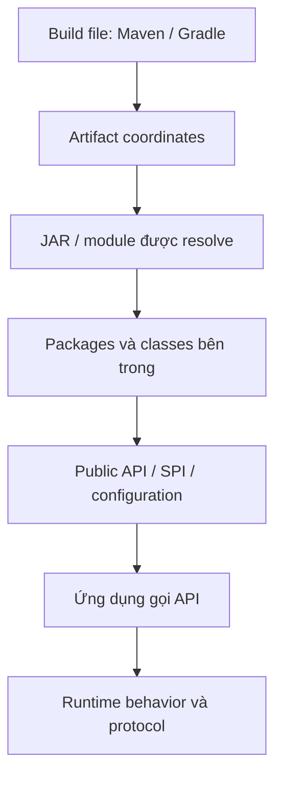

# Phân biệt thay đổi artifact, package và API công khai

Khi nâng cấp một ứng dụng Spring Boot tích hợp dịch vụ managed của AWS, Azure hoặc Google Cloud, một thay đổi trong thư viện có thể xuất hiện ở nhiều lớp: tọa độ dependency thay đổi, class chuyển package, hoặc method/contract mà ứng dụng đang gọi bị thay đổi. Ba loại thay đổi này liên quan nhưng không đồng nghĩa. Nếu chỉ nhìn tên artifact hoặc chỉ sửa import cho hết lỗi biên dịch, ứng dụng vẫn có thể gặp lỗi linkage lúc chạy, mất auto-configuration hoặc thay đổi hành vi khi gọi dịch vụ.

Để đánh giá một lần nâng cấp chính xác, cần tách ba câu hỏi:

1. **Artifact nào được tải?** Đây là danh tính dependency trong Maven/Gradle: group, artifact, version, classifier và repository.
2. **Class nằm ở package nào?** Đây là tên đầy đủ của class trong bytecode và cách mã nguồn import class đó.
3. **Hợp đồng công khai có thay đổi không?** Đây là API mà ứng dụng được phép sử dụng: class, method, constructor, annotation, property, SPI, exception và cả semantics được tài liệu cam kết.

Một artifact có thể đổi tên nhưng giữ nguyên package/API; package có thể đổi trong cùng artifact; hoặc artifact và package giữ nguyên nhưng API thay đổi. Phân biệt được các trường hợp này giúp xác định phạm vi sửa mã, chọn công cụ kiểm tra và lập kế hoạch migration phù hợp.

Sau bài học, bạn có thể:

- Phân biệt artifact coordinates, Java package và public API.
- Nhận diện thay đổi source compatibility, binary compatibility và behavioral compatibility.
- Điều tra dependency được resolve thực tế bằng Maven/Gradle và kiểm tra nội dung JAR.
- Đánh giá tác động của package migration, API signature change và cấu hình Spring.
- Lập kế hoạch nâng cấp thư viện Spring/SDK theo từng lớp thay đổi.
- Dùng compiler, bytecode inspection, API diff và integration test để xác nhận tính tương thích.

## 1. Ba khái niệm ở ba lớp khác nhau

| Khái niệm | Định nghĩa | Ví dụ nhận diện | Câu hỏi khi nâng cấp |
|---|---|---|---|
| Artifact | Đơn vị phân phối dependency được build và publish lên repository | `groupId:artifactId:version` trong Maven | Dependency tọa độ nào được tải và phiên bản nào được chọn? |
| Package | Namespace chứa class/interface/enum/annotation trong Java | `software.amazon.awssdk.services.s3` | Mã nguồn import class từ package nào? Bytecode tham chiếu tên class nào? |
| Public API | Hợp đồng được thư viện công bố để consumer sử dụng | Method, constructor, type, annotation, property, SPI và semantics | Mã ứng dụng có thể compile, link và hoạt động đúng với hợp đồng mới không? |



Artifact là cách thư viện được phân phối. Package là cách code được tổ chức và định danh. Public API là phần consumer được phép phụ thuộc. Một artifact có thể chứa nhiều package; cùng một package có thể được chia giữa nhiều artifact; và một artifact có thể thay đổi API mà không đổi tọa độ hoặc package.

## 2. Thay đổi artifact coordinates

### 2.1. Artifact là gì?

Với Maven, tọa độ dependency cơ bản gồm:

- `groupId`: tổ chức hoặc namespace phát hành.
- `artifactId`: tên module được phát hành.
- `version`: phiên bản của module.
- `type`/`packaging`: loại artifact, thường là `jar` hoặc `pom`.
- `classifier`: biến thể bổ sung nếu có, ví dụ artifact chứa sources hoặc native classifier.

Ví dụ khai báo:

```xml
<dependency>
    <groupId>com.example.cloud</groupId>
    <artifactId>storage-client</artifactId>
    <version>2.4.0</version>
</dependency>
```

Trong Gradle, notation thường có dạng `group:artifact:version`:

```kotlin
dependencies {
    implementation("com.example.cloud:storage-client:2.4.0")
}
```

Đổi `artifactId` hoặc `groupId` làm dependency coordinates thay đổi, nhưng không tự chứng minh package hay API Java đã đổi. Nhà phát hành có thể đổi tên module, tách module, gộp module hoặc chuyển artifact sang một nhóm phát hành khác trong khi giữ nguyên class public.

### 2.2. Các kiểu thay đổi artifact thường gặp

| Thay đổi | Ví dụ | Tác động có thể có |
|---|---|---|
| Đổi version | `client:1.8` lên `client:2.0` | Có thể có API, package hoặc behavior breaking change; phải đọc migration guide |
| Đổi artifactId | `cloud-starter-old` sang `cloud-starter-new` | Build file phải cập nhật; package/API có thể giữ nguyên hoặc thay đổi |
| Tách artifact | Một SDK lớn thành `core`, `auth`, `storage` | Phải thêm module cần thiết; class có thể chuyển JAR nhưng giữ package |
| Gộp artifact | Nhiều module được gom vào một starter | Có thể tạo dependency dư hoặc xung đột nếu vẫn giữ artifact cũ |
| Đổi groupId | Module chuyển sang namespace phát hành khác | Dependency coordinates và rule quản lý version có thể phải cập nhật |
| Relocation | POM cũ khai báo Maven relocation tới artifact mới | Maven có thể cảnh báo và hướng consumer chuyển sang tọa độ mới |
| Đổi classifier/packaging | Artifact có thêm biến thể runtime/platform | Có thể tải sai nội dung hoặc thiếu class cần thiết |

### 2.3. Đổi artifact không nhất thiết đổi API

Giả sử thư viện được chia từ một JAR thành hai JAR:

```text
Trước:
com.example.cloud:cloud-sdk:1.5.0

Sau:
com.example.cloud:cloud-core:2.0.0
com.example.cloud:cloud-storage:2.0.0
```

Nếu class `com.example.cloud.storage.StorageClient` được chuyển từ JAR cũ sang JAR mới nhưng vẫn giữ package, tên class và method, mã nguồn có thể không cần đổi import. Tuy nhiên, build file cần thêm artifact chứa class; dependency transitives, service loader resource, module metadata và runtime classpath cũng cần được kiểm tra.

Trường hợp ngược lại cũng có thể xảy ra: artifact coordinates giữ nguyên nhưng nhà phát hành thay đổi method signature hoặc semantics. Do đó, chỉ nhìn `pom.xml` không đủ để kết luận API tương thích.

### 2.4. Kiểm tra artifact được resolve

Với Maven:

```bash
mvn dependency:tree -Dverbose
mvn help:effective-pom
```

Lọc một nhóm dependency:

```bash
mvn dependency:tree -Dincludes=com.alibaba.cloud,com.aliyun,software.amazon.awssdk,com.azure,com.google.cloud
```

Với Gradle:

```bash
./gradlew dependencies --configuration runtimeClasspath
./gradlew dependencyInsight --dependency storage-client --configuration runtimeClasspath
```

Các lệnh này giúp trả lời artifact nào được chọn, version nào thắng khi có conflict và dependency nào kéo nó vào. Phân biệt `compileClasspath` với `runtimeClasspath`: ứng dụng có thể biên dịch được nhưng runtime lại chọn một version khác do dependency scope hoặc resolution rule.

## 3. Thay đổi package và tên class

### 3.1. Package là một phần của tên class

Tên đầy đủ của class gồm package và tên class, ví dụ:

```java
com.example.storage.ObjectClient
```

Nếu class được chuyển thành:

```java
com.example.cloud.storage.ObjectClient
```

thì đây là một tên class khác đối với compiler và JVM. Mã nguồn thường phải sửa `import`, nhưng tác động không dừng ở import: bytecode cũ tham chiếu tên class cũ và không thể tự tìm class mới chỉ vì tên đơn giản vẫn là `ObjectClient`.

### 3.2. Package migration có thể xảy ra trong cùng artifact

Một ví dụ nổi bật trong hệ sinh thái Java là chuyển từ Java EE `javax.*` sang Jakarta EE `jakarta.*`. Với Spring Framework 6/Spring Boot 3, nhiều API nền tảng chuyển namespace:

```java
// Thế hệ API cũ
import javax.servlet.Filter;
import javax.persistence.Entity;
import javax.validation.Valid;

// Thế hệ Jakarta
import jakarta.servlet.Filter;
import jakarta.persistence.Entity;
import jakarta.validation.Valid;
```

Đây là package/type migration có tác động rộng tới source và binary compatibility. Không thể chỉ thay một dependency rồi mong các class `javax.*` và `jakarta.*` thay thế cho nhau: chúng là hai kiểu khác nhau trong JVM. Một thư viện cũ vẫn tham chiếu `javax.servlet.Filter` không tự tương thích với API mới chỉ vì ứng dụng đã thêm `jakarta.servlet-api`.

Khi nâng Spring Boot 2 lên 3, cần kiểm kê cả code ứng dụng, servlet container, persistence provider, validation provider, OpenAPI library, security adapter và thư viện bên thứ ba. Những package không thuộc nhóm được chuyển đổi không nên bị thay máy móc; ví dụ `javax.crypto` và `javax.net.ssl` vẫn là package Java SE.

### 3.3. Artifact có thể giữ tên nhưng package đổi

Nhà phát hành có thể publish một version mới trong cùng artifact nhưng chuyển class sang package khác. Build vẫn resolve thành công vì tọa độ không đổi, nhưng code import class cũ sẽ không biên dịch hoặc runtime thiếu class cũ. Đây là lý do phải đọc migration guide và so sánh nội dung JAR, không chỉ kiểm tra dependency tree.

### 3.4. Package có thể giữ nguyên nhưng class chuyển artifact

Một dự án có thể tách module mà vẫn giữ nguyên package. Nếu consumer chỉ khai báo artifact cũ và class không còn nằm trong JAR đó, lỗi thường là `ClassNotFoundException` hoặc `NoClassDefFoundError`. Thêm đúng artifact mới có thể khôi phục class mà không cần sửa import. Tuy nhiên, phải kiểm tra version alignment và tránh đưa hai bản chứa cùng class vào runtime classpath.

### 3.5. Tìm class trong JAR

Sau khi xác định JAR được resolve, có thể xem nội dung:

```bash
jar tf path/to/library.jar
```

Lọc class theo package:

```bash
jar tf path/to/library.jar | grep 'com/example/cloud'
```

Trên PowerShell có thể dùng `Select-String` để lọc output. Đối với module Java, kiểm tra thêm `module-info.class` và các resource như `META-INF/services/*`, file Spring auto-configuration imports và metadata. Một class còn tồn tại không đồng nghĩa service provider hoặc auto-configuration registration cũng được giữ.

## 4. Public API là gì?

Public API là phần hợp đồng mà nhà phát hành công bố để ứng dụng khác sử dụng. Trong Java, API thường bao gồm các kiểu và thành viên `public` hoặc `protected` được tài liệu hóa; nhưng phạm vi API thực tế còn có annotation, cấu hình, SPI, resource convention và semantics.

### 4.1. Các thành phần API cần kiểm tra

| Thành phần | Ví dụ | Dạng thay đổi có thể gây breaking change |
|---|---|---|
| Class/interface/enum/record | `StorageClient`, `CloudCredentials` | Xóa, đổi tên, chuyển package, đổi superclass hoặc interface |
| Constructor | `new StorageClient(config)` | Xóa constructor, đổi tham số hoặc giảm visibility |
| Method | `upload(String, byte[])` | Xóa/đổi tên, đổi tham số, kiểu trả về hoặc checked exception |
| Field/constant | `DEFAULT_REGION` | Xóa, đổi tên, đổi kiểu hoặc thay semantics của giá trị |
| Annotation | `@EnableCloudStorage` | Xóa thuộc tính, đổi target/retention hoặc đổi cách auto-configuration xử lý |
| Generic/type bounds | `Client<T extends Request>` | Thay bounds có thể làm code consumer không compile hoặc thay overload resolution |
| Exception contract | `CloudException` | Đổi hierarchy, error code hoặc checked/unchecked behavior |
| Configuration property | `cloud.storage.endpoint` | Đổi prefix, tên property, default hoặc binding semantics |
| SPI/service loader | `META-INF/services/...` | Đổi interface hoặc không đăng ký provider mới |
| Auto-configuration | Bean được tạo theo classpath/property | Đổi condition, bean name, order hoặc back-off behavior |
| Protocol/schema | HTTP endpoint, JSON field, message schema | Đổi wire contract dù Java API vẫn giữ nguyên |

### 4.2. `public` không luôn có nghĩa được hỗ trợ

Một class có modifier `public` có thể là implementation detail được expose vì giới hạn kỹ thuật. Ngược lại, một cấu hình property hoặc annotation có thể là public contract dù không phải method Java thông thường. Hãy phân biệt:

- **Documented public API:** được tài liệu công bố và có cam kết tương thích theo chính sách dự án.
- **SPI/extension point:** được thiết kế để consumer cung cấp implementation hoặc plugin.
- **Internal API:** package/class có tên `internal`, `impl`, `support` hoặc được tài liệu đánh dấu không ổn định.
- **Incidental API:** tình cờ truy cập được nhưng không có cam kết hỗ trợ.

Không xây tích hợp lâu dài trên class nội bộ chỉ vì nó đang `public`. Nếu buộc phải dùng extension chưa ổn định, cô lập trong adapter và viết test để phát hiện thay đổi.

### 4.3. API Java và API dịch vụ cloud là hai hợp đồng khác nhau

Một SDK có thể đổi method Java nhưng HTTP API phía cloud vẫn giữ nguyên. Ngược lại, SDK Java không đổi nhưng dịch vụ cloud thay đổi default, permission, quota, response field hoặc behavior ở server. Cần đánh giá cả:

1. Java API giữa ứng dụng và SDK.
2. Runtime behavior của client (retry, timeout, signing, serialization).
3. Wire/API contract giữa SDK và dịch vụ managed.
4. Hợp đồng dữ liệu giữa ứng dụng với database, topic, queue hoặc object storage.

Ví dụ đổi method `upload()` sang `putObject()` là thay đổi API Java. Đổi endpoint region, chữ ký request, yêu cầu IAM permission hoặc semantics versioning là thay đổi ở lớp tích hợp dịch vụ, dù code vẫn compile.

## 5. Source compatibility, binary compatibility và behavioral compatibility

Một thay đổi có thể phá code ở thời điểm khác nhau. Cần đánh giá ít nhất ba lớp tương thích.

### 5.1. Source compatibility

Source compatibility trả lời: mã nguồn cũ có biên dịch được với thư viện mới không?

Ví dụ code đang gọi:

```java
client.upload(bucket, key, content);
```

Nếu method bị đổi thành:

```java
client.upload(UploadRequest request);
```

source cũ sẽ không compile cho tới khi được chuyển đổi. Tương tự, đổi package khiến import cũ không resolve; đổi generic bounds hoặc checked exception có thể yêu cầu sửa call site.

Compiler là công cụ phát hiện source incompatibility tốt, nhưng chỉ khi compile toàn bộ module consumer, generated code, test source và integration module liên quan.

### 5.2. Binary compatibility

Binary compatibility trả lời: bytecode đã biên dịch trước đó có thể link và chạy với thư viện mới không? JVM liên kết class/method/field dựa trên binary name và descriptor. Nếu một method bị xóa hoặc đổi descriptor, code cũ có thể compile từ trước nhưng lỗi khi chạy.

Các lỗi linkage thường gặp:

| Lỗi | Ý nghĩa thường gặp |
|---|---|
| `NoSuchMethodError` | Bytecode gọi method không còn với descriptor cũ |
| `NoSuchFieldError` | Field mà bytecode tham chiếu không còn hoặc thay đổi không tương thích |
| `NoClassDefFoundError` | Class cần lúc runtime không có hoặc khởi tạo class thất bại trước đó |
| `ClassNotFoundException` | Code dùng cơ chế load class theo tên nhưng class không được tìm thấy |
| `AbstractMethodError` | Implementation runtime không cung cấp method mà bytecode/interface đang yêu cầu |
| `IllegalAccessError` | Quyền truy cập ở runtime không còn tương thích với bytecode đã compile |
| `IncompatibleClassChangeError` | Thay đổi không tương thích về class/interface/static/instance hoặc cấu trúc liên quan |

Ví dụ: ứng dụng được compile với SDK 1.x có `Client.send(String)`, nhưng runtime lại nạp SDK 2.x chỉ có `Client.send(Request)`. Nếu compile và runtime classpath khác nhau, lỗi có thể xuất hiện lúc gọi method dù build artifact đã thành công.

### 5.3. Behavioral compatibility

Behavioral compatibility trả lời: code cũ có tiếp tục tạo ra kết quả và side effect như trước không? Ứng dụng có thể compile và link hoàn toàn nhưng behavior vẫn thay đổi:

- Retry mặc định tăng từ 2 lên 5 lần, làm request kéo dài và tăng tải.
- Timeout mặc định thay đổi hoặc chuyển từ connect timeout sang overall timeout.
- Serializer đổi cách ghi enum/null/timestamp, làm dữ liệu không tương thích.
- SDK đổi default region, endpoint resolution hoặc credential chain.
- Exception mới được ném thay cho kết quả empty/null.
- Pool mặc định hoặc concurrency thay đổi, làm tăng số kết nối tới database.
- Auto-configuration tạo bean khác khi classpath có thêm dependency.
- Message consumer đổi ack mode hoặc retry policy.

Behavioral incompatibility thường chỉ lộ ra qua integration test, contract test, test tải và quan sát canary. Compiler không thể phát hiện tất cả.

### 5.4. Configuration và wire compatibility

Với Spring integration, property key là một phần của contract vận hành. Đổi `spring.cloud.vendor.old.endpoint` sang prefix mới có thể không làm compile thất bại; ứng dụng chỉ dùng default hoặc không kết nối được lúc chạy. Tương tự, đổi JSON field, message header, database column hoặc endpoint HTTP có thể phá consumer khác dù Java API nội bộ không đổi.

Hãy kiểm tra riêng:

- Property name, default, type, validation và relaxed binding.
- Environment variable mapping và precedence giữa file, env, command line, config server.
- HTTP request/response schema, status/error mapping và authentication.
- Message schema, content type, header, ordering và ack semantics.
- Database migration, column type, index, transaction/isolation và serialization.

## 6. Ví dụ: thay đổi package nhưng không nhất thiết đổi artifact

Giả sử một dependency vẫn được khai báo dưới cùng tọa độ:

```xml
<dependency>
    <groupId>com.example.integration</groupId>
    <artifactId>cloud-web-adapter</artifactId>
    <version>3.0.0</version>
</dependency>
```

Version 2 chứa:

```java
import javax.servlet.Filter;
```

Version 3 yêu cầu:

```java
import jakarta.servlet.Filter;
```

Artifact coordinates chỉ đổi version. Package API chuyển namespace và kéo theo binary incompatibility. Nếu ứng dụng vẫn giữ servlet API cũ hoặc một filter library chỉ implement `javax.servlet.Filter`, các type không tương thích dù tên interface đơn giản giống nhau.

Quy trình xử lý:

1. Xác định dependency nào còn tham chiếu `javax.servlet`, `javax.persistence` hoặc `javax.validation`.
2. Chọn các phiên bản thư viện đã hỗ trợ Jakarta.
3. Cập nhật import và annotation trong code ứng dụng.
4. Kiểm tra container/runtime, filter, persistence provider, validation và security integration.
5. Chạy context test và integration test với runtime thực tế.

Không dùng một dependency bridge không chính thức để trộn hai namespace trong cùng một ranh giới API nếu chưa có tài liệu hỗ trợ rõ ràng.

## 7. Ví dụ: đổi artifact/package/API giữa các SDK cloud

### 7.1. AWS SDK for Java v1 và v2

Hai thế hệ SDK có cấu trúc package/API khác nhau. Ví dụ client S3:

```java
// AWS SDK for Java 1.x
import com.amazonaws.services.s3.AmazonS3;

// AWS SDK for Java 2.x
import software.amazon.awssdk.services.s3.S3Client;
```

Đây không chỉ là đổi tên dependency. API client, builder, request/response types, credential provider, exception và cách cấu hình region/HTTP transport khác nhau. Ứng dụng cần chuyển đổi call site và kiểm tra behavior như retry, timeout, stream handling và resource lifecycle.

Không đặt hai SDK generation cạnh nhau với giả định class sẽ tự tương thích. Nếu migration theo từng service, cô lập từng implementation và kiểm soát dependency để tránh conflict hoặc nhầm import.

### 7.2. Azure SDK Java

Azure SDK có các thế hệ API và package khác nhau giữa thư viện legacy và Azure SDK hiện đại. Một số client hiện đại dùng builder, pipeline và credential abstraction như `TokenCredential`; các thư viện cũ có thể dùng client/configuration model khác. Khi nâng cấp, kiểm tra:

- Artifact nào đã đổi tên hoặc được thay thế.
- Package của client, model và credential type.
- Builder/constructor, async/sync API và exception hierarchy.
- Retry policy, pipeline policy, timeout và telemetry.
- Cách lấy managed identity credential trong môi trường triển khai.

Không suy luận rằng mọi Azure SDK có cùng quy trình migration; mỗi service có migration guide riêng.

### 7.3. Google Cloud Java libraries

Google Cloud Java client libraries thường có artifact riêng theo service và có thể thay đổi version độc lập hoặc theo BOM. Một số thư viện chuyển từ API cũ sang client hiện đại với builder, transport, retry settings và resource name type khác nhau. Kiểm tra package, generated API version, artifact BOM, gRPC/HTTP transport và credential integration.

Khi dùng Google Cloud BOM, để BOM quản lý nhóm thư viện tương thích thay vì tự ghim từng transitive dependency không cần thiết. Nếu nâng một client riêng, xác minh nó không kéo phiên bản gRPC/protobuf xung đột với các client khác trong cùng ứng dụng.

### 7.4. Alibaba Cloud OSS SDK

OSS Java SDK V1 và OSS SDK for Java 2.0 có API/package và cách quản lý client khác nhau. Khi chuyển thế hệ, kiểm tra builder, credential provider, response/body stream lifecycle, exception, multipart upload và shutdown/close semantics. Một adapter nội bộ có thể giữ contract của ứng dụng ổn định trong khi implementation thay đổi.

Các ví dụ trên minh họa cách phân loại thay đổi. Tên artifact/version cụ thể phải được lấy từ migration guide và BOM của release đang sử dụng; không sao chép version từ một bài viết cũ mà chưa kiểm tra compatibility.

## 8. Thay đổi public API trong Spring integration

Starter Spring Cloud thường cung cấp nhiều hơn một Java client. Nó có thể đăng ký auto-configuration, bind property, tạo bean, thêm annotation hoặc triển khai interface Spring Cloud. Vì vậy, khi nâng starter cần kiểm tra các bề mặt sau:

### 8.1. Auto-configuration và bean contract

Một starter có thể tạo bean `CloudStorageClient` khi classpath có SDK và property được cấu hình. Version mới có thể:

- Đổi class auto-configuration hoặc registration mechanism.
- Đổi điều kiện `@ConditionalOnClass`, `@ConditionalOnProperty` hoặc bean back-off.
- Đổi bean name/type hoặc chuyển sang factory khác.
- Không còn tạo bean mặc định nếu thiếu property bắt buộc.
- Thay đổi thứ tự auto-configuration hoặc lifecycle/shutdown.

Ứng dụng có thể vẫn compile nhưng `NoSuchBeanDefinitionException` lúc khởi động hoặc có hai bean cạnh tranh. Dùng Spring Boot condition evaluation report (`--debug`) và context test để xác nhận bean nào được tạo.

### 8.2. Configuration properties

Ví dụ một property cũ:

```yaml
cloud:
  storage:
    endpoint: ${STORAGE_ENDPOINT}
```

Phiên bản mới có thể chuyển sang prefix khác hoặc cấu trúc nested object. Không chỉ đổi YAML theo tên được suy đoán; kiểm tra metadata `spring-configuration-metadata.json`, migration guide và `@ConfigurationProperties` class của release mới. Nếu property bị bỏ qua, Spring có thể dùng default khiến ứng dụng kết nối sai region/endpoint.

Viết context test để bind giá trị và kiểm tra bean thực sự nhận đúng endpoint, region, timeout và credential provider. Không in secret khi assertion thất bại.

### 8.3. Annotation và extension points

Annotation như `@Enable...`, `@CloudListener` hoặc custom condition có thể đổi package, attribute, target hoặc semantics. SPI có thể thay interface hoặc cơ chế đăng ký provider. Kiểm tra cả `META-INF/services`, Spring imports metadata và reflection usage; compiler không phát hiện provider bị thiếu nếu chỉ được nạp động lúc runtime.

### 8.4. API async và reactive

Một SDK có thể đổi từ API blocking sang async/reactive, hoặc thay kiểu trả về `Future`/`CompletableFuture`/`Mono`. Đây là thay đổi source API và có thể thay semantics cancellation, thread execution, exception wrapping và resource lifecycle. Khi migration, xác minh:

- Ai sở hữu executor/event loop và client lifecycle.
- Cancellation có hủy request phía server hay chỉ ngừng chờ ở client.
- Backpressure và concurrency được giới hạn thế nào.
- Exception được wrap/unwarp ra sao.
- Có `.block()` hoặc blocking call trên event-loop không.

## 9. Công cụ kiểm tra API và binary compatibility

Không một công cụ duy nhất xác minh mọi lớp tương thích. Kết hợp build, dependency inspection, bytecode/API diff và integration tests.

### 9.1. Dependency tree và effective model

Maven:

```bash
mvn dependency:tree -Dverbose
mvn help:effective-pom
```

Gradle:

```bash
./gradlew dependencies --configuration compileClasspath
./gradlew dependencies --configuration runtimeClasspath
./gradlew dependencyInsight --dependency cloud-client --configuration runtimeClasspath
```

Mục tiêu là xác định artifact/version thực tế, conflict resolution, exclusions và BOM đang quản lý dependency nào.

### 9.2. JAR contents và binary names

```bash
jar tf path/to/client.jar
javap -classpath path/to/client.jar -public com.example.cloud.Client
```

`jar tf` cho biết class/resource nào nằm trong JAR. `javap -public` hiển thị public members mà compiler/runtime nhìn thấy. Có thể dùng `javap -s` để xem descriptor của method, hữu ích khi điều tra `NoSuchMethodError`.

`jdeps` giúp xem dependency/package references ở mức bytecode:

```bash
jdeps --summary path/to/application.jar
jdeps --multi-release 17 --recursive path/to/client.jar
```

Chọn `--multi-release` theo target Java và cấu trúc JAR. Công cụ này không chứng minh behavior hoặc semantics API.

### 9.3. API diff

Các công cụ như Revapi hoặc japicmp có thể so sánh API của hai phiên bản library để phát hiện class/method/field bị xóa, đổi visibility, đổi descriptor hoặc thay đổi cấu trúc khác. Dùng chúng trong pipeline nếu tổ chức phát triển library nội bộ hoặc muốn kiểm soát nâng cấp dependency quan trọng.

API diff vẫn cần được diễn giải: một thay đổi được công cụ đánh dấu có thể không ảnh hưởng ứng dụng nếu app không sử dụng API đó; ngược lại, config property, reflection, SPI, serialized form hoặc wire behavior có thể bị phá dù API diff không phát hiện.

### 9.4. Compile và test trên runtime thật

Chạy clean build để tránh class cũ còn trong output directory. Test trên đúng JDK, container, profile và runtime target. Kiểm tra cả startup, graceful shutdown, health check và một request thật tới dịch vụ test. Nếu SDK có retry hoặc async API, kiểm thử failure mode và resource cleanup.

## 10. Quy trình đánh giá một lần nâng cấp

### Bước 1: Ghi lại baseline

Thu thập Java version, Spring Boot/Framework/Cloud release, BOM, artifact coordinates, runtime classpath và các API/property đang được sử dụng. Ghi lại test và metrics hiện tại để so sánh.

### Bước 2: Đọc release notes và migration guide

Tìm breaking changes, deprecated APIs, artifact relocation, package migration, Java baseline, Jakarta migration, thay đổi auto-configuration và behavior mặc định. Dùng tài liệu của đúng release và đúng service SDK.

### Bước 3: Phân loại từng thay đổi

Đánh dấu thay đổi thuộc một hoặc nhiều nhóm:

- Artifact coordinates/dependency graph.
- Package/class binary name.
- Public API signature/visibility/type hierarchy.
- Configuration/auto-configuration/SPI.
- Runtime behavior/retry/timeout/serialization.
- Wire contract/permission/service-side behavior.

Không gom tất cả vào nhãn chung “breaking change”; mỗi nhóm cần một cách kiểm tra khác nhau.

### Bước 4: Lập bản đồ consumer

Tìm nơi sử dụng artifact, import, method, annotation, property và reflection. Kiểm tra module khác, test code, generated source, plugin và script vận hành. Một dependency có thể được dùng trực tiếp lẫn transitively.

### Bước 5: Cập nhật dependency có kiểm soát

Chọn BOM/release train tương thích, bỏ dependency cũ hoặc exclusions không còn cần, tránh trộn SDK generation. Nâng theo từng nhóm năng lực để dễ xác định nguyên nhân khi lỗi.

### Bước 6: Chuyển đổi source và cấu hình

Sửa import, method call, constructor, exception handling, bean configuration và property theo migration guide. Kiểm tra package `javax`/`jakarta` có liên quan thay vì thay toàn bộ một cách máy móc.

### Bước 7: Kiểm tra binary và runtime

Clean compile, kiểm tra dependency convergence, API diff, startup condition report và runtime classpath. Xác minh không có class trùng hoặc version conflict.

### Bước 8: Kiểm thử behavior và service integration

Chạy unit/contract/integration tests cho auth, endpoint, request signing, serialization, timeout, retry, pooling, transaction, messaging ack và shutdown. Test với môi trường test hoặc sandbox của cloud provider.

### Bước 9: Canary và rollback

Triển khai một nhóm instance trước, so sánh error rate, latency, throttling, connection count, message lag và business outcomes. Giữ artifact/config cũ và xác định tiêu chí rollback. Không chuyển schema/protocol không tương thích theo kiểu chỉ có thể rollback một chiều nếu chưa có kế hoạch dữ liệu.

## 11. Ví dụ phân tích một lỗi nâng cấp

Giả sử sau khi nâng SDK, ứng dụng khởi động được nhưng khi upload object thì log có:

```text
java.lang.NoSuchMethodError:
  'com.example.cloud.Result com.example.cloud.Client.upload(java.lang.String, byte[])'
```

Quy trình:

1. Xác định class `com.example.cloud.Client` được load từ JAR nào trong runtime.
2. Chạy `dependency:tree` hoặc `dependencyInsight` để xem version được resolve và dependency nào kéo vào.
3. Dùng `javap -s` trên class trong JAR runtime để kiểm tra method descriptor.
4. So sánh compile classpath với runtime classpath; tìm trường hợp compile bằng version A nhưng chạy với version B.
5. Kiểm tra BOM, dependency management, shading, application server shared library và container layer.
6. Cập nhật dependency graph để compile/runtime cùng một bộ version tương thích; clean build và test lại.

Nếu lỗi thay bằng `ClassNotFoundException` sau khi đổi artifact, kiểm tra class đã được chuyển sang module khác hay package đã đổi. Nếu compile lỗi `cannot find symbol`, kiểm tra source API/import. Nếu compile và startup đều thành công nhưng request trả kết quả khác, điều tra behavior, property, serialization và service-side change.

## 12. Những nhầm lẫn thường gặp

| Nhầm lẫn | Thực tế |
|---|---|
| “Artifact đổi tên thì package chắc chắn đổi.” | Artifact là đơn vị phân phối; package có thể giữ nguyên. |
| “Package giữ nguyên thì API không đổi.” | Method signature, visibility, annotation hoặc semantics vẫn có thể thay đổi. |
| “Build thành công nghĩa là binary compatible.” | Runtime có thể nạp version khác và ném linkage error. |
| “Không có compile error nghĩa là behavior giữ nguyên.” | Retry, timeout, serializer, default config và ack semantics có thể đổi. |
| “Mọi class `public` đều là API ổn định.” | Class nội bộ có thể public vì lý do triển khai nhưng không được hỗ trợ. |
| “BOM làm mọi dependency tự tương thích.” | BOM chọn version theo một bộ đã quản lý; không đảm bảo mọi thư viện ngoài BOM hoặc SDK tùy chọn tương thích. |
| “Thêm cả artifact cũ và mới để migration dần là an toàn.” | Có thể gây class duplication, conflict, hai auto-configuration hoặc type không tương thích. |
| “Đổi `javax` thành `jakarta` bằng replace toàn repository là đủ.” | Chỉ các API đã chuyển namespace mới được thay; Java SE packages như `javax.net.ssl` vẫn tồn tại. |
| “API diff không báo lỗi nghĩa là không có breaking change.” | Config, SPI, reflection, wire contract và behavior có thể nằm ngoài phạm vi công cụ. |

## 13. Checklist trước khi chấp nhận nâng cấp

- [ ] Đã ghi lại artifact coordinates và dependency graph trước/sau.
- [ ] Đã xác định class/package được thêm, xóa, chuyển hoặc đổi tên.
- [ ] Đã phân biệt API public/documented với internal implementation.
- [ ] Đã đánh giá source, binary và behavioral compatibility.
- [ ] Đã kiểm tra annotation, configuration properties, auto-configuration và SPI.
- [ ] Đã rà soát Java/Jakarta namespace và Java baseline.
- [ ] Compile và runtime classpath dùng version tương thích, không có dependency conflict.
- [ ] Đã dùng API diff/bytecode inspection cho thư viện quan trọng khi phù hợp.
- [ ] Đã chạy clean build, startup/context test và integration test với dịch vụ test.
- [ ] Đã kiểm tra timeout, retry, credential, serialization, transaction và messaging behavior.
- [ ] Có canary, metrics baseline và rollback plan.
- [ ] Đã cập nhật tài liệu nội bộ về artifact, package, property và API mới.

## 14. Kết luận

Artifact, package và public API mô tả ba lớp khác nhau của một dependency. Artifact cho biết build system tải module nào; package xác định tên class mà compiler/JVM tham chiếu; public API mô tả hợp đồng mà ứng dụng được phép sử dụng. Nâng cấp an toàn cần kiểm tra cả source, binary, behavior, configuration và wire contract. Dependency tree cho biết điều gì được resolve, JAR/bytecode inspection cho biết class nào thực sự có mặt, API diff phát hiện một phần breaking changes, còn integration test và canary xác nhận behavior với dịch vụ managed. Phân loại đúng thay đổi ngay từ đầu giúp tránh sửa import một cách máy móc và giảm rủi ro khi nâng Spring Boot, Spring Cloud hoặc cloud SDK.

## Tài liệu tham khảo

- [Maven — Introduction to the Dependency Mechanism](https://maven.apache.org/guides/introduction/introduction-to-dependency-mechanism.html): dependency coordinates, scope và mediation.
- [Maven — POM Relocation](https://maven.apache.org/guides/mini/guide-relocation.html): chuyển tọa độ artifact.
- [Gradle — Dependency Insight](https://docs.gradle.org/current/userguide/viewing_debugging_dependencies.html): kiểm tra dependency graph và version selection.
- [Java Language Specification — Packages](https://docs.oracle.com/javase/specs/jls/se17/html/jls-7.html): package và import declaration.
- [Java Virtual Machine Specification — Binary Compatibility](https://docs.oracle.com/javase/specs/jls/se17/html/jls-13.html): binary compatibility và thay đổi API.
- [Spring Boot 3.0 Migration Guide](https://github.com/spring-projects/spring-boot/wiki/Spring-Boot-3.0-Migration-Guide): Java 17, Spring Framework 6 và Jakarta EE migration.
- [AWS SDK for Java 2.x Migration Guide](https://docs.aws.amazon.com/sdk-for-java/latest/developer-guide/migration.html): thay đổi API và package giữa SDK generation.
- [Revapi](https://revapi.org/revapi-site/main/index.html): kiểm tra thay đổi public API.
- [japicmp](https://siom79.netbeans.org/japicmp/): so sánh API/binary compatibility giữa các JAR.
