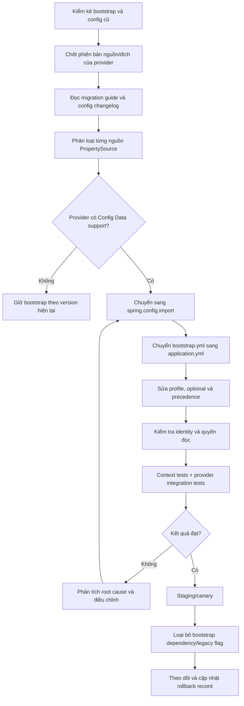

# Chuyển từ bootstrap hoặc cơ chế cấu hình cũ khi phiên bản yêu cầu

Nhiều ứng dụng Spring Cloud cũ nạp cấu hình từ `bootstrap.yml`, Spring Cloud bootstrap context hoặc `PropertySourceLocator` chạy trước ApplicationContext chính. Khi nâng Spring Boot và thư viện provider, cơ chế này có thể được thay bằng Spring Boot Config Data API. Nếu chỉ đổi tên file thành `application.yml` hoặc xóa dependency bootstrap mà không thay cách nạp cấu hình, ứng dụng có thể khởi động với giá trị mặc định, không lấy được cấu hình từ cloud hoặc dùng sai thứ tự ưu tiên.

Cách chuyển đúng là xác định **cơ chế cũ đang làm nhiệm vụ gì**, tìm API thay thế mà phiên bản thư viện đích hỗ trợ, rồi chuyển từng nguồn cấu hình sang `spring.config.import` hoặc cơ chế PropertySource mới. Bài này cũng phân biệt bootstrap context với chế độ xử lý file cấu hình legacy của Spring Boot, vì hai cơ chế có tên gần giống nhưng giải quyết hai vấn đề khác nhau.

Bài thuộc chương **Nâng cấp tích hợp** của module **SPRING_CLOUD_PROVIDER_INTEGRATION**. Module thực hành tích hợp Spring Boot với các dịch vụ managed của AWS, Azure và Google Cloud qua các thư viện Spring Cloud tương ứng. Các ví dụ tập trung vào Spring Cloud Config, AWS Systems Manager Parameter Store/Secrets Manager, Google Cloud Secret Manager, Azure App Configuration và Azure Key Vault.

## 1. Mục tiêu học tập

Sau bài học, bạn có thể:

- Phân biệt `bootstrap.yml`, bootstrap context, Spring Boot Config Data API và `spring.config.use-legacy-processing`.
- Xác định khi nào ứng dụng còn cần bootstrap context và khi nào có thể chuyển sang Config Data.
- Chuyển Spring Cloud Config Client từ `spring.cloud.config.uri` trong bootstrap sang `spring.config.import=configserver:`.
- Chuyển cấu hình AWS Parameter Store/Secrets Manager sang các Config Data import scheme hiện hành.
- Chuyển Google Cloud Secret Manager từ cú pháp cũ `sm://` sang `sm@` khi phiên bản thư viện yêu cầu.
- Chuyển Azure App Configuration từ `bootstrap.yml` sang `application.yml` và `spring.config.import=azureAppConfiguration`.
- Di chuyển cấu hình profile, multi-document YAML và nguồn cấu hình bên ngoài theo quy tắc Spring Boot mới.
- Hiểu tác động của `optional:`, thứ tự import và property source precedence.
- Giữ đúng các extension point bootstrap khi thư viện mới vẫn yêu cầu chúng.
- Xây dựng quy trình chuyển đổi có kiểm thử, quan sát và rollback.

## 2. Phân biệt bốn khái niệm thường bị nhầm

Các tên gọi bootstrap và legacy thường xuất hiện cùng lúc trong tài liệu nâng cấp, nhưng chúng không phải một cơ chế.

| Khái niệm | Vai trò | Khi nào được kích hoạt? |
| --- | --- | --- |
| `bootstrap.yml` / `bootstrap.properties` | File cấu hình dành cho bootstrap context | Chỉ được đọc khi bootstrap context được bật |
| Spring Cloud bootstrap context | ApplicationContext cha, nạp property source bên ngoài trước context chính | Bằng `spring-cloud-starter-bootstrap` hoặc `spring.cloud.bootstrap.enabled=true` |
| Spring Boot Config Data API | Cơ chế nạp cấu hình trong giai đoạn chuẩn bị Environment, hỗ trợ import nhiều nguồn | Dùng với `application.yml` và `spring.config.import` |
| `spring.config.use-legacy-processing` | Bật lại cách xử lý file cấu hình kiểu Spring Boot 2.3 trong giai đoạn chuyển tiếp | Khi được đặt trong Environment ở phiên bản Boot hỗ trợ chế độ này |

### 2.1. Bootstrap context là gì?

Trong cơ chế Spring Cloud bootstrap truyền thống, ứng dụng tạo một bootstrap context làm context cha của ApplicationContext chính. Bootstrap context dùng để nạp cấu hình từ nguồn bên ngoài, ví dụ Spring Cloud Config Server, Vault hoặc provider PropertySource. Các giá trị sau đó được đưa vào Environment của ứng dụng.

File `bootstrap.yml` thường chứa những thông tin cần biết trước khi ứng dụng nạp cấu hình chính, chẳng hạn:

```yaml
spring:
  application:
    name: invoice-service
  cloud:
    config:
      uri: https://config.internal.example
      username: ${CONFIG_SERVER_USER}
      password: ${CONFIG_SERVER_PASSWORD}
```

Chỉ đặt file `bootstrap.yml` trong classpath không có nghĩa bootstrap context luôn hoạt động. Với các phiên bản Spring Cloud hiện hành, bootstrap phải được bật bằng dependency `spring-cloud-starter-bootstrap` hoặc property `spring.cloud.bootstrap.enabled=true` đặt ở system property/environment variable. Khi bootstrap được bật, Config Client mới dùng các thuộc tính trong bootstrap context để tìm Config Server.

### 2.2. Config Data API là gì?

Spring Boot 2.4 giới thiệu Config Data API để nạp cấu hình từ nhiều nguồn. Thay vì cần một context riêng, ứng dụng khai báo nguồn cấu hình ngay trong `application.yml`:

```yaml
spring:
  config:
    import: "configserver:https://config.internal.example"
```

Spring Boot gọi resolver/loader tương ứng để nạp dữ liệu trước khi hoàn tất khởi tạo ApplicationContext. Các thư viện provider có thể đăng ký scheme riêng, ví dụ `aws-parameterstore:`, `aws-secretsmanager:`, `sm@` hoặc `azureAppConfiguration`.

Config Data cho phép ứng dụng chỉ rõ nguồn nào được nạp, thứ tự import và nguồn nào bắt buộc. Nó cũng hỗ trợ việc cấu hình từ xa kích hoạt profile bổ sung. Vì vậy, nhiều thư viện đã chuyển từ bootstrap `PropertySourceLocator` sang Config Data import.

### 2.3. spring.config.use-legacy-processing không phải bootstrap context

Property này thuộc Spring Boot, dùng để quay lại cách xử lý file `application.yml`/`application.properties` kiểu cũ trong giai đoạn chuyển từ Boot 2.3 trở xuống sang Boot 2.4. Nó không tự bật Spring Cloud bootstrap context và cũng không thay thế `spring-cloud-starter-bootstrap`.

Hãy xem đây là cầu nối tạm thời khi một cấu trúc file cũ chưa thể chuyển ngay. Khi đã sửa profile activation, multi-document YAML và external config, hãy bỏ property này để ứng dụng dùng Config Data processing bình thường.

## 3. Khi nào nên giữ bootstrap context?

Không nên xóa bootstrap một cách máy móc. Trước hết, kiểm tra phiên bản thư viện và cách tích hợp mà ứng dụng đang dùng.

Có thể cần giữ bootstrap khi:

- Phiên bản provider cũ chỉ cung cấp `PropertySourceLocator` và chưa có Config Data resolver/loader tương đương.
- Tài liệu của phiên bản thư viện đích yêu cầu `spring-cloud-starter-bootstrap` hoặc `spring.cloud.bootstrap.enabled=true`.
- Ứng dụng có custom `BootstrapConfiguration` hoặc extension point chạy trong bootstrap context mà chưa được chuyển sang cơ chế mới.
- Một thư viện bên thứ ba phụ thuộc rõ ràng vào bootstrap context và chưa có hướng dẫn migration.

Nên chuyển sang Config Data khi:

- Spring Cloud Config Client đã hỗ trợ `spring.config.import=configserver:`.
- Provider đã có Config Data scheme chính thức.
- Phiên bản mới đã bỏ bootstrap PropertySource cũ.
- Cần kiểm soát rõ thứ tự import và profile activation.
- Muốn giảm số context và tránh hai cơ chế cùng nạp một nguồn cấu hình.

Một số thư viện vẫn có extension point cần đăng ký dù dữ liệu chính được nạp bằng Config Data. Ví dụ, một customizer có thể được tài liệu provider yêu cầu đăng ký qua `BootstrapConfiguration` hoặc bootstrap registry để cấu hình client trước khi Config Data loader chạy. **Giữ extension point đó không đồng nghĩa phải tiếp tục nạp toàn bộ cấu hình bằng bootstrap context.** Hãy đọc đúng hướng dẫn của provider trước khi xóa file `spring.factories` hoặc class cấu hình bootstrap.

Không nên chạy đồng thời bootstrap PropertySource và Config Data import cho cùng một nguồn nếu thư viện không hỗ trợ. Một số tích hợp không cho phép hai đường nạp song song; kết quả có thể là gọi API hai lần, property source trùng nhau hoặc thứ tự ưu tiên khó dự đoán. Chọn một đường nạp cho mỗi nguồn cấu hình.

## 4. Chuyển Spring Cloud Config Client sang Config Data

### 4.1. Cấu hình cũ

Ứng dụng cũ dùng `bootstrap.yml`:

```yaml
spring:
  application:
    name: invoice-service
  cloud:
    config:
      uri: https://config.internal.example
      fail-fast: true
      username: ${CONFIG_SERVER_USER}
      password: ${CONFIG_SERVER_PASSWORD}
```

Dependency có thể chứa:

```xml
<dependency>
    <groupId>org.springframework.cloud</groupId>
    <artifactId>spring-cloud-starter-config</artifactId>
</dependency>

<dependency>
    <groupId>org.springframework.cloud</groupId>
    <artifactId>spring-cloud-starter-bootstrap</artifactId>
</dependency>
```

Ở đây, `spring-cloud-starter-bootstrap` kích hoạt bootstrap context. Config Client dùng URI và thông tin xác thực từ bootstrap để kết nối Config Server.

### 4.2. Cấu hình mới

Giữ `spring.application.name` trong `application.yml`, khai báo Config Data import:

```yaml
spring:
  application:
    name: invoice-service
  config:
    import: "configserver:https://config.internal.example"
  cloud:
    config:
      username: ${CONFIG_SERVER_USER}
      password: ${CONFIG_SERVER_PASSWORD}
```

Hoặc dùng URI mặc định trong import và cấu hình endpoint riêng:

```yaml
spring:
  application:
    name: invoice-service
  config:
    import: "configserver:"
  cloud:
    config:
      uri: https://config.internal.example
      username: ${CONFIG_SERVER_USER}
      password: ${CONFIG_SERVER_PASSWORD}
```

Khi endpoint được ghi trực tiếp trong `spring.config.import`, endpoint đó có ưu tiên hơn `spring.cloud.config.uri`. Không khai báo hai địa chỉ khác nhau mà không có chủ đích.

Sau khi chuyển thành công, bỏ `spring-cloud-starter-bootstrap` nếu không còn tích hợp nào khác cần bootstrap context. Chỉ giữ `spring-cloud-starter-config` và các dependency thực sự sử dụng.

### 4.3. Chọn optional hay bắt buộc

Nếu Config Server là nguồn bắt buộc để service hoạt động, không thêm `optional:`:

```yaml
spring:
  config:
    import: "configserver:https://config.internal.example"
```

Nếu cấu hình từ xa chỉ bổ sung cho local development hoặc service có thể chạy an toàn khi không có nguồn đó, có thể dùng:

```yaml
spring:
  config:
    import: "optional:configserver:https://config.internal.example"
```

Bỏ `optional:` sẽ khiến Config Client fail startup nếu không kết nối được. Thêm `optional:` cho phép bỏ qua nguồn khi không nạp được; vì vậy không dùng nó để che sự cố IAM, authentication hoặc cấu hình sai của nguồn bắt buộc.

Config Data có thể gọi Config Server nhiều lần khi khởi động: lần đầu với profile `default` để phát hiện profile được kích hoạt từ cấu hình từ xa, sau đó gọi lại cho profile thực tế. Đây là hành vi bình thường, không nhất thiết là duplicate request do lỗi.

### 4.4. Retry và discovery

Với Config Data import, retry có thể được cấu hình bằng tham số trên URL import khi cần thiết, đặc biệt nếu import nằm trong profile-specific file. Ví dụ:

```yaml
spring:
  config:
    import: "configserver:https://config.internal.example?fail-fast=true&max-attempts=8&initial-interval=1000&max-interval=5000&multiplier=1.5"
```

Nếu dùng discovery-first lookup, vẫn cần cấu hình DiscoveryClient và `spring.cloud.config.discovery.enabled=true`. Discovery-first có thêm một network round trip để tìm Config Server; cân nhắc lợi ích khi endpoint Config Server có thể thay đổi.

## 5. Chuyển cấu hình file Spring Boot cũ sang Config Data processing

Ngoài bootstrap context, nhiều dự án cũ còn dùng cách khai báo profile và multi-document YAML trước Spring Boot 2.4. Khi nâng Boot, cần chuyển các cấu trúc này để tránh file vẫn tồn tại nhưng điều kiện profile không còn được xử lý như mong muốn.

### 5.1. spring.profiles trong multi-document YAML

Cấu hình cũ:

```yaml
spring:
  application:
    name: invoice-service
---
spring:
  profiles: production
  datasource:
    url: jdbc:postgresql://prod-db:5432/invoice
```

Cấu hình mới:

```yaml
spring:
  application:
    name: invoice-service
---
spring:
  config:
    activate:
      on-profile: production
  datasource:
    url: jdbc:postgresql://prod-db:5432/invoice
```

Dùng `spring.config.activate.on-profile` để chỉ định document được áp dụng khi profile tương ứng hoạt động.

### 5.2. Không đặt spring.profiles.active trong profile-specific document

Có thể khai báo profile mặc định ở document không có điều kiện profile:

```yaml
spring:
  profiles:
    active: production
---
spring:
  config:
    activate:
      on-profile: production
  logging:
    level:
      root: INFO
```

Không đặt `spring.profiles.active` hoặc `spring.profiles.include` trong document đã có `spring.config.activate.on-profile`. Nếu cần nhóm nhiều profile, dùng `spring.profiles.group` ở document không profile-specific.

### 5.3. Thứ tự document và file bên ngoài

Spring Boot 2.4 thay đổi cách xử lý thứ tự các document YAML nhiều phần. Property source được thêm theo thứ tự document được khai báo; không nên dựa vào cách sắp xếp theo profile activation của phiên bản cũ.

Thứ tự file bên ngoài cũng thay đổi: file cấu hình ngoài JAR có thể ghi đè file được đóng gói bên trong JAR, kể cả profile-specific file. Khi migration, hãy kiểm tra lại:

- `application.yml` trong JAR.
- `application-prod.yml` trong JAR.
- File cấu hình mount bên ngoài.
- Profile-specific file mount bên ngoài.
- Environment variable và system property ghi đè.

Đừng giả định giá trị đang có trong file JAR sẽ thắng file mount. Kiểm tra effective property bằng test hoặc diagnostic được bảo vệ.

### 5.4. Chỉ dùng legacy processing làm cầu nối

Nếu chưa thể chuyển ngay một cấu trúc file phức tạp trên phiên bản Boot hỗ trợ, có thể tạm đặt:

```yaml
spring:
  config:
    use-legacy-processing: true
```

Sau đó lập danh sách việc phải chuyển: profile document, thứ tự YAML, external file location và config import. Không để cờ này trở thành cấu hình mặc định lâu dài. Sau khi chuyển xong, xóa cờ và chạy lại toàn bộ test cấu hình.

## 6. Chuyển Spring Cloud AWS từ bootstrap PropertySource sang Config Data

Spring Cloud AWS 2.x từng có cách nạp Parameter Store và Secrets Manager qua bootstrap PropertySource. Từ các phiên bản hỗ trợ Config Data, nguồn cấu hình có thể được khai báo trực tiếp trong `application.yml`. Spring Cloud AWS 2.3 đã giới thiệu Config Data import cho Parameter Store; bootstrap PropertySource được xem là cách legacy và bị rút khỏi dòng 3.x.

### 6.1. Parameter Store: từ prefix bootstrap sang import path

Cấu hình legacy 2.x có thể dùng các property như `aws.paramstore.enabled`, `aws.paramstore.prefix`, `aws.paramstore.name` và `aws.paramstore.profileSeparator` trong `bootstrap.yml`.

Với Spring Cloud AWS 3.x/4.x, đường dẫn được chỉ định trực tiếp trong `spring.config.import`. Ví dụ:

```yaml
spring:
  application:
    name: invoice-service
  config:
    import:
      - "aws-parameterstore:/config/application/"
      - "aws-parameterstore:/config/invoice-service/"
```

Các đường dẫn sau scheme được dùng trực tiếp để tìm parameter. Dấu `/` cuối prefix có ý nghĩa khi muốn tên parameter nối với property key theo quy ước của hệ thống.

Có thể thêm prefix cho các key được nạp:

```yaml
spring:
  config:
    import: "aws-parameterstore:/config/invoice-db/?prefix=spring.datasource."
```

Nếu Parameter Store chứa `url`, `username`, `password`, các key có thể được đưa vào Environment thành `spring.datasource.url`, `spring.datasource.username`, `spring.datasource.password`.

### 6.2. Secrets Manager: import secret theo tên

Thêm starter và import secret:

```xml
<dependency>
    <groupId>io.awspring.cloud</groupId>
    <artifactId>spring-cloud-aws-starter-secrets-manager</artifactId>
</dependency>
```

```yaml
spring:
  config:
    import: "aws-secretsmanager:/secrets/invoice-service"
```

Nếu secret JSON chứa các key cấp cao nhất như `username` và `password`, các key đó được thêm vào Spring Environment. Có thể thêm prefix để tránh va chạm:

```yaml
spring:
  config:
    import: "aws-secretsmanager:/secrets/database?prefix=spring.datasource."
```

Với secret dạng text, tham chiếu property theo tên được tạo từ secret name. Chỉ dùng `optional:aws-secretsmanager:` khi secret thực sự không bắt buộc. Với credential chính của database hoặc partner API, giữ import bắt buộc để ứng dụng không khởi động trong trạng thái thiếu cấu hình.

### 6.3. AppConfig cũng dùng Config Data import

Spring Cloud AWS hiện hỗ trợ AppConfig qua starter:

```xml
<dependency>
    <groupId>io.awspring.cloud</groupId>
    <artifactId>spring-cloud-aws-starter-app-config</artifactId>
</dependency>
```

Ví dụ import:

```yaml
spring:
  config:
    import: "aws-app-config:invoice-application#production#prod"
```

Chuỗi import gồm Application, Configuration Profile và Environment. Nếu thiếu một thành phần hoặc resource không tồn tại, Config Data loader có thể làm ứng dụng fail startup trừ khi import được đánh dấu optional.

### 6.4. Kiểm tra IAM và identity sau migration

Khi chuyển từ bootstrap sang Config Data, credential provider vẫn phải hoạt động đủ sớm để Config Data loader gọi AWS. Với runtime, ưu tiên IAM role, task role, instance profile hoặc web identity. Không chuyển access key/secret key vào `bootstrap.yml` chỉ để loader có credential.

Sau migration, kiểm tra các quyền cần thiết, ví dụ:

- Parameter Store: `ssm:GetParametersByPath` hoặc quyền đọc parameter cụ thể.
- Secrets Manager: `secretsmanager:GetSecretValue`.
- AppConfig: quyền đọc configuration session/data tương ứng.

## 7. Chuyển Google Cloud Secret Manager sang Config Data

Spring Framework on Google Cloud cung cấp Config Data resource cho Secret Manager. Các phiên bản cũ dùng cú pháp `sm://`; từ Spring Cloud GCP 6.0, cú pháp `sm@` được khuyến nghị và cú pháp cũ phát cảnh báo khuyến nghị chuyển đổi.

### 7.1. Cấu hình cũ

Ví dụ placeholder cũ:

```yaml
invoice:
  database:
    password: "${sm://projects/invoice-prod/secrets/invoice-db-password/versions/12}"
```

Một số ứng dụng cũ đặt project ID và các cấu hình liên quan trong `bootstrap.yml` vì bootstrap PropertySource được dùng để nạp secret trước ApplicationContext.

### 7.2. Cấu hình mới

Thêm starter Secret Manager do BOM Spring Framework on Google Cloud quản lý:

```xml
<dependency>
    <groupId>com.google.cloud</groupId>
    <artifactId>spring-cloud-gcp-starter-secretmanager</artifactId>
</dependency>
```

Chuyển cấu hình sang `application.yml`:

```yaml
spring:
  config:
    import: "sm@"
  cloud:
    gcp:
      secretmanager:
        project-id: invoice-prod

invoice:
  database:
    password: "${sm@projects/invoice-prod/secrets/invoice-db-password/versions/12}"
```

`spring.config.import=sm@` đăng ký Secret Manager Config Data resolver. Placeholder dùng `sm@` để chỉ rõ secret resource. Có thể dùng resource name đầy đủ hoặc dạng rút gọn theo project mặc định.

Khi chuyển từ `sm://` sang `sm@`, không chỉ thay dấu trong placeholder. Hãy kiểm tra:

- Starter và BOM của Spring Framework on Google Cloud đúng version.
- Project ID được khai báo ở application config hoặc được ADC suy ra.
- Runtime identity có quyền đọc đúng secret.
- Version ID và resource name chính xác.
- Property không bị environment variable khác ghi đè.

## 8. Chuyển Azure App Configuration và Key Vault

Azure có hai kiểu tích hợp cần phân biệt: App Configuration cung cấp các setting/feature flag; Key Vault quản lý secret/certificate. Một số phiên bản cũ của App Configuration dùng bootstrap file, còn phiên bản mới chuyển sang Config Data import.

### 8.1. App Configuration: chuyển bootstrap.yml sang application.yml

Với App Configuration library v6, cấu hình cũ dùng `bootstrap.yml` hoặc `bootstrap.properties` cần chuyển sang `application.yml` hoặc `application.properties`. `spring.config.import=azureAppConfiguration` là bắt buộc để nạp App Configuration.

Dependency ví dụ:

```xml
<dependency>
    <groupId>com.azure.spring</groupId>
    <artifactId>spring-cloud-azure-appconfiguration-config</artifactId>
</dependency>
```

Cấu hình mới:

```yaml
spring:
  config:
    import: "azureAppConfiguration"
  cloud:
    azure:
      appconfiguration:
        stores:
          - endpoint: "${AZURE_APPCONFIG_ENDPOINT}"
```

Trong ví dụ, endpoint là cấu hình không nhạy cảm và có thể lấy từ environment variable. Identity runtime cần được cấp quyền đọc App Configuration store, ví dụ App Configuration Data Reader. Nếu dùng managed identity hoặc DefaultAzureCredential, kiểm tra credential chain trong môi trường triển khai.

### 8.2. Thay đổi authentication khi nâng App Configuration library

Migration lên App Configuration v6 có thay đổi đáng chú ý: mặc định authentication chuyển từ `ManagedIdentityCredential` sang `DefaultAzureCredential`. Nếu ứng dụng trước đây dựa vào Managed Identity cụ thể, hãy xác minh DefaultAzureCredential chọn đúng nguồn credential trong môi trường đích.

Cũng cần rà soát các global properties của Spring Cloud Azure. App Configuration có thể dùng chung cấu hình credential/client với thư viện Azure khác; một biến môi trường hoặc property chung có thể khiến client kết nối App Configuration bằng identity khác dự kiến.

Một số phiên bản App Configuration v6 bỏ property `fail-fast`; không tiếp tục mang property cũ sang file mới mà không kiểm tra changelog. Hãy dùng cơ chế availability/replica và hành vi retry được tài liệu phiên bản hiện tại hỗ trợ.

### 8.3. Key Vault: PropertySource khác Config Data import

Spring Cloud Azure Key Vault Secrets có thể tạo PropertySource để đưa secret vào Spring Environment. Không tự giả định nó dùng scheme Config Data giống App Configuration.

Ví dụ dùng starter:

```xml
<dependency>
    <groupId>com.azure.spring</groupId>
    <artifactId>spring-cloud-azure-starter-keyvault-secrets</artifactId>
</dependency>
```

Cấu hình endpoint và bật PropertySource theo property prefix của phiên bản hiện tại:

```yaml
spring:
  cloud:
    azure:
      keyvault:
        secret:
          endpoint: "https://invoice-vault.vault.azure.net/"
          property-source-enabled: true
```

Các dòng thư viện cũ có thể dùng prefix `azure.keyvault.*`. Các phiên bản mới chuyển sang `spring.cloud.azure.keyvault.secret.*`. Kiểm tra configuration appendix của đúng release để chuyển `endpoint`, `secret-keys`, `tenant-id` và các property liên quan.

Key Vault cũng có thể được tham chiếu gián tiếp từ Azure App Configuration bằng Key Vault reference. Trong trường hợp đó, App Configuration library tải setting và resolver xử lý reference; đây là luồng khác với việc đăng ký Key Vault PropertySource trực tiếp.

## 9. Thứ tự ưu tiên và cách import nhiều nguồn

Config Data import được xử lý như một nguồn cấu hình bổ sung. Các giá trị import được đặt ngay dưới document khai báo import và vì vậy có thể ghi đè giá trị trong document đó. Nếu có nhiều location, location được khai báo sau có ưu tiên cao hơn location trước.

Ví dụ:

```yaml
spring:
  config:
    import:
      - "configserver:https://config.internal.example"
      - "aws-parameterstore:/config/invoice-service/"
      - "sm@"
```

Ở ví dụ trên, import sau có thể ghi đè property trùng tên từ import trước. Các nguồn có ưu tiên cao hơn Config Data như environment variable, Java system property và command-line argument vẫn có thể ghi đè giá trị đã import.

Không đưa cùng một property vào nhiều nguồn nếu không có chủ đích. Với property nhạy cảm như database password, kiểm tra xem có biến môi trường cũ, Kubernetes Secret hoặc JVM argument nào đang ghi đè secret reference.

### 9.1. Tách nguồn bắt buộc và tùy chọn

Có thể đánh dấu từng import độc lập:

```yaml
spring:
  config:
    import:
      - "configserver:https://config.internal.example"
      - "optional:aws-parameterstore:/config/feature-flags/"
      - "aws-secretsmanager:/secrets/invoice-database"
```

Config Server và database secret là bắt buộc; feature flag có thể tùy chọn. Không đặt toàn bộ imports thành optional chỉ vì một nguồn có thể tạm thời không khả dụng.

### 9.2. Profile-specific import

Có thể đặt import trong file profile-specific nếu nguồn chỉ dùng cho profile đó. Ví dụ:

```yaml
# application-prod.yml
spring:
  config:
    import: "aws-parameterstore:/config/invoice-prod/"
```

Khi import phụ thuộc profile, kiểm tra thời điểm profile được kích hoạt. `spring.profiles.active` phải được đặt ở nguồn cấu hình không profile-specific hoặc từ environment/command-line; không đặt nó trong document đã có `spring.config.activate.on-profile`.

## 10. Những lỗi thường gặp khi chuyển đổi

| Triệu chứng | Nguyên nhân có thể | Cách xử lý |
| --- | --- | --- |
| Ứng dụng không gọi Config Server sau khi xóa bootstrap | Config Data import chưa được khai báo hoặc Config Client starter thiếu | Thêm `spring.config.import=configserver:` và kiểm tra starter |
| Config Server luôn gọi localhost:8888 | Import dùng `configserver:` nhưng chưa cấu hình URI/endpoint | Đặt URL trong import hoặc `spring.cloud.config.uri` |
| Property từ xa không ghi đè local như trước | Property source precedence thay đổi | Kiểm tra thứ tự import và property source thực tế |
| Ứng dụng khởi động dù thiếu secret bắt buộc | Import bị đánh dấu optional | Bỏ `optional:` cho nguồn bắt buộc |
| AWS không đọc được Parameter Store sau khi nâng 3.x | Còn dùng bootstrap property source 2.x hoặc prefix cũ | Chuyển sang `aws-parameterstore:` và cập nhật starter |
| AWS đọc sai path | Import path không trùng Parameter Store path | Kiểm tra slash cuối, prefix và `spring.application.name` |
| GCP cảnh báo cú pháp secret cũ | Placeholder còn `sm://` | Chuyển sang `sm@` khi dùng GCP 6.x trở lên |
| Azure App Configuration không nạp dữ liệu | Vẫn dùng bootstrap.yml hoặc thiếu import | Chuyển sang application.yml và thêm `azureAppConfiguration` |
| Azure identity không hoạt động sau upgrade | Default credential chain đã thay đổi | Kiểm tra `DefaultAzureCredential` và quyền Data Reader |
| Key Vault property không xuất hiện | Dùng sai prefix hoặc chưa bật PropertySource | Kiểm tra `spring.cloud.azure.keyvault.secret.*` |
| Property bị ghi đè bất ngờ | Environment/JVM/CLI có precedence cao hơn Config Data | Tìm nguồn trùng và kiểm tra effective Environment |
| Hai nguồn cùng tải một key | Vừa bật bootstrap vừa khai báo Config Data import | Chọn một cơ chế cho từng nguồn hoặc làm theo hướng dẫn provider |

## 11. Giữ lại bootstrap extension point khi thật sự cần

Một migration thường có hai thay đổi riêng:

1. Thay cơ chế tải property source từ bootstrap sang Config Data.
2. Thay cách đăng ký customizer/credential builder chạy trước khi Config Data loader gọi dịch vụ.

Không phải lúc nào hai việc này cũng được thay bằng một dòng `spring.config.import`.

Ví dụ, một thư viện có thể yêu cầu đăng ký `BootstrapConfiguration` để tạo custom `ConfigurationClientCustomizer` hoặc `SecretClientCustomizer`. Trong khi đó, nguồn cấu hình App Configuration vẫn được nạp bằng `spring.config.import=azureAppConfiguration`.

Trước khi xóa:

- Tìm `org.springframework.cloud.bootstrap.BootstrapConfiguration` trong `META-INF/spring.factories`.
- Tìm class implements `PropertySourceLocator`, `BootstrapConfiguration` hoặc `BootstrapRegistryInitializer`.
- Đọc release note của provider để biết extension point nào còn được yêu cầu.
- Kiểm tra xem Config Data loader có hỗ trợ `BootstrapRegistryInitializer` hoặc customizer riêng không.
- Xóa extension chỉ khi phiên bản đích có cách thay thế được tài liệu xác nhận.

Không giữ `spring-cloud-starter-bootstrap` chỉ vì dự án còn một file `spring.factories`. Xác định entry đó được dùng để tải property source legacy hay để đăng ký một thành phần khởi tạo client.

## 12. Quy trình migration từng bước



### 12.1. Bước 1 — Kiểm kê nguồn cấu hình

Tìm trong repository:

```bash
rg -n "bootstrap\\.yml|bootstrap\\.properties|spring-cloud-starter-bootstrap" .
rg -n "spring\\.cloud\\.bootstrap\\.enabled|spring\\.config\\.use-legacy-processing" .
rg -n "PropertySourceLocator|BootstrapConfiguration|BootstrapRegistryInitializer" .
rg -n "spring\\.cloud\\.config|aws\\.paramstore|aws\\.secretsmanager|sm://|azureAppConfiguration|azure\\.keyvault" .
```

Kiểm tra cả source code, test resources, Docker/Helm, Terraform, CI/CD và environment variables. Ghi lại file, profile, owner và nguồn dữ liệu tương ứng.

### 12.2. Bước 2 — Chốt phiên bản nguồn và đích

Đọc compatibility matrix và migration guide của provider. Ví dụ, không áp dụng hướng dẫn AWSpring 2.x → 3.x cho ứng dụng đang nâng từ 3.x → 4.x. Cùng một property có thể đã được chuyển từ bootstrap sang Config Data ở một major trước đó.

### 12.3. Bước 3 — Lập bảng mapping

| Nguồn cũ | Cơ chế mới | Việc phải làm |
| --- | --- | --- |
| Config Server trong bootstrap.yml | `configserver:` | Chuyển URI, credentials và fail-fast semantics |
| AWS Parameter Store bootstrap PropertySource | `aws-parameterstore:` | Chuyển path thành import location |
| AWS Secrets Manager bootstrap PropertySource | `aws-secretsmanager:` | Chuyển secret name/path thành import |
| GCP Secret Manager `sm://` | `sm@` | Chuyển placeholder và import syntax |
| Azure App Configuration bootstrap.yml | `azureAppConfiguration` | Chuyển sang application.yml và thêm import |
| Azure Key Vault `azure.keyvault.*` | `spring.cloud.azure.keyvault.secret.*` | Đổi prefix theo version provider |
| Boot `spring.profiles` trong multi-doc YAML | `spring.config.activate.on-profile` | Chuyển điều kiện profile |
| Boot legacy config processing | Config Data processing | Sửa thứ tự file, profile và import |

### 12.4. Bước 4 — Chuyển từng nguồn, không chuyển tất cả một lần

Chuyển một nguồn, chạy context test và integration test, rồi mới chuyển nguồn tiếp theo. Với service multi-cloud, có thể chuyển Config Server trước, AWS Parameter Store sau, rồi Secret Manager và Azure App Configuration. Cách này giúp xác định nguồn gây lỗi nếu property precedence hoặc identity thay đổi.

### 12.5. Bước 5 — Kiểm tra identity và quyền

Config Data loader truy cập dịch vụ từ rất sớm trong quá trình khởi động. Vì vậy credential dùng để truy cập nguồn ngoài phải có sẵn trước khi property từ nguồn đó được nạp.

- AWS: kiểm tra default credentials chain, task role, instance profile hoặc web identity.
- Google Cloud: kiểm tra ADC và Workload Identity.
- Azure: kiểm tra DefaultAzureCredential, managed identity và role Data Reader/Key Vault permission.
- Config Server: kiểm tra TLS, authentication và quyền đọc cấu hình theo application/profile.

Không lấy credential truy cập Config Server từ chính Config Server nếu đó là nguồn duy nhất chứa credential. Đây là vòng phụ thuộc khiến ứng dụng không thể bootstrap.

### 12.6. Bước 6 — Kiểm thử và loại bỏ cơ chế cũ

Chỉ xóa `spring-cloud-starter-bootstrap`, `spring.cloud.bootstrap.enabled` hoặc `spring.config.use-legacy-processing` sau khi test chứng minh:

- Mọi nguồn bắt buộc đã được import.
- Profile đúng được kích hoạt.
- Thứ tự ưu tiên không đổi ngoài dự kiến.
- Ứng dụng fail đúng cách khi nguồn bắt buộc không khả dụng.
- Optional source chỉ được bỏ qua khi nghiệp vụ cho phép.
- Runtime identity truy cập đúng project/account/vault.
- Không còn `bootstrap.yml` được dùng bởi thư viện khác.

## 13. Bài thực hành: chuyển invoice-service sang Config Data

**Bối cảnh:** `invoice-service` dùng Spring Cloud Config Server, AWS Parameter Store, Google Cloud Secret Manager và Azure App Configuration. Phiên bản mới của các provider đã hỗ trợ Config Data. Ứng dụng hiện còn `bootstrap.yml` và một số property prefix cũ.

### Bước 1 — Cấu hình cũ

```yaml
# bootstrap.yml
spring:
  application:
    name: invoice-service
  cloud:
    config:
      uri: https://config.internal.example
    aws:
      parameterstore:
        enabled: true
        prefix: /config/
        name: invoice-service
```

Một file `application.yml` khác đang chứa placeholder `sm://` và Azure App Configuration chưa có import.

### Bước 2 — Chuyển dependencies

Giữ các provider starter tương ứng và bỏ bootstrap starter khi không còn integration nào yêu cầu:

```xml
<dependency>
    <groupId>org.springframework.cloud</groupId>
    <artifactId>spring-cloud-starter-config</artifactId>
</dependency>

<dependency>
    <groupId>io.awspring.cloud</groupId>
    <artifactId>spring-cloud-aws-starter-parameter-store</artifactId>
</dependency>

<dependency>
    <groupId>com.google.cloud</groupId>
    <artifactId>spring-cloud-gcp-starter-secretmanager</artifactId>
</dependency>

<dependency>
    <groupId>com.azure.spring</groupId>
    <artifactId>spring-cloud-azure-appconfiguration-config</artifactId>
</dependency>
```

Các version phải do BOM phù hợp với Spring Boot/Spring Cloud/provider quản lý. Không sao chép version minh họa sang dự án mà chưa kiểm tra compatibility matrix.

### Bước 3 — Viết application.yml mới

```yaml
spring:
  application:
    name: invoice-service

  config:
    import:
      - "configserver:https://config.internal.example"
      - "aws-parameterstore:/config/application/;/config/invoice-service/"
      - "sm@"
      - "azureAppConfiguration"

  cloud:
    gcp:
      secretmanager:
        project-id: invoice-prod
    azure:
      appconfiguration:
        stores:
          - endpoint: "${AZURE_APPCONFIG_ENDPOINT}"

invoice:
  database:
    password: "${sm@projects/invoice-prod/secrets/invoice-db-password/versions/12}"
```

Ví dụ này minh họa nhiều provider cùng được import. Trong một ứng dụng thực tế, chỉ thêm những starter và import scheme mà service đang dùng. Nếu hai nguồn cùng khai báo `invoice.database.password`, kiểm tra thứ tự import và nguồn nào có ưu tiên cao hơn.

### Bước 4 — Chuyển profile

Nếu trước đây `bootstrap-prod.yml` chứa thông tin endpoint hoặc profile-specific source, chuyển sang `application-prod.yml` hoặc document có `spring.config.activate.on-profile`. Đặt `spring.profiles.active=prod` từ deployment environment hoặc document không profile-specific.

### Bước 5 — Kiểm tra cấu hình render

Render Helm/Terraform hoặc đọc Cloud Run/ECS/App Service settings. Đảm bảo không còn biến môi trường cũ ghi đè property từ Config Data. Kiểm tra endpoint và secret reference đúng môi trường staging/production.

### Bước 6 — Chạy test

- Context startup với profile `dev`, `staging`, `prod`.
- Config Server không khả dụng: service phải fail nếu import bắt buộc.
- AWS Parameter Store path không tồn tại: kiểm tra optional/required đúng kỳ vọng.
- Secret Manager permission bị từ chối: ứng dụng không được khởi động với password rỗng.
- Azure App Configuration không truy cập được: kiểm tra behavior theo phiên bản library và cấu hình replica.
- Runtime identity: xác minh principal thực tế đọc được đúng nguồn.

### Bước 7 — Gỡ bootstrap cũ

Sau khi tất cả test đạt:

- Bỏ `spring-cloud-starter-bootstrap` nếu không còn component nào yêu cầu.
- Bỏ `spring.cloud.bootstrap.enabled`.
- Bỏ `spring.config.use-legacy-processing` nếu có.
- Xóa `bootstrap.yml` và `bootstrap-<profile>.yml` khi không còn consumer.
- Giữ lại `BootstrapConfiguration` hoặc initializer riêng nếu provider version đích còn yêu cầu.
- Chạy lại dependency tree để xác nhận bootstrap starter không còn bị kéo vào transitive.

## 14. Checklist review trước khi merge

- [ ] Đã phân biệt bootstrap context với Spring Boot legacy config processing.
- [ ] Đã ghi version nguồn/đích của Boot và từng provider.
- [ ] Đã kiểm tra provider version đích có Config Data support.
- [ ] Đã tìm tất cả `bootstrap.yml`/`bootstrap.properties`.
- [ ] Đã tìm `spring-cloud-starter-bootstrap` và `spring.cloud.bootstrap.enabled`.
- [ ] Đã tìm `spring.config.use-legacy-processing`.
- [ ] Đã kiểm tra `PropertySourceLocator`, `BootstrapConfiguration` và initializer tùy chỉnh.
- [ ] Đã chuyển Config Server sang `spring.config.import=configserver:`.
- [ ] Đã chuyển AWS Parameter Store/Secrets Manager/AppConfig sang import scheme mới.
- [ ] Đã chuyển GCP `sm://` sang `sm@` khi version yêu cầu.
- [ ] Đã chuyển Azure App Configuration sang `application.yml` và `azureAppConfiguration`.
- [ ] Đã cập nhật Key Vault property prefix theo provider version.
- [ ] Đã chuyển profile document sang `spring.config.activate.on-profile`.
- [ ] Đã kiểm tra thứ tự import, `optional:` và property source precedence.
- [ ] Đã kiểm tra identity/IAM/RBAC của từng provider.
- [ ] Đã chạy context test và integration test bằng identity gần production.
- [ ] Đã gỡ bootstrap dependency/legacy flag sau khi migration hoàn tất.
- [ ] Đã chuẩn bị rollback về artifact và cấu hình trước migration.

## 15. Câu hỏi tự kiểm tra

1. `bootstrap.yml` khác `application.yml` ở vai trò nào?
2. Vì sao file `bootstrap.yml` không tự bật bootstrap context?
3. Hai cách nào có thể kích hoạt Spring Cloud bootstrap context?
4. Spring Boot Config Data API thay thế vai trò nào của bootstrap context?
5. `spring.config.use-legacy-processing` khác `spring.cloud.bootstrap.enabled` như thế nào?
6. Khi nào ứng dụng vẫn cần giữ bootstrap context?
7. Vì sao không nên đồng thời nạp một nguồn bằng bootstrap PropertySource và Config Data import?
8. Config Server Client cần khai báo gì trong `spring.config.import`?
9. `optional:` ảnh hưởng đến hành vi startup như thế nào?
10. Spring Cloud AWS 3.x chuyển Parameter Store path sang cấu hình nào?
11. Google Cloud Secret Manager 6.0 khuyến nghị cú pháp nào thay `sm://`?
12. Azure App Configuration v6 yêu cầu chuyển file và thêm import gì?
13. Vì sao Key Vault PropertySource không nên bị nhầm với App Configuration Config Data import?
14. `spring.profiles` trong multi-document YAML được thay bằng property nào?
15. Vì sao cần kiểm tra identity trước khi Config Data loader truy cập dịch vụ cloud?
16. Khi nào có thể xóa `spring-cloud-starter-bootstrap` và `bootstrap.yml`?

## 16. Ghi nhớ

Bootstrap context và Config Data API đều có thể đưa cấu hình từ bên ngoài vào Spring Environment, nhưng chúng có vòng đời và thứ tự nạp khác nhau. Bootstrap context dùng một context cha và cần được bật rõ ràng; Config Data API khai báo nguồn bằng `spring.config.import` trong cấu hình ứng dụng. `spring.config.use-legacy-processing` lại là cơ chế tương thích cho cách xử lý file cấu hình cũ của Spring Boot.

Khi nâng cấp, hãy xác định provider version đích hỗ trợ cơ chế nào. Chuyển Config Server, AWS Parameter Store/Secrets Manager, GCP Secret Manager và Azure App Configuration theo scheme chính thức; chuyển profile và file cấu hình theo quy tắc Config Data; kiểm tra `optional:`, identity và precedence. Chỉ bỏ bootstrap dependency sau khi không còn extension point nào cần nó. **Mỗi nguồn cấu hình cần có một đường nạp rõ ràng, một thứ tự ưu tiên đã kiểm chứng và một bài test cho cả trường hợp thành công lẫn thất bại.**

## Tài liệu tham khảo chính thức

- [Spring Cloud Config Client — Config Data Import and Legacy Bootstrap](https://docs.spring.io/spring-cloud-config/reference/client.html)
- [Spring Boot — Config Data Migration Guide](https://github.com/spring-projects/spring-boot/wiki/Spring-Boot-Config-Data-Migration-Guide)
- [Spring Boot — Externalized Configuration](https://docs.spring.io/spring-boot/reference/features/external-config.html)
- [Spring Cloud AWS 4.1 — Secrets Manager, Parameter Store and AppConfig](https://docs.awspring.io/spring-cloud-aws/docs/4.1.0/reference/html/index.html)
- [Spring Framework on Google Cloud — Secret Manager Config Data](https://googlecloudplatform.github.io/spring-cloud-gcp/reference/html/)
- [Spring Cloud Azure — Upgrade App Configuration library to version 6](https://learn.microsoft.com/en-us/azure/azure-app-configuration/howto-convert-to-the-new-spring-boot)
- [Spring Cloud Azure — App Configuration Quickstart](https://learn.microsoft.com/en-us/azure/azure-app-configuration/quickstart-java-spring-app)
- [Spring Cloud Azure — Key Vault and Spring integration](https://spring.io/projects/spring-cloud-azure/)

