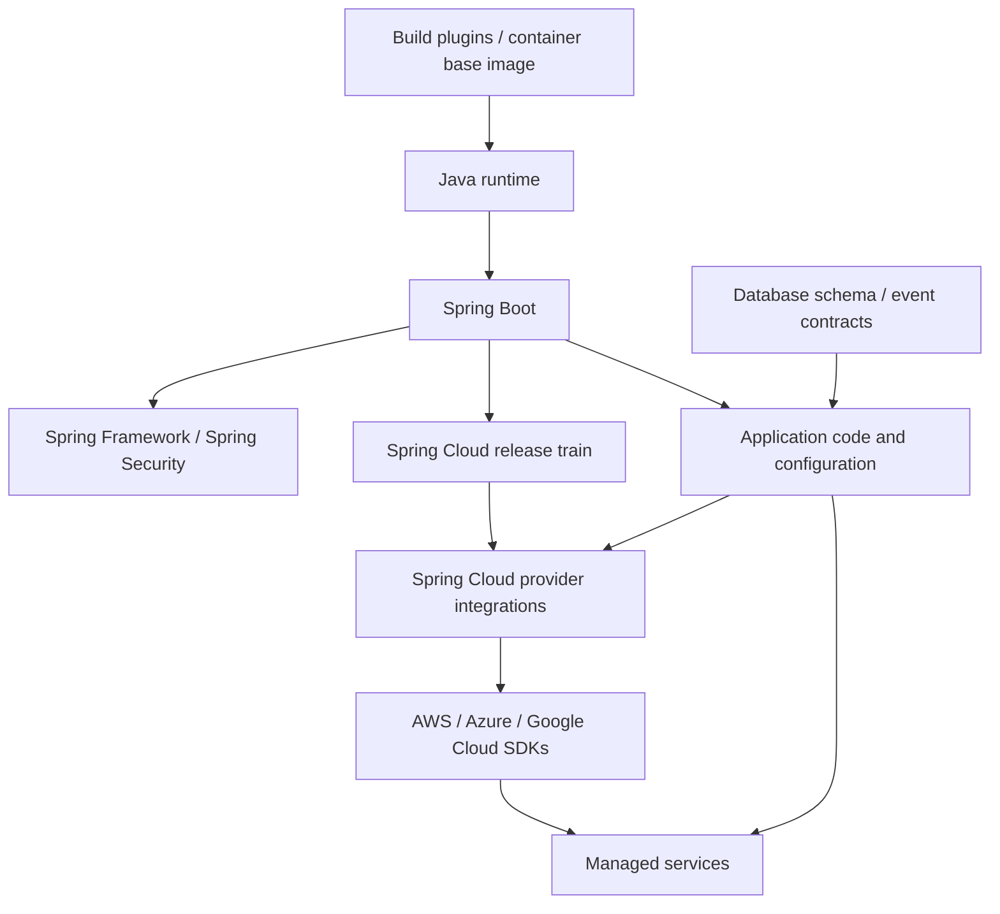
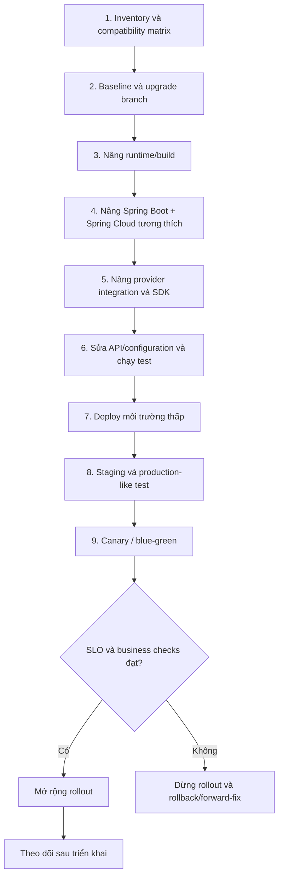
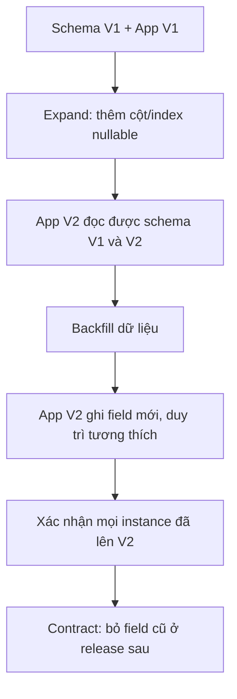
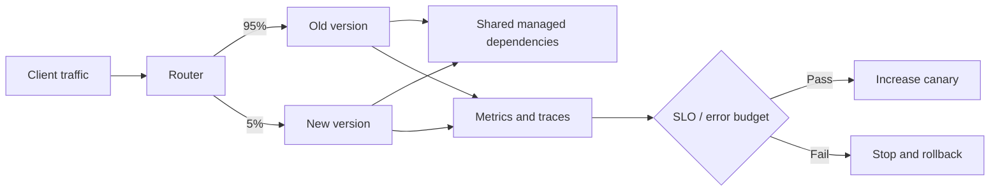

# Nâng cấp theo giai đoạn và chuẩn bị phương án quay lại

> **Chương:** Nâng cấp tích hợp  
> **Học phần:** SPRING_CLOUD_PROVIDER_INTEGRATION — thực hành tích hợp Spring Boot với dịch vụ managed của AWS, Azure và Google Cloud qua các thư viện Spring Cloud tương ứng. Bài này hướng dẫn nâng cấp stack và tích hợp cloud theo từng giai đoạn, kiểm soát thay đổi khi triển khai, đồng thời chuẩn bị phương án rollback có thể thực hiện được.

Một thay đổi phiên bản Spring Boot, Spring Cloud hoặc cloud SDK có thể ảnh hưởng tới nhiều lớp cùng lúc: auto-configuration, dependency injection, credential chain, serialization, retry, timeout, endpoint, metrics và cách ứng dụng gọi dịch vụ managed. Nâng cấp thành công không chỉ là build xanh. Ứng dụng phải giữ đúng hành vi nghiệp vụ, bảo mật và SLO khi chạy trên môi trường thật.

Vì vậy, hãy chia nâng cấp thành những bước nhỏ có thể kiểm chứng. Mỗi bước cần có baseline, tiêu chí chấp nhận, artifact có thể tái tạo và điểm dừng an toàn. Rollback phải được thiết kế cùng migration dữ liệu, message schema và cấu hình cloud; đổi lại image cũ không thể đảo ngược mọi thay đổi đã ghi ra database hoặc managed service.

## 1. Mục tiêu học tập

Sau bài này, bạn có thể:

1. Lập compatibility matrix cho Java, Spring Boot, Spring Cloud, cloud integration libraries và SDK.
2. Chọn phiên bản theo BOM và ma trận tương thích chính thức.
3. Xác định thứ tự nâng cấp để khoanh vùng lỗi.
4. Phân loại breaking change ở API, configuration, identity, data và messaging.
5. Xây baseline test và so sánh hành vi trước/sau nâng cấp.
6. Triển khai canary hoặc blue-green theo từng bước traffic.
7. Giữ tương thích ngược cho database schema và event/message contract.
8. Đặt rollback trigger dựa trên SLO, error rate, latency và backlog.
9. Viết rollback runbook có owner, dữ liệu, lệnh và điều kiện dừng rõ ràng.
10. Biết khi nào nên rollback, khi nào cần forward-fix và khi nào phải dừng rollout để điều tra.

## 2. Nâng cấp là thay đổi một hệ thống có nhiều dependency

Một ứng dụng Spring Boot tích hợp AWS, Azure và Google Cloud thường có dependency graph như sau:



Nâng cấp một node có thể kéo theo nhiều node khác. Ví dụ:

- Spring Boot nâng cấp có thể thay Spring Framework, Jackson, logging, embedded server và auto-configuration.
- Spring Cloud release train phải tương thích với Spring Boot đang dùng.
- Spring Cloud AWS/Azure/GCP có thể yêu cầu một line phiên bản khác hoặc thay package/configuration.
- SDK nâng cấp có thể đổi credential provider, retry policy, HTTP transport hoặc response model.
- Java runtime nâng cấp có thể làm lộ vấn đề reflection, TLS, certificate, native library hoặc bytecode.
- Database/event migration có thể khiến bản ứng dụng cũ không còn đọc được dữ liệu mới.

Do đó, không nên xem việc nâng cấp là một lần đổi version trong file build. Đây là một thay đổi có phạm vi, dependency và rủi ro cần quản lý.

## 3. Lập compatibility matrix trước khi sửa code

Ghi lại phiên bản đang chạy và phiên bản đích cho từng lớp. Ma trận này là nguồn sự thật của đợt nâng cấp.

| Thành phần | Phiên bản hiện tại | Phiên bản đích | Bằng chứng tương thích |
|---|---|---|---|
| JDK | Đang dùng | Đã chọn | Spring Boot và runtime support matrix |
| Spring Boot | Đang dùng | Đã chọn | System requirements và migration guide |
| Spring Framework | Do Boot quản lý | Theo Boot đích | Boot dependency management |
| Spring Cloud | Release train hiện tại | Release train đích | Spring Cloud supported versions |
| Spring Cloud AWS/Azure/GCP | Module hiện tại | Module đích | Tài liệu integration tương ứng |
| Cloud SDK | BOM/transitive hiện tại | BOM/transitive đích | SDK compatibility/release notes |
| Database driver | Hiện tại | Đích | Database và driver support |
| Build/container | Plugin/base image hiện tại | Đích | CI build, image scan, runtime test |

Không điền phiên bản chỉ vì đó là bản mới nhất trên Maven Central. Chọn phiên bản nằm trong ma trận được hỗ trợ, sau đó khóa lại trong BOM hoặc version catalog.

### 3.1. Spring Boot và Spring Cloud phải cùng một cặp tương thích

Spring Cloud phát hành theo release train. Mỗi train hỗ trợ một dải Spring Boot cụ thể. Trước khi đổi version, hãy:

1. Tra compatibility matrix của Spring Cloud.
2. Chọn release train tương thích với Spring Boot đích.
3. Kiểm tra migration guide và release notes của cả hai.
4. Kiểm tra từng Spring Cloud provider integration đang sử dụng.
5. Chạy compatibility verifier và test startup trong CI.

Không tự chọn Spring Boot mới nhất rồi ghép với Spring Cloud train mới nhất nếu ma trận chưa xác nhận cặp đó được hỗ trợ.

### 3.2. Dùng BOM để quản lý version

Maven có thể import Spring Boot BOM và Spring Cloud BOM:

```xml
<properties>
    <java.version>17</java.version>
    <spring-boot.version>BOOT_VERSION_APPROVED</spring-boot.version>
    <spring-cloud.version>CLOUD_TRAIN_APPROVED</spring-cloud.version>
</properties>

<dependencyManagement>
    <dependencies>
        <dependency>
            <groupId>org.springframework.boot</groupId>
            <artifactId>spring-boot-dependencies</artifactId>
            <version>\${spring-boot.version}</version>
            <type>pom</type>
            <scope>import</scope>
        </dependency>
        <dependency>
            <groupId>org.springframework.cloud</groupId>
            <artifactId>spring-cloud-dependencies</artifactId>
            <version>\${spring-cloud.version}</version>
            <type>pom</type>
            <scope>import</scope>
        </dependency>
    </dependencies>
</dependencyManagement>
```

Các chuỗi `BOOT_VERSION_APPROVED` và `CLOUD_TRAIN_APPROVED` là placeholder phải được thay bằng cặp đã xác minh trong dự án. Không commit placeholder vào build thực tế.

Nếu ứng dụng gọi SDK trực tiếp, có thể dùng BOM chính thức của SDK tương ứng, ví dụ AWS SDK BOM, Azure SDK BOM hoặc Google Cloud Libraries BOM. Chỉ import BOM cần thiết và kiểm tra nó không ghi đè version mà Spring Cloud integration yêu cầu. Tránh khai báo version rời rạc cho từng module của cùng một SDK.

### 3.3. Không nâng cấp tất cả dependency một lúc

Một pull request thay đổi đồng thời Java, Spring Boot, Spring Cloud, ba cloud SDK, database driver và container base image sẽ làm khó việc xác định nguyên nhân nếu test hỏng.

Hãy chia thay đổi theo nhóm có ranh giới:

- Runtime/build toolchain.
- Spring Boot và Spring Framework.
- Spring Cloud release train.
- Provider integration libraries.
- Cloud SDK trực tiếp.
- Database/message client.
- Container image và deployment platform.

Có thể cần phối hợp một số nhóm trong cùng bước nếu compatibility matrix yêu cầu, nhưng phải ghi rõ dependency giữa chúng và test riêng từng nhóm.

## 4. Thiết lập baseline trước nâng cấp

Baseline là bằng chứng cho biết hệ thống đang hoạt động như thế nào trước khi thay đổi.

### 4.1. Baseline kỹ thuật

Ghi lại:

- Build command, test command và thời gian build.
- JDK, framework, release train, SDK và container image.
- Startup time, readiness time và memory footprint.
- API latency p50/p95/p99.
- Error rate theo endpoint và dependency.
- Connection pool, thread pool và HTTP client settings.
- Retry count, timeout count, throttling và circuit breaker state.
- Database query latency, connection errors và migration state.
- Message publish/consume rate, age, retry và dead-letter count.

### 4.2. Baseline nghiệp vụ

Chọn một số luồng đại diện:

1. Đăng nhập workload và truy cập storage.
2. Upload rồi download object và xác minh checksum.
3. Publish/consume event với idempotency.
4. Đọc/ghi database managed service.
5. Đọc secret và xác minh rotation behavior.
6. Gọi API có retry và timeout.
7. Khôi phục một bản backup hoặc replay một message test.

Ghi kết quả và dữ liệu đầu vào đã dùng để có thể chạy lại trên phiên bản mới.

### 4.3. Lưu artifact và cấu hình hiện tại

Trước khi nâng cấp, lưu:

- Image digest của bản production hiện tại.
- SBOM hoặc dependency lock report.
- Helm values/manifests hoặc deployment configuration.
- Runtime flags và environment key names.
- Database migration version.
- Event schema version.
- IAM/RBAC policy reference.
- Secret reference/version theo cơ chế quản lý an toàn.

Không export secret plaintext vào hồ sơ nâng cấp. Cần biết secret nào đang được tham chiếu và cách khôi phục phiên bản trước theo quy trình của secret manager.

## 5. Kiểm kê thay đổi và phân loại rủi ro

Đọc release notes, migration guide và deprecation notice. Không chỉ tìm từ khóa “breaking”; một thay đổi mặc định cũng có thể đổi behavior mà code vẫn compile.

| Khu vực | Câu hỏi cần kiểm tra | Ví dụ rủi ro |
|---|---|---|
| Java | Runtime, module, TLS, reflection có đổi không? | Thư viện cũ không truy cập được API bị đóng |
| Spring Boot | Auto-configuration, property, bean lifecycle có đổi không? | Bean không còn được tạo |
| Spring Cloud | Release train/binder/config import có đổi không? | Compatibility verifier fail |
| Security | Filter chain, token decoder, credential chain có đổi không? | Workload mất quyền |
| Storage | Retry, checksum, version, multipart behavior có đổi không? | Upload thành công nhưng metadata sai |
| Messaging | Acknowledgement, retry, serialization có đổi không? | Message bị redeliver hoặc vào DLQ |
| Database | Driver, pool, dialect, TLS có đổi không? | Connection timeout hoặc query behavior đổi |
| Observability | Metric/tag name và tracing bridge có đổi không? | Dashboard không còn dữ liệu |
| Deployment | Health probe, base image, memory limit có đổi không? | Container bị restart |

### 5.1. Phân loại mỗi thay đổi

- **Compatible:** behavior giữ nguyên theo contract đã kiểm chứng.
- **Deprecated:** vẫn chạy nhưng cần thay API trước khi phiên bản sau loại bỏ.
- **Breaking source/API:** cần sửa code hoặc import.
- **Breaking configuration:** property, default hoặc cấu trúc config thay đổi.
- **Behavioral:** code compile nhưng runtime behavior khác.
- **Operational:** cần đổi IAM, network, quota, deployment hoặc monitoring.
- **Data contract:** schema hoặc semantics dữ liệu/message thay đổi.

Ưu tiên xử lý behavioral, security, data và operational change vì chúng dễ bị bỏ sót trong compile test.

## 6. Quy trình nâng cấp theo giai đoạn

Một chu trình có thể dùng cho ứng dụng Spring Boot tích hợp nhiều cloud:



### Giai đoạn 1 — Tạo nhánh nâng cấp và đóng băng baseline

- Tạo branch hoặc change set riêng.
- Gắn issue/ADR với mục tiêu và phạm vi.
- Chụp baseline và image digest hiện tại.
- Không trộn feature business không liên quan vào cùng thay đổi.
- Xác định người quyết định go/no-go.

### Giai đoạn 2 — Nâng runtime và build toolchain

Kiểm tra JDK, Maven/Gradle wrapper, compiler plugin, test plugin, container base image và CI runner. Chạy compile/test với source hiện tại trước khi thay framework.

Nếu runtime mới làm code cũ không chạy, sửa riêng các vấn đề runtime trước. Điều này giúp tách lỗi Java/toolchain khỏi lỗi Spring.

### Giai đoạn 3 — Nâng Spring Boot và Spring Cloud theo ma trận

- Cập nhật Boot BOM.
- Cập nhật Cloud release train tương thích.
- Xử lý deprecated API và configuration property.
- Kiểm tra auto-configuration report khi bean không còn xuất hiện.
- Chạy startup test với từng provider configuration.
- Xác minh Spring Cloud compatibility verifier.

Không bỏ verifier chỉ để làm build xanh. Nếu verifier báo cặp version không được hỗ trợ, cần giải quyết dependency alignment hoặc ghi nhận quyết định ngoại lệ có kiểm soát.

### Giai đoạn 4 — Nâng provider integration và SDK

Nâng từng integration library và SDK theo compatibility matrix. Với mỗi provider, xác minh:

- Client được tạo bằng đúng credential provider chain.
- Region, endpoint, project, subscription, bucket/container đúng.
- Timeout/retry/backoff không bị thay đổi ngoài dự kiến.
- IAM/RBAC và workload identity vẫn hoạt động.
- API response/error được adapter chuyển đổi đúng.
- Health/readiness không gọi operation gây side effect.

Nếu có thể, nâng và test từng provider adapter độc lập. Khi phải nâng đồng thời vì dependency constraint, vẫn giữ test suite riêng cho từng provider.

### Giai đoạn 5 — Sửa code và configuration

Thay API deprecated, cập nhật property, sửa package/import, điều chỉnh bean conditions và cấu hình HTTP client. Không sửa business behavior trong cùng commit nếu không cần.

Tạo một bảng mapping property:

| Property cũ | Property mới | Nguồn cấu hình | Cần restart? | Kiểm thử |
|---|---|---|---|---|
| Tên cũ | Tên mới | Profile/env/config server | Có/không | Context startup |
| Credential property cũ | Workload identity | Runtime identity | Có/không | Token + access test |
| Retry property cũ | Retry policy mới | Application config | Có/không | Fault injection |

Không giả định property cũ bị bỏ sẽ gây lỗi startup. Có trường hợp framework bỏ qua property không còn được bind; ứng dụng vẫn chạy với default mới.

### Giai đoạn 6 — Chạy test trước khi deploy

Chạy theo thứ tự:

1. Compile và static checks.
2. Unit tests.
3. Spring context/startup tests.
4. Contract tests cho storage/messaging/data adapter.
5. Integration tests với emulator hoặc test service.
6. Integration tests trên sandbox cloud thật.
7. Regression và performance tests.
8. Security/configuration checks.

Test pass chỉ có giá trị nếu bao phủ behavior bị thay đổi. Không coi một unit test chỉ kiểm tra mock invocation là bằng chứng IAM, TLS hoặc managed service hoạt động.

## 7. Quản lý breaking changes trong Spring Boot và Spring Cloud

### 7.1. Auto-configuration và bean registration

Framework có thể đổi điều kiện auto-configuration hoặc tên bean. Nếu ứng dụng dựa vào bean mặc định:

- Kiểm tra condition evaluation report.
- Xác nhận bean cần thiết có mặt.
- Xác nhận chỉ có một implementation của port.
- Kiểm tra @ConditionalOnClass, @ConditionalOnProperty, @Profile và @ConditionalOnMissingBean.
- Không thêm @Primary để che giấu việc tạo trùng adapter.

Một startup test nên khởi động context cho từng provider profile/property và xác nhận đúng adapter được inject.

### 7.2. Configuration properties

Property có thể đổi prefix, default, type hoặc vị trí. Dùng @ConfigurationProperties có validation để lỗi được phát hiện lúc startup:

```java
@ConfigurationProperties(prefix = "app.storage")
@Validated
public record StorageProperties(
        @NotBlank String bucket,
        @NotBlank String region,
        @Min(1) long maxObjectSizeBytes) {
}
```

Khi framework nâng cấp, test binding với file cấu hình thực tế và environment variable tương ứng. Đừng chỉ test constructor của properties record.

### 7.3. Spring Security và workload identity

Nâng Spring Security có thể ảnh hưởng filter chain, authorization matcher, OAuth2 resource server, token decoder và client credential configuration.

Với cloud integration, cần kiểm tra riêng:

- Token audience và issuer.
- Role/permission được gắn cho workload.
- Token refresh và credential rotation.
- Private endpoint/network route.
- TLS truststore/certificate.
- Phân biệt user token và workload credential.

Một ứng dụng khởi động thành công không chứng minh workload identity đã lấy token hoặc có quyền truy cập resource.

### 7.4. Spring Cloud Stream và messaging

Khi nâng Spring Cloud Stream/binder:

- Xác minh destination, consumer group và partition mapping.
- Kiểm tra acknowledgement mode.
- Kiểm tra retry/backoff và dead-letter routing.
- Kiểm tra header/content-type mapping.
- Kiểm tra serialization và schema evolution.
- Kiểm tra transaction/outbox behavior.

Không thay binder version rồi giả định queue/topic semantics vẫn giữ nguyên. Test duplicate, poison message, redelivery, ordering và consumer restart.

### 7.5. Spring Cloud provider integrations

Với Spring Cloud AWS, Azure và GCP, rà soát:

- Package/class API đã đổi hoặc deprecated.
- Auto-configuration condition và bean name.
- Property prefix, region/project/endpoint binding.
- Credential provider chain và identity integration.
- Template/client abstraction và exception mapping.
- Health indicator, metrics và tracing integration.
- Version SDK được module quản lý.

Nếu ứng dụng dùng SDK trực tiếp bên cạnh Spring Cloud integration, kiểm tra tránh có hai version khác nhau của cùng SDK trên classpath.

## 8. Database migration phải tương thích với cả bản mới và bản cũ

Rollback ứng dụng chỉ an toàn nếu schema/database vẫn được bản cũ đọc và ghi đúng.

### 8.1. Expand-contract

Không đổi schema phá vỡ ngay trong cùng lần deploy ứng dụng.



Ví dụ:

1. Thêm cột `document_checksum` nullable.
2. Deploy app mới vẫn đọc được record chưa có checksum.
3. Ghi checksum cho record mới.
4. Backfill record cũ theo batch có thể retry.
5. Xác minh dữ liệu đã đủ và không còn consumer cũ.
6. Release sau mới đặt NOT NULL hoặc bỏ cột cũ.

Nếu deploy app mới rồi rollback app cũ, schema vẫn phải tương thích với app cũ trong giai đoạn rollback.

### 8.2. Tránh migration phá hủy trong cửa sổ rollback

Không nên trong cùng một release:

- Rename cột mà không giữ alias/compatibility.
- Xóa cột cũ ngay sau khi code mới ngừng dùng.
- Đổi enum value khiến consumer cũ không parse được.
- Thay type/precision mà driver cũ xử lý khác.
- Thay partition key hoặc primary key mà chưa có migration strategy.

Migration phá hủy nên diễn ra sau khi hết rollback window và có backup/restore plan đã thử.

### 8.3. Migration dữ liệu cần idempotent

Batch migration phải có checkpoint, retry và reconciliation. Khi một batch chạy lại, không được nhân đôi dữ liệu hoặc bỏ sót record. Ghi nhận:

- Số record đã đọc/ghi.
- Số record thành công/thất bại.
- Checksum hoặc invariant dùng để đối chiếu.
- Checkpoint cuối cùng.
- Cách tiếp tục hoặc đảo ngược.

Nếu migration không thể đảo ngược, cần chứng minh app cũ vẫn tương thích hoặc chọn forward-fix thay vì rollback binary.

## 9. Message và event schema phải hỗ trợ rolling deployment

Trong lúc rollout, consumer phiên bản cũ và mới có thể chạy đồng thời. Producer mới không được gửi schema mà consumer cũ không thể đọc.

### 9.1. Quy tắc backward compatibility

- Thêm field optional có default phù hợp.
- Không đổi ý nghĩa field đã phát hành.
- Không đổi tên hoặc xóa field khi còn consumer cũ.
- Giữ enum fallback hoặc quy tắc unknown value.
- Tăng schema version khi semantics thay đổi.
- Giữ khả năng đọc message cũ trong thời gian retention/replay.

### 9.2. Producer-consumer rollout

1. Deploy consumer mới có thể đọc cả schema cũ và mới.
2. Xác nhận toàn bộ consumer group đã sẵn sàng.
3. Deploy producer bắt đầu phát schema mới.
4. Theo dõi deserialize error, DLQ và processing lag.
5. Chỉ bỏ compatibility code sau khi hết thời gian replay và rollback.

Nếu không thể làm consumer cũ hiểu schema mới, giữ producer ở schema cũ trong khi rollout hoặc dùng versioned topic/route.

### 9.3. Tránh hai consumer xử lý cùng side effect

Blue-green có thể khiến hai nhóm consumer cùng chạy. Nếu cả hai nhận cùng event, side effect có thể xảy ra hai lần. Cần:

- Dùng cùng consumer group khi semantics broker bảo đảm phân phối giữa instance trong group.
- Hoặc dừng/disable consumer cũ trước khi kích hoạt consumer mới.
- Thiết kế idempotent consumer theo event ID.
- Dùng transactional outbox/inbox nếu cần kiểm soát side effect và deduplication.
- Kiểm tra scheduler/background job để không chạy hai lần.

Không giả định load balancer HTTP điều khiển được traffic của queue consumer.

## 10. Canary và blue-green rollout

Chọn chiến lược dựa trên khả năng route traffic, tương thích dữ liệu và cách workload xử lý message.

### 10.1. Rolling deployment

Thay instance cũ dần bằng instance mới trong cùng deployment group.

Phù hợp khi:

- App cũ/mới cùng đọc được schema.
- Message contract tương thích.
- Có readiness/liveness chính xác.
- Session hoặc local state không làm rollout mất dữ liệu.

Rủi ro: hai phiên bản cùng chạy trong một thời gian. Cần đảm bảo scheduler, consumer và cache invalidation không tạo side effect trùng.

### 10.2. Blue-green

Chạy hai môi trường riêng:

- Blue: phiên bản đang phục vụ.
- Green: phiên bản mới, đã được kiểm tra.

Chuyển traffic qua load balancer, ingress hoặc DNS sau khi green đạt readiness. Rollback có thể chuyển traffic lại blue nếu dữ liệu và side effect vẫn tương thích.

Blue-green cần đủ capacity cho hai môi trường và cần kiểm soát background worker/consumer. Không tự động chạy cả hai môi trường ở chế độ active đối với job không idempotent.

### 10.3. Canary

Đưa một phần nhỏ traffic tới phiên bản mới:



Canary nên bắt đầu ở mức traffic đủ nhỏ để giới hạn tác động nhưng đủ lớn để tạo tín hiệu. Với workload ít request, có thể dùng synthetic transaction hoặc test tenant.

### 10.4. Định nghĩa bước rollout

Ví dụ kế hoạch:

| Giai đoạn | Tỷ lệ/đối tượng | Thời gian quan sát | Điều kiện mở rộng |
|---|---|---|---|
| Smoke | Synthetic/test tenant | Đến khi đủ các luồng | Không có lỗi cấu hình/security |
| Canary 1 | 1–5% traffic | Theo baseline và volume | Error/latency trong ngưỡng |
| Canary 2 | 10–25% | Đủ chu kỳ tải đại diện | Không tăng DLQ/throttling |
| Rollout | 50% rồi 100% | Mỗi bước có checkpoint | Business metric và SLO đạt |
| Post-deploy | Toàn bộ traffic | Theo dõi tăng cường | Không còn tín hiệu bất thường |

Các tỷ lệ và thời gian trên chỉ là ví dụ. Chọn theo traffic, blast radius, thời gian phát hiện lỗi và khả năng rollback.

## 11. Đặt rollback trigger có thể đo được

Không nên dùng cảm giác “có vẻ chậm” hoặc “có vài lỗi” để quyết định. Hãy xác định trigger trước khi deploy.

### 11.1. Nhóm chỉ số

| Nhóm | Chỉ số |
|---|---|
| Availability | HTTP 5xx, failed request, readiness failure |
| Latency | p95/p99 theo endpoint và dependency |
| Security | Authentication failure, authorization denied, token refresh failure |
| Cloud API | 429/throttling, timeout, access denied, SDK retry exhaustion |
| Storage | Upload/download failure, checksum mismatch, missing revision |
| Messaging | Publish failure, consumer lag, redelivery, DLQ growth |
| Database | Connection failure, query latency, pool exhaustion, migration error |
| Runtime | Crash/restart, OOM, GC pause, thread exhaustion |
| Business | Invoice issuance failure, duplicate event, missing document |

### 11.2. So sánh với baseline và SLO

Trigger nên có:

- Ngưỡng tuyệt đối theo SLO.
- Mức tăng tương đối so với baseline.
- Cửa sổ thời gian.
- Số request tối thiểu để có ý nghĩa.
- Loại lỗi nghiêm trọng cần dừng ngay.

Ví dụ minh họa:

- Dừng canary nếu 5xx vượt ngưỡng SLO trong hai cửa sổ liên tiếp.
- Dừng nếu p95 tăng vượt mức đã thống nhất trong khi volume tương đương.
- Dừng ngay nếu workload identity mất quyền truy cập dữ liệu.
- Dừng ngay nếu checksum sai, cross-tenant access hoặc duplicate financial side effect xuất hiện.
- Dừng mở rộng nếu DLQ hoặc consumer lag tăng liên tục.

Ngưỡng cụ thể phải được lấy từ SLO và baseline của hệ thống, không dùng số mẫu này như mặc định production.

### 11.3. Phân biệt rollback trigger và alert

Không phải mọi alert đều yêu cầu rollback. Một lỗi từ dependency bên ngoài có thể ảnh hưởng cả bản cũ và bản mới. Cần so sánh canary với control group và kiểm tra correlation với deployment.

Một trigger rollback tốt cho thấy:

1. Vấn đề xuất hiện sau khi phiên bản mới nhận traffic.
2. Phiên bản mới có tỷ lệ lỗi cao hơn control group hoặc vi phạm invariant.
3. Rollback có khả năng giảm blast radius.
4. Hành động rollback không làm dữ liệu hỏng thêm.

Nếu không rõ nguyên nhân hoặc rollback có thể làm mất dữ liệu, dừng rollout và thực hiện incident triage theo runbook.

## 12. Thiết kế rollback trước khi nâng cấp

Rollback plan phải trả lời ai quyết định, đổi gì, trong bao lâu, dữ liệu nào đã thay đổi và làm sao xác minh hệ thống trở lại trạng thái an toàn.

### 12.1. Rollback application artifact

Điều kiện cần:

- Giữ image digest của phiên bản cũ.
- Artifact cũ còn được registry giữ lại và có thể pull.
- Deployment manifest/values cũ được version hóa.
- Runtime và platform vẫn hỗ trợ image cũ.
- Database/message schema vẫn tương thích với app cũ.
- Credential và permission cần cho app cũ còn hợp lệ.

Không rebuild từ source branch cũ trong lúc incident nếu đã có artifact production đã xác minh. Dùng đúng digest đã triển khai trước đó.

### 12.2. Rollback configuration

Lưu cấu hình trước/sau theo version:

- Profile/provider selection.
- Endpoint, region và resource identifier.
- Timeout/retry/concurrency.
- Feature flag.
- Secret reference/version (không phải plaintext).
- IAM/RBAC policy reference.

Một config rollback có thể thất bại nếu resource hoặc credential cũ đã bị xóa. Kiểm tra dependency trước khi chuyển lại.

### 12.3. Rollback database

Ưu tiên schema tương thích ngược để rollback app không cần rollback database. Nếu phải restore backup:

- Xác định mất dữ liệu từ thời điểm nào.
- Xác định transaction/event đã phát ra ngoài database.
- Có reconciliation cho side effect.
- Đo thời gian restore và RPO thực tế.
- Có phê duyệt owner dữ liệu.

Restore database có thể làm mất giao dịch mới; đây là quyết định incident nghiêm trọng, không phải thao tác rollback ứng dụng thông thường.

### 12.4. Rollback message/event

Không thể “thu hồi” event đã được consumer khác xử lý chỉ bằng cách quay image. Cần:

- Producer cũ vẫn phát schema tương thích.
- Consumer cũ có thể xử lý message đang tồn tại.
- Có idempotency/deduplication.
- Nếu event mới đã tạo side effect, có compensating action hoặc reconciliation.
- Không xóa DLQ hoặc event archive để che lỗi.

### 12.5. Rollback cloud resource và policy

Một số thay đổi managed service khó hoặc không thể đảo ngược:

- S3 Object Lock Compliance retention đã áp dụng.
- Azure immutable policy đã lock.
- Google Cloud Bucket Lock đã khóa retention.
- Database engine upgrade hoặc storage format migration.
- Key rotation/disable có ảnh hưởng tới dữ liệu cũ.
- Resource rename/recreate làm thay đổi endpoint hoặc identity binding.

Với thay đổi như vậy, có thể cần forward-fix, tạo resource mới và migrate, hoặc giữ policy mới rồi rollback ứng dụng tương thích. Không đưa thao tác không thể đảo ngược vào rollback script tự động.

## 13. Rollback runbook mẫu

Runbook phải đủ cụ thể để người trực vận hành làm theo khi chịu áp lực.

### Thông tin trước rollout

| Trường | Giá trị cần điền |
|---|---|
| Service/version mới | Image tag và digest |
| Version cũ | Image tag và digest đã chạy |
| Deployment | Cluster/namespace/region |
| Database migration | Version hiện tại và trạng thái |
| Message schema | Producer/consumer schema version |
| Owner quyết định | Incident commander/release owner |
| Người thực hiện | On-call/platform engineer |
| Rollback trigger | Ngưỡng đã phê duyệt |
| RTO/RPO | Mục tiêu đã cam kết |

### Trình tự rollback

1. **Stop rollout:** khóa pipeline/canary promotion để không có instance mới được thêm.
2. **Limit blast radius:** giảm traffic tới version mới hoặc disable feature gây lỗi nếu an toàn.
3. **Capture evidence:** ghi deployment digest, config version, trace ID, error và metric.
4. **Check data compatibility:** xác nhận schema, message và side effect còn tương thích với version cũ.
5. **Restore application:** chuyển traffic/deployment về image digest cũ.
6. **Restore configuration:** dùng config version đã kiểm chứng; xác minh identity và endpoint.
7. **Verify health:** readiness, API smoke, database, storage, messaging và secret access.
8. **Verify business invariants:** không thiếu/nhân đôi invoice, document checksum đúng, tenant isolation giữ nguyên.
9. **Reconcile:** xử lý message pending/DLQ và dữ liệu phát sinh trong cửa sổ lỗi.
10. **Hold deployment:** khóa rollout mới cho đến khi có root cause và quyết định tiếp theo.

### Điều kiện kết thúc rollback

- Traffic đã chuyển về bản cũ hoặc hệ thống đã ở trạng thái an toàn được phê duyệt.
- SLO phục hồi hoặc có biện pháp giảm tác động được chấp thuận.
- Không còn side effect đang chạy từ phiên bản mới.
- Database và message pipeline được kiểm tra.
- Owner incident xác nhận hoàn tất.
- Evidence và timeline được lưu cho post-incident review.

## 14. Khi nào rollback, khi nào forward-fix?

| Tình huống | Hướng xử lý thường phù hợp | Lý do |
|---|---|---|
| Bean không được tạo, app mới fail startup | Rollback artifact/config | Không phục vụ được traffic |
| SDK retry gây tăng latency nhưng app cũ hoạt động bình thường | Dừng canary, rollback hoặc revert retry config | Hạn chế tải lên dependency |
| Credential mới bị thiếu quyền S3 | Rollback nếu credential cũ còn an toàn; sửa IAM theo quy trình | Lỗi authorization có thể chặn toàn bộ operation |
| Schema đã expand, app mới lỗi | Có thể rollback app nếu schema backward-compatible | Không cần đảo schema additive |
| Schema đã drop cột cũ | Forward-fix hoặc restore/reconcile có phê duyệt | App cũ có thể không chạy |
| Event schema mới đã được phát và consumer cũ không đọc được | Dừng producer, deploy consumer tương thích hoặc forward-fix | Message đã phát không thể thu hồi đơn giản |
| Object đã được khóa theo compliance retention | Giữ policy, sửa ứng dụng theo hướng tương thích | Policy có thể không thể đảo ngược |
| Duplicate payment/invoice side effect | Dừng rollout, reconcile và incident response | Rollback binary không đảo giao dịch đã xảy ra |

Rollback không phải lúc nào cũng là lựa chọn an toàn nhất. Nếu bản mới đã ghi dữ liệu theo format mà bản cũ không hiểu, quay lại có thể làm sự cố nghiêm trọng hơn. Hãy chọn hành động dựa trên trạng thái dữ liệu và side effect thực tế.

## 15. Ví dụ: nâng Spring Cloud AWS trong Invoice Service

Giả sử service hiện đang:

- Chạy Spring Boot/Spring Cloud ở cặp version đã cũ.
- Dùng Spring Cloud AWS để tạo S3 client.
- Dùng SQS để nhận event hóa đơn.
- Lưu metadata trong PostgreSQL managed service.
- Lấy credential qua workload identity.

Mục tiêu là nâng lên cặp Spring Boot/Spring Cloud được hỗ trợ mới hơn và cập nhật integration library/SDK tương ứng.

### 15.1. Inventory và compatibility

Lập bảng:

| Thành phần | Kiểm tra |
|---|---|
| JDK | Version đích có được Boot hỗ trợ không |
| Spring Boot | Migration guide và auto-configuration changes |
| Spring Cloud | Release train tương thích |
| Spring Cloud AWS | Module/API/property thay đổi |
| AWS SDK | BOM, HTTP client, retry và credential |
| PostgreSQL driver | TLS, pool, type mapping |
| SQS | Acknowledgement, redelivery, DLQ |
| S3 | Versioning, checksum, multipart, encryption |

### 15.2. Chia commit

1. Chốt compatibility matrix và BOM.
2. Nâng JDK/build toolchain và sửa lỗi runtime.
3. Nâng Boot/Cloud, xử lý source/config changes.
4. Nâng Spring Cloud AWS và AWS SDK.
5. Nâng database driver nếu cần.
6. Bổ sung/điều chỉnh test, metrics và runbook.

Mỗi commit phải build được hoặc có quan hệ phụ thuộc rõ ràng. Tránh một commit thay cả framework lẫn business logic.

### 15.3. Kiểm thử

- Startup context với AWS configuration.
- Lấy credential từ workload identity trong sandbox.
- Upload/download object, xác minh checksum và revision.
- Publish/consume SQS test message.
- Xử lý duplicate, timeout, throttling và DLQ.
- PostgreSQL read/write/transaction.
- Load test so sánh p95/p99 và connection pool.

### 15.4. Rollout

1. Deploy staging dùng cùng IAM policy và network model với production.
2. Chạy smoke test với bucket/queue riêng.
3. Canary 5% HTTP traffic.
4. Theo dõi S3/SQS error, retry, p95, DLQ và business metric.
5. Tăng traffic theo checkpoint.
6. Chỉ dừng bản cũ sau khi xác nhận consumer group, scheduled job và schema tương thích.

Nếu bản mới có lỗi nhưng chưa có data migration phá hủy, chuyển traffic về image digest cũ. Giữ lại message/DLQ để điều tra, không purge queue.

## 16. Bộ kiểm thử nâng cấp

| Loại test | Câu hỏi cần trả lời | Công cụ/cách chạy |
|---|---|---|
| Compile/static | Source và dependency có tương thích? | Maven/Gradle, compiler, static analysis |
| Context startup | Bean/property/profile có đúng? | @SpringBootTest, ApplicationContextRunner |
| Unit | Business behavior có giữ nguyên? | JUnit, Mockito |
| Contract | Adapter có giữ semantics? | Shared contract test suite |
| Integration | Identity/API thật có hoạt động? | Cloud sandbox, Testcontainers/emulator |
| Security | Permission, token, TLS có đúng? | IAM/RBAC test, security scan |
| Resilience | Retry/timeout/circuit breaker có đúng? | Fault injection, mock server |
| Performance | Latency/throughput/resource có đổi? | Load test theo baseline |
| Migration | Schema/event tương thích? | Migration test, old/new consumer matrix |
| Recovery | Rollback/restore có làm được? | Rollback rehearsal, restore drill |

Emulator như LocalStack, Azurite hoặc fake GCS server hữu ích cho feedback nhanh nhưng không chứng minh đầy đủ IAM, quota, managed policy, network và failure mode production. Các hành vi rủi ro cao phải được xác nhận trên sandbox cloud thật.

## 17. Checklist go/no-go

### Trước rollout

- [ ] Compatibility matrix đã được review.
- [ ] BOM và dependency tree đã được khóa.
- [ ] Migration guide và deprecation đã được xử lý.
- [ ] Baseline metric và business test đã lưu.
- [ ] Artifact mới có image digest bất biến.
- [ ] Artifact/config cũ có thể khôi phục.
- [ ] Database và event schema backward-compatible.
- [ ] IAM/RBAC, secret, endpoint và network đã test.
- [ ] Canary/blue-green routing đã thử.
- [ ] Rollback trigger và owner đã thống nhất.
- [ ] Runbook có lệnh/đầu mối và đã diễn tập.

### Trong rollout

- [ ] Chỉ tăng traffic sau checkpoint.
- [ ] Theo dõi metric mới và control group.
- [ ] Theo dõi retry, throttling, DLQ và database pool.
- [ ] Kiểm tra business invariant.
- [ ] Dừng mở rộng khi trigger xuất hiện.

### Sau rollout

- [ ] Ổn định qua đủ chu kỳ tải đại diện.
- [ ] Consumer/job cũ được dừng đúng cách.
- [ ] Không còn message hoặc task bị bỏ sót.
- [ ] Backup và recovery path được xác nhận.
- [ ] Ghi lại version/config cuối cùng.
- [ ] Chỉ thực hiện contract migration khi hết rollback window.

## 18. Bài tập thực hành

**Bối cảnh:** Một ứng dụng Spring Boot tích hợp S3, SQS và PostgreSQL đang dùng phiên bản Spring Boot/Spring Cloud cũ. Nhóm muốn nâng framework và AWS integration library trong một release. Hệ thống xử lý hóa đơn, nên duplicate event hoặc mất chứng từ là lỗi nghiêm trọng.

### Phần A — Lập kế hoạch

1. Lập compatibility matrix cho JDK, Spring Boot, Spring Cloud release train, Spring Cloud AWS, AWS SDK và PostgreSQL driver.
2. Chọn phiên bản dựa trên tài liệu hỗ trợ chính thức.
3. Liệt kê breaking, deprecated, behavioral, operational và data contract changes.
4. Xác định thứ tự nâng cấp và dependency giữa các bước.
5. Ghi baseline kỹ thuật và business flow.

### Phần B — Thực hiện nâng cấp

1. Tạo upgrade branch và khóa BOM.
2. Nâng runtime/build toolchain.
3. Nâng Spring Boot và Spring Cloud theo ma trận.
4. Nâng provider integration/SDK.
5. Sửa property/API và cập nhật startup tests.
6. Chạy unit, contract, integration, security và performance test.

### Phần C — Chuẩn bị dữ liệu và rollout

1. Đề xuất expand-contract migration nếu cần thêm cột metadata.
2. Đảm bảo producer/consumer đọc được event schema cũ và mới.
3. Chọn rolling, canary hoặc blue-green; giải thích cách kiểm soát consumer và scheduler.
4. Đặt rollback trigger cho error rate, latency, IAM, S3 checksum, SQS DLQ và business duplicate.
5. Viết rollback runbook theo image digest và config version.

### Phần D — Diễn tập

1. Mô phỏng credential mới thiếu quyền S3.
2. Mô phỏng consumer mới deserialize lỗi.
3. Mô phỏng latency tăng do retry policy.
4. Thực hiện stop rollout và rollback về artifact cũ.
5. Xác minh database, message và object vẫn nhất quán.
6. Viết post-incident note gồm timeline, trigger, hành động và cải tiến.

**Mẫu quyết định rollout:**

| Hạng mục | Quyết định |
|---|---|
| Compatibility matrix | Cặp version đã xác minh |
| Artifact cũ/mới | Image digest |
| Data migration | Expand/contract hoặc không cần |
| Event compatibility | Consumer cũ/new đọc được schema nào |
| Rollout | Canary/blue-green/rolling |
| Rollback trigger | Metric, threshold, time window |
| Rollback owner | Vai trò chịu trách nhiệm |
| Reconciliation | Xử lý message/object/record trong cửa sổ lỗi |
| Go/no-go | Người phê duyệt và thời điểm |

**Tiêu chí đạt:** Nâng cấp được chia thành các bước có thể kiểm chứng; cặp framework được chọn theo ma trận tương thích; database/message contract hỗ trợ rolling deployment và rollback; trigger có thể đo; runbook xác minh cả health kỹ thuật lẫn invariant nghiệp vụ.

## Tài liệu tham khảo chính thức

1. [Spring Boot — Upgrading](https://docs.spring.io/spring-boot/reference/upgrading.html): hướng dẫn và lưu ý khi nâng cấp Spring Boot.
2. [Spring Boot — Dependency Management](https://docs.spring.io/spring-boot/reference/using/build-systems.html): quản lý dependency bằng BOM.
3. [Spring Cloud — Supported Versions](https://spring.io/projects/spring-cloud): release train và tương thích Spring Boot.
4. [Spring Cloud AWS](https://awspring.io/): tài liệu và migration của Spring Cloud AWS.
5. [Spring Cloud Azure](https://spring.io/projects/spring-cloud-azure): tài liệu tích hợp Spring với Azure.
6. [Spring Cloud GCP](https://spring.io/projects/spring-cloud-gcp): tài liệu tích hợp Spring với Google Cloud.
7. [AWS SDK for Java 2.x — Developer Guide](https://docs.aws.amazon.com/sdk-for-java/latest/developer-guide/home.html): credential, retry, HTTP client và service API.
8. [Azure SDK for Java](https://learn.microsoft.com/java/api/overview/azure/): client, identity và version guidance.
9. [Google Cloud Java Libraries](https://cloud.google.com/java/docs/reference): client library reference.
10. [Spring Cloud Stream — Reference](https://docs.spring.io/spring-cloud-stream/reference/index.html): binder, consumer và message configuration.
11. [OpenTelemetry](https://opentelemetry.io/docs/): instrumentation và observability.

> **Ghi nhớ:** Nâng cấp theo giai đoạn bắt đầu từ compatibility matrix và baseline. Giữ database schema, event contract và credential tương thích trong cửa sổ rollout. Canary/blue-green chỉ giảm blast radius khi có metric và trigger rõ. Rollback cần artifact/config cũ, dữ liệu tương thích và runbook đã diễn tập; những thay đổi không thể đảo ngược phải được xử lý bằng forward-fix hoặc migration có kiểm soát.
