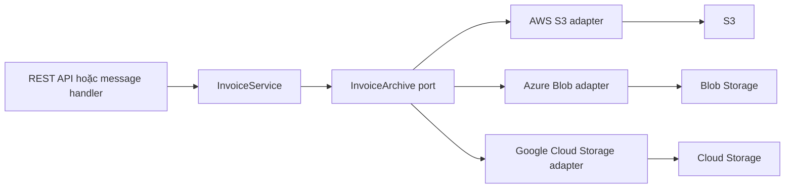

# Thay adapter nhà cung cấp và kiểm thử lại hợp đồng nghiệp vụ

Khi chuyển một ứng dụng Spring Boot từ AWS sang Azure hoặc Google Cloud, phần thay đổi thường thấy nhất là SDK và cấu hình kết nối. Tuy nhiên, chỉ thay `S3Client` bằng Azure Blob client hoặc Google Cloud Storage client chưa đủ để chứng minh ứng dụng vẫn hoạt động đúng. Mỗi dịch vụ có cách biểu diễn tài nguyên, metadata, lỗi, retry, quyền truy cập và semantics khác nhau. Nếu những khác biệt đó lọt vào tầng nghiệp vụ, việc đổi nhà cung cấp có thể làm thay đổi hành vi của hệ thống dù các lời gọi SDK đều thành công.

Trong module `SPRING_CLOUD_PROVIDER_INTEGRATION`, mục tiêu của bài thực hành là thay adapter của một dịch vụ managed mà không làm thay đổi hợp đồng nghiệp vụ. Ta sẽ xác định hành vi mà ứng dụng cần, đặt hành vi đó sau một port, triển khai adapter cho từng cloud provider, rồi chạy cùng một bộ contract test trên các adapter. Bài học cũng mở rộng cách áp dụng quy trình này cho messaging, nơi khác biệt về acknowledgement, redelivery và ordering có thể ảnh hưởng trực tiếp đến nghiệp vụ.

## Kết quả cần đạt

Sau bài học, bạn có thể:

- Tách hợp đồng nghiệp vụ khỏi API của AWS, Azure và Google Cloud.
- Xác định rõ semantics của thao tác storage hoặc messaging trước khi thay adapter.
- Viết port và adapter theo mô hình ports and adapters trong Spring Boot.
- Chọn một adapter bằng cấu hình mà không để nhiều implementation cùng hoạt động ngoài ý muốn.
- Dùng một bộ contract test chung để kiểm tra mọi implementation.
- Kết hợp unit test, emulator test và kiểm thử trên cloud thật.
- Lập kế hoạch chuyển dữ liệu, chuyển traffic, quan sát và rollback khi thay provider.

## 1. Bắt đầu từ hợp đồng nghiệp vụ

Một ứng dụng quản lý hóa đơn có thể cần lưu nội dung PDF, đọc lại hóa đơn theo mã, xóa hóa đơn theo chính sách lưu trữ và biết loại nội dung của tệp. Nghiệp vụ không cần biết object được lưu trong S3 bucket, Azure Blob container hay Google Cloud Storage bucket. Nó cần một tập hành vi ổn định.

Đó là ranh giới của hợp đồng nghiệp vụ. Hợp đồng phải mô tả điều ứng dụng mong đợi, gồm cả trường hợp thành công và lỗi:

| Nghiệp vụ cần | Hợp đồng cần xác định |
|---|---|
| Lưu hóa đơn | Key ổn định, nội dung, content type và quy tắc ghi đè |
| Đọc hóa đơn | Nội dung và metadata được trả về chính xác |
| Đọc key chưa tồn tại | Trả về kết quả không có dữ liệu theo một cách thống nhất |
| Xóa hóa đơn | Quy tắc khi key tồn tại và khi key đã bị xóa |
| Dịch vụ tạm thời lỗi | Lỗi được phân loại để tầng gọi quyết định retry |
| Không đủ quyền | Báo lỗi truy cập, không giả làm trường hợp không tìm thấy |

Hợp đồng cần nói rõ những điểm dễ bị bỏ qua. Ví dụ, `save` có thay thế object cũ hay phải báo conflict? `delete` với key không tồn tại có được xem là thành công không? Content type có được giữ nguyên khi đọc lại không? Key có phân biệt chữ hoa/chữ thường không? Nếu các adapter trả lời khác nhau, cùng một bộ test có thể phát hiện sự không tương thích.

Không nên đưa các kiểu như `S3Object`, `BlobClient`, `StorageObject` hoặc exception của SDK vào model nghiệp vụ. Chúng thuộc adapter. Hợp đồng nên dùng kiểu dữ liệu do ứng dụng định nghĩa, chẳng hạn `InvoiceId`, `byte[]`, `String contentType` và `Optional`.

### Kiến trúc ports and adapters



`InvoiceService` chỉ phụ thuộc vào `InvoiceArchive`. Adapter chuyển lời gọi của port thành lời gọi SDK tương ứng và chuyển kết quả hoặc lỗi về dạng mà ứng dụng hiểu. Nhờ vậy, thay provider là thay implementation ở ranh giới hạ tầng; hợp đồng mà nghiệp vụ sử dụng vẫn được giữ nguyên.

## 2. Tạo port cho nghiệp vụ lưu trữ hóa đơn

Trong ví dụ, quy ước nghiệp vụ là:

- Key được tạo ổn định từ mã hóa đơn, theo dạng `invoices/{invoiceId}.pdf`.
- `save` ghi đè nội dung cũ nếu key đã tồn tại. Đây là hành vi có chủ đích của ví dụ; hệ thống cần giữ phiên bản có thể chọn quy tắc khác.
- `find` trả về `Optional.empty()` khi object không tồn tại.
- `delete` là idempotent: xóa key đã bị xóa vẫn được xem là hoàn tất.
- Content type phải được lưu và trả lại chính xác.
- Lỗi quyền truy cập và lỗi tạm thời phải được phân biệt với trường hợp không tìm thấy.

Định nghĩa model và port:

```java
public record InvoiceId(String value) {
    public InvoiceId {
        if (value == null || value.isBlank()) {
            throw new IllegalArgumentException("invoice id is required");
        }
    }
}

public record ArchivedInvoice(
        InvoiceId id,
        byte[] content,
        String contentType) {
}

public interface InvoiceArchive {
    void save(ArchivedInvoice invoice);

    Optional<ArchivedInvoice> find(InvoiceId id);

    void delete(InvoiceId id);
}
```

Ví dụ dùng `byte[]` để làm rõ hợp đồng. Với tệp lớn, nên thay bằng `InputStream`/`Resource`, API streaming hoặc một abstraction hỗ trợ multipart; khi đó hợp đồng cũng phải quy định ai sở hữu và đóng stream, giới hạn kích thước, cách retry và cách xử lý khi đọc dở. Không thay kiểu dữ liệu chỉ vì SDK của một provider có kiểu thuận tiện hơn.

Tầng nghiệp vụ sử dụng port:

```java
@Service
public class InvoiceService {

    private final InvoiceArchive archive;

    public InvoiceService(InvoiceArchive archive) {
        this.archive = archive;
    }

    public void archive(InvoiceId id, byte[] pdf) {
        ArchivedInvoice invoice = new ArchivedInvoice(
                id, pdf, "application/pdf");
        archive.save(invoice);
    }

    public ArchivedInvoice get(InvoiceId id) {
        return archive.find(id)
                .orElseThrow(() -> new InvoiceNotFoundException(id));
    }

    public void remove(InvoiceId id) {
        archive.delete(id);
    }
}
```

Service không biết bucket, container, region, ARN, resource ID hay credential. Đây là dấu hiệu tốt: nếu một thay đổi SDK buộc phải sửa `InvoiceService`, ranh giới adapter có thể chưa được thiết kế đúng.

## 3. Triển khai adapter cho từng provider

Mỗi adapter nhận model nghiệp vụ, chuyển thành request SDK, gọi dịch vụ managed và chuyển response thành model nghiệp vụ. Adapter cũng chịu trách nhiệm chuyển lỗi SDK thành lỗi ổn định của ứng dụng.

### Quy ước lỗi ở ranh giới adapter

Có thể định nghĩa các lỗi ứng dụng như:

```java
public class ArchiveUnavailableException extends RuntimeException {
    public ArchiveUnavailableException(String message, Throwable cause) {
        super(message, cause);
    }
}

public class ArchiveAccessException extends RuntimeException {
    public ArchiveAccessException(String message, Throwable cause) {
        super(message, cause);
    }
}
```

Quy tắc chuyển lỗi nên nhất quán:

- Not found được chuyển thành `Optional.empty()` cho thao tác đọc.
- Access denied được chuyển thành lỗi truy cập; không chuyển thành not found.
- Timeout, throttling hoặc lỗi dịch vụ tạm thời được chuyển thành lỗi có thể retry nếu nghiệp vụ cho phép.
- Request không hợp lệ, content type sai hoặc key không hợp lệ cần được phát hiện sớm và không retry vô hạn.
- Conflict chỉ được trả về nếu hợp đồng quy định thao tác không được ghi đè.

Không nên bắt mọi exception rồi trả `Optional.empty()`. Làm như vậy sẽ khiến lỗi quyền hoặc lỗi mạng trông giống dữ liệu không tồn tại, che giấu sự cố và có thể dẫn đến quyết định nghiệp vụ sai.

### AWS S3 adapter

Adapter S3 dùng AWS SDK for Java v2. Ví dụ dưới đây minh họa cách ánh xạ model và metadata; phần xử lý exception được rút gọn để tập trung vào ranh giới:

```java
@Component
@ConditionalOnProperty(prefix = "app.archive", name = "provider", havingValue = "aws")
class S3InvoiceArchive implements InvoiceArchive {

    private final S3Client s3;
    private final String bucket;

    S3InvoiceArchive(S3Client s3,
                     @Value("${app.archive.bucket}") String bucket) {
        this.s3 = s3;
        this.bucket = bucket;
    }

    @Override
    public void save(ArchivedInvoice invoice) {
        String key = keyOf(invoice.id());
        PutObjectRequest request = PutObjectRequest.builder()
                .bucket(bucket)
                .key(key)
                .contentType(invoice.contentType())
                .build();
        s3.putObject(request, RequestBody.fromBytes(invoice.content()));
    }

    @Override
    public Optional<ArchivedInvoice> find(InvoiceId id) {
        String key = keyOf(id);
        try {
            ResponseInputStream<GetObjectResponse> response =
                    s3.getObject(GetObjectRequest.builder()
                            .bucket(bucket).key(key).build());
            try (response) {
                return Optional.of(new ArchivedInvoice(
                        id,
                        response.readAllBytes(),
                        response.response().contentType()));
            }
        } catch (NoSuchKeyException ex) {
            return Optional.empty();
        }
    }

    @Override
    public void delete(InvoiceId id) {
        s3.deleteObject(DeleteObjectRequest.builder()
                .bucket(bucket).key(keyOf(id)).build());
    }

    private String keyOf(InvoiceId id) {
        return "invoices/" + id.value() + ".pdf";
    }
}
```

Đây là khung minh họa cho trường hợp object nhỏ và bucket đã được provisioning. Khi triển khai production, cần bổ sung chuyển lỗi theo mã lỗi thực tế của SDK, timeout, logging không lộ dữ liệu, giới hạn kích thước và hỗ trợ streaming nếu cần. Trong một số cấu hình S3, object không tồn tại có thể được biểu diễn qua `NoSuchKeyException` hoặc lỗi service tương ứng; hãy kiểm tra response và quyền của principal. Việc thiếu quyền `s3:ListBucket` có thể ảnh hưởng cách S3 biểu diễn lỗi key không tồn tại.

`S3Client` nên được tạo và đóng bởi cấu hình Spring hoặc starter. Adapter chỉ sử dụng client được inject; không tự tạo client mới trong mỗi thao tác.

### Azure Blob Storage adapter

Azure adapter ánh xạ cùng port sang `BlobContainerClient` hoặc client phù hợp của Azure Storage SDK. Tên container và endpoint đến từ cấu hình môi trường; credential nên lấy từ `DefaultAzureCredential` hoặc managed identity của workload.

Các thao tác cần ánh xạ:

- `save`: tạo `BlobClient` từ key, upload nội dung và đặt HTTP content type tương ứng. Hợp đồng ghi đè cần được thể hiện rõ qua tùy chọn overwrite của SDK.
- `find`: tải nội dung và đọc `BlobHttpHeaders` để lấy content type. Chỉ chuyển `BlobNotFound` thành `Optional.empty()`; các lỗi 401/403 và lỗi mạng phải được chuyển thành lỗi ứng dụng tương ứng.
- `delete`: dùng thao tác xóa phù hợp với quy tắc idempotent; nếu SDK phân biệt blob không tồn tại, adapter xử lý để giữ semantics đã công bố.

Ví dụ phần upload:

```java
BlobClient blob = containerClient.getBlobClient(keyOf(invoice.id()));
BlobHttpHeaders headers = new BlobHttpHeaders()
        .setContentType(invoice.contentType());
blob.upload(new ByteArrayInputStream(invoice.content()),
        invoice.content().length, true);
blob.setHttpHeaders(headers);
```

Ví dụ cho thấy việc đặt content type là một thao tác riêng sau upload. Nếu ứng dụng cần bảo đảm nội dung và metadata thay đổi như một đơn vị trong mọi trường hợp lỗi, cần kiểm tra API upload có hỗ trợ truyền headers ngay trong request và dùng overload phù hợp với phiên bản SDK. Tránh để adapter chỉ upload bytes mà quên metadata vì contract test sẽ phát hiện sai khác.

### Google Cloud Storage adapter

Google Cloud adapter dùng `Storage` từ Google Cloud Java client. Key trở thành object name; bucket và content type được cấu hình ở adapter:

```java
BlobInfo info = BlobInfo.newBuilder(bucket, keyOf(invoice.id()))
        .setContentType(invoice.contentType())
        .build();

storage.create(info, invoice.content());
```

Đọc object có thể dùng `storage.get(bucket, key)`. Nếu kết quả là `null`, adapter trả `Optional.empty()`. Nếu có object, adapter lấy bytes và content type từ metadata của blob. Xóa dùng `storage.delete(bucket, key)`; kết quả boolean hoặc lỗi cần được chuyển về semantics idempotent mà port đã quy định.

Với cả ba provider, cần thống nhất cách chuẩn hóa key, content type, overwrite, missing object và exception. Không để một adapter tự động chuẩn hóa key còn adapter khác giữ nguyên, vì điều đó có thể làm cùng một `InvoiceId` trỏ đến object khác nhau.

## 4. Chọn adapter bằng cấu hình Spring

Ứng dụng chỉ nên có một implementation của `InvoiceArchive` được kích hoạt trong một deployment. Ví dụ cấu hình:

```yaml
app:
  archive:
    provider: aws
    bucket: orders-invoices-prod
```

Khi chuyển sang Azure:

```yaml
app:
  archive:
    provider: azure
    bucket: orders-invoices-prod
```

Trong adapter Azure, giá trị `bucket` có thể được ánh xạ thành container name dù tên property chung là `bucket`. Để tránh thuật ngữ gây nhầm lẫn, production configuration có thể dùng `container` hoặc `resource-name` trung tính hơn. Ví dụ trên giữ property ngắn để minh họa nguyên tắc lựa chọn adapter.

Các class cấu hình provider nên dùng `@ConditionalOnProperty` hoặc một cơ chế chọn implementation tương đương. Khi khởi động, ứng dụng cần thất bại sớm nếu provider không được hỗ trợ hoặc có nhiều adapter cùng thỏa điều kiện. Có thể thêm kiểm tra cấu hình để ngăn deployment production vô tình bật hai adapter.

Ví dụ cấu hình client theo provider:

```java
@Configuration
@ConditionalOnProperty(prefix = "app.archive", name = "provider", havingValue = "aws")
class AwsArchiveClientConfiguration {

    @Bean(destroyMethod = "close")
    S3Client s3Client() {
        return S3Client.builder().build();
    }
}
```

Tương tự, cấu hình Azure tạo `BlobServiceClient`/`BlobContainerClient`, còn Google Cloud cung cấp `Storage` client. Credential nên lấy từ workload identity và credential chain của provider. Không thêm access key, connection string hay service account key vào file YAML được commit.

Các starter Spring Cloud giúp cấu hình client, credential và tích hợp với Spring. Tên property, bean tự động cấu hình và phiên bản SDK thay đổi theo BOM. Hãy khóa phiên bản bằng dependency management của dự án và kiểm tra tài liệu của phiên bản tương ứng. Port nghiệp vụ nên ổn định hơn vòng đời của một starter cụ thể.

## 5. Viết contract test dùng chung cho mọi adapter

Unit test của `InvoiceService` có thể mock `InvoiceArchive` để kiểm tra luồng nghiệp vụ. Tuy nhiên, unit test đó không chứng minh `S3InvoiceArchive`, `AzureBlobInvoiceArchive` và `GcsInvoiceArchive` có cùng hành vi. Contract test giải quyết khoảng trống này: cùng một bộ kiểm thử được chạy trên từng implementation.

### Xây dựng bộ contract test

Tạo một lớp test trừu tượng mô tả hành vi bắt buộc:

```java
abstract class InvoiceArchiveContractTest {

    protected abstract InvoiceArchive createArchive();
    protected abstract void cleanupArchive();

    private InvoiceArchive archive;

    @BeforeEach
    void setUp() {
        archive = createArchive();
    }

    @AfterEach
    void tearDown() {
        cleanupArchive();
    }

    @Test
    void savesAndReadsContentAndContentType() {
        InvoiceId id = new InvoiceId("contract-1001");
        byte[] content = "%PDF-test".getBytes(StandardCharsets.UTF_8);
        archive.save(new ArchivedInvoice(id, content, "application/pdf"));

        ArchivedInvoice loaded = archive.find(id).orElseThrow();

        assertArrayEquals(content, loaded.content());
        assertEquals("application/pdf", loaded.contentType());
    }

    @Test
    void returnsEmptyWhenObjectDoesNotExist() {
        assertTrue(archive.find(new InvoiceId("missing-1002")).isEmpty());
    }

    @Test
    void replacesContentWhenSavingTheSameId() {
        InvoiceId id = new InvoiceId("contract-1003");
        archive.save(new ArchivedInvoice(id, new byte[] {1}, "application/pdf"));
        archive.save(new ArchivedInvoice(id, new byte[] {2, 3}, "application/pdf"));

        assertArrayEquals(new byte[] {2, 3},
                archive.find(id).orElseThrow().content());
    }

    @Test
    void deleteIsIdempotent() {
        InvoiceId id = new InvoiceId("contract-1004");
        archive.save(new ArchivedInvoice(id, new byte[] {4}, "application/pdf"));

        archive.delete(id);
        archive.delete(id);

        assertTrue(archive.find(id).isEmpty());
    }
}
```

Mỗi test dùng key riêng để tránh đụng dữ liệu giữa các lần chạy hoặc giữa các worker CI. Trong thực tế, nên thêm một test namespace theo build ID và cleanup theo prefix. Nếu test có thể chạy song song, không dùng chung một key cố định.

Các test trên kiểm tra hợp đồng cơ bản: round trip, metadata, missing object, overwrite và delete idempotency. Có thể bổ sung test cho nội dung rỗng, ký tự Unicode trong ID, kích thước tối đa, lỗi truy cập, timeout và retry. Chỉ thêm hành vi mà nghiệp vụ thật sự yêu cầu; contract không nên biến mọi chi tiết SDK thành cam kết của ứng dụng.

### Gắn contract test cho từng adapter

Mỗi provider có lớp con tạo adapter thật và cung cấp môi trường test:

```java
class S3InvoiceArchiveContractTest extends InvoiceArchiveContractTest {
    @Override
    protected InvoiceArchive createArchive() {
        return testEnvironment.createS3Archive();
    }

    @Override
    protected void cleanupArchive() {
        testEnvironment.deleteS3TestObjects();
    }
}
```

`testEnvironment` là fixture của dự án, chịu trách nhiệm tạo client, bucket test và cấu hình credential. Các lớp tương tự được tạo cho Azure Blob và Google Cloud Storage. Có thể dùng JUnit 5 `@TestFactory`, test template hoặc test profile để tái sử dụng fixture, nhưng điều quan trọng là cùng một bộ contract phải được chạy trên từng adapter.

Không mock SDK bên trong contract test. Nếu mock SDK, bài test chủ yếu xác minh cách adapter gọi mock và không còn kiểm tra được semantics thật của provider. Mock phù hợp cho unit test chuyển đổi lỗi hoặc kiểm tra một nhánh hiếm; integration contract test cần nói chuyện với dịch vụ hoặc emulator.

## 6. Kết hợp unit test, emulator và cloud thật

Không có một tầng test duy nhất kiểm tra được mọi vấn đề. Một chiến lược thực tế dùng ba tầng:

| Tầng | Mục tiêu | Môi trường |
|---|---|---|
| Unit test | Kiểm tra nghiệp vụ, key mapping, error mapping và cấu hình lựa chọn adapter | Mock port hoặc mock các collaborator hẹp |
| Emulator integration test | Kiểm tra request/response SDK, metadata, upload/download, delete và một phần semantics | LocalStack cho một số dịch vụ AWS, Azurite cho Azure Storage, fake-gcs-server cho GCS |
| Cloud integration test | Kiểm tra IAM, workload identity, network, encryption, policy, quota và hành vi dịch vụ thật | Account/project/subscription sandbox riêng |

Emulator giúp chạy nhanh và giảm chi phí, nhưng không đảm bảo mô phỏng đầy đủ IAM, consistency, retry, versioning, encryption hoặc mọi giới hạn dịch vụ. Test xanh trên emulator không thay thế kiểm thử trên cloud thật, nhất là khi thay đổi danh tính hoặc policy.

### Kiểm thử quyền và credential

Trong cloud integration test, chạy test bằng đúng loại workload identity mà ứng dụng production sử dụng hoặc identity có quyền tương đương. Không dùng credential cá nhân của developer để kết luận workload có quyền. Xác minh các thao tác được phép và bị từ chối:

- Principal có thể ghi và đọc trong đúng bucket/container.
- Principal không thể đọc hoặc xóa dữ liệu ngoài phạm vi được cấp.
- Principal không có quyền quản trị hạ tầng nếu nghiệp vụ không cần.
- Lỗi 401/403 được chuyển thành lỗi truy cập, không thành not found.

Không đưa token hoặc secret vào assertion message, log test hay báo cáo CI. Tài nguyên test cần có tên riêng và chính sách cleanup để không xóa nhầm dữ liệu dùng chung.

## 7. Kiểm thử hợp đồng messaging khi đổi broker

Với messaging, việc thay adapter còn nhạy cảm hơn storage vì broker có semantics giao nhận khác nhau. Port nên mô tả hành vi nghiệp vụ, ví dụ `OrderEventPublisher.publish(OrderCompleted)` hoặc `OrderCommandConsumer`, thay vì để domain phụ thuộc vào `SqsMessage`, `ServiceBusReceivedMessage` hay `PubsubMessage`.

Trước khi thay broker, cần thống nhất:

- **Delivery:** at-most-once, at-least-once hay một bảo đảm khác mà hệ thống thực sự triển khai.
- **Acknowledgement:** message được xác nhận sau điều kiện nghiệp vụ nào.
- **Redelivery:** xử lý lặp và deduplication được thực hiện ở đâu.
- **Ordering:** thứ tự được bảo đảm theo queue, partition, session hay ordering key nào.
- **Retry và dead-letter:** số lần thử, backoff, điều kiện chuyển dead-letter và quy trình replay.
- **Message contract:** schema, version, encoding, header và correlation ID.
- **Durability:** khi nào publisher được xem là đã gửi thành công và cách xử lý publish timeout không rõ kết quả.

| Khái niệm | Amazon SQS/SNS | Azure Service Bus | Google Cloud Pub/Sub |
|---|---|---|---|
| Nhận message | Polling SQS; SNS thường phân phối đến subscription đích | Receiver hoặc processor | Subscriber pull/push |
| Xác nhận | Delete message sau xử lý theo acknowledgement mode | Complete, abandon, defer hoặc dead-letter | Ack hoặc nack theo subscription mode |
| Khóa xử lý | Visibility timeout | Peek-lock và lock renewal | Ack deadline và deadline extension |
| Ordering | FIFO queue có nhóm message và quy tắc riêng | Session-enabled entity | Ordering key khi bật và cấu hình đúng |
| Retry | Visibility/redelivery và redrive policy | Delivery count và dead-letter queue | Retry policy và dead-letter topic khi cấu hình |

Bảng này chỉ tóm tắt khái niệm. Không thể suy ra rằng ba broker có semantics giống nhau chỉ vì cùng hỗ trợ ack và retry. Hãy đối chiếu giới hạn, thứ tự và cấu hình thực tế của từng dịch vụ.

Contract test của consumer nên kiểm tra message hợp lệ được xử lý đúng một lần về mặt hiệu ứng nghiệp vụ dù có thể nhận nhiều lần; message lỗi được phân loại đúng; message phiên bản mới/cũ được xử lý theo schema compatibility; và message có cùng ordering key được xử lý theo quy tắc mà nghiệp vụ yêu cầu. Test publisher nên xác minh payload, schema version, correlation ID và kết quả gửi được xác định rõ.

Để tránh phụ thuộc broker, có thể định nghĩa port:

```java
public interface OrderEventPublisher {
    CompletionStage<PublishResult> publish(OrderCompleted event);
}

public record PublishResult(String eventId) {
}
```

`CompletionStage` thể hiện thao tác gửi bất đồng bộ. Hợp đồng cần nói rõ khi future hoàn tất thì message đã được broker xác nhận tiếp nhận hay chỉ mới được đưa vào buffer cục bộ. Không trả về `PublishResult` quá sớm nếu publisher vẫn có thể thất bại ở bước gửi mạng. Với sự kiện phải nhất quán cùng transaction database, dùng transactional outbox và một publisher worker có retry thường an toàn hơn việc gửi trực tiếp trong transaction.

## 8. Chuyển provider trong môi trường thật

Sau khi adapter mới vượt qua contract test, cần lập kế hoạch di chuyển dữ liệu và lưu lượng. Đổi cấu hình `provider=azure` trong production không tự chuyển các object đang nằm trong S3 sang Blob Storage. Tương tự, tạo subscription mới không tự chuyển message đang tồn tại trong queue cũ.

### Quy trình chuyển storage

1. **Lập inventory:** xác định số object, tổng dung lượng, key, metadata, version, retention, encryption và access policy.
2. **Provision đích:** tạo bucket/container, network, encryption key, lifecycle rule và workload identity bằng IaC.
3. **Copy dữ liệu:** dùng công cụ migration hoặc job riêng, có checkpoint và khả năng tiếp tục sau lỗi.
4. **Đối chiếu:** so sánh số lượng object, key, kích thước, checksum và metadata quan trọng. ETag không phải lúc nào cũng là checksum nội dung tương đương giữa provider hoặc multipart upload.
5. **Chạy contract test trên đích:** dùng workload identity thực tế và xác minh quyền đọc/ghi/xóa theo đúng hợp đồng.
6. **Chuyển ứng dụng:** bật adapter mới ở staging, sau đó canary hoặc chuyển traffic theo đợt.
7. **Theo dõi và giữ khả năng quay lại:** giữ nguồn cũ ở trạng thái có thể đọc trong khoảng thời gian được phê duyệt; chỉ cleanup khi đã đối soát và hết thời hạn rollback.

Nếu hệ thống vẫn có ghi mới trong lúc copy, cần một chiến lược đồng bộ phần thay đổi phát sinh: tạm dừng ghi trong cửa sổ chuyển đổi, dùng change log/outbox, hoặc có quy trình đồng bộ delta được kiểm chứng. Dual-write trực tiếp vào hai provider có thể tạo trạng thái lệch nếu một lần ghi thành công và lần còn lại thất bại; không dùng nó như giải pháp mặc định khi chưa có cơ chế đối soát.

### Quy trình chuyển messaging

Đối với broker, cần xử lý message đang tồn tại và message phát sinh trong lúc chuyển. Một quy trình có thể gồm:

1. Tạo queue/topic/subscription mới và thiết lập policy, retry, dead-letter, ordering.
2. Triển khai consumer mới ở chế độ chưa nhận traffic hoặc chỉ nhận một nhóm message thử.
3. Chọn một điểm chuyển rõ ràng cho producer, có thể thông qua outbox hoặc router.
4. Drain queue cũ đến ngưỡng đã thống nhất hoặc chuyển tiếp message bằng quy trình bảo toàn ID và schema.
5. Bảo đảm không có hai consumer cùng thực hiện side effect ngoài khả năng idempotency của nghiệp vụ.
6. So sánh throughput, backlog, dead-letter, duplicate và latency trước khi ngừng broker cũ.

Nếu cần chạy song song hai consumer để so sánh, consumer shadow chỉ nên đọc và ghi kết quả kiểm tra vào nơi riêng; không thực hiện side effect nghiệp vụ như gửi hóa đơn hoặc trừ tiền. Hãy dùng event ID ổn định để theo dõi message qua hai hệ thống.

### Feature flag và rollback

Provider có thể được chọn bằng cấu hình deployment hoặc feature flag. Thay đổi cần được ghi nhận cùng release ID. Khi lỗi xuất hiện, có thể chuyển lại adapter cũ nếu dữ liệu và traffic vẫn tương thích. Trước khi rollback, kiểm tra:

- Dữ liệu mới có được ghi vào provider mới sau lần chuyển không?
- Adapter cũ có đọc được các thay đổi đó không?
- Có metadata, encryption hoặc key format riêng của provider mới không?
- Message đã phát trên broker mới có được consumer cũ hiểu không?
- Có side effect trùng lặp khi chạy lại message hoặc chuyển traffic không?

Rollback code không tự đảo ngược dữ liệu đã ghi. Hãy có kế hoạch đồng bộ ngược hoặc quy trình phục hồi riêng trước khi cho phép chuyển đổi hai chiều.

## 9. Ví dụ pipeline kiểm thử nhiều adapter

Một pipeline CI có thể chạy cùng contract test trên từng adapter bằng matrix. Ví dụ logic tổng quát:

```yaml
strategy:
  matrix:
    archive-provider: [aws, azure, gcp]

steps:
  - name: Run adapter contract tests
    run: ./mvnw test -Dtest.profile=contract-${{ matrix.archive-provider }}
```

Đây là ví dụ minh họa cấu trúc matrix; cú pháp property và lệnh Maven cần khớp với cấu hình test của dự án. Mỗi job cần môi trường riêng hoặc namespace riêng, credential được cấp an toàn và bước cleanup có giới hạn. Với cloud integration test, ưu tiên workload identity federation hoặc credential ngắn hạn của CI thay vì secret key dài hạn.

Pipeline nên lưu kết quả theo provider để dễ so sánh. Khi một contract test chỉ thất bại trên Azure, có thể khoanh vùng metadata, permission hoặc semantics của adapter Azure. Khi tất cả adapter cùng thất bại, xem lại hợp đồng, fixture hoặc thay đổi nghiệp vụ trước khi sửa từng adapter.

## 10. Lỗi thường gặp khi thay adapter

| Triệu chứng | Nguyên nhân thường gặp | Cách xử lý |
|---|---|---|
| Adapter mới lưu được nhưng đọc không thấy object | Key prefix hoặc cách encode ID khác nhau | Dùng một hàm tạo key chung và thêm contract test cho key đặc biệt |
| Nội dung đúng nhưng content type sai | Metadata không được ghi hoặc không đọc lại | Kiểm tra request upload và mapping metadata của provider |
| Object không tồn tại bị báo lỗi hệ thống | Adapter không chuyển not found thành `Optional.empty()` | Ánh xạ đúng mã lỗi not found; giữ nguyên access denied và timeout |
| 403 bị xem như dữ liệu không tồn tại | Bắt exception quá rộng | Tách lỗi permission khỏi not found và kiểm tra workload identity |
| Test chạy local nhưng cloud test thất bại | Emulator không mô phỏng IAM, network hoặc policy thật | Chạy integration test trong sandbox với identity tương đương production |
| Một adapter ghi đè còn adapter khác báo conflict | Semantics overwrite chưa được chuẩn hóa | Chọn một quy tắc nghiệp vụ và kiểm thử trên tất cả implementation |
| Test flaky khi chạy song song | Dùng chung bucket/key hoặc cleanup chồng lấn | Tạo namespace riêng theo test run và dọn đúng prefix |
| Message bị xử lý hai lần sau chuyển broker | At-least-once delivery và consumer thiếu idempotency | Dùng event ID ổn định, deduplication và transaction phù hợp |
| Message sai thứ tự sau migration | Ordering key/session/FIFO group không được ánh xạ | Xác định phạm vi ordering của nghiệp vụ và cấu hình tương ứng ở broker mới |
| Chi phí tăng sau chuyển provider | Retry, request nhỏ, lifecycle hoặc storage tier chưa tối ưu | Đo request, data transfer, retention và storage class theo workload thật |

Khi lỗi xảy ra, phân loại theo bốn lớp: hợp đồng nghiệp vụ, mapping trong adapter, cấu hình/identity/network và hành vi dịch vụ managed. Chỉ thay đổi lớp có bằng chứng gây lỗi; nếu sửa hợp đồng, phải chạy lại bộ test trên tất cả adapter.

## 11. Checklist hoàn thành bài thực hành

- [ ] Port chỉ chứa kiểu dữ liệu và hành vi thuộc ứng dụng.
- [ ] Hợp đồng quy định rõ missing, overwrite, delete, metadata và lỗi.
- [ ] Domain service chỉ phụ thuộc vào port.
- [ ] Mỗi provider có một adapter triển khai cùng port.
- [ ] Chỉ một adapter được kích hoạt trong mỗi deployment.
- [ ] Credential được lấy từ workload identity hoặc cơ chế an toàn của runtime.
- [ ] Contract test chung chạy thành công trên từng adapter.
- [ ] Unit test, emulator test và cloud integration test có mục tiêu riêng.
- [ ] Test dùng key/prefix riêng, có cleanup và không ghi secret vào log.
- [ ] IAM, network, encryption và metadata được kiểm tra trên cloud thật.
- [ ] Nếu có messaging, delivery, acknowledgement, ordering và retry đã được xác định.
- [ ] Có phương án copy dữ liệu, chuyển traffic, đối soát và rollback.
- [ ] Pipeline ghi nhận kết quả theo provider và release ID.

## Kết luận

Thay adapter an toàn bắt đầu bằng việc mô tả chính xác hợp đồng nghiệp vụ mà ứng dụng cần, sau đó đặt hợp đồng sau một port và triển khai adapter cho từng provider. Cùng một bộ contract test phải xác minh các hành vi như round trip, metadata, missing object, overwrite, delete và phân loại lỗi trên mọi implementation. Emulator giúp kiểm tra nhanh, còn cloud integration test xác minh identity, policy, network và semantics thực tế. Khi bổ sung kế hoạch chuyển dữ liệu, kiểm soát message và rollback, ứng dụng Spring Boot có thể thay nhà cung cấp managed mà vẫn giữ hành vi nghiệp vụ ổn định.
