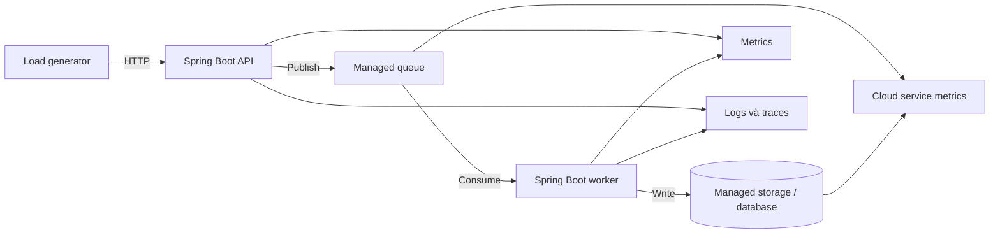

# Triển khai môi trường thử, đo tải và quan sát toàn bộ luồng

Một bài kiểm thử tích hợp chỉ có giá trị khi môi trường chạy gần với môi trường triển khai thật và có thể quan sát được toàn bộ đường đi của dữ liệu. Một endpoint HTTP trả về thành công chưa chứng minh message đã được xử lý, object đã được lưu hoặc dữ liệu đã được ghi vào database. Khi tải tăng, lỗi có thể xuất hiện ở connection pool, quota của dịch vụ managed, hàng đợi, consumer hoặc mạng giữa các thành phần.

Trong module `SPRING_CLOUD_PROVIDER_INTEGRATION`, bài thực hành này xây dựng một môi trường thử nghiệm cho ứng dụng Spring Boot tích hợp dịch vụ managed trên AWS, Azure và Google Cloud. Bạn sẽ cô lập tài nguyên thử, phát luồng giao dịch mẫu, tăng tải theo từng giai đoạn, theo dõi metric, log và trace từ đầu đến cuối, rồi đánh giá kết quả trước khi đưa thay đổi vào production.

## Mục tiêu thực hành

Sau bài học, bạn có thể:

- Chuẩn bị môi trường thử nghiệm có network, identity, cấu hình và dịch vụ managed tương đương production.
- Tạo dữ liệu thử có thể nhận diện, lặp lại và dọn dẹp an toàn.
- Tạo tải bằng k6 hoặc công cụ tương đương với mức tăng có kiểm soát.
- Theo dõi request từ API Spring Boot qua queue, consumer, storage hoặc database.
- Đọc metric ứng dụng và metric dịch vụ cloud để xác định nút thắt.
- Đánh giá latency, throughput, error rate, queue lag, retry và chi phí.
- Lưu bằng chứng thử nghiệm để so sánh giữa các provider hoặc giữa các lần triển khai.

## 1. Bài toán thực hành và kiến trúc

Ta dùng một luồng xử lý đơn hàng làm ví dụ:

1. Client gửi yêu cầu tạo đơn hàng đến REST API của `order-service`.
2. Spring Boot kiểm tra dữ liệu và publish một message đến dịch vụ queue.
3. Consumer nhận message, thực hiện xử lý nghiệp vụ.
4. Consumer ghi kết quả hoặc bản sao sự kiện vào storage/database.
5. Ứng dụng phát metric, log và trace để theo dõi toàn bộ giao dịch.

Các dịch vụ cụ thể có thể thay đổi theo cloud provider. Phần nghiệp vụ và tiêu chí đo được giữ ổn định để kết quả có thể so sánh.



Ví dụ ánh xạ dịch vụ:

| Vai trò | AWS | Azure | Google Cloud |
|---|---|---|---|
| Queue hoặc messaging | Amazon SQS hoặc SNS + SQS | Azure Service Bus Queue/Topic | Pub/Sub |
| Object storage | Amazon S3 | Azure Blob Storage | Cloud Storage |
| Database tùy chọn | Amazon RDS hoặc DynamoDB | Azure Database hoặc Cosmos DB | Cloud SQL hoặc Firestore |
| Identity workload | IAM role, EKS Pod Identity hoặc IRSA tùy nền tảng | Managed Identity hoặc Workload Identity trên AKS | Service Account hoặc Workload Identity Federation |
| Quan sát | CloudWatch, X-Ray hoặc OpenTelemetry | Azure Monitor, Application Insights hoặc OpenTelemetry | Cloud Monitoring, Cloud Trace hoặc OpenTelemetry |

Không cần tạo mọi loại tài nguyên trong bảng. Chọn một dịch vụ cho mỗi vai trò phù hợp với bài toán, sau đó dùng adapter của provider tương ứng. Khi so sánh cloud, giữ nguyên payload, kịch bản tải, thời gian quan sát và cách tính metric.

## 2. Chuẩn bị môi trường thử nghiệm

### 2.1. Tạo môi trường cô lập

Môi trường thử nên có topology gần production nhưng dùng tài nguyên và dữ liệu riêng. Có thể dùng một namespace Kubernetes, một resource group, một project hoặc một account/subscription dành cho non-production.

Tạo bộ tài nguyên có tên dễ nhận biết, ví dụ:

- `provider-lab-order-api`: ứng dụng nhận request.
- `provider-lab-orders-queue`: queue nhận message.
- `provider-lab-order-worker`: consumer xử lý message.
- `provider-lab-results`: bucket/container lưu kết quả thử.
- `provider-lab-observability`: workspace hoặc cấu hình quan sát.

Tên thực tế phải tuân theo quy tắc đặt tên của provider. Tránh dùng chung queue, bucket, database hoặc secret với production.

Các thành phần môi trường cần được kiểm tra:

- Subnet, route, DNS và private endpoint nếu bài lab dùng mạng riêng.
- Firewall/security group/NSG cho đúng giao thức và cổng.
- Workload identity được gắn cho đúng pod, VM hoặc dịch vụ.
- Quyền chỉ đủ cho thao tác thử: publish/consume, đọc/ghi object hoặc truy vấn database.
- Secret và cấu hình riêng của môi trường thử.
- Quota, giới hạn throughput và cảnh báo ngân sách.

Tạo tài nguyên bằng Infrastructure as Code nếu nhóm đã có module chuẩn. Gắn tag/label môi trường, chủ sở hữu và thời hạn dọn dẹp để tránh tài nguyên thử tồn tại ngoài dự kiến.

### 2.2. Giữ cấu hình ứng dụng tách khỏi mã nguồn

Spring Boot có thể nhận cấu hình từ biến môi trường, ConfigMap hoặc secret manager. Ví dụ:

```yaml
# application.yml
app:
  orders:
    queue-name: ${ORDERS_QUEUE_NAME}
    result-resource: ${RESULT_RESOURCE}
    provider: ${CLOUD_PROVIDER}
    publish-timeout: 3s

management:
  endpoints:
    web:
      exposure:
        include: health,info,metrics,prometheus
  endpoint:
    health:
      probes:
        enabled: true
  tracing:
    sampling:
      probability: 0.1
  metrics:
    distribution:
      percentiles-histogram:
        http:
          server:
            requests: true
```

Đây là cấu hình minh họa cho ứng dụng dùng Spring Boot Actuator và Micrometer. Chỉ expose endpoint quan sát trong mạng quản trị hoặc qua cơ chế xác thực phù hợp. Giá trị `CLOUD_PROVIDER` chỉ dùng làm nhãn nhận diện cấu hình; SDK vẫn phải được khởi tạo bằng đúng region/project và credential chain của provider.

Để endpoint `/actuator/prometheus` xuất metric theo định dạng Prometheus, ứng dụng cần có registry tương ứng, chẳng hạn dependency `micrometer-registry-prometheus`, bên cạnh Spring Boot Actuator. Nếu gửi trace đến collector qua OTLP, thêm bridge/exporter tương thích với phiên bản Spring Boot đang dùng và cấu hình endpoint collector theo môi trường.

Không đưa access key, client secret, connection string hoặc nội dung secret vào file YAML được commit. Dùng workload identity và secret manager theo môi trường. Cấu hình non-production không nên trỏ đến tài nguyên production.

### 2.3. Chuẩn bị dữ liệu thử

Mỗi request nên có một định danh thử nghiệm để truy vết qua các thành phần. Ví dụ:

```json
{
  "testRunId": "load-2026-11-24-a",
  "orderId": "lab-order-000001",
  "customerRef": "synthetic-customer-01",
  "amount": 125000,
  "currency": "VND"
}
```

Các trường trên chỉ là dữ liệu giả. Không dùng dữ liệu cá nhân, token hoặc thông tin thanh toán thật. Tạo `testRunId` mới cho mỗi lần chạy để phân biệt log và kết quả.

Thiết kế consumer theo hướng idempotent nếu message có thể được giao lại. Có thể dùng `orderId` hoặc một idempotency key làm khóa chống xử lý trùng. Với queue production-like, hãy ghi nhận cả số lần retry và số message vào dead-letter queue.

Chuẩn bị thao tác dọn dữ liệu sau bài thử: xóa object theo prefix thử, xóa message thử còn tồn đọng, dọn bản ghi database và xóa tài nguyên tạm sau khi đã lưu kết quả.

## 3. Instrumentation trong Spring Boot

Để quan sát end-to-end, cần đo cả hoạt động HTTP lẫn các thao tác đến dịch vụ managed. Metric mặc định của web server không tự mô tả đầy đủ thời gian publish message, xử lý consumer hoặc ghi object.

### 3.1. Các loại tín hiệu cần có

| Tín hiệu | Câu hỏi cần trả lời | Ví dụ |
|---|---|---|
| Metrics | Hệ thống xử lý được bao nhiêu và chậm ở đâu? | Request/s, p95, publish latency, consumer duration, queue depth |
| Logs | Giao dịch cụ thể gặp lỗi gì? | Correlation ID, operation, dependency, error category |
| Traces | Thời gian bị tiêu tốn ở span nào? | HTTP request → publish → consume → storage write |
| Cloud metrics | Dịch vụ managed có bị giới hạn hay nghẽn không? | Throttling, age of oldest message, API errors, storage latency |

Sử dụng metric kiểu RED cho request (Rate, Errors, Duration) và các chỉ số tài nguyên như connection pool, thread pool, CPU, memory. Với queue, cần thêm backlog, tuổi message cũ nhất, số message nhận, ack, retry và dead-letter count.

### 3.2. Ghi metric cho thao tác publish

Spring Boot Actuator và Micrometer cung cấp `MeterRegistry` để ghi metric tùy chỉnh. Ví dụ:

```java
import io.micrometer.core.instrument.MeterRegistry;
import io.micrometer.core.instrument.Timer;
import org.springframework.stereotype.Component;

@Component
public class OrdersPublisherMetrics {

    private final MeterRegistry registry;

    public OrdersPublisherMetrics(MeterRegistry registry) {
        this.registry = registry;
    }

    public <T> T recordPublish(String provider,
                               java.util.function.Supplier<T> operation) {
        Timer.Sample sample = Timer.start(registry);
        try {
            T result = operation.get();
            sample.stop(Timer.builder("orders.publish")
                    .tag("provider", provider)
                    .tag("outcome", "success")
                    .register(registry));
            return result;
        } catch (RuntimeException exception) {
            sample.stop(Timer.builder("orders.publish")
                    .tag("provider", provider)
                    .tag("outcome", "error")
                    .register(registry));
            throw exception;
        }
    }
}
```

Ví dụ dùng `Timer.Sample` để gắn `outcome` sau khi thao tác hoàn tất. Có thể bổ sung counter riêng cho số lỗi nếu dashboard cần truy vấn trực tiếp. Không tạo tag bằng `orderId`, email, queue message ID hoặc correlation ID vì các giá trị này có độ đa dạng cao và làm tăng cardinality.

### 3.3. Đo xử lý ở consumer

Consumer nên ghi nhận ít nhất:

- Thời gian từ lúc nhận message đến lúc hoàn tất xử lý.
- Kết quả xử lý: success, retryable failure hoặc permanent failure.
- Số lần delivery/retry nếu SDK cung cấp.
- Thời gian ghi storage/database.
- Số message ack, abandon/nack hoặc đưa vào dead-letter queue.

Không ghi log toàn bộ payload nếu payload có thể chứa dữ liệu nhạy cảm. Chỉ ghi các trường định danh thử nghiệm đã được cho phép, trạng thái và loại lỗi.

### 3.4. Truyền correlation ID và trace context

Một request có thể kết thúc ở HTTP layer nhưng công việc vẫn tiếp tục bất đồng bộ trong queue. Cần truyền thông tin liên kết qua message metadata để tìm được log và trace tương ứng.

Dùng một correlation ID nghiệp vụ, chẳng hạn `testRunId` và `orderId`, cùng trace context theo W3C Trace Context khi thư viện và broker hỗ trợ. Khi publish message, truyền `traceparent` và `tracestate` trong message headers/attributes theo cơ chế của SDK hoặc Spring Cloud Stream binder. Consumer tiếp tục trace từ context đã nhận hoặc tạo span liên kết theo mô hình messaging instrumentation.

Correlation ID phục vụ tìm kiếm giao dịch; trace ID phục vụ liên kết span. Hai khái niệm có thể cùng xuất hiện nhưng không nên dùng thay thế tùy tiện.

### 3.5. Cấu hình tracing và exporter

Spring Boot có thể tích hợp Micrometer Tracing với OpenTelemetry bridge và exporter tương ứng. Ví dụ, khai báo sampling thấp hơn 100% trong môi trường tải lớn để hạn chế overhead:

```yaml
management:
  tracing:
    sampling:
      probability: 0.1
```

Sampling 10% là ví dụ, không phải giá trị bắt buộc. Khi cần kiểm tra một test run cụ thể, có thể tăng sampling có giới hạn trong môi trường thử hoặc dùng tail sampling ở collector. Tránh bật sampling 100% trong bài stress test dài nếu collector hoặc backend quan sát không đủ khả năng tiếp nhận.

## 4. Tạo tải bằng k6

k6 là một công cụ tạo tải HTTP có thể chạy độc lập với ứng dụng. Kịch bản nên tăng tải dần để quan sát điểm bắt đầu suy giảm, thay vì gửi ngay lượng request rất lớn.

Nếu chưa cài k6, cài theo hướng dẫn của hệ điều hành hoặc dùng image/container chính thức trong môi trường CI. Load generator nên chạy ở mạng có thể truy cập endpoint thử nghiệm; nếu dùng private API, đặt generator trong cùng mạng hoặc mạng được kết nối phù hợp.

Ví dụ kịch bản `orders-load.js`:

```javascript
import http from 'k6/http';
import { check, sleep } from 'k6';

export const options = {
  stages: [
    { duration: '2m', target: 5 },
    { duration: '3m', target: 20 },
    { duration: '5m', target: 20 },
    { duration: '2m', target: 0 }
  ],
  thresholds: {
    http_req_failed: ['rate<0.01'],
    http_req_duration: ['p(95)<500', 'p(99)<1000']
  }
};

export default function () {
  const runId = __ENV.TEST_RUN_ID || 'local-smoke';
  const orderId = `order-${__VU}-${__ITER}`;

  const payload = JSON.stringify({
    testRunId: runId,
    orderId,
    customerRef: 'synthetic-customer',
    amount: 125000,
    currency: 'VND'
  });

  const response = http.post(
    `${__ENV.BASE_URL}/api/orders`,
    payload,
    {
      headers: {
        'Content-Type': 'application/json',
        'X-Correlation-Id': `${runId}-${orderId}`
      },
      timeout: '5s'
    }
  );

  check(response, {
    'accepted for processing': (r) => r.status === 202
  });

  sleep(1);
}
```

Kịch bản giả định API trả HTTP 202 sau khi nhận yêu cầu và đưa message vào queue. Nếu API của bạn dùng response contract khác, điều chỉnh điều kiện `check` tương ứng.

Chạy thử với một lượng nhỏ virtual users:

```bash
k6 run \
  -e BASE_URL=https://test-api.example.internal \
  -e TEST_RUN_ID=load-2026-11-24-a \
  orders-load.js
```

Không đặt credential trong tham số dòng lệnh hoặc script. Nếu API yêu cầu xác thực, dùng cơ chế cấp token an toàn của môi trường chạy k6, secret injection hoặc một identity dành riêng cho load generator. Đảm bảo token không xuất hiện trong log hoặc kết quả test.

### 4.1. Các giai đoạn tạo tải

Một lượt kiểm tra có thể chia thành:

1. **Smoke:** 1–2 virtual users trong thời gian ngắn để xác nhận endpoint và dữ liệu.
2. **Baseline:** tải thấp, ổn định để ghi nhận latency và throughput bình thường.
3. **Load:** tăng dần đến mức tải dự kiến của ứng dụng.
4. **Stress:** tăng vượt mức tải dự kiến trong môi trường được giới hạn để tìm điểm bão hòa.
5. **Soak:** giữ tải ổn định trong thời gian dài hơn để tìm rò rỉ bộ nhớ, cạn connection pool hoặc backlog tích lũy.
6. **Recovery:** giảm tải về 0 và quan sát hệ thống có xử lý hết backlog, giải phóng tài nguyên và trở lại baseline hay không.

Không bắt đầu stress hoặc soak test trước khi xác định quota, giới hạn concurrency và ngân sách. Chạy thử từ tải thấp, đặt giới hạn tối đa cho generator và có người theo dõi dashboard trong suốt bài test.

### 4.2. Phân biệt virtual users, request rate và concurrency

Virtual users là số luồng người dùng ảo chạy kịch bản. Request rate là số request được gửi trong một đơn vị thời gian. Concurrency là số thao tác đang diễn ra đồng thời. Chúng có quan hệ nhưng không đồng nhất.

Nếu mỗi iteration có thời gian chờ hoặc response chậm, cùng số virtual users có thể tạo request rate khác nhau. Hãy ghi nhận throughput thực tế trong k6 và metric của server thay vì suy ra RPS chỉ từ số VU.

## 5. Chạy bài thực hành theo từng giai đoạn

### Bước 1: Xác nhận môi trường và baseline

- Triển khai API và worker vào môi trường thử.
- Kiểm tra readiness, identity, DNS, TLS và quyền đến queue/storage.
- Gửi một request thử với correlation ID riêng.
- Xác nhận message xuất hiện trong queue, worker xử lý và kết quả được ghi.
- Ghi lại baseline của API, queue, worker và storage/database.

Kết quả cần lưu: phiên bản image, cấu hình provider, region, resource alias, thời điểm chạy và dashboard baseline.

### Bước 2: Chạy smoke test

Chạy k6 với một hoặc hai VU trong thời gian ngắn. Kiểm tra response status, error rate và thời gian phản hồi. Sau đó tìm correlation ID trong log API, message metadata, log worker và bản ghi kết quả.

Một request trả 202 chỉ xác nhận API chấp nhận công việc. Cần kiểm tra riêng rằng worker đã xử lý thành công và dữ liệu đầu ra đã xuất hiện.

### Bước 3: Tăng tải có kiểm soát

Tăng số VU theo từng nấc. Mỗi nấc cần có khoảng ổn định đủ để metric phản ánh tải. Ghi lại:

- Request rate và response time p50/p95/p99.
- HTTP error rate và timeout.
- Queue depth và tuổi message cũ nhất.
- Consumer throughput, retry và DLQ.
- Storage/database latency và lỗi.
- CPU, memory, thread pool và connection pool.
- Throttling/quota từ dịch vụ managed.

Dừng tăng tải nếu xuất hiện lỗi vượt ngưỡng đã đặt hoặc có nguy cơ ảnh hưởng tài nguyên dùng chung.

### Bước 4: Kiểm tra khả năng phục hồi

Khi generator dừng, theo dõi queue backlog có giảm về gần 0 hay không. Kiểm tra worker có xử lý nốt message, retry có kết thúc, DLQ có tăng bất thường và storage/database có trở về mức tải bình thường.

Nếu backlog tiếp tục tăng dù request đầu vào đã dừng, consumer có thể bị giới hạn concurrency, lỗi lặp lại hoặc bị throttling. Ghi nhận thời gian phục hồi, không chỉ thời điểm API trở lại bình thường.

### Bước 5: Lặp lại với provider khác

Chạy cùng payload, số VU, thời gian, timeout và tiêu chí đo trên provider thứ hai hoặc thứ ba. Dùng resource riêng cho mỗi lần chạy và gắn nhãn provider. Nếu khác biệt về quota hoặc cấu hình là chủ ý, ghi rõ trong báo cáo để tránh kết luận sai.

## 6. Dashboard quan sát toàn bộ luồng

Dashboard nên giúp người vận hành nhìn thấy nơi dữ liệu đang dừng lại. Một bố cục tham khảo:

| Khu vực | Metric chính | Câu hỏi vận hành |
|---|---|---|
| API ingress | Request/s, p95/p99, 4xx/5xx, timeout | API có tiếp nhận được tải không? |
| Producer | Publish rate, publish latency, publish error | Ứng dụng có đưa message vào broker không? |
| Queue | Depth, oldest message age, enqueue/dequeue rate | Message có bị tích tụ không? |
| Consumer | Processing rate, duration, retry, failure, DLQ | Worker có xử lý kịp và đúng không? |
| Storage/database | Operation latency, error, throttling, pool usage | Lưu kết quả có trở thành nút thắt không? |
| Runtime | CPU, memory, GC, thread, connection pool | Tài nguyên ứng dụng có bão hòa không? |
| Cost/quota | Request units, API calls, egress, quota usage | Tải thử có vượt giới hạn hoặc ngân sách không? |

### 6.1. Đọc mối quan hệ giữa các metric

Một số mẫu hình thường gặp:

- API latency tăng cùng publish latency: kiểm tra kết nối broker, retry, DNS, TLS và giới hạn request.
- API vẫn nhanh nhưng queue depth tăng: producer tiếp nhận nhanh hơn tốc độ consumer xử lý.
- Queue depth thấp nhưng DLQ tăng: consumer có thể nhận message nhưng xử lý thất bại.
- Consumer duration tăng cùng storage latency: storage/database có thể là nút thắt hoặc bị throttling.
- CPU thấp nhưng throughput thấp: kiểm tra chờ mạng, connection pool, concurrency hoặc giới hạn phía dịch vụ managed.
- p95 ổn định nhưng p99 tăng mạnh: có thể tồn tại request retry, cold start hoặc một số thao tác phụ thuộc chậm.

Không kết luận nguyên nhân chỉ từ một metric. Đối chiếu trace, log và metric provider trong cùng khoảng thời gian.

### 6.2. Theo dõi trace end-to-end

Một trace tốt cho luồng này có thể có các span:

```text
POST /api/orders
  ├── validate-order
  ├── orders.publish
  └── broker.publish

orders.consume
  ├── deserialize-message
  ├── process-order
  └── storage.write
```

Với xử lý bất đồng bộ, span consumer có thể là một trace riêng được liên kết bằng message context hoặc span link, tùy thư viện và broker. Không giả định trace luôn là một cây span đồng bộ duy nhất. Điều quan trọng là correlation ID và trace context cho phép tìm được các bước liên quan.

### 6.3. Metric và log cần tránh

Không dùng các giá trị có độ đa dạng cao như `orderId`, `customerRef`, email, token hoặc message ID làm metric label. Chúng làm tăng cardinality, chi phí lưu trữ và truy vấn dashboard. Đặt các giá trị đó trong log đã lọc nhạy cảm hoặc trace attributes có chính sách retention phù hợp.

Không ghi access token, secret, connection string, nội dung thanh toán hoặc dữ liệu cá nhân vào log. Với lỗi, ghi error category và mã lỗi của provider nếu an toàn; không ghi toàn bộ request body theo mặc định.

## 7. Đọc kết quả và xác định nút thắt

Giả sử một lượt chạy 20 VU có kết quả như sau:

| Chỉ số | Baseline | Khi tải ổn định | Nhận xét |
|---|---:|---:|---|
| API throughput | 8 req/s | 42 req/s | Throughput tăng theo tải |
| API p95 | 180 ms | 420 ms | Vẫn trong ngưỡng minh họa 500 ms |
| Publish error rate | 0% | 0.2% | Cần xem loại lỗi và retry |
| Queue oldest age | 0.4 s | 18 s | Message bắt đầu chờ lâu |
| Consumer throughput | 8 msg/s | 30 msg/s | Thấp hơn tốc độ publish |
| DLQ | 0 | 3 | Phải điều tra message lỗi |
| Storage p95 | 90 ms | 260 ms | Latency tăng nhưng chưa đủ kết luận là nút thắt |

Các con số chỉ minh họa cách đọc. Trong tình huống này, API vẫn phản hồi tương đối nhanh nhưng consumer xử lý chậm hơn tốc độ publish, khiến tuổi message tăng. Cần kiểm tra consumer concurrency, thời gian xử lý từng message, giới hạn storage và lỗi trong DLQ. Tăng số API instance không nhất thiết giải quyết được backlog nếu worker hoặc storage là điểm nghẽn.

### 7.1. Tính throughput đầu-cuối

Không lấy số request HTTP làm throughput hoàn tất nghiệp vụ. Với luồng bất đồng bộ, cần đo số đơn hàng được xử lý thành công và ghi kết quả trong một khoảng thời gian:

[
	ext{Completed throughput} =
rac{	ext{Số giao dịch hoàn tất thành công}}
{	ext{Thời gian đo}}
]

Đối chiếu số request được chấp nhận, số message publish, số message consume, số kết quả thành công và số lỗi/DLQ. Chênh lệch giữa các bước có thể chỉ ra message đang tồn đọng hoặc bị mất trong luồng quan sát.

### 7.2. Đo thời gian hoàn tất nghiệp vụ

Ghi timestamp tại thời điểm API nhận request và thời điểm worker ghi kết quả. Dùng cùng một clock source hoặc trace duration để tính end-to-end latency. Với queue, thời gian này bao gồm thời gian chờ trong backlog.

[
	ext{End-to-end latency} =
t_{	ext{result persisted}} - t_{	ext{request accepted}}
]

Báo cáo p50, p95 và p99 thay vì chỉ trung bình. Trung bình có thể che khuất một nhóm nhỏ giao dịch bị chậm nghiêm trọng.

## 8. So sánh AWS, Azure và Google Cloud

Khi chạy cùng bài thực hành trên nhiều provider, giữ nguyên workload và tiêu chí đo. Sau đó ghi rõ khác biệt do cấu hình, quota, region hoặc dịch vụ.

| Khía cạnh | AWS | Azure | Google Cloud |
|---|---|---|---|
| Queue metrics | SQS visible/in-flight messages, oldest message age, send/receive/delete errors | Service Bus active messages, dead-letter messages, incoming/outgoing requests | Pub/Sub undelivered messages, oldest unacked age, publish/ack latency |
| Storage metrics | S3 request metrics, 4xx/5xx, latency qua công cụ quan sát phù hợp | Blob request metrics, availability, latency và throttling | Cloud Storage request count, latency và error |
| Runtime/trace | CloudWatch, X-Ray hoặc OpenTelemetry | Azure Monitor, Application Insights hoặc OpenTelemetry | Cloud Monitoring, Cloud Trace hoặc OpenTelemetry |
| Identity | IAM role và policy | Managed Identity và Azure RBAC | Service Account và IAM |
| Network | VPC, security group, VPC endpoint, NAT | VNet, NSG, Private Endpoint, NAT Gateway | VPC firewall, PSC, Private Google Access, Cloud NAT |

Tên metric và cách thu thập có thể khác theo SKU, loại queue, region và cấu hình monitoring. Xác minh metric có sẵn cho đúng dịch vụ đang dùng trước khi viết dashboard.

### 8.1. Chuẩn hóa báo cáo

Báo cáo so sánh nên có:

- Provider, region và loại dịch vụ managed.
- Phiên bản Spring Boot, Spring Cloud, SDK và image digest.
- Cấu hình instance/pod, CPU, memory và worker concurrency.
- Mức tải thực tế, thời gian warm-up và thời gian đo.
- p50/p95/p99, throughput hoàn tất, error rate và backlog.
- Retry, throttling, DLQ và thời gian phục hồi.
- Chi phí ước tính hoặc số request unit/operation nếu có dữ liệu.
- Các khác biệt cấu hình ảnh hưởng đến kết quả.

Không so sánh hai provider nếu một bên chạy region gần load generator còn bên kia chạy region xa, hoặc một bên dùng private endpoint còn bên kia đi qua public endpoint mà không ghi nhận khác biệt đó.

## 9. Kiểm soát chi phí và giới hạn khi đo tải

Load test có thể tạo chi phí từ request API, message, storage operation, database capacity, log/trace ingestion, data egress và thời gian chạy compute. Trước mỗi lần chạy:

1. Xác định giới hạn VU/RPS tối đa và thời gian chạy.
2. Kiểm tra quota và rate limit của dịch vụ managed.
3. Bật budget alert hoặc cảnh báo usage phù hợp.
4. Giới hạn log/trace sampling và retention.
5. Dùng dữ liệu giả, tài nguyên riêng và prefix thử.
6. Theo dõi chi phí trong và sau test; dừng nếu có dấu hiệu vượt ngân sách.
7. Dọn tài nguyên thử khi đã lưu bằng chứng.

Không dùng production để tìm điểm bão hòa. Nếu cần xác minh production readiness, thực hiện smoke test hoặc kiểm tra tải rất thấp theo kế hoạch vận hành, với ngưỡng dừng và người theo dõi rõ ràng.

## 10. Xử lý lỗi thường gặp

| Hiện tượng | Nơi kiểm tra | Hướng điều tra |
|---|---|---|
| API trả 202 nhưng không có kết quả | Producer, queue, consumer | Xác minh publish thành công, subscription/queue đúng, consumer đang chạy |
| Queue depth tăng liên tục | Consumer và dependency phía sau | So sánh publish/consume rate, concurrency, xử lý chậm và throttling |
| DLQ tăng khi tải cao | Consumer log và message metadata | Phân loại lỗi tạm thời/vĩnh viễn, serialization và retry policy |
| p99 tăng đột biến | Trace, retry và pool | Tìm span chậm, connection wait, cold start hoặc timeout |
| HTTP 429/503 từ cloud | Metric quota và SDK | Kiểm tra quota, backoff có jitter, concurrency và retry amplification |
| Một số pod lỗi DNS | Resolver và network policy | So sánh subnet, DNS cache, private zone và conditional forwarding |
| Metric ứng dụng có nhưng thiếu metric cloud | Exporter/permissions | Kiểm tra quyền đọc monitoring API, agent và cấu hình scrape |
| Trace bị đứt tại queue | Message headers và instrumentation | Kiểm tra propagation của trace context, correlation ID và sampling |
| Chi phí tăng nhanh | Billing/usage dashboard | Xác định request, log, egress hoặc resource tạo chi phí |

Khi retry, dùng exponential backoff có jitter và giới hạn số lần thử. Retry đồng thời ở nhiều tầng có thể nhân số request đến dependency và làm sự cố nghiêm trọng hơn. Ghi nhận attempt count và phân biệt lỗi retryable với lỗi cần đưa vào DLQ.

## 11. Hoàn thành bài lab và lưu bằng chứng

Một lượt thực hành được xem là hoàn tất khi có thể chứng minh cả đường đi dữ liệu và kết quả đo:

- [ ] Môi trường thử dùng tài nguyên và dữ liệu riêng, identity có quyền tối thiểu.
- [ ] API, queue, worker và storage/database hoạt động qua cấu hình đã chọn.
- [ ] Smoke test tìm được correlation ID ở các thành phần liên quan.
- [ ] Load test tăng tải theo giai đoạn và có giới hạn dừng.
- [ ] Dashboard thể hiện request rate, latency, error, queue backlog, consumer throughput và storage latency.
- [ ] Trace hoặc log liên kết được một giao dịch từ request đến kết quả.
- [ ] Đã xác định ít nhất một điểm nghẽn hoặc chứng minh hệ thống giữ được ngưỡng mục tiêu.
- [ ] Đã quan sát quá trình giảm tải và phục hồi backlog.
- [ ] Đã ghi lại provider, region, cấu hình, phiên bản và kết quả.
- [ ] Đã dọn dữ liệu và tài nguyên thử theo quy trình.

Báo cáo nên lưu kịch bản k6, test run ID, image digest, cấu hình đã loại bỏ secret, ảnh chụp dashboard, một số trace mẫu đã lọc dữ liệu và bảng kết quả. Không cần lưu payload nhạy cảm hoặc credential để tái lập bài thử.

## 12. Bài tập mở rộng

Sau khi hoàn thành luồng cơ bản, thực hiện các thử nghiệm sau trong môi trường cô lập:

1. Tăng worker concurrency theo từng nấc và quan sát queue oldest age, consumer throughput, storage latency.
2. Giảm quota hoặc giới hạn concurrency trong môi trường giả lập để quan sát retry, backoff và DLQ.
3. Tạo một lỗi cấu hình có kiểm soát, chẳng hạn queue name sai ở môi trường thử, rồi dùng log/trace để xác định lớp gây lỗi.
4. Chạy cùng kịch bản trên hai provider và chuẩn hóa báo cáo theo cùng đơn vị.
5. Thay sampling rate của trace và quan sát ảnh hưởng đến khả năng điều tra cũng như lượng telemetry.
6. Thử một lượt soak test ở mức tải vừa phải để tìm dấu hiệu backlog tích lũy, rò rỉ tài nguyên hoặc connection pool không được giải phóng.

Với mỗi thử nghiệm, nêu giả thuyết trước khi chạy, xác định metric sẽ quan sát và ghi lại kết quả. Không cố tình gây lỗi trên tài nguyên dùng chung hoặc production.

## Kết luận

Môi trường thử tốt cần phản ánh đúng network, identity và dịch vụ managed mà ứng dụng sẽ dùng. Bài load test phải tăng tải có kiểm soát và đo throughput hoàn tất nghiệp vụ, không chỉ số request HTTP. Khi metrics, logs và traces liên kết được API, broker, consumer và storage/database, nhóm có thể xác định nút thắt, đánh giá giới hạn của từng provider và lưu bằng chứng đáng tin cậy trước khi triển khai rộng.

