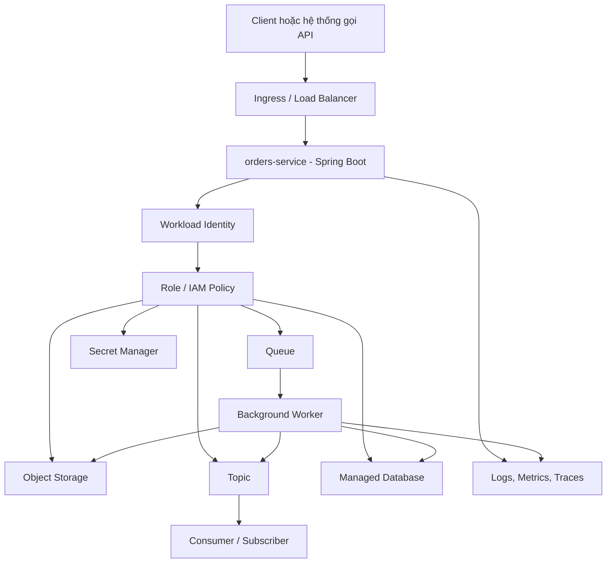
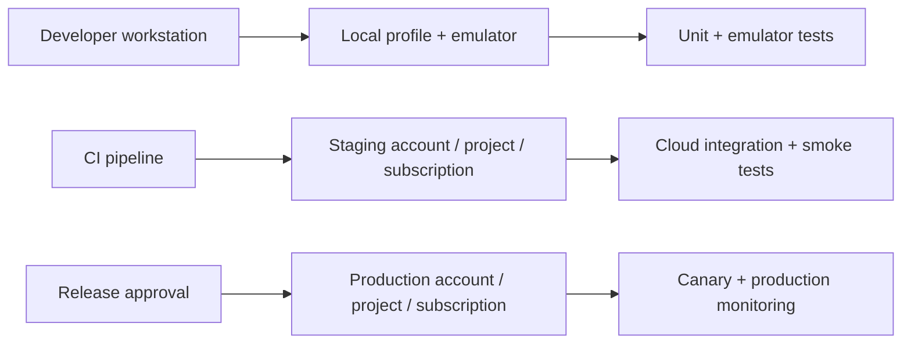
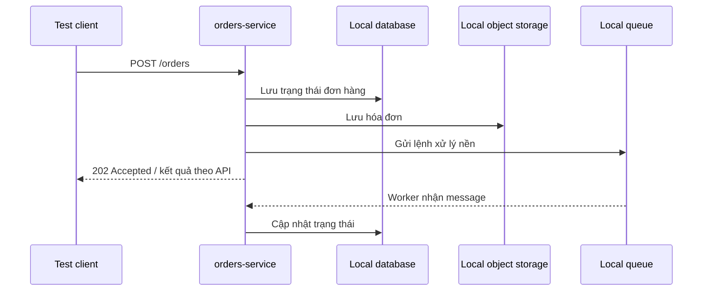
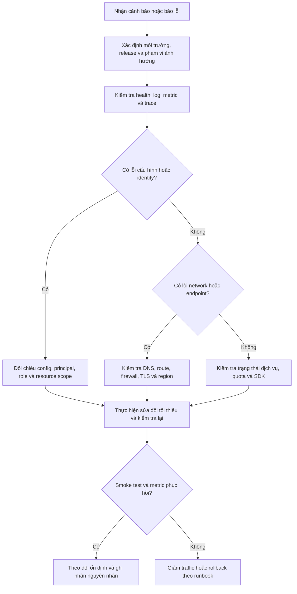

# Viết hướng dẫn chạy, sơ đồ tài nguyên và quy trình xử lý sự cố

Một ứng dụng Spring Boot tích hợp với dịch vụ managed của AWS, Azure hoặc Google Cloud cần nhiều thông tin hơn một lệnh khởi động. Người triển khai phải biết tài nguyên nào cần tồn tại, workload chạy dưới danh tính nào, cấu hình được lấy từ đâu, dịch vụ nào phụ thuộc vào dịch vụ nào và cần kiểm tra gì trước khi mở lưu lượng. Khi xảy ra lỗi, nhóm vận hành cũng cần một quy trình đủ rõ để khoanh vùng giữa lỗi cấu hình, quyền truy cập, mạng, tài nguyên cloud và mã ứng dụng.

Bài thực hành này xây dựng một runbook tổng hợp cho dịch vụ mẫu `orders-service`. Dịch vụ nhận yêu cầu đơn hàng, lưu hóa đơn vào object storage, gửi công việc đến queue và phát sự kiện qua topic. Một database lưu trạng thái đơn hàng; secret manager giữ thông tin nhạy cảm cần thiết. Mục tiêu là tạo tài liệu mà developer có thể dùng để chạy local, triển khai lên môi trường cloud, kiểm tra sau phát hành và xử lý sự cố theo cùng một cách trên ba nhà cung cấp.

## Kết quả cần đạt

Sau bài học, bạn có thể:

- Vẽ sơ đồ tài nguyên và luồng dữ liệu giữa Spring Boot với các dịch vụ managed.
- Lập danh sách điều kiện tiên quyết và cấu hình cho từng môi trường.
- Khởi chạy ứng dụng local bằng profile phù hợp và kiểm tra kết nối.
- Chuẩn bị resource, workload identity, policy và network cho AWS, Azure hoặc Google Cloud.
- Thực hiện smoke test sau khi triển khai và ghi nhận bằng chứng vận hành.
- Phân loại sự cố theo triệu chứng, thu thập thông tin an toàn và thực hiện khôi phục có kiểm soát.
- Duy trì runbook để mỗi release có thể được triển khai và hỗ trợ nhất quán.

## 1. Xác định phạm vi của runbook

Runbook cần bắt đầu bằng mô tả ngắn về dịch vụ và ranh giới hỗ trợ. Với ví dụ `orders-service`, luồng nghiệp vụ chính là:

1. API nhận yêu cầu tạo đơn hàng và xác thực dữ liệu.
2. Service lưu trạng thái đơn hàng vào database.
3. Service lưu hóa đơn hoặc tệp đính kèm vào object storage.
4. Service gửi lệnh xử lý nền vào queue.
5. Khi hoàn tất, worker phát sự kiện đơn hàng lên topic để các hệ thống khác tiêu thụ.
6. Ứng dụng đọc secret cần thiết từ secret manager bằng workload identity.

Trong môi trường thực tế, một số bước có thể được thực hiện bằng transactional outbox hoặc worker riêng để bảo đảm tính nhất quán. Runbook phải ghi đúng kiến trúc đang triển khai; không suy ra rằng một request HTTP đồng bộ thực hiện tất cả các thao tác trên.

### Sơ đồ tổng quan tài nguyên



Danh tính workload là cầu nối xác thực; role hoặc policy quyết định danh tính được làm gì trên từng tài nguyên. Sơ đồ thể hiện luồng logic, không bắt buộc tất cả dịch vụ phải nằm trong cùng một mạng con. Một số dịch vụ có endpoint public được kiểm soát bằng IAM; môi trường yêu cầu private connectivity có thể dùng private endpoint, VPC endpoint hoặc cơ chế tương ứng của provider.

### Bản đồ dịch vụ giữa các provider

| Năng lực | AWS | Azure | Google Cloud |
|---|---|---|---|
| Object storage | Amazon S3 | Azure Blob Storage | Cloud Storage |
| Queue / messaging | Amazon SQS | Azure Service Bus Queue | Pub/Sub subscription hoặc dịch vụ queue phù hợp |
| Publish / topic | Amazon SNS hoặc EventBridge tùy mô hình | Azure Service Bus Topic hoặc Event Grid | Pub/Sub Topic |
| Database | RDS, DynamoDB hoặc dịch vụ phù hợp | Azure SQL, Cosmos DB hoặc dịch vụ phù hợp | Cloud SQL, Firestore hoặc dịch vụ phù hợp |
| Secret | Secrets Manager hoặc Systems Manager Parameter Store | Azure Key Vault | Secret Manager |
| Workload identity | IAM role, task role, IRSA/EKS Pod Identity | Managed Identity hoặc Workload Identity | Service Account và Workload Identity Federation |
| Quan sát | CloudWatch, X-Ray | Azure Monitor, Application Insights | Cloud Logging, Cloud Monitoring, Trace |

Không nên coi các dịch vụ trong cùng một hàng là tương đương hoàn toàn. Ví dụ, SQS, Service Bus và Pub/Sub khác nhau về ordering, acknowledgement, retry, dead-letter và mô hình subscription. Khi chọn dịch vụ thay thế, phải đối chiếu yêu cầu nghiệp vụ và contract test.

## 2. Chuẩn bị môi trường và cấu hình

Trước khi chạy ứng dụng, xác định phiên bản JDK mà dự án hỗ trợ, phiên bản Spring Boot/Spring Cloud được quản lý bằng BOM, công cụ build, CLI của provider và quyền truy cập vào môi trường đích. Dùng dependency management đã được dự án chọn; không nâng riêng một SDK hoặc starter trong lúc làm theo runbook nếu chưa đánh giá tương thích.

### Cấu hình cần thiết

Phân chia cấu hình thành ba nhóm:

- **Cấu hình ứng dụng:** profile, port, tên queue/topic, bucket/container, region và timeout.
- **Cấu hình xác thực:** profile local hoặc workload identity trên cloud. Không lưu access key, client secret hay service account key trong source code.
- **Cấu hình kết nối:** endpoint, DNS, proxy, TLS và private networking nếu môi trường yêu cầu.

Ví dụ các biến môi trường không nhạy cảm:

```dotenv
SPRING_PROFILES_ACTIVE=local
APP_CLOUD_PROVIDER=aws
APP_CLOUD_REGION=ap-southeast-1
APP_INVOICE_BUCKET=orders-local-invoices
APP_ORDERS_QUEUE=orders-local-processing
APP_EVENTS_TOPIC=orders-local-events
APP_DB_URL=jdbc:postgresql://localhost:5432/orders
```

Đây là tên biến minh họa cho cấu hình do ứng dụng định nghĩa. Starter của từng provider có thể dùng property riêng để chọn region, endpoint hoặc credential provider. Hãy kiểm tra cấu hình tương ứng với phiên bản thư viện trong dự án. Không thêm giá trị bí mật vào file `.env` được commit; file local chứa secret cần nằm ngoài version control và được bảo vệ theo chính sách nhóm.

Ví dụ phần `application.yml` cho cấu hình nghiệp vụ chung:

```yaml
spring:
  application:
    name: orders-service
  lifecycle:
    timeout-per-shutdown-phase: 30s

server:
  port: ${SERVER_PORT:8080}
  shutdown: graceful

app:
  cloud:
    provider: ${APP_CLOUD_PROVIDER}
    region: ${APP_CLOUD_REGION}
  storage:
    invoice-container: ${APP_INVOICE_BUCKET}
  messaging:
    orders-queue: ${APP_ORDERS_QUEUE}
    events-topic: ${APP_EVENTS_TOPIC}

management:
  endpoints:
    web:
      exposure:
        include: health,info,metrics
  endpoint:
    health:
      probes:
        enabled: true
```

Property `app.*` là cấu hình ví dụ của ứng dụng, không phải property chuẩn được mọi Spring Cloud starter tự động hiểu. `management` yêu cầu Actuator có trong dependency. Chỉ expose endpoint phù hợp với chính sách bảo mật; production thường cần giới hạn truy cập qua mạng quản trị hoặc cơ chế xác thực riêng.

### Profile local và profile cloud

Profile local nên sử dụng dịch vụ giả lập, container phát triển hoặc tài nguyên sandbox được cấp riêng. Profile cloud sử dụng endpoint thật và workload identity. Không để profile local vô tình được bật trong production.

Ví dụ profile local:

```yaml
# application-local.yml
app:
  cloud:
    provider: local
  storage:
    endpoint: ${LOCAL_STORAGE_ENDPOINT:http://localhost:4566}
  messaging:
    endpoint: ${LOCAL_MESSAGING_ENDPOINT:http://localhost:4566}
```

Đây chỉ là ví dụ cấu hình endpoint cho môi trường giả lập có API tương thích một phần với AWS. Với Azurite hoặc fake-gcs-server, endpoint, credential giả lập và cách khởi tạo tài nguyên sẽ khác. Không dùng chung một endpoint local cho mọi provider.

## 3. Sơ đồ triển khai theo môi trường

Tách ít nhất ba môi trường: local, staging và production. Mỗi môi trường cần có resource name, identity, policy, network và secret scope riêng. Không tái sử dụng bucket, queue hoặc database production để chạy integration test local.



| Thuộc tính | Local | Staging | Production |
|---|---|---|---|
| Mục tiêu | Phát triển và debug | Kiểm tra tích hợp gần thực tế | Phục vụ nghiệp vụ |
| Dịch vụ | Emulator hoặc sandbox riêng | Dịch vụ managed thật | Dịch vụ managed thật |
| Identity | Credential local của developer hoặc emulator | Workload identity riêng | Workload identity production |
| Dữ liệu | Dữ liệu tổng hợp | Dữ liệu thử, không chứa thông tin thật ngoài phê duyệt | Dữ liệu production theo chính sách |
| Quyền | Chỉ trong phạm vi local | Quyền hẹp theo bài test | Quyền tối thiểu theo workload |
| Cleanup | Có thể xóa toàn bộ môi trường thử | Theo lịch và chính sách giữ log/dữ liệu | Theo quy trình vận hành và retention |

Staging nên dùng cùng loại dịch vụ, cơ chế identity và kiểu network như production ở mức cần thiết. Nếu production dùng private endpoint nhưng staging chỉ dùng public endpoint, staging có thể bỏ sót lỗi DNS, route hoặc firewall.

## 4. Khởi chạy ứng dụng local

Quy trình local cần có thể lặp lại và không phụ thuộc credential production. Các bước tổng quát:

1. Cài JDK và công cụ build đúng phiên bản dự án yêu cầu.
2. Khởi động database và emulator cần dùng bằng compose hoặc công cụ phát triển của nhóm.
3. Tạo bucket/container, queue và topic trong môi trường local nếu emulator không tự tạo.
4. Cung cấp các biến cấu hình local không nhạy cảm.
5. Chạy ứng dụng bằng profile `local`.
6. Kiểm tra health endpoint, log khởi động và một luồng nghiệp vụ mẫu.

Nếu dự án dùng Maven Wrapper:

```bash
./mvnw spring-boot:run -Dspring-boot.run.profiles=local
```

Trên Windows có thể dùng `mvnw.cmd`. Nếu dự án dùng Gradle Wrapper:

```bash
./gradlew bootRun --args='--spring.profiles.active=local'
```

Hãy dùng wrapper và task mà repository cung cấp. Các lệnh trên là mẫu phổ biến, không khẳng định dự án cụ thể dùng Maven hay Gradle.

Sau khi ứng dụng khởi động, kiểm tra:

```bash
curl -i http://localhost:8080/actuator/health
```

Nếu endpoint không được expose hoặc ứng dụng chạy ở port khác, điều chỉnh theo profile local. Health `UP` chỉ xác nhận các indicator đã cấu hình báo khỏe; nó chưa chứng minh tất cả luồng storage và messaging hoạt động. Tiếp tục chạy request tạo đơn hàng, xác nhận trạng thái database, object hóa đơn và message được gửi đến queue/topic theo thiết kế.

### Luồng kiểm thử local đề xuất



Sơ đồ chỉ mô tả một luồng mẫu. Nếu ứng dụng dùng transactional outbox, bước gửi message sẽ do publisher worker đọc outbox thực hiện sau commit. Runbook của dự án cần phản ánh chính xác luồng đó và không kết luận rằng API response đồng nghĩa consumer đã xử lý xong.

## 5. Chuẩn bị tài nguyên và danh tính trên cloud

Trước khi deploy, provisioning phải tạo các tài nguyên cần thiết bằng IaC hoặc quy trình quản trị hạ tầng có thể lặp lại. Mỗi tài nguyên nên có tên gắn với ứng dụng, môi trường và region. Pipeline triển khai cần nhận được resource ID, endpoint và tên tài nguyên dưới dạng output có thể truy vết.

### AWS

Một triển khai AWS có thể gồm:

- S3 bucket để lưu hóa đơn, bật block public access và mã hóa phù hợp.
- SQS queue cho công việc nền, cấu hình visibility timeout, retention, redrive policy và dead-letter queue.
- SNS topic hoặc EventBridge tùy mô hình phân phối sự kiện.
- RDS hoặc DynamoDB tùy mô hình dữ liệu.
- Secrets Manager hoặc Parameter Store cho giá trị nhạy cảm.
- IAM role gắn vào EC2, ECS task hoặc EKS workload.

Pipeline cần xác minh policy data plane cho từng thao tác: `s3:PutObject`/`s3:GetObject`, quyền gửi/nhận queue, publish topic, truy cập secret và kết nối database. Nếu object dùng customer-managed KMS key, kiểm tra cả key policy. Tránh dùng access key dài hạn nhúng trong container.

### Azure

Một triển khai Azure có thể gồm:

- Storage account và Blob container cho hóa đơn.
- Service Bus namespace với queue/topic và dead-letter behavior.
- Azure SQL hoặc Cosmos DB tùy mô hình dữ liệu.
- Key Vault cho secret.
- Managed Identity gắn vào App Service, Container Apps, VM hoặc workload phù hợp.

Gán role data plane như `Storage Blob Data Contributor`, role Service Bus Data Sender/Receiver hoặc role đọc secret trong Key Vault theo đúng thao tác và phạm vi. `Contributor` ở resource group không tự động cấp quyền đọc/ghi dữ liệu bên trong blob hoặc queue. Kiểm tra network rule, private endpoint và DNS nếu tài nguyên không public.

### Google Cloud

Một triển khai Google Cloud có thể gồm:

- Cloud Storage bucket cho hóa đơn.
- Pub/Sub topic và subscription cho sự kiện hoặc công việc nền.
- Cloud SQL hoặc Firestore tùy mô hình dữ liệu.
- Secret Manager cho secret.
- Service account gắn với Cloud Run, Compute Engine hoặc GKE workload.

Gán IAM role theo bucket, topic, subscription và secret. Ví dụ, publisher cần quyền publish trên topic; subscriber cần quyền consume trên subscription; ứng dụng đọc object cần quyền đọc object. Với GKE, dùng Workload Identity Federation for GKE thay cho key file service account khi phù hợp.

### Checklist preflight trước deploy

- [ ] Đúng account, project hoặc subscription và region.
- [ ] Bucket/container, queue, topic, database và secret đã tồn tại.
- [ ] Dead-letter, retention, encryption, backup và lifecycle policy được cấu hình.
- [ ] Workload identity được gắn vào đúng runtime.
- [ ] Policy có đúng principal, action và resource scope.
- [ ] DNS, route, firewall và private endpoint cho phép runtime kết nối.
- [ ] Quota và giới hạn throughput phù hợp với tải dự kiến.
- [ ] Runtime config trỏ đến đúng endpoint và tên tài nguyên của môi trường.

## 6. Triển khai ứng dụng và xác minh sau phát hành

Artifact nên bất biến giữa staging và production. Pipeline build một image hoặc package, ghi nhận digest/version, sau đó truyền cấu hình và identity tại thời điểm deploy. Không build image riêng có chứa credential hoặc endpoint production.

Trình tự triển khai khuyến nghị:

1. Provision hoặc xác minh trạng thái hạ tầng.
2. Gắn workload identity và policy.
3. Chờ role assignment hoặc policy propagation trong giới hạn có kiểm soát.
4. Kiểm tra network và truy cập dịch vụ từ đúng runtime context.
5. Triển khai artifact với cấu hình của môi trường.
6. Chờ startup và readiness.
7. Chạy smoke test storage, messaging và database.
8. Mở traffic theo rolling, canary hoặc blue-green.
9. Theo dõi metric và log sau phát hành.

### Smoke test theo năng lực

| Năng lực | Hành động kiểm tra | Bằng chứng mong đợi |
|---|---|---|
| Identity | Ghi nhận principal runtime theo cách an toàn | Đúng role/managed identity/service account |
| Storage | Ghi object vào prefix test, đọc lại, xác minh metadata rồi xóa | Nội dung và content type khớp; cleanup thành công |
| Messaging | Gửi một message có correlation ID test | Broker nhận message; consumer xử lý và ack theo contract |
| Database | Truy vấn health hoặc ghi/đọc bản ghi test riêng | Kết nối bằng danh tính hoặc credential runtime hợp lệ |
| Secret | Đọc secret test có phạm vi giới hạn | Giá trị không xuất hiện trong log hoặc response |
| HTTP | Gọi endpoint health và API nghiệp vụ mẫu | Status code, latency và kết quả nghiệp vụ đúng |

Smoke test phải dùng dữ liệu thử riêng, timeout hữu hạn và cleanup rõ ràng. Không kiểm tra quyền xóa bằng cách xóa object nghiệp vụ thật. Không coi việc chạy CLI bằng tài khoản cá nhân thành công là bằng chứng container có cùng quyền.

### Theo dõi sau deploy

Theo dõi tối thiểu:

- Tỷ lệ HTTP 5xx, timeout, latency p50/p95/p99 và số request đang hoạt động.
- Số message trong queue, tuổi message lâu nhất, throughput, retry và dead-letter.
- Lỗi SDK như access denied, throttling, timeout, resource not found và credential failure.
- Connection pool, số kết nối, executor queue và thread hoạt động.
- Tỷ lệ lỗi storage, kích thước object, request count và chi phí data transfer.
- Database connection saturation, query latency và transaction failure.
- Log theo release ID, trace ID và correlation ID.

Không log secret, token, connection string hoặc payload nhạy cảm. Khi có lỗi, log nên ghi provider, tên logical resource, operation, error category và correlation ID; tránh ghi credential hoặc toàn bộ request body.

## 7. Quy trình xử lý sự cố

Khi có cảnh báo, ưu tiên xác định phạm vi ảnh hưởng và giữ lại bằng chứng trước khi thay đổi cấu hình. Một thao tác như cấp role quản trị rộng hoặc restart hàng loạt có thể làm mất dấu nguyên nhân và tăng phạm vi sự cố.

### Quy trình triage



### Thông tin cần thu thập

Trước khi xử lý, ghi lại:

1. Thời điểm bắt đầu và thời điểm gần nhất hệ thống hoạt động bình thường.
2. Môi trường, provider, region, release ID và image digest.
3. API hoặc worker bị ảnh hưởng; toàn bộ traffic hay chỉ một nhóm request.
4. Operation và logical resource gặp lỗi, correlation ID và error code.
5. Principal runtime thực tế và revision cấu hình đang áp dụng.
6. Metric về latency, retry, backlog, throttling, connection pool và quota.
7. Thay đổi gần nhất về IAM, network, secret, resource hoặc deployment.

Thu thập log đã loại bỏ thông tin nhạy cảm. Không yêu cầu người báo sự cố gửi access token, secret value hoặc file credential.

### Bảng chẩn đoán theo triệu chứng

| Triệu chứng | Khả năng nguyên nhân | Cách xác minh | Hướng xử lý |
|---|---|---|---|
| `AccessDenied`, `Forbidden`, `PERMISSION_DENIED` | Sai principal, thiếu data-plane role, sai resource scope hoặc policy chưa có hiệu lực | Xác minh identity của process; đối chiếu action, resource và policy | Cấp đúng quyền tối thiểu; chờ propagation có giới hạn rồi kiểm tra lại |
| `401` hoặc credential unavailable | Credential chain không tìm được identity hoặc token hết hạn | Kiểm tra cấu hình runtime identity và lỗi credential provider, không in token | Sửa gắn identity hoặc cơ chế federation; không thêm key tĩnh làm giải pháp lâu dài |
| DNS lookup hoặc connection timeout | Endpoint sai, DNS/private DNS, route, firewall, proxy hoặc region | Kiểm tra từ pod/task/VM đang lỗi; so sánh endpoint với output provisioning | Sửa DNS/network rule/route hoặc endpoint; thử lại từ runtime context |
| `ResourceNotFound` | Sai tên, sai region/account/project hoặc provisioning chưa hoàn tất | Đối chiếu resource ID, endpoint và môi trường | Sửa runtime config hoặc hoàn tất provisioning đúng scope |
| `429`, throttling hoặc quota exceeded | Tải vượt quota, burst lớn hoặc retry dồn dập | Kiểm tra metric quota, request rate và retry count | Backoff có jitter, giới hạn concurrency và yêu cầu tăng quota nếu cần |
| Storage ghi thành công nhưng đọc thất bại | Policy bất đối xứng, key khác nhau, metadata hoặc encryption key | Kiểm tra key mapping, quyền đọc và KMS/key access | Sửa policy/key mapping; kiểm tra metadata và quyền sử dụng khóa |
| Message backlog tăng liên tục | Consumer dừng, thiếu quyền receive, lỗi xử lý hoặc throughput thấp | Kiểm tra consumer health, delivery count, dead-letter và handler latency | Khôi phục consumer, sửa permission/schema hoặc tăng concurrency có kiểm soát |
| Message bị xử lý lặp | At-least-once delivery, ack quá muộn hoặc consumer không idempotent | So sánh event ID, delivery count và trạng thái nghiệp vụ | Bổ sung deduplication/idempotency; ack sau commit |
| Message bị mất khỏi luồng nghiệp vụ | Ack/delete trước commit hoặc publish chưa bền vững | Đối chiếu broker acknowledgement với transaction và outbox | Sửa thứ tự commit/ack; phục hồi từ outbox hoặc nguồn dữ liệu theo quy trình |
| Secret mới nhưng ứng dụng vẫn dùng giá trị cũ | Cache secret, connection pool hoặc process chưa refresh | Kiểm tra version secret và thời điểm load trong instance | Refresh theo cơ chế hỗ trợ hoặc rollout có kiểm soát; xoay vòng credential an toàn |
| Chỉ một số instance lỗi | Rollout không đồng nhất, identity/config khác nhau hoặc node network lỗi | So sánh revision, labels, identity, endpoint và zone/region | Cô lập instance lỗi; đồng bộ cấu hình hoặc thay instance sau khi thu thập bằng chứng |
| Health `UP` nhưng nghiệp vụ thất bại | Health indicator không kiểm tra dependency cần thiết hoặc smoke test thiếu | Chạy từng thao tác storage/messaging/database | Bổ sung readiness/smoke test phù hợp, không biến liveness thành kiểm tra mọi dịch vụ |

### Phân loại lỗi để tránh retry sai

| Nhóm lỗi | Ví dụ | Hành động thường phù hợp |
|---|---|---|
| Cấu hình hoặc request | Thiếu tên resource, sai format, payload không hợp lệ | Sửa cấu hình/dữ liệu; không retry vô hạn |
| Xác thực/phân quyền | Token không hợp lệ, 401/403 | Sửa identity hoặc policy; retry chỉ sau khi thay đổi được áp dụng |
| Tạm thời | Timeout, throttling, 5xx từ dịch vụ | Retry có giới hạn, exponential backoff và jitter |
| Không tồn tại | Bucket/queue/object không có trong đúng scope | Xác minh resource và quy ước not found; không che bằng retry mù |
| Nghiệp vụ | Vi phạm trạng thái đơn hàng hoặc duplicate event | Áp dụng quy tắc domain, idempotency hoặc dead-letter phù hợp |

Retry không phải cách xử lý chung cho mọi lỗi. Retry lỗi quyền không làm policy tự đúng; retry request sai không sửa được dữ liệu; retry dồn dập khi throttling có thể khiến dịch vụ quá tải nặng hơn.

## 8. Quy trình khôi phục và rollback

Khi sự cố ảnh hưởng production, chọn hành động theo mức độ tác động và khả năng phục hồi:

1. **Giảm tác động:** dừng rollout, giảm traffic, tắt feature flag hoặc tạm ngừng consumer nếu việc tiếp tục có thể gây ghi sai dữ liệu.
2. **Giữ bằng chứng:** lưu release ID, log đã lọc secret, metric, trace và cấu hình revision.
3. **Sửa nguyên nhân đã xác định:** policy, endpoint, DNS, quota, secret reference hoặc cấu hình ứng dụng.
4. **Kiểm tra trên một instance hoặc nhóm nhỏ:** chạy smoke test và theo dõi lỗi trước khi mở rộng.
5. **Rollback nếu cần:** chuyển về artifact/configuration ổn định trước đó theo chiến lược đã thử nghiệm.
6. **Đối soát dữ liệu:** kiểm tra object, message, transaction và side effect có thể bị lặp hoặc chưa hoàn tất.
7. **Theo dõi sau phục hồi:** quan sát backlog, retry, latency và error rate đến khi ổn định.

Rollback ứng dụng không đồng nghĩa xóa tài nguyên hoặc hoàn tác dữ liệu. Không xóa queue, bucket, database hay secret trong bước rollback mặc định. Nếu release mới đã ghi dữ liệu theo schema hoặc metadata mới, xác minh phiên bản cũ có thể đọc được trước khi chuyển traffic về.

### Ví dụ quyết định rollback

| Tình huống | Hành động ưu tiên | Điều kiện trước khi kết thúc sự cố |
|---|---|---|
| Release mới gây lỗi startup | Dừng rollout và rollback artifact | Phiên bản cũ khởi động, readiness và smoke test đạt |
| Thiếu quyền một thao tác | Sửa policy đúng action/resource | Workload identity thực hiện được thao tác cần thiết; quyền ngoài phạm vi vẫn bị từ chối |
| Endpoint/private DNS sai | Khôi phục cấu hình network đã biết tốt | Runtime phân giải và kết nối đúng endpoint |
| Consumer lỗi do schema mới | Dừng consumer hoặc rollback consumer | Message backlog được xử lý theo schema tương thích; không phát sinh side effect trùng |
| Secret bị xoay sai | Dùng quy trình khôi phục/rotate lại secret | Instance dùng version hợp lệ và connection pool được làm mới |

## 9. Mẫu ghi nhận sự cố

Mỗi sự cố nên có một bản ghi ngắn, có thể điền theo mẫu:

```text
Incident ID:
Environment / Provider / Region:
Service / Release ID / Image digest:
Start time / Recovery time:
Impact and affected operations:
Error code / Correlation IDs:
Runtime principal:
Resource IDs (logical names only where appropriate):
Recent changes:
Evidence: logs, metrics, traces:
Root cause:
Mitigation and recovery steps:
Data/message reconciliation:
Follow-up actions and owner:
```

Không đưa secret, token, private key hoặc payload chứa dữ liệu cá nhân vào incident record. Dùng resource ID và correlation ID đủ để truy vết theo quyền truy cập nội bộ.

## 10. Duy trì runbook qua các lần phát hành

Runbook phải được cập nhật cùng thay đổi ứng dụng và hạ tầng. Khi thêm một bucket, queue hoặc secret mới, cập nhật sơ đồ tài nguyên, policy, biến cấu hình, smoke test và bảng troubleshooting. Khi đổi phiên bản Spring Cloud hoặc SDK, xác minh lại property, credential chain, timeout và cách starter quản lý client.

Một quy trình review tài liệu có thể gồm:

- Developer cập nhật lệnh chạy local và biến cấu hình khi thay đổi profile hoặc dependency.
- Platform engineer cập nhật resource map, IaC output, identity, policy và network path.
- Người vận hành xác minh cảnh báo, dashboard, log field và hướng khôi phục.
- Reviewer kiểm tra rằng ví dụ không chứa secret, resource production thật hoặc quyền vượt nhu cầu.
- Sau một incident, bổ sung nguyên nhân đã xác nhận và bước phát hiện sớm vào runbook.

### Checklist phát hành

- [ ] Sơ đồ tài nguyên phản ánh đúng kiến trúc đang chạy.
- [ ] Có lệnh local phù hợp với build wrapper và profile của dự án.
- [ ] Các biến cấu hình được mô tả; secret không xuất hiện trong source hoặc log.
- [ ] Tài nguyên và identity đã được provisioning đúng môi trường.
- [ ] Policy phân biệt quyền control plane và data plane, theo least privilege.
- [ ] Network, DNS, endpoint và TLS đã được kiểm tra từ runtime.
- [ ] Health, readiness và smoke test được xác minh.
- [ ] Dashboard, log và trace cho phép truy vết theo release/correlation ID.
- [ ] Quy trình xử lý sự cố và rollback có thể thực hiện theo từng bước.
- [ ] Dữ liệu, message và side effect được đối soát sau rollback.
- [ ] Runbook được cập nhật và review cùng release.

## Kết luận

Runbook tốt kết nối cách chạy ứng dụng với sơ đồ tài nguyên, danh tính, quyền, cấu hình và quy trình vận hành. Developer cần có đường chạy local lặp lại; pipeline cần biết thứ tự provisioning và smoke test; người vận hành cần phân loại lỗi trước khi retry, thay policy hoặc rollback. Khi các thông tin này được ghi cùng release và cập nhật sau mỗi thay đổi, ứng dụng Spring Boot tích hợp với AWS, Azure và Google Cloud sẽ dễ triển khai, kiểm tra và khôi phục hơn.
