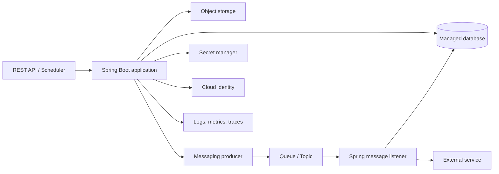
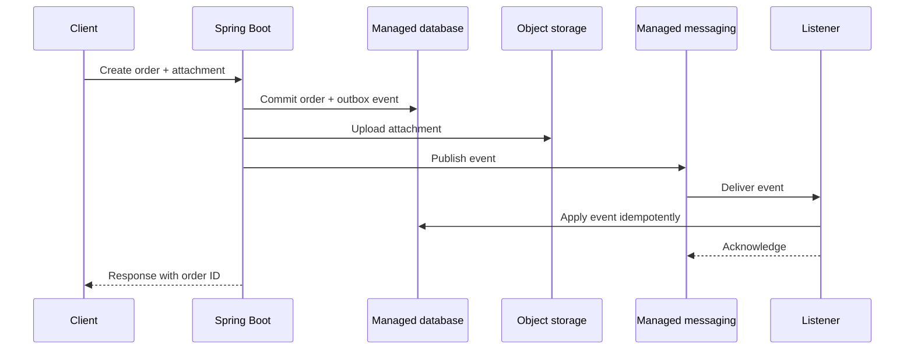

# Đánh giá kết quả tích hợp và dọn dẹp toàn bộ tài nguyên thực hành

Sau khi hoàn thành các bài tích hợp Spring Boot với dịch vụ managed của AWS, Azure và Google Cloud, cần đánh giá toàn bộ hệ thống như một sản phẩm có thể vận hành: luồng nghiệp vụ có chạy đúng không, quyền truy cập có đủ hẹp không, message có được xử lý an toàn khi retry không, lỗi có thể quan sát và khôi phục không, chi phí có nằm trong giới hạn không, và tài nguyên thử nghiệm có được thu hồi đầy đủ không.

Bài thực hành tổng hợp này kết nối kết quả từ các bài trước thành một quy trình nghiệm thu có bằng chứng. Bạn sẽ lập ma trận acceptance criteria, chạy smoke/integration/failure tests, so sánh hành vi giữa các cloud provider, ghi nhận rủi ro và lập kế hoạch dọn dẹp. **Chỉ xóa tài nguyên sau khi đã xác định chủ sở hữu, lưu bằng chứng cần thiết và xác nhận dữ liệu không còn cần giữ.**

## 1. Mục tiêu thực hành

Hoàn thành bài này, bạn có thể:

- Đánh giá tích hợp Spring Boot với storage, messaging, database, secrets và identity trên các cloud provider.
- Xây dựng acceptance criteria có thể kiểm chứng thay cho kết luận “chạy được”.
- Chạy smoke test, integration test, failure/retry test và kiểm tra bảo mật trước khi nghiệm thu.
- So sánh các khác biệt có ý nghĩa giữa AWS, Azure và Google Cloud.
- Thu thập bằng chứng kỹ thuật, vận hành và chi phí để bàn giao.
- Lập inventory tài nguyên theo môi trường, owner, project/account và IaC stack.
- Dừng producer/consumer, xử lý message còn tồn, lưu dữ liệu cần giữ và dọn tài nguyên theo thứ tự phụ thuộc.
- Xác minh không còn tài nguyên mồ côi hoặc chi phí phát sinh ngoài dự kiến.

## 2. Bối cảnh bài thực hành

Giả sử nhóm phát triển một dịch vụ xử lý đơn hàng. Spring Boot nhận yêu cầu, ghi dữ liệu, lưu tệp đính kèm, phát sự kiện và xử lý các tác vụ bất đồng bộ. Ứng dụng có thể được triển khai trên một cloud hoặc chạy thử trên nhiều provider để so sánh.



Các dịch vụ cụ thể có thể khác nhau theo provider. Ví dụ, messaging có thể dùng Amazon SQS/SNS, Azure Service Bus hoặc Google Cloud Pub/Sub; object storage có thể dùng Amazon S3, Azure Blob Storage hoặc Google Cloud Storage. Hãy đánh giá hợp đồng nghiệp vụ của ứng dụng và các semantics riêng của từng dịch vụ.

## 3. Chuẩn bị phạm vi nghiệm thu

Trước khi chạy test, ghi rõ môi trường và phiên bản:

| Thông tin | Giá trị cần ghi |
|---|---|
| Ứng dụng | Tên service, commit/build version, profile đang chạy |
| Java/Spring | Java version, Spring Boot version, Spring Cloud release train |
| Cloud SDK | Phiên bản Spring Cloud AWS/Azure/GCP và SDK tương ứng |
| Môi trường | Local, integration, sandbox, staging hoặc production |
| Tài khoản | AWS account ID, Azure subscription, Google Cloud project ID |
| Region | Region của compute, storage, database và messaging |
| IaC | Terraform/Pulumi/CloudFormation/Bicep stack hoặc deployment ID |
| Người phụ trách | Owner kỹ thuật, owner dữ liệu và người phê duyệt cleanup |
| Giới hạn | Ngân sách, thời gian chạy, retention và dữ liệu được phép sử dụng |

Chỉ dùng dữ liệu tổng hợp hoặc đã được phê duyệt. Không đưa access key, refresh token, connection string, secret value hay dữ liệu khách hàng vào báo cáo nghiệm thu.

### 3.1. Đặt tiêu chí trước khi đo

Với mỗi luồng nghiệp vụ, ghi trước điều kiện pass/fail. Ví dụ:

- Một yêu cầu tạo đơn hàng chỉ tạo một order record và một event logic.
- Consumer nhận lại cùng event không làm tăng tác dụng phụ lần thứ hai.
- Khi database hoặc messaging tạm thời không sẵn sàng, ứng dụng retry theo chính sách đã chọn.
- Message lỗi được đưa vào DLQ/quarantine sau ngưỡng cấu hình và có quy trình replay.
- Ứng dụng lấy credential từ identity/secret manager theo môi trường.
- Log/trace có correlation ID và không lộ secret hoặc payload nhạy cảm.
- Các tài nguyên thực hành có thể được xác định từ IaC, tag/label và inventory.

Không thay đổi tiêu chí sau khi thấy kết quả chỉ để biến một test thất bại thành pass. Nếu tiêu chí cần sửa, ghi rõ lý do và yêu cầu nghiệp vụ mới.

## 4. Ma trận acceptance criteria

Dùng bảng dưới đây làm checklist nghiệm thu. Có thể bổ sung ngưỡng cụ thể theo SLA của hệ thống.

| Nhóm | Tiêu chí | Bằng chứng tối thiểu |
|---|---|---|
| Functional | Luồng create/read/update và event processing đúng | Integration test, record kiểm tra, event ID |
| Identity | Ứng dụng dùng identity phù hợp môi trường và quyền tối thiểu | Role/service principal/service account, policy review |
| Secrets | Secret được lấy từ secret manager và không xuất hiện trong log/config commit | Config review, secret scan, log sample đã che dữ liệu |
| Storage | Upload/download, metadata, access control và cleanup hoạt động | Test file checksum, object metadata, policy |
| Messaging | Publish/consume, acknowledgment, retry, DLQ và replay đúng | Test report, queue metrics, message correlation |
| Database | Transaction, connection lifecycle và idempotency đúng | Integration test, migration result, query/constraint review |
| Reliability | Timeout, retry/backoff, duplicate và recovery được kiểm chứng | Failure injection result, DLQ/recovery evidence |
| Observability | Log, metrics, trace và alert đủ để điều tra | Dashboard/trace ID/alert test |
| Performance | Latency/throughput nằm trong mục tiêu đã định | Load test report, p95/p99, resource metrics |
| Cost | Tài nguyên, retention và mức sử dụng nằm trong ngân sách | Cost estimate/actual, usage metrics |
| Operability | Deploy, restart, graceful shutdown và rollback có quy trình | Runbook, deployment/rollback evidence |
| Cleanup | Tài nguyên tạm đã được thu hồi hoặc có owner/expiry rõ ràng | IaC destroy output, inventory sau cleanup |

### 4.1. Cổng nghiệm thu bắt buộc

Một điểm tổng hợp cao không bù được lỗi nghiêm trọng. Các điều kiện sau phải pass trước khi bàn giao:

1. Không có secret hoặc credential bị hard-code hay ghi vào log.
2. Identity runtime không có quyền quản trị rộng hơn nhu cầu.
3. Consumer có cơ chế idempotency phù hợp với delivery semantics.
4. Message lỗi có chính sách retry/DLQ hoặc quy trình xử lý tương đương.
5. Dữ liệu và tài nguyên có owner, retention và cleanup plan.
6. Có thể xác định phiên bản ứng dụng, cấu hình và tài nguyên đã triển khai.

Nếu một cổng bắt buộc fail, ghi `BLOCKED` hoặc `NEEDS_REMEDIATION`; không dùng điểm trung bình để kết luận nghiệm thu.

## 5. Chạy bộ kiểm thử theo thứ tự

Chạy từ kiểm tra rẻ và nhanh đến kiểm tra cần tài nguyên managed:

1. Compile, unit test và static checks.
2. Contract/schema test cho payload, event type và message attributes.
3. Integration test với emulator/container hoặc service test environment.
4. Smoke test trên cloud sandbox: identity, secrets, storage, database và messaging.
5. Failure test: timeout, throttling, permission denied, consumer restart, duplicate và DLQ.
6. Performance test với tải đại diện và giới hạn concurrency.
7. Kiểm tra quan sát: trace, metric, alert và log redaction.
8. Kiểm tra deploy, rolling restart, graceful shutdown và rollback.

Mỗi test cần có input, điều kiện môi trường, kết quả mong đợi, kết quả thực tế, thời gian chạy và liên kết bằng chứng. Khi test phụ thuộc thời gian, dùng polling có timeout thay vì `Thread.sleep()` cố định.

## 6. Kiểm tra functional end-to-end

Chọn một luồng nghiệp vụ đại diện, ví dụ tạo đơn hàng và xử lý event:



Kiểm tra các invariant:

- Order ID và event ID được tạo ổn định.
- Database không có bản ghi một phần nếu transaction thất bại.
- Tệp lưu trữ có checksum/metadata khớp với dữ liệu đầu vào.
- Event chỉ được publish sau khi dữ liệu nghiệp vụ được ghi bền vững, thường qua transactional outbox.
- Consumer kiểm tra idempotency key trước khi tạo side effect.
- Acknowledgment xảy ra sau khi nghiệp vụ đã hoàn tất theo chính sách.
- Correlation ID nối được request, event, listener và log.

Nếu storage và database không tham gia cùng một transaction, xác định rõ saga/compensation hoặc trạng thái trung gian. Không giả định một thao tác upload và một transaction database tạo thành một transaction phân tán nguyên tử.

## 7. Đánh giá identity, quyền và secrets

Kiểm tra ứng dụng chạy bằng danh tính runtime dành cho workload:

| Provider | Danh tính thường gặp | Nội dung cần xác minh |
|---|---|---|
| AWS | IAM role, workload identity hoặc task/instance role | Trust policy, role session, policy scope và không dùng access key dài hạn nếu không cần |
| Azure | Managed Identity hoặc workload identity federation | Đúng tenant/subscription, role assignment ở scope hẹp và quyền Key Vault/Storage/Service Bus |
| Google Cloud | Service account hoặc Workload Identity Federation | Principal đúng, IAM binding theo resource và tránh service account key dài hạn |

Checklist bảo mật:

- Tách identity của ứng dụng runtime khỏi identity triển khai hạ tầng.
- Cấp quyền theo resource và action cần thiết; loại bỏ quyền wildcard không có lý do.
- Xác minh token/credential được làm mới đúng cách và không cache quá hạn.
- Không lưu secret trong source, Docker image, application log hoặc CI artifact.
- Dùng secret manager và rotation policy phù hợp.
- Kiểm tra quyền đọc secret chỉ thuộc service cần dùng.
- Bật encryption at rest/in transit theo yêu cầu và xác định key owner.
- Kiểm tra audit log cho hành động nhạy cảm.

Khi nghiệm thu, lưu policy/role definition đã redacted và tên resource. Không copy secret value hoặc token vào báo cáo.

## 8. Đánh giá storage và database

Đối với object storage, kiểm tra:

- Upload/download và checksum của object.
- Metadata, content type, encoding và naming convention.
- Quyền public/private và quyền truy cập theo workload identity.
- Versioning, retention, lifecycle và encryption.
- Hành vi khi upload trùng key, upload bị gián đoạn hoặc object không tồn tại.
- CORS/event notification nếu luồng nghiệp vụ sử dụng.

Đối với database, kiểm tra:

- Connection pool, timeout, retry và giới hạn kết nối.
- Migration chạy đúng phiên bản và có chiến lược rollback/forward-fix.
- Transaction boundary giữa ghi dữ liệu và tạo outbox event.
- Unique constraint/idempotency table ngăn side effect trùng.
- Backup/restore hoặc snapshot đã được kiểm chứng ở môi trường phù hợp.
- Không ghi credential hoặc dữ liệu nhạy cảm trong query log.

Không kết luận storage/database “tương đương” giữa provider chỉ vì các API CRUD có tên tương tự. So sánh semantics về consistency, versioning, retention, transaction, indexing, failover và giới hạn dịch vụ.

## 9. Đánh giá messaging và khả năng phục hồi

Với từng queue/topic/subscription, ghi nhận:

| Hạng mục | Câu hỏi nghiệm thu |
|---|---|
| Delivery | At-least-once, at-most-once hay semantics khác? |
| Ordering | Thứ tự toàn queue, theo partition/group hay không có guarantee? |
| Deduplication | Có dedup phía broker không? Cửa sổ và scope là gì? |
| Acknowledgment | Khi nào broker coi message đã xử lý? |
| Retry | Retry ngay, visibility/lock timeout hay subscription retry policy? |
| Dead-letter | DLQ/subscription có được cấu hình và theo dõi không? |
| Replay | Có thể redrive nguyên trạng hay cần consumer/tool riêng? |
| Retention | Message giữ tối đa bao lâu và tuổi được tính thế nào? |
| Backpressure | Concurrency, prefetch, lock renewal và rate limit được điều khiển ra sao? |

Kiểm thử tối thiểu:

1. Gửi một event hợp lệ và xác minh consumer tạo đúng kết quả.
2. Gửi lại cùng event ID và xác minh idempotency.
3. Làm consumer lỗi trước acknowledgment và xác minh retry.
4. Làm payload không hợp lệ và xác minh DLQ/quarantine.
5. Restart consumer khi message đang in-flight và xác minh recovery.
6. Replay một message đã sửa trong môi trường test.
7. Tạo burst và xác minh backpressure không làm downstream quá tải.

Các provider không dùng chung một mô hình message. Ví dụ, SQS visibility timeout, Azure Service Bus lock duration/renewal và Pub/Sub acknowledgment deadline có tên gọi gần giống nhưng quy tắc gia hạn, retry, ordering và dead-letter khác nhau. Hãy ghi nhận hành vi đã kiểm thử của từng adapter thay vì chỉ dựa trên abstraction chung.

## 10. So sánh đa cloud theo capability

Sử dụng ma trận capability thay cho việc so sánh tên class hoặc số lượng method:

| Capability | AWS | Azure | Google Cloud | Câu hỏi đánh giá |
|---|---|---|---|---|
| Workload identity | IAM role/federation | Managed Identity/federation | Service account/WIF | Có loại bỏ được secret dài hạn không? |
| Object storage | S3 | Blob Storage | Cloud Storage | Versioning, retention, lifecycle và consistency thế nào? |
| Messaging | SQS/SNS | Service Bus | Pub/Sub | Delivery, ordering, retry, dedup và DLQ ra sao? |
| Secrets | Secrets Manager/Parameter Store | Key Vault | Secret Manager | Rotation, access scope và audit thế nào? |
| Database | DynamoDB/RDS và dịch vụ khác | Cosmos DB/Azure SQL | Firestore/Cloud SQL và dịch vụ khác | Transaction, query, consistency và connection model thế nào? |
| Observability | CloudWatch/X-Ray | Azure Monitor/Application Insights | Cloud Monitoring/Trace | Trace context và metric có đủ để điều tra không? |

Đánh giá từng capability theo ba lớp:

1. **Hợp đồng ứng dụng:** interface/domain event mà Spring Boot sử dụng.
2. **Adapter/provider:** cấu hình và API cụ thể của Spring Cloud/provider SDK.
3. **Semantics managed service:** delivery, consistency, retention, IAM, quota và failure behavior.

Abstraction chung có ích khi nó giữ đúng ý nghĩa nghiệp vụ. Nếu một provider có semantics khác, hãy thể hiện khác biệt trong adapter/configuration và test; không ép mọi dịch vụ vào một abstraction làm mất khả năng kiểm soát quan trọng.

## 11. Kiểm tra observability và runbook

Một hệ thống được nghiệm thu cần trả lời được: request nào tạo event này, event đang ở queue nào, consumer nào nhận, xử lý mất bao lâu, lỗi ở dependency nào và message đang retry hay ở DLQ?

Kiểm tra:

- Log có timestamp, service, environment, trace/correlation ID, event ID và error category.
- Secret, access token, receipt handle và payload nhạy cảm không bị ghi log.
- Metrics có throughput, latency, error rate, queue depth, retry/DLQ count và dependency saturation.
- Trace nối được inbound request, publish, consume và lời gọi downstream nếu instrumentation hỗ trợ.
- Alert có owner, severity, runbook và ngưỡng có thể hành động.
- Dashboard phân biệt lỗi ứng dụng, lỗi IAM, throttling, network và quota.

Thực hiện ít nhất một bài diễn tập: cố ý làm downstream trả lỗi, xác minh alert được kích hoạt, tìm được event ID trong trace/log và làm theo runbook để khôi phục.

## 12. Đo performance và giới hạn tải

Không chỉ đo số message mỗi giây. Ghi lại:

- Throughput đầu vào và đầu ra.
- p50/p95/p99 latency từ publish đến xử lý hoàn tất.
- Queue backlog và tuổi message cũ nhất.
- Số message in-flight/locked và tỷ lệ redelivery.
- CPU, heap, GC, thread pool và connection pool.
- Database latency, throttling và downstream rate limit.
- Số request receive/delete và empty receive nếu dịch vụ cung cấp.
- Chi phí phát sinh theo thời gian chạy test.

Chạy tải theo các bước tăng dần, giữ cùng dataset và cấu hình khi so sánh provider. Không tăng concurrency đến khi test pass nếu chưa xác định downstream còn khả năng chịu tải. Tìm điểm bão hòa và đặt giới hạn an toàn thấp hơn điểm đó.

## 13. Đánh giá chi phí và ngân sách

Tạo bảng dự toán theo resource type:

| Nhóm tài nguyên | Đơn vị tính thường gặp | Cần ghi nhận |
|---|---|---|
| Compute | vCPU/giờ, memory/giờ, request | Thời gian chạy, autoscaling, idle capacity |
| Messaging | Request, operation, throughput unit hoặc message volume | Send/receive/delete, retry, empty poll, retention |
| Object storage | GB-tháng, request, data transfer | Dung lượng, version, lifecycle, egress |
| Database | Instance/throughput, storage, I/O, backup | Provisioned capacity, autoscaling, backup retention |
| Secrets/KMS | API operation, key, rotation | Số lần truy cập, key và audit requirements |
| Observability | Log ingestion/retention, metric, trace | Sampling, retention và high-cardinality labels |
| Network | Egress, NAT, private endpoint, inter-region | Data path và cross-zone/cross-region traffic |

So sánh chi phí trên cùng workload và cùng khoảng thời gian. Bao gồm cả chi phí request retry, message polling rỗng, log và network egress. Một dịch vụ có giá request thấp vẫn có thể đắt hơn nếu cần nhiều thành phần phụ trợ.

Đặt budget/alert cho sandbox nếu nền tảng hỗ trợ. Budget alert không nhất thiết tự dừng tài nguyên; cleanup vẫn cần quy trình riêng.

## 14. Chấm điểm kết quả tích hợp

Có thể dùng thang 100 điểm để tổng hợp tiến độ. Điểm chỉ có ý nghĩa khi có bằng chứng đính kèm:

| Hạng mục | Trọng số |
|---|---:|
| Functional correctness và contract | 20 |
| Reliability, retry, idempotency và recovery | 20 |
| Identity, secrets và data protection | 20 |
| Observability và runbook | 10 |
| Performance và scalability | 10 |
| Cost và resource governance | 10 |
| Deployment, operability và cleanup | 10 |
| **Tổng** | **100** |

Đề xuất cách diễn giải:

- 90–100: đủ bằng chứng cho phạm vi nghiệm thu, các cổng bắt buộc đều pass.
- 75–89: có thể dùng trong môi trường thử nghiệm có kiểm soát; cần kế hoạch khắc phục các mục còn thiếu.
- Dưới 75: chưa đủ bằng chứng để nghiệm thu.
- Bất kỳ cổng bảo mật, dữ liệu hoặc phục hồi bắt buộc nào fail: trạng thái vẫn là `BLOCKED`, bất kể tổng điểm.

Không cộng điểm cho một test chưa chạy hoặc một tính năng chỉ mới được cấu hình nhưng chưa có bằng chứng hoạt động.

## 15. Chuẩn bị cleanup: inventory và quyền sở hữu

Trước khi xóa tài nguyên, tạo inventory từ IaC state, cloud console/CLI và tag/label. Không dựa vào tên tài nguyên duy nhất vì nhiều tài nguyên được tạo tự động có tên khác dự kiến.

| Trường inventory | Ví dụ |
|---|---|
| Provider | AWS / Azure / Google Cloud |
| Account scope | Account ID / Subscription ID / Project ID |
| Environment | `integration-lab-2026-11` |
| Resource ID | ARN, resource ID hoặc full resource name |
| Resource type | Queue, topic, bucket, database, key, identity |
| Owner | Team hoặc người phụ trách |
| IaC stack | Workspace, stack name hoặc deployment ID |
| Data disposition | Delete / retain / archive / legal hold |
| Dependency | Ứng dụng, queue, key, identity hoặc network phụ thuộc |
| Cleanup status | Pending / approved / deleted / retained |

Gắn tag/label nhất quán ngay khi tạo resource, ví dụ:

```text
application = provider-integration-lab
environment = integration
owner       = platform-team
expires-at  = 2026-12-01
managed-by  = terraform
```

Không xóa resource chỉ vì tên có chữ `test`, `dev` hoặc `lab`. Kiểm tra account/project, owner, tag, IaC state và dependency trước khi hành động.

## 16. Quy trình cleanup an toàn

Thực hiện theo thứ tự để tránh consumer còn chạy nhưng queue/storage đã bị xóa:

1. **Đóng đầu vào:** dừng job/scheduler, API test producer và automation có thể tạo thêm resource/message.
2. **Thông báo và ghi nhận trạng thái:** xác nhận owner, thời điểm cleanup, phạm vi account/project và danh sách resource.
3. **Lưu bằng chứng:** export log/metric/test report, inventory, config đã redacted và dữ liệu cần giữ.
4. **Quyết định message còn tồn:** drain, archive, replay hoặc purge theo yêu cầu; không xóa message đang cần điều tra.
5. **Dừng consumer:** stop listener/worker và xác nhận không còn instance đang poll hoặc xử lý.
6. **Xóa messaging:** subscription, queue, topic/event rule theo dependency và retention đã thống nhất.
7. **Xóa ứng dụng phụ trợ:** compute, scheduler, container, function, endpoint và integration test runner.
8. **Xóa data resources:** database, storage, snapshot/backup tạm sau khi đã xác nhận retention.
9. **Thu hồi identity và secrets:** role assignment, service account, managed identity, secret version và policy không còn dùng.
10. **Xử lý key/network:** key chỉ xóa hoặc schedule deletion sau khi không còn resource phụ thuộc; xóa private endpoint, NAT, network và firewall tạm.
11. **Giữ audit cần thiết:** log/trace/cost report phải được archive theo retention trước khi xóa workspace/log group.
12. **Xác minh hậu cleanup:** inventory, IaC state, cloud resource listing và billing/usage không còn tài nguyên ngoài dự kiến.

Nếu dùng IaC, ưu tiên destroy stack/workspace đúng môi trường để công cụ xử lý dependency. Tuy nhiên, cần xem trước kế hoạch destroy và các resource có `retain`, `prevent_destroy`, soft-delete hoặc deletion protection.

## 17. Dọn dẹp bằng Infrastructure as Code

IaC là nguồn tham chiếu chính để biết tài nguyên nào thuộc bài thực hành. Trước khi destroy:

- Chọn đúng account, subscription/project, region và workspace.
- Xem state/plan và xác minh mọi resource nằm trong phạm vi lab.
- Kiểm tra resource được import hoặc tạo ngoài IaC; chúng có thể không xuất hiện trong destroy plan.
- Kiểm tra resource dùng chung, shared VPC/network, shared KMS key và shared log workspace.
- Lưu output plan, approval và kết quả destroy.

Với Terraform:

```bash
terraform workspace show
terraform plan -destroy -out=cleanup.tfplan
terraform show cleanup.tfplan
# Sau khi xác minh đúng workspace và resource scope:
terraform apply cleanup.tfplan
```

Với Pulumi:

```bash
pulumi stack
pulumi preview --diff
# Sau khi xác minh đúng stack:
pulumi destroy
```

Không dùng `terraform destroy -auto-approve` hoặc `pulumi destroy --yes` trong quy trình thực hành mặc định. Giữ bước review để phát hiện resource ngoài phạm vi hoặc dữ liệu cần giữ. Sau cleanup, chạy lại plan/preview để xác nhận stack không còn resource do IaC quản lý.

## 18. Cleanup trên AWS

Trước tiên xác minh account và Region đang thao tác:

```bash
aws sts get-caller-identity
aws configure get region
```

Nếu toàn bộ lab được quản lý bởi một CloudFormation stack riêng, kiểm tra stack và resource trước khi xóa:

```bash
aws cloudformation describe-stacks --stack-name provider-integration-lab
aws cloudformation list-stack-resources --stack-name provider-integration-lab
```

Sau khi xác nhận stack chỉ chứa tài nguyên lab và dữ liệu cần giữ đã được lưu, có thể xóa stack:

```bash
aws cloudformation delete-stack --stack-name provider-integration-lab
aws cloudformation wait stack-delete-complete --stack-name provider-integration-lab
```

CloudFormation có thể giữ lại resource được cấu hình `DeletionPolicy: Retain` hoặc resource không được stack quản lý. Kiểm tra inventory sau khi stack xóa xong.

### 18.1. Xóa thủ công tài nguyên SQS/SNS/S3

Chỉ chạy lệnh với queue/topic/bucket đã xác minh thuộc lab:

```bash
# Queue
aws sqs delete-queue --queue-url "$QUEUE_URL"

# SNS topic
aws sns delete-topic --topic-arn "$TOPIC_ARN"

# S3: xóa object/version cần thiết trước, sau đó mới xóa bucket.
aws s3 rm "s3://$BUCKET_NAME" --recursive
aws s3api delete-bucket --bucket "$BUCKET_NAME" --region "$AWS_REGION"
```

Với S3 versioning, `aws s3 rm --recursive` không xóa mọi object version và delete marker. Cần inventory và xóa versions/delete markers theo retention đã duyệt trước khi xóa bucket. Bucket có Object Lock hoặc retention/legal hold sẽ không thể xóa object còn được bảo vệ.

### 18.2. Database, secret và KMS

Trước khi xóa DynamoDB table/RDS instance, snapshot hoặc export dữ liệu cần giữ và xác nhận backup retention. Xóa secret theo chính sách recovery window của tổ chức; không ép xóa ngay nếu không có phê duyệt. KMS customer managed key thường cần schedule deletion và phải kiểm tra không còn dữ liệu/resource phụ thuộc.

Ví dụ xóa một DynamoDB table lab:

```bash
aws dynamodb delete-table --table-name provider-integration-lab
aws dynamodb wait table-not-exists --table-name provider-integration-lab
```

Không xóa IAM role, policy hoặc KMS key dùng chung. Thu hồi role/policy riêng của lab sau khi compute, queue, database và secret đã dừng sử dụng chúng.

## 19. Cleanup trên Microsoft Azure

Xác minh subscription và resource group:

```bash
az account show --query '{subscription:id, name:name, tenant:tenantId}'
az group show --name "$RESOURCE_GROUP"
az resource list --resource-group "$RESOURCE_GROUP" --output table
```

Nếu resource group chỉ chứa tài nguyên lab và không có resource dùng chung, có thể xóa toàn bộ group:

```bash
az group delete --name "$RESOURCE_GROUP" --yes --no-wait
az group wait --name "$RESOURCE_GROUP" --deleted
```

Resource lock có thể ngăn xóa resource/group. Kiểm tra lock và owner trước khi gỡ; không tự ý gỡ lock bảo vệ production.

### 19.1. Key Vault và dữ liệu có soft delete

Key Vault có soft-delete và có thể bật purge protection. Xóa vault có thể chuyển nó sang trạng thái soft-deleted; tên vault và dữ liệu có thể còn trong thời gian retention. Purge chỉ được thực hiện khi policy và quyền cho phép. Không cố bypass purge protection để dọn lab nhanh.

Với Storage Account, Blob Container, Service Bus namespace hoặc database, xác minh resource nằm trong resource group lab và không còn consumer/trigger phụ thuộc trước khi xóa. Nếu giữ backup hoặc snapshot, ghi rõ owner, expiry và chi phí còn lại.

## 20. Cleanup trên Google Cloud

Xác minh project và billing scope:

```bash
gcloud config get-value project
gcloud projects describe "$PROJECT_ID"
gcloud services list --enabled --project "$PROJECT_ID"
```

Nếu lab có project riêng, cách đơn giản nhất là quản lý toàn bộ resource trong project đó bằng IaC và destroy stack trước. Chỉ xóa project khi đã xác nhận project không chứa workload, dataset, log hoặc service dùng chung:

```bash
gcloud projects delete "$PROJECT_ID"
```

Xóa project là thao tác cấp project và có thể đưa project vào trạng thái chờ xóa/khôi phục theo chính sách Google Cloud. Không dùng lệnh này cho project dùng chung hoặc chỉ vì một bài lab đã kết thúc. Nếu project còn dùng cho nhóm khác, xóa riêng resource thuộc stack lab.

### 20.1. Xóa messaging và service account riêng của lab

Ví dụ xóa Pub/Sub subscription/topic:

```bash
gcloud pubsub subscriptions delete "$SUBSCRIPTION_ID"
gcloud pubsub topics delete "$TOPIC_ID"
```

Sau khi xác minh không còn workload dùng service account lab:

```bash
gcloud iam service-accounts delete "$SERVICE_ACCOUNT_EMAIL"
```

Cloud Storage bucket, database, secret và key ring cần được xử lý theo retention, versioning và dependency tương ứng. Không xóa service account, VPC hoặc key ring dùng chung chỉ vì chúng được sử dụng trong một phần lab.

## 21. Kiểm tra tài nguyên mồ côi sau cleanup

Một stack destroy thành công chưa chứng minh toàn bộ tài nguyên đã biến mất. Kiểm tra các nhóm sau:

- Queue, topic, subscription, DLQ và event notification.
- Bucket/container, object version, snapshot, database backup và retained data.
- Database instance, read replica, serverless capacity và connection proxy.
- Secret, secret version, key, certificate và scheduled key deletion.
- IAM role/policy, service principal, managed identity, service account và role binding.
- Compute instance, container registry, function, scheduler và autoscaling group.
- Load balancer, NAT gateway, public IP, private endpoint, firewall rule và network interface.
- Log group, log bucket, trace store, metric alert và dashboard.
- DNS record, domain mapping, webhook, subscription và integration trigger.

Đối chiếu ba nguồn: IaC state sau destroy, danh sách resource trong account/project và cost/usage report. Nếu tìm thấy resource không có owner hoặc không rõ nguồn gốc, đánh dấu `REVIEW_REQUIRED`; không xóa tự động.

## 22. Dữ liệu cần giữ và retention

Trước cleanup, phân loại dữ liệu:

| Loại dữ liệu | Quyết định cần có |
|---|---|
| Test payload tổng hợp | Có thể xóa sau khi hoàn tất xác minh |
| Log/trace phục vụ audit | Archive theo retention của nhóm/tổ chức |
| Database snapshot | Giữ nếu có yêu cầu phục hồi hoặc so sánh; gắn owner/expiry |
| Object version | Xóa theo lifecycle/retention đã duyệt |
| DLQ message | Replay, archive hoặc xóa theo quyết định owner |
| Secret/credential | Revoke/rotate và xác minh không còn workload dùng |
| KMS key | Chỉ schedule deletion khi không còn dữ liệu cần decrypt |
| Cost/test report | Lưu trong kho tài liệu được phê duyệt, không chứa secret |

Không xóa database hoặc key trước khi xác nhận backup có thể phục hồi và dữ liệu không còn nghĩa vụ lưu giữ. Một backup được tạo nhưng chưa từng restore thử chưa phải bằng chứng chắc chắn có thể phục hồi.

## 23. Mẫu báo cáo nghiệm thu

Sử dụng mẫu sau để bàn giao kết quả:

```text
Project: spring-cloud-provider-integration
Environment: integration-lab
Build/commit: <build-id>
Test window: <start> - <end>

Functional: PASS / FAIL / BLOCKED
Identity and secrets: PASS / FAIL / BLOCKED
Storage and database: PASS / FAIL / BLOCKED
Messaging and recovery: PASS / FAIL / BLOCKED
Observability: PASS / FAIL / BLOCKED
Performance: PASS / FAIL / BLOCKED
Cost: PASS / FAIL / BLOCKED
Cleanup: PASS / FAIL / BLOCKED

Evidence:
- Test report: <link>
- Dashboard/trace: <link>
- IAM/security review: <link>
- Resource inventory: <link>
- IaC plan/destroy output: <link>

Open issues:
- <issue, owner, due date>

Retained resources:
- <resource ID, owner, reason, expiry>

Final decision: ACCEPTED / ACCEPTED_WITH_ACTIONS / BLOCKED
Approved by: <reviewer>
```

Thay link bằng vị trí lưu nội bộ đã được phê duyệt. Không đưa token, secret, access key hoặc raw customer data vào báo cáo.

## 24. Bài tập thực hành cuối

**Bài 1 — Nghiệm thu luồng nghiệp vụ:** Chạy create order → persist → upload object → publish event → consume → update trạng thái. Lưu event ID, trace ID và kết quả assertion.

**Bài 2 — Failure/recovery:** Làm database hoặc messaging tạm thời không sẵn sàng. Xác minh retry/backoff, idempotency, DLQ và recovery sau khi dependency hoạt động lại.

**Bài 3 — Security review:** Kiểm tra workload identity, IAM/RBAC, secret manager, encryption và log redaction. Ghi lại quyền không cần thiết cần loại bỏ.

**Bài 4 — So sánh provider:** Chọn một capability messaging và một capability storage ở ít nhất hai provider. Ghi khác biệt về delivery/ordering, retention, access control, quota và chi phí.

**Bài 5 — Performance:** Tăng tải theo từng mức, ghi p95/p99, throughput, queue depth, database connection và chi phí. Xác định điểm bão hòa và cấu hình concurrency an toàn.

**Bài 6 — Cleanup rehearsal:** Tạo inventory, kiểm tra IaC plan, phân loại retained data và thực hiện cleanup trong sandbox riêng. Không dùng project/account dùng chung.

**Bài 7 — Orphan audit:** Sau destroy, đối chiếu IaC state với cloud inventory và usage report. Ghi mọi resource chưa được giải thích cùng owner và hành động tiếp theo.

**Bài 8 — Bàn giao:** Hoàn thiện báo cáo nghiệm thu, evidence pack, retained-resource list, open issues và quyết định cuối.

## 25. Câu hỏi tự kiểm tra

1. Vì sao cần acceptance criteria trước khi chạy test? **Để kết quả pass/fail dựa trên yêu cầu đã xác định, tránh thay đổi tiêu chí theo kết quả.**
2. Vì sao một điểm tổng cao không thể bù cho lỗi lộ secret? **Một số điều kiện bảo mật và dữ liệu là cổng bắt buộc, không phải hạng mục có thể bù điểm.**
3. Vì sao abstraction đa cloud không nên che giấu delivery semantics? **Vì retry, ordering, deduplication, retention và acknowledgment khác nhau giữa các managed service.**
4. Vì sao cần inventory trước cleanup? **Để xác định đúng owner, account/project, dependency, dữ liệu và tài nguyên được phép xóa.**
5. Vì sao phải dừng producer trước consumer? **Để không tạo thêm message trong khi consumer đang được dừng và queue chuẩn bị cleanup.**
6. Vì sao phải lưu dữ liệu/evidence trước khi xóa resource? **Vì thao tác xóa có thể làm mất dữ liệu, log hoặc khả năng điều tra.**
7. Vì sao IaC destroy chưa đủ để chứng minh cleanup hoàn tất? **Resource retained, import ngoài state hoặc tài nguyên tạo thủ công có thể còn tồn tại.**
8. Vì sao cần cẩn trọng với KMS key và Key Vault? **Xóa key/secret có thể làm dữ liệu hoặc ứng dụng khác không thể truy cập; soft-delete/purge protection cũng ảnh hưởng thời điểm xóa.**
9. Vì sao cần kiểm tra cost report sau cleanup? **Một số resource, backup, log, IP hoặc storage có thể tiếp tục phát sinh chi phí.**
10. Khi nào được kết luận nghiệm thu? **Khi tiêu chí bắt buộc đều pass, bằng chứng đầy đủ, issue còn lại có owner và cleanup/retention đã được xác nhận.**

## 26. Tài liệu tham khảo

- [AWS — Deleting a CloudFormation stack](https://docs.aws.amazon.com/AWSCloudFormation/latest/UserGuide/cfn-console-delete-stack.html): xóa stack và lưu ý tài nguyên được giữ lại.
- [AWS — Deleting an Amazon S3 bucket](https://docs.aws.amazon.com/AmazonS3/latest/userguide/delete-bucket.html): điều kiện và quy trình xóa bucket.
- [AWS — Deleting a queue](https://docs.aws.amazon.com/AWSSimpleQueueService/latest/SQSDeveloperGuide/sqs-queue-delete.html): xóa queue SQS.
- [Microsoft Azure — Delete resource groups](https://learn.microsoft.com/azure/azure-resource-manager/management/delete-resource-group): xóa resource group và xử lý resource locks/dependencies.
- [Microsoft Azure — Key Vault recovery overview](https://learn.microsoft.com/azure/key-vault/general/key-vault-recovery): soft delete và purge protection.
- [Google Cloud — Creating and managing projects](https://cloud.google.com/resource-manager/docs/creating-managing-projects): vòng đời project và thao tác xóa project.
- [Google Cloud — Delete Pub/Sub topics](https://cloud.google.com/pubsub/docs/delete-topic): xóa topic và subscription liên quan.
- [Terraform — Destroy infrastructure](https://developer.hashicorp.com/terraform/cli/commands/destroy): lập kế hoạch và hủy tài nguyên do Terraform quản lý.
- [Pulumi — Destroy a stack](https://www.pulumi.com/docs/iac/cli/commands/pulumi_destroy/): preview và xóa tài nguyên của stack.

**Ghi nhớ:** Nghiệm thu cần dựa trên tiêu chí và bằng chứng; cleanup cần dựa trên inventory, owner, dependency và retention. Dừng đầu vào trước, xử lý message và dữ liệu theo quyết định, destroy đúng IaC scope, rồi đối chiếu cloud inventory và chi phí để xác nhận không còn tài nguyên mồ côi.
