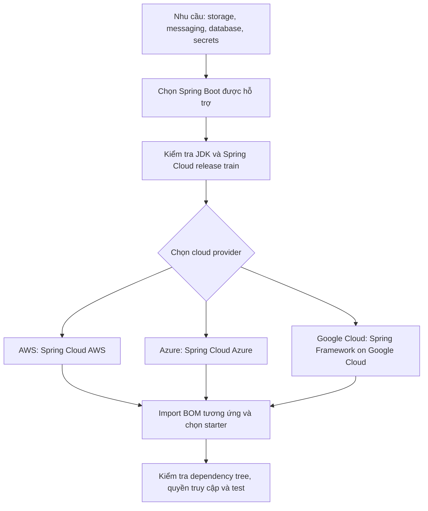

# Chọn tổ hợp Java, Spring Boot, Spring Cloud và thư viện nhà cung cấp

> **Chương:** Khởi tạo dự án  
> **Phạm vi:** Spring Cloud Provider Integration — tích hợp ứng dụng Spring Boot với các dịch vụ managed của AWS, Azure và Google Cloud.

Một ứng dụng Spring Boot có thể chạy tốt ở máy phát triển nhưng lỗi ngay khi thêm thư viện S3, Azure Blob Storage hoặc Google Cloud Pub/Sub. Nguyên nhân đôi khi không nằm ở API cloud mà ở tổ hợp phiên bản không tương thích: Java không đáp ứng yêu cầu của Spring Boot, Spring Cloud release train thuộc thế hệ khác, hoặc BOM của nhà cung cấp quản lý những thư viện nền xung đột với Spring Boot.

Bài học này hướng dẫn **chọn một tổ hợp có thể giải thích, kiểm tra và duy trì được**, trước khi viết nghiệp vụ truy cập storage, messaging, dữ liệu, secret và danh tính cloud.

## 1. Kết quả cần đạt

Sau bài này, bạn có thể:

1. Phân biệt vai trò của JDK, Spring Boot, Spring Cloud release train, thư viện tích hợp cloud, SDK, BOM và starter.
2. Tra đúng ma trận tương thích và chốt một bộ phiên bản cho AWS, Azure hoặc Google Cloud.
3. Khởi tạo dự án Maven với các dependency được quản lý nhất quán; biết khi nào cần Spring Cloud BOM và khi nào chỉ cần BOM của nhà cung cấp.
4. Xác nhận phiên bản thực sự được phân giải, cấu hình danh tính theo cơ chế mặc định của cloud và thiết kế kiểm thử trước khi gọi dịch vụ managed.
5. Nhận biết xung đột phiên bản, artifact cũ và lỗi cấu hình thường gặp.

## 2. Hiểu đúng các tầng phiên bản

| Thành phần | Trách nhiệm | Cách lựa chọn |
|---|---|---|
| **Java/JDK** | Biên dịch và chạy JVM; quyết định cú pháp và API Java có thể dùng. | Đáp ứng yêu cầu của Spring Boot và môi trường triển khai; dùng JDK LTS mà tổ chức hỗ trợ. |
| **Spring Boot** | Nền ứng dụng, auto-configuration, quản lý phần lớn dependency, build plugin và vận hành. | Chọn nhánh được hỗ trợ, sau đó chọn bản vá phù hợp. |
| **Spring Cloud release train** | Tập phiên bản đồng bộ của các dự án Spring Cloud như Config, Gateway, OpenFeign, Stream. | Tra ma trận **Spring Cloud ↔ Spring Boot**; không chọn chỉ vì số năm lớn hơn. |
| **Thư viện tích hợp nhà cung cấp** | Tích hợp Spring với AWS, Azure, Google Cloud; cung cấp starter, cấu hình và client tiện ích. | Tra ma trận **riêng của từng dự án** sau khi đã xác định nhánh Spring Boot. |
| **SDK cloud** | API cấp thấp gọi S3, Service Bus, Cloud Storage, v.v. | Ưu tiên phiên bản do BOM tương ứng quản lý; chỉ override khi có lý do và đã kiểm thử. |
| **BOM (Bill of Materials)** | Khai báo tập phiên bản tương thích trong `dependencyManagement` của Maven. | Import đúng BOM, sau đó khai báo starter **không kèm version**. |
| **Starter** | Gom các dependency và kích hoạt tích hợp cấu hình tự động của một dịch vụ. | Chỉ thêm starter cần thiết; tránh starter tổng hợp khi không dùng hết. |

**Phân biệt hai khái niệm dễ nhầm:** `Spring Cloud` là nhóm dự án thuộc hệ sinh thái Spring; `Spring Cloud AWS`, `Spring Cloud Azure` và `Spring Framework on Google Cloud` (thường được gọi là Spring Cloud GCP) có vòng phát hành và BOM riêng. Chẳng hạn, Spring Cloud `2025.1.x` **không có nghĩa** Spring Cloud AWS cũng mang phiên bản `2025.1.x`.

Một sơ đồ lựa chọn:



## 3. Ma trận tương thích để bắt đầu

**Mốc tham khảo: 24/11/2026.** Bảng sau mô tả **nhánh phiên bản**, không bảo đảm mọi bản vá thuộc nhánh đều tương thích với nhau. Mỗi lần khởi tạo hoặc nâng cấp phải kiểm tra release notes và ma trận chính thức của cả Spring lẫn nhà cung cấp.

| Tầng | Phương án cho dự án mới | Phương án duy trì hệ thống Spring Boot 3 |
|---|---|---|
| JDK | Java **21 LTS** làm ví dụ; Java 17 là mức tối thiểu của Spring Boot 4.0 | Java 17+ theo ma trận Spring Boot 3.5 và các thư viện liên quan |
| Spring Boot | **4.0.x** | **3.5.x** |
| Spring Cloud release train | **2025.1.x (Oakwood)** | **2025.0.x (Northfields)** |
| Spring Cloud AWS | **4.x** | **3.4.x** |
| Spring Cloud Azure | **7.x** | **6.x** |
| Spring Framework on Google Cloud | **8.x** | **7.x** |

**Vì sao chọn 4.0.x làm ví dụ chung?** Các ma trận của AWS, Azure và Google Cloud đều công bố nhánh tương ứng cho Spring Boot 4.0.x. Spring Cloud 2025.1.x hỗ trợ Boot 4.0.x, đồng thời hỗ trợ 4.1.x kể từ bản 2025.1.2. Tuy nhiên, không được mặc định rằng **mọi** thư viện của nhà cung cấp đều đã xác nhận 4.1.x: cần kiểm tra từng bảng tương thích trước khi nâng Boot.

Ở thời điểm này, hệ sinh thái có thể đã phát hành nhánh mới hơn. **Bản mới nhất không tự động là lựa chọn đúng** nếu thư viện cloud hoặc môi trường chạy chưa hỗ trợ. Khi chọn hệ cũ 3.5.x để bảo trì, cần kiểm tra trạng thái hỗ trợ và bản vá bảo mật trước khi sử dụng cho hệ thống mới.

Nguồn ma trận cần tra:

- [Spring Cloud — Boot compatibility](https://spring.io/projects/spring-cloud/) và [Supported Versions](https://github.com/spring-cloud/spring-cloud-release/wiki/Supported-Versions).
- [Spring Cloud AWS — Compatibility](https://github.com/awspring/spring-cloud-aws#compatibility-with-spring-project-versions).
- [Spring Cloud Azure — Spring Versions Mapping](https://github.com/Azure/azure-sdk-for-java/wiki/Spring-Versions-Mapping).
- [Spring Framework on Google Cloud — Getting Started](https://googlecloudplatform.github.io/spring-cloud-gcp/8.2.4/reference/html/getting-started.html).
- [Spring Boot 4.0 — System Requirements](https://docs.spring.io/spring-boot/4.0/system-requirements.html).

### Thứ tự quyết định thực tế

1. **Chốt mục tiêu kỹ thuật:** ví dụ upload hóa đơn lên object storage, nhận sự kiện qua queue, truy vấn database managed và lấy secret. Mỗi chức năng phải chỉ ra dịch vụ thật sự cần dùng.
2. **Chốt điều kiện chạy:** JDK có sẵn trên CI/CD, container base image, nền tảng deploy, thời hạn hỗ trợ và chính sách an toàn. Java 21 là lựa chọn ví dụ; Java 25 có thể phù hợp nếu toàn bộ toolchain đã được xác nhận.
3. **Chọn Spring Boot, rồi tra Spring Cloud:** ghi rõ `4.0.x → 2025.1.x`, chọn bản vá được hỗ trợ và theo dõi release notes.
4. **Tra bảng tích hợp provider:** chẳng hạn `Boot 4.0.x → AWS 4.x`; tra tương tự với Azure hoặc GCP.
5. **Chốt BOM và starter:** pin phiên bản BOM, tránh khai báo version riêng cho mỗi starter; bổ sung native SDK chỉ khi API Spring abstraction không đáp ứng.
6. **Xác thực bằng build và kiểm thử:** Maven effective POM, dependency tree, compile, unit test và integration test với quyền tối thiểu.

Ghi kết quả vào tài liệu kiến trúc của dự án: `JDK / Boot / Spring Cloud / Provider BOM / build tool / phiên bản SDK được phân giải / ngày xác nhận`. Việc này giúp tái hiện lỗi và đánh giá nâng cấp.

## 4. Chọn starter theo dịch vụ cần tích hợp

Với cùng một nghiệp vụ, các cloud có dịch vụ và starter khác nhau:

| Mục đích | AWS | Azure | Google Cloud |
|---|---|---|---|
| Object storage | S3 — `io.awspring.cloud:spring-cloud-aws-starter-s3` | Blob Storage — `com.azure.spring:spring-cloud-azure-starter-storage-blob` | Cloud Storage — `com.google.cloud:spring-cloud-gcp-starter-storage` |
| Queue / messaging | SQS — `io.awspring.cloud:spring-cloud-aws-starter-sqs` | Service Bus — `com.azure.spring:spring-cloud-azure-starter-servicebus` | Pub/Sub — `com.google.cloud:spring-cloud-gcp-starter-pubsub` |
| Secret | Secrets Manager — `io.awspring.cloud:spring-cloud-aws-starter-secrets-manager` | Key Vault — `com.azure.spring:spring-cloud-azure-starter-keyvault-secrets` | Secret Manager — `com.google.cloud:spring-cloud-gcp-starter-secretmanager` |
| Dữ liệu managed | DynamoDB — `io.awspring.cloud:spring-cloud-aws-starter-dynamodb` | Cosmos DB — `com.azure.spring:spring-cloud-azure-starter-cosmos` | Cloud SQL PostgreSQL — `com.google.cloud:spring-cloud-gcp-starter-sql-postgresql` |

Bảng có tính **định hướng dependency**, không hàm ý các dịch vụ tương đương hoàn toàn. SQS là queue, Pub/Sub vận hành theo mô hình topic/subscription, Azure Service Bus hỗ trợ queue/topic; cách xác nhận thông điệp, retry, thứ tự và dead-letter khác nhau. Cơ sở dữ liệu cũng khác biệt lớn về mô hình dữ liệu và truy vấn.

Nếu chỉ cần một API SDK thấp cấp hoặc một dịch vụ chưa có starter phù hợp, có thể sử dụng SDK chính thức trực tiếp. Khi đó cần tự cấu hình client, credential, retry, timeout và quan sát; không bắt buộc thêm một starter chỉ để gọi SDK.

## 5. Thực hành: khởi tạo Spring Boot kết nối Amazon S3

Ví dụ triển khai dịch vụ lưu đối tượng lên S3. Chọn một tổ hợp cụ thể để dễ đọc mã:

| Thành phần | Phiên bản ví dụ |
|---|---|
| Java | 21 |
| Spring Boot | 4.0.10 |
| Spring Cloud BOM | 2025.1.5 |
| Spring Cloud AWS BOM | 4.1.1 |
| Maven | Bản được Spring Boot 4.0 hỗ trợ |

Các số phiên bản trên là **ảnh chụp ví dụ tại thời điểm soạn bài**. Trước khi triển khai, hãy xác nhận lại tương thích và chọn bản vá an toàn mới nhất trong cùng nhánh. Việc ứng dụng có thể build phụ thuộc cả Maven, plugin, Java và các dependency được phân giải.

### Bước 1 — Tạo skeleton

Truy cập [Spring Initializr](https://start.spring.io/), chọn:

- Project: **Maven**, Language: **Java**, Spring Boot: **4.0.x** (chọn bản vá thích hợp).
- Group `com.example`, Artifact `provider-demo`, Packaging `Jar`, Java **21**.
- Dependency Spring Web MVC nếu cần REST API; các starter cloud có thể thêm vào `pom.xml` sau khi tải project.

Kiểm tra môi trường trước khi sửa dependency:

```bash
java -version
./mvnw -version
```

Trên Windows PowerShell dùng `.\mvnw.cmd -version`. Cả máy phát triển và CI phải dùng JDK tương thích; riêng Maven chạy bằng JDK 21 còn `maven.compiler.release` hoặc `java.version` khác có thể khiến kết quả khó dự đoán.

### Bước 2 — Khai báo BOM và starter

Ví dụ `pom.xml` hoàn chỉnh ở mức tối thiểu:

```xml
<?xml version="1.0" encoding="UTF-8"?>
<project xmlns="http://maven.apache.org/POM/4.0.0"
         xmlns:xsi="http://www.w3.org/2001/XMLSchema-instance"
         xsi:schemaLocation="http://maven.apache.org/POM/4.0.0
          https://maven.apache.org/xsd/maven-4.0.0.xsd">
    <modelVersion>4.0.0</modelVersion>

    <parent>
        <groupId>org.springframework.boot</groupId>
        <artifactId>spring-boot-starter-parent</artifactId>
        <version>4.0.10</version>
        <relativePath/>
    </parent>

    <groupId>com.example</groupId>
    <artifactId>provider-demo</artifactId>
    <version>0.0.1-SNAPSHOT</version>

    <properties>
        <java.version>21</java.version>
        <spring-cloud.version>2025.1.5</spring-cloud.version>
        <spring-cloud-aws.version>4.1.1</spring-cloud-aws.version>
    </properties>

    <dependencyManagement>
        <dependencies>
            <dependency>
                <groupId>org.springframework.cloud</groupId>
                <artifactId>spring-cloud-dependencies</artifactId>
                <version>${spring-cloud.version}</version>
                <type>pom</type>
                <scope>import</scope>
            </dependency>
            <dependency>
                <groupId>io.awspring.cloud</groupId>
                <artifactId>spring-cloud-aws-dependencies</artifactId>
                <version>${spring-cloud-aws.version}</version>
                <type>pom</type>
                <scope>import</scope>
            </dependency>
        </dependencies>
    </dependencyManagement>

    <dependencies>
        <dependency>
            <groupId>org.springframework.boot</groupId>
            <artifactId>spring-boot-starter-webmvc</artifactId>
        </dependency>
        <dependency>
            <groupId>io.awspring.cloud</groupId>
            <artifactId>spring-cloud-aws-starter-s3</artifactId>
        </dependency>
        <dependency>
            <groupId>org.springframework.boot</groupId>
            <artifactId>spring-boot-starter-test</artifactId>
            <scope>test</scope>
        </dependency>
    </dependencies>

    <build>
        <plugins>
            <plugin>
                <groupId>org.springframework.boot</groupId>
                <artifactId>spring-boot-maven-plugin</artifactId>
            </plugin>
        </plugins>
    </build>
</project>
```

Lưu ý:

- `spring-boot-starter-parent` quản lý dependency Spring Boot; hai BOM trong `dependencyManagement` quản lý nhóm Spring Cloud và Spring Cloud AWS. `dependencyManagement` **không tự thêm thư viện vào classpath**; chỉ khi khai báo `spring-cloud-aws-starter-s3` trong `dependencies` thì integration S3 mới được nạp.
- `spring-boot-starter-webmvc` là tên starter web MVC được ưu tiên trong Spring Boot 4. Không tự mang thói quen dùng tên starter hoặc package của Boot 2/3 sang Boot 4.
- Nếu ứng dụng **chỉ sử dụng Spring Cloud AWS** mà không có dự án Spring Cloud nào khác, Spring Cloud BOM riêng có thể không cần thiết. Ở đây nó được đưa vào để minh họa cách đồng bộ một hệ thống dự kiến dùng thêm Spring Cloud Config/Stream.
- Không viết `<version>` vào `spring-cloud-aws-starter-s3` khi BOM đã quản lý. Cũng không nhập song song AWS SDK v1 (`com.amazonaws`) trừ khi có yêu cầu chuyển đổi rõ ràng.

### Bước 3 — Cấu hình region và danh tính

`src/main/resources/application.yml`:

```yaml
spring:
  application:
    name: provider-demo
  cloud:
    aws:
      region:
        static: ${AWS_REGION:ap-southeast-1}
```

Ví dụ này dùng biến môi trường `AWS_REGION` để cấu hình region. Không đưa access key và secret key vào file cấu hình hay repository. Spring Cloud AWS dùng cơ chế `DefaultCredentialsProvider` của AWS SDK v2 để tìm credential phù hợp ở máy phát triển hoặc môi trường chạy. Với môi trường production, ưu tiên IAM role gắn với workload (chẳng hạn task role hoặc identity dựa trên web identity) và giới hạn quyền theo bucket, object prefix.

Trước khi chạy thao tác S3, một danh tính phù hợp cần có quyền `s3:PutObject` trên tài nguyên mục tiêu, bucket đã tồn tại và region đã đúng. Đăng nhập AWS CLI qua profile/SSO hoặc môi trường cloud có role hợp lệ; không cần truyền thông tin mật vào mã Java.

### Bước 4 — Gọi S3 qua client được Spring quản lý

Đặt class trong package thuộc vùng quét component của ứng dụng:

```java
package com.example.providerdemo;

import org.springframework.stereotype.Service;
import software.amazon.awssdk.core.sync.RequestBody;
import software.amazon.awssdk.services.s3.S3Client;
import software.amazon.awssdk.services.s3.model.PutObjectRequest;

@Service
public class ObjectUploadService {
    private final S3Client s3Client;

    public ObjectUploadService(S3Client s3Client) {
        this.s3Client = s3Client;
    }

    public void upload(String bucket, String objectKey, byte[] content) {
        PutObjectRequest request = PutObjectRequest.builder()
                .bucket(bucket)
                .key(objectKey)
                .build();

        s3Client.putObject(request, RequestBody.fromBytes(content));
    }
}
```

`S3Client` ở đây do `spring-cloud-aws-starter-s3` cấu hình tự động. Hàm upload **sẽ thực hiện gọi cloud thật** nếu được kích hoạt; chỉ gọi với bucket thử nghiệm đã được cấp quyền và đã thống nhất chi phí. Trong ứng dụng thực tế cần bổ sung giới hạn kích thước, kiểm tra loại dữ liệu, content type, timeout, retry phù hợp và tránh ghi đè object key ngoài ý muốn.

### Bước 5 — Build và xem dependency thực tế

```bash
./mvnw clean verify
./mvnw dependency:tree
./mvnw help:effective-pom
```

Maven wrapper trên Windows dùng `.\mvnw.cmd`. Từ `dependency:tree`, xác nhận:

- Chỉ có một phiên bản được chọn cho `spring-core`, `spring-boot` và các thư viện SDK AWS quan trọng.
- Các module Spring Cloud thuộc nhánh tương thích với Spring Boot 4.0.x.
- Không bị kéo các artifact Spring Cloud AWS 2.x hoặc AWS Java SDK v1 vào classpath ngoài ý muốn.

Nếu phát hiện phiên bản lạ, dùng `dependency:tree -Dverbose` (nếu phiên bản plugin hỗ trợ) để xem đường đi của dependency; phân tích parent/BOM và khai báo trực tiếp trước khi nghĩ tới exclusion. Lưu ý một cây dependency có thể hợp lệ về mặt Maven nhưng chưa chắc đúng về runtime; chạy test mới xác nhận được tích hợp.

## 6. Đổi nhà cung cấp: giữ nguyên nguyên tắc, thay BOM và starter

Ví dụ AWS ở trên chỉ chọn **một provider** để thực hành. Nếu dự án dùng Azure hoặc Google Cloud, giữ nguyên Spring Boot/JDK phù hợp, sau đó thay BOM và starter theo ma trận của provider. Hai đoạn dưới đây là **phần cần thay trong `pom.xml`**, không phải hai `pom.xml` hoàn chỉnh và không phải chỉ dẫn cài cả ba provider vào cùng dự án.

### Azure — Blob Storage

Với Boot 4.0.x, dùng Spring Cloud Azure 7.x theo bảng tương thích; ví dụ BOM `7.5.0`:

```xml
<dependencyManagement>
    <dependencies>
        <dependency>
            <groupId>com.azure.spring</groupId>
            <artifactId>spring-cloud-azure-dependencies</artifactId>
            <version>7.5.0</version>
            <type>pom</type>
            <scope>import</scope>
        </dependency>
    </dependencies>
</dependencyManagement>

<dependencies>
    <dependency>
        <groupId>com.azure.spring</groupId>
        <artifactId>spring-cloud-azure-starter-storage-blob</artifactId>
    </dependency>
</dependencies>
```

Nếu còn sử dụng các module của Spring Cloud, giữ thêm BOM `spring-cloud-dependencies` tương thích. Cấu hình endpoint hoặc storage account theo tài liệu chính thức; ưu tiên Microsoft Entra ID và `DefaultAzureCredential`/managed identity thay vì đặt account key trong code. Danh tính sử dụng ứng dụng cần được cấp role dữ liệu phù hợp, chẳng hạn **Storage Blob Data Contributor** trong phạm vi cần thiết; quyền quản trị Azure resource thông thường không mặc nhiên cấp quyền dữ liệu.

### Google Cloud — Cloud Storage

Với Boot 4.0.x, dùng Spring Framework on Google Cloud 8.x; ví dụ BOM `8.2.4`:

```xml
<dependencyManagement>
    <dependencies>
        <dependency>
            <groupId>com.google.cloud</groupId>
            <artifactId>spring-cloud-gcp-dependencies</artifactId>
            <version>8.2.4</version>
            <type>pom</type>
            <scope>import</scope>
        </dependency>
    </dependencies>
</dependencyManagement>

<dependencies>
    <dependency>
        <groupId>com.google.cloud</groupId>
        <artifactId>spring-cloud-gcp-starter-storage</artifactId>
    </dependency>
</dependencies>
```

Vẫn giữ BOM `spring-cloud-dependencies` nếu dự án có module Spring Cloud tương ứng. Ứng dụng cần biết project ID và dùng **Application Default Credentials (ADC)**. Ở máy phát triển có thể chạy `gcloud auth application-default login`; ở production ưu tiên service account gắn với workload hoặc workload identity. Lệnh `gcloud auth login` và ADC không phải cùng một thứ. Cấp IAM role liên quan tới Cloud Storage với phạm vi bucket phù hợp, tránh phát tán file JSON chứa private key.

### Nếu phải tích hợp đồng thời nhiều cloud?

Một dịch vụ có thể dùng S3 làm kho chính và Pub/Sub cho hệ thống downstream, nhưng việc import nhiều provider BOM làm tăng khả năng xung đột thư viện chung như gRPC, Netty, Jackson và HTTP client. Trước hết cân nhắc **tách adapter hoặc service** theo ranh giới nghiệp vụ. Nếu bắt buộc đặt chung trong một tiến trình, cần pin từng BOM tương thích, đọc effective POM và test cả đường gọi AWS/Azure/GCP. Không áp dụng một BOM như công cụ tự động bảo đảm mọi provider tương thích với nhau.

## 7. Danh tính, secret và cấu hình theo môi trường

Chọn phiên bản thư viện chỉ giải quyết bài toán **class/interface/API**. Một tích hợp cloud dùng được còn cần xác thực và phân quyền:

| Nơi chạy | AWS | Azure | Google Cloud |
|---|---|---|---|
| Laptop | AWS CLI profile/SSO, default credential chain | Azure CLI/IDE credential qua DefaultAzureCredential | `gcloud auth application-default login`, ADC |
| Workload trên cloud | IAM role / workload identity phù hợp | Managed identity / workload identity | Service account / workload identity và ADC |
| Quyền tối thiểu | Policy theo action và resource ARN | RBAC ở scope resource/container | IAM role ở project/bucket/service |
| Secret của ứng dụng | Secrets Manager / Parameter Store | Key Vault | Secret Manager |

Nguyên tắc:

1. **Phân biệt identity và secret**: identity cho phép ứng dụng đăng nhập; secret là dữ liệu bí mật ứng dụng cần sử dụng. Không thay thế identity bằng cách hard-code access token.
2. **Phân biệt authentication và authorization**: đăng nhập thành công chưa chắc có quyền `PutObject` hoặc publish message.
3. **Giữ thông tin nhạy cảm bên ngoài artifact**: không commit token, password, service account key; dùng workload identity hoặc secret manager. Không log toàn bộ environment và object cấu hình credential.
4. **Tách cấu hình theo môi trường**: endpoint, tên bucket, queue, project ID, subscription, timeout có thể đến từ biến môi trường/secret store; không cần biên dịch lại jar.
5. **Giới hạn retry**: với thao tác không idempotent, retry mù có thể tạo tác dụng phụ. Xác định idempotency key, backoff và dead-letter policy theo từng dịch vụ.

## 8. Kiểm thử đúng tầng

Không phải test nào cũng cần kết nối AWS/Azure/GCP. Chia các lớp kiểm thử:

| Lớp | Cần xác minh | Cách làm |
|---|---|---|
| **Build/compatibility** | POM phân giải, biên dịch, Spring context phù hợp | Maven `verify`, dependency tree, context test |
| **Unit test adapter** | Mapping request, bucket/key, xác nhận lỗi nghiệp vụ | Mock SDK client; không yêu cầu internet hay credential |
| **Integration test cục bộ** | Request/response, serialization, listener, retry | LocalStack cho AWS khi tính năng được hỗ trợ; Azurite cho Blob; Google Cloud emulator cho dịch vụ có emulator |
| **Smoke test cloud thực** | IAM, region, endpoint, quota, network, cấu hình secret | Môi trường test được cấp quyền, tài nguyên tách biệt, có cơ chế dọn dẹp |

Ví dụ unit test cho `ObjectUploadService`:

```java
package com.example.providerdemo;

import static org.junit.jupiter.api.Assertions.assertEquals;
import static org.mockito.ArgumentMatchers.any;
import static org.mockito.Mockito.verify;

import java.nio.charset.StandardCharsets;
import org.junit.jupiter.api.Test;
import org.junit.jupiter.api.extension.ExtendWith;
import org.mockito.ArgumentCaptor;
import org.mockito.InjectMocks;
import org.mockito.Mock;
import org.mockito.junit.jupiter.MockitoExtension;
import software.amazon.awssdk.core.sync.RequestBody;
import software.amazon.awssdk.services.s3.S3Client;
import software.amazon.awssdk.services.s3.model.PutObjectRequest;

@ExtendWith(MockitoExtension.class)
class ObjectUploadServiceTest {
    @Mock
    S3Client s3Client;

    @InjectMocks
    ObjectUploadService uploadService;

    @Test
    void uploadsToExpectedBucketAndKey() {
        byte[] payload = "hello".getBytes(StandardCharsets.UTF_8);
        uploadService.upload("test-documents", "invoices/001.txt", payload);

        ArgumentCaptor<PutObjectRequest> request =
                ArgumentCaptor.forClass(PutObjectRequest.class);
        verify(s3Client).putObject(request.capture(), any(RequestBody.class));

        assertEquals("test-documents", request.getValue().bucket());
        assertEquals("invoices/001.txt", request.getValue().key());
    }
}
```

Test này chứng minh application adapter gửi đúng đích và object key; nó **chưa chứng minh** IAM, kết nối mạng hay khả năng ghi dữ liệu lên bucket thật. Integration test cần kiểm tra riêng các điểm đó. Emulator cũng không mô phỏng chính xác mọi dịch vụ managed hoặc policy bảo mật; smoke test môi trường test là bước xác nhận cuối trước khi triển khai production.

## 9. Lỗi thường gặp và cách xử lý

| Triệu chứng | Nguyên nhân có thể | Hướng xử lý |
|---|---|---|
| `UnsupportedClassVersionError` | JDK chạy thấp hơn bytecode được biên dịch. | So sánh `java -version`, JDK trong CI/container và `java.version`. |
| `NoSuchMethodError` / `NoClassDefFoundError` | Thư viện Spring, Jackson, Netty hoặc SDK bị ép sang phiên bản không phù hợp. | Kiểm tra dependency tree, effective POM và thứ tự BOM; gỡ override tùy tiện. |
| `Could not resolve ... starter` | Sai groupId/artifactId hoặc dùng artifact của thế hệ cũ. | Tra tên starter và version BOM ở tài liệu chính thức của **đúng nhánh**. |
| `Bean ... not found` | Thiếu starter, điều kiện auto-config không thỏa, cấu hình sai hoặc không nằm trong component scan. | Kiểm tra dependency, auto-configuration report và vị trí package; không tự tạo client trước khi xác định nguyên nhân. |
| `Unable to load credentials` / `401 Unauthorized` | Chưa có danh tính hợp lệ hoặc credential đã hết hạn. | Kiểm tra provider chain, đăng nhập local đúng cách, workload identity và token scope. |
| `AccessDenied` / `403 Forbidden` | Có danh tính nhưng thiếu quyền trên resource hoặc policy khác từ chối. | Kiểm tra IAM/RBAC, scope, resource policy, bucket policy, firewall. |
| `Region ... not found` / sai endpoint | Thiếu region/project/account hoặc resource ở vùng khác. | Chỉ định region, endpoint và project ID đúng, kiểm tra tên tài nguyên. |
| Build qua nhưng startup lỗi sau khi nâng Boot | Provider starter chưa hỗ trợ Boot mới; thay đổi auto-config/namespace. | Quay về tổ hợp được xác nhận, đọc migration guide, nâng theo nhánh đồng bộ. |

**Các tổ hợp cần tránh:** Spring Boot 4 với Spring Cloud 2025.0.x; Spring Boot 3.5 với Spring Cloud AWS 4.x; Spring Boot 4 với Spring Cloud GCP 7.x hoặc Azure 6.x. Chúng nằm ngoài các cặp phiên bản được công bố trong ma trận nêu trên. Cũng tránh copy hướng dẫn dùng `javax.*`, AWS SDK v1, auto-config hoặc starter đời cũ vào dự án Spring Boot 4 mà không kiểm tra migration guide.

## 10. Checklist trước khi bắt đầu triển khai tính năng cloud

- [ ] Đã ghi rõ JDK, Spring Boot, Spring Cloud release train, BOM provider và phiên bản build tool.
- [ ] Đã tra tài liệu chính thức của **từng** dự án, gồm trạng thái hỗ trợ và các bản vá.
- [ ] Đã chọn starter cho đúng dịch vụ managed, loại bỏ dependency không dùng.
- [ ] Đã chạy build và kiểm tra dependency tree; không có override không giải thích được.
- [ ] Đã xác định danh tính local và production, quyền tối thiểu, region/project/endpoint.
- [ ] Đã thiết kế kiểm thử unit, integration/emulator và smoke test trên môi trường test.
- [ ] Đã tách secret ra khỏi mã nguồn, xem xét retry, timeout, idempotency và khả năng quan sát.

## 11. Bài tập tự thực hành

**Bối cảnh:** Một hệ thống nhận tài liệu từ người dùng, lưu file trên object storage và phát sự kiện để dịch vụ khác xử lý. Chọn **một** trong ba nhà cung cấp AWS, Azure hoặc Google Cloud.

1. Lập bảng phiên bản JDK, Spring Boot, Spring Cloud và BOM provider; dẫn link các trang chứng minh tính tương thích.
2. Tạo `pom.xml` với starter storage và messaging tối thiểu. Mở `dependency:tree`, ghi lại phiên bản SDK được giải quyết.
3. Viết một service có phương thức `store(document)` và một adapter phát sự kiện sau khi lưu thành công. Thiết kế lại nếu cần bảo đảm nhất quán giữa thao tác lưu file và publish message.
4. Viết unit test cho bucket/container và key/path; bổ sung một integration test với emulator hoặc môi trường test được cấp quyền.
5. Mô tả identity, quyền cần thiết, cách quản lý secret và lý do không nhúng credential vào application.yml.

**Tiêu chí đạt:** Có bảng tương thích có nguồn, project build được, request đúng tài nguyên, không chứa thông tin mật và giải thích được khi nào cần dùng SDK trực tiếp thay vì Spring starter.

## Tài liệu tham khảo

- [Spring Cloud release trains và ma trận Spring Boot](https://spring.io/projects/spring-cloud/).
- [Spring Cloud AWS — Tài liệu bản 4.1.1](https://docs.awspring.io/spring-cloud-aws/docs/4.1.1/reference/html/index.html).
- [Spring Cloud Azure — Developer Guide](https://learn.microsoft.com/azure/developer/java/spring-framework/developer-guide-overview).
- [Azure SDK for Java — Spring Versions Mapping](https://github.com/Azure/azure-sdk-for-java/wiki/Spring-Versions-Mapping).
- [Spring Framework on Google Cloud — Getting Started 8.2.4](https://googlecloudplatform.github.io/spring-cloud-gcp/8.2.4/reference/html/getting-started.html).
- [Spring Boot 4.0 — Build Systems](https://docs.spring.io/spring-boot/4.0/reference/using/build-systems.html).

> **Ghi nhớ:** Luôn chọn phiên bản theo **ma trận tương thích và vòng đời hỗ trợ**, quản lý dependency bằng BOM, sau đó kiểm tra bằng build và test thực tế. Cấu hình danh tính, quyền và secret là phần bắt buộc của bài toán tích hợp provider, kể cả khi dự án đã khởi động thành công.
