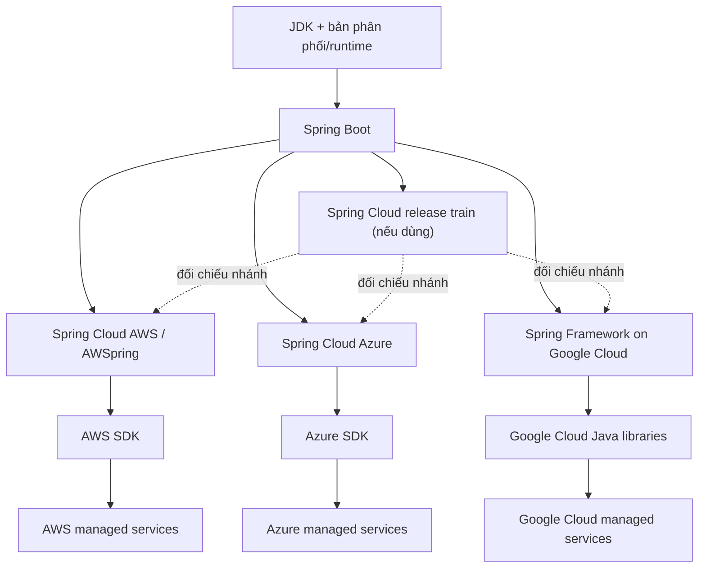
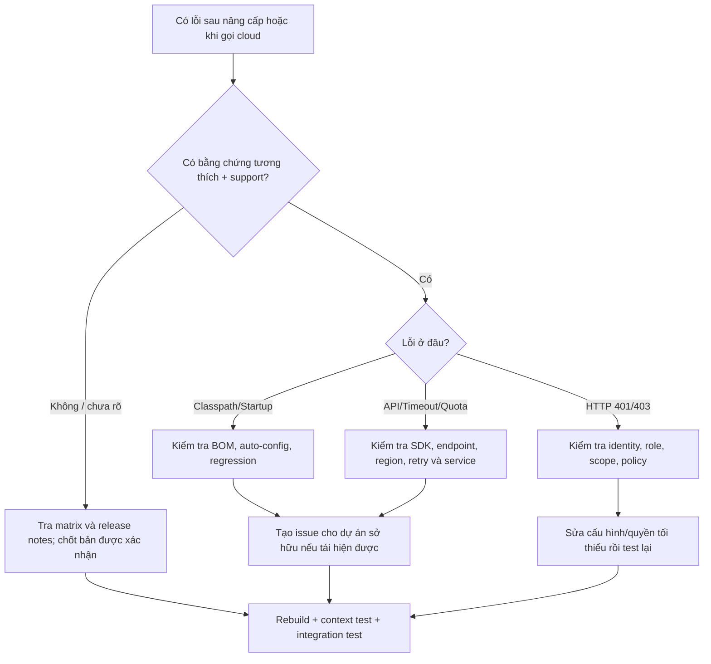

# Đọc ma trận tương thích và xác định đơn vị bảo trì từng dự án

> **Chương:** Khởi tạo dự án  
> **Học phần:** Spring Cloud Provider Integration — tích hợp Spring Boot với các dịch vụ managed của AWS, Azure và Google Cloud.

Một ứng dụng dùng Spring Boot, Spring Cloud Config và Amazon S3 có thể biên dịch bình thường sau khi nâng Spring Boot, nhưng đến lúc khởi động mới phát sinh lỗi từ cơ chế auto-configuration. Một ứng dụng khác dùng Azure Blob Storage vẫn chạy được song phiên bản Spring Cloud Azure đã hết thời gian bảo trì. Cả hai trường hợp cho thấy **chạy được**, **được tuyên bố tương thích** và **còn được bảo trì** là ba điều khác nhau.

Để chọn nền tảng cho ứng dụng production, kỹ sư phải đọc nhiều ma trận do **những dự án độc lập** công bố, xác định đúng **ai duy trì phần nào**, kiểm tra thời hạn hỗ trợ của từng nhánh và lưu lại bằng chứng cho quyết định nâng cấp.

## 1. Mục tiêu học tập

Sau bài học, bạn có thể:

1. Đọc được chiều hàng, cột, chú thích, ngoại lệ và điều kiện phiên bản trong một ma trận tương thích.
2. Xác định ranh giới bảo trì giữa Spring Boot, Spring Cloud release train, Spring Cloud AWS, Spring Cloud Azure, Spring Framework on Google Cloud, cloud SDK và dịch vụ managed.
3. Phân biệt tính tương thích kỹ thuật với vòng đời hỗ trợ OSS, hỗ trợ thương mại và phạm vi hỗ trợ tính năng.
4. Chọn giao điểm phiên bản hợp lệ khi ứng dụng tích hợp một hoặc nhiều provider.
5. Lập hồ sơ phiên bản có nguồn dẫn và thực hiện kiểm chứng bằng dependency resolution, test và kế hoạch nâng cấp.

## 2. Ma trận tương thích đang trả lời câu hỏi gì?

Ma trận tương thích là tuyên bố của **dự án sở hữu thư viện** về các tổ hợp phiên bản đã được thiết kế hoặc kiểm thử để hoạt động cùng nhau. Ví dụ, bảng của Spring Cloud liên kết **Spring Cloud release train** với **Spring Boot generation**. Bảng của Spring Cloud AWS liên kết thêm **phiên bản Spring Cloud AWS**, **Spring Framework** và **AWS SDK**. Bảng của Spring Cloud Azure còn công bố trạng thái hỗ trợ, dải JDK. Dự án Google Cloud có bảng riêng cho **Spring Framework on Google Cloud**.

Các cách ghi phổ biến:

| Cách ghi | Cần hiểu như thế nào | Ví dụ |
|---|---|---|
| `4.0.x` | Nhánh Spring Boot 4.0, gồm các bản vá 4.0.0, 4.0.1... | Một ô `4.0.x` không phải lời hứa rằng mọi bản vá đều hoạt động trong mọi thời điểm. |
| `2025.1.x` | Nhánh release train Spring Cloud 2025.1, thường mang tên Oakwood | Không được nhầm với Spring Boot 2025.1 hay Spring Cloud AWS 2025.1. |
| `7.x` | Cả một nhánh major của thư viện provider | Cần chọn một bản GA cụ thể, kiểm tra release notes và trạng thái bảo trì. |
| `4.1.x (từ 2025.1.2)` | Khả năng hỗ trợ có điều kiện theo **bản vá tối thiểu** | Spring Cloud 2025.1.0 không mặc nhiên hỗ trợ Boot 4.1 chỉ vì cùng nhánh release train. |
| `Yes / In Support` | Dự án ghi nhận đang hỗ trợ theo bảng của **chính dự án đó** | Không có nghĩa các dependency khác cũng đang được hỗ trợ. |
| `EOL / Unsupported` | Nhánh không còn thuộc phạm vi bảo trì được công bố | Artifact có thể vẫn tải và chạy, nhưng không thể suy ra sẽ có bản vá. |
| `Beta / M / RC` | Bản preview/milestone/release candidate | Không dùng làm phiên bản production mặc định nếu chưa có quyết định chấp nhận rủi ro. |

**Ví dụ đọc một dòng:** Bảng Spring Cloud ghi `2025.1.x → Spring Boot 4.0.x, 4.1.x (bắt đầu từ 2025.1.2)`. Ta chỉ được kết luận rằng nhánh 2025.1.x có thể kết hợp với Boot 4.1.x **khi chọn ít nhất bản 2025.1.2** và đáp ứng các điều kiện khác; chưa được suy ra Spring Cloud AWS, Azure hay Google Cloud đều đã hỗ trợ Boot 4.1.x.

Tại thời điểm biên soạn **24/11/2026**, Spring Cloud 2025.1.5 đã được phát hành ngày 20/11/2026 và công bố hỗ trợ Boot 4.0.x/4.1.x. Bản công bố một release và bảng compatibility đều có ích; khi khác nhau, cần đọc release notes cụ thể để tìm các ngoại lệ theo bản vá.

Nguồn: [Spring Cloud Project](https://spring.io/projects/spring-cloud/), [Spring Cloud 2025.1.5 release announcement](https://spring.io/blog/2026/11/20/spring-cloud-2025-1-5-has-been-released/).

## 3. Sơ đồ phụ thuộc: tương thích không lan truyền tự động

Một dự án đa cloud có ít nhất các lớp sau:



Các cạnh có **hai nghĩa khác nhau**:

- Cạnh phụ thuộc (`A → B`) nói rằng dự án A sử dụng API/thư viện hoặc dịch vụ ở B.
- Đường đối chiếu nói rằng **phải tra cả hai ma trận**; nó **không** nói Spring Cloud release train sở hữu hoặc phát hành Spring Cloud AWS/Azure/GCP.

Giả sử hai thư viện đều công bố hỗ trợ Boot 4.0.x. Điều đó vẫn không chứng minh chúng tương thích **với nhau trong cùng một classpath**. Chúng có thể kéo các phiên bản gRPC, Netty, Jackson, HTTP client hoặc protobuf khác nhau. Tương thích là một tập điều kiện, không phải phép suy luận bắc cầu.

## 4. “Đơn vị bảo trì” có hai lớp nghĩa

Trong tài liệu phát triển phần mềm, cần xác định đồng thời:

1. **Đơn vị phát hành/bảo trì:** nhánh phiên bản nào nhận bản vá lỗi và bảo mật, có BOM nào quản lý artifact của nó.
2. **Đơn vị chịu trách nhiệm:** dự án, nhóm maintainer hoặc nhà cung cấp nào công bố ma trận, tài liệu, release notes và tiếp nhận sự cố.

Một release train có thể gom nhiều dự án; bản thân release train **không nhất thiết có vòng đời hỗ trợ độc lập**. Theo chính sách Spring Cloud, release train là tập các dự án thành phần; lịch hỗ trợ cần đánh giá theo dự án bên trong và nhánh Spring Boot liên quan. Không nên gộp tất cả thành một nhãn “Spring Cloud được hỗ trợ”.

### Bảng phân định quyền sở hữu

| Thành phần | Ai quản lý phát hành/tài liệu? | Đơn vị cần theo dõi | Phạm vi, giới hạn |
|---|---|---|---|
| **Java/JDK** | OpenJDK và **nhà phân phối JDK** mà đội ngũ chọn | Bản Java, bản vá CPU và gói JDK thực tế trong container/host | “Java 21 LTS” chưa nói rõ bên nào cung cấp update và thời hạn hỗ trợ. |
| **Spring Framework** | Dự án Spring Framework | Nhánh major/minor và bản vá | API lõi, DI, Web, transaction; không quản lý trực tiếp các dịch vụ cloud. |
| **Spring Boot** | Dự án Spring Boot | Nhánh `4.0.x`, `4.1.x`... và bản vá cụ thể | BOM Spring Boot, starter, auto-configuration, build/plugin, yêu cầu hệ thống. |
| **Spring Cloud Config, Gateway, Commons...** | Các dự án trong hệ sinh thái Spring Cloud | Dự án thành phần và **release train** phối hợp phiên bản | Release train quản lý tập dependency; thời hạn hỗ trợ dựa trên chính sách từng dự án liên quan. |
| **Spring Cloud AWS** | Dự án **AWSpring** tại `awspring/spring-cloud-aws` | Nhánh Spring Cloud AWS, BOM `io.awspring.cloud:spring-cloud-aws-dependencies`, starter và service coverage | Có ma trận Boot/Cloud/Framework riêng; **không được đồng nhất** với release train Spring Cloud. |
| **Spring Cloud Azure** | Nhóm duy trì dự án trong **Azure SDK for Java** | Nhánh Spring Cloud Azure, BOM `com.azure.spring:spring-cloud-azure-dependencies`, mapping Boot/Cloud/JDK | Cần kiểm tra chính sách/lịch hỗ trợ của **Spring Cloud Azure** bên cạnh Azure SDK Java. |
| **Spring Framework on Google Cloud** | Dự án tại `GoogleCloudPlatform/spring-cloud-gcp` | Nhánh thư viện Google Cloud, BOM `com.google.cloud:spring-cloud-gcp-dependencies` | Tên thường gặp trong tài liệu cũ: *Spring Cloud GCP*; phải kiểm tra tài liệu cho **đúng major**. |
| **AWS/Azure/Google Cloud Java SDK** | Dự án SDK của từng nhà cung cấp | Phiên bản SDK/BOM, thông báo lỗ hổng và migration guide | SDK có vòng đời riêng; version được chọn có thể là dependency gián tiếp của starter. |
| **S3, Service Bus, Pub/Sub, Cloud SQL...** | Đội dịch vụ managed tương ứng | API, quota, region, tính năng, thay đổi/retirement của dịch vụ | SLA và chính sách ngừng API **không phải** thời hạn bảo trì Spring starter. |
| **Ứng dụng của đội sản phẩm** | Đội phát triển/vận hành ứng dụng | File quản lý dependency, CI image, IAM, tài khoản, test và kế hoạch nâng cấp | Trách nhiệm nội bộ vẫn tồn tại dù các thư viện đều được hỗ trợ. |

Các nguồn gốc cần tra:

- Spring: [Version mappings / generations](https://spring.io/projects/generations), [Spring support policy](https://spring.io/support-policy/), [Spring Cloud Supported Versions](https://github.com/spring-cloud/spring-cloud-release/wiki/Supported-Versions).
- AWS: [AWSpring repository và compatibility table](https://github.com/awspring/spring-cloud-aws).
- Azure: [Spring Versions Mapping](https://github.com/Azure/azure-sdk-for-java/wiki/Spring-Versions-Mapping), [Azure SDK support policy](https://github.com/Azure/azure-sdk/blob/main/docs/policies/support.md).
- Google Cloud: [Spring Framework on Google Cloud compatibility](https://googlecloudplatform.github.io/spring-cloud-gcp/8.2.4/reference/html/getting-started.html), [repository](https://github.com/GoogleCloudPlatform/spring-cloud-gcp).

**Hệ quả khi có lỗi:** lỗi API của Spring Cloud Config cần điều tra trong dự án Config và tương tác với Boot; lỗi binding/auto-configuration của starter S3 có thể thuộc AWSpring; lỗi request SDK thuộc AWS Java SDK; lỗi `AccessDenied` thường do policy và identity trên cloud. Không nên mặc định gửi mọi vấn đề cho đội Spring Cloud release train.

## 5. Phân biệt tương thích, còn được hỗ trợ và có đủ tính năng

| Câu hỏi | Bằng chứng phù hợp | Điều không thể kết luận chỉ từ bằng chứng đó |
|---|---|---|
| **Có tương thích?** | Ma trận các version, release notes, migration guide; test với tổ hợp thực tế | Không kết luận còn nhận bản vá bảo mật. |
| **Có còn được bảo trì?** | Support policy, ngày kết thúc OSS/enterprise, trạng thái nhánh trong tài liệu maintainer | Không kết luận ứng dụng dùng đúng API hoặc IAM. |
| **Starter có hỗ trợ dịch vụ cần dùng?** | Bảng service coverage, danh sách artifact, reference guide của nhánh đã chọn | Không kết luận tất cả tính năng của cloud service đều có abstraction. |
| **Có chạy với nền triển khai?** | Yêu cầu JDK, runtime, kiến trúc CPU, hệ điều hành, container image và kiểm thử | Không kết luận đã cấp đúng quyền cloud. |
| **Có phù hợp vận hành?** | Test lỗi mạng, retry, timeout, quyền tối thiểu, quota, log/metric, kế hoạch nâng cấp | Không thể suy ra từ một lệnh `mvn test` thành công. |

### OSS support khác enterprise support

“Supported” phải được đọc trong **bối cảnh chính sách**:

- **OSS/community support** nói về khoảng thời gian dự án tiếp nhận và phát hành bản vá công khai theo chính sách hiện hành.
- **Enterprise/commercial support** có thể có hợp đồng và lịch kéo dài riêng. Không suy từ câu “có hỗ trợ thương mại” rằng ứng dụng tự động được hưởng quyền đó.
- **Extended maintenance/community branch** không chắc tương đương mức cam kết sửa lỗi của nhánh chính. Xác nhận cụ thể với maintainer và điều khoản áp dụng.
- **Thư viện còn được hỗ trợ** không kéo dài vòng đời của JDK, OS/container, SDK phụ thuộc hoặc dịch vụ managed.

Trong Spring Cloud, trang Supported Versions giải thích release train tập hợp các dự án và liên kết trạng thái hỗ trợ với vòng đời Spring Boot. Trang có phần dữ liệu lịch sử được đánh dấu deprecated; khi kiểm tra EOL, ưu tiên [Spring Support Policy](https://spring.io/support-policy/) và [Spring Cloud project support](https://spring.io/projects/spring-cloud/#support) đang hiện hành. Đừng sao chép một ngày EOL từ blog cũ vào quyết định dài hạn mà không kiểm tra lại.

### Có support không đồng nghĩa có chức năng

Ví dụ bảng Supported AWS integrations của AWSpring cho thấy một số tích hợp như RDS/EC2/ElastiCache/CloudFormation từng có trong nhánh 2.x nhưng **không được cung cấp theo cách cũ** ở 3.x/4.x. Vì thế, dù Spring Cloud AWS 4.x tương thích Boot 4, người triển khai tính năng liên quan vẫn phải kiểm tra danh sách integration hỗ trợ hoặc dùng AWS SDK trực tiếp.

Tương tự, “Cloud Storage có starter” không chứng minh starter thay thế toàn bộ API Google Cloud Storage; Azure Service Bus starter không có nghĩa tất cả tùy chọn quản trị namespace đều được bọc thành bean Spring. Cần tra API và reference guide của **phiên bản cụ thể**.

## 6. Ví dụ đọc nhiều bảng để chọn một tổ hợp

**Ảnh chụp tài liệu tại ngày 24/11/2026:** Các nhánh sau được nêu trong ma trận của các dự án. Bảng chỉ minh họa **giao điểm tương thích**, không thay thế kiểm tra tình trạng support và bản vá tại ngày triển khai.

| Ứng dụng chọn Boot | Spring Cloud release train | Spring Cloud AWS | Spring Cloud Azure | Spring Framework on Google Cloud |
|---|---|---|---|---|
| **4.0.x** | **2025.1.x (Oakwood)** | **4.x** | **7.x** | **8.x** |
| **3.5.x** | **2025.0.x (Northfields)** | **3.4.x** | **6.x** (ma trận Azure còn ghi một số bản 5.x tương thích) | **7.x** |

Tài liệu tham chiếu: [Spring Cloud](https://spring.io/projects/spring-cloud/), [AWSpring](https://github.com/awspring/spring-cloud-aws#compatibility-with-spring-project-versions), [Azure versions mapping](https://github.com/Azure/azure-sdk-for-java/wiki/Spring-Versions-Mapping), [Google Cloud 8.x getting started](https://googlecloudplatform.github.io/spring-cloud-gcp/8.2.4/reference/html/getting-started.html).

**Lưu ý quan trọng:** Spring Cloud 2025.1.x hỗ trợ Spring Boot 4.1.x kể từ **2025.1.2**. Google Cloud 8.x cũng công bố Boot 4.1.x, nhưng bảng AWSpring 4.x và Spring Cloud Azure 7.x được dẫn ở trên ghi Boot **4.0.x**. Do đó, với một ứng dụng sử dụng **đồng thời** ba provider, không thể coi Boot 4.1.x là lựa chọn đã được xác nhận chỉ nhờ bảng Spring Cloud và Google Cloud. Cần kiểm tra release notes/bảng cập nhật **của AWSpring và Azure**, và xác nhận thực nghiệm trước khi duyệt nâng cấp.

### Bài toán tình huống A: S3 và Spring Cloud Config

Yêu cầu: Spring Boot 4.0, Java 21, dùng Config Server và Amazon S3.

Đọc tuần tự:

1. [Spring Boot system requirements](https://docs.spring.io/spring-boot/4.0/system-requirements.html) để xác nhận JDK/Maven/Gradle phù hợp; kiểm tra bản JDK chạy thật trong build và container.
2. [Spring Cloud compatibility](https://spring.io/projects/spring-cloud/) để lấy train `2025.1.x` cho Boot `4.0.x`.
3. [AWSpring compatibility](https://github.com/awspring/spring-cloud-aws#compatibility-with-spring-project-versions) để lấy `4.x` cho Boot `4.0.x`.
4. Đọc release notes của từng nhánh, chọn **bản GA cụ thể**, dùng Spring Cloud BOM và Spring Cloud AWS BOM.
5. Build, đọc dependency tree, chạy test Config Server và S3 adapter (unit + integration).

Đầu ra: Một **bộ phiên bản được chốt** (ví dụ dạng `Boot 4.0.p / Cloud 2025.1.q / AWSpring 4.r.s`), link bằng chứng và kết quả test. Ký hiệu `p/q/r/s` ở đây là biến biểu diễn bản vá **cần chọn từ phát hành có thật**, không phải số phiên bản Maven hợp lệ.

### Bài toán tình huống B: Chỉ tích hợp Azure Blob Storage

Nếu ứng dụng chỉ dùng `spring-cloud-azure-starter-storage-blob` và **không dùng** Config/Gateway/Stream hoặc module khác trong Spring Cloud release train, cần:

1. Kiểm tra Boot ↔ Spring Cloud Azure ở bảng của Microsoft.
2. Import `com.azure.spring:spring-cloud-azure-dependencies` và starter cần dùng.
3. Xác định liệu có dependency nào đòi `org.springframework.cloud:spring-cloud-dependencies` hay không; **không import release train BOM chỉ vì tên thư viện có “Spring Cloud”**.
4. Kiểm tra bộ Azure SDK được BOM provider quản lý, chọn workload identity/managed identity, chạy test với Blob Storage.

Tách biệt này làm rõ **đơn vị bảo trì**: Spring Boot quản lý Boot; Spring Cloud Azure quản lý starter Azure; Azure SDK và Azure Blob Storage có chính sách, kênh phát hành khác.

### Bài toán tình huống C: Nâng hệ thống lên Boot 4.1

Giả sử ứng dụng hiện dùng Boot 4.0, Cloud 2025.1, AWSpring 4.x và Google Cloud 8.x. Đội phát triển muốn nâng Boot 4.1 để nhận bản vá.

1. Kiểm tra Spring Cloud **từ 2025.1.2 trở lên** và điều kiện tương thích cho bản Boot 4.1 được chọn.
2. Kiểm tra Google Cloud 8.x có Boot 4.1.x trong bảng.
3. **Dừng kết luận ở bước AWSpring:** bảng nhánh AWSpring đang liệt kê Boot 4.0.x; chưa có đủ bằng chứng để duyệt Boot 4.1 cho toàn bộ ứng dụng chỉ từ các dòng đã đọc.
4. Tra lại release notes AWSpring ở thời điểm triển khai, hỏi maintainer khi tài liệu mâu thuẫn, hoặc giữ Boot 4.0.x được xác nhận cho tới khi có bằng chứng và test phù hợp.

Đây là một ví dụ điển hình cho nguyên tắc: **nâng được một thành phần không có nghĩa nâng được cả tổ hợp**.

## 7. Quy trình đọc ma trận có thể lặp lại

### Bước 1 — Chụp “tọa độ” hiện tại của dự án

Ghi lại:

| Trường | Ví dụ cần ghi |
|---|---|
| Runtime | Java 21, nhà phân phối JDK, bản vá, OS/container image |
| Build | Maven/Gradle và bản wrapper thực tế |
| Framework | Spring Boot bản **đầy đủ**, Spring Framework, Spring Cloud train nếu có |
| Provider | Spring Cloud AWS/Azure/GCP và starter đang dùng |
| SDK | Bản AWS SDK/Azure SDK/Google libraries đã resolve |
| Workload | S3 upload, Blob download, Pub/Sub publish, Key Vault read secret, v.v. |
| Support | Support policy, ngày đánh giá, nhánh hiện tại, rủi ro EOL |

Ví dụ một ứng dụng dùng `spring-cloud-aws-starter-s3` cần kiểm tra xem BOM Spring Cloud AWS đang quản lý phiên bản `software.amazon.awssdk:s3` nào. Không đoán từ version starter.

### Bước 2 — Đọc nguồn chính thức theo thứ tự

1. **Spring Boot:** yêu cầu JDK, công cụ build, trạng thái vòng đời Boot và migration guide.
2. **Spring Cloud (nếu dùng):** mapping Boot ↔ release train và chính sách của từng Spring project.
3. **Provider starter:** bảng tương thích **của đúng dự án và đúng major**, release notes và danh sách tích hợp được hỗ trợ.
4. **SDK và dịch vụ managed:** release policy, endpoint, API/feature compatibility, policy ngừng hỗ trợ nếu có.
5. **Phân phối Java và hạ tầng:** môi trường deploy có chạy được bytecode, TLS, native transports, container và JDK đã chọn hay không.

Ưu tiên README/reference guide của nhánh chính thức, trang Supported Versions và changelog hơn câu trả lời cộng đồng không có phiên bản. **README nhánh `main` có thể mô tả tính năng chưa có trong bản bạn đang dùng**; khi cần kiểm chứng chi tiết, mở tài liệu release đã chốt hoặc tag tương ứng.

### Bước 3 — Tìm giao điểm, không ghép theo cảm tính

Đặt từng lựa chọn thành các ràng buộc:

```text
Boot ∈ supportedBy(Java runtime)
CloudTrain ∈ supportedBy(Boot)                   [nếu dùng Spring Cloud]
ProviderRelease ∈ supportedBy(Boot, CloudTrain) [theo ma trận provider]
SDKRelease ∈ managedAndSupportedBy(Provider BOM)
RequiredFeature ∈ providerCoverage(ProviderRelease)
SupportWindow ∋ plannedDeploymentAndMaintenance
```

Tất cả điều kiện cần có bằng chứng riêng. Nếu một provider không công bố hỗ trợ `Boot 4.1.x`, **không đánh dấu PASS** chỉ vì ứng dụng build được với Boot 4.1; có thể ghi `UNKNOWN / CẦN XÁC NHẬN`.

### Bước 4 — Phân biệt tín hiệu và mức độ chắc chắn

| Tình huống | Đánh giá | Hành động |
|---|---|---|
| Ma trận nêu đúng tổ hợp, còn trong support window, test đạt | **Đủ bằng chứng để xem xét duyệt** | Chốt patch, bảo mật, regression và vận hành. |
| Ma trận nêu Boot 4.0 nhưng bạn muốn Boot 4.1 | **Chưa được xác nhận** | Tìm release notes/issue chính thức, hỏi maintainer; chưa kết luận PASS. |
| Ma trận nói tương thích nhưng startup test lỗi | **Không đạt thực nghiệm** | Phân tích dependency/auto-config, bug, patch cụ thể. |
| Ứng dụng chạy được nhưng nhánh provider EOL | **Rủi ro bảo trì** | Lập kế hoạch nâng cấp hoặc chấp nhận rủi ro có thời hạn. |
| Provider major hỗ trợ Boot nhưng thiếu adapter dịch vụ cần dùng | **Không đạt yêu cầu tính năng** | Chọn SDK trực tiếp, thư viện phù hợp hoặc thiết kế adapter khác. |

### Bước 5 — Chốt kết quả thành hồ sơ

Một bảng quyết định đơn giản có thể đặt trong tài liệu kiến trúc:

| Thành phần | Nhánh đã duyệt | Nguồn xác nhận | Maintainer/kênh thông báo | Lần kiểm tra tiếp |
|---|---|---|---|---|
| JDK | Java 21 LTS (xác định nhà phân phối) | Hợp đồng/support matrix của JDK vendor | JDK vendor | Mỗi đợt CPU/security update |
| Spring Boot | 4.0.x | Spring Support Policy và release notes | Spring Boot | Khi nâng patch hoặc thay minor |
| Spring Cloud | 2025.1.x | Spring Cloud Project | Spring Cloud và từng dự án con | Khi đổi Boot hoặc train |
| AWSpring | 4.x | AWSpring compatibility/coverage | AWSpring | Khi nâng starter/SDK |
| Azure | 7.x | Azure Spring Versions Mapping | Azure SDK for Java | Khi nâng starter/SDK |
| Google Cloud | 8.x | Google Cloud compatibility | Spring Framework on Google Cloud | Khi nâng starter/SDK |

Đây là mẫu **nhánh**. Để triển khai, bổ sung số patch thật, ngày đánh giá và kết quả kiểm chứng của chính ứng dụng.

## 8. BOM là công cụ áp dụng quyết định, không thay thế ma trận

Sau khi đã xác định các nhánh hợp lệ, dùng BOM để Maven quản lý các phiên bản liên quan. Với Maven:

```xml
<properties>
    <java.version>21</java.version>
    <spring-cloud.version>2025.1.5</spring-cloud.version>
    <spring-cloud-aws.version>4.1.1</spring-cloud-aws.version>
</properties>

<dependencyManagement>
    <dependencies>
        <dependency>
            <groupId>org.springframework.cloud</groupId>
            <artifactId>spring-cloud-dependencies</artifactId>
            <version>${spring-cloud.version}</version>
            <type>pom</type>
            <scope>import</scope>
        </dependency>
        <dependency>
            <groupId>io.awspring.cloud</groupId>
            <artifactId>spring-cloud-aws-dependencies</artifactId>
            <version>${spring-cloud-aws.version}</version>
            <type>pom</type>
            <scope>import</scope>
        </dependency>
    </dependencies>
</dependencyManagement>

<dependencies>
    <dependency>
        <groupId>io.awspring.cloud</groupId>
        <artifactId>spring-cloud-aws-starter-s3</artifactId>
    </dependency>
</dependencies>
```

Đoạn trên là **phần trích POM**, giả định dự án đã dùng parent/BOM Spring Boot **4.0.x** thích hợp. Không phải `pom.xml` chạy độc lập. `spring-cloud-dependencies` chỉ cần nếu ứng dụng thực sự sử dụng các dự án Spring Cloud thuộc release train; `spring-cloud-aws-dependencies` quản lý nhóm AWSpring.

Quan sát kỹ:

- BOM chỉ cung cấp dependency management; import BOM **không tự thêm** starter vào classpath.
- Starter không cần pin phiên bản riêng nếu BOM quản lý; override tùy tiện có thể làm lệch những dependency chung.
- Khi nhiều BOM cùng quản lý một tọa độ dependency, quy tắc Maven về dependency management, inheritance và thứ tự import có thể làm kết quả khác trực giác. Phải xem **effective POM** và dependency tree.
- Đừng nhầm **Spring Cloud BOM** với **Spring Cloud AWS/Azure/GCP BOM**; chúng không thay thế cho nhau.
- Nếu trộn nhiều provider trong cùng tiến trình, BOM không bảo đảm các thư viện trung gian đã được kiểm thử chéo.

### Lệnh kiểm chứng

```bash
java -version
./mvnw -version
./mvnw help:effective-pom
./mvnw dependency:tree
./mvnw clean verify
```

Trên Windows dùng `.\mvnw.cmd`. Nếu dùng Gradle, kiểm tra `./gradlew dependencies --configuration runtimeClasspath` và `dependencyInsight` cho các module xung đột; việc cài BOM bằng Gradle platform và Maven BOM không hoàn toàn giống nhau, nên kiểm tra version đã resolve thay vì chỉ đọc khai báo.

Tìm các dấu hiệu:

1. Một version Spring Framework/Boot không thuộc nhánh mong đợi, hoặc nhiều module Spring Cloud từ các release train không đồng bộ.
2. SDK v1 và v2 đồng tồn tại ngoài ý muốn; ví dụ `com.amazonaws` (AWS SDK v1) cạnh `software.amazon.awssdk` (AWS SDK v2).
3. Dependency `javax.*` được đưa vào nơi yêu cầu Jakarta namespaces ở thế hệ Boot mới.
4. Một dependency quan trọng bị parent, BOM khác hoặc override kéo lệch so với release notes của provider.

**Build thành công chỉ là một cổng kiểm tra.** Phải khởi tạo Spring context và chạy integration test trong môi trường có danh tính/quyền phù hợp mới kiểm chứng được đường tích hợp thật.

## 9. Mô hình sở hữu sự cố và luồng xử lý

Khi lỗi xảy ra, xác định thư viện hoặc lớp gây lỗi rồi liên hệ **đơn vị có khả năng sửa**. Bảng dưới đây là công cụ phân luồng ban đầu, không phải kết luận nguyên nhân:

| Biểu hiện | Nơi cần kiểm tra trước | Chủ thể có thể chịu trách nhiệm sửa |
|---|---|---|
| `NoSuchMethodError` trong Spring Framework | Dependency tree, thay đổi API giữa các bản Spring | Đội ứng dụng nếu cấu hình sai; dự án Spring khi lỗi thư viện được xác nhận |
| Bean `S3Client` không được cấu hình | Có starter chưa, điều kiện auto-config, version AWSpring | Đội ứng dụng hoặc AWSpring |
| Blob SDK trả mã HTTP 403 | Managed identity, Azure RBAC, scope, network/firewall | Đội vận hành IAM/ứng dụng; không mặc nhiên là lỗi Azure Spring starter |
| Pub/Sub client retry sai khi backend không ổn định | Version Google libraries, adapter, retry config, emulator test | Đội ứng dụng, Google Cloud libraries hoặc dịch vụ tùy root cause |
| Một phiên bản có CVE | Advisory, dependency resolved, bản vá của dự án sở hữu artifact | Maintainer artifact phát hành bản vá; đội ứng dụng chịu trách nhiệm nâng và kiểm thử |
| SDK hoạt động nhưng API cloud đã bị deprecated | Thông báo ngừng API, thời hạn sunset, changelog | Đội cloud provider và đội ứng dụng cần chuyển đổi |

### Thông tin cần có trước khi mở issue

Ghi: Boot/Cloud/provider **đầy đủ patch**, JDK distribution/version, dependency tree tối thiểu có liên quan, stack trace đã loại bỏ secret, phiên bản API/SDK, bước tái hiện, hệ điều hành/runtime, expected/actual behavior. Nếu là lỗi cloud, thêm request ID được phép chia sẻ, region và trạng thái phân quyền **mà không tiết lộ credential**. Đọc issue tracker và release notes trước khi tạo báo cáo mới.

Quy trình phân loại:



## 10. Quản lý nâng cấp như một kế hoạch bảo trì

Trong hệ thống nhiều cloud, việc nâng Spring Boot có thể kéo theo các migration của Spring Framework, Spring Cloud và toàn bộ provider. Nên phân nhóm thay đổi theo phạm vi:

| Loại thay đổi | Kỳ vọng | Kiểm tra tối thiểu |
|---|---|---|
| **Patch trong cùng minor** | Thường có bug/security fix, nhưng không loại trừ regression | Build, dependency tree, unit/context test, smoke test các adapter có liên quan |
| **Minor của Boot/Cloud/provider** | Có thể thay đổi auto-config, artifact, điều kiện hỗ trợ JDK | Ma trận mới, migration guide, integration/contract tests, deployment canary |
| **Major** | Có thể đòi đổi Java, package namespace, API, starter name | Kế hoạch migration riêng, đánh giá tất cả provider và API cloud |
| **Đổi SDK trực tiếp** | Có thể thay đổi credential chain, transport hoặc serialization | Dependency management, contract test, retry/timeout, điều kiện hạ tầng |

### Lịch bảo trì gợi ý

- Theo dõi security advisory của Spring/maintainer provider/JDK vendor; ưu tiên xử lý khi có lỗ hổng ảnh hưởng ứng dụng thực tế.
- Định kỳ xem ngày EOL của mỗi nhánh và ngày hết hỗ trợ **sớm nhất** trong hệ stack.
- Khi phát hành Boot/Cloud/provider mới, đánh giá ma trận, không cho bot tự nâng major nếu chưa có test và người duyệt.
- Ghi lại kết quả compatibility assessment trong PR hoặc tài liệu kiến trúc; link tới chính sách và release notes đang dùng.
- Giữ môi trường thử nghiệm đủ sát production: JDK image, IAM, network, quota, proxy, TLS và endpoint.

Rủi ro lớn của hệ thống đa cloud thường nằm ở **giao điểm của nhiều lịch phát hành**. Một nhánh Boot vẫn còn support không thể bù cho một provider starter đã EOL; một provider starter mới cũng không sửa được JDK runtime không còn được vá.

## 11. Bài tập thực hành: quyết định nâng cấp có bằng chứng

Một ứng dụng quản lý tài liệu có ba adapter:

- AWS S3 để lưu file.
- Azure Service Bus để phát sự kiện.
- Google Cloud Secret Manager để lấy cấu hình nhạy cảm.

Đội phát triển đang dùng **Spring Boot 4.0.x, Spring Cloud 2025.1.x, AWSpring 4.x, Spring Cloud Azure 7.x, Spring Framework on Google Cloud 8.x**. Họ đề xuất nâng Boot lên **4.1.x** nhưng không thay các nhánh provider.

Hãy thực hiện:

1. Đọc bốn nguồn compatibility (Spring Cloud, AWSpring, Azure, Google Cloud), ghi phiên bản patch tối thiểu nếu có và trạng thái support **ở ngày bạn kiểm tra**.
2. Điền bảng `PASS / FAIL / UNKNOWN` cho từng cạnh: Boot ↔ Cloud, Boot ↔ AWSpring, Boot ↔ Azure, Boot ↔ Google Cloud.
3. Đặt câu hỏi cho maintainer hoặc tra release notes khi bảng chưa nêu Boot 4.1.x. Nêu rõ tại sao build chạy được vẫn chưa đủ để ghi `PASS`.
4. Lập danh sách các test cần chạy: S3 upload, Service Bus publish/receive, Secret Manager read, startup/context test, credential injection và regression về retry.
5. Ghi lại trách nhiệm cập nhật: đội ứng dụng, Spring, AWSpring, Azure Spring, Google Cloud, SDK/cloud service và nhà phân phối JDK.
6. Đề xuất quyết định: duy trì Boot 4.0.x có bản vá phù hợp, hay nâng Boot 4.1.x sau khi có bằng chứng mới và đã kiểm chứng đầy đủ. Không bắt buộc phải nâng nếu chưa đạt điều kiện.

**Mẫu bảng nộp bài:**

| Cạnh tương thích | Đánh giá | Nguồn + ngày kiểm tra | Bước kiểm chứng tiếp theo |
|---|---|---|---|
| Boot 4.1 ↔ Cloud 2025.1 | `PASS` nếu bản Cloud ≥ 2025.1.2 và điều kiện đi kèm phù hợp | Spring Cloud release notes | Context test |
| Boot 4.1 ↔ AWSpring 4.x | `UNKNOWN` theo bảng AWSpring chỉ nêu 4.0.x | AWSpring compatibility | Tra release notes/tag, hỏi maintainer và test |
| Boot 4.1 ↔ Azure 7.x | `UNKNOWN` theo bảng Azure chỉ nêu 4.0.x | Azure Spring Versions Mapping | Tra cập nhật mapping và changelog |
| Boot 4.1 ↔ Google Cloud 8.x | `PASS` theo bảng tương thích nhánh 8.x | Google Cloud reference guide | Integration test Secret Manager |

Các đánh giá ở mẫu chỉ phản ánh **bảng nguồn đang nêu ở thời điểm biên soạn**; nếu ma trận được cập nhật, phải sửa lại trạng thái theo bằng chứng mới.

### Câu hỏi tự kiểm tra

**1. Nếu một project có tên “Spring Cloud Azure”, có thể suy ra nó thuộc release train Spring Cloud không?**  
Không. Spring Cloud Azure có nhánh phát hành, BOM và bảng hỗ trợ riêng. Release train Spring Cloud là tập phối hợp của các dự án Spring Cloud thuộc train đó.

**2. Nếu hai starter cùng hỗ trợ Spring Boot 4.0, dùng chung luôn an toàn?**  
Không. Chúng có thể xung đột dependency và cấu hình; phải kiểm tra effective POM, dependency tree, Spring context và các luồng tích hợp.

**3. Nếu nhánh đã hết OSS support nhưng dependency vẫn tải từ Maven Central thì sao?**  
Việc artifact tồn tại không chứng minh còn nhận bản vá. Đội dự án cần nâng cấp hoặc có quyết định chấp nhận rủi ro cùng phương án hỗ trợ phù hợp.

**4. Lỗi 403 khi gọi S3 nên báo thẳng cho AWSpring?**  
Chưa đủ căn cứ. Kiểm tra IAM role, bucket policy, KMS permissions, region và request trước; phân tích có lỗi starter/SDK thật hay không.

**5. Có nên pin version từng SDK con thay cho provider BOM?**  
Thông thường không. Ưu tiên BOM của dự án tương ứng, chỉ override khi đã xác định lý do, tương thích và có test bảo vệ.

## 12. Checklist dùng trước khi phê duyệt phiên bản

- [ ] Nhánh Java/JDK thực tế được runtime và build tool hỗ trợ; đã biết bên cung cấp bản vá JDK.
- [ ] Spring Boot, Spring Framework và Spring Cloud release train (nếu dùng) khớp ma trận.
- [ ] Mỗi AWSpring/Azure/GCP starter có **ma trận độc lập**, đúng major/minor/patch và không bỏ qua ngoại lệ.
- [ ] Dịch vụ managed cần dùng có starter/API tương ứng ở **nhánh đã chọn**.
- [ ] Đã đánh giá support window OSS/enterprise, EOL và trách nhiệm maintainer của **từng thành phần**.
- [ ] BOM và dependency tree đã resolve về các phiên bản mong đợi; không có override không giải thích được.
- [ ] Build, startup/context test, unit/integration test và test IAM/secret trên môi trường được cấp quyền đạt.
- [ ] Hồ sơ quyết định ghi rõ ngày kiểm tra, nguồn chính thức, version patch, rủi ro chưa giải quyết và người duyệt.

## Tài liệu chính thức

1. [Spring Cloud — Compatibility và support](https://spring.io/projects/spring-cloud/).
2. [Spring Cloud — Supported Versions (giải thích release train và dự án thành phần)](https://github.com/spring-cloud/spring-cloud-release/wiki/Supported-Versions).
3. [Spring Boot / Spring project generations](https://spring.io/projects/generations).
4. [Spring Support Policy](https://spring.io/support-policy/).
5. [Spring Cloud 2025.1.5 release notes — 20/11/2026](https://spring.io/blog/2026/11/20/spring-cloud-2025-1-5-has-been-released/).
6. [AWSpring / Spring Cloud AWS — Compatibility và service coverage](https://github.com/awspring/spring-cloud-aws).
7. [Spring Cloud Azure — Spring Versions Mapping](https://github.com/Azure/azure-sdk-for-java/wiki/Spring-Versions-Mapping).
8. [Azure SDK Support Policy](https://github.com/Azure/azure-sdk/blob/main/docs/policies/support.md).
9. [Spring Framework on Google Cloud 8.2.4 — Getting Started, Compatibility](https://googlecloudplatform.github.io/spring-cloud-gcp/8.2.4/reference/html/getting-started.html).
10. [Spring Boot 4.0 — System Requirements](https://docs.spring.io/spring-boot/4.0/system-requirements.html).

> **Ghi nhớ:** Ma trận tương thích là **điều kiện cần**, hồ sơ bảo trì cho biết **trách nhiệm và thời hạn**, còn build/integration test xác nhận **ứng dụng cụ thể** hoạt động. Với nhiều cloud provider, phải có bằng chứng cho **từng cạnh tương thích** trước khi chọn hoặc nâng cấp toàn bộ stack.
