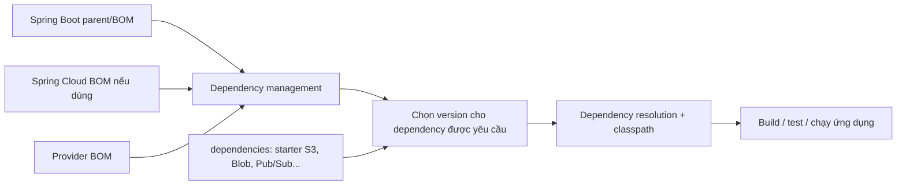
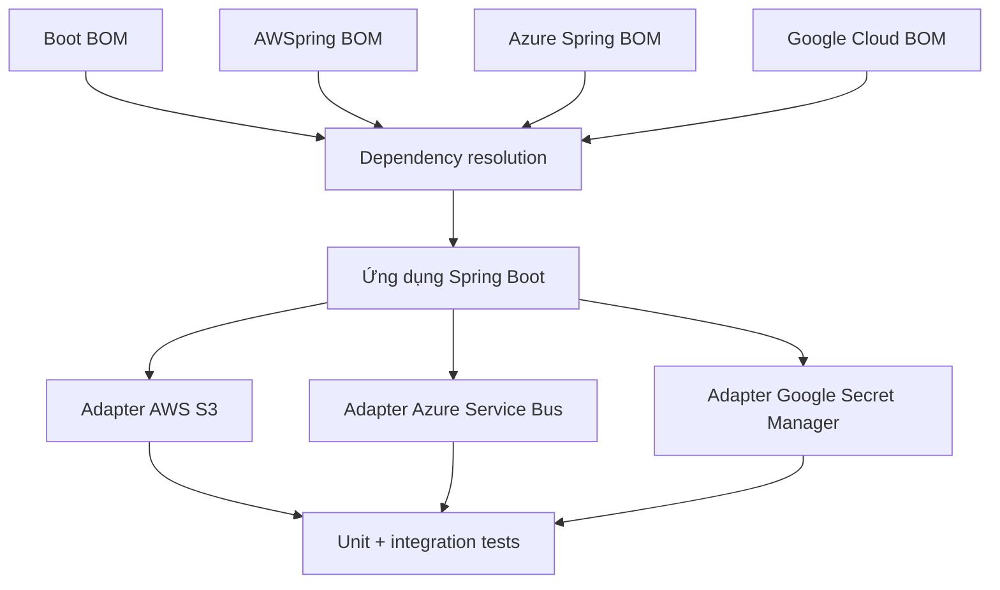

# Quản lý phiên bản bằng BOM trong Maven và Gradle

> **Chương:** Khởi tạo dự án  
> **Học phần:** Spring Cloud Provider Integration — thực hành tích hợp Spring Boot với các dịch vụ managed của AWS, Azure và Google Cloud.

Một ứng dụng Spring Boot gọi S3, Azure Service Bus hoặc Google Cloud Pub/Sub thường kéo theo hàng chục thư viện: Spring Framework, Spring Cloud, SDK của provider, Jackson, HTTP client, gRPC, Netty và thư viện telemetry. Việc gán `version` thủ công cho từng dependency khiến ứng dụng khó nâng cấp và dễ xuất hiện `NoSuchMethodError`, `NoClassDefFoundError` hoặc xung đột lúc khởi động.

**BOM (Bill of Materials)** giúp quản lý **một tập phiên bản đã được dự án phát hành phối hợp**. Tuy vậy, BOM không tự xác nhận mọi cloud provider tương thích với nhau, không tự thêm dependency, không quản lý IAM/secret và cũng không thay thế kiểm thử tích hợp. Bài này tập trung vào cách **khai báo, kết hợp và kiểm tra BOM** trong cả Maven lẫn Gradle.

## 1. Kết quả học tập

Sau bài học, bạn có thể:

1. Giải thích khác biệt giữa BOM, Spring Boot parent, dependency management, starter, dependency trực tiếp và dependency bắc cầu.
2. Khởi tạo dự án Maven/Gradle sử dụng Spring Boot BOM và BOM tương ứng với AWS, Azure hoặc Google Cloud.
3. Hiểu đúng quy tắc chọn phiên bản khi **nhiều BOM cùng quản lý một artifact**; phân biệt Maven, Gradle native `platform()` và plugin `io.spring.dependency-management`.
4. Xác minh phiên bản **thực tế được phân giải**, phát hiện override sai và ghi lại lý do khi phải nâng một dependency riêng lẻ.
5. Thiết kế quy trình nâng cấp, kiểm thử và quản trị dependency phù hợp ứng dụng có storage, messaging, data và secret.

## 2. BOM thực sự làm gì?

Thông thường, Maven BOM là một POM có `<packaging>pom</packaging>` và một vùng `<dependencyManagement>`, chứa các tọa độ `groupId:artifactId:version`. Khi import BOM, dự án sử dụng tập phiên bản do BOM quản lý mà không cần khai báo lại phiên bản ở từng dependency thuộc tập đó.

Ví dụ mang tính khái niệm:

```xml
<!-- Đây là phần minh họa bên trong một BOM, không phải file ứng dụng. -->
<dependencyManagement>
    <dependencies>
        <dependency>
            <groupId>com.example.cloud</groupId>
            <artifactId>storage-client</artifactId>
            <version>2.3.1</version>
        </dependency>
        <dependency>
            <groupId>com.example.cloud</groupId>
            <artifactId>messaging-client</artifactId>
            <version>2.3.1</version>
        </dependency>
    </dependencies>
</dependencyManagement>
```

Khi ứng dụng khai báo `storage-client` mà không có `<version>`, Maven có thể lấy `2.3.1` từ dependency management. **Tập dependency xuất hiện trong classpath vẫn phụ thuộc vào những gì ứng dụng hoặc các thư viện thực sự khai báo trong `<dependencies>`.**

| Khái niệm | Chức năng | Không nên nhầm với |
|---|---|---|
| **BOM** | Định nghĩa các phiên bản đồng bộ cho nhiều module | Một “starter” tự cài đặt mọi module |
| **`dependencyManagement` của Maven** | Cung cấp phiên bản, scope và một số metadata mặc định cho dependency; không tự thêm dependency | `dependencies` |
| **Spring Boot parent POM** | Cung cấp dependency management, plugin management và cấu hình build mặc định | Chỉ riêng BOM; parent làm nhiều việc hơn |
| **Spring Boot BOM** | `org.springframework.boot:spring-boot-dependencies`, quản lý nền Spring và nhiều dependency thứ ba | Maven parent POM |
| **Spring Cloud release-train BOM** | `org.springframework.cloud:spring-cloud-dependencies` quản lý các module Spring Cloud thuộc một train | BOM của AWSpring/Azure/GCP |
| **Provider BOM** | Quản lý starter và các thành phần provider tương ứng | Cam kết tương thích chéo giữa mọi provider |
| **Starter** | Khai báo bộ thư viện cần cho một tích hợp và thường kích hoạt auto-configuration | Bảng quản lý phiên bản |
| **Lockfile** | Ghi lại phiên bản đã được giải quyết ở một lần build | BOM, vốn chủ yếu quy định phiên bản mong muốn |

Một nguyên tắc cốt lõi:



**BOM không phải security scanner hoặc cam kết vận hành.** Dù BOM chọn đúng version thư viện, lỗi phân quyền S3, hết hạn token Azure, thiếu ADC trên Google Cloud hoặc quota Pub/Sub vẫn phải xử lý riêng. Tương thích giữa Java, Spring Boot, Spring Cloud release train và provider cũng cần kiểm tra bằng ma trận chính thức **trước khi import BOM**.

## 3. Chọn đúng BOM theo thư viện tích hợp

Các nhóm dưới đây **phát hành độc lập**. Không chọn một BOM chỉ vì tên có chữ “Spring Cloud”.

| Bộ thư viện | BOM Maven/Gradle | Ví dụ starter |
|---|---|---|
| Spring Boot | `org.springframework.boot:spring-boot-dependencies` | `org.springframework.boot:spring-boot-starter-webmvc` |
| Spring Cloud Config, Gateway, Stream... | `org.springframework.cloud:spring-cloud-dependencies` | `org.springframework.cloud:spring-cloud-starter-config` |
| **AWSpring / Spring Cloud AWS** | `io.awspring.cloud:spring-cloud-aws-dependencies` | `io.awspring.cloud:spring-cloud-aws-starter-s3`, `spring-cloud-aws-starter-sqs` |
| **Spring Cloud Azure** | `com.azure.spring:spring-cloud-azure-dependencies` | `com.azure.spring:spring-cloud-azure-starter-storage-blob`, `spring-cloud-azure-starter-servicebus` |
| **Spring Framework on Google Cloud** | `com.google.cloud:spring-cloud-gcp-dependencies` | `com.google.cloud:spring-cloud-gcp-starter-storage`, `spring-cloud-gcp-starter-pubsub` |

**Chọn theo tính năng, không theo đám mây chung chung.** Muốn upload file lên S3 thì dùng starter S3; muốn nhận sự kiện qua SQS cần starter SQS và kiểm tra semantics của queue. Azure Service Bus và Google Pub/Sub không có cách ack, retry hay dead-letter giống hệt SQS. BOM giúp chọn các phiên bản thư viện, không chuẩn hóa đặc tính dịch vụ managed.

Ví dụ nhánh dùng xuyên suốt bài:

| Thành phần | Phiên bản minh họa |
|---|---|
| Java | 21 |
| Spring Boot | `4.0.10` |
| Spring Cloud AWS | `4.1.0` |
| Spring Cloud release train (nếu dùng Config/Gateway/Stream) | `2025.1.5` |
| Spring Cloud Azure (ví dụ thay thế) | `7.4.0` |
| Spring Framework on Google Cloud (ví dụ thay thế) | `8.2.4` |

Đây là **tập số phiên bản có thật được dùng để minh họa cấu hình**, không phải chỉ dẫn luôn chọn bản mới nhất. Trước khi áp dụng cho một dự án thực, hãy tra ma trận và bản vá hiện hành của đúng nhánh, kiểm tra mức hỗ trợ của JDK/build tool, đọc release notes và cập nhật một cách có kiểm soát. Trong ví dụ chính chỉ sử dụng **AWS S3**; các BOM Azure/GCP xuất hiện ở phần so sánh.

Nguồn: [Spring Boot 4.0 Gradle plugin](https://docs.spring.io/spring-boot/4.0/gradle-plugin/managing-dependencies.html), [Spring Cloud AWS 4.1.0](https://docs.awspring.io/spring-cloud-aws/docs/4.1.0/reference/html/index.html), [Spring Cloud Azure developer guide](https://learn.microsoft.com/azure/developer/java/spring-framework/developer-guide-overview), [Google Cloud getting started 8.2.4](https://googlecloudplatform.github.io/spring-cloud-gcp/8.2.4/reference/html/getting-started.html).

## 4. Maven: Spring Boot parent và provider BOM

### 4.1. Ví dụ `pom.xml` hoàn chỉnh cho AWS S3

Tạo dự án Spring Boot bằng [Spring Initializr](https://start.spring.io/) hoặc một Maven project tương đương, sau đó sử dụng POM:

```xml
<?xml version="1.0" encoding="UTF-8"?>
<project xmlns="http://maven.apache.org/POM/4.0.0"
         xmlns:xsi="http://www.w3.org/2001/XMLSchema-instance"
         xsi:schemaLocation="http://maven.apache.org/POM/4.0.0
          https://maven.apache.org/xsd/maven-4.0.0.xsd">
    <modelVersion>4.0.0</modelVersion>

    <parent>
        <groupId>org.springframework.boot</groupId>
        <artifactId>spring-boot-starter-parent</artifactId>
        <version>4.0.10</version>
        <relativePath/>
    </parent>

    <groupId>com.example</groupId>
    <artifactId>provider-bom-demo</artifactId>
    <version>0.0.1-SNAPSHOT</version>

    <properties>
        <java.version>21</java.version>
        <spring-cloud-aws.version>4.1.0</spring-cloud-aws.version>
    </properties>

    <dependencyManagement>
        <dependencies>
            <dependency>
                <groupId>io.awspring.cloud</groupId>
                <artifactId>spring-cloud-aws-dependencies</artifactId>
                <version>${spring-cloud-aws.version}</version>
                <type>pom</type>
                <scope>import</scope>
            </dependency>
        </dependencies>
    </dependencyManagement>

    <dependencies>
        <dependency>
            <groupId>org.springframework.boot</groupId>
            <artifactId>spring-boot-starter-webmvc</artifactId>
        </dependency>
        <dependency>
            <groupId>io.awspring.cloud</groupId>
            <artifactId>spring-cloud-aws-starter-s3</artifactId>
        </dependency>
        <dependency>
            <groupId>org.springframework.boot</groupId>
            <artifactId>spring-boot-starter-test</artifactId>
            <scope>test</scope>
        </dependency>
    </dependencies>

    <build>
        <plugins>
            <plugin>
                <groupId>org.springframework.boot</groupId>
                <artifactId>spring-boot-maven-plugin</artifactId>
            </plugin>
        </plugins>
    </build>
</project>
```

Trong POM này:

1. **Boot parent** quản lý phiên bản các module Spring Boot, Spring Framework và nhiều thư viện thông dụng.
2. **AWSpring BOM** quản lý phiên bản các module Spring Cloud AWS và những thư viện trong phạm vi BOM của dự án.
3. **Starter S3** mới là dependency thực sự được đưa vào đồ thị; nó kéo theo những module AWSpring/SDK cần thiết.
4. `<type>pom</type>` và `<scope>import</scope>` là cách Maven đưa phần dependency management của BOM vào POM dự án.
5. Không viết `<version>` ở `spring-cloud-aws-starter-s3` vì BOM đã quản lý.
6. Không import `spring-cloud-dependencies` chỉ vì artifact tên là `spring-cloud-aws`. BOM Spring Cloud release train chỉ cần khi ứng dụng dùng thêm các dự án thuộc release train.

Sự khác biệt **parent** và **BOM** quan trọng khi ứng dụng có parent riêng của tổ chức. Maven chỉ có một `<parent>` trực tiếp. Nếu không thể kế thừa `spring-boot-starter-parent`, có thể import `spring-boot-dependencies` dưới `dependencyManagement`, nhưng khi đó phải chủ động quản lý plugin/build configuration mà parent thường cung cấp. Import BOM **không tự mang theo toàn bộ plugin management** của parent.

### 4.2. Khi nào thêm Spring Cloud release-train BOM?

Nếu cùng ứng dụng còn dùng Spring Cloud Config, thêm BOM và starter **đã kiểm tra nhánh tương thích**:

```xml
<properties>
    <spring-cloud.version>2025.1.5</spring-cloud.version>
    <spring-cloud-aws.version>4.1.0</spring-cloud-aws.version>
</properties>

<dependencyManagement>
    <dependencies>
        <dependency>
            <groupId>org.springframework.cloud</groupId>
            <artifactId>spring-cloud-dependencies</artifactId>
            <version>${spring-cloud.version}</version>
            <type>pom</type>
            <scope>import</scope>
        </dependency>
        <dependency>
            <groupId>io.awspring.cloud</groupId>
            <artifactId>spring-cloud-aws-dependencies</artifactId>
            <version>${spring-cloud-aws.version}</version>
            <type>pom</type>
            <scope>import</scope>
        </dependency>
    </dependencies>
</dependencyManagement>

<!-- Bên trong <dependencies> của POM chính: -->
<dependency>
    <groupId>org.springframework.cloud</groupId>
    <artifactId>spring-cloud-starter-config</artifactId>
</dependency>
```

Đây là **đoạn cần ghép/thay vào POM**, không phải file XML độc lập. Tránh tạo hai khối `dependencyManagement` cạnh nhau chỉ bằng thao tác copy/paste. Việc thêm Config còn đòi cấu hình server/import thích hợp; một ứng dụng có starter Config nhưng chưa cấu hình đúng có thể không khởi động theo kỳ vọng.

## 5. Gradle: cách 1 — dùng BOM native bằng `platform()`

Gradle hỗ trợ import Maven BOM như **platform dependency constraints**. Đây là lựa chọn có tính bản địa, thường rõ ràng và phù hợp với dự án muốn sử dụng cơ chế giải quyết dependency của Gradle. Khác Maven, khi dùng `platform()`, phiên bản trong BOM thường là **khuyến nghị/ràng buộc tham gia resolution**, không nhất thiết là bản cuối cùng nếu xuất hiện yêu cầu khác mạnh hơn hoặc phiên bản cao hơn trong đồ thị.

### 5.1. `build.gradle.kts` (Kotlin DSL) hoàn chỉnh cho S3

```kotlin
plugins {
    java
    id("org.springframework.boot") version "4.0.10"
}

group = "com.example"
version = "0.0.1-SNAPSHOT"

java {
    toolchain {
        languageVersion = JavaLanguageVersion.of(21)
    }
}

repositories {
    mavenCentral()
}

dependencies {
    // Gradle native không tự import Boot BOM chỉ vì áp dụng Boot plugin.
    implementation(platform(
        org.springframework.boot.gradle.plugin.SpringBootPlugin.BOM_COORDINATES
    ))
    implementation(platform(
        "io.awspring.cloud:spring-cloud-aws-dependencies:4.1.0"
    ))

    implementation("org.springframework.boot:spring-boot-starter-webmvc")
    implementation("io.awspring.cloud:spring-cloud-aws-starter-s3")

    testImplementation("org.springframework.boot:spring-boot-starter-test")
    testRuntimeOnly("org.junit.platform:junit-platform-launcher")
}

tasks.withType<Test> {
    useJUnitPlatform()
}
```

Ý nghĩa:

- `org.springframework.boot` cung cấp task build/package/bootRun; **không tự import Boot BOM ở cách native**. Ta đưa Boot BOM vào bằng `SpringBootPlugin.BOM_COORDINATES` để tránh lặp lại số phiên bản Boot.
- `implementation(platform(...))` đưa constraints vào các classpath kế thừa từ `implementation`; cũng cần lưu ý các cấu hình không kế thừa nó khi có plugin hoặc source set đặc biệt.
- AWSpring BOM là platform thứ hai; `spring-cloud-aws-starter-s3` không ghi version.
- Java toolchain quy định JDK dùng cho compile/test trong cấu hình dự án, nhưng CI/IDE/container vẫn cần được thiết lập và kiểm chứng phù hợp.

Để dùng chính xác ví dụ Kotlin DSL này, chọn bản Gradle wrapper nằm trong dải phiên bản được Spring Boot Gradle plugin hỗ trợ. Tài liệu Boot 4.0 nêu Gradle **8.14+ thuộc nhánh 8.x hoặc nhánh 9.x**; kiểm tra lại yêu cầu khi thay Boot. [Spring Boot Gradle Plugin](https://docs.spring.io/spring-boot/4.0/gradle-plugin/index.html).

### 5.2. Tương đương trong `build.gradle` (Groovy DSL)

```groovy
plugins {
    id 'java'
    id 'org.springframework.boot' version '4.0.10'
}

group = 'com.example'
version = '0.0.1-SNAPSHOT'

java {
    toolchain {
        languageVersion = JavaLanguageVersion.of(21)
    }
}

repositories {
    mavenCentral()
}

dependencies {
    implementation platform(
        org.springframework.boot.gradle.plugin.SpringBootPlugin.BOM_COORDINATES
    )
    implementation platform('io.awspring.cloud:spring-cloud-aws-dependencies:4.1.0')

    implementation 'org.springframework.boot:spring-boot-starter-webmvc'
    implementation 'io.awspring.cloud:spring-cloud-aws-starter-s3'

    testImplementation 'org.springframework.boot:spring-boot-starter-test'
    testRuntimeOnly 'org.junit.platform:junit-platform-launcher'
}

tasks.named('test') {
    useJUnitPlatform()
}
```

Hai DSL làm cùng một việc; **đừng trộn cú pháp Kotlin và Groovy**. Một repository chỉ chọn một kiểu cho mỗi build script. Hãy lưu wrapper và kiểm tra `./gradlew --version` để CI sử dụng cùng bộ công cụ.

### 5.3. `platform()` khác `enforcedPlatform()`

Ví dụ:

```kotlin
dependencies {
    // Lựa chọn thông thường: tham gia vào dependency conflict resolution.
    implementation(platform("io.awspring.cloud:spring-cloud-aws-dependencies:4.1.0"))

    // Chỉ dùng có chủ đích; ví dụ minh họa, không áp dụng đồng thời với dòng trên.
    // implementation(enforcedPlatform("io.awspring.cloud:spring-cloud-aws-dependencies:4.1.0"))
}
```

| Thuộc tính | `platform()` | `enforcedPlatform()` |
|---|---|---|
| Cách quản lý | Các phiên bản BOM là constraints tham gia lựa chọn | Ép các phiên bản BOM bằng strict constraints |
| Nếu dependency khác yêu cầu version cao hơn | Gradle có thể chọn version cao hơn khi các constraint cho phép | Có thể buộc về version BOM hoặc gây xung đột strict |
| Khi nên cân nhắc | Mặc định cho đa số ứng dụng | Khi đã xác định cần khóa cả nhóm và hiểu tác động |
| Nếu là thư viện được publish | Thường phù hợp hơn | Cần thận trọng vì constraint nghiêm ngặt có thể lan sang consumer |

Không dùng `enforcedPlatform()` như cách “chữa nhanh” tất cả cảnh báo xung đột. Nếu một thư viện cần version cao hơn vì bản vá bảo mật, việc ép xuống version cũ có thể gây lỗi hoặc tái mở lỗ hổng. Điều tra dependency graph rồi cập nhật **BOM phù hợp** hoặc constraint có chủ đích.

Nguồn: [Gradle — Platforms](https://docs.gradle.org/current/userguide/platforms.html), [Spring Boot — Managing Dependencies](https://docs.spring.io/spring-boot/4.0/gradle-plugin/managing-dependencies.html).

## 6. Gradle: cách 2 — plugin `io.spring.dependency-management`

Plugin này mô phỏng mô hình dependency management kiểu Maven, hỗ trợ import BOM qua `mavenBom(...)` và thay phiên bản bằng thuộc tính của BOM trong nhiều trường hợp. Khi áp dụng **cùng** Spring Boot Gradle plugin, Boot BOM được tự động import bởi cơ chế tích hợp giữa hai plugin.

Ví dụ Kotlin DSL thay thế cách `platform()`:

```kotlin
plugins {
    java
    id("org.springframework.boot") version "4.0.10"
    id("io.spring.dependency-management") version "1.1.7"
}

group = "com.example"
version = "0.0.1-SNAPSHOT"

java {
    toolchain {
        languageVersion = JavaLanguageVersion.of(21)
    }
}

repositories {
    mavenCentral()
}

dependencyManagement {
    imports {
        mavenBom("io.awspring.cloud:spring-cloud-aws-dependencies:4.1.0")
    }
}

dependencies {
    // Boot BOM đã được tự import khi cả hai plugin được áp dụng.
    implementation("org.springframework.boot:spring-boot-starter-webmvc")
    implementation("io.awspring.cloud:spring-cloud-aws-starter-s3")
    testImplementation("org.springframework.boot:spring-boot-starter-test")
    testRuntimeOnly("org.junit.platform:junit-platform-launcher")
}

tasks.withType<Test> {
    useJUnitPlatform()
}
```

Trong cùng một module, nên chọn **một chiến lược quản lý BOM chính**: Gradle native hoặc dependency-management plugin. Trộn hai cách mà không biết cách từng bên can thiệp dependency resolution sẽ khiến nguyên nhân chọn version khó giải thích.

| Khía cạnh | Gradle native BOM | `io.spring.dependency-management` |
|---|---|---|
| Khai báo | `implementation(platform("g:a:v"))` | `dependencyManagement { imports { mavenBom("g:a:v") } }` |
| Import Boot BOM | **Khai báo tường minh** | **Tự động** nếu áp dụng với Spring Boot plugin |
| Tùy chỉnh version thông qua Maven BOM property | Không trực tiếp theo thuộc tính BOM | Có hỗ trợ theo cơ chế của plugin |
| Cơ chế chọn version | Gradle dependency constraints/conflict resolution | Dependency management rule theo plugin |
| Đánh giá cuối | Xem `dependencies` / `dependencyInsight` | Vẫn phải xem `dependencies` / `dependencyInsight` |

Tài liệu: [Spring Dependency Management Plugin](https://docs.spring.io/dependency-management-plugin/docs/current/reference/html/), [Spring Boot Gradle plugin — Managing Dependencies](https://docs.spring.io/spring-boot/4.0/gradle-plugin/managing-dependencies.html).

## 7. Import BOM Azure và Google Cloud

Nếu chọn **Azure Blob Storage** thay S3, dùng BOM Azure và starter đúng group:

**Maven — đoạn đặt trong các vùng tương ứng của POM**:

```xml
<!-- Trong <dependencyManagement><dependencies>: -->
<dependency>
    <groupId>com.azure.spring</groupId>
    <artifactId>spring-cloud-azure-dependencies</artifactId>
    <version>7.4.0</version>
    <type>pom</type>
    <scope>import</scope>
</dependency>

<!-- Trong <dependencies>: -->
<dependency>
    <groupId>com.azure.spring</groupId>
    <artifactId>spring-cloud-azure-starter-storage-blob</artifactId>
</dependency>
```

**Gradle Kotlin DSL native**:

```kotlin
dependencies {
    implementation(platform(
        org.springframework.boot.gradle.plugin.SpringBootPlugin.BOM_COORDINATES
    ))
    implementation(platform("com.azure.spring:spring-cloud-azure-dependencies:7.4.0"))
    implementation("com.azure.spring:spring-cloud-azure-starter-storage-blob")
}
```

Nếu chọn **Google Cloud Pub/Sub**, sử dụng BOM và starter của Spring Framework on Google Cloud:

**Maven — đoạn đặt vào vùng phù hợp**:

```xml
<!-- Trong <dependencyManagement><dependencies>: -->
<dependency>
    <groupId>com.google.cloud</groupId>
    <artifactId>spring-cloud-gcp-dependencies</artifactId>
    <version>8.2.4</version>
    <type>pom</type>
    <scope>import</scope>
</dependency>

<!-- Trong <dependencies>: -->
<dependency>
    <groupId>com.google.cloud</groupId>
    <artifactId>spring-cloud-gcp-starter-pubsub</artifactId>
</dependency>
```

**Gradle Kotlin DSL native**:

```kotlin
dependencies {
    implementation(platform(
        org.springframework.boot.gradle.plugin.SpringBootPlugin.BOM_COORDINATES
    ))
    implementation(platform("com.google.cloud:spring-cloud-gcp-dependencies:8.2.4"))
    implementation("com.google.cloud:spring-cloud-gcp-starter-pubsub")
}
```

Các đoạn này là **phương án thay thế** và chỉ trình bày phần dependency cần điều chỉnh; chúng không phải file build độc lập. Với Gradle dependency-management plugin, thay dòng `implementation(platform(...))` của provider bằng `mavenBom("com.azure.spring:spring-cloud-azure-dependencies:7.4.0")` hoặc `mavenBom("com.google.cloud:spring-cloud-gcp-dependencies:8.2.4")` trong `imports`.

Với Azure, tiếp tục cấu hình Microsoft Entra ID/managed identity, account/endpoint và RBAC; với Pub/Sub cần Google Cloud project ID, Application Default Credentials và IAM publish/subscribe. **BOM không cung cấp quyền truy cập hoặc tạo tài nguyên cloud**.

## 8. Khi nhiều BOM cùng quản lý một module

Trong tích hợp nhiều cloud, hai BOM có thể đề xuất hai phiên bản khác nhau của Jackson, Netty, gRPC hoặc một thư viện HTTP chung. Kết quả phụ thuộc vào **build tool và cách import**, không thể chỉ nhìn thứ tự dòng version ở file build rồi suy đoán.

### 8.1. Maven: ưu tiên dependency management của POM hiện tại, rồi đến thứ tự import

Trong Maven, phiên bản khai báo trực tiếp trong `<dependencyManagement>` của POM hiện tại có thể ghi đè phần kế thừa/import liên quan. Nếu **hai BOM được import ở cùng mức** quản lý cùng một tọa độ `groupId:artifactId`, quy tắc Maven là **BOM được import trước thắng** cho tọa độ trùng, trừ khi POM hiện tại tự khai báo management cho tọa độ đó.

Ví dụ giả định, chỉ để đọc quy tắc:

| BOM | Phiên bản quản lý cho `com.example:common-client` |
|---|---|
| BOM A import đầu tiên | `1.5.0` |
| BOM B import sau | `1.6.0` |
| POM hiện tại không tự quản lý module này | Maven dùng version từ **BOM A** |

Đừng nhầm với quy tắc **nearest dependency** khi Maven giải quyết dependency bắc cầu: `dependencyManagement` và dependency mediation là hai cơ chế có quan hệ nhưng không giống nhau. Khi thật sự có nhiều BOM, dùng `help:effective-pom` và `dependency:tree` để xem kết quả.

Nguồn: [Maven — Introduction to the Dependency Mechanism](https://maven.apache.org/guides/introduction/introduction-to-dependency-mechanism.html).

### 8.2. Gradle native: phối hợp các constraints

Khi sử dụng nhiều `platform()`, Gradle xem constraints trong toàn bộ đồ thị. Theo luật resolution mặc định, Gradle có thể chọn phiên bản cao hơn trong các yêu cầu tương thích; vì thế **không áp dụng quy tắc “BOM đầu thắng” của Maven** cho Gradle native.

Ví dụ giả định: platform A khuyến nghị `1.5.0`, platform B khuyến nghị `1.6.0` cho cùng một module; kết quả có thể là `1.6.0` hoặc kết quả khác nếu có constraint nghiêm ngặt, version range hay resolution rule. Chỉ `dependencyInsight` mới cho thấy lý do thực tế.

### 8.3. Dependency-management plugin: BOM import cuối có thể thắng

Với `io.spring.dependency-management`, khi import nhiều BOM và chúng quản lý trùng dependency, **BOM được import sau** có thể ghi đè version của BOM trước. Đây là quy tắc **khác Maven**. Không vận dụng mẹo thay đổi thứ tự import để che xung đột mà không kiểm tra tính tương thích thực tế.

| Cơ chế | Khi hai BOM cùng quản lý một dependency | Lệnh/đầu ra cần đọc |
|---|---|---|
| Maven BOM import | Thường ưu tiên **BOM đầu tiên** trong các import cùng mức; management trực tiếp ở POM hiện tại có quyền ưu tiên | `mvn help:effective-pom`, `mvn dependency:tree` |
| Gradle `platform()` | Constraints được hòa giải theo thuật toán Gradle, thường chọn phiên bản phù hợp cao hơn | `gradlew dependencyInsight` |
| Gradle `enforcedPlatform()` | Ràng buộc strict có thể ép version hoặc gây lỗi nếu xung đột | `gradlew dependencyInsight`, thông báo conflict |
| Gradle dependency-management plugin | Với BOM trùng, **import cuối** được dùng trong mô hình của plugin | `gradlew dependencies` / `dependencyInsight` |

Tài liệu: [Gradle — Dependency Constraints and Conflict Resolution](https://docs.gradle.org/current/userguide/dependency_constraints_conflicts.html), [Spring Dependency Management Plugin — Importing Multiple Boms](https://docs.spring.io/dependency-management-plugin/docs/current/reference/html/).

## 9. Kiểm chứng phiên bản đã resolve

Không đánh giá cấu hình BOM chỉ bằng việc nhìn `pom.xml` hoặc `build.gradle.kts`. Phải quan sát **đồ thị dependency thực tế** ở compile/runtime/test.

### Với Maven

Tại thư mục dự án, sử dụng Maven wrapper:

```bash
./mvnw -version
./mvnw help:effective-pom
./mvnw dependency:tree
./mvnw clean verify
```

Trên PowerShell Windows, lệnh wrapper tương ứng là `.\mvnw.cmd`. Khi cần tập trung vào AWS SDK:

```bash
./mvnw dependency:tree -Dincludes=software.amazon.awssdk
```

`dependency:tree` cho biết những dependency nào kéo SDK vào và version cuối cùng được chọn. `help:effective-pom` cho biết dependency management thực tế sau khi kế thừa parent và import BOM. Nếu cần lưu kết quả cho review, dùng tham số `-DoutputFile=...` của plugin tương ứng trong một dự án mẫu.

### Với Gradle

```bash
./gradlew --version
./gradlew dependencies --configuration runtimeClasspath
./gradlew dependencyInsight --dependency software.amazon.awssdk:s3 --configuration runtimeClasspath
./gradlew test
./gradlew build
```

Trên Windows PowerShell, dùng `.\gradlew.bat`. Với Gradle, `dependencyInsight` là công cụ trọng tâm để thấy module đến từ đâu, version nào đã được chọn và lý do như `By constraint`, `By conflict resolution`, `Forced`. Kiểm tra thêm `compileClasspath` và `testRuntimeClasspath` nếu môi trường test có dependency khác runtime.

Khi kiểm tra, hỏi:

1. Dependency có được mang vào classpath hay mới chỉ nằm trong BOM?
2. Version thực tế của các module Boot/Cloud/provider SDK có đúng với release notes và ma trận tương thích không?
3. Vì sao version đó được chọn: import BOM, parent, direct version, constraint hay transitive dependency?
4. Có những SDK cũ không mong muốn, phiên bản `javax.*` không tương thích hoặc module thế hệ khác cùng tồn tại không?
5. Có dependency nào phải override do CVE? Việc override có phá tính đồng bộ của SDK stack không?

### Ví dụ phân tích một xung đột

Giả sử sau khi thêm Azure Service Bus vào ứng dụng đã có AWS S3, một HTTP client bị nâng khỏi version do AWSpring BOM đề xuất:

1. Đọc dependency tree/insight để xác định **đường dẫn kéo module** và lý do Gradle/Maven chọn version.
2. Tra compatibility/release notes của AWSpring, Azure Spring và SDK liên quan.
3. Ưu tiên cập nhật BOM của provider đến bộ đã được công bố tương thích; chỉ cân nhắc override khi có yêu cầu bảo mật hoặc bug cụ thể.
4. Chạy unit test adapter, startup/context test và integration test cả đường S3 lẫn Service Bus.
5. Ghi lại phiên bản cuối cùng, nguyên nhân và cách hoàn tác nếu xuất hiện regression.

Không coi việc xóa `dependency` hoặc `exclude` một module là cách giải quyết mặc định. Exclusion có thể làm một starter thiếu class cần thiết và chỉ chuyển lỗi từ thời điểm build sang runtime.

## 10. BOM, lockfile và version catalog phục vụ ba mục tiêu khác nhau

| Cơ chế | Trả lời câu hỏi gì? | Điều cần nhớ |
|---|---|---|
| **BOM** | “Nhóm thư viện này nên đi cùng những phiên bản nào?” | Không đảm bảo graph cuối giữ đúng mọi version khi có xung đột hoặc override. |
| **Gradle version catalog** | “Tọa độ và phiên bản khai báo tập trung ở đâu?” | Catalog giúp tái sử dụng alias; **không áp đặt** version cuối cùng lên dependency graph. |
| **Gradle dependency locking** | “Lần build sau có dùng đúng phiên bản đã resolve không?” | Lock state được lưu và đối chiếu; cần cập nhật lockfile khi chủ động nâng phiên bản. |
| **Maven effective POM/tree** | “Parent/BOM đã quản lý gì và Maven chọn gì?” | Đó là thông tin kiểm chứng build; bản thân không phải lockfile của toàn đồ thị. |

Ví dụ bật dependency locking cho Gradle Kotlin DSL:

```kotlin
dependencyLocking {
    lockAllConfigurations()
}
```

Sau khi cấu hình và kiểm tra graph:

```bash
./gradlew dependencies --write-locks
./gradlew build
```

Kiểm tra `gradle.lockfile` được tạo và đưa vào version control khi phù hợp quy trình của đội. Khi thay đổi BOM, cập nhật lock state trong một PR có kiểm thử; **không tự ý sửa tay những dòng version riêng lẻ**. Locking làm build dễ tái hiện, nhưng không đánh giá tính an toàn/bảo trì của version.

Với dự án nhiều module, BOM phải được khai báo trong các cấu hình/module cần nó. Đặt một `platform()` ở module gốc **không tự động** áp constraints lên mọi subproject Gradle. Có thể tổ chức platform nội bộ qua `java-platform` hoặc convention plugin, nhưng cần kiểm tra version cuối cùng ở từng module tiêu thụ. Maven multi-module có thể kế thừa `dependencyManagement` từ parent POM của tổ chức nếu cấu trúc inheritance đã được thiết kế.

Nguồn: [Gradle — Locking Versions](https://docs.gradle.org/current/userguide/dependency_locking.html), [Gradle — Platforms and Version Catalogs](https://docs.gradle.org/current/userguide/platforms.html).

## 11. Cách tổ chức và nâng cấp BOM trong ứng dụng đa cloud

Ví dụ kiến trúc một ứng dụng Spring Boot có ba adapter: lưu file lên S3, phát sự kiện qua Azure Service Bus và đọc cấu hình từ Google Cloud Secret Manager:



Không nhất thiết nhập toàn bộ BOM vào một tiến trình. Một số hệ thống có thể tách adapter thành service/module độc lập để giảm rủi ro dependency chung; nhưng ranh giới phải theo thiết kế nghiệp vụ, tính nhất quán dữ liệu và yêu cầu vận hành, không chỉ để tránh dependency conflict.

### Quy trình nâng cấp có kiểm soát

1. **Lập bảng nền:** JDK distribution, Boot, Spring Cloud release train (nếu có), từng provider BOM, Gradle/Maven wrapper và các SDK quan trọng đã resolve.
2. **Tra ma trận:** kiểm tra tương thích với Boot, thời hạn bảo trì và danh sách starter/tính năng ở nhánh định nâng.
3. **Nâng một nhóm có mục đích:** ưu tiên thay version BOM, giới hạn override lẻ; cập nhật version catalog/lockfile khi áp dụng.
4. **Đọc chênh lệch graph:** so sánh output dependency tree/insight cũ và mới; đánh dấu các module logging, HTTP client, Jackson, Netty, gRPC, Google libraries, AWS SDK v2, Azure SDK.
5. **Kiểm tra kỹ thuật:** compile, unit test, Spring context/startup, contract test, integration test với emulator nếu phù hợp.
6. **Kiểm tra cloud:** smoke test ở tài khoản/môi trường riêng có IAM/RBAC tối thiểu; xác minh region, secret injection, timeout, retry, idempotency và quota.
7. **Đánh giá triển khai:** changelog, lỗ hổng, đo lường regression, phương án rollback và nguồn chứng minh hỗ trợ.

### Vì sao vẫn phải test danh tính, secret và dịch vụ?

BOM chỉ quản lý code dependency. Spring Cloud AWS có thể dùng AWS SDK credential chain và IAM role; Spring Cloud Azure có thể dùng Microsoft Entra ID/managed identity; Spring Framework on Google Cloud có thể dùng ADC/workload identity. **Dependency resolve PASS** không chứng minh ứng dụng đã được cấp `s3:PutObject`, Azure Service Bus Data Sender hoặc quyền đọc secret trên Google Cloud. Cần tách kiểm thử thư viện (unit/context) khỏi kiểm thử môi trường managed (integration/smoke).

## 12. Lỗi thường gặp khi dùng BOM

| Triệu chứng | Nguyên nhân hay gặp | Cách xử lý |
|---|---|---|
| `dependencies` không có starter, ứng dụng không có bean client | Chỉ import BOM mà chưa khai báo starter | Thêm dependency starter trong `dependencies` hoặc `implementation`. |
| Maven báo thiếu `version` cho starter | BOM chưa import đúng vị trí, tọa độ/version không tồn tại, hoặc BOM không quản lý starter đó | Kiểm tra `dependencyManagement`, `type=pom`, `scope=import` và effective POM. |
| `Could not find ...` | Sai `groupId:artifactId:version`, repository không có, mạng/proxy lỗi | Tra tọa độ chính thức, kiểm tra Maven Central/mirror và repository config. |
| Gradle báo không thể resolve version khi bỏ `version` | Dùng Gradle native nhưng quên `platform(SpringBootPlugin.BOM_COORDINATES)` hoặc BOM provider | Kiểm tra `implementation(platform(...))` và configuration áp dụng. |
| Lỗi `NoSuchMethodError` hoặc `NoClassDefFoundError` | Nhiều BOM/override kéo lệch API runtime | Xem dependency graph, loại bỏ override không cần, chọn BOM tương thích. |
| “Đổi thứ tự BOM” nhưng Gradle vẫn chọn version cao hơn | Nhầm quy tắc Maven với Gradle native constraints | Dùng `dependencyInsight`; đọc conflict resolution và strict rules. |
| BOM provider nâng mới nhưng một tích hợp biến mất | Major mới bỏ module/starter hoặc đổi API | Đọc migration guide và bảng supported integrations của nhánh. |
| Build qua nhưng smoke test thất bại `401/403` | Danh tính và quyền cloud chưa đúng | Kiểm tra credential chain/ADC, IAM/RBAC, resource policy và scope. |
| Dùng `enforcedPlatform()` rồi thư viện khác fail | Ép toàn bộ BOM gây strict conflict | Đánh giá lại lý do ép, ưu tiên regular platform/BOM phù hợp. |
| Nâng BOM không đổi phiên bản runtime | Lockfile cũ hoặc rule override/constraint đang giữ phiên bản | Xem `dependencyInsight`, cập nhật lockfile có chủ đích. |

Không xóa cache hoặc đổi mọi version lên “latest” như bước đầu tiên khi gặp lỗi. Tìm **version đã resolve và lý do chọn version đó** thường cho câu trả lời chính xác hơn.

## 13. Bài tập thực hành

**Tình huống:** Một nhóm đang xây dịch vụ tiếp nhận hồ sơ, lưu file lên object storage và gửi sự kiện đến hệ thống xử lý. Nhóm muốn chọn Maven hoặc Gradle và dự kiến triển khai ở một trong ba provider.

### Phần A — Tạo dự án và quản lý dependency

1. Chọn **một** phương án: AWS S3 + SQS, Azure Blob Storage + Service Bus, hoặc Google Cloud Storage + Pub/Sub.
2. Chọn JDK/Spring Boot/BOM provider **có ma trận tương thích và nguồn dẫn**; chỉ dùng Spring Cloud release train BOM nếu có module thuộc train.
3. Tạo cấu hình Maven hoặc Gradle. Các starter provider không ghi version lẻ khi BOM đã quản lý.
4. Build project và dùng dependency tree/insight ghi lại version SDK/HTTP client quan trọng.
5. Nếu sử dụng Gradle, giải thích vì sao đã chọn `platform()` hoặc dependency-management plugin.

### Phần B — Quan sát sự khác nhau của các cơ chế

1. Trên một project mẫu, thêm **có kiểm soát** một dependency/constraint khiến version của một thư viện chung bị đề nghị khác với BOM.
2. Quan sát Maven effective POM/tree hoặc Gradle dependencyInsight, ghi lại version cuối cùng và lý do.
3. Thử nghiệm về thứ tự import với **hai BOM mẫu không dùng để production**. So sánh Maven “import đầu” với plugin dependency-management “import cuối”; giải thích vì sao Gradle native có kết quả khác.
4. Hoàn nguyên thí nghiệm, giữ lại cấu hình production phù hợp rồi chạy test.

### Phần C — Bảo đảm tính sẵn sàng của tích hợp

Viết unit test adapter để xác minh tên bucket/container/topic, định dạng object key/message và cách xử lý lỗi. Tiếp theo chạy integration test với emulator phù hợp (nếu hỗ trợ) hoặc môi trường cloud thử nghiệm. Ghi các quyền IAM/RBAC cần thiết và cách lấy credential **ngoài mã nguồn**.

**Tiêu chí hoàn thành:** Có BOM đúng và có nguồn, dependency graph giải thích được, project build/test đạt, không có credential trong repository, có bằng chứng cho khả năng tích hợp tối thiểu và biết giới hạn của BOM.

## 14. Checklist trước khi phê duyệt cấu hình

- [ ] Đã đọc ma trận Java ↔ Boot ↔ Cloud train ↔ provider và trạng thái hỗ trợ của từng nhánh.
- [ ] Sử dụng đúng BOM Spring Boot, Spring Cloud và provider **theo nhu cầu thực tế**.
- [ ] Starter được khai báo trong dependencies; không chỉ import BOM rồi kỳ vọng tự có client.
- [ ] Maven: đã hiểu parent vs BOM; `dependencyManagement` và `scope=import` đúng vị trí.
- [ ] Gradle: đã chọn native `platform()` hoặc dependency-management plugin và hiểu quy tắc resolve.
- [ ] Đã kiểm tra trường hợp BOM trùng version và mọi override có lý do, có test bảo vệ.
- [ ] Đã dùng wrapper và kiểm tra effective POM/dependency tree/insight trên đúng cấu hình.
- [ ] Nếu có lockfile, thay đổi đã được cập nhật cùng BOM và được kiểm tra trước khi merge.
- [ ] Đã chạy build, unit/context test và integration/smoke test cần thiết cho cloud provider.
- [ ] Đã kiểm tra IAM/secret, lỗ hổng đã biết, thời hạn bảo trì và tài liệu migration.

## Tài liệu tham khảo

1. [Maven — Introduction to the Dependency Mechanism](https://maven.apache.org/guides/introduction/introduction-to-dependency-mechanism.html): `dependencyManagement`, import BOM, thứ tự ưu tiên.
2. [Spring Boot 4.0 — Gradle Managing Dependencies](https://docs.spring.io/spring-boot/4.0/gradle-plugin/managing-dependencies.html): native BOM và dependency-management plugin.
3. [Gradle — Platforms](https://docs.gradle.org/current/userguide/platforms.html): `platform`, `enforcedPlatform`, constraints.
4. [Gradle — Dependency Constraints and Conflict Resolution](https://docs.gradle.org/current/userguide/dependency_constraints_conflicts.html): cách Gradle chọn version.
5. [Spring Dependency Management Plugin Reference](https://docs.spring.io/dependency-management-plugin/docs/current/reference/html/): import BOM và quy tắc BOM cuối.
6. [Gradle — Viewing and Debugging Dependencies](https://docs.gradle.org/current/userguide/viewing_debugging_dependencies.html): `dependencies` và `dependencyInsight`.
7. [Gradle — Locking Versions](https://docs.gradle.org/current/userguide/dependency_locking.html): dependency lockfile.
8. [AWSpring 4.1.0 — Bill of Materials](https://docs.awspring.io/spring-cloud-aws/docs/4.1.0/reference/html/index.html): Maven/Gradle BOM và AWS starters.
9. [Spring Cloud Azure — Developer Guide](https://learn.microsoft.com/azure/developer/java/spring-framework/developer-guide-overview): BOM và Azure starters.
10. [Spring Framework on Google Cloud 8.2.4 — Getting Started](https://googlecloudplatform.github.io/spring-cloud-gcp/8.2.4/reference/html/getting-started.html): BOM, starter và Gradle platform.

> **Ghi nhớ:** BOM quản lý **tập phiên bản mong muốn**, build tool quyết định **phiên bản cuối cùng**, còn kiểm thử và ma trận bảo trì xác nhận **ứng dụng có thể triển khai an toàn**. Mỗi khi thêm một cloud provider, hãy kiểm tra cả ba lớp thay vì chỉ thêm một dòng starter.
